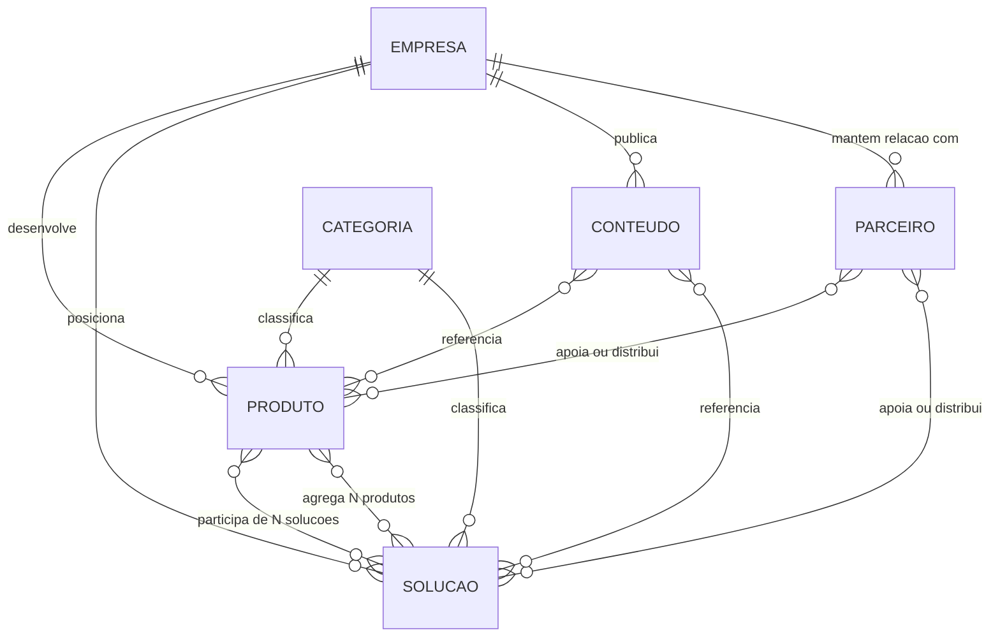
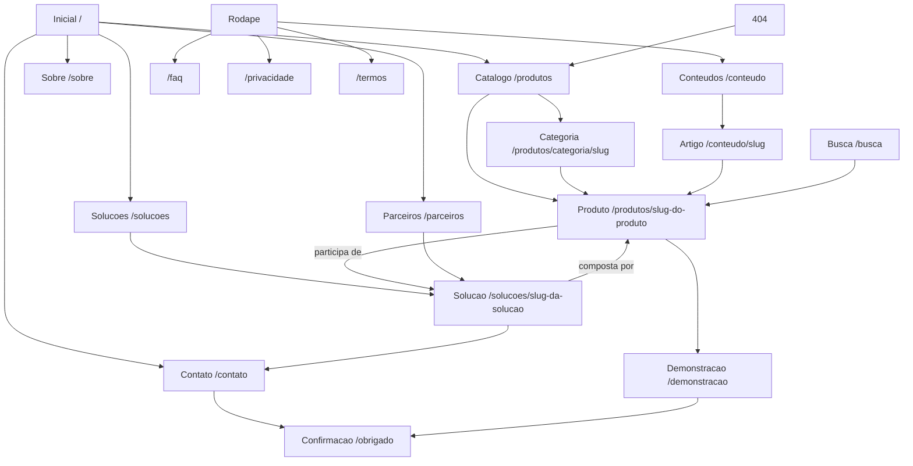
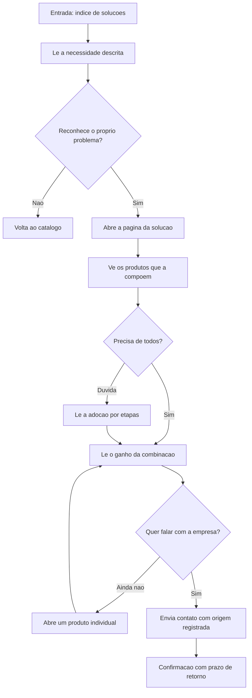
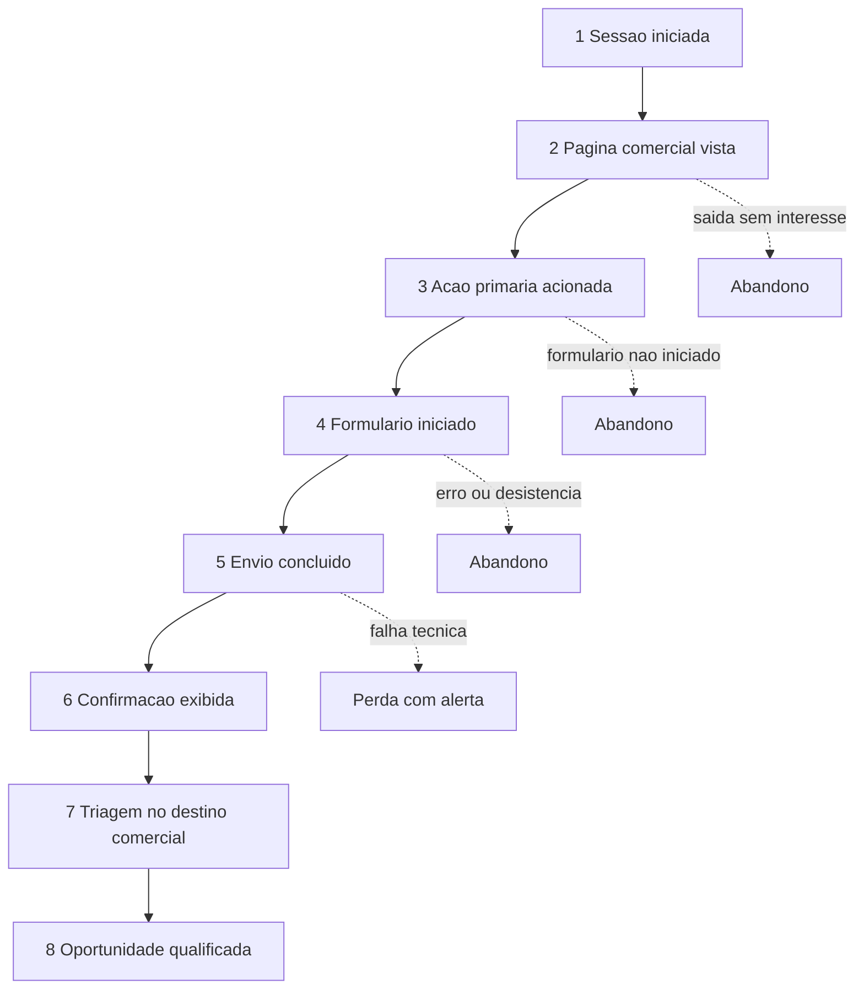
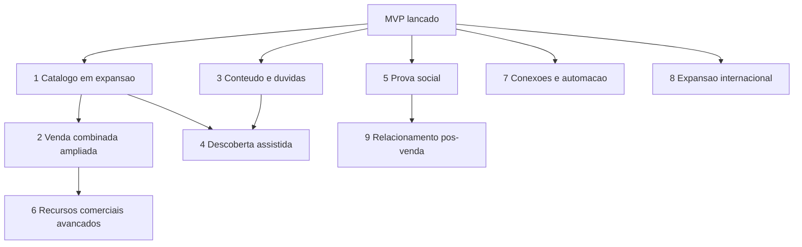

# PRD — Site institucional e de exposição comercial de [EMPRESA]

| Campo | Valor |
|---|---|
| Versão | 1.0 |
| Data | 2026-09-07 |
| Status | Rascunho para revisão |
| Autor | Time de Produto |
| Escopo | Site institucional público |

> Este documento **não define tecnologia**: não escolhe framework, plataforma de conteúdo, provedor ou biblioteca; descreve apenas comportamento, conteúdo, estrutura e regras de produto.
> Todo dado de negócio marcado como **Premissa (PR-0xx)** ou **Pergunta (Q-0xx)** é pendência real, assumida provisoriamente, e exige validação do cliente antes do desenvolvimento.

## Sumário

1. [1. Resumo executivo](#1-resumo-executivo)
2. [2. Visão do produto](#2-visão-do-produto)
3. [3. Objetivos do negócio](#3-objetivos-do-negócio)
4. [4. Público-alvo](#4-público-alvo)
5. [5. Proposta de valor](#5-proposta-de-valor)
6. [6. Arquitetura de informação](#6-arquitetura-de-informação)
7. [7. Páginas e requisitos](#7-páginas-e-requisitos)
   Páginas P-01 a P-18, com objetivo, conteúdo e seções de cada uma.
8. [8. Jornadas do usuário](#8-jornadas-do-usuário)
9. [9. Requisitos funcionais](#9-requisitos-funcionais)
   RF-001 a RF-206, por área: navegação, inicial, catálogo, produto, soluções, parceiros, formulários, conteúdo institucional, SEO, administração, analytics.
10. [10. Requisitos não funcionais](#10-requisitos-não-funcionais)
    RNF-001 a RNF-107: responsividade, performance, acessibilidade, SEO técnico, segurança, privacidade, compatibilidade, manutenibilidade, escalabilidade, disponibilidade, qualidade.
11. [11. Conteúdo e identidade da marca](#11-conteúdo-e-identidade-da-marca)
12. [12. SEO e descoberta](#12-seo-e-descoberta)
13. [13. Acessibilidade e usabilidade](#13-acessibilidade-e-usabilidade)
14. [14. Conversão e contato comercial](#14-conversão-e-contato-comercial)
15. [15. Métricas e analytics](#15-métricas-e-analytics)
16. [16. Escopo do MVP](#16-escopo-do-mvp)
    O que entra no MVP, Fase 2 e Futuro, o que fica fora, conteúdo mínimo e decisões antes do desenvolvimento.
17. [17. Roadmap de evolução](#17-roadmap-de-evolução)
18. [18. Riscos, premissas e pendências](#18-riscos-premissas-e-pendências)
    Riscos, premissas consolidadas (PR-001 a PR-060), informações faltantes, decisões necessárias e dependências.
19. [19. Critérios gerais de aceite](#19-critérios-gerais-de-aceite)
20. [20. Perguntas finais para validação](#20-perguntas-finais-para-validação)
    As dez mais críticas, bloqueantes, importantes e as que podem esperar.
21. [21. Síntese final e próximos passos](#21-síntese-final-e-próximos-passos)

## 1. Resumo executivo

[EMPRESA] é uma empresa de software em constituição que desenvolverá um **ecossistema de produtos digitais**: vários softwares menores, cada um com finalidade própria, vendidos individualmente, contratados em conjunto ou apresentados como soluções complementares, com expansão contínua do portfólio. **Pergunta Q-001:** qual o nome comercial confirmado — "ArtZan", nome do diretório do projeto, é o nome oficial?

O site é o **ponto central de exposição da empresa**: identidade institucional, catálogo de softwares, soluções compostas, empresas parceiras e informações relevantes para clientes, potenciais clientes e interessados.

**Problema que resolve.** [EMPRESA] não tem canal próprio para explicar o que faz. O problema não é apenas ausência de presença digital: é a dificuldade de comunicar um portfólio que cresce, é vendido isolado ou combinado, e só faz sentido pleno quando o visitante entende a relação entre as peças. Sem canal próprio, cada produto novo exige explicação manual em reunião, cada combinação é narrada caso a caso, e a empresa é percebida como softwares avulsos em vez de ecossistema. Um site artesanal, com página escrita à mão por produto, reproduziria o problema em escala: retrabalho de estrutura e conteúdo a cada lançamento.

**Finalidade comercial.** O site é instrumento de geração de oportunidades, não vitrine passiva. Leva o visitante de "não conheço esta empresa" a "quero falar sobre este produto ou esta combinação". A conversão do MVP é o **contato comercial qualificado**, não a compra online. **Premissa PR-004:** a venda é concluída por atendimento humano; o site qualifica e encaminha.

**Relação com o ecossistema.** O site é a camada de apresentação do ecossistema, não parte dele: descreve os produtos, não os executa. Cada software tem página gerada por **template obrigatório**; cada solução agrega produtos existentes. **Premissa PR-003:** a relação produto↔solução é de muitos para muitos — um produto participa de N soluções, uma solução agrega N produtos. É a decisão estrutural central deste PRD: dela dependem a arquitetura de informação, o modelo de conteúdo e a capacidade de crescer sem reestruturação.

**Resultado esperado.** (1) Canal público capaz de explicar empresa, produtos e combinações sem intervenção comercial prévia; (2) catálogo que aceita produto, categoria, solução e parceiro novos por cadastro, sem alterar estrutura, navegação ou código; (3) caminho de conversão claro em toda página comercial; (4) base de conteúdo preparada para busca orgânica desde o lançamento, já que a empresa não tem autoridade acumulada; (5) apresentação consistente, de modo que o vigésimo produto tenha a mesma qualidade editorial do primeiro.

**Maturidade.** **Premissa PR-007:** no lançamento não há clientes, cases, depoimentos ou logos de clientes publicáveis. O site precisa convencer sem prova social — o que altera decisões de conteúdo descritas nas seções 5 e 7.

## 2. Visão do produto

### 2.1 Conceito e posição no negócio

O site é um **catálogo institucional navegável de um ecossistema de software**, em quatro camadas que se referenciam: empresa, produtos, soluções e parceiros. Não é folheto com lista de produtos anexada; é estrutura de dados publicada, com template por entidade e relações navegáveis nos dois sentidos. Posição no negócio: primeiro contato da maioria dos interessados, principal ativo de explicação do portfólio e origem do funil comercial.

### 2.2 A empresa como marca principal

[EMPRESA] é a marca-guarda-chuva; os softwares são produtos **de** [EMPRESA], nunca marcas independentes competindo entre si. Consequências: identidade visual única; nenhum produto ganha site, subdomínio ou navegação próprios no MVP; o nome da empresa identifica toda página de produto e solução; a promessa institucional é hierarquicamente superior à de cada produto. Isso protege o ativo mais escasso de uma empresa nova — reconhecimento acumulado. **Pergunta Q-003:** existe identidade visual, logotipo ou manual de marca?

### 2.3 Os softwares como produtos

Cada software é **entidade de catálogo**, com página, endereço e conjunto fixo de campos, autoexplicativa: quem chega direto nela entende qual problema o produto resolve, para quem, o que faz e como contratar. Produtos não são apresentados como módulos de um sistema maior — a decisão de negócio é vender software pequeno e delimitado. **Premissa PR-008:** todo produto usa o mesmo template obrigatório, sem páginas artesanais.

### 2.4 As soluções conjuntas como combinações de produtos

Solução é **entidade derivada**: combina dois ou mais produtos para atender necessidade mais ampla do que qualquer um isolado. Não é produto novo — referencia as páginas dos produtos e acrescenta o ganho da combinação. Relação bidirecional: da solução veem-se os produtos; do produto veem-se as soluções. **Premissa PR-010:** solução composta exige no mínimo dois produtos do próprio portfólio.

### 2.5 Os parceiros como parte do ecossistema

Parceiros são organizações externas com relação declarada com [EMPRESA] — tecnologia, implantação, revenda ou indicação. Existem para dar credibilidade a uma empresa nova e explicar como o cliente será atendido além do software. Não são clientes e não podem ser exibidos de forma que sugira isso. **Premissa PR-018:** nenhuma marca de terceiro é publicada sem autorização formal registrada.

### 2.6 Modelo conceitual do ecossistema

Produto e Solução mantêm relação **muitos-para-muitos**. Categoria classifica Produtos e Soluções sem exigir pertencimento único. Parceiro e Conteúdo os referenciam sem exclusividade. Nenhuma dessas relações pode ser texto escrito à mão: todas são vínculos entre registros.

### 2.7 O que este site NÃO é

| Não é | Justificativa |
|---|---|
| **Aplicação** | Não executa nenhum software do portfólio, não processa dados de cliente, não simula funcionalidades. Executar acoplaria o ciclo de vida do site ao de cada produto — exatamente o que a estratégia de portfólio crescente evita. |
| **Área logada** | Sem autenticação, painel, suporte ou gestão de licenças. Sem base de clientes no lançamento (PR-007), a área não teria usuários e imporia requisitos de segurança e suporte desproporcionais. **Premissa PR-001:** o site é público e anônimo no MVP. |
| **E-commerce** | Sem carrinho, checkout ou contratação online. O modelo comercial não está definido (Q-007) e a venda combinada exige negociação de escopo. **Premissa PR-005:** preço não é publicado no MVP. |

Nenhuma exclusão é permanente: são decisões de escopo, revisáveis quando houver base de clientes, modelo comercial fechado e demanda observada.

### 2.8 Princípios de produto

Em conflito entre requisitos, prevalece o princípio de ordem mais alta.

| # | Princípio | Consequência prática no site |
|---|---|---|
| 1 | Clareza | Nenhum texto depende de conhecimento prévio da marca; termo próprio é explicado na primeira ocorrência. |
| 2 | Apresentação profissional | Nenhuma página publicada tem lacuna visível, imagem ausente ou seção "em breve". |
| 3 | Foco nos produtos | A inicial dedica mais espaço a produtos e soluções que ao institucional; o catálogo fica a um clique de qualquer página. |
| 4 | Venda individual ou conjunta | Toda página de produto é completa em si e exibe as soluções de que participa. |
| 5 | Escalabilidade | Adicionar produto, categoria, solução ou parceiro é cadastro — nunca mudança de estrutura, menu ou código. |
| 6 | Conversão | Toda página de produto e solução termina com chamada para ação; nenhuma página é beco sem saída. |
| 7 | Manutenção simples | Campos objetivos e obrigatórios explícitos; nada exige editor técnico (**PR-009**). |
| 8 | Experiência consistente | Ordem fixa de seções e mínimos de preenchimento fazem o vigésimo produto parecer tão cuidado quanto o primeiro. |
| 9 | Mobile-first | Hierarquia, tamanho de listas e comprimento de formulários são definidos primeiro para tela pequena (**PR-017**). |
| 10 | SEO desde a concepção | URLs, títulos, hierarquia de cabeçalhos e metadados são parte do modelo de conteúdo, não ajuste posterior. |
| 11 | Acessibilidade | Contraste, foco visível, navegação por teclado, texto alternativo e rótulo de formulário são critérios de aceite. |
| 12 | Performance | Peso de imagens, itens por listagem e recursos de terceiros são restrições de projeto. |
| 13 | Evolução gradual | Busca, filtros, paginação e blog têm **gatilhos objetivos** (6.6) em vez de entrarem "porque todo site tem". |

## 3. Objetivos do negócio

| ID | Objetivo | Por que importa | Como se manifesta no site | Indicador | Horizonte |
|---|---|---|---|---|---|
| OB-01 | Apresentar [EMPRESA] ao mercado | Empresa desconhecida; sem apresentação clara não há confiança para iniciar conversa | Proposta de valor na inicial e página institucional | Visitantes únicos; leitura do institucional; profundidade de navegação | MVP |
| OB-02 | Divulgar o portfólio | Os produtos são o objeto da venda e hoje só existem na explicação verbal | Catálogo completo e página individual por produto | Visualizações por produto; % de sessões que alcançam um produto | MVP |
| OB-03 | Gerar oportunidades comerciais | O site é a origem prevista do funil | Formulários acessíveis de toda página comercial | Nº de contatos e demonstrações; conversão por página de origem | MVP |
| OB-04 | Facilitar o contato | Fricção de contato é perda direta em ciclo consultivo | Chamadas para ação, formulário curto, canais no rodapé | Início vs. conclusão de formulário; tempo até o retorno | MVP |
| OB-05 | Fortalecer marca e confiabilidade | Sem cases nem clientes (PR-007), credibilidade vem de consistência e cuidado | Identidade única, linguagem padronizada, páginas legais publicadas | Taxa de rejeição; visitantes recorrentes | MVP |
| OB-06 | Apresentar parcerias | Parceiros ampliam a capacidade percebida de entrega de uma empresa pequena | Página de parceiros e vínculo com produtos e soluções | Visualizações e contatos originados na página | MVP (condicionado, ver P-07) |
| OB-07 | Expandir o portfólio sem retrabalho | Retrabalho estrutural a cada lançamento inviabiliza a estratégia | Modelo de conteúdo com entidades e relações; templates; gatilhos | Esforço para publicar produto novo; mudanças estruturais por lançamento | MVP |
| OB-08 | Sustentar descoberta orgânica | Empresa sem audiência depende de busca para ser encontrada | URLs estáveis, campos de SEO no modelo, hierarquia por produto | Sessões orgânicas; páginas indexadas; entradas diretas em produto | MVP (base) / Fase 2 (conteúdo) |
| OB-09 | Posicionar a venda combinada | Diferencial estrutural do negócio; sem isso vira catálogo avulso | Soluções compostas com página própria e vínculo bidirecional | % de sessões que veem produto **e** solução; contatos vindos de solução | MVP |

**Por que ainda não há metas numéricas.** Não existe histórico de tráfego, o portfólio não está definido e o modelo comercial não está fechado; qualquer número seria arbitrário e viraria critério de aceite falso. Para converter indicadores em metas é preciso definir capacidade de atendimento, ciclo de venda, ticket alvo e o baseline dos três primeiros meses. **Pergunta Q-015:** que volume de oportunidades por mês o time comercial consegue atender e qual a expectativa mínima de sucesso? **Pergunta Q-016:** qual o ciclo de venda e o ticket esperado por produto e por solução? **Pergunta Q-017:** quais indicadores serão acompanhados, com que periodicidade e por quem?

## 4. Público-alvo

Perfis são hipóteses derivadas do modelo de negócio informado; não há pesquisa nem base de clientes que os valide. **Pergunta Q-009:** qual o segmento ou vertical alvo? **Pergunta Q-010:** qual o porte de cliente pretendido? **Pergunta Q-011:** qual o mercado geográfico e haverá mais de um idioma? Sem essas respostas, linguagem, profundidade técnica e priorização de conteúdo permanecem provisórias.

| ID | Perfil | Quem é | O que procura | Dúvidas | Ação esperada | Entrada provável | Conteúdo decisivo |
|---|---|---|---|---|---|---|---|
| PU-01 | Decisor de negócio | Sócio ou diretor com autoridade de compra | Saber se a empresa é confiável e se o portfólio resolve problema que custa dinheiro | "Quem é essa empresa?"; "vale o investimento?" | Solicitar contato comercial | Inicial; solução | Proposta de valor, benefícios em resultado, institucional, parceiros |
| PU-02 | Gestor com dor operacional | Responsável por processo manual, disperso ou falho | Reconhecer a própria dor descrita com precisão | "Serve para o meu caso?"; "muda muito a rotina?" | Pedir demonstração | Produto (via busca); solução | "Problema que resolve", casos de uso, funcionalidades |
| PU-03 | Buscador de software específico | Já sabe o tipo de sistema de que precisa | Comparar rápido o que o produto faz | "Faz o que preciso?"; "quanto custa?"; "integra?" | Abrir o produto e pedir demonstração | Produto, vindo de busca | Funcionalidades, imagens, integrações, informações comerciais |
| PU-04 | Cliente de múltiplos produtos | Problema atravessa mais de um processo | Entender o ganho de combinar produtos | "Preciso de tudo?"; "posso começar por um?" | Contato sobre uma solução | Índice de soluções; solução | Ganho da combinação, composição, adoção por etapas |
| PU-05 | Parceiro ou revenda | Consultoria, integrador, revendedor | Entender portfólio e modelo de parceria | "Trabalham com canal?"; "que parceria existe?" | Contato identificado como parceiro | Parceiros; inicial | Tipos de parceria, natureza da relação, canal de contato |
| PU-06 | Avaliador técnico (TI) | Analista ou consultor que valida a escolha | Verificar viabilidade, integrações e risco | "Integra com nossos sistemas?"; "como ficam os dados?" | Aprovar internamente ou questionar | Produto; FAQ | Integrações, requisitos, privacidade e tratamento de dados |
| PU-07 | Visitante orgânico sem contexto | Chega por busca a uma página interna | Saber se aquilo responde à dúvida e quem está por trás | "Que empresa é essa?"; "é séria?" | Aprofundar até um produto ou o institucional | Produto, solução, conteúdo | Identificação da empresa em toda página; caminho ao catálogo e institucional |
| PU-08 | Candidato ou curioso institucional | Profissional, estudante, imprensa, fornecedor | Entender a empresa e como falar com ela | "O que fazem?"; "contratam?" | Encontrar institucional e contato | Sobre a empresa | Sobre e contato geral. **Secundário:** não orienta layout, prioridade nem conversão no MVP |

### 4.1 Priorização de públicos no MVP

O MVP atende com prioridade **PU-01, PU-02, PU-03 e PU-04**: são os perfis ligados a OB-03, e a estrutura que os serve — catálogo, produto, solução e formulários — é a mesma exigida por OB-02, OB-07 e OB-09. **PU-06** é atendido parcialmente: o template reserva espaço para integrações e requisitos, mas profundidade técnica depende de produtos definidos (Q-004). **PU-05** é atendido pela página de parceiros e por um campo de assunto no formulário, sem trilha própria — o volume esperado não justifica página de candidatura no lançamento. **PU-07** é atendido por decisão estrutural, não por página: toda página interna identifica a empresa e oferece caminho ao catálogo e ao institucional. **PU-08** é atendido pelo institucional e pelo contato, sem investimento adicional.

## 5. Proposta de valor

### 5.1 Os 10 primeiros segundos

Em qualquer página de entrada o visitante deve compreender, sem rolar e sem clicar: **o que [EMPRESA] faz**, **para quem**, **que problema resolve** e **qual o próximo passo**. Em páginas internas soma-se **onde estou** — produto individual ou solução composta. Daí três regras: a primeira tela declara a atuação em linguagem do cliente, não em jargão interno; nenhuma frase de abertura depende de conhecimento prévio da marca; existe exatamente uma ação primária visível, sem chamadas concorrentes de mesmo peso.

### 5.2 Estrutura da mensagem em três níveis

| Nível | O que promete | Onde aparece | Regra |
|---|---|---|---|
| 1. Empresa | Por que [EMPRESA] existe e que classe de problema ataca | Inicial, institucional, rodapé, títulos | Formulação única, repetida sem variação |
| 2. Produto | Qual problema aquele software resolve, para quem, com que resultado | Página de produto e card do catálogo | Uma promessa por produto; não repete a da empresa nem a de outro produto |
| 3. Combinação | O que a união entrega que nenhum produto entrega sozinho | Página de solução e bloco de soluções no produto | Deve nomear ganho exclusivo; se for a soma óbvia das partes, a solução não se justifica |

A hierarquia é obrigatória: o nível 2 herda o contexto do 1, e o 3 herda o dos dois. Quem entra direto no nível 2 ou 3 (PU-03, PU-07) precisa conseguir subir por navegação explícita.

### 5.3 Esqueleto de mensagem a preencher pelo time de conteúdo

As lacunas são intencionais e **não devem ser preenchidas por este documento**: nenhum diferencial foi informado, e inventá-lo comprometeria o posicionamento.

**Nível 1 — empresa**
- `[EMPRESA] desenvolve [categoria de software] para [categoria de cliente] que enfrentam [dor principal].`
- `Cada software resolve [escopo delimitado do problema]. Combinados, cobrem [processo ou ciclo completo].`
- `[prova de credibilidade disponível no lançamento]` · Ação: `[ação primária]`

**Nível 2 — produto**
- `[Produto] resolve [dor específica] para [papel ou área], entregando [resultado observável].`
- `Indicado para quem [situação atual do cliente].`
- `Principais capacidades: [capacidade 1], [capacidade 2], [capacidade 3].`

**Nível 3 — combinação**
- `[Solução] reúne [Produto A] e [Produto B] para [necessidade ampla].`
- `Juntos entregam [ganho que nenhum produto entrega isolado].`
- `Pode ser adotada por etapas, começando por [produto de entrada].`

Exemplos de nomenclatura usados em revisão interna devem ser marcados como fictícios (`[Produto A]`, `Software Alfa (exemplo fictício)`) e nunca publicados.

### 5.4 Diferenciais ainda não definidos

- **Pergunta Q-018:** o que [EMPRESA] faz melhor ou diferente das alternativas atuais, incluindo planilhas, processos manuais e concorrentes diretos?
- **Pergunta Q-019:** por que vários softwares menores em vez de uma suíte única, e qual o benefício concreto para o cliente (custo de entrada, velocidade de implantação, escopo sob medida, independência entre áreas)?
- **Pergunta Q-020:** o que a integração entre os produtos entrega que combinar ferramentas de fornecedores diferentes não entrega?
- **Pergunta Q-021:** quais provas de credibilidade existirão no lançamento, sem cases nem logos de clientes — experiência da equipe, piloto autorizado a ser citado, parceiro de referência, certificação, garantia contratual, política de suporte?
- **Pergunta Q-022:** haverá promessa comercial verificável, como prazo de implantação, garantia de migração ou período de avaliação?

Enquanto Q-018 a Q-022 não forem respondidas, qualquer bloco de "diferenciais" permanece como lacuna e **não pode ser publicado preenchido com texto genérico** (princípio 2).

## 6. Arquitetura de informação

### 6.1 Menu principal e justificativa

| Item | Destino | Por que existe |
|---|---|---|
| Softwares | `/produtos` | Objeto da venda e principal motivo de visita (OB-02) |
| Soluções | `/solucoes` | Materializa a venda combinada, diferencial estrutural do modelo (OB-09) |
| Parceiros | `/parceiros` | Credibilidade de empresa nova; atende PU-05 (OB-06) |
| Sobre | `/sobre` | Responde "quem é essa empresa", obrigatória para PU-01 e PU-07 (OB-01) |
| Contato | `/contato` | Conversão sempre disponível (OB-03, OB-04) |

São **cinco itens fixos**, que não crescem com o portfólio — decisão que garante OB-07: menu que lista produtos exige alteração de navegação a cada lançamento e se torna inutilizável rapidamente. "Contato" é apresentado como ação destacada.

### 6.2 Regras de submenu

1. Submenu só existe com mais de um destino real; nunca para um único link.
2. Submenu **não lista produtos, soluções ou parceiros** — lista categorias, estáveis e em número controlado.
3. O submenu de "Softwares" só é ativado quando as categorias forem exibidas (6.6); antes disso o item leva direto ao catálogo.
4. Profundidade máxima de dois níveis; um terceiro indica informação que pertence a uma página, não à navegação.
5. Em tela pequena o menu abre por controle único, mantém a ordem e não esconde a ação de contato.
6. Itens legais e utilitários (privacidade, termos, FAQ, conteúdo) ficam no rodapé.

### 6.3 Mapa do site

### 6.4 Padrão canônico de URLs

**Pergunta Q-002:** qual será o domínio do site?

| Página | Padrão |
|---|---|
| Inicial | `https://[dominio]/` |
| Institucional | `https://[dominio]/sobre` |
| Catálogo | `https://[dominio]/produtos` |
| **Produto** | `https://[dominio]/produtos/[slug-do-produto]` |
| Categoria | `https://[dominio]/produtos/categoria/[slug-da-categoria]` (só quando ativadas) |
| Índice de soluções | `https://[dominio]/solucoes` |
| **Solução** | `https://[dominio]/solucoes/[slug-da-solucao]` |
| Parceiros / Contato / Demonstração | `https://[dominio]/parceiros`, `/contato`, `/demonstracao` |
| Confirmação | `https://[dominio]/obrigado` (não indexável) |
| Conteúdo | `https://[dominio]/conteudo` e `/conteudo/[slug]` (sem data na URL) |
| FAQ e legais | `https://[dominio]/faq`, `/privacidade`, `/termos` |
| Busca | `https://[dominio]/busca` (não indexável) |

Regras: a URL de produto **nunca** inclui categoria — um produto pode pertencer a mais de uma e a URL deixaria de ser estável; a URL de solução nunca inclui os produtos que a compõem, pela mesma razão; não há identificadores numéricos; um endereço publicado nunca é reaproveitado para outro conteúdo.

### 6.5 Regras de slug

1. Apenas letras minúsculas, números e hífen; sem acento, cedilha, espaço ou caractere especial.
2. Derivado do nome oficial, sem prefixos como "software-" ou "solucao-", que se repetiriam em todo o catálogo.
3. Único dentro do tipo; conflito bloqueia a publicação e exige resolução manual, nunca sufixo numérico automático.
4. De 2 a 5 palavras, limite de 60 caracteres, sem ano, versão ou termo temporal.
5. **Premissa PR-014:** slug imutável após a publicação; renomeação inevitável exige redirecionamento permanente, e o endereço antigo não é reutilizado.
6. Gerado automaticamente a partir do nome, editável apenas antes da primeira publicação.

### 6.6 Crescimento do catálogo: gatilhos de ativação

**Premissa PR-002:** o portfólio de lançamento será pequeno — estimativa de trabalho entre 2 e 5 produtos —, o que torna filtros, busca e paginação prejudiciais no início: aumentam a carga cognitiva e sugerem catálogo maior do que o real.

| Recurso | Gatilho | Justificativa |
|---|---|---|
| Grade simples | Sempre | Estado inicial |
| Agrupamento por categoria | 7 produtos | Abaixo disso a leitura sequencial é mais rápida que a triagem |
| Filtro por categoria | 10 produtos, ou 4 categorias com 2+ produtos | Filtro só ajuda quando remove quantidade relevante |
| Ordenação | 12 produtos | Antes não há o que ordenar de forma útil |
| Busca interna | 15 produtos ou 20 conteúdos | Busca com poucos resultados frustra mais do que ajuda |
| Paginação | 24 produtos | Mantém a listagem leve |
| Categoria com URL própria | Filtro ativo **e** descrição editorial da categoria | Categoria sem texto próprio não sustenta indexação |
| Filtro de soluções por produto | 7 soluções | Mesma lógica do catálogo |

Todos esses recursos existem no modelo de conteúdo desde o MVP, ainda que desligados. **Premissa PR-013:** categorias existem como entidade desde o início, mesmo sem exibição, para que a ativação seja configuração e não migração. **Pergunta Q-023:** os gatilhos numéricos são aceitos ou devem ser ajustados ao ritmo previsto de lançamentos?

### 6.7 Modelo de conteúdo

Base da escalabilidade; referenciado pelas demais partes do PRD. "SEO" marca campos que alimentam títulos, descrições, dados estruturados ou compartilhamento.

**Produto**

| Campo | Obrig. | SEO | Observação |
|---|---|---|---|
| Nome | Sim | Sim | Base do título da página |
| Slug | Sim | Sim | Regras de 6.5 |
| Resumo de uma linha | Sim | Sim | Card e base da descrição |
| Problema que resolve | Sim | Sim | 1 a 3 parágrafos |
| Descrição completa | Sim | Sim | — |
| Público-alvo | Sim | Não | Papéis ou tipos de organização |
| Funcionalidades | Sim (mín. 3) | Sim | Título + descrição curta |
| Benefícios | Sim (mín. 3) | Não | Redigidos como resultado |
| Categoria(s) | Sim (mín. 1) | Sim | Relação N:N |
| Imagem de destaque | Sim | Sim | Card e compartilhamento |
| Galeria de telas | Não | Não | Obrigatória quando o material existir (Q-005) |
| Vídeo/demonstração | Não | Não | — |
| Integrações | Não | Não | Só quando existirem de fato |
| Informações comerciais | Sim | Não | Modelo de contratação; preço opcional (PR-005) |
| Soluções das quais participa | Derivado | Sim | Vínculo N:N, nunca digitado |
| Produtos relacionados | Não | Não | Manual ou derivado por categoria |
| Destaque na inicial | Não | Não | Booleano com ordem |
| Título e descrição de SEO | Não | Sim | Automáticos a partir de nome e resumo |
| Status de publicação | Sim | Não | Rascunho / publicado |
| Datas de publicação e atualização | Sim (auto) | Sim | — |

**Solução composta**

| Campo | Obrig. | SEO | Observação |
|---|---|---|---|
| Nome | Sim | Sim | Nomeia a necessidade, não os produtos |
| Slug / Resumo | Sim | Sim | — |
| Necessidade ou cenário atendido | Sim | Sim | — |
| Produtos que compõem | Sim (mín. 2) | Sim | Relação N:N (PR-010) |
| Ganho da combinação | Sim | Sim | Ganho exclusivo da união |
| Público-alvo | Sim | Não | — |
| Casos de uso | Não | Sim | — |
| Adoção por etapas | Não | Não | Produto de entrada |
| Imagem de destaque | Sim | Sim | — |
| Categoria(s) / Parceiros envolvidos | Não | Sim / Não | Relações N:N |
| Título e descrição de SEO | Não | Sim | — |
| Status de publicação | Sim | Não | — |

**Parceiro**

| Campo | Obrig. | SEO | Observação |
|---|---|---|---|
| Nome | Sim | Não | — |
| Logo | Sim | Não | Texto alternativo obrigatório |
| Descrição curta | Sim | Não | 1 a 3 linhas |
| Tipo de parceria | Sim | Não | Taxonomia de P-07 |
| Natureza da relação | Sim | Não | O que a parceria entrega ao cliente |
| Produtos/soluções relacionados | Não | Não | Relação N:N |
| Link externo | Não | Não | Nova aba, sem transferir autoridade de busca |
| Autorização de uso de marca | Sim | Não | Controle interno; sem ele não publica (PR-018) |
| Ordem / Status | Sim | Não | — |

**Categoria**

| Campo | Obrig. | SEO | Observação |
|---|---|---|---|
| Nome / Slug | Sim | Sim | — |
| Descrição curta | Não | Sim | Obrigatória se ganhar URL própria |
| Ordem de exibição | Não | Não | — |
| Visível publicamente | Sim | Não | Permite existir sem ser exibida (PR-013) |

**Página institucional**

| Campo | Obrig. | SEO | Observação |
|---|---|---|---|
| Título / Slug | Sim | Sim | Slug fixo para páginas de menu |
| Corpo em blocos | Sim | Sim | Blocos reordenáveis, sem editar estrutura |
| Imagem de destaque | Não | Sim | — |
| Título e descrição de SEO | Não | Sim | — |
| Indexável | Sim | Sim | Falso em `/obrigado` e `/busca` |
| Data de atualização | Sim (auto) | Não | Relevante para páginas legais |

**Item de conteúdo**

| Campo | Obrig. | SEO | Observação |
|---|---|---|---|
| Título / Slug / Resumo / Corpo | Sim | Sim | Slug sem data |
| Data de publicação | Sim | Sim | — |
| Tema editorial | Não | Sim | — |
| Produtos e soluções relacionados | Não | Sim | Leva tráfego ao catálogo |
| Imagem de destaque | Sim | Sim | — |
| Autor / Status | Não / Sim | Não | — |

### 6.8 Relação entre empresa, produtos, soluções e parceiros

Navegação cruzada obrigatória e bidirecional: **Produto → Solução** (lista as soluções de que participa, geradas por vínculo; sem vínculo o bloco é omitido, nunca exibido vazio); **Solução → Produto** (lista os produtos com link, sem duplicar a descrição de cada um); **Produto ↔ Produto** (complementaridade derivada por categoria ou manual, sempre rotulada "relacionado", nunca "solução"); **Parceiro → Produto/Solução** (indica em que parte do portfólio o parceiro atua); **Produto/Solução → Empresa** (toda página interna oferece caminho ao institucional, atendendo PU-07); **Conteúdo → Produto/Solução** (artigos referenciam entidades do catálogo, virando porta de entrada do portfólio).

### 6.9 Regras de crescimento sem reestruturação

1. O menu **não lista produtos, soluções ou parceiros individualmente** e não muda quando o portfólio cresce.
2. **Nenhuma página de produto ou solução é escrita fora do template** — não existe "página especial" para produto estratégico.
3. Toda listagem é gerada a partir dos registros publicados, jamais mantida como lista fixa.
4. A relação produto↔solução é vínculo entre registros, nunca texto digitado: incluir um produto numa solução não pode exigir reescrever nenhuma das duas páginas.
5. Categorias, filtros, busca e paginação já existem no modelo e são **ativados por configuração** nos gatilhos de 6.6.
6. Blocos da inicial que exibem produtos, soluções ou parceiros são alimentados por seleção de registros com limite de itens; não contêm texto sobre entidades específicas.
7. Produto retirado do portfólio é despublicado, não apagado: a URL redireciona para o catálogo ou para o sucessor, preservando o histórico de busca.
8. Nenhum requisito assume número fixo de produtos, soluções, categorias ou parceiros — inclusive **zero**, tratado como estado válido em cada listagem.

## 7. Páginas e requisitos

Cada página recebe identificador P-xx. Os requisitos numerados (RF/RNF) pertencem às seções 9 e 10 deste PRD; aqui os comportamentos são descritos em texto. **Pergunta Q-029:** existe data alvo de lançamento ou restrição de orçamento que altere a priorização entre MVP, Fase 2 e Futuro?

### P-01 — Página inicial — MVP

**Objetivo.** Explicar em uma tela o que [EMPRESA] faz, mostrar o portfólio, evidenciar a venda combinada e conduzir ao contato. **Público.** PU-01, PU-04; secundariamente PU-02 e PU-05.
**Conteúdo necessário.** Proposta de valor institucional, apresentação da empresa, produtos em destaque, soluções, parceiros, benefícios, elementos de confiança, chamadas para ação, rodapé.

**Seções em ordem.**
1. **Proposta de valor** — frase principal, apoio e ação primária única. Sem carrossel: mensagem rotativa impede fixar a promessa em quem vê o site uma vez.
2. **Apresentação da empresa** — 2 a 4 linhas com link para `/sobre`; responde a PU-01 antes que ele desista.
3. **Destaque dos softwares** — 3 a 6 produtos com o card do catálogo (P-03) e link "ver todos"; ordem por campo de destaque, não por código.
4. **Apresentação de soluções** — 2 a 4 soluções, cada uma indicando os produtos que a compõem e o ganho em uma linha; materializa OB-09 na página de maior tráfego.
5. **Benefícios** — 3 a 6 benefícios do modelo de portfólio (adotar por etapas, escopo sob medida, integração sem trocar de fornecedor), redigidos como resultado; conteúdo condicionado a Q-018 e Q-019.
6. **Empresas parceiras** — faixa de logos com título explicativo; **condicional**, só renderizada com ao menos um parceiro publicado e autorizado.
7. **Elementos de confiança.**
8. **Chamada para ação final** — repete a ação primária, com alternativa de menor compromisso ("conhecer os softwares").
9. **Rodapé.**

**Chamadas para ação.** No máximo uma ação primária por seção. A ação primária global é o contato comercial; a secundária é explorar o catálogo. É proibido haver chamadas de peso visual idêntico competindo na mesma tela.
**Elementos de confiança sem prova social.** Sem clientes nem depoimentos (PR-007), a confiança vem de: identificação completa da empresa no rodapé; páginas legais publicadas e datadas; clareza sobre o que acontece após o envio do formulário; parceiros, quando existirem; consistência de apresentação. **Proibido:** logo genérico, número inventado, selo sem lastro, depoimento fictício. Enquanto Q-021 não for respondida, o bloco exibe apenas o verificável.

**Rodapé — quatro colunas** (empilhadas em tela pequena, mesma ordem):

| Coluna | Conteúdo |
|---|---|
| 1 Empresa | Identificação de [EMPRESA], frase institucional, links `/sobre` e `/parceiros` |
| 2 Portfólio | `/produtos`, `/solucoes` e, quando ativadas, categorias principais |
| 3 Contato | `/contato`, `/demonstracao`, canais diretos (Q-012), horário de atendimento |
| 4 Institucional e legal | `/faq`, `/conteudo`, `/privacidade`, `/termos`, direitos e data de atualização |

**Ações.** Abrir contato ou demonstração; navegar para catálogo, solução, parceiro ou institucional. **Relação.** Hub: liga-se a P-02 a P-09 e ao rodapé.
**Requisitos específicos.** Blocos de produtos, soluções e parceiros são alimentados por registros publicados, com limite de itens e comportamento definido para lista vazia (seção omitida, nunca espaço em branco). Ordem das seções fixa; quantidade de itens configurável.
**Aceite.** [ ] Proposta de valor compreensível sem rolagem em tela pequena; [ ] exatamente uma ação primária na primeira tela; [ ] blocos gerados por registros; [ ] nenhum bloco vazio renderizado; [ ] produto em destaque leva à sua página em um clique; [ ] rodapé com as quatro colunas; [ ] nenhum elemento de confiança não verificável publicado.
**Prioridade.** MVP — é a entrada da marca e a única página que apresenta o ecossistema inteiro; sem ela, OB-01, OB-05 e OB-09 ficam sem suporte.

### P-02 — Sobre a empresa — MVP

**Objetivo.** Responder "quem é essa empresa" a quem precisa confiar antes de comprar. **Público.** PU-01, PU-07, PU-08.
**Conteúdo e seções.** Promessa institucional; o que fazemos; como trabalhamos; por que um ecossistema de produtos; equipe (opcional, condicionada a Q-021); chamada para contato.
**Interface e ações.** Texto em blocos, imagem opcional, links para catálogo e contato. **Relação.** Recebe tráfego de P-01, do rodapé e de toda página interna (PU-07).
**Requisitos específicos.** Página institucional editável em blocos; não pode conter afirmação não verificável sobre tamanho, tempo de mercado ou clientes.
**Aceite.** [ ] Explica o modelo de portfólio; [ ] identifica a empresa; [ ] termina com caminho para catálogo e contato; [ ] nenhuma informação inventada.
**Prioridade.** MVP — empresa desconhecida sem institucional não passa da primeira triagem de PU-01.

### P-03 — Catálogo de softwares — MVP

**Objetivo.** Permitir que o visitante identifique, em uma varredura, qual produto resolve seu problema. **Público.** PU-02, PU-03, PU-04, PU-06.
**Conteúdo e seções.** Título e introdução curta sobre o portfólio; listagem de todos os produtos publicados; caminho para soluções; chamada para contato ao final.
**Como os produtos são apresentados.** Grade uniforme de cards de mesmo tamanho e estrutura, sem hierarquia visual entre produtos: card maior para um produto quebraria a comparabilidade e criaria manutenção manual.
**Campos exatos do card.** (1) imagem de destaque; (2) nome; (3) resumo de uma linha; (4) rótulo de categoria, quando exibida; (5) selo "participa de soluções", quando houver vínculo; (6) ação "ver detalhes" com o nome do produto associado, para tecnologias assistivas. Nada além disso: preço não entra (PR-005) e lista de funcionalidades não entra, porque destruiria a comparabilidade da grade.
**Filtros, categorias e busca.** Ativados pelos gatilhos de 6.6 — agrupamento em 7 produtos, filtro em 10 produtos ou 4 categorias relevantes, busca em 15 produtos. Com filtro ativo: seleção múltipla, contagem de resultados visível, estado sem resultados com opção de limpar filtro e link para contato. Antes dos gatilhos, busca é ruído: catálogo que cabe na tela não precisa ser pesquisado.
**Acesso ao produto.** Todo o card é acionável, com destino único; nenhuma informação relevante existe apenas no card.
**Sinalização de soluções.** O selo indica existência, não quantidade, para não sugerir ranking entre produtos.
**Estados de exceção.** *Poucos produtos (1 a 3)* — estado esperado no lançamento (PR-002): mesma grade, sem filtro, sem busca, sem espaços de preenchimento; a introdução assume portfólio em formação e reforça soluções e contato. Proibido card falso, item "em breve" sem página ou produto fictício. *Catálogo vazio* — mensagem objetiva e chamada para contato, sem página quebrada.
**Ações e relação.** Abrir produto, filtrar, buscar, ir a soluções, contato. Origem de P-04; destino de P-01, do menu, de P-15 e P-17.
**Aceite.** [ ] Todos os produtos publicados aparecem, sem lista fixa; [ ] todos os cards têm os mesmos campos; [ ] filtro e busca desativados abaixo dos gatilhos; [ ] estados vazio e com poucos produtos tratados; [ ] selo de solução só com vínculo existente.
**Prioridade.** MVP — sustenta OB-02 e é o principal ponto de decisão de navegação.

### P-04 — Página individual de software — MVP

**Objetivo.** Explicar um produto de forma autossuficiente e conduzir a contato ou demonstração. **Público.** PU-02, PU-03, PU-06; PU-07 quando vem de busca.

**Template obrigatório — ordem fixa**

| # | Seção | Obrigatória | Regra |
|---|---|---|---|
| 1 | Nome, resumo de uma linha, categoria, ação primária | Sim | Primeiro conteúdo da página |
| 2 | Problema que resolve | Sim | Linguagem do cliente; conecta PU-02 ao produto |
| 3 | Para quem é | Sim | Papéis ou tipos de organização; evita lead desqualificado |
| 4 | Principais funcionalidades | Sim (mín. 3) | Título curto + uma linha por item |
| 5 | Benefícios | Sim (mín. 3) | Resultado, não recurso; sem repetir a seção 4 |
| 6 | Imagens ou demonstração | Condicional | Obrigatória quando houver material (Q-005); omitida por completo se não houver — nunca substituída por imagem genérica |
| 7 | Integrações | Condicional | Só quando existirem; relevante para PU-06 |
| 8 | Informações comerciais | Sim | Modelo de contratação; sem preço no MVP (PR-005) |
| 9 | Soluções das quais participa | Derivada | Gerada por vínculo; omitida se não houver |
| 10 | Produtos relacionados | Opcional | Rotulados "relacionados", nunca "solução" |
| 11 | Chamada para contato ou demonstração | Sim | Nenhuma página de produto termina sem ação |

**Ausência de preço.** Texto padrão único em todo o catálogo, explicando que o valor depende do escopo e indicando o caminho para proposta; frases evasivas variando por produto quebrariam o princípio 8. **Pergunta Q-008:** o preço será público, faixado ou sob consulta? A resposta altera todos os produtos de uma vez.
**Como o template garante consistência.** A ordem é fixa e não editável por produto; seções sem conteúdo são omitidas, nunca improvisadas; os mínimos (3 funcionalidades, 3 benefícios) impedem páginas rasas; e as seções derivadas (9 e 10) se atualizam sozinhas — publicar uma solução nova enriquece automaticamente as páginas de todos os produtos que ela agrega. É o mecanismo que sustenta OB-07 no nível da página.
**Interface, ações e relação.** Breadcrumb catálogo → produto; galeria quando existir; ação primária acessível durante a leitura; links para soluções e produtos relacionados. Origem: P-03, P-01, P-06, P-11, busca externa. Destino: P-06, P-08, P-09.
**Requisitos específicos.** A página é gerada pelo template para qualquer produto cadastrado; publicar exige todos os campos obrigatórios; deve ser compreensível para quem chega sem contexto, identificando [EMPRESA] e oferecendo caminho ao institucional.
**Aceite.** [ ] Todas as páginas de produto seguem a mesma ordem; [ ] nenhuma seção obrigatória vazia em produto publicado; [ ] seções sem conteúdo omitidas; [ ] bloco de soluções reflete os vínculos atuais sem edição manual; [ ] ação de contato ou demonstração visível ao fim; [ ] publicar produto novo não exige alteração estrutural.
**Prioridade.** MVP — destino de maior valor comercial e principal ponto de entrada orgânica.

### P-05 — Índice de soluções — MVP

**Objetivo.** Mostrar que os produtos se combinam e conduzir à solução adequada. **Público.** PU-01, PU-04.
**Conteúdo e seções.** Explicação curta do que é solução composta em [EMPRESA]; grade de soluções com nome, resumo, produtos que a compõem e ganho em uma linha; caminho ao catálogo; chamada para ação.
**Requisitos específicos.** Listagem gerada por registros; filtro por produto ativado em 7 soluções; se não houver soluções, o item de menu é ocultado em vez de levar a página vazia.
**Aceite.** [ ] Cada card mostra os produtos que compõem a solução; [ ] o texto distingue solução de produto; [ ] estado vazio tratado.
**Prioridade.** MVP — sem esta página a venda combinada (OB-09) não tem lugar próprio. **Pergunta Q-006:** quais soluções compostas existirão no lançamento? Se nenhuma, P-05 e P-06 passam a Fase 2 e o item de menu é removido.

### P-06 — Página individual de solução — MVP

**Objetivo.** Explicar uma necessidade ampla, mostrar que a combinação de produtos a resolve e converter em contato. **Público.** PU-01, PU-04; PU-02 quando a dor atravessa processos.
**Critério para existir uma solução composta.** Quatro condições cumulativas: (1) reúne **dois ou mais** produtos do portfólio (PR-010); (2) atende necessidade **nomeável pelo cliente**, não agrupamento interno por conveniência; (3) declara **ganho exclusivo da combinação**, que nenhum produto entrega isolado; (4) tem caminho de adoção descrito, ainda que por etapas. Combinações que não passam nos quatro critérios permanecem como "produtos relacionados", sem página própria.
**Seções em ordem.** 1. Nome e resumo da necessidade; 2. Cenário ou problema amplo; 3. Produtos que compõem, com card e link; 4. Ganho da combinação (obrigatório); 5. Casos de uso (opcional); 6. Adoção por etapas (opcional); 7. Parceiros envolvidos (opcional); 8. Chamada para contato.
**Como relacionar produtos.** Por vínculo entre registros, exibindo o card padrão do catálogo. A solução **não reescreve** a descrição do produto: referencia — o que evita divergência quando o produto é atualizado.
**Como evitar confusão entre produto e solução.** *Rotulagem:* todo título de solução é precedido do rótulo "Solução" e todo título de produto do rótulo "Software", fixos e não editáveis. *Linguagem:* produto usa verbos de capacidade ("faz", "controla", "registra"); solução usa verbos de cobertura ("cobre", "conecta", "integra"). Solução nunca é descrita com funcionalidades próprias — se tiver, é produto novo. *Visual:* tratamentos distintos e consistentes; o card de solução sempre exibe os produtos que a compõem. *Breadcrumb:* `Início › Soluções › [Solução]` e `Início › Softwares › [Produto]`, sempre visível. *URL:* namespaces separados e nunca aninhados (6.4).
**Expansão sem reescrita.** Incluir ou remover produto é alterar o vínculo: a página se recompõe e as páginas de produto afetadas se atualizam. Apenas o "ganho da combinação" exige revisão editorial quando a composição muda — e o sistema deve sinalizar essa pendência ao editor.
**Mesmo produto em várias soluções.** Situação normal. A página do produto lista todas as soluções sem hierarquia; cada solução exibe o produto com o mesmo card; nenhum texto da página de produto pode assumir uma solução específica como contexto — é proibido escrever "faz parte da nossa solução de X" fora do bloco derivado.
**Aceite.** [ ] Mínimo de dois produtos vinculados por registro; [ ] ganho da combinação preenchido e não sendo a soma óbvia das partes; [ ] rótulo, breadcrumb e URL distinguem solução de produto; [ ] alterar a composição não exige reescrever a página; [ ] produto em várias soluções aparece corretamente em todas.
**Prioridade.** MVP, condicionada a Q-006 — é onde OB-09 se converte em oportunidade.

### P-07 — Parceiros — MVP (condicionado)

**Objetivo.** Apresentar as organizações do ecossistema e reforçar credibilidade. **Público.** PU-05, PU-01, PU-06.
**Conteúdo e seções.** Introdução sobre o papel das parcerias; lista agrupada por tipo, com nome, logo, descrição curta, tipo de parceria, natureza da relação e link ou ação; bloco "seja um parceiro" com caminho para contato.

**Taxonomia de tipos de parceria — rascunho a validar**

| Tipo | Descrição provisória |
|---|---|
| Tecnológico | Integração entre produtos ou infraestrutura complementar |
| Implantação | Executa implantação, configuração e treinamento junto ao cliente |
| Revenda | Comercializa produtos ou soluções de [EMPRESA] |
| Indicação | Encaminha oportunidades sem participar da entrega |
| Institucional | Associações, entidades e programas dos quais [EMPRESA] participa |

**Pergunta Q-024:** esta taxonomia corresponde aos modelos de parceria pretendidos? Nenhum parceiro real é citado neste documento.
**Uso de marca de terceiros.** Logo e nome só são publicados com autorização formal registrada no modelo de conteúdo (PR-018); a descrição da relação é acordada com o parceiro; o link externo não transfere autoridade de busca; a remoção deve ser imediata mediante solicitação.
**Sem parceiros no lançamento.** **Premissa PR-011:** a lista pode estar vazia. Nesse caso a página não é publicada, o item de menu é ocultado e a faixa da inicial é omitida — nunca substituída por logos genéricos ou texto que sugira parcerias inexistentes. O bloco "seja um parceiro" pode permanecer como página simples se houver interesse em captar canal.
**Aceite.** [ ] Nenhum parceiro publicado sem autorização; [ ] tipo de parceria visível; [ ] estado vazio oculta página e menu; [ ] nenhum parceiro fictício.
**Prioridade.** MVP, condicionado — entra no lançamento se houver ao menos um parceiro autorizado. **Pergunta Q-025:** existirão parceiros no lançamento e há autorização de uso de marca obtida? Caso contrário, Fase 2.

### P-08 — Contato comercial — MVP

**Objetivo.** Capturar oportunidades com qualificação mínima e sem fricção. **Público.** PU-01 a PU-05.
**Conteúdo e seções.** Frase de contexto; formulário; canais alternativos; aviso de privacidade.
**Requisitos específicos.** Campos mínimos: nome, e-mail, empresa, assunto (com opção "sou parceiro" para PU-05), produto ou solução de interesse e mensagem. O campo de interesse é pré-preenchido quando a origem é uma página de produto ou solução, atribuindo a origem sem esforço do visitante. Validação com mensagem clara por campo, proteção contra envio automatizado, confirmação de envio e informação sobre uso dos dados com link para `/privacidade`. **Premissa PR-012:** o formulário é o canal principal; canais diretos dependem de confirmação.
**Aceite.** [ ] Funciona em tela pequena; [ ] o erro identifica o campo; [ ] origem registrada; [ ] confirmação exibida; [ ] aviso de privacidade presente.
**Prioridade.** MVP — sem ele não há OB-03. **Pergunta Q-012:** quais canais de contato existirão? **Pergunta Q-013:** quem recebe os leads e com que prazo de resposta? **Pergunta Q-014:** os envios devem ser encaminhados a alguma ferramenta de gestão comercial?

### P-09 — Solicitação de demonstração — MVP

**Objetivo.** Atender quem já escolheu um produto e quer vê-lo funcionando. **Público.** PU-02, PU-03, PU-06.
**Requisitos específicos.** Variante do formulário de P-08, não página de estrutura independente: mesmos campos base, mais identificação do produto ou solução e disponibilidade de agenda. Deve explicitar que a demonstração é conduzida por pessoa (**Premissa PR-016**), evitando a expectativa de acesso imediato ao software. **Pergunta Q-026:** haverá demonstração ao vivo, ambiente de avaliação, vídeo gravado ou apresentação comercial?
**Aceite.** [ ] Produto de origem identificado; [ ] formato da demonstração explicado; [ ] confirmação exibida.
**Prioridade.** MVP — conversão de maior intenção e chamada final do template de produto.

### P-10 — Índice de conteúdos (blog) — Fase 2

**Objetivo.** Atrair tráfego orgânico de quem ainda não busca a marca e criar porta de entrada ao catálogo (OB-08). **Público.** PU-07, PU-02. **Requisitos.** Listagem por data com resumo, imagem e tema; vínculo com produtos e soluções. **Aceite.** [ ] Listagem gerada por registros; [ ] cada item leva ao artigo.
**Prioridade.** **Fase 2** — conteúdo sem cadência sustentada envelhece e produz o efeito oposto: um blog com dois artigos antigos comunica abandono. **Premissa PR-015:** blog não é pré-requisito de lançamento. **Pergunta Q-027:** existe responsável e cadência editorial definidos?

### P-11 — Item de conteúdo — Fase 2

**Objetivo.** Responder a uma dúvida específica e conduzir ao produto ou solução correspondente. **Público.** PU-07, PU-02. **Requisitos.** Template único; bloco obrigatório de produtos e soluções relacionados ao final; identificação da empresa para quem chega de busca. **Aceite.** [ ] Todo artigo leva a ao menos um destino do catálogo ou ao contato. **Prioridade.** Fase 2, junto de P-10.

### P-12 — FAQ — Fase 2

**Objetivo.** Reduzir dúvidas repetidas no atendimento e responder objeções de PU-01 e PU-06 antes do contato. **Requisitos.** Perguntas agrupadas por tema — contratação, suporte, integrações, tratamento de dados —, com itens vinculáveis a produtos. **Aceite.** [ ] Nenhuma resposta baseada em suposição.
**Prioridade.** **Fase 2** — perguntas frequentes reais só são conhecidas depois de haver contatos reais; um FAQ presumido no lançamento seria conteúdo sem lastro.

### P-13 — Política de privacidade — MVP

**Objetivo.** Informar o tratamento dos dados pessoais coletados por formulários e ferramentas de medição. **Público.** PU-06, PU-01. **Requisitos.** Página institucional com data de atualização visível, linguagem acessível, finalidades descritas e canal para exercício de direitos; referenciada por todo formulário. **Aceite.** [ ] Acessível do rodapé e de todo formulário; [ ] data visível.
**Prioridade.** **MVP, não negociável** — há coleta de dados desde o primeiro dia (P-08, P-09). **Premissa PR-019:** o conteúdo jurídico é fornecido e validado pelo cliente; o site apenas publica. **Pergunta Q-028:** quem redige e valida os textos legais?

### P-14 — Termos de uso — MVP

**Objetivo.** Definir condições de uso do site, propriedade intelectual do conteúdo e limites de responsabilidade. **Requisitos.** Mesmo template institucional de P-13, com data de atualização. **Aceite.** [ ] Acessível do rodapé; [ ] data visível. **Prioridade.** MVP — complementa P-13 e sustenta a percepção de seriedade (OB-05) a custo baixo.

### P-15 — Página não encontrada (404) — MVP

**Objetivo.** Recuperar quem chegou a endereço inválido — inevitável quando conteúdo é despublicado ou links externos envelhecem. **Requisitos.** Explicação objetiva sem culpar o visitante; caminhos para inicial, catálogo, soluções e contato; busca quando ativada; mesma identidade das demais páginas. **Aceite.** [ ] Oferece ao menos três caminhos de retorno. **Prioridade.** MVP — custo baixo e evita perder tráfego orgânico, o mais caro de conquistar (OB-08).

### P-16 — Confirmação de envio — MVP

**Objetivo.** Confirmar o recebimento, informar o prazo de retorno e oferecer o próximo passo em vez de encerrar a sessão. **Requisitos.** Mensagem de confirmação; prazo de resposta (Q-013); sugestões de navegação; página não indexável, o que também permite medir conversões com precisão. **Aceite.** [ ] Prazo informado; [ ] ao menos um próximo passo oferecido; [ ] não indexável. **Prioridade.** MVP — sem confirmação explícita o visitante reenvia o formulário ou abandona sem saber se foi atendido.

### P-17 — Busca no site — Futuro

**Objetivo.** Encontrar produtos, soluções e conteúdos quando o volume tornar a navegação insuficiente. **Requisitos.** Busca unificada com resultados rotulados por tipo e estado sem resultados que ofereça caminho ao catálogo e ao contato. **Aceite.** [ ] Resultados identificam o tipo de entidade. **Prioridade.** **Futuro** — com portfólio pequeno (PR-002) a busca não é usada e ainda sugere catálogo maior do que o real; ativação pelo gatilho de 6.6.

### P-18 — Categoria de produtos — Fase 2

**Objetivo.** Agrupar produtos por tipo de problema e criar página com potencial de indexação para termos de categoria. **Requisitos.** Listagem filtrada com descrição editorial própria obrigatória; sem essa descrição a página não é publicada, para não gerar conteúdo raso. **Aceite.** [ ] Descrição própria presente; [ ] listagem gerada por vínculo. **Prioridade.** Fase 2, condicionada ao gatilho de 6.6.

## 8. Jornadas do usuário

### J-01 — Descoberta institucional até o contato

**Entrada.** Página inicial (indicação, campanha, busca pelo nome da empresa). **Público.** PU-01.
**Etapas e decisões.** Lê a proposta de valor e decide se a empresa é relevante → percorre os produtos em destaque → abre o catálogo → abre um produto → avalia → aciona contato. Decisões: "faz algo que me interessa?"; "algum produto trata do meu problema?"; "vale iniciar conversa?".
**Resultado esperado.** Contato enviado com produto de interesse identificado.
**Abandono e mitigação.** Proposta genérica → esqueleto de mensagem obrigatório (5.3). Catálogo confuso → cards uniformes e comparáveis (P-03). Desconfiança de empresa nova → institucional acessível de qualquer página e páginas legais publicadas. Formulário longo → campos mínimos e origem pré-preenchida (P-08).

### J-02 — Busca por software específico até a demonstração

**Entrada.** Página de produto, vinda de busca externa. **Público.** PU-03.
**Etapas e decisões.** Chega direto no produto → verifica funcionalidades e imagens → checa integrações → procura preço, não encontra e lê a explicação padrão → solicita demonstração. Decisões: "faz o que preciso?"; "quanto custa?"; "vale pedir demonstração sem saber o preço?".
**Resultado esperado.** Pedido de demonstração com produto identificado.
**Abandono e mitigação.** Ausência de preço como bloqueio → texto padrão único explicando o critério da proposta (P-04). Falta de imagens → material obrigatório quando existir e omissão limpa quando não existir (Q-005). Dúvida técnica → seção de integrações. Desconhecimento da marca → identificação e caminho ao institucional em toda página interna.

### J-03 — Necessidade ampla até a solução composta

**Entrada.** Índice de soluções ou bloco de soluções da inicial. **Público.** PU-04, PU-01.
**Etapas e decisões.** Reconhece a necessidade descrita → abre a solução → vê os produtos que a compõem → avalia se precisa de tudo → lê o caminho de adoção → solicita informações. Decisões: "meu problema é esse?"; "preciso contratar tudo?"; "posso começar por um?".
**Resultado esperado.** Contato com a solução registrada como origem.
**Abandono e mitigação.** Escopo percebido como grande demais → adoção por etapas explícita (P-06). Confusão produto/solução → rótulos fixos, linguagem distinta e breadcrumb. Dúvida sobre o ganho → campo obrigatório "ganho da combinação".

### J-04 — Do parceiro à solução

**Entrada.** Página de parceiros, em geral por indicação do próprio parceiro. **Público.** PU-05, PU-01.
**Etapas e decisões.** Localiza o parceiro → entende o tipo de parceria e a natureza da relação → segue para a solução ou produto vinculado → avalia → entra em contato. Decisões: "que relação existe entre as empresas?"; "quem me atende?".
**Resultado esperado.** Contato qualificado com o vínculo de parceria conhecido.
**Abandono e mitigação.** Relação vaga → campo obrigatório de natureza da relação. Página como beco sem saída → vínculo obrigatório a produtos e soluções quando existir. Ausência de parceiros → página e menu ocultos, evitando frustração (PR-011).

### J-05 — Entrada orgânica em produto até a empresa

**Entrada.** Página de produto ou conteúdo, vinda de busca. **Público.** PU-07.
**Etapas e decisões.** Lê sem contexto de marca → identifica [EMPRESA] → decide se investiga → abre o institucional → volta ao catálogo → contata ou sai. Decisões: "que empresa é essa?"; "é confiável?"; "tem mais coisa útil para mim?".
**Resultado esperado.** Sessão que se aprofunda da página de entrada para o portfólio.
**Abandono e mitigação.** Página interna sem identidade → identificação e breadcrumb obrigatórios. Ausência de próximo passo → toda página de produto e conteúdo termina com ação e links para catálogo e soluções. Institucional que não explica o modelo → seção "por que um ecossistema de produtos" em P-02.

### J-06 — Retorno para comparação entre dois produtos

**Entrada.** Retorno direto ao catálogo ou a produto já visitado. **Público.** PU-02, PU-03, PU-06.
**Justificativa.** O modelo é de produtos pequenos com escopos vizinhos: a dúvida "qual destes dois resolve meu caso?" é estruturalmente provável e, sem resposta, vira contato desqualificado ou abandono.
**Etapas e decisões.** Volta ao catálogo → abre dois produtos em sequência → compara problema resolvido, público-alvo e funcionalidades → verifica se há solução que reúne os dois → decide entre um produto ou a combinação → contata. Decisões: "qual dos dois é o meu caso?"; "são concorrentes internos ou complementares?".
**Resultado esperado.** Contato com escolha definida, ou pedido de orientação citando os dois produtos.
**Abandono e mitigação.** Estruturas divergentes entre páginas → template de ordem fixa, que permite comparar lendo a mesma seção nas duas. Sobreposição aparente → seções "problema que resolve" e "para quem é" obrigatórias e distintas. Combinação não percebida → bloco de soluções derivado em ambas as páginas. Sem comparador no MVP: com poucos produtos (PR-002) a consistência do template resolve; o comparador fica como **Futuro**, junto ao gatilho de filtros.

---

## 9. Requisitos funcionais

Cada requisito traduz um comportamento já descrito nas seções 1 a 8: nenhum item existe por convenção de mercado. Referências a páginas (`P-xx`), públicos (`PU-xx`), objetivos (`OB-xx`), jornadas (`J-xx`), premissas (`PR-xxx`) e perguntas (`Q-xxx`) apontam para as seções 1 a 8 deste PRD.

### 9.0 Resumo das faixas

| Faixa | Domínio | Requisitos | Dos quais MVP |
|---|---|---|---|
| RF-001..011 | Navegação e estrutura global | 11 | 11 |
| RF-020..028 | Página inicial | 9 | 9 |
| RF-040..050 | Catálogo de softwares | 11 | 5 |
| RF-060..070 | Página individual de software | 11 | 10 |
| RF-080..089 | Soluções compostas | 10 | 9 |
| RF-100..107 | Parceiros | 8 | 8 |
| RF-120..132 | Formulários e contato comercial | 13 | 13 |
| RF-140..147 | Conteúdo e páginas institucionais | 8 | 5 |
| RF-160..172 | SEO, compartilhamento e dados estruturados | 13 | 12 |
| RF-180..187 | Gestão de conteúdo / administração | 8 | 7 |
| RF-200..206 | Analytics e medição | 7 | 6 |
| **Total** | — | **109** | **95** |

### 9.1 Navegação e estrutura global (RF-001..011)

#### RF-001 — Cabeçalho persistente
- **Descrição:** todo template exibe um cabeçalho fixo ao topo, com identificação de [EMPRESA], menu principal e ação de contato destacada.
- **Motivo:** J-05 e PU-07 entram por páginas internas sem contexto de marca; sem identificação e saída permanentes, a sessão termina na página de entrada (OB-01, OB-04).
- **Comportamento esperado:** o cabeçalho acompanha a rolagem sem cobrir mais de 15% da altura útil em telas pequenas; a identificação leva à inicial; a ação de contato permanece visível em qualquer largura, inclusive com o menu recolhido.
- **Páginas afetadas:** P-01 a P-18.
- **Prioridade:** MVP.
- **Critérios de aceite:** Ao rolar qualquer página até o fim, o cabeçalho continua acessível sem rolar de volta ao topo. Ao abrir qualquer página interna, a identificação de [EMPRESA] está presente e leva a `/`.
- **Depende de:** Q-003 (identidade visual).

#### RF-002 — Menu principal de cinco itens fixos
- **Descrição:** o menu principal contém exatamente os cinco destinos de 6.1 — Softwares, Soluções, Parceiros, Sobre, Contato — e não cresce com o portfólio.
- **Motivo:** OB-07 exige que publicar produto, solução ou parceiro não altere navegação; menu que lista entidades quebra a cada lançamento.
- **Comportamento esperado:** os itens nunca listam produtos, soluções ou parceiros individualmente. Submenu só é renderizado com dois ou mais destinos reais e apenas para categorias, com profundidade máxima de dois níveis; abaixo do gatilho de filtro (6.6) "Softwares" leva direto a `/produtos`. Destino sem conteúdo publicado — soluções (Q-006) ou parceiros (PR-011) — tem o item ocultado, nunca exibido levando a página vazia.
- **Páginas afetadas:** P-01 a P-18.
- **Prioridade:** MVP.
- **Critérios de aceite:** Dado um catálogo com qualquer quantidade de produtos, quando a inicial é aberta, então o menu apresenta cinco itens. Dado zero parceiros publicados, quando o menu é renderizado, então "Parceiros" não aparece e `/parceiros` não é linkado no rodapé.
- **Depende de:** RF-044, RF-089, RF-105.

#### RF-003 — Menu em tela pequena
- **Descrição:** em larguras reduzidas o menu abre por controle único, preservando ordem e destaque da ação de contato.
- **Motivo:** princípio 9 e PR-017: parte relevante do tráfego é móvel; esconder a conversão atrás de dois toques custa oportunidades (OB-04).
- **Comportamento esperado:** um único controle abre e fecha o menu, com estado anunciado a tecnologias assistivas; a ordem dos itens é idêntica à de tela larga; a ação de contato permanece visível fora do painel recolhido; o painel aberto retém o foco e fecha por tecla de escape e por toque fora dele.
- **Páginas afetadas:** P-01 a P-18.
- **Prioridade:** MVP.
- **Critérios de aceite:** Ao abrir o menu em tela pequena, o foco vai para o primeiro item e não escapa para trás do painel. Ao fechar por escape, o foco retorna ao controle de abertura.
- **Depende de:** RF-002.

#### RF-004 — Rodapé global de quatro colunas
- **Descrição:** todo template encerra com o rodapé de quatro colunas definido em P-01.
- **Motivo:** OB-05 e PU-07: sem prova social (PR-007), identificação completa e páginas legais acessíveis são os elementos de confiança disponíveis.
- **Comportamento esperado:** colunas Empresa, Portfólio, Contato, Institucional e legal, nesta ordem, empilhadas na mesma sequência em tela pequena. Links para destinos sem conteúdo publicado são omitidos. Categorias aparecem na coluna Portfólio apenas quando exibidas publicamente (6.6).
- **Páginas afetadas:** P-01 a P-18.
- **Prioridade:** MVP.
- **Critérios de aceite:** Ao abrir qualquer página, o rodapé apresenta as quatro colunas e os links legais. Ao reduzir a largura, as colunas empilham sem reordenar.
- **Depende de:** RF-028, Q-012.

#### RF-005 — Trilha de navegação (breadcrumb)
- **Descrição:** páginas de produto, solução, categoria e item de conteúdo exibem trilha textual a partir da inicial.
- **Motivo:** J-05 e P-06: a trilha é um dos quatro mecanismos que distinguem produto de solução e permite subir de nível 2 para nível 1 da mensagem (5.2).
- **Comportamento esperado:** formatos fixos `Início › Softwares › [Produto]` e `Início › Soluções › [Solução]`; nunca aninha produto dentro de categoria, coerente com o padrão de URLs de 6.4; o item atual não é link; a trilha antecede o título da página.
- **Páginas afetadas:** P-04, P-06, P-11, P-18.
- **Prioridade:** MVP.
- **Critérios de aceite:** Ao abrir uma página de produto, a trilha mostra dois níveis acima e o segmento "Softwares" leva a `/produtos`. Ao abrir uma solução, o segmento intermediário é "Soluções", nunca um produto.
- **Depende de:** RF-168.

#### RF-006 — Navegação cruzada e ausência de becos sem saída
- **Descrição:** toda página comercial oferece pelo menos um caminho adiante — outra entidade do catálogo, o institucional ou um formulário.
- **Motivo:** princípio 6 e J-01, J-03, J-05: página terminal converte a sessão em abandono.
- **Comportamento esperado:** as relações de 6.8 são renderizadas nos dois sentidos a partir dos vínculos entre registros, nunca de texto digitado; bloco sem vínculo é omitido, jamais exibido vazio; toda página interna oferece caminho para `/sobre` e para `/produtos`.
- **Páginas afetadas:** P-01 a P-11, P-15, P-16, P-18.
- **Prioridade:** MVP.
- **Critérios de aceite:** Ao abrir qualquer página publicada, existe ao menos um link para outra página do site além do cabeçalho e do rodapé. Dado um produto sem solução vinculada, quando a página é aberta, então o bloco de soluções não é renderizado.
- **Depende de:** RF-066, RF-082, RF-106.

#### RF-007 — Página não encontrada
- **Descrição:** endereços inválidos respondem com a página P-15, mantendo cabeçalho, rodapé e identidade.
- **Motivo:** despublicação de produto (6.9, regra 7) e links externos envelhecidos são inevitáveis; tráfego orgânico é o mais caro de conquistar (OB-08).
- **Comportamento esperado:** mensagem objetiva sem culpar o visitante; ao menos três caminhos de retorno — inicial, catálogo e contato —, mais soluções quando houver e busca quando ativada; código de resposta de recurso inexistente, nunca de sucesso; página não indexável.
- **Páginas afetadas:** P-15.
- **Prioridade:** MVP.
- **Critérios de aceite:** Ao acessar um endereço inexistente, a resposta indica recurso não encontrado e a página oferece três ou mais destinos. Ao inspecionar a página, ela não está listada no mapa do site.
- **Depende de:** RF-171.

#### RF-008 — Página de confirmação de envio
- **Descrição:** todo envio bem-sucedido de formulário leva a P-16, com endereço próprio e sem indexação.
- **Motivo:** OB-04 e P-16: sem confirmação explícita o visitante reenvia ou abandona sem saber se foi atendido; o endereço próprio permite medir conversão com precisão (RF-201).
- **Comportamento esperado:** confirma o recebimento, informa o prazo de retorno (Q-013), sugere ao menos um próximo passo — catálogo, soluções ou institucional — e não repete o formulário. Acesso direto ao endereço sem envio prévio exibe a mesma página sem confirmar recebimento falso.
- **Páginas afetadas:** P-08, P-09, P-16.
- **Prioridade:** MVP.
- **Critérios de aceite:** Dado um envio válido, quando a resposta retorna, então `/obrigado` é exibida com prazo de retorno e ao menos um próximo passo. Ao inspecionar `/obrigado`, ela está marcada como não indexável.
- **Depende de:** RF-125, RF-172, Q-013.

#### RF-009 — Salto para o conteúdo e estados de foco
- **Descrição:** todo template oferece link de salto para o conteúdo principal e mantém indicador de foco visível em todo elemento acionável.
- **Motivo:** princípio 11 e PU-06, que avalia risco e conformidade; navegação por teclado é critério de aceite, não refinamento.
- **Comportamento esperado:** o link de salto é o primeiro elemento focável, torna-se visível ao receber foco e move o foco para o início do conteúdo principal; a ordem de tabulação segue a ordem visual; nenhum elemento acionável perde o indicador de foco; menus, painéis e mensagens de erro devolvem o foco a posição previsível.
- **Páginas afetadas:** P-01 a P-18.
- **Prioridade:** MVP.
- **Critérios de aceite:** Ao pressionar a tecla de tabulação na primeira interação, o link de salto aparece e funciona. Ao percorrer a página apenas por teclado, todo elemento acionável é alcançável e visivelmente focado.
- **Depende de:** RNF-022, RNF-023.

#### RF-010 — Consistência estrutural entre templates
- **Descrição:** os templates de produto, solução, parceiro, institucional e conteúdo compartilham a mesma estrutura de página — cabeçalho, trilha, título, corpo, chamada final e rodapé.
- **Motivo:** princípio 8 e J-06: comparar dois produtos exige encontrar a mesma informação na mesma posição; consistência substitui o comparador no MVP.
- **Comportamento esperado:** nenhuma página publicada usa estrutura própria (6.9, regra 2); a posição da chamada para ação, da trilha e do título é idêntica entre templates; variações são de conteúdo, nunca de arranjo.
- **Páginas afetadas:** P-02, P-04, P-06, P-07, P-11 a P-14, P-18.
- **Prioridade:** MVP.
- **Critérios de aceite:** Dadas duas páginas de produto distintas, quando abertas lado a lado, então as seções aparecem na mesma ordem. Ao publicar um produto novo, nenhuma exceção de layout é criada.
- **Depende de:** RF-060, RF-081, RNF-071.

#### RF-011 — Idioma declarado do documento
- **Descrição:** toda página declara o idioma do conteúdo no documento, e trechos em outro idioma são marcados individualmente.
- **Motivo:** leitores de tela pronunciam conforme a declaração; PR-006 fixa um único idioma no lançamento e a estrutura precisa suportar a mudança sem retrabalho (RNF-083).
- **Comportamento esperado:** o idioma é atributo do documento, não texto fixo em código; nomes próprios e termos técnicos estrangeiros recebem marcação de idioma quando alterarem a pronúncia; a declaração acompanha o conteúdo caso outro idioma seja ativado.
- **Páginas afetadas:** P-01 a P-18.
- **Prioridade:** MVP.
- **Critérios de aceite:** Ao inspecionar qualquer página, o idioma declarado corresponde ao do conteúdo publicado. Ao ativar um segundo idioma no futuro, a declaração muda por configuração, sem alteração de template.
- **Depende de:** PR-006, Q-011.

### 9.2 Página inicial (RF-020..028)

#### RF-020 — Bloco de proposta de valor
- **Descrição:** a primeira seção de P-01 apresenta frase principal, frase de apoio e uma única ação primária.
- **Motivo:** 5.1 exige que o visitante entenda o que [EMPRESA] faz, para quem e qual o próximo passo sem rolar; é a entrada de J-01 e de PU-01.
- **Comportamento esperado:** sem carrossel nem mensagem rotativa; exatamente uma ação primária na primeira tela, sem chamada concorrente de mesmo peso visual; o texto segue o esqueleto de 5.3 e não pode ser publicado com lacuna visível (princípio 2). Enquanto Q-018 e Q-019 não forem respondidas, o texto permanece pendente de conteúdo, não preenchido genericamente.
- **Páginas afetadas:** P-01.
- **Prioridade:** MVP.
- **Critérios de aceite:** Ao abrir a inicial em tela pequena, frase principal e ação primária são compreensíveis sem rolagem. Ao inspecionar a primeira tela, existe exatamente uma ação primária.
- **Depende de:** Q-018, Q-019, Q-021.

#### RF-021 — Bloco de apresentação da empresa
- **Descrição:** seção curta de 2 a 4 linhas sobre [EMPRESA], com link para `/sobre`.
- **Motivo:** PU-01 abandona sem saber quem está por trás; OB-01 e OB-05 dependem de resposta imediata a "que empresa é essa".
- **Comportamento esperado:** texto institucional único, idêntico ao nível 1 da mensagem (5.2), sem variação por campanha; nenhuma afirmação sobre tamanho, tempo de mercado ou clientes (PR-007); link de continuidade sempre presente.
- **Páginas afetadas:** P-01, P-02.
- **Prioridade:** MVP.
- **Critérios de aceite:** Ao abrir a inicial, a seção existe e leva a `/sobre`. Ao comparar com P-02, a formulação institucional é a mesma.
- **Depende de:** RF-140.

#### RF-022 — Destaque de produtos alimentado pelo catálogo
- **Descrição:** o bloco de softwares em destaque é gerado a partir dos produtos publicados marcados como destaque, com limite configurável de 3 a 6 itens.
- **Motivo:** OB-02 e OB-07: lista escrita à mão exigiria editar a inicial a cada lançamento e divergiria do catálogo (6.9, regra 6).
- **Comportamento esperado:** usa o mesmo card de P-03 (RF-041), ordenado pelo campo de ordem de destaque; produto despublicado desaparece do bloco sem edição manual; com menos itens que o mínimo, exibe os existentes sem espaços de preenchimento; com nenhum produto publicado, o bloco é omitido e o link "ver todos" permanece.
- **Páginas afetadas:** P-01, P-03, P-04.
- **Prioridade:** MVP.
- **Critérios de aceite:** Dado um produto novo marcado como destaque, quando publicado, então aparece na inicial sem alteração de código. Dado um produto despublicado, quando a inicial é recarregada, então ele não aparece e nenhum espaço vazio permanece.
- **Depende de:** RF-040, RF-041, RF-186.

#### RF-023 — Bloco de soluções na inicial
- **Descrição:** seção com 2 a 4 soluções publicadas, cada uma indicando os produtos que a compõem e o ganho da combinação em uma linha.
- **Motivo:** OB-09 é o diferencial estrutural do negócio e precisa aparecer na página de maior tráfego; é a entrada alternativa de J-03.
- **Comportamento esperado:** gerado por registros, com limite configurável; cada item mostra os produtos vinculados (RF-082) e leva à página da solução; com zero soluções publicadas o bloco inteiro é omitido, e não substituído por texto explicativo genérico.
- **Páginas afetadas:** P-01, P-05, P-06.
- **Prioridade:** MVP.
- **Critérios de aceite:** Ao abrir a inicial com ao menos uma solução publicada, o bloco lista os produtos de cada solução. Dado zero soluções, quando a inicial é aberta, então a seção não é renderizada.
- **Depende de:** RF-080, RF-082, Q-006.

#### RF-024 — Bloco de benefícios do modelo de portfólio
- **Descrição:** seção com 3 a 6 benefícios do modelo de softwares combináveis, redigidos como resultado para o cliente.
- **Motivo:** PU-01 e PU-04 precisam entender por que vários softwares menores, e não uma suíte; responde às objeções de J-03 antes da página de solução.
- **Comportamento esperado:** cada benefício é uma afirmação verificável sobre o modelo — adoção por etapas, escopo delimitado, integração dentro do mesmo fornecedor —, nunca sobre desempenho de produto não medido; o bloco não é publicado com texto genérico enquanto Q-018 e Q-019 estiverem abertas.
- **Páginas afetadas:** P-01.
- **Prioridade:** MVP.
- **Critérios de aceite:** Ao revisar o bloco, cada item descreve um resultado, não um recurso. Ao faltar resposta a Q-019, o bloco permanece despublicado em vez de exibir texto de preenchimento.
- **Depende de:** Q-018, Q-019.

#### RF-025 — Faixa de parceiros com estado vazio tratado
- **Descrição:** faixa de logos de parceiros publicados e autorizados, precedida de título que explica o papel das parcerias.
- **Motivo:** OB-06: parceiros ampliam a capacidade percebida de entrega de uma empresa nova, mas exibi-los sem autorização é risco jurídico (PR-018) e sugerir parcerias inexistentes é fraude de percepção.
- **Comportamento esperado:** renderiza somente com ao menos um parceiro publicado, com autorização registrada; com lista vazia (PR-011) a seção inteira é omitida — proibido logo genérico, silhueta, texto "em breve" ou logo de cliente; o título deixa claro que são parceiros, nunca clientes.
- **Páginas afetadas:** P-01, P-07.
- **Prioridade:** MVP.
- **Critérios de aceite:** Dado zero parceiros publicados, quando a inicial é aberta, então nenhuma faixa nem espaço reservado aparece. Dado um parceiro sem autorização registrada, quando se tenta publicá-lo, então ele não é exibido na inicial.
- **Depende de:** RF-103, RF-105, PR-018.

#### RF-026 — Elementos de confiança verificáveis
- **Descrição:** bloco que reúne apenas provas de credibilidade verificáveis disponíveis no lançamento.
- **Motivo:** PR-007 elimina cases, clientes e depoimentos; OB-05 precisa ser sustentado por identificação, transparência e consistência, não por invenção.
- **Comportamento esperado:** admite identificação completa da empresa, páginas legais publicadas e datadas, explicação do que acontece após o envio do formulário e parceiros quando existirem. Proibidos: número inventado, selo sem lastro, depoimento fictício, logo de cliente. Sem item verificável, o bloco é omitido.
- **Páginas afetadas:** P-01, P-13, P-14.
- **Prioridade:** MVP.
- **Critérios de aceite:** Ao revisar o bloco, cada item é rastreável a um fato documentado. Enquanto Q-021 estiver aberta, nenhum item não verificável é publicado.
- **Depende de:** RF-141, Q-021.

#### RF-027 — Hierarquia de chamadas para ação
- **Descrição:** a inicial tem uma ação primária global — contato comercial — e uma secundária — explorar o catálogo —, repetidas na chamada final.
- **Motivo:** OB-03 e OB-04; 5.1 proíbe chamadas concorrentes de mesmo peso, que dispersam a decisão em J-01.
- **Comportamento esperado:** no máximo uma ação primária por seção; a ação secundária tem tratamento visual distinto e menor peso; a seção final repete a ação primária e oferece a alternativa de menor compromisso; nenhuma seção termina sem caminho adiante.
- **Páginas afetadas:** P-01, P-08.
- **Prioridade:** MVP.
- **Critérios de aceite:** Ao percorrer a inicial, nenhuma seção apresenta duas ações de peso visual idêntico. Ao chegar ao fim da página, a ação primária está novamente disponível.
- **Depende de:** RF-020, RF-120.

#### RF-028 — Rodapé institucional e identificação da empresa
- **Descrição:** o rodapé da inicial e das demais páginas apresenta a identificação de [EMPRESA], a frase institucional, os canais de contato e os links legais com data de atualização.
- **Motivo:** sem prova social, a identificação completa é o principal sinal de seriedade (OB-05) e responde à dúvida de PU-07 em J-05.
- **Comportamento esperado:** a identificação inclui razão social e dados de registro quando disponíveis (Q-001); canais diretos aparecem apenas se confirmados (PR-012, Q-012); links legais sempre presentes; a data de atualização das páginas legais é exibida ou linkada.
- **Páginas afetadas:** P-01 a P-18.
- **Prioridade:** MVP.
- **Critérios de aceite:** Ao abrir qualquer página, o rodapé identifica a empresa e linka `/privacidade` e `/termos`. Dado que um canal direto não foi confirmado, quando o rodapé é renderizado, então ele não é exibido com valor de exemplo.
- **Depende de:** RF-004, Q-001, Q-012.

### 9.3 Catálogo de softwares (RF-040..050)

#### RF-040 — Listagem gerada a partir dos registros publicados
- **Descrição:** P-03 lista todos os produtos com status publicado, em grade uniforme, sem lista fixa mantida à mão.
- **Motivo:** OB-02 e OB-07; 6.9, regra 3: listagem manual desatualiza no primeiro lançamento e reintroduz o retrabalho que o modelo evita.
- **Comportamento esperado:** nenhum produto publicado fica de fora e nenhum despublicado permanece; a grade não cria hierarquia visual entre produtos — todos os cards têm o mesmo tamanho e estrutura; a ordem padrão é estável e configurável, nunca aleatória entre carregamentos.
- **Páginas afetadas:** P-03, P-18.
- **Prioridade:** MVP.
- **Critérios de aceite:** Dado um produto publicado, quando o catálogo é aberto, então ele aparece sem qualquer edição da página. Dadas duas visitas seguidas sem mudança de dados, a ordem exibida é idêntica.
- **Depende de:** RF-186.

#### RF-041 — Card de produto com campos exatos
- **Descrição:** o card exibe exatamente seis elementos: imagem de destaque, nome, resumo de uma linha, rótulo de categoria (quando exibida), selo de participação em soluções (quando houver vínculo) e ação de abertura nomeando o produto.
- **Motivo:** J-06 depende de comparabilidade; campo a mais em um card destrói a varredura da grade e cria manutenção manual (P-03).
- **Comportamento esperado:** o card inteiro é acionável com destino único, sem links aninhados concorrentes; nenhuma informação existe apenas no card; preço não entra (PR-005) e lista de funcionalidades não entra; imagem ausente bloqueia a publicação do produto (RF-185), pois é campo obrigatório.
- **Páginas afetadas:** P-01, P-03, P-05, P-06, P-18.
- **Prioridade:** MVP.
- **Critérios de aceite:** Ao abrir o catálogo, todos os cards apresentam os mesmos campos na mesma ordem. Dado um produto sem categoria exibida publicamente, quando o card é renderizado, então o rótulo é omitido sem espaço reservado.
- **Depende de:** RF-040, RF-042.

#### RF-042 — Selo de participação em soluções
- **Descrição:** o card indica que o produto participa de ao menos uma solução, sem informar quantas.
- **Motivo:** OB-09 precisa de sinal já no catálogo; indicar quantidade criaria ranking involuntário entre produtos (P-03).
- **Comportamento esperado:** o selo é derivado do vínculo produto↔solução, nunca de campo digitado; aparece somente quando existe ao menos uma solução publicada contendo o produto; desaparece automaticamente quando o último vínculo é removido ou a solução é despublicada.
- **Páginas afetadas:** P-01, P-03, P-05, P-18.
- **Prioridade:** MVP.
- **Critérios de aceite:** Dado um produto vinculado a três soluções, quando o card é exibido, então o selo não menciona número. Dado que a única solução do produto é despublicada, quando o catálogo recarrega, então o selo desaparece sem edição manual.
- **Depende de:** RF-066, RF-082.

#### RF-043 — Agrupamento por categoria
- **Descrição:** a partir de 7 produtos publicados, a grade passa a ser agrupada por categoria, com título por grupo.
- **Motivo:** gatilho de 6.6: abaixo desse volume a leitura sequencial é mais rápida que a triagem, e o agrupamento sugere catálogo maior do que o real.
- **Comportamento esperado:** produto em mais de uma categoria aparece em cada grupo pertinente, sem duplicar registro; produto sem categoria visível vai para um grupo final neutro; o agrupamento é ativado por configuração, não por alteração de template.
- **Páginas afetadas:** P-03.
- **Prioridade:** Fase 2.
- **Critérios de aceite:** Dado um catálogo com 6 produtos, quando aberto, então não há agrupamento. Dado o sétimo produto publicado, quando o catálogo é aberto, então os grupos por categoria aparecem sem intervenção de desenvolvimento.
- **Depende de:** RF-048, PR-013, Q-023.

#### RF-044 — Filtro por categoria
- **Descrição:** o filtro por categoria é ativado com 10 produtos publicados, ou com 4 categorias que tenham ao menos 2 produtos cada.
- **Motivo:** gatilho de 6.6: filtro só ajuda quando remove quantidade relevante de itens; antes disso é ruído (PU-02, PU-03).
- **Comportamento esperado:** seleção múltipla, contagem de resultados visível, estado selecionado refletido no endereço para permitir compartilhamento, e opção de limpar seleção sempre disponível; com o filtro ativo, o submenu de "Softwares" pode listar categorias (6.2).
- **Páginas afetadas:** P-03, P-18.
- **Prioridade:** Fase 2.
- **Critérios de aceite:** Dado o filtro ativo e duas categorias selecionadas, quando a página é recarregada pelo endereço, então a mesma seleção é restaurada. Ao selecionar categorias, a contagem de resultados é atualizada e visível.
- **Depende de:** RF-043, RF-050, Q-023.

#### RF-045 — Ordenação da listagem
- **Descrição:** controle de ordenação da grade, ativado com 12 produtos publicados.
- **Motivo:** gatilho de 6.6: abaixo desse volume não há o que ordenar de forma útil, e o controle ocuparia espaço que a comparação precisa.
- **Comportamento esperado:** critérios limitados e neutros — alfabético e mais recentes primeiro —, sem ordenação por popularidade ou relevância comercial, que criaria hierarquia entre produtos; a ordenação escolhida é refletida no endereço e preservada ao voltar da página de produto.
- **Páginas afetadas:** P-03.
- **Prioridade:** Fase 2.
- **Critérios de aceite:** Dado o controle ativo, quando um critério é escolhido, então a grade reordena sem recarregar o contexto de filtro. Ao voltar de uma página de produto, o critério anterior permanece aplicado.
- **Depende de:** RF-044, Q-023.

#### RF-046 — Busca dentro do catálogo
- **Descrição:** campo de busca sobre nome, resumo e problema resolvido dos produtos, ativado com 15 produtos publicados ou 20 itens de conteúdo.
- **Motivo:** gatilho de 6.6: busca com poucos resultados frustra mais do que ajuda e sugere catálogo maior do que o real (P-17).
- **Comportamento esperado:** busca por termo parcial, sem sensibilidade a acento e caixa; resultados exibidos na mesma grade de cards; termo refletido no endereço; estado sem resultados tratado por RF-050; a busca unificada de P-17 é evolução deste requisito, não substituto.
- **Páginas afetadas:** P-03, P-17.
- **Prioridade:** Futuro.
- **Critérios de aceite:** Dado o termo digitado sem acentos, quando a busca é executada, então produtos com acento no nome são encontrados. Dado um termo sem correspondência, então o estado sem resultados é exibido com caminho para o contato.
- **Depende de:** RF-048, RF-050, Q-023.

#### RF-047 — Paginação da listagem
- **Descrição:** a listagem passa a paginar com 24 produtos publicados, mantendo no máximo 24 itens por página.
- **Motivo:** gatilho de 6.6 e RNF-011: listagem única com portfólio grande compromete o peso da página e a varredura visual.
- **Comportamento esperado:** cada página tem endereço próprio e indexável; filtros e ordenação são preservados entre páginas; a numeração é navegável por teclado; a primeira página é a canônica da listagem.
- **Páginas afetadas:** P-03, P-05, P-10, P-18.
- **Prioridade:** Fase 2.
- **Critérios de aceite:** Dado um catálogo com 30 produtos, quando aberto, então são exibidos 24 itens e um controle de navegação entre páginas. Ao avançar de página com filtro ativo, o filtro permanece aplicado.
- **Depende de:** RF-044, RF-161, Q-023.

#### RF-048 — Ativação progressiva por configuração
- **Descrição:** agrupamento, filtro, ordenação, busca e paginação existem no modelo desde o MVP e são ligados por configuração quando os gatilhos de 6.6 são atingidos.
- **Motivo:** OB-07 e PR-013: ativar recurso não pode ser migração de dados nem alteração de template; o site precisa acompanhar o crescimento do portfólio sem projeto.
- **Comportamento esperado:** o sistema calcula continuamente as contagens de produtos, categorias com dois ou mais produtos, soluções e conteúdos publicados; ao cruzar um gatilho, sinaliza a quem administra que o recurso pode ser ativado; a ativação é decisão editorial explícita, não automática, para evitar mudança de interface sem aviso.
- **Páginas afetadas:** P-03, P-05, P-10, P-18.
- **Prioridade:** MVP.
- **Critérios de aceite:** Dado que o catálogo atinge 10 produtos, quando a administração é aberta, então há sinalização de que o filtro pode ser ativado. Ao ativar um recurso, nenhuma alteração de código ou de estrutura de dados é necessária.
- **Depende de:** RF-180, Q-023.

#### RF-049 — Estado vazio e catálogo pequeno
- **Descrição:** o catálogo trata como válidos os estados de zero produtos e de 1 a 3 produtos publicados.
- **Motivo:** PR-002 estima 2 a 5 produtos no lançamento, e 6.9 (regra 8) proíbe requisito que assuma número mínimo; catálogo quebrado no primeiro dia contradiz OB-05.
- **Comportamento esperado:** com poucos produtos, mesma grade, sem filtro, busca ou espaço de preenchimento, e introdução que assume portfólio em formação e reforça soluções e contato; com zero produtos, mensagem objetiva e chamada para contato. Proibidos card falso, item "em breve" sem página e produto fictício.
- **Páginas afetadas:** P-03.
- **Prioridade:** MVP.
- **Critérios de aceite:** Dado um catálogo com 2 produtos, quando aberto, então a grade não exibe posições vazias nem placeholders. Dado zero produtos publicados, então a página exibe mensagem e chamada para contato, sem erro.
- **Depende de:** RF-040, PR-002.

#### RF-050 — Estado sem resultados de filtro ou busca
- **Descrição:** quando filtro ou busca não retornam itens, a página exibe estado dedicado com saída.
- **Motivo:** J-06 e PU-03: resultado vazio sem caminho encerra a sessão; a saída converte frustração em contato (OB-03).
- **Comportamento esperado:** informa que nenhum item corresponde ao critério, apresenta ação de limpar filtro ou busca, oferece link para o catálogo completo e para o contato, e preserva o termo digitado para correção.
- **Páginas afetadas:** P-03, P-05, P-17, P-18.
- **Prioridade:** Fase 2.
- **Critérios de aceite:** Dado um filtro sem correspondência, quando aplicado, então a mensagem, a ação de limpar e o link de contato estão presentes. Ao limpar o filtro, a listagem completa é restaurada.
- **Depende de:** RF-044, RF-046.

### 9.4 Página individual de software (RF-060..070)

#### RF-060 — Template único obrigatório com ordem fixa
- **Descrição:** toda página de produto é gerada pelo template de P-04, com as onze seções na ordem definida, não editável por produto.
- **Motivo:** PR-008 e princípio 8: página artesanal para produto estratégico quebra a comparabilidade de J-06 e reintroduz retrabalho a cada lançamento (OB-07).
- **Comportamento esperado:** não existe página de produto fora do template; a ordem das seções é idêntica em todo o catálogo; adicionar produto não cria exceção de layout; alterações de template valem para todos os produtos simultaneamente.
- **Páginas afetadas:** P-04.
- **Prioridade:** MVP.
- **Critérios de aceite:** Dadas duas páginas de produto, quando comparadas, então as seções presentes aparecem na mesma ordem. Ao publicar um produto novo, nenhuma página específica é criada manualmente.
- **Depende de:** RF-010, RF-180.

#### RF-061 — Bloco de abertura e rótulo de tipo
- **Descrição:** a primeira seção exibe rótulo "Software", nome, resumo de uma linha, categoria e ação primária.
- **Motivo:** P-06 define o rótulo fixo como um dos quatro mecanismos que impedem a confusão entre produto e solução; PU-03, que entra por busca, precisa se situar em segundos.
- **Comportamento esperado:** o rótulo é fixo e não editável pelo autor do conteúdo; a ação primária é contato ou demonstração, visível sem rolagem em tela pequena; a categoria só é exibida quando visível publicamente.
- **Páginas afetadas:** P-04.
- **Prioridade:** MVP.
- **Critérios de aceite:** Ao abrir qualquer produto, o rótulo "Software" precede o nome. Ao abrir em tela pequena, a ação primária está visível na primeira tela.
- **Depende de:** RF-085.

#### RF-062 — Seções obrigatórias e mínimos de preenchimento
- **Descrição:** problema que resolve, para quem é, funcionalidades (mínimo 3), benefícios (mínimo 3) e informações comerciais são obrigatórios em todo produto publicado.
- **Motivo:** os mínimos impedem páginas rasas e sustentam J-02 e J-06, em que o visitante compara escopos vizinhos; sem eles o vigésimo produto seria pior que o primeiro (princípio 8).
- **Comportamento esperado:** benefícios são redigidos como resultado e não repetem a lista de funcionalidades; "para quem é" descreve papéis ou tipos de organização, evitando lead desqualificado; a publicação é bloqueada se qualquer mínimo não for atendido (RF-185).
- **Páginas afetadas:** P-04.
- **Prioridade:** MVP.
- **Critérios de aceite:** Dado um produto com 2 funcionalidades, quando se tenta publicar, então a publicação é recusada com indicação do campo. Ao abrir um produto publicado, nenhuma seção obrigatória está vazia.
- **Depende de:** RF-185.

#### RF-063 — Renderização condicional de blocos ausentes
- **Descrição:** seções condicionais — mídia, integrações, soluções, produtos relacionados — são omitidas por completo quando não há conteúdo.
- **Motivo:** princípio 2: nenhuma página publicada exibe lacuna, imagem ausente ou "em breve"; espaço vazio comunica descuido a PU-01 e PU-06 (OB-05).
- **Comportamento esperado:** omissão elimina título, espaçamento e separadores da seção, não apenas o conteúdo; nunca há substituição por imagem genérica ou texto de preenchimento; a ausência de uma seção não altera a ordem das demais.
- **Páginas afetadas:** P-04, P-06, P-11.
- **Prioridade:** MVP.
- **Critérios de aceite:** Dado um produto sem integrações, quando a página é aberta, então nem o título nem o espaço da seção aparecem. Dado um produto sem imagens, então nenhuma imagem genérica é exibida.
- **Depende de:** RF-060.

#### RF-064 — Galeria e material de demonstração
- **Descrição:** quando existir material visual do produto, a seção de imagens ou demonstração é obrigatória.
- **Motivo:** J-02 registra a falta de imagens como causa de abandono para PU-03; material existente e não publicado é perda direta de conversão (OB-03).
- **Comportamento esperado:** cada imagem tem texto alternativo descritivo obrigatório; a galeria é navegável por teclado; vídeo, quando houver, não inicia automaticamente com som e possui alternativa textual; com material inexistente (Q-005) a seção é omitida integralmente.
- **Páginas afetadas:** P-04, P-06.
- **Prioridade:** MVP.
- **Critérios de aceite:** Dado material cadastrado, quando a página é aberta, então a galeria é navegável apenas por teclado. Dada uma imagem sem texto alternativo, quando se tenta publicar, então a publicação é recusada.
- **Depende de:** RF-187, Q-005.

#### RF-065 — Informações comerciais e ausência de preço
- **Descrição:** a seção de informações comerciais descreve o modelo de contratação e, na ausência de preço, exibe um texto padrão único para todo o catálogo.
- **Motivo:** PR-005 mantém o preço fora do MVP; J-02 mostra que a ausência de preço só não bloqueia se houver explicação do critério — frases evasivas diferentes por produto quebrariam o princípio 8.
- **Comportamento esperado:** o texto padrão é definido uma vez e aplicado a todos os produtos, não editável individualmente; explica que o valor depende do escopo e indica o caminho para proposta; se Q-008 definir preço público ou faixado, o campo passa a ser exibido em todos os produtos de uma vez.
- **Páginas afetadas:** P-04, P-06.
- **Prioridade:** MVP.
- **Critérios de aceite:** Dadas duas páginas de produto, o texto sobre preço é idêntico. Ao abrir a seção, existe caminho direto para solicitar proposta.
- **Depende de:** PR-005, Q-007, Q-008.

#### RF-066 — Soluções das quais o produto participa
- **Descrição:** bloco derivado que lista todas as soluções publicadas que contêm o produto, sem hierarquia entre elas.
- **Motivo:** OB-09 e princípio 4: é o mecanismo que faz publicar uma solução enriquecer automaticamente as páginas de todos os produtos que ela agrega (P-04).
- **Comportamento esperado:** gerado exclusivamente pelo vínculo N:N (PR-003), nunca digitado; ordem estável e sem destaque para nenhuma solução; nenhum texto da página de produto pode assumir uma solução específica como contexto fora deste bloco; sem vínculo, o bloco é omitido.
- **Páginas afetadas:** P-04, P-06.
- **Prioridade:** MVP.
- **Critérios de aceite:** Dado que uma solução nova inclui o produto, quando publicada, então o bloco passa a exibi-la sem edição da página de produto. Dado um produto em três soluções, então as três aparecem sem ordenação por importância.
- **Depende de:** RF-082, RF-086.

#### RF-067 — Produtos relacionados
- **Descrição:** bloco opcional com produtos complementares, derivados por categoria ou selecionados manualmente.
- **Motivo:** J-06: o visitante compara escopos vizinhos; oferecer o produto adjacente reduz a chance de abandono por escolha errada (OB-02).
- **Comportamento esperado:** rotulado sempre como "relacionado", nunca como "solução", para não competir com RF-066; usa o card padrão; exclui o próprio produto e produtos despublicados; sem candidatos, o bloco é omitido.
- **Páginas afetadas:** P-04.
- **Prioridade:** Fase 2.
- **Critérios de aceite:** Ao abrir o bloco, o rótulo não contém a palavra "solução". Dado um produto despublicado que era relacionado, quando a página recarrega, então ele não aparece.
- **Depende de:** RF-041, RF-066.

#### RF-068 — Chamada para contato e demonstração com contexto
- **Descrição:** a página encerra com ação de contato e de demonstração, e a origem é transportada para o formulário.
- **Motivo:** OB-03 e J-02: pedir ao visitante que redigite o produto de interesse é fricção evitável e degrada a qualidade do lead (P-08).
- **Comportamento esperado:** ao acionar a partir de um produto, o campo de interesse do formulário chega pré-preenchido com aquele produto e o campo permanece editável; a origem é registrada mesmo que o visitante altere a seleção; a ação também está acessível durante a leitura, não apenas ao fim.
- **Páginas afetadas:** P-04, P-08, P-09.
- **Prioridade:** MVP.
- **Critérios de aceite:** Dado o acionamento a partir de um produto, quando o formulário abre, então o campo de interesse já contém aquele produto. Ao enviar, o registro do lead indica a página de origem.
- **Depende de:** RF-120, RF-128.

#### RF-069 — Trilha e caminho ao institucional
- **Descrição:** a página exibe a trilha `Início › Softwares › [Produto]` e oferece caminho explícito para `/sobre` e `/produtos`.
- **Motivo:** J-05: PU-07 chega por busca sem contexto de marca; sem identificação e caminho de subida, a sessão termina em uma página só (OB-01, OB-08).
- **Comportamento esperado:** a trilha nunca inclui categoria, coerente com 6.4; a identificação de [EMPRESA] está presente independentemente da rolagem (RF-001); o caminho ao institucional não depende do rodapé como única via.
- **Páginas afetadas:** P-04.
- **Prioridade:** MVP.
- **Critérios de aceite:** Ao entrar direto em uma página de produto, é possível alcançar o catálogo e o institucional em um clique. A trilha exibe exatamente dois níveis acima do produto.
- **Depende de:** RF-005, RF-001.

#### RF-070 — Bloqueio de publicação incompleta
- **Descrição:** um produto só é publicável com todos os campos obrigatórios do modelo de conteúdo (6.7) preenchidos.
- **Motivo:** princípio 2 e princípio 8: a consistência do catálogo depende de a validação ocorrer antes da publicação, não de revisão humana caso a caso.
- **Comportamento esperado:** a tentativa de publicar sem obrigatórios é recusada com indicação de cada campo pendente; rascunhos incompletos podem ser salvos, mas não ficam acessíveis publicamente nem aparecem em listagens, mapa do site ou blocos derivados.
- **Páginas afetadas:** P-04.
- **Prioridade:** MVP.
- **Critérios de aceite:** Dado um produto sem imagem de destaque, quando se tenta publicar, então a operação é recusada nomeando o campo. Dado um rascunho, quando seu endereço é acessado publicamente, então responde como recurso não encontrado.
- **Depende de:** RF-185, RF-186.

### 9.5 Soluções compostas (RF-080..089)

#### RF-080 — Índice de soluções
- **Descrição:** P-05 lista todas as soluções publicadas, precedidas de explicação curta do que é uma solução composta em [EMPRESA].
- **Motivo:** OB-09 precisa de lugar próprio; sem índice, a venda combinada só existiria dentro de páginas de produto e nunca seria descoberta por PU-04 em J-03.
- **Comportamento esperado:** listagem gerada por registros, com card de solução (RF-081) e caminho para o catálogo e para o contato ao fim; o texto introdutório distingue solução de produto antes da primeira leitura de card.
- **Páginas afetadas:** P-05.
- **Prioridade:** MVP.
- **Critérios de aceite:** Ao publicar uma solução, ela aparece no índice sem edição da página. Ao abrir o índice, o texto introdutório explica a diferença entre software e solução.
- **Depende de:** RF-089, Q-006.

#### RF-081 — Card de solução
- **Descrição:** o card de solução exibe rótulo "Solução", nome, resumo da necessidade, os produtos que a compõem e o ganho em uma linha.
- **Motivo:** P-06: exibir os produtos no próprio card é o que impede que a solução seja lida como um produto novo, e antecipa a resposta de J-03 "preciso contratar tudo?".
- **Comportamento esperado:** tratamento visual distinto do card de produto, consistente em todas as páginas onde aparece; a lista de produtos vem do vínculo, com no mínimo dois itens (PR-010); produto despublicado é removido do card automaticamente.
- **Páginas afetadas:** P-01, P-05, P-07.
- **Prioridade:** MVP.
- **Critérios de aceite:** Ao abrir o índice, cada card mostra os produtos que compõem a solução. Ao comparar com o card de produto, o tratamento visual é distinguível sem ler o rótulo.
- **Depende de:** RF-085.

#### RF-082 — Template da página de solução
- **Descrição:** P-06 é gerada por template único com as oito seções na ordem definida, sendo obrigatórias nome e resumo, cenário, produtos que compõem, ganho da combinação e chamada para contato.
- **Motivo:** mesma razão de RF-060 aplicada a soluções: consistência editorial e crescimento sem retrabalho (OB-07, OB-09).
- **Comportamento esperado:** casos de uso, adoção por etapas e parceiros envolvidos são condicionais e omitidos quando ausentes (RF-063); a solução nunca descreve funcionalidades próprias — se tiver, é produto novo, e a publicação deve ser revista.
- **Páginas afetadas:** P-06.
- **Prioridade:** MVP.
- **Critérios de aceite:** Dadas duas soluções, as seções presentes aparecem na mesma ordem. Dada uma solução sem casos de uso, quando aberta, então a seção não é renderizada.
- **Depende de:** RF-010, RF-083, RF-084.

#### RF-083 — Composição por vínculo, com card e link
- **Descrição:** a página lista os produtos que compõem a solução usando o card padrão do catálogo, com link para cada página de produto.
- **Motivo:** 6.9, regra 4: a solução referencia e não reescreve o produto, evitando divergência quando o produto é atualizado; J-03 exige avaliar cada peça antes de decidir.
- **Comportamento esperado:** mínimo de dois produtos vinculados (PR-010); a solução não duplica a descrição do produto; produto despublicado sai da composição e, se restar menos de dois, a solução é sinalizada como pendente de revisão e não permanece publicada com composição inválida.
- **Páginas afetadas:** P-06.
- **Prioridade:** MVP.
- **Critérios de aceite:** Dada uma solução com dois produtos, quando um é despublicado, então a solução é sinalizada e sai do ar até revisão. Ao alterar o resumo de um produto, o card exibido na solução reflete a alteração sem edição da solução.
- **Depende de:** RF-041, RF-186.

#### RF-084 — Ganho da combinação obrigatório
- **Descrição:** campo obrigatório que declara o que a união entrega e nenhum produto entrega isolado.
- **Motivo:** critério 3 de existência de solução (P-06) e nível 3 da mensagem (5.2): se o ganho for a soma óbvia das partes, a solução não se justifica e vira "produtos relacionados".
- **Comportamento esperado:** publicação bloqueada sem o campo; quando a composição muda, o campo é marcado como pendente de revisão editorial e a alteração fica registrada para quem administra; o conteúdo é redigido com verbos de cobertura, não de capacidade.
- **Páginas afetadas:** P-06.
- **Prioridade:** MVP.
- **Critérios de aceite:** Dada uma solução sem ganho preenchido, quando se tenta publicar, então a operação é recusada. Dado que um produto é adicionado à composição, então o ganho é sinalizado para revisão.
- **Depende de:** RF-083, RF-185.

#### RF-085 — Diferenciação entre produto e solução
- **Descrição:** produto e solução são distinguidos por quatro mecanismos simultâneos: rótulo fixo, linguagem, tratamento visual e trilha com URL em espaços separados.
- **Motivo:** J-03 registra a confusão produto/solução como principal causa de abandono; um único mecanismo não basta para quem chega direto por busca (PU-07).
- **Comportamento esperado:** rótulos "Software" e "Solução" são fixos e não editáveis; produto usa verbos de capacidade e solução verbos de cobertura; os endereços seguem `/produtos/…` e `/solucoes/…`, nunca aninhados (6.4); o card de solução sempre exibe os produtos que a compõem.
- **Páginas afetadas:** P-03, P-04, P-05, P-06.
- **Prioridade:** MVP.
- **Critérios de aceite:** Ao abrir qualquer página de solução, rótulo, trilha e endereço a identificam como solução. Ao revisar textos, nenhuma solução descreve funcionalidades próprias.
- **Depende de:** RF-005, RF-061, RF-081, RF-169.

#### RF-086 — Mesmo produto em várias soluções
- **Descrição:** um produto pode integrar quantas soluções forem cadastradas, sem exclusividade nem limite.
- **Motivo:** PR-003 é a decisão estrutural central do PRD; qualquer restrição a um vínculo por produto inviabilizaria OB-09 e exigiria reestruturação futura.
- **Comportamento esperado:** o produto aparece com o mesmo card em todas as soluções; sua página lista todas elas sem hierarquia; é proibido texto na página de produto assumindo uma solução como contexto fora do bloco derivado (P-06).
- **Páginas afetadas:** P-04, P-05, P-06.
- **Prioridade:** MVP.
- **Critérios de aceite:** Dado um produto em três soluções, quando cada solução é aberta, então o produto aparece corretamente nas três. Ao abrir a página do produto, as três soluções são listadas sem ordenação por importância.
- **Depende de:** RF-066, RF-083.

#### RF-087 — Alteração da composição sem reescrever páginas
- **Descrição:** incluir ou remover produto de uma solução é operação sobre o vínculo e não exige editar a página da solução nem a de qualquer produto.
- **Motivo:** OB-07 no nível da entidade: se cada mudança de composição exigisse reescrita, o custo de manter o portfólio cresceria com o quadrado do número de vínculos.
- **Comportamento esperado:** após a alteração, a página da solução se recompõe, os blocos derivados dos produtos afetados se atualizam e o selo do catálogo (RF-042) é recalculado; apenas o ganho da combinação exige revisão editorial, sinalizada por RF-084.
- **Páginas afetadas:** P-03, P-04, P-06.
- **Prioridade:** MVP.
- **Critérios de aceite:** Dado um produto adicionado a uma solução, quando a página do produto é aberta, então a solução consta do bloco derivado sem edição do produto. Nenhum texto de produto precisou ser alterado.
- **Depende de:** RF-066, RF-083, RF-182.

#### RF-088 — Chamada para ação da solução com contexto
- **Descrição:** a página de solução encerra com chamada para contato que transporta a solução como origem.
- **Motivo:** J-03 termina em "contato com a solução registrada como origem"; sem esse registro não é possível medir a contribuição de OB-09 ao funil.
- **Comportamento esperado:** o campo de interesse do formulário chega pré-preenchido com a solução, editável; o texto da chamada reconhece que a adoção pode ser por etapas, respondendo à objeção "preciso contratar tudo?".
- **Páginas afetadas:** P-06, P-08.
- **Prioridade:** MVP.
- **Critérios de aceite:** Dado o acionamento a partir de uma solução, quando o formulário abre, então o interesse contém aquela solução. Ao enviar, o lead identifica a solução de origem.
- **Depende de:** RF-120, RF-128.

#### RF-089 — Estado sem soluções e filtro por produto
- **Descrição:** com zero soluções publicadas, a página e o item de menu são ocultados; com 7 ou mais soluções, é ativado o filtro por produto.
- **Motivo:** P-05 e gatilho de 6.6: página vazia frustra e comunica portfólio inacabado (princípio 2); filtro antes do volume é ruído. Q-006 pode mover P-05 e P-06 para Fase 2.
- **Comportamento esperado:** o estado vazio remove o item do menu e o link do rodapé, sem página publicada; o filtro por produto, quando ativo, usa a mesma mecânica de RF-044, inclusive contagem de resultados e estado sem correspondência.
- **Páginas afetadas:** P-05, P-06.
- **Prioridade:** MVP (ocultação); Fase 2 (filtro).
- **Critérios de aceite:** Dado zero soluções publicadas, quando o site é aberto, então "Soluções" não aparece no menu. Dadas 7 soluções, o filtro por produto pode ser ativado por configuração.
- **Depende de:** RF-002, RF-048, Q-006, Q-023.

### 9.6 Parceiros (RF-100..107)

#### RF-100 — Listagem de parceiros agrupada por tipo
- **Descrição:** P-07 apresenta os parceiros publicados agrupados pelo tipo de parceria, precedidos de introdução sobre o papel das parcerias.
- **Motivo:** OB-06 e PU-05: o visitante precisa entender qual é a relação antes do nome; lista sem tipo não responde "quem me atende?" em J-04.
- **Comportamento esperado:** listagem gerada por registros, ordenada por tipo e depois pelo campo de ordem; grupos sem parceiros não são renderizados; a introdução deixa explícito que parceiros não são clientes.
- **Páginas afetadas:** P-07.
- **Prioridade:** MVP.
- **Critérios de aceite:** Ao abrir a página, cada parceiro aparece sob o rótulo do seu tipo. Dado um tipo sem parceiros, então o grupo não é exibido.
- **Depende de:** RF-102, Q-025.

#### RF-101 — Ficha do parceiro
- **Descrição:** cada parceiro exibe nome, logo, descrição curta, tipo de parceria, natureza da relação e, quando houver, link externo e vínculos com produtos ou soluções.
- **Motivo:** J-04 aponta "relação vaga" como causa de abandono; a natureza da relação é campo obrigatório justamente por isso.
- **Comportamento esperado:** todos os campos obrigatórios do modelo (6.7) preenchidos para publicar; a descrição da relação é a acordada com o parceiro; nenhum parceiro fictício ou ilustrativo é publicado.
- **Páginas afetadas:** P-07.
- **Prioridade:** MVP.
- **Critérios de aceite:** Ao abrir a ficha, tipo e natureza da relação estão visíveis. Dado um parceiro sem natureza da relação, quando se tenta publicar, então a operação é recusada.
- **Depende de:** RF-185, PR-018.

#### RF-102 — Taxonomia de tipos de parceria
- **Descrição:** o tipo de parceria é escolhido em taxonomia controlada, editável sem desenvolvimento.
- **Motivo:** OB-06 e Q-024: a taxonomia de P-07 é rascunho a validar; texto livre por parceiro tornaria o agrupamento inconsistente e impediria a leitura comparativa.
- **Comportamento esperado:** valores iniciais conforme P-07 — tecnológico, implantação, revenda, indicação, institucional; alterar, acrescentar ou remover tipo é operação de cadastro; um parceiro pode ter mais de um tipo, e nesse caso aparece em cada grupo pertinente.
- **Páginas afetadas:** P-07.
- **Prioridade:** MVP.
- **Critérios de aceite:** Ao cadastrar um parceiro, o tipo é selecionado de lista controlada. Ao acrescentar um tipo novo, nenhuma alteração de código é necessária.
- **Depende de:** RF-181, Q-024.

#### RF-103 — Autorização de uso de marca de terceiro
- **Descrição:** logo e nome de parceiro só são publicados com autorização formal registrada no cadastro.
- **Motivo:** PR-018 e risco jurídico e reputacional: publicar marca de terceiro sem autorização expõe [EMPRESA] e contradiz OB-05.
- **Comportamento esperado:** o campo de autorização é obrigatório e bloqueia a publicação quando ausente; a autorização registra data e responsável; a remoção a pedido do parceiro é imediata, retirando-o da página, da faixa da inicial e de qualquer bloco derivado.
- **Páginas afetadas:** P-01, P-07, P-06.
- **Prioridade:** MVP.
- **Critérios de aceite:** Dado um parceiro sem autorização registrada, quando se tenta publicar, então a operação é recusada. Dada uma solicitação de remoção, quando o parceiro é despublicado, então ele desaparece de todas as páginas na mesma operação.
- **Depende de:** RF-186, PR-018.

#### RF-104 — Link externo com atributos de segurança
- **Descrição:** o link para o site do parceiro abre em nova aba, sem transferir autoridade de busca e sem expor o contexto da janela de origem.
- **Motivo:** o link é conveniência para PU-05, não endosso de posicionamento; abrir na mesma aba interromperia J-04 e transferir autoridade beneficiaria terceiros à custa de OB-08.
- **Comportamento esperado:** abertura em nova aba sinalizada visualmente e para tecnologias assistivas; relação de link que impede transferência de autoridade e o acesso da página de destino à janela de origem; links quebrados são detectados pela verificação de RNF-094.
- **Páginas afetadas:** P-07.
- **Prioridade:** MVP.
- **Critérios de aceite:** Ao acionar o link, uma nova aba é aberta e a página de origem permanece. Ao inspecionar o link, ele não transfere autoridade de busca.
- **Depende de:** RNF-094.

#### RF-105 — Comportamento quando não há parceiros
- **Descrição:** com zero parceiros publicados, P-07 não é publicada, o item de menu é ocultado e a faixa da inicial é omitida.
- **Motivo:** PR-011 admite lista vazia no lançamento; página vazia ou logos genéricos comunicariam parcerias inexistentes, o que fere o princípio 2 e a regra de não inventar fatos.
- **Comportamento esperado:** nenhum link para `/parceiros` no menu ou rodapé nesse estado; ao publicar o primeiro parceiro autorizado, página, item de menu e faixa voltam a aparecer sem intervenção de desenvolvimento; o bloco "seja um parceiro" pode permanecer como página simples se houver interesse em captar canal.
- **Páginas afetadas:** P-01, P-07.
- **Prioridade:** MVP.
- **Critérios de aceite:** Dado zero parceiros, quando o site é navegado, então não há caminho para `/parceiros`. Dado o primeiro parceiro publicado, então página, menu e faixa aparecem automaticamente.
- **Depende de:** RF-002, RF-025, Q-025.

#### RF-106 — Vínculo entre parceiro, produto e solução
- **Descrição:** parceiros podem ser vinculados a produtos e soluções, e o vínculo é exibido nos dois sentidos quando existir.
- **Motivo:** J-04 leva do parceiro à solução; sem vínculo, a página de parceiros é beco sem saída e não contribui para OB-03.
- **Comportamento esperado:** relação N:N conforme 6.7; na ficha do parceiro, os produtos e soluções aparecem como links; na página de solução, o bloco de parceiros envolvidos é condicional e omitido quando vazio; despublicar qualquer lado remove o vínculo da exibição.
- **Páginas afetadas:** P-06, P-07.
- **Prioridade:** MVP.
- **Critérios de aceite:** Dado um parceiro vinculado a uma solução, quando a ficha é aberta, então há link para a solução. Dada a solução despublicada, então o vínculo deixa de ser exibido.
- **Depende de:** RF-082, RF-182.

#### RF-107 — Captação de novos parceiros
- **Descrição:** a página de parceiros oferece bloco "seja um parceiro" que leva ao formulário de contato com o assunto já classificado como parceria.
- **Motivo:** PU-05 chega buscando modelo de parceria (4.1), e o volume esperado não justifica página de candidatura própria no lançamento; classificar a origem evita lead mal roteado (RF-129).
- **Comportamento esperado:** o bloco existe mesmo quando não há parceiros publicados, desde que haja interesse comercial em captar canal; ao acionar, o formulário abre com o assunto "sou parceiro" pré-selecionado e editável.
- **Páginas afetadas:** P-07, P-08.
- **Prioridade:** MVP.
- **Critérios de aceite:** Ao acionar o bloco, o formulário abre com o assunto de parceria selecionado. O lead resultante é identificável como candidatura a parceria.
- **Depende de:** RF-120, RF-129.

### 9.7 Formulários e contato comercial (RF-120..132)

Esta faixa concentra a conversão do MVP (OB-03, OB-04). **Premissa PR-020:** contato e demonstração são os únicos formulários do site no lançamento; não há cadastro, área logada (PR-001) nem assinatura de newsletter.

#### RF-120 — Formulário de contato comercial
- **Descrição:** P-08 apresenta formulário com nome, e-mail, empresa, assunto, produto ou solução de interesse e mensagem.
- **Motivo:** OB-03: é o único mecanismo de conversão do MVP; PR-004 estabelece que a venda é concluída por atendimento humano, e o formulário faz a qualificação mínima.
- **Comportamento esperado:** obrigatórios nome, e-mail e mensagem; empresa e interesse são opcionais para não bloquear PU-07; o assunto é lista controlada que inclui a opção "sou parceiro" (PU-05); o formulário cabe em uma tela de celular sem rolagem excessiva, com no máximo seis campos visíveis.
- **Páginas afetadas:** P-08.
- **Prioridade:** MVP.
- **Critérios de aceite:** Ao abrir P-08 em tela pequena, todos os campos são utilizáveis sem zoom. Dado o preenchimento apenas dos obrigatórios, o envio é aceito.
- **Depende de:** RF-122, RF-127, Q-012.

#### RF-121 — Formulário de solicitação de demonstração
- **Descrição:** P-09 é variante de P-08, com os mesmos campos base mais identificação do produto ou solução e disponibilidade de agenda.
- **Motivo:** J-02 termina em pedido de demonstração; tratar como variante, e não como estrutura independente, evita dois fluxos divergentes de manutenção (princípio 7).
- **Comportamento esperado:** identificação do produto ou solução obrigatória, pré-preenchida quando a origem for uma página de catálogo; a página explicita que a demonstração é conduzida por pessoa (PR-016), evitando a expectativa de acesso imediato ao software; enquanto Q-026 estiver aberta, o formato não é descrito com detalhe inventado.
- **Páginas afetadas:** P-04, P-06, P-09.
- **Prioridade:** MVP.
- **Critérios de aceite:** Dado o acesso a partir de um produto, quando P-09 abre, então o produto está identificado. Ao abrir P-09, o texto informa que a demonstração é conduzida por pessoa.
- **Depende de:** RF-068, RF-128, Q-026.

#### RF-122 — Validação em tempo real e no envio
- **Descrição:** os campos são validados ao perder o foco e novamente no envio, antes de qualquer processamento.
- **Motivo:** OB-04: erro descoberto só após o envio faz o visitante recomeçar e é causa direta de abandono em J-01.
- **Comportamento esperado:** validação de formato de e-mail, de comprimento mínimo da mensagem e de campos obrigatórios; a validação no cliente é conveniência e a validação no servidor é obrigatória, jamais dispensada; campo corrigido tem o erro removido imediatamente; o envio só é bloqueado por erro real, nunca por formatação cosmética de telefone ou nome.
- **Páginas afetadas:** P-08, P-09.
- **Prioridade:** MVP.
- **Critérios de aceite:** Dado um e-mail inválido, quando o campo perde o foco, então o erro é exibido antes do envio. Dado um envio manipulado sem os obrigatórios, então o servidor recusa a requisição.
- **Depende de:** RF-123.

#### RF-123 — Mensagens de erro por campo
- **Descrição:** cada erro é exibido junto do campo correspondente, em texto que descreve como corrigir.
- **Motivo:** P-08 exige que o erro identifique o campo; mensagem genérica no topo obriga o visitante a caçar o problema e degrada a acessibilidade para PU-06.
- **Comportamento esperado:** a mensagem é associada programaticamente ao campo e anunciada por tecnologias assistivas; o erro não depende apenas de cor; ao falhar o envio, o foco vai ao primeiro campo com erro e um resumo indica a quantidade de pendências; o texto informa a correção, não apenas a falha.
- **Páginas afetadas:** P-08, P-09.
- **Prioridade:** MVP.
- **Critérios de aceite:** Dado um envio com três erros, quando submetido, então o foco vai ao primeiro campo inválido e cada erro aparece junto do seu campo. Ao usar leitor de tela, a mensagem de erro é anunciada com o rótulo do campo.
- **Depende de:** RF-131.

#### RF-124 — Estado de carregamento e prevenção de envio duplicado
- **Descrição:** durante o processamento, o formulário exibe estado de envio em andamento e impede reenvio.
- **Motivo:** sem retorno visível, o visitante clica novamente e gera leads duplicados, que sobrecarregam o time e distorcem a medição de OB-03.
- **Comportamento esperado:** a ação de envio é desabilitada e rotulada como em andamento, com anúncio para tecnologias assistivas; envios idênticos do mesmo remetente em janela curta são descartados no servidor; o duplo clique nunca gera dois registros; o estado dura até a resposta, com tempo limite e mensagem de falha (RF-132).
- **Páginas afetadas:** P-08, P-09.
- **Prioridade:** MVP.
- **Critérios de aceite:** Dado um duplo clique no envio, então apenas um lead é registrado. Durante o processamento, a ação de envio está desabilitada e o estado é anunciado.
- **Depende de:** RF-126, RF-132.

#### RF-125 — Confirmação de sucesso
- **Descrição:** o envio bem-sucedido leva a P-16, com confirmação, prazo de retorno e próximo passo.
- **Motivo:** OB-04 e P-16: sem confirmação explícita o visitante reenvia ou abandona; o destino próprio permite medir conversão sem inferência (RF-201).
- **Comportamento esperado:** a confirmação informa o prazo de resposta acordado (Q-013) e nunca promete prazo não confirmado; oferece ao menos um caminho de continuidade; o conteúdo do formulário não é reexibido, evitando reenvio acidental.
- **Páginas afetadas:** P-08, P-09, P-16.
- **Prioridade:** MVP.
- **Critérios de aceite:** Dado um envio válido, então `/obrigado` é exibida com prazo e próximo passo. Ao voltar no navegador, o formulário não reenvia os dados.
- **Depende de:** RF-008, Q-013.

#### RF-126 — Proteção contra envio automatizado
- **Descrição:** os formulários são protegidos por campo-armadilha invisível, limitação de taxa por origem e validação de tempo mínimo de preenchimento.
- **Motivo:** formulário público sem proteção recebe envio automatizado desde a primeira indexação, o que polui o funil de OB-03 e faz o time perder confiança no canal.
- **Comportamento esperado:** o campo-armadilha não é perceptível nem alcançável por teclado ou leitor de tela, e seu preenchimento descarta o envio silenciosamente; a limitação de taxa restringe envios por origem em janela de tempo, com mensagem clara ao visitante legítimo que a atingir; preenchimento em tempo inferior a poucos segundos é tratado como automatizado. **Pergunta Q-030:** será adotado desafio interativo, que aumenta atrito e risco de acessibilidade, ou apenas as medidas silenciosas? A decisão só se justifica com volume real de abuso medido.
- **Páginas afetadas:** P-08, P-09.
- **Prioridade:** MVP.
- **Critérios de aceite:** Dado o campo-armadilha preenchido, então o envio é descartado sem criar lead. Ao navegar por teclado, o campo-armadilha nunca recebe foco.
- **Depende de:** RNF-042, Q-030.

#### RF-127 — Consentimento e vínculo com a política de privacidade
- **Descrição:** todo formulário informa a finalidade do tratamento e liga à política de privacidade antes do envio.
- **Motivo:** obrigação sob a LGPD e requisito de P-13; PU-06 avalia explicitamente como os dados são tratados, e a transparência é elemento de confiança (OB-05).
- **Comportamento esperado:** o aviso descreve finalidade, destinatário e prazo de retenção em linguagem simples, com link para `/privacidade`; o consentimento para contato comercial é registrado com data, hora e versão do texto vigente; o consentimento para comunicações não relacionadas ao pedido, se existir, é opcional e separado, nunca pré-marcado.
- **Páginas afetadas:** P-08, P-09, P-13.
- **Prioridade:** MVP.
- **Critérios de aceite:** Ao abrir qualquer formulário, o aviso e o link para `/privacidade` estão presentes antes da ação de envio. Ao registrar um lead, a versão do texto de privacidade aceita fica gravada.
- **Depende de:** RF-141, RF-142, RNF-051.

#### RF-128 — Registro do contexto de origem
- **Descrição:** cada envio registra a página de origem, o produto ou a solução que o motivou e os parâmetros de campanha, quando houver.
- **Motivo:** OB-03 e OB-09 exigem saber qual página e qual entidade do catálogo geraram a oportunidade; sem isso não é possível avaliar contribuição de produto, de solução ou de parceiro.
- **Comportamento esperado:** a origem é capturada automaticamente e não depende do preenchimento do visitante; permanece registrada mesmo que o campo de interesse seja alterado; envio direto por `/contato`, sem origem, é registrado como origem geral, estado válido e não erro.
- **Páginas afetadas:** P-04, P-06, P-07, P-08, P-09.
- **Prioridade:** MVP.
- **Critérios de aceite:** Dado o envio a partir de uma solução, então o registro identifica a solução e a página. Dado o acesso direto a `/contato`, então o lead é registrado com origem geral, sem falha.
- **Depende de:** RF-068, RF-088, RF-202.

#### RF-129 — Roteamento do lead
- **Descrição:** cada envio é entregue ao destino comercial definido, classificado por assunto e por origem.
- **Motivo:** J-04 e PU-05 produzem leads de natureza diferente do comercial; roteamento indistinto atrasa a resposta e contradiz OB-04. Q-013 e Q-014 permanecem abertas.
- **Comportamento esperado:** entrega ao destino confirmado, com assunto legível que identifique tipo de formulário, produto ou solução de origem e classificação do assunto; a falha de entrega dispara alerta operacional (RNF-092); nenhum lead é descartado silenciosamente. **Premissa PR-021:** no MVP o destino é uma caixa de mensagens compartilhada, sem integração com ferramenta de gestão comercial.
- **Páginas afetadas:** P-08, P-09.
- **Prioridade:** MVP.
- **Critérios de aceite:** Dado um envio classificado como parceria, então o destino recebe a classificação no assunto. Dada uma falha de entrega, então um alerta é gerado e o envio fica registrado para reprocessamento.
- **Depende de:** RNF-092, Q-013, Q-014.

#### RF-130 — Confirmação por e-mail ao remetente
- **Descrição:** o visitante recebe mensagem automática confirmando o recebimento e informando o prazo de retorno.
- **Motivo:** OB-04 e OB-05: a confirmação em tela desaparece ao fechar a aba; a mensagem cria registro para o visitante e reduz reenvios, sustentando a percepção de seriedade sem prova social.
- **Comportamento esperado:** mensagem transacional, sem conteúdo comercial nem rastreamento de abertura; repete o resumo do pedido e o produto ou solução de interesse; o remetente é um endereço do domínio próprio, autenticado, para não cair em caixa de spam. **Premissa PR-022:** o e-mail é transacional e não constitui comunicação de marketing, dispensando consentimento adicional. **Pergunta Q-031:** qual endereço remetente será usado e quem responde às respostas a ele?
- **Páginas afetadas:** P-08, P-09.
- **Prioridade:** MVP.
- **Critérios de aceite:** Dado um envio válido, então a confirmação chega ao e-mail informado com o prazo de retorno. Ao inspecionar a mensagem, não há rastreamento de abertura nem conteúdo promocional.
- **Depende de:** RNF-053, Q-013, Q-031.

#### RF-131 — Acessibilidade dos formulários
- **Descrição:** todo campo tem rótulo visível e associado, e a interação completa é possível apenas por teclado.
- **Motivo:** princípio 11 e RNF-020: formulário inacessível elimina parte do público de OB-03; PU-06 pode avaliar acessibilidade como critério de contratação.
- **Comportamento esperado:** rótulo persistente, nunca substituído por texto interno que desaparece ao digitar; campos obrigatórios sinalizados em texto, não só por símbolo ou cor; agrupamento com legenda para conjuntos de opções; mensagens de erro e de sucesso anunciadas por região de status; ordem de tabulação igual à ordem visual.
- **Páginas afetadas:** P-08, P-09.
- **Prioridade:** MVP.
- **Critérios de aceite:** Ao percorrer o formulário por teclado, todos os campos e a ação de envio são alcançáveis e rotulados. Ao remover o estilo visual, cada campo continua identificável pelo rótulo.
- **Depende de:** RNF-020, RNF-027.

#### RF-132 — Tratamento de falha de envio
- **Descrição:** falha de processamento exibe mensagem clara, preserva o conteúdo digitado e oferece alternativa de contato.
- **Motivo:** perder um lead por falha silenciosa é o pior defeito possível deste site (RNF-092); obrigar o visitante a redigitar após erro equivale a perdê-lo (OB-03).
- **Comportamento esperado:** a mensagem distingue falha temporária de dado inválido; todos os campos preenchidos são mantidos; é oferecida ao menos uma alternativa — nova tentativa e canal direto quando confirmado (Q-012); a falha é registrada e alertada, nunca apenas exibida.
- **Páginas afetadas:** P-08, P-09.
- **Prioridade:** MVP.
- **Critérios de aceite:** Dada uma falha de servidor, quando a resposta retorna, então o conteúdo digitado permanece no formulário. Dada a mesma falha, então um alerta operacional é gerado.
- **Depende de:** RNF-092, Q-012.

### 9.8 Conteúdo e páginas institucionais (RF-140..147)

#### RF-140 — Página institucional sobre a empresa
- **Descrição:** P-02 é montada em blocos reordenáveis e explica promessa institucional, o que a empresa faz, como trabalha e por que um ecossistema de produtos.
- **Motivo:** OB-01 e OB-05: PU-01 e PU-07 não avançam sem saber quem está por trás; a seção "por que um ecossistema" responde à objeção estrutural de J-05.
- **Comportamento esperado:** blocos reordenáveis sem edição de estrutura; nenhuma afirmação não verificável sobre tamanho, tempo de mercado, clientes ou resultados (PR-007); encerra com caminho para catálogo e contato; equipe é bloco opcional condicionado a Q-021.
- **Páginas afetadas:** P-02.
- **Prioridade:** MVP.
- **Critérios de aceite:** Ao abrir P-02, o modelo de portfólio está explicado e há caminho para `/produtos` e `/contato`. Ao revisar o texto, nenhuma afirmação depende de dado inexistente.
- **Depende de:** RF-146, Q-021.

#### RF-141 — Páginas legais publicadas e datadas
- **Descrição:** P-13 e P-14 são publicadas desde o lançamento, com data de atualização visível e acesso a partir do rodapé e de todo formulário.
- **Motivo:** há coleta de dados pessoais desde o primeiro dia (P-08, P-09); a publicação é obrigação legal e, simultaneamente, elemento de confiança verificável (OB-05, RF-026).
- **Comportamento esperado:** mesmo template institucional; linguagem acessível; finalidades descritas e canal para exercício de direitos indicado; a data de vigência aparece no topo do documento, não apenas no rodapé; PR-019 mantém a redação sob responsabilidade do cliente.
- **Páginas afetadas:** P-13, P-14, P-08, P-09.
- **Prioridade:** MVP.
- **Critérios de aceite:** Ao abrir `/privacidade`, a data de vigência está visível sem rolagem. Ao abrir qualquer formulário, há link direto para `/privacidade`.
- **Depende de:** RF-127, PR-019, Q-028.

#### RF-142 — Versionamento dos textos legais
- **Descrição:** cada alteração de texto legal gera nova versão identificada, com data de vigência e histórico preservado.
- **Motivo:** o consentimento registrado em RF-127 só tem valor se for possível demonstrar qual texto vigia no momento da coleta; sem versão, a prova se perde.
- **Comportamento esperado:** a versão vigente é a exibida publicamente; versões anteriores são preservadas e recuperáveis; a data de vigência é obrigatória e não pode ser retroativa; alteração relevante é comunicada no aviso das páginas de formulário. **Pergunta Q-032:** o histórico de versões dos textos legais deve ser acessível publicamente ao visitante ou apenas mantido internamente?
- **Páginas afetadas:** P-13, P-14.
- **Prioridade:** MVP.
- **Critérios de aceite:** Dada uma nova versão publicada, então a data de vigência muda e a versão anterior permanece recuperável. Ao consultar um lead, a versão do texto aceita é identificável.
- **Depende de:** RF-127, RF-186, Q-032.

#### RF-143 — Perguntas frequentes
- **Descrição:** P-12 agrupa perguntas por tema — contratação, suporte, integrações e tratamento de dados — com itens vinculáveis a produtos.
- **Motivo:** reduz dúvidas repetidas no atendimento e antecipa objeções de PU-01 e PU-06 antes do contato, melhorando a qualidade dos leads de OB-03.
- **Comportamento esperado:** nenhuma resposta baseada em suposição — as perguntas vêm de contatos reais, o que só existe após o lançamento; cada item pode referenciar produtos e soluções; o conteúdo alimenta os dados estruturados de RF-169.
- **Páginas afetadas:** P-12.
- **Prioridade:** Fase 2.
- **Critérios de aceite:** Ao publicar, cada resposta é rastreável a uma dúvida efetivamente recebida. Ao abrir um item vinculado a produto, há link para a página do produto.
- **Depende de:** RF-169.

#### RF-144 — Índice de conteúdos
- **Descrição:** P-10 lista itens de conteúdo publicados, com título, resumo, imagem, tema e data.
- **Motivo:** OB-08 na sua parcela de Fase 2: a empresa não tem autoridade acumulada e depende de conteúdo para ser encontrada por quem ainda não busca a marca (PU-07).
- **Comportamento esperado:** listagem gerada por registros, ordenada por data de publicação; paginação ativada pelo mesmo gatilho de RF-047; sem itens publicados, a página e o link de rodapé não são exibidos, evitando o efeito de abandono descrito em P-10 (PR-015).
- **Páginas afetadas:** P-10.
- **Prioridade:** Fase 2.
- **Critérios de aceite:** Ao publicar um item, ele aparece no índice sem edição da página. Dado zero itens, então não há link para `/conteudo`.
- **Depende de:** RF-147, Q-027.

#### RF-145 — Item de conteúdo
- **Descrição:** P-11 usa template único, com bloco obrigatório de produtos e soluções relacionados ao final.
- **Motivo:** conteúdo sem destino no catálogo gera visita sem valor comercial; o bloco converte tráfego orgânico em navegação de portfólio (OB-02, OB-08, J-05).
- **Comportamento esperado:** publicar exige ao menos um destino — produto, solução ou contato; identificação de [EMPRESA] presente para quem chega por busca; a URL não contém data (6.4), preservando estabilidade quando o conteúdo é atualizado.
- **Páginas afetadas:** P-11.
- **Prioridade:** Fase 2.
- **Critérios de aceite:** Dado um item sem destino vinculado, quando se tenta publicar, então a operação é recusada. Ao abrir o item, existe caminho para o catálogo.
- **Depende de:** RF-144, RF-170.

#### RF-146 — Reuso de blocos de conteúdo
- **Descrição:** páginas institucionais são montadas a partir de uma biblioteca de blocos reutilizáveis, sem edição de estrutura.
- **Motivo:** princípio 7 e PR-009: a equipe é reduzida e não técnica; criar página institucional não pode exigir desenvolvimento nem produzir arranjos divergentes (RF-010).
- **Comportamento esperado:** os blocos disponíveis são finitos e documentados; a ordem é ajustável; um bloco alterado na biblioteca reflete em todas as páginas que o usam; nenhum bloco permite inserir estrutura arbitrária que quebre o padrão visual ou a hierarquia de cabeçalhos.
- **Páginas afetadas:** P-02, P-12, P-13, P-14.
- **Prioridade:** MVP.
- **Critérios de aceite:** Ao criar uma página institucional nova, ela é montada apenas com blocos existentes. Ao reordenar blocos, a hierarquia de cabeçalhos permanece válida.
- **Depende de:** RF-162, RF-181.

#### RF-147 — Política de publicação e despublicação
- **Descrição:** qualquer entidade tem estado de rascunho ou publicado, e a despublicação preserva o endereço com destino alternativo.
- **Motivo:** 6.9, regra 7: produto retirado do portfólio é despublicado, não apagado; a URL preservada protege o histórico de busca conquistado, ativo mais caro de reconstruir (OB-08).
- **Comportamento esperado:** rascunho não aparece em listagens, blocos derivados, mapa do site nem busca interna, e seu endereço responde como não encontrado; ao despublicar, o endereço passa a redirecionar permanentemente para o catálogo ou para o sucessor indicado; o endereço nunca é reaproveitado para outro conteúdo (6.4).
- **Páginas afetadas:** P-03 a P-11, P-18.
- **Prioridade:** MVP.
- **Critérios de aceite:** Dado um produto despublicado com sucessor indicado, quando seu endereço é acessado, então há redirecionamento permanente ao sucessor. Dado um rascunho, então ele não consta do mapa do site.
- **Depende de:** RF-163, RF-171, RF-186.

### 9.9 SEO, compartilhamento e dados estruturados (RF-160..172)

#### RF-160 — Título e descrição por template
- **Descrição:** cada template gera título e descrição de página a partir dos campos do registro, com possibilidade de sobrescrita manual.
- **Motivo:** OB-08: a empresa não tem audiência e depende de busca; título escrito à mão por página não escala com o portfólio (OB-07) e é a primeira coisa esquecida em um lançamento.
- **Comportamento esperado:** o padrão automático combina nome da entidade e nome de [EMPRESA] para o título, e o resumo de uma linha para a descrição; a sobrescrita é opcional e por registro; títulos são únicos em todo o site; comprimentos respeitam os limites usuais de exibição em resultados de busca, com aviso ao editor quando excedidos.
- **Páginas afetadas:** P-01 a P-18.
- **Prioridade:** MVP.
- **Critérios de aceite:** Ao publicar um produto sem preencher campos de SEO, título e descrição são gerados automaticamente. Dadas duas páginas quaisquer, seus títulos são diferentes.
- **Depende de:** RF-180.

#### RF-161 — Endereço canônico
- **Descrição:** toda página declara seu endereço canônico absoluto.
- **Motivo:** filtros, ordenação, paginação e parâmetros de campanha criam variantes do mesmo conteúdo; sem canônico, a autoridade se divide e OB-08 é prejudicado.
- **Comportamento esperado:** listagens filtradas e ordenadas apontam para a listagem base; páginas paginadas são canônicas de si mesmas; parâmetros de campanha nunca alteram o canônico; o canônico usa o domínio definido em Q-002, com um único formato de endereço.
- **Páginas afetadas:** P-01 a P-18.
- **Prioridade:** MVP.
- **Critérios de aceite:** Ao abrir o catálogo com filtro aplicado, o canônico aponta para `/produtos`. Ao acessar uma página com parâmetro de campanha, o canônico permanece sem parâmetros.
- **Depende de:** RF-170, Q-002.

#### RF-162 — Hierarquia de cabeçalhos
- **Descrição:** cada página tem um único cabeçalho de primeiro nível e hierarquia sem saltos.
- **Motivo:** é simultaneamente requisito de leitura por tecnologias assistivas (RNF-025) e de interpretação do conteúdo por buscadores (OB-08); não pode depender da disciplina do editor.
- **Comportamento esperado:** o template define os níveis; blocos de conteúdo não permitem escolher nível arbitrário que quebre a sequência; o cabeçalho de primeiro nível corresponde ao nome da entidade; a validação ocorre antes da publicação.
- **Páginas afetadas:** P-01 a P-18.
- **Prioridade:** MVP.
- **Critérios de aceite:** Ao inspecionar qualquer página, existe exatamente um cabeçalho de primeiro nível. Ao percorrer os cabeçalhos, não há salto de nível.
- **Depende de:** RF-146, RNF-025.

#### RF-163 — Mapa do site gerado na publicação
- **Descrição:** o mapa do site é regenerado automaticamente a cada publicação ou despublicação.
- **Motivo:** OB-07 e OB-08: manter lista manual de endereços é exatamente o retrabalho que o modelo evita, e mapa desatualizado atrasa a indexação de produto novo.
- **Comportamento esperado:** inclui apenas páginas indexáveis e publicadas, com data da última modificação; exclui `/obrigado`, `/busca`, rascunhos e páginas despublicadas; é referenciado pelo arquivo de diretrizes para robôs (RF-164); a regeneração não depende de ação manual do editor.
- **Páginas afetadas:** P-01 a P-18.
- **Prioridade:** MVP.
- **Critérios de aceite:** Dado um produto publicado, então ele consta do mapa do site sem intervenção. Dado um produto despublicado, então ele é removido do mapa na mesma operação.
- **Depende de:** RF-147, RF-172.

#### RF-164 — Diretrizes para robôs de indexação
- **Descrição:** o site publica arquivo de diretrizes para robôs, referenciando o mapa do site e restringindo o que não deve ser rastreado.
- **Motivo:** sem diretriz explícita, páginas utilitárias e variantes com parâmetro consomem orçamento de rastreamento e competem com as páginas comerciais (OB-08).
- **Comportamento esperado:** libera o conteúdo público; restringe endereços utilitários e resultados de busca interna; o ambiente de homologação bloqueia integralmente a indexação, e essa configuração nunca é promovida junto com o conteúdo para produção.
- **Páginas afetadas:** todo o site.
- **Prioridade:** MVP.
- **Critérios de aceite:** Ao consultar o arquivo, o mapa do site está referenciado e `/busca` está restrito. Ao consultar o mesmo arquivo em homologação, toda indexação está bloqueada.
- **Depende de:** RF-163, RNF-103.

#### RF-165 — Cartão de compartilhamento
- **Descrição:** cada página fornece título, descrição, imagem e tipo para pré-visualização em redes e mensageiros.
- **Motivo:** J-04 e o ciclo consultivo de PU-01 envolvem repassar links internamente; link sem pré-visualização perde contexto e reduz a chance de abertura (OB-03).
- **Comportamento esperado:** usa a imagem de destaque da entidade; na ausência dela, uma imagem institucional padrão; nunca compartilha imagem quebrada nem espaço vazio; título e descrição derivam de RF-160; as dimensões seguem o formato aceito pelos principais leitores de link.
- **Páginas afetadas:** P-01 a P-18.
- **Prioridade:** MVP.
- **Critérios de aceite:** Ao compartilhar uma página de produto, a pré-visualização mostra nome, resumo e imagem do produto. Dada uma página sem imagem própria, então a imagem institucional é usada.
- **Depende de:** RF-160, RF-187.

#### RF-166 — Dados estruturados de organização
- **Descrição:** a inicial e as páginas institucionais declaram os dados estruturados de organização, com nome, endereço do site, logotipo e canais de contato confirmados.
- **Motivo:** OB-01 e OB-05: para empresa desconhecida, a declaração explícita de identidade é o que permite ao buscador associar o site à entidade; sem ela, a marca nova não é reconhecida.
- **Comportamento esperado:** apenas dados confirmados são declarados — nada de canal, endereço ou perfil inventado (Q-001, Q-002, Q-012); os dados são gerados a partir de configuração única, não repetidos manualmente por página.
- **Páginas afetadas:** P-01, P-02.
- **Prioridade:** MVP.
- **Critérios de aceite:** Ao validar a inicial, os dados de organização são reconhecidos sem erro. Dado um canal não confirmado, então ele não é declarado.
- **Depende de:** RF-028, Q-001, Q-002, Q-012.

#### RF-167 — Dados estruturados de produto e solução
- **Descrição:** páginas de produto declaram dados estruturados do tipo aplicação de software; páginas de solução declaram dados de oferta de serviço, sem se apresentarem como produto único.
- **Motivo:** OB-02 e OB-08: PU-03 chega por busca de software específico, e a declaração explícita aumenta a chance de apresentação enriquecida; declarar solução como produto contradiz RF-085.
- **Comportamento esperado:** os campos são preenchidos a partir do modelo de conteúdo, nunca digitados por página; preço só é declarado se Q-008 autorizar publicação — enquanto vigorar PR-005, o campo de oferta é omitido em vez de declarado como zero ou indefinido; avaliações não são declaradas na ausência de avaliações reais.
- **Páginas afetadas:** P-04, P-06.
- **Prioridade:** MVP.
- **Critérios de aceite:** Ao validar uma página de produto, os dados são reconhecidos sem erro nem aviso de campo obrigatório ausente. Enquanto o preço não for público, nenhum campo de oferta é declarado.
- **Depende de:** RF-065, PR-005, Q-008.

#### RF-168 — Dados estruturados da trilha de navegação
- **Descrição:** páginas com trilha declaram os dados estruturados correspondentes, refletindo exatamente a trilha visível.
- **Motivo:** exibe o caminho no resultado de busca, reforçando a distinção entre software e solução (RF-085) para quem ainda não conhece a marca (PU-07).
- **Comportamento esperado:** a declaração é gerada a partir da mesma fonte da trilha visível, impedindo divergência; nunca inclui categoria em páginas de produto, coerente com 6.4.
- **Páginas afetadas:** P-04, P-06, P-11, P-18.
- **Prioridade:** MVP.
- **Critérios de aceite:** Ao validar uma página de produto, a trilha declarada coincide com a exibida. Nenhuma trilha declarada contém segmento inexistente na navegação.
- **Depende de:** RF-005.

#### RF-169 — Dados estruturados de perguntas frequentes
- **Descrição:** quando P-12 existir, suas perguntas e respostas são declaradas como dados estruturados de perguntas frequentes.
- **Motivo:** amplia a presença em resultados para dúvidas de PU-01 e PU-06 sem produzir conteúdo adicional; depende de FAQ real, que só existe após contatos reais (RF-143).
- **Comportamento esperado:** só declara perguntas efetivamente publicadas na página; não declara conteúdo oculto; se P-12 não existir, nenhuma declaração é emitida.
- **Páginas afetadas:** P-12.
- **Prioridade:** Fase 2.
- **Critérios de aceite:** Ao validar P-12, cada par declarado corresponde a um item visível na página. Sem P-12 publicada, nenhuma declaração desse tipo existe no site.
- **Depende de:** RF-143.

#### RF-170 — Conformidade com o padrão de URLs
- **Descrição:** todos os endereços seguem o padrão canônico de 6.4 e as regras de slug de 6.5.
- **Motivo:** URL de produto contendo categoria deixaria de ser estável quando o produto entrasse em uma segunda categoria — situação normal no modelo N:N (PR-003) — e quebraria links conquistados (OB-08).
- **Comportamento esperado:** slug com letras minúsculas, números e hífen, sem acento, de 2 a 5 palavras e até 60 caracteres; sem identificador numérico; sem prefixo repetitivo; conflito de slug bloqueia a publicação e exige resolução manual, nunca sufixo automático; slug editável apenas antes da primeira publicação (PR-014).
- **Páginas afetadas:** P-01 a P-18.
- **Prioridade:** MVP.
- **Critérios de aceite:** Dado um nome com acentos, quando o slug é gerado, então ele não contém acentos nem espaços. Dado um slug já existente no mesmo tipo, então a publicação é recusada.
- **Depende de:** RF-171, PR-014.

#### RF-171 — Redirecionamento permanente
- **Descrição:** mudança inevitável de slug e despublicação de entidade geram redirecionamento permanente do endereço antigo.
- **Motivo:** PR-014 e 6.9, regra 7: endereço publicado é compromisso público; perdê-lo destrói autoridade acumulada e produz erro para quem chegou por link externo (OB-08).
- **Comportamento esperado:** o redirecionamento é permanente, aponta ao sucessor indicado ou ao catálogo, e o endereço antigo nunca é reaproveitado para outro conteúdo; cadeias de redirecionamento são resolvidas para um único salto; a criação do redirecionamento é automática na operação de renomear ou despublicar.
- **Páginas afetadas:** P-03 a P-11, P-15, P-18.
- **Prioridade:** MVP.
- **Critérios de aceite:** Dado um slug alterado, quando o endereço antigo é acessado, então há redirecionamento permanente ao novo. Nenhuma cadeia de redirecionamento tem mais de um salto.
- **Depende de:** RF-147, RF-170.

#### RF-172 — Controle de indexação de páginas utilitárias
- **Descrição:** `/obrigado`, `/busca`, resultados filtrados e páginas de rascunho são marcados como não indexáveis.
- **Motivo:** indexar a confirmação de envio distorce a medição de conversão (RF-201) e coloca no resultado de busca páginas sem valor para o visitante, prejudicando a percepção do site (OB-05, OB-08).
- **Comportamento esperado:** a indexabilidade é campo do modelo de conteúdo (6.7), configurável por página institucional; páginas não indexáveis também ficam fora do mapa do site; o bloqueio não impede o acesso direto por quem tem o endereço.
- **Páginas afetadas:** P-16, P-17, P-03, P-18.
- **Prioridade:** MVP.
- **Critérios de aceite:** Ao inspecionar `/obrigado`, ela está marcada como não indexável e ausente do mapa do site. Ao inspecionar uma listagem filtrada, ela não é indexável e aponta canônico para a listagem base.
- **Depende de:** RF-161, RF-163.

### 9.10 Gestão de conteúdo e administração (RF-180..187)

Esta faixa descreve **capacidades necessárias**, não uma plataforma. A forma de administração é decisão pendente e tem duas opções viáveis:

| Opção | Como funciona | Custo | Risco |
|---|---|---|---|
| A — Edição por arquivos versionados | O conteúdo vive em arquivos estruturados, editados por quem tem perfil técnico, com histórico e revisão | Menor custo inicial; nenhuma camada adicional a manter | Publicar depende de pessoa técnica; contradiz PR-009 e trava o time de conteúdo |
| B — Painel para equipe não técnica | Interface de cadastro com campos, validação, vínculos e pré-visualização | Maior custo inicial e manutenção contínua | Sobredimensionado se o portfólio crescer devagar |

**Critério de escolha.** Vence a opção que permitir publicar um produto novo dentro do alvo de RNF-075 sem depender de pessoa técnica, considerando a frequência real de lançamentos (Q-004) e quem manterá o conteúdo (PR-009). Se houver perfil técnico dedicado e menos de um lançamento por trimestre, a opção A é suficiente no MVP; com equipe não técnica ou ritmo maior, a opção B se paga. **Pergunta Q-033:** qual das duas formas será adotada, e existe pessoa técnica disponível de forma contínua para publicar conteúdo?

#### RF-180 — Publicar produto sem desenvolvimento
- **Descrição:** deve existir um meio de cadastrar e publicar um produto novo, com todos os campos e vínculos de 6.7, sem alterar código nem estrutura.
- **Motivo:** é o requisito central de OB-07 e a razão de existir do modelo de conteúdo; se publicar produto exigir desenvolvimento, toda a estratégia de portfólio crescente falha.
- **Comportamento esperado:** o meio escolhido cobre todos os campos obrigatórios e opcionais do produto, a seleção de categorias e o vínculo com soluções; publicar não exige nova versão do sistema; a página resultante é idêntica em estrutura às demais (RF-060).
- **Páginas afetadas:** P-03, P-04.
- **Prioridade:** MVP.
- **Critérios de aceite:** Dado um produto novo com conteúdo pronto, quando publicado, então ele aparece no catálogo e tem página própria sem alteração de código. Ao publicar, nenhuma alteração estrutural é registrada.
- **Depende de:** RF-185, Q-033.

#### RF-181 — Publicar solução, parceiro, categoria e conteúdo
- **Descrição:** o mesmo meio permite cadastrar e publicar soluções, parceiros, categorias e itens de conteúdo.
- **Motivo:** 6.9, regra 5, e OB-06 e OB-09: se apenas produto for gerenciável, soluções e parceiros voltam a ser páginas artesanais e o problema retorna por outra porta.
- **Comportamento esperado:** categorias existem desde o MVP mesmo sem exibição pública (PR-013), com campo de visibilidade; itens de conteúdo entram na Fase 2 junto de P-10 e P-11; a taxonomia de tipos de parceria é editável (RF-102).
- **Páginas afetadas:** P-05 a P-07, P-10, P-11, P-18.
- **Prioridade:** MVP (produto, solução, parceiro, categoria); Fase 2 (conteúdo).
- **Critérios de aceite:** Ao cadastrar uma categoria não visível, ela existe no modelo e não aparece publicamente. Ao publicar uma solução, ela aparece no índice sem desenvolvimento.
- **Depende de:** RF-180, PR-013.

#### RF-182 — Gestão de vínculos entre entidades
- **Descrição:** os vínculos produto↔solução, produto↔categoria, parceiro↔produto e parceiro↔solução são criados e removidos como relação, não como texto.
- **Motivo:** PR-003 e 6.9, regra 4: é o vínculo que faz publicar uma solução enriquecer as páginas dos produtos; digitar a relação reintroduz divergência e retrabalho.
- **Comportamento esperado:** cada vínculo é editável dos dois lados, com o mesmo efeito; a remoção de um vínculo atualiza imediatamente todos os blocos derivados; o sistema impede vínculo com entidade inexistente e alerta quando a remoção deixa uma solução com menos de dois produtos (RF-083).
- **Páginas afetadas:** P-03, P-04, P-06, P-07.
- **Prioridade:** MVP.
- **Critérios de aceite:** Dado um vínculo criado pelo lado da solução, quando a página do produto é aberta, então a solução consta do bloco derivado. Ao remover o vínculo, ambos os lados são atualizados na mesma operação.
- **Depende de:** RF-066, RF-083, RF-106.

#### RF-183 — Papéis e níveis de acesso
- **Descrição:** o acesso à publicação é individual e diferenciado por papel: quem edita rascunho, quem publica e quem administra configurações.
- **Motivo:** publicação é ato com efeito público e legal (RF-141); acesso compartilhado impede saber quem alterou o quê e contradiz RNF-046.
- **Comportamento esperado:** mínimo de dois papéis — editor, que cria e altera rascunhos, e publicador, que torna público; configurações sensíveis, como ativação de gatilhos (RF-048) e textos legais, restritas ao papel administrativo; contas individuais, nunca compartilhadas. **Premissa PR-023:** até três pessoas terão acesso de publicação no lançamento. **Pergunta Q-034:** quem exercerá cada papel e quem aprova conteúdo antes da publicação?
- **Páginas afetadas:** administração.
- **Prioridade:** MVP.
- **Critérios de aceite:** Dado um usuário com papel de editor, quando tenta publicar, então a operação é negada. Ao consultar uma publicação, o responsável é identificável.
- **Depende de:** RF-186, RNF-046, Q-034.

#### RF-184 — Pré-visualização antes de publicar
- **Descrição:** é possível ver a página exatamente como ficará publicada, antes de torná-la pública.
- **Motivo:** princípio 2: página com lacuna visível já publicada compromete a percepção da marca (OB-05); a pré-visualização evita corrigir em produção.
- **Comportamento esperado:** a pré-visualização usa o template real, inclusive blocos derivados e omissões condicionais; o endereço de pré-visualização não é indexável nem descobrível por navegação; expira ou exige autenticação.
- **Páginas afetadas:** P-04, P-06, P-07, P-11.
- **Prioridade:** Fase 2.
- **Critérios de aceite:** Ao pré-visualizar um produto sem integrações, a seção correspondente não aparece, como na página publicada. O endereço de pré-visualização não é indexável.
- **Depende de:** RF-063, RF-172.

#### RF-185 — Validação de campos obrigatórios na publicação
- **Descrição:** a publicação é bloqueada enquanto houver campo obrigatório ou mínimo de itens não atendido.
- **Motivo:** princípio 8: a consistência entre o primeiro e o vigésimo produto não pode depender de revisão humana; a validação é o mecanismo que a garante (P-04).
- **Comportamento esperado:** valida obrigatórios de 6.7, mínimo de 3 funcionalidades e 3 benefícios em produto, mínimo de 2 produtos e ganho preenchido em solução, autorização de marca em parceiro e texto alternativo em toda imagem; a recusa nomeia cada pendência; rascunho incompleto pode ser salvo.
- **Páginas afetadas:** P-04, P-06, P-07, P-11.
- **Prioridade:** MVP.
- **Critérios de aceite:** Dada uma solução com um único produto vinculado, quando se tenta publicar, então a operação é recusada nomeando a pendência. Dado um rascunho incompleto, então ele é salvo sem publicar.
- **Depende de:** RF-070, RF-084, RF-103.

#### RF-186 — Publicação e despublicação com efeito imediato
- **Descrição:** publicar e despublicar uma entidade atualiza listagens, blocos derivados, mapa do site e redirecionamentos na mesma operação.
- **Motivo:** OB-07: se a propagação exigir etapas manuais, alguma será esquecida e o site exibirá estado inconsistente — produto no catálogo mas com página fora do ar, ou o inverso.
- **Comportamento esperado:** a operação é atômica do ponto de vista do visitante; entidade despublicada sai de todas as listagens e blocos derivados e passa a redirecionar (RF-171); o histórico de quem publicou, quando e o que mudou fica registrado.
- **Páginas afetadas:** P-01 a P-11, P-18.
- **Prioridade:** MVP.
- **Critérios de aceite:** Dado um produto despublicado, quando o catálogo, a inicial e as soluções são recarregados, então ele não aparece em nenhum deles. Ao consultar o histórico, a operação está registrada com autor e data.
- **Depende de:** RF-147, RF-163, RF-171.

#### RF-187 — Gestão de mídia
- **Descrição:** imagens e vídeos são carregados uma vez, reutilizáveis entre entidades, com texto alternativo obrigatório.
- **Motivo:** RF-064 e RNF-026 exigem texto alternativo; RNF-012 exige controle de peso; sem gestão central, cada editor sobe versões diferentes da mesma imagem e o orçamento de performance é rompido.
- **Comportamento esperado:** o texto alternativo é obrigatório no momento do carregamento e impede o uso da imagem sem ele; o sistema gera as variações de tamanho necessárias (RNF-006) e recusa arquivos acima do limite definido em RNF-011; imagem em uso não pode ser excluída sem aviso das páginas afetadas.
- **Páginas afetadas:** P-01 a P-11.
- **Prioridade:** MVP.
- **Critérios de aceite:** Dada uma imagem sem texto alternativo, quando se tenta usá-la, então a operação é recusada. Ao carregar uma imagem, as variações responsivas são geradas sem ação manual.
- **Depende de:** RF-064, RNF-006, RNF-012.

### 9.11 Analytics e medição (RF-200..206)

**Premissa PR-024:** haverá uma única ferramenta de medição, escolhida fora deste PRD; nenhum outro recurso de terceiro é carregado no site no MVP.

#### RF-200 — Instrumentação de eventos de navegação
- **Descrição:** o site registra visualização de página e as interações que representam progresso de jornada.
- **Motivo:** OB-01, OB-02 e OB-09 têm indicadores declarados na seção 3 — profundidade de navegação, visualizações por produto, sessões que veem produto e solução — que não existem sem instrumentação.
- **Comportamento esperado:** eventos mínimos: abertura de página de produto e de solução, acionamento de card no catálogo, uso de filtro ou busca quando ativos, e clique em link de parceiro; cada evento identifica a entidade por slug, nunca por identificador interno instável; a instrumentação é definida por template, não repetida por página.
- **Páginas afetadas:** P-01 a P-11.
- **Prioridade:** MVP.
- **Critérios de aceite:** Ao abrir uma página de produto, um evento identificando aquele produto é registrado. Ao publicar um produto novo, ele é medido sem instrumentação adicional.
- **Depende de:** RF-203.

#### RF-201 — Eventos de conversão
- **Descrição:** início de formulário, envio bem-sucedido e falha de envio são registrados como eventos distintos.
- **Motivo:** OB-03 e OB-04 medem "início versus conclusão de formulário"; sem os três eventos não é possível distinguir desinteresse de fricção de fluxo quebrado.
- **Comportamento esperado:** o evento de conversão carrega tipo de formulário, página de origem e entidade de interesse; a confirmação em `/obrigado` é o marco de sucesso, o que exige que a página não seja indexável (RF-172); nenhum dado preenchido pelo visitante é enviado ao evento.
- **Páginas afetadas:** P-04, P-06, P-08, P-09, P-16.
- **Prioridade:** MVP.
- **Critérios de aceite:** Dado um envio válido a partir de um produto, então o evento de conversão identifica o produto. Dada uma falha de envio, então um evento de falha distinto é registrado.
- **Depende de:** RF-128, RF-204.

#### RF-202 — Identificação de origem de tráfego
- **Descrição:** o site preserva e registra a origem da sessão — canal, campanha e página de entrada.
- **Motivo:** OB-03 exige avaliar conversão por página de origem, e OB-08 exige separar tráfego orgânico de direto e de indicação; sem origem preservada, todo lead parece direto.
- **Comportamento esperado:** parâmetros de campanha são lidos, preservados durante a sessão e anexados ao envio do formulário (RF-128); os parâmetros nunca alteram o canônico (RF-161); a origem é armazenada apenas pelo tempo da sessão.
- **Páginas afetadas:** P-01 a P-11.
- **Prioridade:** MVP.
- **Critérios de aceite:** Dada uma entrada com parâmetro de campanha e navegação até o contato, então o lead registra a campanha. Ao consultar o canônico da página de entrada, ele não contém parâmetros.
- **Depende de:** RF-128, RF-161.

#### RF-203 — Consentimento antes de rastreamento não essencial
- **Descrição:** nenhuma medição não essencial é executada antes de consentimento explícito do visitante.
- **Motivo:** exigência de tratamento lícito sob a LGPD e coerência com o discurso de transparência que sustenta OB-05 diante de PU-06.
- **Comportamento esperado:** o aviso é apresentado sem bloquear a leitura do conteúdo, com opções equivalentes de aceitar e recusar — recusar não pode ser mais difícil que aceitar; a escolha é registrada com data e versão do aviso e pode ser alterada a qualquer momento por acesso permanente no rodapé; sem consentimento, apenas medições estritamente necessárias ao funcionamento ocorrem.
- **Páginas afetadas:** P-01 a P-18, P-13.
- **Prioridade:** MVP.
- **Critérios de aceite:** Dado que o visitante não respondeu ao aviso, então nenhum evento não essencial é enviado. Ao recusar, a escolha persiste entre páginas e é revisável pelo rodapé.
- **Depende de:** RNF-051, RNF-055.

#### RF-204 — Ausência de dados pessoais em eventos
- **Descrição:** nenhum evento de medição carrega dado pessoal ou conteúdo digitado pelo visitante.
- **Motivo:** minimização é obrigação legal (RNF-050) e reduz a superfície de incidente; conteúdo de formulário em ferramenta de medição é vazamento por desenho.
- **Comportamento esperado:** eventos carregam apenas identificadores de página e de entidade, tipo de formulário e resultado; nome, e-mail, empresa e mensagem nunca são enviados; endereços de página com dado pessoal em parâmetro são proibidos por construção.
- **Páginas afetadas:** P-08, P-09, P-16.
- **Prioridade:** MVP.
- **Critérios de aceite:** Ao inspecionar os eventos de um envio, nenhum campo contém dado do visitante. Nenhum endereço do site transporta dado pessoal em parâmetro.
- **Depende de:** RF-201, RNF-050.

#### RF-205 — Relatório por página e por entidade do catálogo
- **Descrição:** os indicadores da seção 3 podem ser lidos por página e por produto, solução e parceiro.
- **Motivo:** OB-02, OB-06 e OB-09 têm indicadores por entidade; relatório apenas agregado não responde qual produto atrai e qual não se justifica manter no catálogo.
- **Comportamento esperado:** os eventos identificam a entidade por slug estável (RF-200), permitindo agrupar sem configuração por item; entidade nova entra no relatório automaticamente; a periodicidade e o responsável dependem de Q-017.
- **Páginas afetadas:** P-03 a P-07.
- **Prioridade:** Fase 2.
- **Critérios de aceite:** Ao publicar um produto novo, ele aparece no relatório sem configuração adicional. É possível comparar visualizações entre dois produtos no mesmo período.
- **Depende de:** RF-200, Q-017.

#### RF-206 — Medição do funil de formulário
- **Descrição:** a razão entre início e conclusão de formulário é apurável por tipo de formulário e por página de origem.
- **Motivo:** indicador explícito de OB-04; sem ele, uma queda de conversão é indistinguível de queda de tráfego, e a fricção do formulário nunca é corrigida.
- **Comportamento esperado:** o início é registrado na primeira interação com um campo, uma vez por sessão e formulário; abandono é inferido pela ausência de conclusão, sem rastrear conteúdo digitado; erros de validação por campo são contabilizados de forma agregada, permitindo identificar o campo que mais bloqueia.
- **Páginas afetadas:** P-08, P-09.
- **Prioridade:** MVP.
- **Critérios de aceite:** Dado um formulário iniciado e não enviado, então há evento de início e nenhum de conclusão. É possível identificar qual campo gera mais erros de validação sem acessar o conteúdo digitado.
- **Depende de:** RF-201, RF-204.

### 9.12 Rastreabilidade entre objetivos e requisitos

| Objetivo | Requisitos que o sustentam |
|---|---|
| OB-01 Apresentar [EMPRESA] ao mercado | RF-001, RF-011, RF-020, RF-021, RF-026, RF-028, RF-069, RF-140, RF-166, RF-200 |
| OB-02 Divulgar o portfólio | RF-022, RF-040, RF-041, RF-047, RF-049, RF-060, RF-062, RF-067, RF-160, RF-167, RF-205 |
| OB-03 Gerar oportunidades comerciais | RF-027, RF-068, RF-088, RF-107, RF-120, RF-121, RF-124, RF-126, RF-128, RF-129, RF-132, RF-201 |
| OB-04 Facilitar o contato | RF-001, RF-003, RF-008, RF-122, RF-123, RF-125, RF-130, RF-131, RF-206 |
| OB-05 Fortalecer marca e confiabilidade | RF-004, RF-010, RF-026, RF-028, RF-063, RF-125, RF-140, RF-141, RF-142, RF-166 |
| OB-06 Apresentar parcerias | RF-025, RF-100, RF-101, RF-102, RF-103, RF-104, RF-105, RF-106, RF-107 |
| OB-07 Expandir o portfólio sem retrabalho | RF-002, RF-022, RF-040, RF-043 a RF-048, RF-060, RF-066, RF-087, RF-163, RF-180, RF-181, RF-182, RF-186 |
| OB-08 Sustentar descoberta orgânica | RF-005, RF-007, RF-144, RF-145, RF-147, RF-160 a RF-165, RF-168 a RF-172 |
| OB-09 Posicionar a venda combinada | RF-023, RF-042, RF-066, RF-080 a RF-089, RF-128, RF-167 |

Nenhum requisito desta seção existe sem objetivo associado. Requisitos de infraestrutura editorial (RF-183 a RF-187) sustentam OB-07 indiretamente, ao garantir que a publicação seja operação de rotina e não projeto.

## 10. Requisitos não funcionais

Todos os limites numéricos abaixo são compromissos verificáveis, não intenções. Onde o número depende de dado que o cliente ainda não forneceu, ele é registrado como premissa e vinculado a uma pergunta.

| Faixa | Domínio | Requisitos |
|---|---|---|
| RNF-001..006 | Responsividade | 6 |
| RNF-010..016 | Performance | 7 |
| RNF-020..027 | Acessibilidade | 8 |
| RNF-030..036 | SEO técnico | 7 |
| RNF-040..046 | Segurança | 7 |
| RNF-050..056 | Privacidade e proteção de dados | 7 |
| RNF-060..063 | Compatibilidade | 4 |
| RNF-070..075 | Manutenibilidade e modelo de conteúdo | 6 |
| RNF-080..083 | Escalabilidade | 4 |
| RNF-090..094 | Disponibilidade e monitoramento | 5 |
| RNF-100..104 | Qualidade da futura implementação | 5 |
| **Total** | — | **66** |

### 10.1 Responsividade (RNF-001..006)

#### RNF-001 — Concepção mobile-first
- **Descrição:** hierarquia de conteúdo, tamanho de listagens e comprimento de formulários são definidos primeiro para tela pequena e depois ampliados.
- **Motivo:** princípio 9 e PR-017; desenhar para tela grande e adaptar produz formulários longos e listagens densas que colapsam justamente onde está a maior parte do tráfego.
- **Métrica ou verificação:** revisão de cada template em largura de 360 pixels antes da aprovação do desenho para larguras maiores.
- **Prioridade:** MVP.
- **Critérios de aceite:** Ao abrir a inicial em 360 pixels, proposta de valor e ação primária são legíveis sem rolagem. Ao abrir P-08 na mesma largura, o formulário é preenchível sem zoom.

#### RNF-002 — Faixas de viewport suportadas
- **Descrição:** o site funciona de 320 a 1920 pixels de largura, com pontos de adaptação em telefone, tablet e desktop.
- **Motivo:** definir a faixa evita discussão caso a caso e torna verificável o que "responsivo" significa; abaixo de 320 pixels não há dispositivo relevante em uso.
- **Métrica ou verificação:** verificação em 320, 360, 768, 1024, 1440 e 1920 pixels em cada template.
- **Prioridade:** MVP.
- **Critérios de aceite:** Em cada uma das seis larguras, nenhum conteúdo é cortado, sobreposto ou ilegível. Nenhum texto fica menor que 16 pixels no corpo em telas pequenas.

#### RNF-003 — Ausência de rolagem horizontal
- **Descrição:** nenhuma página produz rolagem horizontal do corpo em nenhuma largura suportada.
- **Motivo:** rolagem horizontal é o sintoma mais visível de layout quebrado e destrói a percepção de cuidado que sustenta OB-05 sem prova social.
- **Métrica ou verificação:** medição da largura do documento contra a largura da janela em todas as larguras de RNF-002 e em todos os templates.
- **Prioridade:** MVP.
- **Critérios de aceite:** Em 320 pixels, nenhuma página apresenta barra de rolagem horizontal. Nenhum elemento excede a largura da janela, incluindo tabelas e imagens.

#### RNF-004 — Alvos de toque
- **Descrição:** todo elemento acionável tem área mínima de 44 por 44 pixels e espaçamento suficiente para evitar acionamento acidental.
- **Motivo:** requisito de acessibilidade e de conversão: alvo pequeno em card de catálogo e em ação de formulário custa oportunidades diretamente (OB-03).
- **Métrica ou verificação:** medição da área acionável de cards, itens de menu, ações de formulário e paginação em tela pequena.
- **Prioridade:** MVP.
- **Critérios de aceite:** Ao medir qualquer elemento acionável em tela pequena, a área é igual ou superior a 44 por 44 pixels. Elementos adjacentes têm ao menos 8 pixels de separação.

#### RNF-005 — Conteúdo largo com rolagem própria
- **Descrição:** tabelas, diagramas e blocos de texto pré-formatado rolam dentro de seu próprio contêiner, nunca empurrando a página.
- **Motivo:** o modelo de conteúdo admite tabelas comparativas e diagramas; sem contenção, um único conteúdo largo quebra RNF-003 em todas as páginas que o utilizam.
- **Métrica ou verificação:** inserção de tabela com o dobro da largura da janela em cada template que aceite conteúdo largo.
- **Prioridade:** MVP.
- **Critérios de aceite:** Dada uma tabela mais larga que a tela, quando a página é aberta, então a tabela rola isoladamente. O corpo da página permanece sem rolagem horizontal.

#### RNF-006 — Imagens responsivas
- **Descrição:** cada imagem é servida em variação compatível com a largura e a densidade do dispositivo, com dimensões declaradas.
- **Motivo:** servir a imagem de desktop ao telefone rompe o orçamento de peso de RNF-011; dimensões ausentes provocam deslocamento de layout e violam RNF-010.
- **Métrica ou verificação:** comparação do peso transferido de imagens em 360 e em 1440 pixels; verificação de dimensões declaradas em todas as imagens.
- **Prioridade:** MVP.
- **Critérios de aceite:** Em 360 pixels, o peso de imagens é ao menos 50% menor que em 1440. Nenhuma imagem provoca deslocamento visível durante o carregamento.

### 10.2 Performance (RNF-010..016)

**Premissa PR-025:** o orçamento abaixo foi calibrado para conexão móvel de qualidade média e dispositivo de faixa intermediária, hipótese a revisar quando houver dados reais de audiência. **Pergunta Q-035:** existe restrição de orçamento de infraestrutura que impeça sustentar estes limites?

#### RNF-010 — Orçamento de métricas de experiência
- **Descrição:** cada página pública cumpre, no percentil 75 dos acessos móveis: maior conteúdo visível renderizado em até 2,5 segundos; resposta à interação em até 200 milissegundos; deslocamento cumulativo de layout até 0,1.
- **Motivo:** OB-08 e OB-03: lentidão em página de produto reduz indexação e conversão simultaneamente; PU-03 chega por busca e compara alternativas em segundos.
- **Métrica ou verificação:** medição em laboratório antes de cada publicação e acompanhamento de campo mensal, sempre no percentil 75.
- **Prioridade:** MVP.
- **Critérios de aceite:** Ao medir a inicial e uma página de produto em conexão móvel simulada, os três limites são cumpridos. Nenhuma publicação ocorre com regressão acima de 10% em qualquer das três métricas.

#### RNF-011 — Peso e número de requisições por página
- **Descrição:** peso total transferido no primeiro acesso: até 1.200 KB na inicial, 1.000 KB em página de produto ou solução, 600 KB em páginas institucionais e legais; até 50 requisições e no máximo 150 KB de script.
- **Motivo:** limites concretos transformam performance em restrição de projeto (princípio 12) em vez de ajuste posterior, e protegem o orçamento contra decisões visuais tomadas isoladamente.
- **Métrica ou verificação:** medição do peso transferido e da contagem de requisições por template, com cache vazio.
- **Prioridade:** MVP.
- **Critérios de aceite:** Ao carregar uma página de produto com cache vazio, o total transferido não excede 1.000 KB. Nenhuma página excede 50 requisições no primeiro acesso.

#### RNF-012 — Otimização e formatos modernos de imagem
- **Descrição:** imagens são comprimidas, servidas em formato moderno com alternativa compatível, e nenhuma imagem individual excede 200 KB.
- **Motivo:** imagem é o maior componente de peso em site de catálogo; sem limite por arquivo, o orçamento de RNF-011 é rompido pelo primeiro produto com galeria.
- **Métrica ou verificação:** verificação automática do tamanho e do formato no momento do carregamento da mídia (RF-187).
- **Prioridade:** MVP.
- **Critérios de aceite:** Dada uma imagem acima de 200 KB após otimização, quando carregada, então o sistema recusa ou reprocessa o arquivo. Todas as imagens públicas são servidas em formato moderno quando o navegador suporta.

#### RNF-013 — Carregamento diferido abaixo da dobra
- **Descrição:** imagens, vídeos e blocos não visíveis na primeira tela são carregados sob demanda; a imagem principal da primeira tela nunca é diferida.
- **Motivo:** catálogo e galerias carregam muitos elementos que o visitante pode nunca ver; diferir o que está fora da tela é o ganho de maior relação entre efeito e custo em RNF-010.
- **Métrica ou verificação:** comparação do peso do primeiro acesso com e sem rolagem, por template.
- **Prioridade:** MVP.
- **Critérios de aceite:** Ao abrir o catálogo sem rolar, apenas as imagens visíveis foram transferidas. A imagem principal da primeira tela não é diferida e não atrasa a métrica de maior conteúdo visível.

#### RNF-014 — Fontes sem bloqueio de renderização
- **Descrição:** no máximo duas famílias e quatro arquivos de fonte, com peso total até 150 KB, exibindo texto imediatamente com fonte alternativa até o carregamento.
- **Motivo:** fonte bloqueante produz tela sem texto e piora a métrica de maior conteúdo visível; a alternativa mal escolhida produz deslocamento e viola RNF-010.
- **Métrica ou verificação:** medição do peso das fontes e observação da renderização de texto em conexão lenta simulada.
- **Prioridade:** MVP.
- **Critérios de aceite:** Em conexão lenta, o texto é legível antes do carregamento completo das fontes. O deslocamento causado pela troca de fonte mantém o total dentro de 0,1.

#### RNF-015 — Política de cache
- **Descrição:** recursos estáticos são armazenados em cache por longo prazo com identificação por versão; documentos são revalidados a cada acesso.
- **Motivo:** visitantes recorrentes são indicador de OB-05, e a segunda visita precisa ser sensivelmente mais rápida; sem versionamento, publicar conteúdo novo não chega a quem já visitou.
- **Métrica ou verificação:** comparação do peso transferido entre primeira e segunda visita; verificação de que uma publicação é visível em até 5 minutos.
- **Prioridade:** MVP.
- **Critérios de aceite:** Na segunda visita, o peso transferido cai ao menos 60%. Ao publicar uma alteração, ela é visível para novos acessos em até 5 minutos.

#### RNF-016 — Verificação do orçamento antes de cada publicação
- **Descrição:** nenhuma publicação que altere template, mídia ou recursos de terceiros ocorre sem verificação prévia do orçamento de RNF-010 a RNF-014.
- **Motivo:** orçamento não verificado é degradado silenciosamente por acréscimos individualmente pequenos; a verificação preventiva é mais barata que a correção após queda de indexação.
- **Métrica ou verificação:** execução da medição em ambiente de homologação (RNF-103) e registro do resultado no checklist de publicação (RNF-102).
- **Prioridade:** MVP.
- **Critérios de aceite:** Dada uma alteração que rompa qualquer limite, então a publicação é bloqueada até correção ou revisão explícita do orçamento. Cada publicação tem resultado de medição registrado.

### 10.3 Acessibilidade (RNF-020..027)

A política detalhada consta da seção 13. Aqui ficam os requisitos verificáveis.

#### RNF-020 — Conformidade WCAG 2.2 nível AA
- **Descrição:** todas as páginas públicas cumprem os critérios de sucesso do nível AA da WCAG 2.2.
- **Motivo:** princípio 11 e PU-06, que pode avaliar acessibilidade como critério de contratação; adiar acessibilidade multiplica o custo de correção quando o portfólio já cresceu. **Premissa PR-026:** não há exigência contratual ou setorial adicional. **Pergunta Q-036:** existe obrigação legal, de edital ou de cliente que exija nível superior?
- **Métrica ou verificação:** auditoria por template — não por página — combinando verificação automatizada e revisão manual dos critérios não automatizáveis.
- **Prioridade:** MVP.
- **Critérios de aceite:** Ao auditar cada template, nenhum critério AA é violado. Toda não conformidade encontrada é corrigida ou registrada com prazo antes da publicação.

#### RNF-021 — Contraste
- **Descrição:** texto comum tem contraste mínimo de 4,5:1; texto grande e elementos de interface, 3:1.
- **Motivo:** é a falha de acessibilidade mais comum e a mais fácil de evitar na definição da identidade visual; corrigir depois exige refazer a paleta (Q-003).
- **Métrica ou verificação:** medição de cada par de cores da paleta, incluindo estados de foco, erro e desabilitado, antes da aprovação da identidade.
- **Prioridade:** MVP.
- **Critérios de aceite:** Ao medir todas as combinações publicadas, nenhuma fica abaixo do mínimo. Mensagens de erro e estados de foco também cumprem o limite.

#### RNF-022 — Navegação completa por teclado
- **Descrição:** toda funcionalidade é operável apenas por teclado, sem armadilhas de foco.
- **Motivo:** menus, galerias e formulários são os pontos onde a operação por teclado costuma quebrar, e são exatamente os elementos de conversão de OB-03.
- **Métrica ou verificação:** percurso completo de cada template apenas por teclado, incluindo abrir menu, filtrar, navegar galeria e enviar formulário.
- **Prioridade:** MVP.
- **Critérios de aceite:** Ao percorrer qualquer página por teclado, todas as funções são alcançáveis e executáveis. Nenhum componente retém o foco sem via de saída.

#### RNF-023 — Foco visível e previsível
- **Descrição:** o indicador de foco é visível em todo elemento acionável, com contraste suficiente, e a ordem de foco acompanha a ordem visual.
- **Motivo:** sem indicador, a navegação por teclado é tecnicamente possível e praticamente inutilizável; a ordem divergente confunde inclusive quem enxerga.
- **Métrica ou verificação:** inspeção do indicador em todos os componentes e comparação entre ordem de tabulação e ordem visual por template.
- **Prioridade:** MVP.
- **Critérios de aceite:** Ao tabular por qualquer página, cada elemento focado é claramente identificável. A ordem de foco não salta entre regiões distantes da página.

#### RNF-024 — Respeito à redução de movimento
- **Descrição:** animações e transições são suprimidas ou reduzidas quando o visitante indica preferência por movimento reduzido.
- **Motivo:** movimento não solicitado provoca desconforto e desorientação em parte do público; ignorar a preferência declarada é violação direta de um critério verificável.
- **Métrica ou verificação:** verificação de cada componente animado com a preferência de movimento reduzido ativada no sistema.
- **Prioridade:** MVP.
- **Critérios de aceite:** Com a preferência ativada, nenhuma animação decorativa é executada. Nenhuma informação depende exclusivamente de movimento para ser compreendida.

#### RNF-025 — Semântica e estrutura do documento
- **Descrição:** cada página usa marcos de região, listas, tabelas e cabeçalhos conforme o significado do conteúdo, com hierarquia sem saltos.
- **Motivo:** é o que permite a navegação por regiões e por cabeçalhos em leitores de tela, e simultaneamente sustenta a interpretação do conteúdo por buscadores (RF-162, OB-08).
- **Métrica ou verificação:** navegação por regiões e por lista de cabeçalhos em leitor de tela, por template.
- **Prioridade:** MVP.
- **Critérios de aceite:** Ao listar os cabeçalhos de qualquer página, a estrutura descreve o conteúdo sem saltos de nível. Cabeçalho, navegação, conteúdo principal e rodapé são identificáveis como regiões.

#### RNF-026 — Textos alternativos
- **Descrição:** toda imagem informativa tem texto alternativo descritivo; imagens decorativas são marcadas como tal.
- **Motivo:** galeria de produto e logos de parceiros são conteúdo, não decoração; sem alternativa, PU-06 e usuários de leitor de tela perdem informação decisiva (J-02).
- **Métrica ou verificação:** validação obrigatória no carregamento da mídia (RF-187) e revisão amostral da qualidade descritiva antes da publicação.
- **Prioridade:** MVP.
- **Critérios de aceite:** Nenhuma imagem publicada está sem alternativa ou sem marcação decorativa. Logos de parceiros identificam o nome da organização no texto alternativo.

#### RNF-027 — Formulários acessíveis
- **Descrição:** rótulos persistentes e associados, erros anunciados, agrupamentos com legenda e instruções que não dependem apenas de cor.
- **Motivo:** o formulário é o ponto de conversão único do MVP; uma falha de acessibilidade ali elimina parte do público de OB-03 sem deixar rastro na medição.
- **Métrica ou verificação:** preenchimento completo dos formulários com leitor de tela e apenas com teclado, incluindo o caminho de erro.
- **Prioridade:** MVP.
- **Critérios de aceite:** Ao submeter um formulário inválido com leitor de tela, cada erro é anunciado com o rótulo do campo. Nenhum campo obrigatório é sinalizado apenas por cor ou símbolo.

#### RNF-028 — Conteúdo com avanço automático pausável
- **Descrição:** bloco cujo conteúdo avança sozinho, sem ação do visitante (destaques da inicial, logos de parceiros), tem controle de pausa sempre visível e operável por teclado.
- **Motivo:** RF-022 e RF-025 crescem com o catálogo (OB-02, OB-06) e podem virar rotação automática; sem pausa, o conteúdo desaparece antes de parte do público lê-lo — falha distinta da resposta a movimento reduzido de RNF-024.
- **Métrica ou verificação:** inspeção de todo bloco com rotação ativa, confirmando pausa acessível por teclado e leitor de tela.
- **Prioridade:** MVP.
- **Critérios de aceite:** Pausado pelo visitante, o conteúdo não retoma sozinho. Nenhum bloco depende do cursor sobre o elemento para pausar.

#### RNF-029 — Verificação de acessibilidade a cada publicação
- **Descrição:** toda publicação de conteúdo novo passa por verificação automatizada e checagem manual dos critérios não automatizáveis antes de ficar pública.
- **Motivo:** a auditoria de RNF-020 cobre o template; conteúdo novo, redigido por quem não tem formação em acessibilidade (PR-023), pode reintroduzir falha sem deixar rastro até a próxima auditoria completa.
- **Métrica ou verificação:** resultado registrado no checklist de publicação (RNF-102) de cada entidade.
- **Prioridade:** MVP.
- **Critérios de aceite:** Publicação sem registro de verificação é bloqueada. O resultado da verificação é consultável por entidade.

### 10.4 SEO técnico (RNF-030..037)

#### RNF-030 — Indexabilidade das páginas públicas
- **Descrição:** toda página pública responde com status de sucesso, sem bloqueio de indexação não intencional, e é alcançável por crawler sem autenticação.
- **Motivo:** OB-08 depende de descoberta orgânica; um bloqueio esquecido em produção — por exemplo herdado da homologação (RF-164) — torna o conteúdo invisível sem sintoma visual.
- **Métrica ou verificação:** varredura do site em até 24 horas após cada publicação, comparando páginas esperadas às rastreáveis.
- **Prioridade:** MVP.
- **Critérios de aceite:** Nenhuma página do catálogo, de soluções ou institucional retorna bloqueio de indexação. A homologação mostra bloqueio total (RF-164).

#### RNF-031 — Conteúdo principal disponível sem execução de script
- **Descrição:** nome, resumo e texto principal de cada entidade estão presentes na resposta do servidor, sem depender de script.
- **Motivo:** crawlers de compartilhamento (RF-165) e parte dos buscadores não executam todo script; conteúdo que só existe após processamento no navegador fica invisível a eles, prejudicando OB-02.
- **Métrica ou verificação:** obtenção da resposta do servidor com script desativado, por template, conferindo a presença do texto principal.
- **Prioridade:** MVP.
- **Critérios de aceite:** Sem executar script, nome e resumo de um produto estão presentes na resposta. Nenhuma entidade depende de interação para revelar seu conteúdo principal.

#### RNF-032 — Integridade estrutural dos endereços publicados
- **Descrição:** todo endereço já publicado continua resolvendo para o conteúdo pretendido ao longo do tempo.
- **Motivo:** RF-170 e RF-171 definem geração de slug e redirecionamento; sem verificação, uma falha nesse mecanismo passa despercebida até quebrar um link externo e a autoridade acumulada (OB-08) com ele.
- **Métrica ou verificação:** auditoria mensal de todo endereço já publicado, confirmando sucesso direto ou redirecionamento de um único salto.
- **Prioridade:** MVP.
- **Critérios de aceite:** Nenhum endereço já publicado retorna erro na auditoria. Nenhuma cadeia de redirecionamento tem mais de um salto.

#### RNF-033 — Tempo de resposta do servidor
- **Descrição:** o servidor inicia a resposta de qualquer página pública em até 600 milissegundos no percentil 75.
- **Motivo:** o orçamento de RNF-010 é medido a partir da resposta do servidor; um servidor lento consome a margem antes de a página começar a renderizar. A calibração de **Premissa PR-025** aplica-se aqui.
- **Métrica ou verificação:** tempo até o primeiro byte de resposta, por template, na mesma verificação de RNF-016.
- **Prioridade:** MVP.
- **Critérios de aceite:** No percentil 75, a resposta inicia em até 600 ms. Nenhuma publicação piora esse tempo sem revisão explícita.

#### RNF-034 — Validade de sitemap e diretrizes para robôs
- **Descrição:** o mapa do site e o arquivo de diretrizes para robôs são tecnicamente válidos e refletem o estado publicado.
- **Motivo:** RF-163 e RF-164 garantem que existem e são regenerados; um mapa com endereço quebrado é pior que a ausência dele, pois o buscador passa a desconfiar dos demais endereços listados.
- **Métrica ou verificação:** validação de formato do mapa e checagem de que entidades publicadas nas últimas 24h constam dele, a cada publicação.
- **Prioridade:** MVP.
- **Critérios de aceite:** Nenhum endereço do mapa retorna erro. Uma entidade publicada aparece no mapa antes da próxima verificação.

#### RNF-035 — Ausência de conteúdo duplicado entre produto e solução
- **Descrição:** nenhum par de páginas publicadas repete o mesmo bloco de texto substancial como conteúdo principal.
- **Motivo:** RF-085 exige que solução não descreva funcionalidade própria; texto copiado do produto para a solução faz buscadores tratarem as páginas como concorrentes, dividindo a autoridade de que OB-09 depende.
- **Métrica ou verificação:** comparação de similaridade de texto entre solução e produtos componentes, antes da publicação.
- **Prioridade:** MVP.
- **Critérios de aceite:** Nenhum bloco de texto principal é idêntico entre solução e produtos que a compõem. Texto copiado é sinalizado antes de ir ao ar.

#### RNF-036 — Validade dos dados estruturados
- **Descrição:** todo dado estruturado declarado (RF-166 a RF-169) é reconhecido sem erro pelas ferramentas de validação de referência.
- **Motivo:** dado estruturado com erro é pior que a ausência: pode penalizar a confiabilidade do domínio inteiro, prejudicando OB-01, OB-02 e OB-09 ao mesmo tempo.
- **Métrica ou verificação:** validação de cada template com dado estruturado, a cada alteração de campo do modelo de conteúdo.
- **Prioridade:** MVP.
- **Critérios de aceite:** Nenhuma página publicada reporta erro de validação. Aviso de campo recomendado ausente é tratado antes da próxima publicação.

#### RNF-037 — Controle de indexação de páginas utilitárias
- **Descrição:** `/obrigado`, `/busca`, listagens filtradas e rascunhos nunca aparecem em resultado de busca.
- **Motivo:** garante o resultado do comportamento de RF-172; página de confirmação indexada distorce a métrica de conversão (RF-201) e expõe página sem valor, contra OB-05.
- **Métrica ou verificação:** busca mensal pelo endereço dessas páginas nos mecanismos de referência do mercado brasileiro.
- **Prioridade:** MVP.
- **Critérios de aceite:** Nenhum resultado indexado aparece para `/obrigado` ou `/busca`. Listagem filtrada não aparece como resultado distinto da listagem base.

### 10.5 Segurança (RNF-040..046)

#### RNF-040 — HTTPS obrigatório com redirecionamento permanente
- **Descrição:** todo acesso ao site é servido exclusivamente sobre conexão criptografada; acesso não criptografado é redirecionado de forma permanente.
- **Motivo:** formulários coletam dado pessoal desde o primeiro dia (RF-120, RF-121); conexão aberta expõe esse dado em trânsito e contradiz a seriedade que sustenta OB-05.
- **Métrica ou verificação:** tentativa de acesso não criptografado em cada endereço público, confirmando redirecionamento.
- **Prioridade:** MVP.
- **Critérios de aceite:** Acesso sem criptografia redireciona de forma permanente à versão criptografada. Nenhum recurso carrega por conexão aberta.

#### RNF-041 — Cabeçalhos de segurança do navegador
- **Descrição:** toda resposta declara diretrizes que restringem origem de script e estilo, forçam conexão criptografada, impedem interpretação incorreta de arquivo, limitam vazamento de origem e restringem recursos sensíveis do navegador.
- **Motivo:** o site publica formulário e recurso de terceiro (PR-024); sem essas diretrizes, uma falha de outra natureza (RNF-044) fica mais fácil de explorar contra o visitante.
- **Métrica ou verificação:** inspeção das diretrizes em toda resposta, por template, com ferramenta de referência.
- **Prioridade:** MVP.
- **Critérios de aceite:** Toda página pública declara as diretrizes listadas. Nenhuma é enfraquecida sem revisão registrada.

#### RNF-042 — Proteção contra envio automatizado
- **Descrição:** os formulários recusam ou descartam envio identificado como automatizado, sem depender de um único mecanismo.
- **Motivo:** site novo sem histórico é alvo fácil de automação; leads falsos poluem a caixa compartilhada (PR-021) e obrigam quem responde (PR-023) a triar lixo antes de uma oportunidade real (OB-03).
- **Métrica ou verificação:** envio automatizado simulado contra os dois formulários, confirmando descarte sem atrito perceptível a um envio humano.
- **Prioridade:** MVP.
- **Critérios de aceite:** Envio automatizado simulado é descartado sem gerar lead. Envio humano legítimo não sofre fricção adicional por padrão — ver Q-030.

#### RNF-043 — Proteção do endpoint que recebe os formulários
- **Descrição:** o ponto que recebe os formulários valida origem, formato, tamanho e método da requisição, rejeitando o que não corresponde ao esperado.
- **Motivo:** é a superfície que aceita dado externo sem autenticação; endpoint sem validação própria aceita payload arbitrário, o vetor mais comum de abuso. **Pergunta Q-047:** há expectativa de teste de intrusão antes do lançamento, ou fica para fase posterior?
- **Métrica ou verificação:** requisição fora do formato esperado, confirmando rejeição sem expor detalhe interno.
- **Prioridade:** MVP.
- **Critérios de aceite:** Requisição de origem não reconhecida é rejeitada antes de gerar lead. Nenhum erro exposto revela detalhe da implementação.

#### RNF-044 — Gestão de dependências e correção de vulnerabilidades
- **Descrição:** todo componente de terceiro usado na construção do site é verificado contra vulnerabilidade conhecida, com correção em prazo definido por severidade.
- **Motivo:** vulnerabilidade não corrigida em componente de construção é a porta de entrada mais comum de comprometimento de site institucional. **Premissa PR-027:** a correção é rotina contínua da equipe de publicação. **Pergunta Q-044:** há procedimento de resposta a incidente de segurança já definido pela empresa?
- **Métrica ou verificação:** verificação periódica automatizada, com prazo de correção contado a partir do alerta.
- **Prioridade:** MVP.
- **Critérios de aceite:** Nenhuma vulnerabilidade de severidade alta passa do prazo definido sem correção. Toda correção é registrada com data.

#### RNF-045 — Ausência de segredo no código entregue ao navegador
- **Descrição:** nenhuma chave, senha, token ou credencial aparece no código ou arquivo entregue ao navegador do visitante.
- **Motivo:** tudo que chega ao navegador é publicamente inspecionável; credencial exposta compromete o serviço de destino, risco desproporcional a qualquer atalho.
- **Métrica ou verificação:** varredura do código entregue ao navegador em busca de padrão de credencial, a cada publicação que altere script.
- **Prioridade:** MVP.
- **Critérios de aceite:** Nenhuma credencial é encontrada na varredura. Chamada que exija segredo é sempre intermediada pelo servidor.

#### RNF-046 — Controle de acesso à publicação
- **Descrição:** publicar ou alterar conteúdo exige autenticação individual, associada a quem publicou e quando.
- **Motivo:** publicação tem efeito público e legal (RF-141); com até três pessoas autorizadas (PR-023), conta compartilhada impede apurar responsabilidade por erro publicado (RF-183).
- **Métrica ou verificação:** tentativa de publicar sem autenticação válida e conferência de autoria em publicações reais.
- **Prioridade:** MVP.
- **Critérios de aceite:** Publicação sem sessão autenticada é recusada. Autor e data da última publicação são identificáveis em qualquer entidade.

### 10.6 Privacidade e proteção de dados (RNF-050..057)

#### RNF-050 — Minimização dos dados coletados
- **Descrição:** cada formulário coleta apenas os campos necessários para responder ao pedido, sem campo especulativo.
- **Motivo:** obrigação da LGPD que reduz superfície de incidente (RF-204); campo além do necessário também é fricção que reduz conclusão do formulário (OB-04).
- **Métrica ou verificação:** revisão de cada campo de RF-120 e RF-121 contra a finalidade declarada, antes da publicação.
- **Prioridade:** MVP.
- **Critérios de aceite:** Todo campo tem finalidade explicável. Nenhum campo obrigatório é alheio ao atendimento do pedido.

#### RNF-051 — Base legal e consentimento sob a LGPD
- **Descrição:** todo tratamento de dado pessoal tem base legal identificada; quando a base for consentimento, ele é específico, informado e registrável.
- **Motivo:** obrigação central da lei; sem base legal por finalidade, formulário e medição ficam expostos a questionamento (RF-127, RF-203).
- **Métrica ou verificação:** verificação de que cada finalidade — contato, demonstração, medição — tem base legal documentada antes do lançamento.
- **Prioridade:** MVP.
- **Critérios de aceite:** Cada finalidade de tratamento tem base legal identificada. Onde a base é consentimento, o registro existe por envio.

#### RNF-052 — Aviso de privacidade acessível de qualquer página
- **Descrição:** existe caminho para a política de privacidade a partir do rodapé de toda página e de todo formulário, em um passo.
- **Motivo:** RF-141 publica a política desde o lançamento; aviso inalcançável de qualquer ponto equivale a não existir no momento em que o visitante mais precisa dele.
- **Métrica ou verificação:** verificação da presença do link em cada template publicado.
- **Prioridade:** MVP.
- **Critérios de aceite:** A política é alcançável em um clique de qualquer página. Nenhum template omite o link de rodapé.

#### RNF-053 — Prazo de retenção definido
- **Descrição:** cada categoria de dado pessoal tem prazo de retenção definido e declarado, após o qual o dado é eliminado ou anonimizado.
- **Motivo:** RF-127 exige que o aviso descreva prazo de retenção; sem prazo real por trás, a declaração não resiste a uma auditoria. **Pergunta Q-042:** ver Q-065, que trata do prazo de retenção e da validação jurídica dos dados de formulário.
- **Métrica ou verificação:** conferência de que o prazo declarado corresponde a rotina real de eliminação, não apenas texto.
- **Prioridade:** MVP.
- **Critérios de aceite:** O aviso declara prazo de retenção por categoria de dado. Passado o prazo, o dado não é mais encontrado em texto claro.

#### RNF-054 — Atendimento aos direitos do titular
- **Descrição:** existe canal identificado para o titular solicitar acesso, correção ou eliminação de seu dado, com prazo de resposta definido.
- **Motivo:** direito garantido pela LGPD mesmo sem área logada; sem canal claro, um direito legal vira obrigação que ninguém sabe cumprir na primeira solicitação real. **Pergunta Q-043:** qual canal e prazo de resposta serão usados?
- **Métrica ou verificação:** verificação de que o canal está descrito no aviso e há responsável interno designado.
- **Prioridade:** MVP.
- **Critérios de aceite:** O canal para exercício de direitos está identificado no aviso. Solicitação simulada recebe resposta dentro do prazo declarado.

#### RNF-055 — Tratamento de cookies e recursos de terceiros
- **Descrição:** nenhum cookie ou recurso de terceiro não essencial é carregado antes do consentimento; os essenciais são listados e justificados.
- **Motivo:** RF-203 exige que medição não essencial dependa de consentimento prévio; sem isso aplicado tecnicamente, o aviso de cookies é só texto enquanto o rastreamento já ocorre — o que a LGPD veda.
- **Métrica ou verificação:** inspeção dos recursos carregados antes de qualquer resposta ao aviso.
- **Prioridade:** MVP.
- **Critérios de aceite:** Antes de resposta ao aviso, só recursos essenciais carregam. A lista declarada corresponde à lista carregada.

#### RNF-056 — Transferência internacional de dados
- **Descrição:** quando um fornecedor contratado processa dado pessoal fora do Brasil, o aviso de privacidade declara o fato e a salvaguarda aplicável.
- **Motivo:** PR-024, e possivelmente hospedagem e e-mail transacional (RF-130), podem operar fora do país; declarar a transferência só se cumpre após o fornecedor ser conhecido. **Premissa PR-031:** até confirmação, assume-se possível processamento fora do Brasil. **Pergunta Q-040:** os serviços cogitados processam dado fora do Brasil?
- **Métrica ou verificação:** conferência da localização de processamento de cada fornecedor antes do lançamento.
- **Prioridade:** MVP.
- **Critérios de aceite:** A localização de cada fornecedor está identificada antes do lançamento. Havendo transferência, o aviso a declara nominalmente.

#### RNF-057 — Registro do consentimento com data e versão
- **Descrição:** todo consentimento coletado é registrado com o texto exato aceito, sua versão e o momento da aceitação.
- **Motivo:** RF-142 garante isso para o texto legal; este item estende o mesmo padrão ao ato de aceitar, sem o qual a empresa não demonstra o que foi consentido.
- **Métrica ou verificação:** conferência por amostragem de que todo registro inclui os três elementos, a cada nova versão dos textos legais.
- **Prioridade:** MVP.
- **Critérios de aceite:** Um consentimento registrado traz versão do texto e data. Nova versão do texto não altera registros já coletados sob a anterior.

### 10.7 Compatibilidade (RNF-060..065)

#### RNF-060 — Critério objetivo de navegadores suportados
- **Descrição:** suporte completo às duas versões mais recentes de cada navegador com parcela relevante de audiência, sem prometer suporte a navegador descontinuado.
- **Motivo:** sem critério objetivo, "suportar tudo" é promessa inverificável e "só os novos" exclui parte real do público — PU-06 navega em ambiente corporativo, muitas vezes desatualizado. **Premissa PR-028:** sem dado real de audiência, usa-se referência genérica de mercado no Brasil. **Pergunta Q-037:** há dado de audiência de outro canal que permita calibrar isso antes do lançamento?
- **Métrica ou verificação:** verificação de cada template nos navegadores do critério, a cada mudança relevante da camada visual.
- **Prioridade:** MVP.
- **Critérios de aceite:** Nenhuma função essencial falha nos navegadores do critério. O critério e a lista testada ficam documentados e datados.

#### RNF-061 — Degradação graciosa
- **Descrição:** quando um recurso visual não é suportado por um navegador específico, o conteúdo permanece acessível em versão simplificada, nunca ausente.
- **Motivo:** princípio 2 — seção quebrada prejudica OB-05 mais que seção simples; degradar graciosamente separa suporte limitado de site quebrado.
- **Métrica ou verificação:** verificação de cada template com o recurso mais recente desativado.
- **Prioridade:** MVP.
- **Critérios de aceite:** Sem o recurso avançado, o conteúdo essencial permanece legível e operável. Nenhum elemento aparece quebrado ou sobreposto.

#### RNF-062 — Operação essencial sem JavaScript
- **Descrição:** navegar, ler conteúdo e enviar os formulários continuam funcionando com script desativado no navegador do visitante.
- **Motivo:** distinto de RNF-031, focado no crawler: aqui o público é humano — bloqueador ou falha de rede desativam script para um visitante real, e perder o envio nesse caso é perder oportunidade comercial (OB-03).
- **Métrica ou verificação:** percurso completo de navegação e envio de formulário com script desativado.
- **Prioridade:** Fase 2.
- **Critérios de aceite:** Com script desativado, toda página é navegável e legível. O formulário de contato pode ser enviado, ainda que sem validação em tempo real.

#### RNF-063 — Comportamento em impressão das páginas legais
- **Descrição:** privacidade e termos de uso produzem impressão legível, com texto completo, sem elemento de navegação nem corte entre páginas.
- **Motivo:** um titular pode precisar arquivar o texto vigente (RF-141) fora do site; documento com efeito legal exige esse cuidado que página institucional comum dispensa.
- **Métrica ou verificação:** geração de impressão de P-13 e P-14, conferindo texto completo sem corte.
- **Prioridade:** MVP.
- **Critérios de aceite:** A impressão da política de privacidade traz todo o texto vigente legível. Nenhum menu aparece na versão impressa.

#### RNF-064 — Suporte a zoom até 200%
- **Descrição:** toda página permanece legível e operável com ampliação de até 200% no navegador, sem perda de conteúdo nem rolagem horizontal.
- **Motivo:** teste de compatibilidade entre camada visual e ampliação; falhar remove conteúdo de quem depende de zoom, sem que a equipe de conteúdo perceba em uso normal.
- **Métrica ou verificação:** teste de cada template com ampliação de 200%, sem alterar configuração do sistema operacional.
- **Prioridade:** MVP.
- **Critérios de aceite:** A 200%, nenhum texto ou controle é cortado. O corpo não produz rolagem horizontal, coerente com RNF-003.

#### RNF-065 — Tolerância a bloqueadores de conteúdo comuns
- **Descrição:** navegação, leitura e envio de formulário continuam funcionando com bloqueador de anúncios ou rastreamento ativo no navegador.
- **Motivo:** parte do público técnico (PU-06) navega com bloqueador por padrão; se a ferramenta única de medição (PR-024) for bloqueada, a perda é só de dado — nunca deve virar perda comercial.
- **Métrica ou verificação:** percurso completo do site com bloqueador ativado, confirmando que só a medição é afetada.
- **Prioridade:** MVP.
- **Critérios de aceite:** Com bloqueador ativo, o envio de formulário funciona normalmente. Só eventos de medição são impedidos.

### 10.8 Manutenibilidade e modelo de conteúdo (RNF-070..077)

#### RNF-070 — Separação entre conteúdo e apresentação
- **Descrição:** campos de cada entidade vivem separados do código de layout, cor e tipografia; alterar um não exige tocar o outro.
- **Motivo:** princípio 5 e OB-07 — se publicar exigisse editar apresentação, o modelo de conteúdo seria ficção.
- **Métrica ou verificação:** verificação de que alteração de conteúdo não produz alteração de apresentação, por amostragem a cada publicação.
- **Prioridade:** MVP.
- **Critérios de aceite:** Publicar um produto novo não altera arquivo de apresentação. Alterar um token visual não edita conteúdo de entidade.

#### RNF-071 — Template único por tipo de entidade
- **Descrição:** existe exatamente um template por tipo — produto, solução, parceiro, institucional; nenhuma entidade usa arranjo próprio.
- **Motivo:** RF-010 exige consistência estrutural; exceção "para produto estratégico" quebra a comparação que substitui o comparador no MVP (J-06).
- **Métrica ou verificação:** verificação de que toda página de um tipo usa o mesmo template, sem arranjo alternativo no sistema.
- **Prioridade:** MVP.
- **Critérios de aceite:** Duas páginas de produto quaisquer têm estrutura idêntica. Nenhum mecanismo permite publicar fora do template único.

#### RNF-072 — Biblioteca de componentes e tokens visuais
- **Descrição:** cor, tipografia, espaçamento e componentes são definidos uma vez, em referência única, reutilizada por todos os templates.
- **Motivo:** sem referência única, cada template redefine os mesmos valores com pequenas diferenças, repetindo na camada visual o problema que o princípio 8 evita no conteúdo.
- **Métrica ou verificação:** verificação de que nenhum template declara valor visual fora da referência única.
- **Prioridade:** MVP.
- **Critérios de aceite:** Alterar um token na referência reflete em todos os templates. Nenhum template declara valor equivalente por conta própria.

#### RNF-073 — Glossário de termos aplicado de forma consistente
- **Descrição:** termos que distinguem software, solução, parceiro e demais conceitos têm definição única, aplicada de forma idêntica em todo texto publicado.
- **Motivo:** RF-085 depende de rótulo consistente; glossário aplicado parcialmente reabre a confusão que RF-085 existe para fechar, sobretudo com novas pessoas redigindo conteúdo (PR-023).
- **Métrica ou verificação:** revisão de todo texto publicado contra o glossário, antes de cada publicação.
- **Prioridade:** MVP.
- **Critérios de aceite:** Os termos do glossário aparecem sem variação de rótulo. Termo fora do glossário para conceito já nomeado é sinalizado antes de publicar.

#### RNF-074 — Proibição de conteúdo de negócio fixo no código
- **Descrição:** nenhum nome de produto, solução, parceiro ou dado do negócio aparece escrito diretamente em código; todo esse conteúdo vem do registro correspondente.
- **Motivo:** um texto de negócio esquecido em código, multiplicado ao longo do crescimento do portfólio (OB-07), vira segunda fonte de verdade divergente do conteúdo publicado.
- **Métrica ou verificação:** varredura do código em busca de texto de entidade publicada, a cada revisão de arquitetura.
- **Prioridade:** MVP.
- **Critérios de aceite:** Nenhum nome de produto, solução ou parceiro publicado aparece fixo no código-fonte. Remover um registro não deixa vestígio de texto no código.

#### RNF-075 — Tempo alvo para publicar um produto novo
- **Descrição:** pessoa sem perfil técnico publica um produto novo, com campos e vínculos já redigidos, em até 60 minutos.
- **Motivo:** critério de escolha entre as opções de administração da seção 9.10 e teste direto de que OB-07 se cumpre. **Premissa PR-035:** os 60 minutos cobrem campos e vínculos, não a produção de texto e imagem.
- **Métrica ou verificação:** cronometragem de uma publicação completa em homologação (RNF-103).
- **Prioridade:** MVP.
- **Critérios de aceite:** A publicação de um produto com conteúdo pronto não excede 60 minutos. Nenhuma etapa exige suporte técnico fora do papel de publicador (RF-183).

#### RNF-076 — Documentação mínima de publicação
- **Descrição:** existe guia curto e atualizado descrevendo como publicar cada tipo de entidade e o que cada campo espera.
- **Motivo:** com até três publicadores (PR-023) e possível troca de pessoas, o conhecimento de publicar não pode existir só na memória de quem operou o lançamento.
- **Métrica ou verificação:** verificação de que o guia cobre todo campo obrigatório (6.7) e é revisado a cada mudança de campo.
- **Prioridade:** MVP.
- **Critérios de aceite:** Seguindo só o guia, uma pessoa nova publica um produto de teste sem apoio adicional. Mudança de campo atualiza o guia antes da próxima publicação.

#### RNF-077 — Rastreabilidade de alteração de conteúdo
- **Descrição:** toda alteração relevante de conteúdo publicado é identificável — o que mudou, quando e por quem — além do registro de autoria de RNF-046.
- **Motivo:** RNF-046 registra quem publicou; este item garante saber o que mudou dentro de uma entidade ao longo do tempo, necessário para investigar erro relatado ou reverter alteração isolada.
- **Métrica ou verificação:** verificação de que alteração de campo em entidade publicada gera registro comparável ao estado anterior.
- **Prioridade:** Fase 2.
- **Critérios de aceite:** O histórico de uma entidade mostra o texto anterior a uma alteração específica. Reverter um campo não exige reconstrução manual.

### 10.9 Escalabilidade (RNF-080..085)

#### RNF-080 — Crescimento do catálogo em uma ordem de magnitude
- **Descrição:** o site opera sem mudança estrutural com catálogo de dezenas de produtos e soluções, ordem de magnitude acima da estimativa de lançamento (PR-002).
- **Motivo:** princípio 5 e OB-07 só se comprovam além do cenário de lançamento; modelo que degrada com dezenas de produtos só adiou o problema.
- **Métrica ou verificação:** povoamento de homologação (RNF-103) com dezenas de produtos de teste, verificando listagens, blocos derivados e tempo de publicação.
- **Prioridade:** Fase 2.
- **Critérios de aceite:** Com dezenas de produtos de teste, nenhuma listagem degrada perceptivelmente. Nenhuma alteração estrutural é necessária.

#### RNF-081 — Custo marginal constante de adicionar uma entidade
- **Descrição:** o esforço de publicar o vigésimo produto é o mesmo esforço do primeiro.
- **Motivo:** tradução verificável de OB-07 em custo de operação; entidade que exige mais esforço que a anterior torna o crescimento do portfólio progressivamente mais caro.
- **Métrica ou verificação:** comparação do tempo de publicação (RNF-075) entre as primeiras entidades e entidades cadastradas após o crescimento em homologação.
- **Prioridade:** Fase 2.
- **Critérios de aceite:** O tempo de publicação da vigésima entidade não excede o da primeira. Nenhuma entidade adicional exige alteração de código.

#### RNF-082 — Ativação progressiva sem migração
- **Descrição:** categoria, filtro, ordenação, busca e paginação já existem no modelo e são ligados por configuração, sem migração de dado, nos gatilhos de 6.6.
- **Motivo:** PR-013 já garante isso para categoria; este item estende a garantia aos demais recursos, para que atingir um gatilho seja ativar uma opção, não um projeto de migração.
- **Métrica ou verificação:** ativação de cada recurso em homologação antes do catálogo real atingir o gatilho, confirmando ausência de migração.
- **Prioridade:** MVP (existência); Fase 2 (ativação conforme o gatilho).
- **Critérios de aceite:** Ativar filtro por categoria em homologação não exige reeditar produto existente. A ativação é revertível sem perda de dado.

#### RNF-083 — Preparação para múltiplos idiomas sem ativação no MVP
- **Descrição:** a estrutura suporta declarar e alternar o idioma do conteúdo por configuração, mesmo publicando um único idioma no lançamento.
- **Motivo:** PR-006 fixa um idioma no MVP, mas OB-08 pode exigir alcance internacional depois; sem preparação estrutural, ativar um segundo idioma exigiria refazer template e conteúdo.
- **Métrica ou verificação:** verificação de que o idioma é atributo de configuração (RF-011), não texto fixo, em todo template.
- **Prioridade:** MVP (estrutura); Futuro (ativação).
- **Critérios de aceite:** O idioma declarado vem de configuração em qualquer template. Simular segundo idioma em homologação não altera a estrutura dos templates.

#### RNF-084 — Comportamento das listagens em volume alto
- **Descrição:** catálogo, soluções e parceiros mantêm o mesmo tempo de resposta e clareza de leitura independente do número de itens, respeitando a paginação de 6.6.
- **Motivo:** modelo que promete escalar (princípio 5) mas degrada em volume alto transfere o problema para a experiência do visitante, prejudicando páginas de maior intenção comercial (OB-02, OB-03).
- **Métrica ou verificação:** medição do orçamento de RNF-011 na listagem povoada com o volume de RNF-080, sem degradar mais de 10%.
- **Prioridade:** Fase 2.
- **Critérios de aceite:** Com dezenas de itens e paginação ativa, o peso da listagem permanece dentro do orçamento de RNF-011. Nenhuma listagem carrega todos os itens de uma vez com paginação ativa.

#### RNF-085 — Crescimento do volume de mídia
- **Descrição:** o crescimento de imagens e vídeos que acompanha o catálogo não degrada o carregamento de nenhuma página nem exige reorganização manual do acervo.
- **Motivo:** RF-187 centraliza a gestão de mídia para este cenário; sem controle de volume, a primeira publicação que ultrapassar um limite não previsto rompe o orçamento de RNF-011 sem aviso.
- **Métrica ou verificação:** verificação do orçamento de imagem (RNF-012) após inserção de volume equivalente ao catálogo maior (RNF-080).
- **Prioridade:** Fase 2.
- **Critérios de aceite:** Com acervo ampliado, nenhuma página ultrapassa o orçamento de RNF-011. Localizar uma imagem carregada não depende de busca manual por nome de arquivo.

### 10.10 Disponibilidade e monitoramento (RNF-090..097)

#### RNF-090 — Alvo de disponibilidade declarado
- **Descrição:** declara-se meta de disponibilidade mensal de 99,5% para o site, referência de aceitação do provedor e de qualquer incidente.
- **Motivo:** sem alvo declarado, indisponibilidade não tem critério de gravidade, e a empresa não pode cobrar o provedor por um padrão nunca explicitado. **Premissa PR-029:** 99,5% assume hospedagem convencional sem redundância dedicada. **Pergunta Q-038:** há meta contratual já definida ou embutida no provedor em avaliação?
- **Métrica ou verificação:** apuração mensal do percentual real contra o alvo declarado.
- **Prioridade:** MVP.
- **Critérios de aceite:** O percentual mensal apurado é comparável ao alvo. Indisponibilidade que rompe o alvo é registrada com causa e duração.

#### RNF-091 — Monitoramento externo de disponibilidade
- **Descrição:** um serviço externo verifica em intervalo curto e regular se as páginas principais respondem, sem depender do próprio site relatar sua falha.
- **Motivo:** site fora do ar não pode ser a única fonte de aviso disso; sem verificação externa, a empresa saberia de indisponibilidade só por reclamação de visitante. **Pergunta Q-039:** qual ferramenta de monitoramento externo será contratada, e quem recebe o alerta?
- **Métrica ou verificação:** simulação de indisponibilidade em homologação, confirmando alerta antes de um tempo máximo.
- **Prioridade:** MVP.
- **Critérios de aceite:** Indisponibilidade simulada gera alerta ao responsável em até 5 minutos. O monitoramento independe da infraestrutura do próprio site.

#### RNF-092 — Alerta obrigatório em falha no envio de formulário
- **Descrição:** toda falha no processamento ou entrega de um formulário gera alerta a um responsável operacional em até 15 minutos, além do erro mostrado ao visitante.
- **Motivo:** uma solicitação comercial perdida em silêncio é o pior defeito possível deste site — os dois formulários são o único ponto de conversão do MVP (PR-020, OB-03, OB-04). RF-128, RF-130 e RF-132 já assumem este alerta como dependência.
- **Métrica ou verificação:** simulação de falha de entrega em cada formulário, confirmando alerta a um responsável humano.
- **Prioridade:** MVP.
- **Critérios de aceite:** Falha simulada gera alerta em até 15 minutos. Nenhuma falha fica registrada apenas em log sem notificação ativa.

#### RNF-093 — Monitoramento de erros técnicos
- **Descrição:** falhas de execução nas páginas públicas são capturadas e agregadas em painel consultável, sem depender de relato de visitante.
- **Motivo:** erro que quebra página de produto reduz OB-02 e OB-03 tão silenciosamente quanto falha de formulário. **Premissa PR-032:** categoria operacional distinta da ferramenta única de PR-024. **Pergunta Q-041:** isso conta como exceção à restrição de ferramenta única, ou compete pelo mesmo espaço de decisão?
- **Métrica ou verificação:** verificação periódica do painel, comparando com incidentes relatados por outros canais.
- **Prioridade:** Fase 2.
- **Critérios de aceite:** Erro simulado aparece no painel sem relato manual. Nenhum erro em produção fica sem registro consultável.

#### RNF-094 — Verificação periódica de links quebrados
- **Descrição:** todo link interno e externo publicado, incluindo os de parceiros (RF-104), é verificado semanalmente.
- **Motivo:** link externo de parceiro está fora do controle do site, e link interno quebrado costuma ser sintoma de despublicação sem redirecionamento (RF-171); os dois corroem a experiência sem que ninguém precise reportar.
- **Métrica ou verificação:** varredura semanal de todo link publicado, com pendências enviadas ao responsável.
- **Prioridade:** Fase 2.
- **Critérios de aceite:** A varredura semanal identifica qualquer link com erro. Link de parceiro quebrado é sinalizado sem depender de relato do visitante.

#### RNF-095 — Cópia de segurança do conteúdo e teste de restauração
- **Descrição:** o conteúdo publicado é copiado em rotina regular, com retenção mínima de 30 dias, e a restauração é testada periodicamente.
- **Motivo:** o conteúdo é o ativo central do site (6.7); perdê-lo sem cópia recente equivale a recomeçar a estratégia de portfólio do zero. **Premissa PR-030:** retenção mínima de 30 dias. **Pergunta Q-046:** qual será o provedor de hospedagem, do qual depende esta rotina e a homologação (RNF-103)?
- **Métrica ou verificação:** restauração completa a partir da cópia mais recente, em ambiente separado, comparando ao conteúdo de origem.
- **Prioridade:** MVP.
- **Critérios de aceite:** Restauração de teste reproduz o conteúdo sem perda. A cópia ocorre sem ação manual de quem publica.

#### RNF-096 — Monitoramento de desempenho em produção com dados reais
- **Descrição:** as métricas de RNF-010 são observadas a partir de acessos reais em produção, não só em laboratório antes da publicação.
- **Motivo:** a medição de laboratório de RNF-016 é simulada; só dado real revela se o orçamento se sustenta na distribuição real de dispositivo e conexão, coerente com a calibração de PR-025.
- **Métrica ou verificação:** acompanhamento mensal das três métricas no percentil 75 de acessos reais, comparado ao laboratório da última publicação.
- **Prioridade:** Fase 2.
- **Critérios de aceite:** Relatório mensal apresenta as três métricas medidas em produção. Divergência relevante entre laboratório e produção é investigada.

#### RNF-097 — Janela e procedimento de publicação
- **Descrição:** existe procedimento definido para quando e como uma publicação ocorre, incluindo o que fazer se algo sair errado logo depois.
- **Motivo:** sem procedimento, cada publicação depende da memória de quem a executa, aumentando a chance de pular um passo do checklist (RNF-102) sob pressão. **Premissa PR-034:** qualquer publicador pode publicar em qualquer horário útil, sem plantão dedicado. **Pergunta Q-045:** a publicação deve evitar algum horário específico?
- **Métrica ou verificação:** verificação de que o procedimento inclui os passos do checklist (RNF-102) e o caminho de reversão (RNF-107).
- **Prioridade:** MVP.
- **Critérios de aceite:** Qualquer publicador segue o mesmo procedimento. Problema logo após publicar tem caminho de reversão sem consulta externa.

### 10.11 Qualidade da futura implementação (RNF-100..107)

#### RNF-100 — Verificação combinada de acessibilidade e performance antes de publicar
- **Descrição:** nenhuma publicação que altere template, estilo ou recurso de terceiro ocorre sem os resultados de RNF-029 e RNF-016 registrados e aprovados.
- **Motivo:** verificação como responsabilidade individual depende de disciplina pessoal; um bloqueio único torna a verificação parte do processo, não passo opcional sob prazo apertado.
- **Métrica ou verificação:** bloqueio automático de publicação sem os dois registros no checklist (RNF-102), testado em homologação (RNF-103).
- **Prioridade:** MVP.
- **Critérios de aceite:** Publicação sem um dos dois registros é impedida. Toda publicação efetivada tem os dois resultados rastreáveis.

#### RNF-101 — Revisão editorial obrigatória antes de publicar
- **Descrição:** todo texto novo é lido por uma segunda pessoa antes de publicado, verificando ortografia, glossário (RNF-073) e ausência de afirmação não verificável (PR-007).
- **Motivo:** princípio 2 — erro de texto publicado é a falha mais visível e evitável; equipe pequena (PR-023) tende a pular a segunda leitura sob pressão.
- **Métrica ou verificação:** verificação de que toda publicação de texto tem um segundo nome associado à revisão.
- **Prioridade:** MVP.
- **Critérios de aceite:** Nenhum texto é publicado sem revisão registrada de outra pessoa. Erro de glossário encontrado na revisão bloqueia a publicação.

#### RNF-102 — Checklist de publicação
- **Descrição:** toda publicação passa por lista de verificação única, com os itens desta seção marcados como cumpridos antes de ir ao ar.
- **Motivo:** une as verificações de acessibilidade (RNF-029), performance (RNF-016) e homologação (RNF-103) em um único ponto de controle, já citado por RNF-016 como o registro do resultado.
- **Métrica ou verificação:** auditoria amostral de publicações passadas, confirmando checklist preenchido, não apenas assumido.
- **Prioridade:** MVP.
- **Critérios de aceite:** Toda publicação tem checklist preenchido associado. Item não marcado impede concluir a publicação.

#### RNF-103 — Ambiente de homologação equivalente à produção
- **Descrição:** existe ambiente separado do público, com a mesma estrutura e configuração da produção, onde toda alteração é verificada antes de ir ao ar.
- **Motivo:** é o ambiente que RNF-016, RNF-029 e RF-164 já assumem; sem equivalência real, verificação aprovada ali pode falhar de forma inesperada em produção. **Premissa PR-033:** réplica reduzida, no mesmo orçamento de PR-025 e Q-035.
- **Métrica ou verificação:** comparação de configuração entre homologação e produção a cada alteração de infraestrutura; bloqueio de indexação verificado com RF-164.
- **Prioridade:** MVP.
- **Critérios de aceite:** Alteração verificada em homologação produz o mesmo resultado em produção. A homologação nunca é indexável.

#### RNF-104 — Padrão de marcação semântica
- **Descrição:** existe padrão documentado de marcação para cabeçalho, região, lista, tabela e formulário, aplicado de forma idêntica em todo template.
- **Motivo:** RNF-025 e RF-162 exigem estrutura consistente; sem padrão documentado, cada template implementa a exigência de forma ligeiramente diferente, e a diferença aparece nos casos que a auditoria de RNF-020 precisa achar um a um.
- **Métrica ou verificação:** verificação de que todo template segue o padrão, incluída na auditoria de RNF-020.
- **Prioridade:** MVP.
- **Critérios de aceite:** A mesma estrutura de conteúdo usa a mesma marcação em templates distintos. O padrão é referência única para template novo.

#### RNF-105 — Versionamento do conteúdo e do código
- **Descrição:** toda alteração de código de template é registrada em histórico com autor e data, no espírito do versionamento já exigido para texto legal (RF-142) e conteúdo (RNF-077).
- **Motivo:** sem histórico de código, uma regressão de template não pode ser localizada nem revertida isoladamente, obrigando reconstrução manual sob pressão.
- **Métrica ou verificação:** verificação de que toda alteração de template em produção corresponde a registro de histórico identificável.
- **Prioridade:** MVP.
- **Critérios de aceite:** Uma alteração de template é associável a autor e data. É possível recuperar o estado anterior a uma alteração específica.

#### RNF-106 — Critério de pronto da implementação
- **Descrição:** existe lista única de condições que um template deve cumprir para ser considerado pronto, cobrindo ao menos responsividade, performance, acessibilidade, SEO técnico e segurança.
- **Motivo:** sem critério explícito, "pronto" fica sujeito à interpretação de quem implementa, e a seção 10 não se traduz em prática sem um ponto de verificação formal antes da entrega.
- **Métrica ou verificação:** verificação de que nenhum template entra em produção sem passar pela lista completa, com resultado registrado.
- **Prioridade:** MVP.
- **Critérios de aceite:** Um template novo só é publicado após cumprir a lista de pronto. A lista é idêntica para qualquer template, novo ou alterado.

#### RNF-107 — Possibilidade de reverter uma publicação
- **Descrição:** qualquer publicação pode ser desfeita, retornando a entidade e páginas que a referenciam ao estado imediatamente anterior.
- **Motivo:** RNF-097 já assume este caminho no procedimento de publicação; sem reversão real, o remédio para uma publicação com problema é nova publicação corretiva — mais lenta e arriscada que desfazer.
- **Métrica ou verificação:** reversão de publicação de teste em homologação, confirmando que blocos derivados (RF-186) retornam ao estado anterior na mesma operação.
- **Prioridade:** Fase 2.
- **Critérios de aceite:** Reverter retorna a entidade ao estado anterior em uma operação. Nenhum bloco derivado referencia o estado revertido depois.

---

## 11. Conteúdo e identidade da marca

Esta seção define **como se escreve** no site. Ela não substitui o esqueleto de mensagem de 5.3 — aquele diz *o que* dizer e permanece com lacunas até Q-018 a Q-022 serem respondidas; esta diz *de que forma* qualquer texto será escrito, e pode ser aplicada imediatamente, antes de existir um único produto nomeado.

**Premissa PR-040:** o site tem **uma única voz**, a de [EMPRESA]. Nenhum software recebe personalidade, tom ou vocabulário próprios. É consequência direta de 2.2 — a marca-guarda-chuva é o ativo a construir, e vozes distintas por produto fragmentariam o pouco reconhecimento que existe.

### 11.1 Tom de voz

**Por que este tom e não outro.** A situação é específica e restringe as escolhas: uma empresa **nova**, **sem histórico publicável**, **sem clientes ou cases** (PR-007), vendendo **software para outras empresas**, num processo de decisão consultivo e com atendimento humano ao final (PR-004). Três consequências obrigam a calibragem:

1. **Toda afirmação será testada.** O comprador B2B verifica antes de comprar. Uma promessa que a empresa não pode provar não é neutra — ela é descoberta, e a descoberta contamina tudo o que foi dito antes. Uma empresa com dez anos de mercado sobrevive a um exagero; uma empresa desconhecida, não.
2. **Não há reserva de confiança para gastar.** Superlativo ("a melhor", "líder", "revolucionário") funciona como saque numa conta de credibilidade. A conta de [EMPRESA] está zerada. Cada saque não coberto vira dívida.
3. **A competência precisa aparecer no texto, não na declaração.** Como não há prova social, o único lugar onde a empresa demonstra que entende o problema do cliente é a **precisão com que descreve esse problema**. Um texto que descreve a dor com exatidão prova mais do que qualquer adjetivo sobre a própria empresa.

Daí o tom: **competente e verificável**. Seis atributos, cada um com o seu limite.

| # | Atributo | O que é | O que não é |
|---|---|---|---|
| 1 | **Claro** | Linguagem do cliente; uma ideia por frase; termo próprio explicado na primeira ocorrência | Didatismo condescendente, texto infantilizado, explicação do óbvio |
| 2 | **Específico** | Nomeia o que o software faz, para quem e com que resultado observável | Adjetivo no lugar do fato; "completo", "robusto", "inovador" sem o que os sustente |
| 3 | **Direto** | Frase curta, verbo concreto, sujeito explícito, ordem natural | Secura ou rispidez; frase telegráfica que economiza a informação necessária |
| 4 | **Confiante sem exagero** | Afirma o que a empresa faz e assume o que ainda não faz | Autoproclamação de liderança, pioneirismo ou superioridade não comprovada |
| 5 | **Profissional e próximo** | Trata o leitor por "você"; escreve como um profissional que vai atendê-lo | Gíria, emoji, exclamação, humor, intimidade forçada, "a gente" |
| 6 | **Consistente** | Mesmo termo para o mesmo conceito, sempre (11.8); mesma ordem de argumento entre páginas | Variação de vocabulário "para não repetir"; sinônimo criativo que cria dúvida |

**Exemplos por atributo** (apenas placeholders; nenhum texto abaixo é conteúdo real aprovado):

| # | Adequado | Inadequado | Por quê |
|---|---|---|---|
| 1 | `[Produto A] organiza [dor do cliente] em um único lugar, com registro por responsável e prazo.` | `[Produto A] é uma poderosa ferramenta de gestão inteligente end-to-end.` | O segundo não permite ao leitor saber o que o software faz |
| 2 | `Reduz o retrabalho de [dor do cliente] ao eliminar o registro duplicado entre planilha e sistema.` | `Aumenta drasticamente a produtividade da sua equipe.` | "Drasticamente" é uma medida que [EMPRESA] não tem |
| 3 | `Você contrata [Produto A] isolado e acrescenta [Produto B] quando precisar.` | `A contratação pode se dar de forma isolada ou, alternativamente, mediante composição posterior.` | Mesma informação, metade das palavras |
| 4 | `[EMPRESA] desenvolve softwares para [dor do cliente]. Comece por um produto e amplie conforme a necessidade.` | `[EMPRESA] é referência no mercado e líder em transformação digital.` | Empresa nova não é referência de nada; a frase se desmente sozinha |
| 5 | `Fale com a equipe para ver [Produto A] funcionando com os seus dados.` | `Bora resolver [dor do cliente] de uma vez? 🚀` | O comprador de software B2B lê como falta de seriedade |
| 6 | `[Produto A] é um software de [EMPRESA].` (sempre "software") | `[Produto A] é nossa plataforma, um módulo do nosso ecossistema, uma ferramenta...` | Quatro palavras para uma coisa só; o leitor passa a duvidar do que é |

**Pergunta Q-050:** os seis atributos de tom acima estão aprovados pelo cliente, ou há uma personalidade de marca já pretendida que os altere?

### 11.2 Princípios de redação

1. **Frase curta.** Alvo de até 20 palavras por frase; acima de 25, quebrar. Um parágrafo tem no máximo 4 linhas em tela pequena.
2. **Benefício antes de funcionalidade.** O leitor decide pelo resultado e confirma pelo recurso. A ordem "faz X, o que permite Y" vira "Y, porque faz X" sempre que a frase couber.
3. **Verbo concreto.** "Registra", "aprova", "concilia", "envia", "bloqueia". Proibidos como verbo principal: "otimizar", "potencializar", "alavancar", "revolucionar", "empoderar", "transformar" quando não houver objeto verificável.
4. **Proibição de jargão vazio.** Não se publica: "solução completa", "de ponta a ponta" sem dizer quais pontas, "inteligente", "disruptivo", "sinergia", "one-stop-shop", "tecnologia de última geração", "estado da arte".
5. **Proibição de superlativo não comprovável.** "Melhor", "líder", "maior", "mais rápido do mercado", "número 1", "pioneiro" só existem com fonte publicável ao lado. Sem fonte, o adjetivo é cortado — não é substituído por outro adjetivo.
6. **Número só quando real.** Percentual, quantidade de clientes, tempo de implantação, economia estimada e prazo só entram com origem verificável e responsável identificado. É proibido número "ilustrativo". Vale também para arredondamentos ("mais de 100 empresas") — o mesmo padrão de PR-007 e do princípio 2 de 2.8.
7. **Nada depende de conhecimento prévio da marca.** Nenhum texto começa assumindo que o leitor já sabe quem é [EMPRESA] ou o que é [Produto A] (princípio 1 de 2.8; público PU-07).
8. **Uma promessa por bloco.** Se um parágrafo defende duas coisas, são dois parágrafos ou um deles é supérfluo.
9. **Voz ativa e segunda pessoa.** "Você acompanha", não "é possível acompanhar". Primeira pessoa do plural apenas no institucional (P-02).
10. **Sem comparação nominal com concorrentes.** Comparar com a situação atual do cliente (planilha, processo manual, retrabalho) é permitido; nomear concorrente, não.

### 11.3 Estrutura padrão de textos por tipo de bloco

Os limites abaixo são **decisões de projeto**, derivadas de duas restrições: (a) o layout mobile-first (PR-017) — o texto precisa caber sem truncar em grade de cards de altura uniforme, exigida por P-03; e (b) o comportamento de exibição em busca e em compartilhamento — buscadores truncam por largura em pixels, não por contagem de caracteres, de modo que o número em caracteres é uma **aproximação operacional segura**, não uma regra do buscador.

Três colunas de limite: **ideal** (alvo editorial), **máximo** (bloqueia publicação) e **mínimo** (impede página rasa, ver 12.7).

| Tipo de bloco | Onde aparece | Mín. | Ideal | Máx. | Justificativa |
|---|---|---|---|---|---|
| Título de página (H1) | Todas | 15 | 30–55 | 70 | Duas linhas em tela de 360 px; base do título de busca |
| Subtítulo de apoio | P-01, P-03, P-05, P-04, P-06 | 40 | 80–130 | 160 | Três linhas em tela pequena sem empurrar a ação primária para fora da primeira tela |
| Chamada de seção (H2) | Todas | 8 | 20–45 | 60 | Uma linha em tela pequena; serve à varredura (11.7) |
| Resumo de uma linha | Card de produto e solução | 45 | 60–90 | 110 | Duas linhas em card de grade uniforme (P-03); é a base da descrição de busca |
| Texto de card (institucional/parceiro) | P-01, P-07 | 40 | 70–120 | 150 | Três linhas sem quebrar a altura da grade |
| Descrição curta de produto | Card, listagem, compartilhamento | 90 | 110–150 | 160 | Reaproveitada como base da descrição de busca (12.2) |
| Descrição longa de produto | P-04, seção "descrição completa" | 500 | 900–1800 | 3000 | Piso combate conteúdo raso (12.7); teto evita página que ninguém termina |
| "Problema que resolve" | P-04 | 400 | 600–1200 | 2000 | É a seção que prova competência (11.1); abaixo do piso não descreve dor nenhuma |
| Título de funcionalidade | P-04 | 8 | 15–35 | 45 | Uma linha em coluna estreita |
| Descrição de funcionalidade | P-04 | 40 | 60–110 | 140 | Uma linha por item, conforme P-04 |
| Benefício | P-01, P-04, P-06 | 30 | 40–85 | 100 | Redigido como resultado, cabe em uma linha |
| Ganho da combinação | P-06 | 200 | 300–800 | 1200 | Campo obrigatório; abaixo do piso vira soma óbvia das partes |
| Rótulo de botão | Todas | 6 | 12–22 | 28 | 1 a 3 palavras; alvo de toque confortável sem quebra de linha (13.9) |
| Rótulo de campo | P-08, P-09 | 3 | 5–20 | 30 | Rótulo persistente acima do campo (13.6) |
| Texto de erro de campo | P-08, P-09 | 20 | 35–90 | 120 | Diz o que houve e como resolver (13.7) |
| Texto de erro global | P-08, P-09 | 40 | 80–150 | 200 | Inclui caminho alternativo |
| Texto de sucesso | P-16 | 40 | 70–160 | 220 | Confirma, informa prazo e oferece próximo passo |
| Estado vazio (título) | P-03, P-05, P-07, P-17 | 10 | 20–40 | 50 | — |
| Estado vazio (apoio) | idem | 30 | 60–120 | 160 | Explica e oferece saída, nunca só "nada encontrado" |
| Título de busca | Páginas indexáveis | 25 | 45–58 | 60 | Ver 12.2 |
| Descrição de busca | Páginas indexáveis | 90 | 120–155 | 158 | Ver 12.2 |
| Texto alternativo | Imagens informativas | 5 | 40–100 | 125 | Ver 13.4 |
| Rótulo de categoria | Cards e filtros | 3 | 8–20 | 24 | Cabe como etiqueta sem quebrar a grade |
| Item de lista | Todas | 15 | 30–90 | 110 | Uma linha em tela pequena (11.7) |

**Premissa PR-041:** os limites são validados no momento da edição: **aviso** ao ultrapassar o ideal e **bloqueio de publicação** ao ultrapassar o máximo ou ficar abaixo do mínimo. Sem validação na origem, os limites são recomendação e serão ignorados na décima publicação. Os requisitos das faixas RF-180..199 e RNF-070..079 implementam essa validação.

### 11.4 Padrão de nomenclatura de produtos

**Os nomes não existem.** Nenhum produto foi definido (Q-004) e nenhum nome é proposto aqui. O que segue é a **regra a aplicar quando os nomes forem criados** — e ela precisa existir antes do primeiro nome, porque o primeiro nome fixa o padrão dos vinte seguintes.

**Premissa PR-042:** o portfólio crescerá continuamente; portanto o padrão de nomes é decidido uma vez, para a família inteira, e não caso a caso.

**Regras**

1. **Extensão.** Nome de produto com 1 ou 2 palavras, até 20 caracteres. O nome aparece em card de grade uniforme, breadcrumb, rótulo "Software", título de busca (que ainda leva o sufixo da marca) e assunto de formulário. Nome longo quebra os quatro.
2. **Pronunciabilidade.** Precisa ser dito ao telefone e escrito depois de ouvido, sem soletração. Vendas consultivas (PR-004) são conversas faladas.
3. **Digitabilidade.** Sem hífen interno, sem número, sem caractere acentuado, sem letra duplicada incomum, sem grafia "criativa" (troca de "s" por "z", vogal suprimida). O nome vira slug (6.5) e termo de busca; grafia ambígua divide o tráfego do próprio nome.
4. **Unicidade dentro do portfólio.** Dois produtos não podem ter nomes que se confundam na leitura rápida do catálogo — a jornada J-06 depende disso. Nomes que compartilham raiz só são aceitos se os produtos forem realmente da mesma família.
5. **Risco de colisão de marca.** Antes de adotar, verificar: registro de marca na classe correspondente, disponibilidade do termo como slug no domínio próprio, existência de software homônimo no mesmo mercado e sentido indesejado em outro idioma se Q-011 indicar mercado externo. Nome não verificado não é publicado.
6. **Relação com o nome da empresa.** Três padrões possíveis, e a escolha é única para todo o portfólio: (a) **nomes independentes** sob a assinatura "um software de [EMPRESA]"; (b) **família com prefixo ou sufixo da marca** (`[EMPRESA] [Termo]`); (c) **radical comum** compartilhado entre produtos. O padrão (b) reforça a marca-guarda-chuva de 2.2 ao custo de nomes mais longos; o (a) dá autonomia comercial ao produto e exige que a assinatura institucional apareça em toda página; o (c) é o mais frágil, porque cria vizinhança fonética entre produtos e agrava o risco da regra 4.
7. **Sufixos e famílias.** Sufixos de versão, edição, porte ou plano ("Pro", "Plus", "Enterprise", "2.0") são **proibidos no MVP**: não há modelo comercial definido (Q-007) nem preço publicado (PR-005), então o sufixo prometeria uma diferenciação que não existe e comprometeria o slug, que é imutável (PR-014).
8. **Descritivo x abstrato.** Nome descritivo é encontrável em busca e explica-se sozinho, mas envelhece quando o escopo do produto cresce e limita o registro de marca. Nome abstrato é registrável e duradouro, mas exige que o descritor funcional apareça sempre ao lado (12.2). A escolha é de negócio, não de site.
9. **O que evitar.** Sigla sem significado; termo genérico do mercado que não pode ser registrado nem disputado em busca; nome que descreva a tecnologia em vez do problema do cliente; referência interna do time; termo temporal ou de moda; nome que já é o rótulo fixo da interface ("Solução", "Software", "Plataforma").
10. **Registro.** Todo nome aprovado entra no glossário controlado (11.8) com grafia única — inclusive maiúsculas — e passa a ser a única forma escrita em todo o site.

**Pergunta Q-051:** qual dos três padrões de relação entre nome de produto e nome da empresa (independente, família com marca, radical comum) será adotado? **Pergunta Q-052:** haverá registro de marca dos nomes de produto, e quem faz a verificação de disponibilidade antes da publicação?

### 11.5 Como apresentar a empresa sem tempo de mercado, cases ou equipe

O problema é concreto: as três provas usuais de um site B2B — tempo de mercado, clientes e tamanho — estão indisponíveis (PR-007). A tentação é preenchê-las com formulação vaga ("anos de experiência combinada", "atendemos empresas de diversos setores"). Isso é proibido: é a mesma classe de invenção que a regra 6 de 11.2 veda, e é detectável.

**A troca é explícita: substituir prova de tamanho por prova de método.** O que uma empresa nova pode demonstrar publicamente, sem mentir:

| Elemento de credibilidade | O que se publica | Por que funciona | Dependência |
|---|---|---|---|
| **Precisão na descrição do problema** | Seção "problema que resolve" de cada produto, escrita na linguagem do cliente | Quem descreve a dor com exatidão demonstra que já a viu; é a prova mais barata e a mais convincente | Q-004, Q-009 |
| **Clareza sobre o escopo** | O que o software faz e o que **não** faz; para quem é e para quem não é | Delimitar escopo é sinal de maturidade; promessa ilimitada é sinal contrário | Q-004 |
| **Identificação completa** | Razão social, identificação fiscal, endereço e canal de contato no rodapé | Empresa que se identifica assume responsabilidade; a ausência é lida como risco | **Pergunta Q-053** |
| **Transparência do processo comercial** | O que acontece após o envio: quem responde, em quanto tempo, o que vem depois (P-16) | Reduz o risco percebido do primeiro contato, que é a barreira real de PU-01 | Q-013 |
| **Páginas legais publicadas e datadas** | P-13 e P-14, com data de atualização visível | Custo baixo, sinal alto de operação real (OB-05) | Q-028 |
| **Explicação do modelo de negócio** | "Por que vários softwares menores" em P-02 | Transforma a pequenez em decisão deliberada, não em limitação | Q-019 |
| **Parceiros** | P-07, quando existirem e autorizados (PR-018) | Capacidade de entrega emprestada, declarada com honestidade (11.6) | Q-025 |
| **Experiência da equipe** | Trajetória profissional, quando houver autorização das pessoas | Prova pessoal substitui prova institucional enquanto ela não existe | Q-021 |
| **Consistência de apresentação** | Template idêntico, sem lacuna, sem "em breve" (princípio 2 de 2.8) | Um site sem falhas é, ele próprio, evidência de cuidado operacional | — |

**O que é proibido enquanto Q-021 não for respondida:** selo sem lastro, logo genérico, contador de clientes, depoimento fictício ou "ilustrativo", mapa de atuação sem operação, prêmio inexistente, imagem de banco que simule equipe ou escritório. Bloco de credibilidade sem conteúdo verificável é **omitido**, nunca preenchido.

**Como falar do tempo de mercado sem mentir e sem se diminuir.** Três formulações aceitáveis, em ordem de preferência: (1) não mencionar tempo de mercado e falar de método e escopo; (2) declarar o recorte temporal como escolha ("[EMPRESA] nasceu para..."), sem transformar novidade em argumento de venda; (3) declarar explicitamente a fase, se houver decisão do cliente nesse sentido. É proibido ocultar a informação e simultaneamente sugerir o contrário — usar plural corporativo grandioso, citar "nossos escritórios", falar em "clientes" no plural genérico.

### 11.6 Como apresentar parceiros

Parceiro não é cliente e não é endosso. A linguagem precisa deixar isso legível sem esforço, porque a leitura por varredura (11.7) confunde as duas coisas por padrão: uma faixa de logos é interpretada como carteira de clientes salvo indicação em contrário.

1. **Rotulagem explícita e não editável.** Toda faixa e toda listagem de parceiro leva título que declara a natureza — "Empresas parceiras" — e nunca aparece sob título ambíguo ("Quem confia", "Trabalham com a gente", "Eles usam").
2. **Cada parceiro declara o tipo de parceria** (taxonomia de P-07) e a **natureza da relação** — campos obrigatórios do modelo (6.7). Logo sem essas duas informações não é publicado.
3. **Verbos permitidos:** "é parceiro de tecnologia", "realiza implantação", "comercializa", "encaminha oportunidades", "integra com". **Verbos proibidos:** "recomenda", "aprova", "certifica", "endossa", "confia", "escolheu" — todos afirmam algo sobre a opinião de um terceiro.
4. **Nenhuma frase pode sugerir relação comercial inexistente.** Citar tecnologia de terceiro que a empresa apenas utiliza não cria parceria; a menção, se necessária, aparece como informação técnica em "integrações" (P-04), fora da página de parceiros.
5. **Descrição redigida em conjunto.** O texto sobre o parceiro é acordado com ele, além da autorização de uso de marca (PR-018). **Pergunta Q-054:** a autorização obtida cobre também o texto descritivo da relação, ou apenas o uso do logotipo?
6. **Simetria.** Todos os parceiros recebem o mesmo espaço e o mesmo tratamento visual; destaque de um parceiro é uma afirmação comercial que exige acordo.
7. **Sem parceiro, sem bloco.** Estado vazio oculta página, item de menu e faixa da inicial (PR-011) — nunca substitui por logos genéricos.

### 11.7 Densidade de texto e hierarquia de leitura

**O risco.** Um site que precisa explicar um modelo pouco usual (softwares pequenos vendidos isolados ou combinados) tende a compensar com texto. Excesso de texto não aumenta a compreensão: reduz a leitura, empurra a ação primária para fora da tela e piora o desempenho (RNF-010..019).

**Regra de densidade por seção**

| Contexto | Teto de texto corrido | Regra adicional |
|---|---|---|
| Primeira tela de qualquer página | 1 título + 1 apoio + 1 ação | Nada mais compete com a ação primária (5.1) |
| Seção da página inicial | 90 palavras | Máximo 2 parágrafos; o resto é lista, card ou link |
| Seção de página de produto/solução | 180 palavras | Exceto "problema que resolve" e "descrição completa" |
| Parágrafo | 4 linhas em tela pequena (~320 caracteres) | Acima disso, quebrar |
| Lista | 3 a 7 itens | Menos de 3 é parágrafo; mais de 7 vira tabela ou seção |
| Item de lista | 1 linha (até 110 caracteres) | Item que precisa de duas linhas é subtítulo com apoio |

**Hierarquia de leitura em três níveis.** Toda página é escrita para ser compreendida em três profundidades, e as três precisam funcionar isoladamente:

- **Nível 1 — varredura (5 a 10 segundos):** só títulos, rótulos, nomes de produto e rótulos de botão. Teste: lendo apenas isso, o visitante sabe onde está, o que a empresa faz e qual é o próximo passo. Se não souber, o problema está nos títulos, não no corpo.
- **Nível 2 — leitura parcial (30 a 60 segundos):** títulos, subtítulos, primeira frase de cada parágrafo e listas. Regra decorrente: **a primeira frase de cada parágrafo carrega a informação principal**; ela nunca é preparatória ("Neste tópico vamos falar sobre...").
- **Nível 3 — leitura completa:** corpo integral, para o avaliador técnico (PU-06) e para quem compara dois produtos (J-06).

**Quando cortar.** Corta-se a frase que: (a) repete o que o título já disse; (b) não muda nenhuma decisão do leitor; (c) contém adjetivo sem fato que o sustente; (d) explica o óbvio do mercado do próprio leitor; (e) descreve o processo interno de [EMPRESA] em vez do resultado para o cliente; (f) só existe para preencher um espaço de layout. **Teste final:** se a página cortada em 30% continua respondendo às perguntas do público-alvo (seção 4), o corte era necessário.

### 11.8 Consistência entre páginas: glossário de termos controlados

Um termo por conceito, sem sinônimos. A regra vale para textos publicados, rótulos de interface, mensagens de erro, assunto de formulário e nomes de evento de medição. **Premissa PR-058:** o glossário é normativo — divergência bloqueia a publicação na revisão editorial (11.9).

| Conceito | Termo único | Significado fixo | Sinônimos proibidos |
|---|---|---|---|
| Unidade vendável de software | **Software** (público) / **produto** (interno e modelo de conteúdo) | Um dos softwares do portfólio, vendido isolado ou combinado | sistema, ferramenta, app, aplicativo, plataforma, módulo, serviço, solução |
| Combinação de dois ou mais softwares | **Solução** | Entidade derivada que reúne 2+ softwares para uma necessidade ampla (PR-010) | pacote, combo, suíte, bundle, kit, plano, plataforma |
| Parte interna de um software | **Funcionalidade** | O que o software faz | recurso, feature, função, módulo, ferramenta |
| Resultado para o cliente | **Benefício** | Efeito observável do uso, não o recurso que o produz | vantagem, diferencial, ganho (reservado a "ganho da combinação") |
| Agrupamento de softwares por tipo de problema | **Categoria** | Classificação N:N, sem pertencimento único (6.7) | segmento, linha, família, tipo, vertical |
| Peça de um sistema maior | *(termo banido)* | [EMPRESA] não vende módulos: cada software é delimitado e autônomo (2.3) | **"módulo" é proibido em todo o site** |
| Nível ou faixa de contratação | *(termo banido no MVP)* | Sem modelo comercial definido (Q-007) e sem preço publicado (PR-005), "plano" prometeria uma estrutura inexistente | **"plano", "pacote", "licença" só após Q-007/Q-008** |
| Forma de contratar | **Modelo de contratação** | Texto padrão único do catálogo (P-04, seção 8) | plano, pacote, oferta, condições |
| Apresentação conduzida por pessoa | **Demonstração** | Sessão conduzida por alguém de [EMPRESA] (PR-016) | demo, trial, teste grátis, período de avaliação, tour |
| Organização externa com relação declarada | **Parceiro** | P-07 e 11.6 | apoiador, patrocinador, aliado, colaborador, cliente |
| Organização que contrata | **Cliente** | Uso restrito: proibido no plural genérico enquanto não houver clientes (PR-007) | conta, parceiro |
| Pessoa que acessa o site | **Visitante** | Vocabulário interno; não aparece em texto publicado | usuário, lead, prospect |
| Solicitação enviada pelo formulário | **Solicitação de contato** (público) / **oportunidade** (interno) | Registro gerado por P-08 ou P-09 | lead (aceito só em documento interno), pedido, cadastro |
| Conexão com sistema de terceiro | **Integração** | Só publicada quando existir de fato (P-04, seção 7) | conector, plug-in, sincronização |
| Textos editoriais | **Conteúdo** (público) / **item de conteúdo** (interno) | P-10 e P-11 | blog, post, notícia, matéria |
| A empresa | **[EMPRESA]** | Nome por extenso na primeira ocorrência de cada página | a companhia, a organização, a gente, nós (fora de P-02), a startup, a casa |
| Conjunto do portfólio | **Ecossistema** | Uso exclusivo no nível 1 da mensagem (5.2); nunca em página de produto | universo, família, suíte, hub |
| Início do uso pelo cliente | **Implantação** | — | onboarding, ativação, setup |

**Pergunta Q-055:** existe manual de marca, guia de estilo verbal ou vocabulário já em uso na comunicação da empresa que deva substituir ou complementar este glossário?

### 11.9 Checklist de revisão editorial antes de publicar

**Premissa PR-043:** todo texto publicado passa por **um único revisor** designado, e a revisão é etapa obrigatória do fluxo de publicação (faixa RF-180..199), não uma boa intenção. Com equipe reduzida e não técnica (PR-009), revisão distribuída produz divergência já no terceiro produto.

- [ ] Todos os campos obrigatórios do tipo de entidade preenchidos (6.7); nenhuma seção improvisada para preencher espaço.
- [ ] Limites mínimos e máximos de 11.3 respeitados em todos os campos.
- [ ] Volume mínimo de conteúdo único atingido (12.7).
- [ ] Glossário de 11.8 respeitado; nenhum sinônimo proibido no texto.
- [ ] Nenhum superlativo, jargão vazio ou número sem fonte (11.2, regras 4 a 6).
- [ ] Nenhuma afirmação sobre clientes, tamanho, tempo de mercado ou prêmio (11.5).
- [ ] Texto compreensível para quem nunca ouviu falar de [EMPRESA]; primeira ocorrência de termo próprio explicada.
- [ ] Nível 1 de leitura funciona: só os títulos já respondem "onde estou / o que é / qual o próximo passo".
- [ ] Nenhuma frase idêntica a outra página de produto, exceto os textos padrão declarados.
- [ ] Rótulo "Software" ou "Solução" correto; linguagem de capacidade x cobertura conforme P-06.
- [ ] Ação primária presente, única na seção e com rótulo do inventário de 14.1.
- [ ] Título e descrição de busca dentro dos limites e sem duplicidade com outra página (12.2).
- [ ] Texto alternativo presente e adequado ao tipo de imagem (13.4).
- [ ] Links internos com texto descritivo, sem "clique aqui" e sem âncora repetida apontando para destinos diferentes (12.9).
- [ ] Nenhum texto essencial dentro de imagem (13.11).
- [ ] Revisão ortográfica e gramatical em português do Brasil (PR-006).

### 11.10 Pendências de marca

Nada da identidade de marca está definido. As pendências abaixo **bloqueiam etapas do cronograma**, e o impacto é diferente em cada caso — algumas podem esperar até a implementação, outras precisam ser resolvidas antes de qualquer decisão de layout.

| Pendência | Situação | Impacto se não resolvida | Quando trava |
|---|---|---|---|
| **Nome da empresa** | Q-001 permanece aberta; "ArtZan" é o nome do diretório, não confirmação | Todo texto usa `[EMPRESA]`; slug institucional, título de busca, assinatura de rodapé, remetente de e-mail de confirmação e nomes de produto (11.4) dependem dele | **Antes da redação final.** É a primeira dependência do cronograma: nenhum texto é aprovável sem o nome |
| **Domínio** | Q-002 aberta | Sem URL canônica, sem endereço de e-mail no domínio, sem dados estruturados de identificação, sem configuração de compartilhamento (12.5, 12.6) | **Antes da publicação**, e antes de qualquer redirecionamento permanente |
| **Logotipo** | Q-003 aberta | Cabeçalho, rodapé, ícone de aba, imagem de compartilhamento padrão (12.6) e dados estruturados de organização (12.4) ficam sem ativo | **Antes do desenho de interface** |
| **Paleta de cores** | Não definida | Sem paleta não há verificação de contraste (13.3), e contraste é critério de aceite (13.12). Refazer cor depois da implementação obriga a reverificar toda a interface | **Antes do desenho de interface.** Alto custo de retrabalho |
| **Tipografia** | Não definida | Define legibilidade (13.8), limites de caracteres de 11.3 e peso de recursos externos (faixa RNF-010..019) | **Antes do desenho de interface** |
| **Posicionamento** | Q-018 a Q-022 abertas | Sem ele, o nível 1 da mensagem (5.2) e o bloco de benefícios da inicial permanecem lacunas não publicáveis | **Antes da redação da inicial e do institucional.** É a maior dependência de conteúdo |
| **Assinatura de marca (tagline)** | Não definida | Aparece em rodapé, compartilhamento e título da inicial; sem ela usa-se a descrição funcional, que é aceitável e não bloqueia | **Não trava.** Pode entrar depois, desde que os limites de 11.3 sejam respeitados |
| **Tom de voz aprovado** | Q-050 aberta | Reescrita completa se a aprovação vier depois da redação | **Antes da redação** |

**Pergunta Q-056:** quem produz a identidade visual (logotipo, paleta, tipografia), em que prazo, e há orçamento reservado? A resposta define se o desenho de interface começa com identidade pronta ou com um sistema provisório que será substituído — e o segundo caminho implica retrabalho de verificação de contraste e de todos os ativos de compartilhamento.

## 12. SEO e descoberta

[EMPRESA] não tem audiência, backlinks, histórico de domínio nem reconhecimento de marca. Duas consequências orientam toda esta seção: **(a)** o site não disputa termos genéricos de alta concorrência no primeiro ano, e planejar como se disputasse produz frustração e decisões erradas; **(b)** o que está sob controle da empresa — estrutura, unicidade de conteúdo, metadados, semântica e velocidade — é exatamente onde o esforço deve ir. Os requisitos das faixas RF-160..179 e RNF-030..039 implementam as políticas descritas aqui.

### 12.1 Estrutura de URLs

O padrão canônico é o de 6.4 e não é alterado por esta seção. Reafirmação das regras, com o que elas implicam em manutenção:

1. **Minúsculas, hífen, sem acento, sem cedilha, sem caractere especial** (6.5). Variações de caixa são normalizadas por redirecionamento permanente, não servidas em paralelo.
2. **Sem parâmetro de consulta em URL indexável.** Filtro e ordenação de catálogo (6.6) não geram endereço próprio indexável; a página filtrada aponta para a listagem base (12.5). Parâmetro de campanha é aceito por ser inevitável, e não gera versão indexável (12.5).
3. **Sem identificador numérico, sem data, sem versão** — nem em produto, nem em solução, nem em conteúdo (6.4).
4. **A URL de produto nunca contém categoria; a de solução nunca contém produtos** (6.4). Um produto pertence a N categorias e participa de N soluções (PR-003); qualquer aninhamento tornaria a URL instável.
5. **Slug imutável após a publicação** (PR-014). Renomeação inevitável exige redirecionamento permanente do endereço antigo para o novo, e o endereço antigo **nunca** é reaproveitado para outro conteúdo.
6. **Despublicação não apaga endereço.** Produto retirado do portfólio redireciona permanentemente para o catálogo ou para o produto sucessor (6.9, regra 7), preservando o histórico de indexação — o ativo mais caro de reconstruir.
7. **Uma única forma canônica de host** (com ou sem `www`, sempre em conexão segura) e **uma única convenção de barra final**, ambas garantidas por redirecionamento permanente. Duas formas servidas em paralelo dividem sinais entre endereços idênticos.
8. **Cadeia de redirecionamento no máximo em um salto.** Redirecionamentos encadeados perdem sinal e tempo de carregamento; quando um endereço já redirecionado precisa mudar de novo, a origem é reapontada para o destino final.

### 12.2 Títulos e descrições de busca

**Nenhuma palavra-chave é inventada aqui.** As fórmulas abaixo usam placeholders que serão preenchidos com os termos levantados pelo método de 12.8.

**Regras gerais.** Um título por página, único em todo o site; alvo de 45 a 58 caracteres e teto de 60; sufixo fixo de marca `| [EMPRESA]` em todas as páginas exceto a inicial, onde a marca vem primeiro; nunca empilhar termos separados por vírgula; nunca repetir o nome da marca duas vezes; a descrição de busca não é fator de posicionamento, é **texto de venda no resultado** e por isso termina com um convite à ação. Buscadores truncam por largura em pixels e podem reescrever ambos — os limites são operacionais, não garantias.

| Página | Fórmula do título | Fórmula da descrição de busca (120–155) |
|---|---|---|
| P-01 Inicial | `[EMPRESA] — [o que faz] para [tipo de cliente]` | `[EMPRESA] desenvolve [categoria de software] para [tipo de cliente] que enfrentam [dor do cliente]. Conheça os softwares e as soluções.` |
| P-02 Sobre | `Quem somos \| [EMPRESA]` | `Como [EMPRESA] desenvolve softwares para [dor do cliente] e por que o portfólio é composto por produtos independentes que se combinam.` |
| P-03 Catálogo | `Softwares \| [EMPRESA]` | `Conheça os softwares de [EMPRESA]: cada um resolve [escopo delimitado do problema] e pode ser contratado isolado ou combinado.` |
| P-04 Produto | `[Produto A] — [descritor funcional de 2 a 4 palavras] \| [EMPRESA]` | `[Produto A] resolve [dor específica] para [papel ou área]. Veja funcionalidades, integrações e solicite uma demonstração.` |
| P-05 Soluções | `Soluções \| [EMPRESA]` | `Combinações de softwares de [EMPRESA] para necessidades que atravessam mais de um processo. Veja o que cada solução reúne.` |
| P-06 Solução | `[Solução] — solução para [necessidade] \| [EMPRESA]` | `[Solução] reúne [Produto A] e [Produto B] para [necessidade ampla]. Veja o ganho da combinação e como adotar por etapas.` |
| P-07 Parceiros | `Parceiros \| [EMPRESA]` | `Empresas parceiras de [EMPRESA] em tecnologia, implantação e distribuição, e o papel de cada uma no atendimento ao cliente.` |
| P-08 Contato | `Contato comercial \| [EMPRESA]` | `Fale com a equipe de [EMPRESA] sobre [Produto A] ou sobre uma combinação de softwares. Resposta em até [prazo de resposta].` |
| P-09 Demonstração | `Solicitar demonstração \| [EMPRESA]` | `Agende uma demonstração conduzida pela equipe de [EMPRESA] e veja [Produto A] aplicado ao seu cenário.` |
| P-11 Conteúdo | `[Título do artigo] \| [EMPRESA]` | Resumo do artigo, com a dúvida que ele responde e o produto ou solução relacionado |
| P-12 FAQ | `Perguntas frequentes \| [EMPRESA]` | `Respostas sobre contratação, implantação, integrações e tratamento de dados dos softwares de [EMPRESA].` |
| P-13/P-14 Legais | `[Nome do documento] \| [EMPRESA]` | Descrição objetiva; sem apelo comercial |
| P-18 Categoria | `[Categoria] — softwares para [contexto] \| [EMPRESA]` | `Softwares de [EMPRESA] para [contexto da categoria]. Compare o escopo de cada um e veja quais se combinam.` |
| P-15/P-16/P-17 | Título descritivo; **páginas não indexáveis** (6.4) | Não se aplica |

**Regras de geração e de exceção.** Título e descrição são **gerados automaticamente** a partir de nome e resumo (6.7) e podem ser sobrescritos por campo próprio; sobrescrever é a exceção, não a rotina. Se o nome do produto for longo, corta-se o descritor funcional, nunca a marca — exceto na inicial. Descrição vazia é preferível a descrição duplicada: o campo em branco deixa o buscador extrair do corpo; o campo duplicado entre páginas é sinal ativo de conteúdo repetido. Nenhuma página indexável pode compartilhar título com outra — verificação obrigatória na publicação.

### 12.3 Hierarquia de títulos por template

Regras válidas para todos: **exatamente um H1 por página**; nenhum nível pulado; título é estrutura, não estilo — texto grande que não é seção não vira título; o logotipo do cabeçalho não é H1; rodapé e navegação não usam H1 ou H2.

| Template | H1 | H2 | H3 |
|---|---|---|---|
| P-01 Inicial | Proposta de valor (o que a empresa faz), não o nome isolado da marca | Cada uma das 9 seções fixas | Nome de cada produto, solução ou benefício dentro do bloco |
| P-02 Sobre | Título da página institucional | Cada bloco de conteúdo | Subitens do bloco |
| P-03 Catálogo | `Softwares` (com o complemento do subtítulo à parte) | Nome da categoria quando o agrupamento estiver ativo (6.6); caso contrário, nome do produto | Nome do produto quando houver agrupamento |
| P-04 Produto | Nome do produto | Cada uma das 11 seções do template, na ordem fixa | Título de cada funcionalidade; nome de cada solução no bloco derivado |
| P-05 Soluções | `Soluções` | Nome de cada solução | Nomes dos produtos que a compõem |
| P-06 Solução | Nome da solução | Cada uma das 8 seções, na ordem fixa | Nome de cada produto que compõe; cada caso de uso |
| P-07 Parceiros | `Parceiros` | Tipo de parceria | Nome de cada parceiro |
| P-08 / P-09 | Ação da página ("Contato comercial", "Solicitar demonstração") | Agrupamentos do formulário, quando houver mais de um | Não usar |
| P-10 / P-11 | Título do índice / do artigo | Seções do artigo | Subseções |
| P-12 FAQ | `Perguntas frequentes` | Tema | Texto da pergunta |
| P-13 / P-14 | Nome do documento | Cláusula ou capítulo | Subitens |
| P-15 404 | Explicação objetiva | Não usar; os caminhos de retorno são lista de links | — |
| P-16 Obrigado | Confirmação do envio | Não usar | — |
| P-17 Busca | `Resultados para [termo]` | Tipo de entidade (Softwares, Soluções, Conteúdos) | Nome do item |
| P-18 Categoria | Nome da categoria | Blocos da descrição editorial; listagem | Nome do produto |

### 12.4 Dados estruturados

Objetivo: permitir que o buscador identifique **quem é a empresa** e **o que é cada página**, sem prometer exibição enriquecida. **Premissa PR-056:** os dados estruturados declaram apenas o que é verificável e visível na própria página. É proibido declarar avaliação, nota, número de opiniões, preço ou disponibilidade — não existem (PR-005, PR-007), e declará-los é falsear informação em campo de leitura automática.

| Tipo | Onde | Campos (descritos, sem sintaxe) | Por que existe |
|---|---|---|---|
| **Organization** | Uma vez por site, na inicial | Nome; razão social; endereço do site; logotipo; descrição curta; endereços de perfis oficiais; ponto de contato do tipo comercial com e-mail, idioma atendido e área atendida; endereço físico e identificação fiscal quando disponíveis (Q-053) | É o registro de identidade da empresa. Para marca nova e desconhecida, é o principal sinal de "esta entidade existe e é esta aqui" (OB-01, OB-05) |
| **WebSite** | Uma vez por site, na inicial | Nome do site; endereço; editor (vínculo com Organization); idioma | Associa o domínio à organização e evita que a marca seja lida como termo genérico |
| **SoftwareApplication** | Cada página de produto (P-04) | Nome; descrição; endereço; imagem; categoria de aplicação; fornecedor (vínculo com Organization); requisitos e integrações quando existirem | Descreve o produto como software, não como página genérica. **Sem campo de oferta**, porque não há preço (PR-005) — a ausência elimina a chance de exibição enriquecida, e isso é aceito: a finalidade é identificação da entidade, não estrela no resultado |
| **BreadcrumbList** | P-04, P-06, P-11, P-18 | Sequência de níveis com nome e endereço, igual ao breadcrumb visível | Comunica a posição na hierarquia e reforça a separação de namespaces entre produto e solução (12.9) |
| **WebPage / ItemList** | P-06 Solução | Página com nome, descrição e endereço; lista ordenada dos produtos que compõem, cada item com nome e endereço do produto | Não existe tipo nativo para "combinação de softwares". Representar a solução como página que **lista** produtos é a descrição honesta: a solução não é um software, é um conjunto (2.4). Declará-la como software criaria uma entidade inexistente |
| **FAQPage** | P-12, Fase 2 | Pares de pergunta e resposta, idênticos ao texto visível | Só com perguntas reais vindas do atendimento. A exibição enriquecida depende do buscador e pode ser restringida; o dado é publicado pela precisão semântica, não pela promessa de exibição |
| **Article** | P-11, Fase 2 | Título; resumo; data de publicação; data de atualização; autor; imagem; editor | Datas e autoria de conteúdo editorial |
| **ContactPage / AboutPage** | P-08, P-02 | Identificação do tipo de página, vinculada à Organization | Opcional, custo baixo, ajuda na desambiguação institucional |

**Regras transversais.** Todo dado estruturado espelha conteúdo **visível** na página; nenhum campo descreve o que o visitante não vê. Os dados são gerados a partir do modelo de conteúdo (6.7), nunca digitados por página — caso contrário divergem na primeira atualização. Páginas não indexáveis (`/obrigado`, `/busca`) não recebem dados estruturados. Um erro em dado estruturado é falha de publicação, não ajuste posterior: a validação entra no checklist de 11.9.

### 12.5 Sitemap, robots e canonical

**Mapa do site (sitemap).**
1. Gerado automaticamente a partir dos registros publicados; nunca mantido à mão — lista manual é a primeira coisa a divergir quando o portfólio cresce (OB-07).
2. Contém **apenas** endereços canônicos, indexáveis, publicados e que respondem com sucesso. Ficam de fora: `/obrigado`, `/busca`, rascunhos, endereços redirecionados, versões filtradas do catálogo e qualquer endereço com parâmetro.
3. A data de última modificação reflete **alteração real de conteúdo**. Atualizá-la a cada publicação técnica do site destrói o valor do campo.
4. Regenerado automaticamente a cada publicação, despublicação ou alteração de slug.
5. Enquanto o volume for pequeno (PR-002), um único arquivo basta; a segmentação por tipo de entidade só é necessária ao se aproximar dos limites do protocolo (dezenas de milhares de endereços), o que não ocorrerá no horizonte deste PRD.
6. Endereço do mapa declarado no arquivo de diretrizes de rastreamento e informado às ferramentas de webmaster dos buscadores. **Pergunta Q-057:** quem administra o registro do site nas ferramentas de webmaster dos buscadores e recebe os avisos de erro de indexação?

**Diretrizes de rastreamento (robots).**
1. Rastreamento liberado para todo o conteúdo público; **nenhum bloqueio de folhas de estilo, scripts ou imagens** — bloqueá-los impede o buscador de avaliar a página como o visitante a vê.
2. `/busca` e qualquer caminho com parâmetro de busca interna são desautorizados ao rastreamento: geram infinitas combinações sem valor.
3. `/obrigado` **não** é bloqueado por essas diretrizes: é marcado como não indexável na própria página. Bloquear o rastreamento impediria o buscador de ler a marcação de não indexação — o efeito seria o contrário do pretendido.
4. Ambientes de homologação e pré-produção são bloqueados **e** protegidos por autenticação. Diretriz de rastreamento sozinha não impede indexação por links externos.
5. Nenhuma regra de bloqueio é usada como controle de segurança ou de privacidade: o arquivo é público e legível por qualquer pessoa.

**Endereço canônico.**
1. Toda página indexável declara o seu próprio endereço canônico, absoluto, com o host único definido em 12.1.
2. Listagens filtradas ou ordenadas apontam para a listagem base; páginas de resultado paginado apontam para si mesmas.
3. Parâmetros de campanha nunca criam versão canônica distinta.
4. **É proibido apontar canônico entre entidades diferentes** — de produto para solução, ou de solução para produto. São conteúdos distintos com finalidades distintas; a canonicalização entre eles apagaria uma das páginas do índice. O tratamento correto da concorrência entre elas está em 12.9.
5. Página não indexável não declara canônico apontando para outra página indexável.

### 12.6 Compartilhamento social (Open Graph e equivalentes)

| Campo | Origem | Regra |
|---|---|---|
| Título de compartilhamento | Título de busca da página, sem o sufixo de marca quando o nome do site já é enviado em campo próprio | Até 60 caracteres; ler bem isolado, fora de contexto |
| Descrição de compartilhamento | Descrição de busca da página | 100 a 150 caracteres; frase completa, nunca cortada |
| Endereço | Endereço canônico (12.5) | Sempre absoluto |
| Nome do site | `[EMPRESA]` | Fixo em todas as páginas |
| Tipo de conteúdo | Site para páginas gerais; artigo para P-11 | — |
| Idioma | Português do Brasil (PR-006) | — |
| Imagem de compartilhamento | Ver tabela abaixo | Proporção aproximada de 1,91:1, dimensão alvo de 1200 × 630 pixels, peso abaixo de 300 KB; texto legível em miniatura ou nenhum texto |
| Texto alternativo da imagem | Campo de acessibilidade da imagem (13.4) | Obrigatório |
| Formato de cartão | Imagem grande | Aplicado a todos os templates, para consistência |

**Imagem por template e cascata de substituição.**

| Template | Imagem usada | Se não houver |
|---|---|---|
| P-01, P-02, P-08, P-09, P-13, P-14, P-15, P-16 | Imagem institucional padrão da marca | Não se aplica: a imagem padrão é obrigatória do lançamento |
| P-04 Produto | Imagem de destaque do produto (campo obrigatório, 6.7) | Não pode faltar; sem ela o produto não é publicável |
| P-06 Solução | Imagem de destaque da solução (campo obrigatório) | Não pode faltar |
| P-03, P-05, P-07 | Imagem institucional padrão | — |
| P-11 Conteúdo | Imagem de destaque do artigo (obrigatória) | — |
| P-18 Categoria | Imagem da categoria, se existir | Imagem institucional padrão |

**Premissa PR-055:** existe **uma** imagem institucional padrão de compartilhamento, criada junto com a identidade visual, usada como substituto sempre que o campo específico estiver vazio. Nunca se compartilha sem imagem — o cartão sem imagem reduz drasticamente a legibilidade do link e transmite descuido, exatamente o oposto do que a estratégia de credibilidade de 11.5 precisa. A imagem padrão depende da identidade visual (11.10) e é item de bloqueio do lançamento.

### 12.7 Indexação de páginas de produto e o risco de conteúdo raso

**O risco é estrutural, não hipotético.** O modelo de negócio é um portfólio de **softwares pequenos**, com escopos vizinhos, descritos por um **template idêntico** (PR-008) com seções curtas. Três forças empurram para páginas quase iguais: o template repete a mesma moldura; produtos vizinhos compartilham vocabulário; e o texto padrão de ausência de preço (P-04) é literalmente idêntico em todas. Quando o vigésimo produto for publicado, o site pode ter vinte páginas cujo conteúdo exclusivo é o nome e três frases. Buscadores tratam esse padrão como conteúdo de baixo valor, e o efeito não é local: páginas rasas em volume rebaixam a avaliação do site inteiro, incluindo as páginas boas.

**Volume mínimo de conteúdo único por página de produto.** **Premissa PR-057:** nenhum produto é publicado abaixo destes pisos:

| Requisito | Piso |
|---|---|
| Texto exclusivo da página (excluindo cabeçalho, rodapé, navegação, rótulos de interface e textos padrão) | 1.200 caracteres, aproximadamente 200 palavras |
| Seção "problema que resolve" | 400 caracteres |
| Seção "descrição completa" | 500 caracteres |
| Funcionalidades | 3 itens, cada um com título e descrição de ao menos 40 caracteres |
| Benefícios | 3 itens, cada um com ao menos 30 caracteres |
| Proporção de texto exclusivo | Ao menos 70% do texto da página não pode aparecer em nenhuma outra página do site |
| Imagem de destaque | Própria do produto; imagem genérica de banco não conta como conteúdo |

**Regras de não publicação.**
1. **Página vazia não é publicada.** Produto que não atinge os pisos permanece em rascunho. Não existe "publicar e completar depois" — reproduziria o princípio 2 de 2.8 ao contrário.
2. **Não existe página de produto anunciando produto inexistente.** Nada de "em breve" com endereço próprio (P-03 já o proíbe no card).
3. **Textos padrão são declarados.** Os trechos idênticos entre páginas — ausência de preço, aviso de privacidade, chamada final — são registrados como padrão e **descontados** do cálculo de texto exclusivo.
4. **Verificação de similaridade na publicação.** Duas páginas de produto com "problema que resolve" ou "para quem é" muito próximos disparam alerta editorial. Se dois produtos não conseguem descrever problemas distintos, ou os textos estão preguiçosos, ou os produtos não deveriam ser dois (o que é uma questão de portfólio, não de site).
5. **Mesma regra para soluções e categorias.** Solução sem "ganho da combinação" próprio é a soma das partes e não deveria existir (P-06); categoria sem descrição editorial não recebe URL própria (6.6, P-18).
6. **Despublicação preserva endereço** (12.1, regra 6).

### 12.8 Método para levantar palavras-chave

**Nenhum termo é proposto neste documento.** Não há produtos definidos (Q-004), segmento definido (Q-009) nem porte de cliente definido (Q-010); qualquer palavra-chave escrita aqui seria invenção e viraria requisito falso. O que se entrega é o **método**, executável assim que os produtos existirem.

**Etapa 1 — Extração a partir do que é real.** As fontes, em ordem de confiabilidade: (a) as palavras que o próprio cliente usa para descrever a dor, colhidas em conversas comerciais e em atendimento; (b) o vocabulário do setor do cliente, não o vocabulário técnico interno; (c) as funcionalidades e integrações reais de cada produto; (d) as perguntas que aparecem no atendimento — que também alimentam P-12. Fonte proibida: adivinhação do time de marketing sobre como o cliente falaria.

**Etapa 2 — Classificação por intenção.** Cada termo levantado é classificado em uma das três intenções, e a intenção determina a página de destino:

| Intenção | O que a pessoa quer | Página que atende | Formato do conteúdo |
|---|---|---|---|
| **Informacional** | Entender o problema, ainda não busca fornecedor | P-11 (Fase 2), P-12 | Explicação, sem apelo de venda na abertura; leva ao catálogo no final |
| **Comparativa** | Já sabe que existe software para isso e compara alternativas | P-18 Categoria, P-05/P-06 Soluções | Escopo, para quem é, o que faz e o que não faz |
| **Transacional** | Quer contratar, avaliar ou ver funcionando | P-04 Produto, P-09 Demonstração | Funcionalidades, integrações, ação primária visível |
| **De marca** | Busca [EMPRESA] ou o nome de um produto | P-01, P-04 | Identificação inequívoca e dados estruturados (12.4) |

**Etapa 3 — Distribuição: um termo principal por página.** Cada página indexável declara, no modelo de conteúdo, **um** termo principal e no máximo dois secundários. Nenhum termo principal se repete entre páginas — a verificação de unicidade é feita na publicação e é a defesa concreta contra canibalização (12.9). Página sem termo principal declarado é publicável, mas não entra no acompanhamento de busca.

**Etapa 4 — Priorização realista para marca sem autoridade.** A ordem de investimento decorre da probabilidade de resultado no primeiro ano:

1. **Termos de marca** (nome da empresa e dos produtos). Baixo volume, concorrência quase nula, conversão altíssima. É obrigação: perder a própria marca na busca é o pior resultado possível e é o único termo que a empresa tem direito de disputar desde o dia um.
2. **Termos de cauda longa e específicos** — a combinação de problema, papel e contexto. Volume individual baixo, intenção alta, concorrência baixa. É onde uma marca nova compete de igual para igual, e conversa diretamente com PU-03.
3. **Termos de categoria e de solução** — a disputa média, que exige conteúdo próprio (P-18 com descrição editorial obrigatória) e tempo.
4. **Termos genéricos de cauda curta** — alto volume, dominados por concorrentes com anos de autoridade. **Não são alvo no primeiro ano.** Perseguí-los produz páginas otimizadas que não ranqueiam e consomem o orçamento editorial que renderia nos itens 1 e 2.

**Etapa 5 — Acompanhamento e revisão.** Revisão trimestral: quais termos trouxeram sessões, quais páginas o buscador escolheu exibir para cada termo (sinal de canibalização, 12.9), quais páginas têm exibição sem clique (título ou descrição fracos) e quais dúvidas novas do atendimento viraram termos.

**Pergunta Q-058:** quem participa da coleta inicial de termos — comercial, atendimento, sócios — e quando essa conversa acontece? **Pergunta Q-059:** existe alguma restrição de vocabulário imposta pelo mercado do cliente (termo regulado, sigla setorial obrigatória) que deva ser respeitada nos textos?

### 12.9 Canibalização entre página de produto e página de solução

Este é **o risco de SEO específico deste site**, decorrente da decisão estrutural de 2.4: solução e produto falam do mesmo tema, para um público que se sobrepõe, com vocabulário parecido, no mesmo domínio. Não é um risco genérico de qualquer site — é uma consequência direta do modelo produto + solução e precisa de tratamento explícito.

**Como o problema se manifesta.** Uma solução que reúne `[Produto A]` e `[Produto B]` para `[necessidade ampla]` descreve, necessariamente, o mesmo território que as duas páginas de produto. Se ambas forem escritas para o mesmo termo, quatro efeitos aparecem, nesta ordem:

1. **O buscador escolhe por conta própria** qual das páginas exibir, e a escolha alterna ao longo do tempo. A alternância é o sintoma diagnóstico.
2. **A escolha costuma ser a errada.** Para uma busca transacional ("quero um software que faça X"), o buscador pode exibir a página de solução, que fala de escopo amplo e não responde à pergunta — e a taxa de retorno ao resultado aumenta.
3. **Os sinais se dividem.** Links internos, links externos e o histórico de cliques se repartem entre dois endereços; nenhum dos dois acumula o suficiente para competir.
4. **O relatório engana.** Duas páginas com desempenho medíocre parecem "tráfego crescendo" quando somadas, e o problema só é diagnosticado ao olhar termo a termo.

**Regras de prevenção.** Estas regras são de conteúdo e de estrutura; os requisitos das faixas RF-060..079, RF-080..099 e RF-160..179 as implementam.

| # | Regra | Como se verifica |
|---|---|---|
| 1 | **Um termo principal por página, sem repetição em todo o site** (12.8, etapa 3) | Verificação de unicidade bloqueia a publicação |
| 2 | **Intenções separadas por tipo de entidade.** Produto atende intenção transacional e comparativa de escopo; solução atende intenção comparativa ampla e informacional de processo | Campo de intenção no modelo de conteúdo; revisão editorial (11.9) |
| 3 | **Léxico distinto, já obrigatório em P-06.** Produto usa verbos de capacidade ("registra", "controla", "aprova"); solução usa verbos de cobertura ("cobre", "conecta", "integra"). Não é só clareza editorial: é a separação lexical que impede as duas páginas de competirem pelo mesmo termo | Checklist editorial |
| 4 | **Solução nunca descreve funcionalidade.** Já é regra de P-06; aqui ganha razão adicional: descrever funcionalidade é assumir a intenção transacional que pertence ao produto | Bloqueio de campo: solução não tem seção de funcionalidades no template |
| 5 | **Título diferenciado por fórmula fixa** (12.2): produto leva descritor funcional; solução leva "solução para [necessidade]" | Geração automática a partir do template |
| 6 | **Disciplina de âncoras internas.** Link para produto usa **o nome do produto** como texto; link para solução usa **o nome da necessidade**. Nunca a mesma âncora apontando para endereços diferentes | Checklist editorial; verificação automatizável |
| 7 | **Fluxo interno assimétrico.** A solução aponta para os produtos com âncora nominal (é ela quem distribui autoridade para as páginas transacionais); o produto aponta para as soluções pelo bloco derivado, com o nome da solução | Estrutura dos templates (P-04 seção 9, P-06 seção 3) |
| 8 | **Nenhum canônico entre produto e solução** (12.5, regra 4) | Verificação técnica |
| 9 | **Categoria entra como terceiro competidor e precisa de recorte próprio.** A categoria disputa o termo genérico do tipo de software; o produto disputa o nome e a especificidade; a solução disputa o processo. Categoria sem descrição editorial própria não é publicada (6.6) | Regra de publicação de P-18 |
| 10 | **Monitoramento por termo, não por página.** A cada revisão trimestral (12.8, etapa 5), verificar para cada termo principal qual endereço o buscador exibe. Alternância entre dois endereços em revisões consecutivas é diagnóstico de canibalização | Rotina de acompanhamento |

**O que fazer quando a canibalização já ocorreu.** Em ordem, e nunca começando pelo último:

1. **Rediferenciar o conteúdo.** Reescrever a página que perdeu o foco, ajustando léxico, título e termo principal. Resolve a maioria dos casos e não destrói nada.
2. **Reorganizar os links internos.** Concentrar as âncoras do termo disputado na página que deve vencer.
3. **Rebaixar deliberadamente uma das páginas para aquele termo**, mantendo-a viva para o seu próprio termo. Solução e produto continuam existindo — apenas param de disputar o mesmo resultado.
4. **Consolidar.** Só quando as duas páginas realmente descrevem a mesma coisa — o que significa que a solução não passava nos quatro critérios de P-06 e nunca deveria ter existido. Nesse caso a solução é despublicada e redirecionada permanentemente (12.1, regra 6), e a combinação volta a ser "produtos relacionados".

**Nunca fazer:** apontar canônico de uma para outra; bloquear a indexação de uma das duas; publicar as duas com o mesmo título variando uma palavra; usar a página de solução como cópia enriquecida das páginas de produto.

## 13. Acessibilidade e usabilidade

### 13.1 Meta de conformidade

**Premissa PR-044:** o site é entregue em conformidade com as **WCAG 2.2, nível AA**, e a conformidade é **critério de aceite de publicação**, não uma melhoria posterior. Os requisitos da faixa RNF-020..029 formalizam essa meta; esta seção descreve o que ela significa na prática.

**Por que AA e por que agora.** Três razões concretas, nenhuma decorativa: (a) o público inclui avaliadores técnicos e compradores corporativos (PU-01, PU-06) que podem ter requisito interno de acessibilidade — um site inacessível é uma objeção antes mesmo da primeira conversa; (b) a maior parte dos critérios AA é decisão de projeto de custo quase zero na origem e cara depois, porque exige refazer paleta, layout e componentes; (c) acessibilidade e a estratégia de descoberta (seção 12) compartilham a mesma base — hierarquia semântica correta, texto real em vez de imagem, rótulo descritivo e ordem lógica de conteúdo servem às duas.

**O que a meta implica na prática, em uma frase por área:** o site é inteiramente operável por teclado; todo texto tem contraste suficiente; toda imagem informativa tem texto alternativo; a estrutura de títulos e regiões é semântica e não decorativa; os formulários têm rótulo persistente, erro descrito em texto e foco gerenciado; o conteúdo se reorganiza sem rolagem horizontal em telas estreitas e em zoom elevado; e nenhuma animação é imposta a quem pediu menos movimento.

**Critérios adicionados na versão 2.2 que afetam diretamente este site:** foco não obscurecido por elementos fixos (cabeçalho aderente e barra de aviso são os suspeitos usuais); tamanho mínimo de alvo; ausência de movimento de arrastar como única forma de operar um controle; e ausência de reentrada de dados já informados no mesmo processo — relevante no fluxo de formulário de 14.3, onde nada do que foi digitado pode ser exigido duas vezes. Os critérios de autenticação acessível não se aplicam: não há área logada (PR-001).

**Pergunta Q-060:** existe exigência contratual, setorial ou de licitação que obrigue nível superior a AA, laudo formal de acessibilidade ou declaração pública de conformidade?

### 13.2 Navegação por teclado, foco e ordem

1. **Tudo que é operável por mouse é operável por teclado**, sem exceção: menu, submenu, abertura do menu em tela pequena, campos, filtros, galeria de telas, componentes que expandem e fecham.
2. **Sem armadilha de foco.** É sempre possível entrar e sair de qualquer componente pelo teclado. Componentes que sobrepõem o conteúdo devem devolver o foco ao elemento que os abriu ao serem fechados, e fechar por tecla de escape.
3. **Ordem de foco igual à ordem de leitura.** A sequência acompanha a ordem visual e lógica da página; nenhuma reordenação visual pode inverter a sequência de tabulação. Em telas pequenas, a ordem empilhada é a mesma ordem definida no rodapé (P-01) e nas seções do template (P-04, P-06).
4. **Link de salto (skip link)** como primeiro elemento focável de toda página, levando ao conteúdo principal. Ele é invisível até receber foco e, ao recebê-lo, torna-se plenamente visível — nunca fica oculto de forma permanente nem é removido do fluxo. Com um cabeçalho e um menu presentes em todas as páginas, sem ele o visitante de teclado atravessa a navegação inteira em cada página.
5. **Foco sempre visível**, com indicador próprio do site e não apenas o padrão do navegador: contorno de espessura mínima de 2 pixels, com contraste mínimo de 3:1 contra o fundo adjacente, envolvendo o elemento e sem ser cortado por recorte de contêiner.
6. **Foco nunca obscurecido.** Se houver cabeçalho fixo, barra de consentimento ou aviso persistente, o elemento focado não pode ficar por baixo deles — o deslocamento de rolagem compensa a altura do elemento fixo.
7. **Nenhuma funcionalidade depende de arrastar.** Galeria, carrossel de imagens do produto ou qualquer controle deslizante têm alternativa por clique ou tecla.
8. **Estado de foco distinto do estado de passagem do ponteiro.** Foco e passagem do mouse não podem ser o mesmo tratamento visual, ou o visitante de teclado perde a referência.

### 13.3 Contraste

| Elemento | Mínimo | Observação |
|---|---|---|
| Texto corrido e qualquer texto abaixo de 24 px (ou 18,66 px em negrito) | **4,5:1** | Inclui texto sobre imagem e sobre gradiente |
| Texto grande (a partir de 24 px, ou 18,66 px em negrito) | **3:1** | Títulos e números de destaque |
| Componentes de interface (borda de campo, controle, ícone acionável) e objetos gráficos essenciais à compreensão | **3:1** | Um campo de formulário cuja borda não atinge 3:1 é inutilizável para baixa visão |
| Indicador de foco contra o fundo adjacente | **3:1** | Ver 13.2 |
| Texto sobre imagem | **4,5:1** garantido por camada sólida ou semitransparente | Nunca confiar na área "escura" da foto: a foto muda |
| Estado desabilitado | Sem mínimo obrigatório | Ainda assim deve ser legível; nunca é o único indicador de estado |

**Regras adicionais.** A cor nunca é o único meio de transmitir informação: erro, sucesso, obrigatoriedade, item selecionado e estado ativo de filtro precisam de texto, ícone ou forma além da cor (13.6). Link dentro de bloco de texto corrido é distinguível sem depender exclusivamente de cor — sublinhado, ou contraste de 3:1 em relação ao texto ao redor **somado** a um indicador visual na passagem e no foco. A verificação de contraste é feita sobre a paleta real, o que depende da identidade visual (11.10) — e é por isso que a paleta é bloqueio de cronograma.

### 13.4 Textos alternativos

Regra por tipo de imagem, aplicável a todos os campos de imagem do modelo de conteúdo (6.7):

| Tipo de imagem | Regra do texto alternativo | Exemplo de forma (placeholder) |
|---|---|---|
| **Logotipo de parceiro** | Nome da organização, sem a palavra "logo" e sem descrever o desenho | `[Parceiro X]` |
| **Logotipo de [EMPRESA] no cabeçalho** | Nome da empresa; quando o logotipo é link para a inicial, o texto descreve o **destino** | `[EMPRESA] — página inicial` |
| **Captura de tela de produto** | O que a tela mostra em termos de função, não de elementos visuais; nunca "captura de tela do sistema" | `Tela de [Produto A] com a lista de [objeto do produto] agrupada por responsável` |
| **Imagem de destaque de produto ou solução** | Descrição funcional curta; se for puramente ilustrativa e não acrescentar informação, é decorativa | Depende do material (Q-005) |
| **Ícone decorativo** | Alternativo **vazio**, para que a tecnologia assistiva o ignore; nunca repetir o rótulo que está ao lado | — |
| **Ícone que é o único conteúdo de um botão** | Descreve a **ação**, não o desenho | `Abrir menu` |
| **Imagem de demonstração ou diagrama** | Alternativo curto identificando o assunto **mais** a informação equivalente disponível como texto na própria página | Diagrama nunca carrega informação exclusiva (13.11) |
| **Imagem que é link** | Descreve o destino, não a imagem | `Ver [Produto A]` |
| **Imagem de compartilhamento** | Texto alternativo obrigatório no campo próprio (12.6) | — |
| **Gráfico ou imagem com dado** | Proibido: dado vive em texto ou tabela (11.2, regra 6; 13.11) | — |

**Regras gerais.** Limite de 125 caracteres (11.3): texto alternativo longo é lido de uma vez, sem pausa, e deixa de ser compreensível. Não começar com "imagem de" ou "foto de" — a tecnologia assistiva já anuncia o tipo. Não repetir a legenda visível nem o título imediatamente adjacente: o leitor de tela ouviria a mesma frase duas vezes. Imagem informativa sem texto alternativo **bloqueia a publicação**; alternativo vazio é uma escolha declarada, não uma omissão.

### 13.5 Hierarquia semântica e regiões de página

1. **Regiões declaradas em toda página:** cabeçalho, navegação principal, conteúdo principal, complementos (quando houver) e rodapé. Elas permitem que o leitor de tela salte diretamente para o conteúdo — a mesma função do link de salto, por outro caminho.
2. **Um único conteúdo principal por página**, contendo tudo que é específico daquela página e nada do que se repete entre páginas.
3. **Regiões repetidas recebem rótulo próprio quando houver mais de uma do mesmo tipo** — por exemplo, a navegação principal e a navegação do rodapé.
4. **Hierarquia de títulos conforme 12.3**, sem pular níveis. Aqui a regra tem duas justificativas convergentes: descoberta (12.3) e navegação por títulos, que é a forma mais usada de percorrer uma página com leitor de tela.
5. **Listas são listas; tabelas são tabelas.** Funcionalidades, benefícios, produtos de uma solução e itens de rodapé são listas de verdade, com contagem anunciada. Tabela só para dado tabular, com cabeçalho de coluna declarado.
6. **Breadcrumb é uma região de navegação identificada**, com o item atual marcado como atual (P-04, P-06, P-18).
7. **O idioma da página é declarado** (PR-006), e qualquer trecho em outro idioma declara o seu próprio — relevante quando houver nome de produto ou termo técnico estrangeiro.
8. **Ordem do conteúdo no código igual à ordem lógica**, para que a leitura linear faça sentido independentemente do arranjo visual.

### 13.6 Formulários acessíveis

Aplica-se a P-08 e P-09 e a qualquer campo do site.

1. **Rótulo persistente e visível acima do campo.** Rótulo dentro do campo (que desaparece ao digitar) é proibido: some justamente quando o visitante precisa conferir o que preencheu, prejudica revisão, autocompletar e memória de trabalho.
2. **Rótulo programaticamente associado ao campo**, de modo que clicar no rótulo mova o foco para o campo e o leitor de tela o anuncie.
3. **Instruções antes do campo, nunca depois.** Formato esperado, obrigatoriedade e restrições aparecem antes de o visitante começar a digitar. Instrução colocada abaixo do campo é lida tarde demais por quem usa leitor de tela.
4. **Obrigatoriedade indicada em texto e programaticamente**, não apenas por asterisco colorido. O critério de 14.2 é manter poucos campos obrigatórios, o que também simplifica isto.
5. **Erros identificados em texto**, junto ao campo, descrevendo o que houve e como resolver (13.7). Cor e ícone são reforço, nunca o único sinal.
6. **Resumo de erros no topo do formulário** quando houver mais de um, com links que levam a cada campo com problema.
7. **Foco movido para o primeiro campo com erro** após uma tentativa de envio inválida, e o erro anunciado por tecnologia assistiva.
8. **Mensagem de sucesso anunciada por leitor de tela** — em região de anúncio dinâmico, se a confirmação ocorrer sem troca de página, ou pelo próprio título da página de confirmação (P-16), que passa a ser o primeiro conteúdo lido.
9. **Nada é reexigido.** Dados já informados no mesmo processo — inclusive o produto de interesse pré-preenchido pela origem (14.7) — não são pedidos de novo, e o preenchimento sobrevive a qualquer erro (14.4).
10. **Campos identificam a sua finalidade** para permitir preenchimento automático de nome, e-mail, organização e telefone: reduz esforço motor e cognitivo e aumenta a taxa de conclusão.
11. **Agrupamentos têm legenda.** Um conjunto de opções (assunto, disponibilidade) é anunciado com o seu título comum.
12. **Nenhuma mudança de contexto automática.** Selecionar uma opção não envia o formulário, não navega e não reorganiza a página sem aviso.
13. **Sem limite de tempo** para preencher. Se houver expiração técnica de sessão do formulário, ela precisa ser longa, avisada e recuperável sem perda de dados.
14. **Envio por um único controle explícito**, com rótulo que descreve o resultado ("Enviar solicitação"), estado de processamento anunciado e proteção contra envio duplicado.

### 13.7 Princípios de redação das mensagens de erro

1. **Diga o que houve, no campo onde houve.** "E-mail inválido" flutuando no topo não localiza nada.
2. **Diga como resolver.** Toda mensagem termina com a ação corretiva, ou o formato esperado.
3. **Nunca culpe o visitante.** Sem "você errou", "você esqueceu", "inválido" isolado. O tom segue 11.1: direto, sem rispidez.
4. **Sem jargão técnico e sem código de erro** como texto principal. Um identificador de ocorrência pode aparecer discretamente, para suporte.
5. **Uma mensagem por problema**, no mesmo lugar, sempre com a mesma redação — a consistência de 11.8 vale para as mensagens.
6. **Erro de sistema assume a responsabilidade** e oferece caminho alternativo (14.4).
7. **Preservar o que foi digitado é parte da mensagem.** Dizer "seus dados continuam preenchidos" reduz o abandono no momento exato em que ele acontece.

### 13.8 Legibilidade

| Parâmetro | Regra | Justificativa |
|---|---|---|
| Corpo de texto | Mínimo **16 px** (ou equivalente relativo); nunca abaixo de 14 px em qualquer texto secundário | Abaixo disso a leitura prolongada em tela pequena (PR-017) exige zoom |
| Altura de linha do corpo | Mínimo **1,5** | Também é o valor que o critério de espaçamento de texto exige suportar sem perda de conteúdo |
| Espaço entre parágrafos | Ao menos **2×** o tamanho da fonte | — |
| Largura da linha | **60 a 75 caracteres** no máximo em telas largas | Linha longa faz o olho perder o retorno; a coluna de texto não ocupa a largura inteira da tela |
| Alinhamento | **Sempre à esquerda**, texto não justificado | Justificação cria rios de espaço branco irregulares, que prejudicam a leitura, especialmente na dislexia |
| Hifenização forçada | Proibida em texto corrido | — |
| Zoom e redimensionamento | O conteúdo permanece utilizável com o texto ampliado em 200% e a página reflui sem rolagem horizontal em largura equivalente a 320 px | Critérios de redimensionamento e refluxo |
| Espaçamento ajustável | O layout suporta ajuste externo de altura de linha, espaço entre parágrafos, letras e palavras sem perda de conteúdo ou função | Critério de espaçamento de texto |
| Maiúsculas | Proibidas em blocos de texto; permitidas apenas em rótulos curtos | Texto todo em maiúsculas elimina a silhueta da palavra e reduz a velocidade de leitura |
| Contraste | Conforme 13.3 | — |

### 13.9 Alvo de toque e espaçamento

- **Mínimo normativo:** 24 × 24 pixels para qualquer alvo, com espaçamento suficiente para que alvos vizinhos não se sobreponham.
- **Padrão adotado pelo projeto:** **44 × 44 pixels** para todo elemento acionável — botões, itens de menu, links do rodapé, controles de galeria, campos e itens de filtro. O mínimo normativo evita reprovação; 44 px evita erro de toque, que é o que realmente custa conversão em tela pequena (PR-017).
- **Espaçamento mínimo de 8 pixels** entre alvos adjacentes.
- **A área acionável pode ser maior que o desenho visível** — um ícone de 24 px pode ter área de toque de 44 px.
- **O card inteiro do catálogo é acionável** (P-03), o que já satisfaz o alvo com folga; nenhum link menor pode ficar aninhado dentro dele.
- **Links em texto corrido**, exceção justificada, mantêm altura de linha de 1,5 para não se colarem entre si.

### 13.10 Movimento e animação

1. **Preferência de movimento reduzido é respeitada.** Quando o sistema do visitante declara essa preferência, transições de deslocamento, paralaxe, animação de entrada por rolagem e movimento automático são desligados ou substituídos por transição simples de opacidade.
2. **Nada se move sozinho por mais de 5 segundos** sem controle de pausa. A página inicial não tem carrossel de mensagem (P-01), o que elimina a fonte mais comum do problema.
3. **Sem piscar.** Nenhum elemento pisca mais de três vezes por segundo.
4. **Movimento nunca carrega informação.** Se algo só é compreendido por meio da animação, a informação também existe como texto ou estado estático.
5. **Animação não atrasa a leitura.** Conteúdo que só aparece após animação de rolagem precisa estar presente e legível mesmo se a animação não executar — o que também protege a indexação (seção 12).
6. **Sem rolagem sequestrada** e sem sobreposição que interrompa a leitura por tempo. O aviso de privacidade, quando existir, não pode cobrir o conteúdo principal nem o foco (13.2, regra 6).

### 13.11 Conteúdo essencial em imagem

**Premissa PR-045: é proibido publicar texto essencial dentro de imagem.** Vale para proposta de valor, benefício, funcionalidade, tabela comparativa, preço, dado, diagrama explicativo e chamada para ação. Exceção única: logotipo.

Cinco razões, e nenhuma é opcional: o texto em imagem não é lido por tecnologia assistiva além do que couber no alternativo de 125 caracteres; não é redimensionado nem reflui no zoom (13.8); não é indexado (seção 12); não pode ser selecionado, copiado ou traduzido; e não pode ser corrigido sem refazer o ativo — o que, num catálogo que cresce (OB-07), significa refazer N imagens a cada mudança de texto padrão.

**Casos limítrofes.** Captura de tela de produto é permitida como **ilustração**, nunca como fonte da informação: tudo que a captura mostra e que importa para a decisão também está escrito na página. Diagrama de arquitetura ou de fluxo segue a mesma regra, com equivalente textual próximo. Imagem de compartilhamento (12.6) pode conter texto curto por ser um cartão isolado, mas o mesmo texto existe no título e na descrição da página.

### 13.12 Checklist de verificação antes de publicar

Separado pelo critério prático: o que uma verificação automática detecta e o que exige uma pessoa. **A lista automatizável não substitui a manual** — a maior parte das falhas relevantes (texto alternativo errado, ordem de foco ilógica, mensagem de erro inútil) passa por qualquer verificação automática.

**Automatizável — bloqueia a publicação**

- [ ] Imagem informativa sem texto alternativo, ou com alternativo idêntico ao nome do arquivo.
- [ ] Campo de formulário sem rótulo associado.
- [ ] Contraste de texto e de componente abaixo dos mínimos de 13.3 na paleta definida.
- [ ] Mais de um H1, nível de título pulado ou título vazio.
- [ ] Idioma da página não declarado.
- [ ] Botão ou link sem nome acessível (inclui botão só com ícone).
- [ ] Link com o mesmo texto apontando para destinos diferentes na mesma página (também é regra de 12.9).
- [ ] Regiões de página ausentes ou duplicadas sem rótulo.
- [ ] Ausência de link de salto.
- [ ] Rolagem horizontal em largura equivalente a 320 px, ou perda de conteúdo em zoom de 200%.
- [ ] Texto abaixo do tamanho mínimo ou altura de linha abaixo de 1,5.
- [ ] Alvo acionável abaixo do mínimo.

**Manual — exige teste por pessoa**

- [ ] Percorrer a página inteira **somente com teclado**, do início ao envio do formulário: ordem lógica, foco sempre visível, nada inalcançável, nada preso, nada escondido sob o cabeçalho fixo.
- [ ] Ler a página inteira **com leitor de tela**: os títulos contam a estrutura, os alternativos fazem sentido, os rótulos de botão dizem o que acontece, o breadcrumb é compreensível.
- [ ] Verificar se **cada texto alternativo descreve a função** e não o desenho (13.4).
- [ ] Enviar o formulário **com erros propositais**: mensagem correta, foco no primeiro erro, erro anunciado, dados preservados, resumo no topo funcional.
- [ ] Enviar o formulário **com sucesso**: confirmação anunciada, prazo informado, próximo passo disponível.
- [ ] Ativar a **preferência de movimento reduzido** e confirmar que nada se move.
- [ ] Ler a página **sem cor** (em escala de cinza): erro, sucesso, obrigatoriedade, filtro ativo e link ainda são identificáveis.
- [ ] Ampliar o **texto em 200%** e conferir que nada se sobrepõe e nada é cortado.
- [ ] Confirmar que **nenhuma informação essencial está dentro de imagem** (13.11).
- [ ] Confirmar que a página faz sentido para quem chega sem contexto de marca (PU-07), lendo apenas o nível 1 de leitura (11.7).

**Pergunta Q-061:** haverá verificação de acessibilidade por auditoria externa ou por teste com pessoas com deficiência antes do lançamento, e há orçamento para isso?

## 14. Conversão e contato comercial

O site tem **uma** conversão no MVP: a solicitação de contato comercial (OB-03, PR-004). Tudo nesta seção existe para reduzir o atrito entre "entendi o que vocês fazem" e "quero falar sobre isto". Os requisitos das faixas RF-120..139 e RF-200..219 implementam o que segue.

### 14.1 Inventário de chamadas para ação

**Três níveis, com definição funcional e não estética:**

| Nível | Definição | Onde pode aparecer | Peso visual |
|---|---|---|---|
| **Primária** | Leva a um formulário: contato (P-08) ou demonstração (P-09) | No máximo **uma por seção**; ao menos uma na primeira tela de toda página comercial | Botão de maior destaque |
| **Secundária** | Aprofunda a navegação no portfólio: catálogo, produto, solução, categoria | Livre, desde que não compita em peso com a primária | Botão discreto ou link com destaque |
| **Terciária** | Baixo compromisso e utilidade: institucional, conteúdo, FAQ, legais, link externo de parceiro | Rodapé, fim de seção, dentro de texto | Link |

**Regras invioláveis.** (1) **No máximo uma ação primária por seção**, e nunca duas de mesmo peso visual na mesma tela (P-01, 5.1). (2) **Nenhuma página é beco sem saída** (princípio 6 de 2.8): toda página termina com pelo menos uma ação. (3) **Rótulo começa com verbo no infinitivo** e descreve o resultado; proibidos "Clique aqui", "Saiba mais" isolado, "Enviar" sozinho, "Vamos lá". (4) **O mesmo rótulo sempre para a mesma ação** em todo o site (11.8). (5) Um rótulo nunca aponta para destinos diferentes em páginas diferentes.

**Inventário por página**

| Página | Ação primária | Ação secundária | Ação terciária |
|---|---|---|---|
| **P-01 Inicial** | `Falar com a equipe` — na primeira tela e na chamada final | `Ver softwares`; `Conhecer a solução` (por card); `Ver todos os softwares` | `Sobre [EMPRESA]`; rodapé completo |
| **P-02 Sobre** | `Falar com a equipe` — ao final | `Ver softwares` | `Ver parceiros` |
| **P-03 Catálogo** | `Falar com a equipe` — ao final da listagem | `Ver detalhes` (cada card, com o nome do produto associado para tecnologia assistiva); `Ver soluções` | `Limpar filtros` (quando ativo) |
| **P-04 Produto** | `Solicitar demonstração` — na primeira tela e na seção 11 do template | `Falar com a equipe` (alternativa de menor compromisso, peso menor); `Conhecer a solução` (bloco derivado); `Ver softwares` | Breadcrumb; `Sobre [EMPRESA]` |
| **P-05 Soluções** | `Falar com a equipe` — ao final | `Conhecer a solução` (por card); `Ver softwares` | — |
| **P-06 Solução** | `Falar com a equipe` — ao final | `Ver detalhes` (cada produto que compõe); `Solicitar demonstração` (peso secundário aqui, porque a intenção é mais ampla) | Breadcrumb; `Ver parceiros` quando houver vínculo |
| **P-07 Parceiros** | `Falar com a equipe` — no bloco "seja um parceiro", com assunto pré-selecionado | `Ver softwares`; `Conhecer a solução` (quando vinculada) | Link externo do parceiro (nova aba, sem transferir autoridade) |
| **P-08 Contato** | `Enviar solicitação` (envio do formulário) | — (nada compete com o envio) | Canais diretos (Q-012); `Política de privacidade` |
| **P-09 Demonstração** | `Enviar solicitação` | — | Canais diretos; `Política de privacidade` |
| **P-10 / P-11 Conteúdo** | `Falar com a equipe` — ao final do artigo | `Ver detalhes` do produto ou solução relacionados (bloco obrigatório de P-11) | `Ver todos os conteúdos` |
| **P-12 FAQ** | `Falar com a equipe` — ao final | `Ver softwares` | Links para produtos citados |
| **P-13 / P-14 Legais** | — (sem ação comercial) | — | Rodapé |
| **P-15 404** | — | `Ver softwares`; `Ver soluções`; `Ir para a página inicial` | `Falar com a equipe` |
| **P-16 Obrigado** | — (a conversão já ocorreu) | `Ver softwares`; `Conhecer a solução` relacionada à origem | `Ver conteúdos` |
| **P-17 Busca** | — | Resultados; `Ver softwares` no estado sem resultados | `Falar com a equipe` no estado sem resultados |
| **P-18 Categoria** | `Falar com a equipe` — ao final | `Ver detalhes` (cada produto) | `Ver todos os softwares` |
| **Rodapé (todas)** | — | `Ver softwares`; `Ver soluções` | Institucional, conteúdo, FAQ, legais, canais diretos |

Em P-15 e P-17 a ação primária é deliberadamente ausente: são páginas de recuperação, e o objetivo é devolver o visitante ao conteúdo, não empurrá-lo para um formulário que ele não pediu.

### 14.2 O que o visitante pode enviar

**Princípio.** Cada campo é uma decisão que o visitante precisa tomar, e cada decisão é uma oportunidade de desistir. Um campo só existe se **muda o que o time comercial faz ao receber a solicitação**. Campo que apenas alimenta relatório é fricção paga com conversão perdida. Como a venda é concluída por pessoa (PR-004), a qualificação profunda acontece na conversa — o formulário só precisa permitir **priorizar e preparar** o primeiro contato.

**Formulário de contato (P-08)**

| Campo | Obrigatório | Por que existe / custo de fricção |
|---|---|---|
| Nome | Sim | Necessário para responder e para o tratamento na resposta. Fricção mínima, valor alto |
| E-mail | Sim | É o canal de resposta. Sem ele nada funciona. Fricção mínima |
| Empresa | Sim | Separa oportunidade B2B de curiosidade e permite pesquisa prévia antes do retorno — é o campo que mais muda a preparação do atendimento. Fricção baixa, valor alto |
| Assunto | Sim, com opções | Roteia a solicitação (comercial, parceria, suporte, outro) e atende PU-05 sem trilha própria (4.1). Fricção quase nula: é escolha, não digitação |
| Produto ou solução de interesse | Sim, **pré-preenchido pela origem** (14.7) | Muda a qualificação e alimenta a métrica de produto com mais interesse (15.2). Fricção zero quando vem de P-04 ou P-06; quando vem de página institucional, oferece a opção "ainda não sei" |
| Mensagem | Sim | É onde o visitante descreve a própria dor — o dado mais valioso da solicitação e o que mais encurta o ciclo. Fricção real, e assumida |
| Telefone | **Não** | Útil para retorno rápido, mas obrigá-lo expõe o visitante a uma ligação não solicitada, o que reduz envios. Opcional, com a explicação de que só será usado se ele preferir esse canal |
| Cargo ou área | **Não** | Ajuda a qualificar, mas o mesmo dado aparece na conversa. Não justifica ser obrigatório |
| Aceite de comunicações futuras | **Não**, desmarcado | Separado do envio: consentimento para contato de marketing é distinto de responder a uma solicitação (14.3) |

**Formulário de demonstração (P-09).** É **variante** do formulário de contato, não estrutura independente (P-09): mesmos campos base, com três diferenças. O campo de produto ou solução é obrigatório e sem a opção "ainda não sei" — pedir demonstração de nada é contradição. Acrescenta-se **disponibilidade preferida** como campo opcional de faixa (manhã ou tarde, dias úteis), nunca um seletor de agenda, porque não há agendamento automático no MVP (14.9). E acrescenta-se **contexto atual** como campo opcional livre — como o processo é feito hoje —, que é o que permite preparar uma demonstração relevante (PR-016).

**Premissa PR-046:** o formulário é curto por decisão; a qualificação profunda ocorre no atendimento humano. **Premissa PR-047:** não há envio de arquivo anexo no MVP — o anexo agrega superfície de risco e custo de tratamento sem demanda demonstrada.

**O que se ganha e o que se perde com um formulário curto.** Ganha-se taxa de conclusão, especialmente em tela pequena (PR-017), onde cada campo adicional é uma rolagem a mais e uma abertura de teclado a mais; ganha-se acessibilidade, porque menos campos significam menos rótulos, menos erros e menos gestão de foco (13.6); e ganha-se velocidade de resposta, porque o time lê menos para decidir o que fazer. Perde-se qualificação automática: chegarão solicitações de porte, orçamento ou aderência incompatíveis, e alguém precisará triá-las manualmente. **A troca é deliberada e favorável enquanto o volume for baixo:** com poucas solicitações por mês, o custo de triar uma solicitação ruim é minutos; o custo de perder uma boa por excesso de campos é uma oportunidade inteira. Quando o volume crescer a ponto de a triagem consumir tempo relevante, acrescentam-se campos de qualificação — e a decisão será baseada em dados reais, não em suposição. **Pergunta Q-062:** o time comercial precisa de algum dado de qualificação antes do primeiro contato — porte, orçamento, prazo, quantidade de usuários — que justifique um campo adicional?

### 14.3 Fluxo de contato ponta a ponta

1. **Entrada com contexto.** O visitante aciona uma ação primária em P-04, P-06 ou em qualquer página. O produto ou solução de origem é registrado e pré-preenchido (14.7). O contexto aparece de forma visível para o visitante — ele precisa ver que está falando sobre `[Produto A]` e poder mudar.
2. **Preenchimento.** Rótulos persistentes, instruções antes dos campos, campos identificados para preenchimento automático (13.6). Nada de validação agressiva enquanto se digita: a validação de formato ocorre ao sair do campo; a de obrigatoriedade, no envio.
3. **Validação.** Erros mostrados junto aos campos, com resumo no topo se houver mais de um, foco no primeiro erro e anúncio por tecnologia assistiva (13.6).
4. **Envio.** Controle único, estado de processamento anunciado, bloqueio de duplo envio. Camadas de proteção contra spam operam sem interação do visitante (14.6).
5. **Confirmação na tela.** Redirecionamento para P-16 (`/obrigado`, não indexável), que confirma o recebimento, informa **o prazo de resposta**, indica **por qual canal** a resposta virá e oferece ao menos um próximo passo relacionado à origem. Página própria em vez de mensagem embutida por três motivos: é anunciada com clareza por leitor de tela, sobrevive à atualização da página e permite medir a conversão sem ambiguidade (15.4).
6. **Confirmação por e-mail ao visitante.** Mensagem curta e automática: o que foi recebido, sobre o que é, o prazo e como responder. Não é opcional — é a única evidência que o visitante guarda de que o envio funcionou, e reduz reenvios. Contém o resumo do que ele escreveu.
7. **Destino interno.** A solicitação chega ao destino comercial definido (14.5) com todos os campos, o contexto de origem e o horário. **Premissa PR-048:** o prazo de resposta comunicado ao visitante é de **um dia útil** enquanto Q-013 não for respondida — número provisório e explicitamente sujeito a validação, porque prometer prazo que não se cumpre é pior do que não prometer.
8. **Registro e rastreabilidade.** Toda solicitação recebe identificador próprio e fica registrada de forma independente do canal de entrega (14.5).
9. **Falha em qualquer etapa.** Nada do que o visitante digitou é perdido; a mensagem explica e oferece caminho alternativo (14.4); e a falha gera **alerta interno**, porque uma falha silenciosa de envio é indistinguível de "ninguém entrou em contato" — o pior modo de falha possível deste site.

### 14.4 Mensagens de sucesso e de erro

Textos propostos, com placeholders onde envolvem dado do negócio. **Premissa: o visitante nunca perde o que digitou.** Em nenhuma condição de erro o formulário é limpo, recarregado sem estado ou reiniciado.

**Sucesso**

| Situação | Texto proposto |
|---|---|
| Contato enviado (P-16) | `Recebemos sua mensagem. Nossa equipe responde em até [prazo de resposta] por e-mail. Enviamos uma confirmação para o endereço informado.` |
| Demonstração enviada (P-16) | `Recebemos sua solicitação de demonstração de [Produto A]. Entramos em contato em até [prazo de resposta] para combinar o horário. A demonstração é conduzida por uma pessoa da nossa equipe.` |
| Contato de parceria enviado | `Recebemos seu interesse em parceria. Respondemos em até [prazo de resposta] com os próximos passos.` |

**Erros de validação**

| Situação | Texto proposto |
|---|---|
| Campo obrigatório vazio (nome) | `Informe seu nome para que possamos responder.` |
| Campo obrigatório vazio (e-mail) | `Informe um e-mail para receber a resposta.` |
| Formato de e-mail inválido | `Verifique o e-mail: o formato esperado é nome@dominio.com.` |
| Empresa vazia | `Informe o nome da empresa. Isso nos ajuda a preparar o contato.` |
| Mensagem vazia | `Escreva em poucas linhas o que você precisa resolver.` |
| Mensagem curta demais | `Conte um pouco mais: quanto mais claro o cenário, mais objetiva é a resposta.` |
| Assunto não selecionado | `Selecione um assunto para direcionarmos sua mensagem.` |
| Produto de interesse não selecionado (P-09) | `Escolha o software ou a solução que você quer ver funcionando.` |
| Vários erros | `Faltam [N] informações para enviar. Os campos com problema estão indicados abaixo.` |

**Erros de envio**

| Situação | Texto proposto | Comportamento |
|---|---|---|
| Falha de rede | `Não foi possível enviar agora: a conexão falhou. Seus dados continuam preenchidos. Tente novamente em alguns instantes ou escreva para [canal de contato direto].` | Botão volta ao estado ativo; nada é limpo |
| Falha do servidor | `Tivemos um problema ao registrar sua solicitação. Nada do que você escreveu foi perdido. Tente enviar novamente ou escreva para [canal de contato direto].` | Gera alerta interno (14.3, item 9) |
| Tempo de resposta esgotado | `O envio demorou mais do que o esperado e não foi concluído. Seus dados continuam preenchidos. Tente novamente ou escreva para [canal de contato direto].` | Nunca dizer "enviado" sem confirmação |
| Envio duplicado detectado | `Sua solicitação já foi enviada. Se precisar acrescentar alguma informação, responda ao e-mail de confirmação.` | Não cria segundo registro |
| Bloqueio por proteção contra spam | Mesma mensagem de falha do servidor, sem acusação | Nunca informar que foi classificado como spam; registra ocorrência internamente para revisão (14.6) |

Nenhuma mensagem menciona código de erro, nome de sistema ou detalhe de infraestrutura (13.7, regra 4).

### 14.5 Destino das solicitações

**Decisão pendente, sem escolha de fornecedor.** Há duas opções estruturais, e a diferença entre elas não é de ferramenta, é de operação:

| Opção | O que resolve | O que custa | Quando faz sentido |
|---|---|---|---|
| **Caixa de e-mail comercial compartilhada** | Simples, imediata, sem contrato nem integração; todos veem tudo | Não há estado ("quem está atendendo?", "isto já foi respondido?"); histórico se perde em respostas individuais; medir tempo de resposta e taxa de qualificação vira trabalho manual | Volume baixo (PR-002) e time muito pequeno, com disciplina explícita de quem responde o quê |
| **Ferramenta de gestão de relacionamento** | Estado, responsável, histórico, funil e tempo de resposta medidos automaticamente; liga o dado do site ao resultado comercial (15.2) | Custo, configuração, manutenção e uma disciplina de preenchimento que o time precisa sustentar; ferramenta abandonada é pior que nenhuma | Assim que houver mais de uma pessoa atendendo, ou quando a métrica de oportunidades qualificadas precisar ser confiável |

**Requisitos que valem para qualquer das duas — não negociáveis:**

1. **Rastreabilidade completa.** Toda solicitação tem identificador próprio, horário, todos os campos e o contexto de origem (14.7), consultável depois.
2. **Registro independente do canal de entrega.** A solicitação é persistida em um registro do próprio site **antes** de ser encaminhada. Se a entrega falhar, o dado existe. Depender exclusivamente do encaminhamento é aceitar perder oportunidades silenciosamente.
3. **Alerta em caso de falha de envio ou de encaminhamento**, para um destino monitorado, com o identificador da solicitação.
4. **Confirmação de entrega verificável**: é preciso saber que a solicitação chegou, e não apenas que foi enviada.
5. **Sem dado pessoal em ferramenta de medição** (15.9). A analítica registra que houve uma conversão e sua origem, nunca quem converteu.
6. **Retenção e finalidade declaradas** em P-13, coerentes com o que o site realmente faz.

A escolha entre as duas opções permanece aberta (Q-014) e não é feita neste documento. **Pergunta Q-063:** existe endereço de e-mail no domínio próprio para receber e responder as solicitações, e quem tem acesso a ele? **Pergunta Q-064:** quem é o responsável nominal pela triagem diária e qual o procedimento quando ele estiver ausente?

### 14.6 Proteção contra spam

Camadas em ordem crescente de custo de usabilidade. **Adotam-se as camadas 1 a 6; a 7 é último recurso.**

| # | Camada | Custo para o visitante | Observação |
|---|---|---|---|
| 1 | **Campo isca invisível** | Zero | Campo oculto que humanos não preenchem. Precisa ser ocultado de forma que tecnologia assistiva também o ignore e o preenchimento automático não o alcance — caso contrário, bloqueia justamente quem usa leitor de tela |
| 2 | **Tempo mínimo de preenchimento** | Zero | Envio em menos de poucos segundos é automatizado. O limite é baixo para não punir quem usa preenchimento automático |
| 3 | **Token de origem do formulário** | Zero | Vinculado à sessão, de uso único e validade limitada; impede envio direto ao destino sem passar pela página. A expiração precisa ser longa e recuperável sem perda de dados (13.6, regra 13) |
| 4 | **Limitação de taxa por origem** | Zero em uso normal | Poucos envios por janela de tempo. Risco real de falso positivo em rede corporativa compartilhada — por isso a mensagem de bloqueio nunca acusa e sempre oferece canal alternativo (14.4) |
| 5 | **Validação de formato e de existência do domínio de e-mail** | Baixo | Verifica sintaxe e se o domínio pode receber mensagens. **Proibido bloquear provedores gratuitos:** empresas pequenas — parte relevante do público — os usam legitimamente. Domínio descartável pode ser recusado com mensagem clara |
| 6 | **Triagem no destino** | Zero | Filtro e revisão humana no destino (14.5). Com volume baixo, resolve o resíduo |
| 7 | **Desafio interativo (CAPTCHA)** | **Alto** | **Último recurso**, ver abaixo |

**Por que o desafio interativo fica em último lugar.** Ele é o único item da lista cujo custo recai sobre o **visitante legítimo**, e recai desproporcionalmente sobre quem já tem mais dificuldade: exige acuidade visual ou auditiva, coordenação motora e carga cognitiva adicional; alternativas de áudio e outras vias historicamente funcionam mal com tecnologia assistiva; e ele adiciona um recurso de terceiro à página, com implicações de desempenho (faixa RNF-010..019) e de privacidade (15.9). Este site tem **uma única conversão**: qualquer atrito no último passo do único caminho de receita é caro. Somando: o desafio protege um formulário que recebe poucos envios por mês, ao custo de reduzir os envios legítimos e criar barreira de acessibilidade contra a meta de 13.1.

**Premissa PR-050:** não haverá desafio interativo no MVP. **Gatilho objetivo de reavaliação:** se, com as camadas 1 a 6 ativas, o volume de envios indesejados passar a exigir triagem humana relevante — mais envios inválidos do que válidos por duas semanas consecutivas —, avalia-se primeiro o reforço das camadas 2 a 5 e só então um desafio, preferindo o formato que não exige interação do visitante na maior parte dos casos.

### 14.7 Contexto de origem da solicitação

Toda solicitação registra **de onde partiu**. Não é um detalhe de implementação: é o que transforma um formulário genérico em informação comercial, e é o insumo da métrica "produtos que mais geram interesse" (15.2) e do objetivo OB-09.

**Premissa PR-049:** nenhuma solicitação é registrada sem contexto de origem; quando a origem for institucional, o contexto é registrado como tal, e não fica vazio.

| Dado registrado | Origem | Para que serve |
|---|---|---|
| Página de origem (endereço canônico) | Página onde a ação foi acionada | Identifica o caminho real de conversão (15.5) |
| Tipo de entidade (produto, solução, categoria, institucional, conteúdo, parceiro) | Template da página | Permite comparar a conversão de produto contra a de solução (OB-09) |
| Identificador do produto ou solução | Registro vinculado | Alimenta a métrica de interesse por produto e a qualificação da conversa |
| Ação que originou o envio (primária, secundária, rodapé, bloco final) | Componente acionado | Mostra qual chamada funciona e onde |
| Formulário utilizado (contato ou demonstração) | Página de destino | Separa intenções de níveis diferentes (15.5) |
| Canal de chegada ao site | Parâmetros de campanha ou origem de referência, sem identificação pessoal | Liga o esforço de divulgação ao resultado (15.2) |
| Categoria de dispositivo | Contexto técnico | Valida as decisões mobile-first (PR-017) |
| Data e hora | Sistema | Base do tempo de resposta (15.2) |

**Regras.** O contexto é registrado automaticamente, sem esforço do visitante, e o campo de interesse aparece **pré-preenchido e editável** (P-08). O visitante vê e pode alterar o contexto — nada é coletado de forma oculta que ele não possa verificar na tela. O contexto acompanha a solicitação até o destino interno (14.5) e é enviado também na notificação, para que quem atende saiba do que se trata antes de abrir o registro. Nenhum dado pessoal adicional é inferido ou anexado.

### 14.8 Eventos de conversão a medir

Convenção de nomes, fixa e obrigatória: **letras minúsculas, sem acento, palavras separadas por sublinhado, em português, no formato objeto_ação, no passado.** Nome de evento nunca muda depois de publicado — renomear quebra a série histórica, que é o único ativo que a medição acumula. Nenhum evento carrega dado pessoal (15.9).

| Nome do evento | Quando dispara | Classificação |
|---|---|---|
| `contato_iniciado` | Primeira interação com qualquer campo do formulário de P-08 | Micro-conversão |
| `contato_enviado` | Confirmação de recebimento da solicitação de contato | **Conversão** |
| `contato_falhou` | Erro de rede, de servidor ou tempo esgotado no envio de P-08 | Diagnóstico |
| `demonstracao_iniciada` | Primeira interação com qualquer campo do formulário de P-09 | Micro-conversão |
| `demonstracao_enviada` | Confirmação de recebimento da solicitação de demonstração | **Conversão** |
| `demonstracao_falhou` | Erro no envio de P-09 | Diagnóstico |
| `parceria_enviada` | Envio concluído com assunto de parceria selecionado | **Conversão** (secundária, OB-06) |
| `cta_primaria_clicada` | Acionamento de qualquer ação primária (14.1) | Micro-conversão |
| `cta_secundaria_clicada` | Acionamento de ação secundária | Micro-conversão |
| `canal_direto_acionado` | Acionamento de e-mail ou telefone publicado (Q-012) | **Conversão** (fora do formulário) |
| `formulario_com_erro` | Tentativa de envio bloqueada por validação | Diagnóstico |

Eventos de comportamento que não são conversão estão na tabela completa de 15.4.

### 14.9 O que não faremos no MVP e por quê

**Premissa PR-059:** o MVP não terá chat ao vivo, agendamento automático, autoatendimento de proposta nem cadastro de visitante. Nenhuma dessas exclusões é permanente; cada uma tem um gatilho objetivo de reavaliação, na mesma lógica dos gatilhos de crescimento de 6.6 — nenhum recurso entra por ser comum em outros sites (princípio 13 de 2.8).

| Recurso | Por que fica fora | O que o substitui no MVP | Gatilho de reavaliação |
|---|---|---|---|
| **Chat ao vivo** | Chat exige presença humana em horário declarado. Com equipe reduzida (PR-009) e venda consultiva (PR-004), a resposta provável é "ninguém disponível" — o que é pior do que não oferecer o canal, porque a expectativa foi criada e frustrada no momento de maior interesse. Acrescenta ainda recurso de terceiro na página, com custo de desempenho e de privacidade | Formulário curto com prazo de resposta explícito (14.3) e canais diretos no rodapé (Q-012) | Quando houver pessoa dedicada ao atendimento em horário fixo e volume que justifique |
| **Agendamento automático** | Depende de agenda pública compartilhada, de formato de demonstração definido (Q-026) e de disponibilidade previsível. Nenhum dos três existe. Uma agenda com poucos horários visíveis também sinaliza escassez de forma involuntária | Campo opcional de disponibilidade preferida em P-09 (14.2) e combinação por e-mail | Volume de demonstrações em que a troca de mensagens para marcar horário se torne o gargalo |
| **Autoatendimento de proposta** | Exige modelo comercial (Q-007) e preço (Q-008), ambos indefinidos, e a venda combinada exige negociação de escopo (2.7). Um simulador com números inventados violaria a regra 6 de 11.2 | Texto padrão único sobre modelo de contratação (P-04) e contato comercial | Preço definido e escopo padronizável por produto |
| **Cadastro e área logada** | Sem clientes no lançamento (PR-007) não há usuários; o site é público e anônimo (PR-001). Autenticação traria requisitos de segurança, recuperação de acesso, suporte e tratamento de dados desproporcionais ao valor entregue | Todo o conteúdo é público e acessível sem barreira | Existência de base de clientes com necessidade declarada de área própria |
| **Área de materiais com formulário obrigatório** | Trocar conteúdo por dado cadastral gera volume de contatos de baixa intenção e polui a única métrica de conversão do site | Conteúdo aberto (P-10, P-11, Fase 2) | Volume de tráfego que justifique segmentar intenção |

## 15. Métricas e analytics

### 15.1 Dois conjuntos que não se misturam

**Métricas de negócio** medem **resultado**: o que aconteceu de valor para a empresa. Respondem "o site está gerando oportunidades?" e são as únicas que justificam o investimento. **Métricas de uso** medem **comportamento**: o que as pessoas fazem no site. Respondem "por que o resultado é este?" e servem para diagnosticar, nunca para declarar sucesso.

A separação importa porque a confusão entre as duas é o erro mais comum e o mais caro: um site com tráfego crescente e nenhuma solicitação parece saudável em qualquer relatório de uso e é um fracasso de negócio. O inverso também vale: poucas visitas com alta conversão é um problema de divulgação, não de site — e a decisão correspondente é completamente diferente.

**Regra de admissão: métrica que não muda decisão não entra.** Toda métrica desta seção declara explicitamente qual decisão ela altera. Métrica sem decisão associada é ruído: ocupa espaço no painel, consome tempo de leitura e cria a ilusão de acompanhamento.

**Premissa PR-054:** o site mede **até o envio da solicitação**. As etapas posteriores — triagem, qualificação, proposta, fechamento — pertencem ao destino comercial (14.5) e só entram nas métricas de negócio se esse destino as registrar. Enquanto não houver esse registro, a métrica é declarada como indisponível, e não estimada.

### 15.2 Métricas de negócio

Coluna "Quem acompanha" usa papéis, não pessoas: a atribuição nominal é pendência (Q-069, complementando Q-017).

| Métrica | Definição | Como é calculada | Fonte | Quem acompanha | Cadência | Que decisão muda |
|---|---|---|---|---|---|---|
| **Oportunidades geradas** | Solicitações de contato e de demonstração recebidas e válidas no período | Contagem de `contato_enviado` + `demonstracao_enviada` + `canal_direto_acionado`, descontados os envios de teste e os classificados como inválidos na triagem | Registro de solicitações (14.5) | Responsável comercial | Semanal | É a métrica de existência do site. Se for zero por período prolongado com tráfego, o problema está no caminho de conversão, não na divulgação |
| **Oportunidades qualificadas** | Subconjunto que o time considera aderente após a triagem | Contagem marcada na triagem, dividida pelo total | Destino comercial (14.5) | Responsável comercial | Mensal | Se a taxa for baixa, o problema é de **público**: ou o conteúdo atrai o perfil errado, ou o formulário curto (14.2) precisa de um campo de qualificação (Q-062) |
| **Taxa de qualificação** | Oportunidades qualificadas ÷ oportunidades geradas | Percentual | Destino comercial | Responsável comercial | Mensal | Decide entre acrescentar campo ao formulário e ajustar a mensagem das páginas |
| **Produtos e soluções que mais geram interesse** | Distribuição das solicitações pelo produto ou solução de origem (14.7) | Contagem por identificador de entidade | Contexto de origem | Responsável comercial e de conteúdo | Mensal | Decide **onde investir conteúdo** e, no limite, informa a estratégia de portfólio: um produto que nunca aparece ou não interessa ou não está sendo encontrado |
| **Participação das soluções na origem** | Percentual das solicitações originadas em P-05/P-06 contra as originadas em P-04 | Contagem por tipo de entidade | Contexto de origem | Responsável comercial | Mensal | É a medição direta de OB-09. Se as soluções não originam solicitações, a venda combinada não está sendo comunicada |
| **Custo por oportunidade** | Investimento do período ÷ oportunidades geradas | Só calculável com investimento declarado (Q-067) | Registro financeiro + registro de solicitações | Responsável comercial | Mensal | Compara canais de divulgação. **Indisponível enquanto não houver investimento declarado** — não se estima |
| **Tempo até o primeiro retorno** | Intervalo entre o envio e a primeira resposta ao visitante | Média e pior caso | Destino comercial | Responsável comercial | Semanal | Valida ou desmente o prazo prometido em P-16 (PR-048). Prometer e não cumprir é dano direto a OB-05 |
| **Solicitações por canal de chegada** | Distribuição por origem de tráfego, sem identificação pessoal | Contagem por canal | Contexto de origem (14.7) | Responsável comercial | Mensal | Decide onde repetir esforço de divulgação |
| **Interesse de parceria** | Solicitações com assunto de parceria | Contagem de `parceria_enviada` | Registro de solicitações | Responsável comercial | Trimestral | Mede OB-06 e informa se P-07 justifica investimento adicional |

### 15.3 Métricas de uso

| Métrica | Definição | Como é calculada | Fonte | Quem acompanha | Cadência | Que decisão muda |
|---|---|---|---|---|---|---|
| **Visitantes e sessões** | Volume de acesso no período | Contagem de sessões e de visitantes distintos | Medição do site | Responsável de conteúdo | Semanal | Contextualiza todas as taxas (15.8). Isoladamente não decide nada |
| **Sessões que alcançam uma página comercial** | Percentual de sessões que veem ao menos um produto ou solução | Sessões com `produto_visualizado` ou `solucao_visualizada` ÷ sessões | Medição do site | Responsável de conteúdo | Semanal | Mede OB-02. Se for baixo, o problema está na inicial e na navegação, não no produto |
| **Páginas por sessão** | Profundidade média de navegação | Páginas ÷ sessões | Medição do site | Responsável de conteúdo | Mensal | Sinaliza se a navegação cruzada (6.8) funciona. Interpretar com cuidado: valor alto também pode significar que a pessoa não encontra o que procura |
| **Profundidade de rolagem** | Percentual de sessões que atinge 75% da altura da página | Evento de rolagem por página | Medição do site | Responsável de conteúdo | Mensal | Diz se o conteúdo abaixo da dobra é lido. Se a chamada final nunca é vista, ela precisa subir |
| **Taxa de início de formulário** | Sessões em página de formulário que interagem com algum campo | `contato_iniciado` ÷ visualizações de P-08 | Medição do site | Responsável de conteúdo | Semanal | Separa dois problemas distintos: chegar ao formulário e começar a preencher |
| **Taxa de conclusão de formulário** | Envios concluídos ÷ formulários iniciados | Percentual | Medição do site | Responsável de conteúdo | Semanal | Se estiver baixa, o problema está nos campos (14.2), nos erros (14.4) ou no desempenho |
| **Taxa de erro de validação** | Tentativas bloqueadas por validação ÷ tentativas de envio | `formulario_com_erro` ÷ tentativas | Medição do site | Responsável de conteúdo | Semanal | Identifica o campo que trava as pessoas. Um campo concentrando erros é um campo mal redigido, não um visitante desatento |
| **Taxa de falha de envio** | Falhas técnicas ÷ tentativas de envio | `contato_falhou` + `demonstracao_falhou` ÷ tentativas | Medição do site | Responsável técnico | **Diária, com alerta** | Falha de envio é perda direta de receita. Qualquer valor acima de zero exige investigação (14.3, item 9) |
| **Caminho até a conversão** | Sequência de páginas que precede o envio | Análise de percurso | Medição do site | Responsável de conteúdo | Mensal | Mostra qual conteúdo participa da decisão e merece investimento |
| **Entradas orgânicas por página** | Sessões que começam em uma página vinda de busca | Contagem por página de entrada | Medição do site e ferramentas de webmaster | Responsável de conteúdo | Mensal | Mede OB-08 e alimenta a revisão de termos (12.8, etapa 5) |
| **Alternância de página por termo** | Qual endereço o buscador exibe para cada termo principal | Comparação entre revisões | Ferramentas de webmaster | Responsável de conteúdo | Trimestral | Diagnóstico de canibalização (12.9, regra 10) |
| **Desempenho técnico** | Carregamento, resposta à interação e estabilidade visual | Conforme os limites definidos na faixa RNF-010..019 | Medição de campo e de laboratório | Responsável técnico | Mensal e a cada publicação | Desempenho ruim reduz conversão e descoberta ao mesmo tempo; decide priorização técnica |
| **Erros 404** | Acessos a endereços inexistentes | Contagem por endereço de origem | Registro do servidor | Responsável técnico | Mensal | Identifica link quebrado e redirecionamento faltante (12.1, regra 5) |

### 15.4 Eventos a instrumentar

Convenção de nomes conforme 14.8. **Nenhuma propriedade contém dado pessoal** (15.9): nem nome, nem e-mail, nem conteúdo digitado, nem identificador que permita reconhecer a pessoa.

| Evento | Gatilho | Propriedades | Página | Métrica que alimenta |
|---|---|---|---|---|
| `pagina_vista` | Carregamento de qualquer página | tipo de página, identificador da entidade, categoria, canal de chegada, categoria de dispositivo | Todas | Visitantes, sessões, entradas orgânicas |
| `produto_visualizado` | Carregamento de P-04 | identificador do produto, categorias, origem interna | P-04 | Sessões que alcançam página comercial; interesse por produto |
| `solucao_visualizada` | Carregamento de P-06 | identificador da solução, quantidade de produtos que a compõem | P-06 | OB-09; participação das soluções |
| `catalogo_visualizado` | Carregamento de P-03 | quantidade de produtos exibidos, filtro ativo | P-03 | Navegação até o produto |
| `catalogo_filtrado` | Aplicação de filtro ou ordenação | categorias selecionadas, quantidade de resultados | P-03, P-05 | Uso real de filtros; valida os gatilhos de 6.6 |
| `busca_realizada` | Envio de busca interna (quando ativa) | termo buscado, quantidade de resultados | P-17 | Lacunas de conteúdo; termos que as pessoas usam (12.8) |
| `produto_a_partir_de_solucao` | Clique de P-06 para uma página de produto | solução de origem, produto de destino | P-06 | Navegação cruzada (6.8); OB-09 |
| `solucao_a_partir_de_produto` | Clique do bloco derivado de P-04 para uma solução | produto de origem, solução de destino | P-04 | OB-09 |
| `cta_primaria_clicada` | Acionamento de ação primária | rótulo do botão, posição na página, tipo de entidade de origem | Todas as comerciais | Intenção; qual chamada funciona |
| `cta_secundaria_clicada` | Acionamento de ação secundária | rótulo, posição | Todas | Navegação de aprofundamento |
| `rolagem_75` | 75% da altura da página alcançados | tipo de página | Todas | Profundidade de rolagem |
| `contato_iniciado` | Primeira interação com campo de P-08 | tipo de entidade de origem, identificador da entidade | P-08 | Taxa de início de formulário |
| `demonstracao_iniciada` | Primeira interação com campo de P-09 | identificador do produto ou solução | P-09 | Taxa de início |
| `formulario_com_erro` | Tentativa de envio bloqueada por validação | nome do campo com erro, quantidade de erros, formulário | P-08, P-09 | Taxa de erro de validação |
| `contato_enviado` | Confirmação de recebimento em P-08 | tipo e identificador da entidade de origem, assunto, formulário, canal de chegada | P-16 | **Oportunidades geradas** |
| `demonstracao_enviada` | Confirmação de recebimento em P-09 | identificador do produto ou solução, disponibilidade informada (faixa) | P-16 | **Oportunidades geradas** |
| `parceria_enviada` | Envio concluído com assunto de parceria | tipo de parceria de interesse | P-16 | OB-06 |
| `contato_falhou` / `demonstracao_falhou` | Erro de rede, servidor ou tempo esgotado | tipo de falha, formulário | P-08, P-09 | **Taxa de falha de envio (com alerta)** |
| `canal_direto_acionado` | Acionamento de e-mail ou telefone publicado | canal, página de origem | Todas | Conversões fora do formulário |
| `parceiro_link_externo` | Clique em link externo de parceiro | identificador do parceiro | P-07 | Uso da página de parceiros (OB-06) |
| `erro_404` | Carregamento de P-15 | endereço solicitado, origem | P-15 | Erros 404 |

**Regras de instrumentação.** Um evento por acontecimento — nunca dois nomes para o mesmo fato. Propriedades usam **identificadores de registro**, não textos livres, para não quebrarem quando o nome de um produto for ajustado. Nome de evento e de propriedade são imutáveis após a publicação. Todo evento novo passa pela mesma pergunta de admissão: qual decisão ele muda?

### 15.5 Funil do site até o contato

| # | Etapa | Como é medida | Taxa derivada | O que o valor baixo indica |
|---|---|---|---|---|
| 1 | Sessão iniciada | `pagina_vista` (primeira da sessão) | — | Problema de divulgação, não de site |
| 2 | Página comercial vista | `produto_visualizado` ou `solucao_visualizada` | Etapa 2 ÷ 1 — **alcance comercial** | A inicial e a navegação não conduzem ao portfólio (OB-02) |
| 3 | Ação primária acionada | `cta_primaria_clicada` | Etapa 3 ÷ 2 — **intenção** | A página não convence, ou a chamada está mal posicionada, ou o preço ausente barra a decisão (Q-008) |
| 4 | Formulário iniciado | `contato_iniciado` ou `demonstracao_iniciada` | Etapa 4 ÷ 3 — **engajamento** | O formulário assusta à primeira vista: tamanho, campos obrigatórios, ausência de contexto |
| 5 | Envio concluído | `contato_enviado` ou `demonstracao_enviada` | Etapa 5 ÷ 4 — **conclusão** | Campos, erros de validação ou falhas técnicas (15.3) |
| 6 | Confirmação exibida | Visualização de P-16 | Deve ser igual à etapa 5 | Divergência entre 5 e 6 indica falha de medição ou de redirecionamento |
| — | **Conversão total do site** | Etapa 5 ÷ etapa 1 | — | Indicador único de OB-03; ler apenas com volume suficiente (15.8) |
| 7 | Solicitação triada | Destino comercial (14.5) | — | Fora do site (PR-054) |
| 8 | Oportunidade qualificada | Destino comercial | Etapa 8 ÷ 5 — **qualificação** | Público errado ou expectativa mal calibrada nas páginas |

O ponto 4 do funil só existe porque o abandono entre "clicou na ação" e "começou a preencher" e o abandono entre "começou" e "enviou" têm causas e correções completamente diferentes. Sem essa separação, uma queda de conversão não indica onde agir.

### 15.6 Métricas por objetivo

| Objetivo | Métrica principal | Métricas de apoio |
|---|---|---|
| **OB-01** Apresentar a empresa | Visitantes e sessões; visualizações de P-02 | Profundidade de rolagem em P-01 e P-02; entradas por termo de marca |
| **OB-02** Divulgar o portfólio | Sessões que alcançam uma página comercial | Visualizações por produto; caminho catálogo → produto; `catalogo_filtrado` |
| **OB-03** Gerar oportunidades | **Oportunidades geradas** | Conversão total do site; conversão por página de origem |
| **OB-04** Facilitar o contato | Taxa de conclusão de formulário | Taxa de início; taxa de erro de validação; `canal_direto_acionado`; tempo até o primeiro retorno |
| **OB-05** Fortalecer marca e confiabilidade | Visitantes recorrentes | Sessões de duração muito curta em página de entrada; visualizações de páginas legais; entradas por termo de marca |
| **OB-06** Apresentar parcerias | Solicitações com assunto de parceria | Visualizações de P-07; `parceiro_link_externo`; solicitações originadas em P-07 |
| **OB-07** Expandir sem retrabalho | Esforço para publicar um produto novo (medido em horas e em etapas, fora da analítica) | Número de alterações estruturais por lançamento; publicações bloqueadas por campo obrigatório ausente |
| **OB-08** Sustentar descoberta orgânica | Entradas orgânicas por página | Páginas indexadas; exibições e cliques por termo; alternância de página por termo (12.9) |
| **OB-09** Posicionar a venda combinada | Participação das soluções na origem das solicitações | Percentual de sessões que veem produto **e** solução; `solucao_a_partir_de_produto`; `produto_a_partir_de_solucao` |

OB-07 é o único objetivo cuja métrica **não** vem da analítica: ele é medido no processo editorial. Registrá-lo assim mesmo evita que ele seja esquecido por não ter número automático — e ele é o objetivo que sustenta toda a arquitetura da seção 6.

### 15.7 Painel mínimo de lançamento

Uma tela, seis blocos. Cada bloco responde a **uma** pergunta em uma olhada; o que não responder a uma pergunta desta lista não entra no painel.

| Bloco | Pergunta que responde | Conteúdo |
|---|---|---|
| 1. Oportunidades | Quantas chegaram no período e de onde? | Contagem do período, comparação com o período anterior, divisão entre contato e demonstração, e as cinco origens mais frequentes |
| 2. Interesse por produto e solução | Sobre o que as pessoas querem falar? | Ranking de produtos e soluções por solicitação recebida e por visualização, lado a lado — a diferença entre os dois rankings é o achado mais útil do painel |
| 3. Audiência | Quantas pessoas chegaram e por qual caminho? | Sessões, visitantes, canais de chegada, cinco páginas de entrada mais frequentes |
| 4. Funil | Onde as pessoas param? | Etapas 1 a 5 de 15.5, em números absolutos **e** percentuais |
| 5. Saúde técnica | Algo está quebrado? | Falhas de envio, erros de validação por campo, 404 mais frequentes, indicadores de desempenho (faixa RNF-010..019) |
| 6. Descoberta | Estamos sendo encontrados? | Páginas indexadas, entradas orgânicas, exibições e cliques por termo principal |

**Regras do painel.** Números absolutos sempre visíveis ao lado de qualquer percentual (15.8). Comparação com o período anterior, nunca com meta inexistente (Q-068). Nenhum bloco exige interpretação de mais de dez segundos. O bloco 5 é o único com alerta ativo: falha de envio notifica imediatamente, sem esperar a leitura do painel.

### 15.8 Como ler os primeiros meses sem tirar conclusão errada

**O problema é matemático, não de interpretação.** Com pouco tráfego, uma taxa de conversão é uma estimativa com margem de erro grande — e a margem é frequentemente maior do que a diferença que se pretende observar.

Duas contas ilustram a ordem de grandeza, usando o intervalo de confiança de 95% para uma proporção:

- **200 sessões e 4 envios** (2,0%): o intervalo vai de aproximadamente **0,8% a 5,0%**. A conversão real pode ser seis vezes maior ou duas vezes menor do que a observada. Nenhuma decisão pode se apoiar nisso.
- **1.000 sessões e 30 envios** (3,0%): o intervalo vai de aproximadamente **2,1% a 4,3%**. Ainda é largo, mas já permite dizer que a conversão não é 1% nem 8%.

São propriedades da amostra, não estatísticas de mercado: valem para qualquer site com esses volumes.

**Regras operacionais para os primeiros meses**

1. **Piso de leitura de taxa:** nenhuma taxa é interpretada com menos de **30 eventos no numerador** e **1.000 sessões no denominador** no período. Abaixo disso, o painel exibe o número absoluto e omite o percentual.
2. **Contagens absolutas em primeiro lugar.** "Recebemos 6 solicitações este mês, 4 sobre `[Produto A]`" é informação acionável. "A conversão caiu 30%" com base em duas solicitações a menos não é.
3. **Janelas móveis.** Ler acumulado de 28 dias em vez de semanas isoladas; a variação semanal com volume baixo é quase toda ruído.
4. **Sem comparação entre versões no primeiro ano.** Testes comparativos exigem volume que este site não terá (PR-002 e ausência de audiência); comparações feitas com pouco volume produzem "vencedores" aleatórios que induzem a mudanças erradas e permanentes.
5. **Sem reação a um único ponto fora da curva.** Uma semana ruim não gera mudança; três leituras consecutivas na mesma direção, sim.
6. **Exceção: erro é lido no primeiro caso.** Falha de envio, 404 relevante ou campo que trava as pessoas não têm piso estatístico — uma única ocorrência já é acionável, porque não é uma estimativa, é um defeito.
7. **Os três primeiros meses são calibração.** **Premissa PR-053:** os três primeiros meses estabelecem a linha de base; nenhuma meta é fixada antes disso, e nenhum julgamento sobre o desempenho do site é emitido nesse período além da verificação de que tudo funciona (bloco 5 do painel).
8. **Leitura qualitativa vale mais no início.** Com seis solicitações no mês, **ler as seis mensagens** ensina mais sobre a adequação do conteúdo do que qualquer taxa. O texto que o visitante escreve é a fonte mais rica que o site tem no lançamento — e alimenta diretamente P-12 e o método de 12.8.

**Pergunta Q-067:** haverá investimento em mídia paga ou em divulgação no lançamento? A resposta muda a leitura do funil, a viabilidade do custo por oportunidade e a necessidade de parâmetros de campanha nos endereços. **Pergunta Q-068:** existe alguma meta numérica mínima aceitável para o primeiro trimestre, ou o período é assumido como calibração? Complementa Q-015, que trata da capacidade de atendimento.

### 15.9 Consentimento e privacidade na medição

**Premissa PR-051:** nenhuma métrica deste PRD depende de coletar dado pessoal além do necessário. A medição registra **comportamento agregado e contexto de origem**, nunca identidade.

1. **Nenhum dado pessoal em evento.** Nome, e-mail, telefone, empresa e conteúdo digitado **nunca** são enviados como propriedade de evento (15.4). O que se mede é que houve uma conversão e de onde ela partiu, não quem a fez.
2. **Nenhum campo de formulário é enviado à medição** — inclusive o texto da mensagem, que é o dado mais sensível do site.
3. **Sem rastreamento entre sites e sem perfil publicitário no MVP.** Não há publicidade nem remarketing; portanto não há justificativa para identificadores dessa natureza.
4. **Consentimento para o que não é essencial.** **Premissa PR-052:** medição que exija armazenamento no navegador além do estritamente necessário ao funcionamento só ocorre após manifestação do visitante. Enquanto não houver manifestação, a medição opera em modo reduzido ou não opera — nunca em modo completo "até o visitante recusar".
5. **O aviso de consentimento não pode prejudicar a acessibilidade** nem obscurecer o foco (13.2, regra 6), e recusar precisa ser tão fácil quanto aceitar, com a mesma quantidade de cliques.
6. **Coerência com a política de privacidade.** Tudo que é medido está descrito em P-13, em linguagem compreensível, com finalidade e prazo de retenção. É proibido medir o que a política não declara.
7. **Endereço de rede e demais dados técnicos** usados nas camadas antifraude (14.6) têm finalidade e prazo próprios, curtos, e não alimentam a analítica.
8. **Minimização também no destino comercial.** O que chega ao destino (14.5) é o necessário para responder; nada é coletado "para o caso de servir depois".
9. **Direitos do titular** exercíveis pelo canal indicado em P-13, com procedimento definido para exclusão de uma solicitação.

**Pergunta Q-065:** qual a base legal e o prazo de retenção dos dados coletados nos formulários, e quem valida juridicamente essa definição (relacionada a Q-028 e PR-019)? **Pergunta Q-066:** haverá aceite explícito e separado para comunicações futuras, além da resposta à solicitação, e qual o texto aprovado desse aceite? **Pergunta Q-069:** quem tem acesso ao painel de medição e a quem cabe agir quando um indicador se deteriora? Complementa Q-017, que trata de quais indicadores serão acompanhados e com que periodicidade — sem responsável nomeado, o painel existe e ninguém age sobre ele, que é a forma mais silenciosa de o investimento em medição se perder.

---

## 16. Escopo do MVP

**Definição de sucesso do MVP em uma frase.** O MVP está pronto quando um visitante que nunca ouviu falar de [EMPRESA] consegue, sozinho, entender o que a empresa faz, identificar um produto ou solução relevante e enviar uma solicitação de contato que chega — confirmada e rastreável — a alguém que vai responder; e quando a equipe consegue publicar um produto ou solução novos sem ajuda do desenvolvimento. As duas metades são obrigatórias: um site que só cumpre a primeira é artesanal disfarçado de produto, e reabre o problema no segundo lançamento.

### 16.1 O que entra no MVP

**Por página** (prioridade já fixada nas seções 1-8; aqui apenas a justificativa):

| Página | Justificativa |
|---|---|
| P-01 Inicial | Única página que expõe o ecossistema inteiro; sustenta OB-01, OB-05, OB-09 |
| P-02 Sobre | Responde "quem é essa empresa" sem prova social (PR-007) |
| P-03 Catálogo | Sustenta OB-02; principal ponto de decisão de navegação |
| P-04 Produto | Maior valor comercial; hospeda o template obrigatório, mecanismo central da escalabilidade |
| P-05 Índice de soluções | Condicionada a Q-006; dá lugar próprio a OB-09 |
| P-06 Solução | Condicionada a Q-006; converte combinação em oportunidade |
| P-07 Parceiros | Condicionada a parceiro autorizado (Q-025); custo zero se ausente (RF-105) |
| P-08 Contato | Sem ela não há OB-03; canal principal (PR-012) |
| P-09 Demonstração | Conversão de maior intenção; variante do formulário de contato |
| P-13 Privacidade | Não negociável: há coleta desde o primeiro formulário |
| P-14 Termos | Complementa P-13 a custo baixo, sustenta OB-05 |
| P-15 404 | Custo baixo; protege tráfego orgânico já conquistado |
| P-16 Confirmação | Fecha o fluxo com prazo e rastreabilidade de conversão |

**Por capacidade transversal** — o MVP não é a soma das telas; é isso somado ao mecanismo que permite o portfólio crescer sem reabrir projeto a cada lançamento:

| Capacidade | Por que está no MVP |
|---|---|
| Template obrigatório por produto/solução (PR-008, RF-060..063, RF-082) | Garante qualidade igual do 1º ao 20º produto |
| Modelo de conteúdo com entidades e relações (6.7, RF-181-182) | Condição estrutural de OB-07; reverter depois exige migração |
| Relação produto↔solução N:N (PR-003, RF-066, RF-083, RF-087) | Sustenta a venda combinada sem reescrever páginas |
| Categorias desde o início, mesmo ocultas (PR-013) | Evita migração quando os gatilhos de 6.6 forem ativados |
| Gatilhos de ativação por configuração (6.6, RF-048) | Ligar filtro/busca/paginação é configuração, não projeto novo |
| Publicação sem desenvolvimento (RF-180, RF-185, RF-186) | Requisito central de OB-07 |
| Papéis e revisão editorial obrigatória (RF-183, PR-043) | Qualidade constante sem perfil técnico contínuo |
| Piso de conteúdo único por produto/solução (PR-057) | Defesa contra conteúdo raso desde o primeiro produto |
| SEO incorporado ao modelo (RF-160..172) | Título, URL, dados estruturados nascem com o registro |
| Mobile-first e acessibilidade AA (RNF-001..006, RNF-020..027) | Critério de aceite desde o 1º template, não auditoria futura |
| Eventos, funil e alerta de falha de envio (RF-200..204, RF-206) | Linha de base (PR-053) começa no lançamento e não se recupera depois |
| Camadas silenciosas antispam (PR-050) | Protege a única conversão sem atrito ao público legítimo |
| Voz única e glossário normativo (PR-040, PR-058) | Consistência em escala, sem depender do redator |

### 16.2 O que fica para a Fase 2

| Item | Gatilho de ativação |
|---|---|
| Agrupamento por categoria (RF-043) | 7 produtos publicados |
| Filtro por categoria (RF-044) | 10 produtos, ou 4 categorias com 2+ produtos |
| Ordenação (RF-045) | 12 produtos |
| Paginação (RF-047) | 24 produtos |
| Estado sem resultados (RF-050) | Junto do filtro/busca que o ativar |
| Filtro de soluções por produto (RF-089) | 7 soluções |
| Categoria com página própria (P-18) | Filtro ativo **e** descrição editorial escrita |
| Blog (P-10, P-11, RF-144, RF-145) | Responsável e cadência definidos (Q-027) |
| FAQ e seus dados estruturados (P-12, RF-143, RF-169) | Volume real de dúvidas do atendimento |
| Produtos relacionados (RF-067) | Catálogo com produtos suficientes para relação lateral valer a pena |
| Pré-visualização antes de publicar (RF-184) | Ritmo de publicação que torne arriscado revisar em produção |
| Relatório por entidade (RF-205) | Volume acima do piso estatístico (15.8: 30 eventos / 1.000 sessões) |

### 16.3 O que fica para o Futuro

| Item | Por que não é Fase 2 | Gatilho |
|---|---|---|
| Busca no site (P-17, RF-046) | Portfólio pequeno (PR-002) torna a busca ruído | 15 produtos ou 20 conteúdos |
| Comparador de produtos (J-06) | Template consistente já resolve a dúvida com poucos produtos | Catálogo com produtos de escopo vizinho o bastante para gerar dúvida frequente |

### 16.4 O que explicitamente não faz parte do projeto

| Excluído | Justificativa |
|---|---|
| Área logada | Sem clientes (PR-007), sem usuário para autenticar; custo de segurança/suporte desproporcional (PR-001) |
| E-commerce | Modelo comercial aberto (Q-007) e preço não publicado (PR-005); cobrar por preço inexistente é custo sem necessidade |
| Autoatendimento de proposta/calculadora | Depende de preço e modelo fechados; número ilustrativo violaria 11.2 |
| Aplicação (executar produto) | Acoplaria o site ao ciclo de vida de cada produto, o oposto da estratégia de portfólio |
| Portal de cliente | Sem cliente, sem suporte modelado — mesmo erro da área logada |
| Chat ao vivo | Equipe reduzida (PR-009) tornaria "ninguém disponível" a resposta provável; custo de terceiro |
| Agendamento automático | Depende de formato de demonstração (Q-026) e agenda previsível, nenhum existe |

### 16.5 Funcionalidades que podem ser adiadas sem perda comercial

**Critério para adiar sob pressão de prazo:** só se, ao mesmo tempo, (a) a ausência não impede nenhuma jornada central (J-01 a J-04) de terminar; (b) não é requisito jurídico, de acessibilidade ou de segurança não negociável; (c) adicionar depois não exige retrabalho estrutural; (d) existe substituto mínimo que preserve "nenhuma lacuna visível" — nunca um "em breve".

| Adiável | Substituto imediato |
|---|---|
| Fluxo dedicado "seja um parceiro" (RF-107) | Link de contato com assunto pré-selecionado |
| Histórico público de versões legais (Q-032) | Data de atualização visível; histórico só interno |
| Mecanismo formal de reuso de blocos (RF-146) | Duplicação simples com revisão reforçada |
| Painel de medição curado (15.7) pronto no dia 1 | Dados brutos lidos manualmente; instrumentação e alerta de falha não são adiáveis |
| Profundidade da seção de integrações (RF-060 §7) | Já é condicional — seção omitida quando não há integração |

**Nunca cortar, mesmo sob pressão:** P-13/P-14 publicadas e datadas; alerta de falha de envio; validação de obrigatórios na publicação (RF-185, PR-057); acessibilidade AA; qualquer item de 16.4.

### 16.6 Conteúdo mínimo para lançar

O maior risco de atraso deste projeto é este, não o desenvolvimento.

| Item | Mínimo exigido | Por que bloqueia |
|---|---|---|
| Nome e domínio | Ambos confirmados (Q-001, Q-002) | Sem nome nenhum texto é aprovável; sem domínio não há URL nem e-mail |
| 1 produto completo | Campos de 6.7 e pisos de PR-057 (~1.200 caracteres únicos, 3 funcionalidades, 3 benefícios, imagem própria) | Catálogo e P-04 ficam vazios sem isso |
| 1 solução válida, se P-05/06 entrarem | 2+ produtos vinculados, ganho preenchido (RF-084) | Sem isso, P-05/06 saem do MVP por definição própria |
| Institucional completo (P-02) | Promessa, o que faz, como trabalha, sem afirmação não verificável | Empresa desconhecida sem isso não passa da triagem de PU-01 |
| Textos legais (P-13, P-14) | Validados juridicamente (PR-019), datados | Páginas MVP não negociáveis |
| Imagem padrão de compartilhamento | Uma imagem, da identidade visual (PR-055) | Bloqueio explícito do lançamento (12.6) |
| Identidade visual mínima | Paleta validada em contraste (RNF-021) | Sem paleta não há verificação de contraste possível |
| Dados de contato operacionais | Destino, prazo de resposta, um canal direto | Sem isso o formulário não tem para onde apontar |
| Autorização de marca por parceiro | Registrada (PR-018), se houver parceiro | Sem ela o parceiro não pode ser publicado (RF-103) |
| Revisão editorial/acessibilidade por página | Checklists de 11.9 e 13.12 aprovados | Portão contra "nenhuma lacuna visível" |

### 16.7 Decisões antes de começar o desenvolvimento

Ordenadas por urgência; detalhe completo em 18.4.

1. **D-01** Nome e identidade da marca — bloqueia redação final e desenho de interface.
2. **D-06** Idioma único ou múltiplo — afeta arquitetura de URLs; caro de retrofitar.
3. **D-10** Prazo alvo e orçamento — define o critério real de corte de escopo.
4. **D-02** Forma de publicação de conteúdo — bloqueia toda a faixa RF-180..199.
5. **D-04** Preço público, faixado ou sob consulta — condiciona todas as páginas de produto.
6. **D-05** Parceiros no lançamento e autorização — condiciona P-07 e o rodapé.
7. **D-03** Destino dos leads — condiciona o roteamento (RF-129).
8. **D-08** Ferramenta de medição — condiciona a instrumentação (RF-200..206).
9. **D-09** Responsável editorial e de triagem — condiciona a prontidão do lançamento.
10. **D-07** Desafio interativo antispam — pode esperar o pós-lançamento, mas o princípio precisa estar acordado antes.

### 16.8 Estimativa de esforço relativo

Sem prazo em dias ou semanas — não há base enquanto 16.7 estiver aberto.

| Bloco | Esforço | O que domina o custo |
|---|---|---|
| Template de produto + modelo de conteúdo + publicação sem código (RF-060..070, RF-180..187) | Grande | Mecanismo do qual toda a estratégia depende; vínculos N:N bidirecionais |
| Formulários, roteamento, e-mail, confirmação (RF-120..132, P-16) | Grande | Tratamento de falha, alerta e rastreabilidade, não a superfície visível |
| Template de solução e diferenciação produto/solução (RF-080..089, 12.9) | Médio | Reaproveita padrões do template de produto, soma lógica de composição |
| Navegação, cabeçalho, rodapé, catálogo com gatilhos desligados (RF-001..011, RF-040..050) | Médio | Nascer com filtro/ordenação/paginação já modelados, mesmo inativos |
| SEO e dados estruturados nos templates (RF-160..172) | Médio, concentrado no início | Parte do desenho de cada template; depois opera quase automaticamente |
| Institucional, legais, 404 (P-02, P-13-15, RF-140..147) | Pequeno | Depende dos textos existirem (16.6), não da construção |
| Parceiros (RF-100..107) | Pequeno, quase zero se D-05 for "sem parceiro" | Modelo de dados existe de qualquer forma; interface só se houver o que mostrar |
| Analytics, funil, painel mínimo (RF-200..206, 15.7) | Pequeno a médio | Instrumentar é direto; o esforço extra é ligar o alerta ao canal de leads |
| Acessibilidade e responsividade | Sobretaxa em todos os blocos, não bloco isolado | Cada template soma o custo de AA e mobile-first à própria construção |

Duas variáveis não técnicas dominam o calendário: a opção escolhida em D-02 (painel custa mais, mas resolve dependência operacional contínua) e quanto do conteúdo de 16.6 já existe quando o desenvolvimento começa.

## 17. Roadmap de evolução

Nada aqui é requisito do MVP nem deve ser antecipado para 16.1.

| Onda | Objetivo | Itens | Pré-condição | Indicador de necessidade |
|---|---|---|---|---|
| 1. Catálogo em expansão | Crescer sem perder curadoria | Novos produtos/categorias; ativação de 6.6 | Portfólio maior, categorias reais | Catálogo se aproxima dos gatilhos de 6.6 |
| 2. Venda combinada ampliada | Ampliar presença comercial das combinações | Novas soluções; filtro de soluções | Produtos suficientes para combinações que passem nos 4 critérios de P-06 | Participação das soluções na origem (15.2) estagnada |
| 3. Conteúdo e dúvidas | Atrair tráfego e reduzir dúvidas | Blog (P-10/11); FAQ (P-12) | Responsável/cadência definidos (Q-027) | Dúvidas repetidas no atendimento |
| 4. Descoberta assistida | Ajudar a encontrar quando navegar não bastar | Busca (P-17); filtros avançados | Volume real (gatilhos de 6.6) | Sessões que alcançam página comercial caindo |
| 5. Prova social | Substituir credibilidade sem prova social por evidência real | Cases, depoimentos, logos autorizados | Clientes reais dispostos a citação | Primeiras vendas concluídas |
| 6. Recursos comerciais avançados | Reduzir fricção para quem já entende o portfólio | Comparação; calculadora; preço público | Modelo comercial e preço fechados (D-04) | Contatos pedindo preço antes de falar com a equipe |
| 7. Conexões e automação | Reduzir triagem e nutrição manuais | Integração com gestão de relacionamento; automação | Volume que torne a triagem manual um gargalo | Tempo até o 1º retorno piorando |
| 8. Expansão internacional | Atender mercado fora do idioma único | Múltiplos idiomas | Mercado geográfico exigindo outro idioma (Q-011) | Tráfego relevante fora do mercado de língua portuguesa |
| 9. Relacionamento pós-venda | Atender clientes além da exposição comercial | Área de clientes; portal de suporte | Base de clientes com necessidade declarada — reverte PR-001/007 | Volume de solicitações de suporte que justifique canal dedicado |

Ondas 1, 3, 5, 7 e 8 podem começar de forma independente. Ondas 2, 4, 6 e 9 dependem de uma anterior ter avançado.

## 18. Riscos, premissas e pendências

### 18.1 Riscos

| ID | Risco | Categoria | Prob. | Impacto | Sinal de alerta | Mitigação no PRD |
|---|---|---|---|---|---|---|
| R-01 | Identidade de marca indefinida quando o design precisa começar | Negócio | Alta | Alto | Data de início do design chega sem paleta aprovada | Sistema visual provisório (11.10); D-01 antes do design |
| R-02 | Portfólio de lançamento não definido a tempo | Negócio/Conteúdo | Alta | Alto | Template pronto sem nenhum produto real (Q-004) | P-03 funciona com 1-3 produtos; piso é ao menos 1 real |
| R-03 | Conteúdo depende do cliente e atrasa | Conteúdo/Prazo | Alta | Alto | Prazo de revisão chega sem entregável | Inventário mínimo explícito (16.6) |
| R-04 | Ausência de prova social reduz conversão | Negócio/Mercado | Alta (fato, PR-007) | Médio | Conclusão de contato abaixo do esperado sem outra causa | Confiança sem prova social (P-01); tom verificável (11.1) |
| R-05 | Canibalização de busca produto x solução | Técnico/Mercado | Média | Médio | Alternância do endereço exibido por termo (15.3) | Regras de 12.9: léxico distinto, título, âncoras |
| R-06 | Portfólio cresce e catálogo perde curadoria | Negócio/Técnico | Média, crescente | Médio | Catálogo ultrapassa gatilhos de 6.6 sem ativação | Gatilhos objetivos (6.6); categorias desde o início (PR-013) |
| R-07 | Formulário falha em silêncio, oportunidade se perde | Técnico/Negócio | Baixa, impacto alto | Alto | Divergência envio x confirmação; falha sem alerta | Registro independente, alerta obrigatório (RNF-092) |
| R-08 | Expectativa de tráfego orgânico rápido para marca nova | Mercado/Negócio | Alta | Médio | Cobrança de resultado antes da calibração (PR-053) | Priorização realista (12.8); leitura estatística (15.8) |
| R-09 | Decisão de forma de publicação (D-02) atrasa | Prazo/Técnico | Média | Alto | Q-033 sem resposta além do combinado | Critério de escolha explícito (9.10); D-02 bloqueante em 16.7 |
| R-10 | Escopo cresce durante a execução | Prazo/Negócio | Alta | Médio-alto | Pedidos fora de 16.1-16.3 sem passar por 16.5 | Critério de adiamento (16.5); taxonomia MVP/Fase2/Futuro |
| R-11 | Parceiros/autorização não resolvidos a tempo | Negócio/Jurídico | Média | Baixo-médio | Q-025 sem resposta perto do lançamento | P-07 já condicionada; RF-105 trata o vazio |
| R-12 | Destino dos leads e triagem indefinidos no lançamento | Operacional | Média | Alto | Lançamento próximo sem resposta a Q-013/063/064 | D-03/D-09 bloqueantes; rastreabilidade de 14.5 funciona mesmo simples |
| R-13 | Preço e modelo comercial seguem indefinidos | Negócio | Média | Médio | Q-007/008 sem resposta mesmo após o lançamento | Texto único consistente (RF-065); D-04 em revisão contínua |
| R-14 | Revisor único sobrecarregado com o ritmo de publicação | Operacional | Baixa no lançamento, cresce | Médio | Atraso sistemático entre pronto e publicado | Papéis diferenciados (RF-183); checklists objetivos (11.9, 13.12) |

### 18.2 Premissas consolidadas

Todas as premissas do documento, agrupadas por origem. Impacto = efeito no restante do PRD se a premissa for falsa.

| ID | Enunciado | Origem | Impacto se falsa |
|---|---|---|---|
| PR-001 | Site totalmente público e anônimo no MVP, sem área logada | Seções 1–8 | Alto |
| PR-002 | Portfólio de lançamento pequeno, entre 2 e 5 produtos | Seções 1–8 | Médio |
| PR-003 | Relação produto↔solução é muitos-para-muitos nos dois sentidos | Seções 1–8 | Alto |
| PR-004 | Venda concluída por atendimento humano; o site qualifica e encaminha | Seções 1–8 | Alto |
| PR-005 | Preço não é publicado no MVP | Seções 1–8 | Médio |
| PR-006 | Site publicado em um único idioma, português do Brasil | Seções 1–8 | Alto |
| PR-007 | Sem clientes, cases, depoimentos ou logos no lançamento | Seções 1–8 | Médio |
| PR-008 | Todo produto publicado usa o mesmo template obrigatório | Seções 1–8 | Alto |
| PR-009 | Conteúdo mantido por equipe reduzida e não técnica | Seções 1–8 | Alto |
| PR-010 | Solução composta exige no mínimo dois produtos | Seções 1–8 | Médio |
| PR-011 | A lista de parceiros pode estar vazia no lançamento | Seções 1–8 | Baixo |
| PR-012 | Formulário é o canal principal de contato | Seções 1–8 | Médio |
| PR-013 | Categorias existem no modelo desde o início, mesmo sem exibição | Seções 1–8 | Médio |
| PR-014 | Slug imutável após publicação; renomeação exige redirecionamento | Seções 1–8 | Médio |
| PR-015 | Blog e conteúdo editorial não são pré-requisito de lançamento | Seções 1–8 | Baixo |
| PR-016 | Demonstração conduzida por pessoa, sem acesso imediato ao software | Seções 1–8 | Médio |
| PR-017 | Parte relevante do tráfego será móvel | Seções 1–8 | Alto |
| PR-018 | Marca de terceiro só com autorização formal registrada | Seções 1–8 | Alto |
| PR-019 | Textos legais fornecidos e validados pelo cliente | Seções 1–8 | Alto |
| PR-020 | Contato e demonstração são os únicos formulários no lançamento | Seções 9–10 | Médio |
| PR-021 | Destino é caixa de mensagens compartilhada, sem CRM | Seções 9–10 | Médio |
| PR-022 | E-mail de confirmação é transacional, não é marketing | Seções 9–10 | Médio |
| PR-023 | Até três pessoas com acesso de publicação no lançamento | Seções 9–10 | Baixo |
| PR-024 | Uma única ferramenta de medição, escolhida fora deste PRD | Seções 9–10 | Médio |
| PR-025 | Orçamento de performance calibrado para conexão móvel média | Seções 9–10 | Médio |
| PR-026 | Sem exigência contratual adicional de acessibilidade além de AA | Seções 9–10 | Baixo-médio |
| PR-027 | Correção de vulnerabilidades e dependências é rotina operacional contínua da mesma equipe de publicação | Seções 9–10 | Médio |
| PR-028 | Critério de navegadores suportados usa referência genérica de mercado até haver dado real de audiência | Seções 9–10 | Baixo |
| PR-029 | Meta de disponibilidade assumida em 99,5% mensal, compatível com hospedagem convencional sem redundância dedicada | Seções 9–10 | Alto |
| PR-030 | Cópia de segurança do conteúdo assume retenção mínima de 30 dias | Seções 9–10 | Baixo |
| PR-031 | Até confirmação dos fornecedores contratados, assume-se possível processamento de dado fora do Brasil | Seções 9–10 | Médio |
| PR-032 | Monitoramento de erro e de desempenho real é categoria operacional distinta da ferramenta única de PR-024 | Seções 9–10 | Médio |
| PR-033 | Ambiente de homologação é réplica reduzida da produção, no mesmo orçamento de hospedagem de PR-025 | Seções 9–10 | Médio |
| PR-034 | Qualquer publicador autorizado pode publicar em qualquer horário útil, sem plantão dedicado no MVP | Seções 9–10 | Médio |
| PR-035 | Alvo de 60 minutos para publicar um produto novo cobre campos e vínculos, exclui texto e imagem | Seções 9–10 | Alto |
| PR-040 | Uma única voz, a de [EMPRESA]; nenhum produto tem tom próprio | Seções 11–15 | Médio |
| PR-041 | Limites de caracteres validados na edição | Seções 11–15 | Baixo |
| PR-042 | Nomes de produto ainda não existem; padrão único para a família | Seções 11–15 | Alto |
| PR-043 | Todo texto passa por um único revisor designado | Seções 11–15 | Médio |
| PR-044 | WCAG 2.2 nível AA como critério de aceite | Seções 11–15 | Alto |
| PR-045 | Nenhum texto essencial dentro de imagem, exceto o logotipo | Seções 11–15 | Médio |
| PR-046 | Formulário curto por decisão; qualificação no atendimento humano | Seções 11–15 | Médio |
| PR-047 | Sem envio de anexo nos formulários do MVP | Seções 11–15 | Baixo |
| PR-048 | Prazo de resposta de um dia útil, provisório até Q-013 | Seções 11–15 | Alto |
| PR-049 | Nenhuma solicitação sem contexto de origem | Seções 11–15 | Médio |
| PR-050 | Sem desafio interativo no MVP; camadas 1-6 de 14.6 | Seções 11–15 | Baixo-médio |
| PR-051 | Nenhuma métrica com dado pessoal além do necessário | Seções 11–15 | Alto |
| PR-052 | Medição não essencial só após manifestação do visitante | Seções 11–15 | Alto |
| PR-053 | Três primeiros meses são linha de base; sem meta antes disso | Seções 11–15 | Médio |
| PR-054 | O site mede até o envio; o resto depende do destino comercial | Seções 11–15 | Médio |
| PR-055 | Existe uma imagem institucional padrão de compartilhamento | Seções 11–15 | Médio |
| PR-056 | Dados estruturados só declaram o verificável | Seções 11–15 | Alto |
| PR-057 | Nenhum produto publicado abaixo do piso de conteúdo único | Seções 11–15 | Alto |
| PR-058 | Glossário normativo bloqueia publicação divergente | Seções 11–15 | Médio |
| PR-059 | Sem chat, agendamento automático, proposta automática e cadastro no MVP | Seções 11–15 | Alto |
| PR-060 | Lançamento do MVP como evento único: 16.1 publica em bloco, sem fases parciais internas | Seções 16–21 | Médio |

### 18.3 Informações faltantes

**Marca.** Nome, domínio, logo, paleta, tipografia, manual de marca, tagline — nada existe hoje; risco de atraso que nenhuma engenharia mitiga.

**Produto.** Quantidade, nomes, categorias e material visual dos produtos do lançamento (Q-004, Q-005); sem isso o template está pronto e vazio.

**Comercial.** Modelo de contratação, preço, segmento, porte de cliente, mercado geográfico, volume atendível (Q-007 a Q-011, Q-015, Q-016).

**Operacional.** Destino real dos leads, triagem, prazo de resposta, e-mail próprio, ferramenta de medição, administração de webmaster (Q-013, Q-014, Q-057, Q-063, Q-064).

**Jurídico.** Quem redige/valida privacidade e termos, base legal e retenção, razão social publicável, abrangência da autorização de parceiros (Q-028, Q-053, Q-054, Q-065, Q-066).

### 18.4 Decisões necessárias

| ID | Decisão | Opções | Critério | Quem decide | Prazo | Consequência de adiar |
|---|---|---|---|---|---|---|
| D-01 | Nome e identidade visual | (a) Confirmar e produzir identidade completa antes do design; (b) sistema provisório, substituir depois | Custo de retrabalho x pressão de prazo | Cliente | Antes do design | Design não inicia ou refaz tudo depois |
| D-02 | Forma de publicação de conteúdo | (a) Arquivos versionados; (b) painel para equipe não técnica | Frequência de lançamento (Q-004) x perfil técnico disponível (PR-009) | Cliente + dev. | Antes do desenvolvimento | RF-180..199 não pode ser estimado nem iniciado |
| D-03 | Destino dos leads | (a) Caixa compartilhada; (b) ferramenta de gestão de relacionamento | Tamanho do time x necessidade de estado/histórico | Comercial/cliente | Antes de RF-129 | Roteamento e confirmação não finalizam |
| D-04 | Preço público, faixado ou consulta | 3 opções (Q-008) | Ciclo de venda e sensibilidade competitiva | Comercial/cliente | Antes da seção comercial do template | Texto padrão de ausência de preço indefinidamente |
| D-05 | Parceiros no lançamento | (a) Sem parceiros (P-07 oculta); (b) com parceiros autorizados | Autorização obtida a tempo | Cliente | Antes de congelar rodapé/menu | Escopo de P-07 oscila até a reta final |
| D-06 | Idioma único ou múltiplo | (a) Só PT-BR; (b) incluir outro idioma | Mercado geográfico (Q-011) | Cliente | Antes do desenvolvimento | Adicionar depois exige rework estrutural |
| D-07 | Desafio interativo antispam | (a) Só camadas 1-6; (b) acrescentar desafio | Volume de envios inválidos pós-lançamento (gatilho de 14.6) | Dev. + comercial | Princípio antes do formulário; ativação pode esperar | Atrito precoce penaliza público legítimo |
| D-08 | Ferramenta de medição | Critério técnico de privacidade/custo/integração, sem fornecedor indicado | Aderência a 15.9 e ao orçamento de RNF-010..016 | Dev. + privacidade | Antes dos eventos (RF-200..206) | Instrumentação sem destino; painel não se monta |
| D-09 | Responsável editorial/triagem | (a) Papel interno; (b) rotativo entre sócios; (c) apoio externo | Headcount real; limite de 3 acessos (PR-023) | Cliente | Antes do lançamento | Leads sem dono; prazo prometido sem responsável |
| D-10 | Prazo alvo e orçamento | (a) Data fixa, escopo ajustável; (b) escopo fixo, data ajustável | Urgência x completude desejada | Cliente/patrocinador | O quanto antes | Discussão de escopo permanece abstrata |

### 18.5 Dependências

| Dependência | Origem | Bloqueia enquanto pendente |
|---|---|---|
| Nome, identidade, paleta, tipografia | Cliente/Design | Redação final e telas de alta-fidelidade |
| Textos legais validados juridicamente | Cliente/Jurídico | Publicação de P-13/P-14 e o lançamento |
| Definição real de produtos e soluções | Cliente | Conteúdo do catálogo e dimensionamento do esforço |
| Forma de publicação de conteúdo | Cliente/Dev. | Início do desenvolvimento de RF-180..199 |
| Ferramenta de medição | Dev./Cliente | Instrumentação de eventos e painel mínimo |
| Destino dos leads e triagem | Cliente/Comercial | Roteamento (RF-129) e prontidão operacional |
| Domínio e infraestrutura básica | Cliente/Infra | Ambiente de dev., URLs, e-mail transacional |
| Material visual dos produtos | Cliente/Produto | Seção de galeria condicional (RF-064) |
| Autorizações de marca de parceiros | Cliente/Parceiros | Publicação de P-07 |

### 18.6 Impactos possíveis no escopo

**Identidade atrasa:** estrutura avança com sistema provisório (11.10); nenhuma tela final nem verificação de contraste fecha. Risco no cronograma de design, não na arquitetura.

**Sem parceiros no lançamento:** P-07 sai do MVP por definição própria; menu e faixa da inicial ocultos (RF-105). Sem perda de funcionalidade central.

**Apenas um produto no lançamento:** P-03 opera no estado "poucos produtos" (PR-002); P-05/06 saem do MVP porque solução exige 2+ produtos (PR-010). Site continua coerente, só sem venda combinada até o 2º produto.

**Preço público:** texto padrão de RF-065 vira campo de valor no modelo; impacto é de conteúdo e um campo validado na publicação (RF-185), não estrutural — se D-04 vier antes da redação.

**Segundo idioma exigido:** maior risco de retrabalho da lista — endereços por idioma, seletor, conteúdo duplicado, dados estruturados por idioma; custo multiplicado se D-06 chegar depois do desenvolvimento já iniciado.

## 19. Critérios gerais de aceite

Cada critério é verificável por observação ou medição; a coluna final diz como.

### 19.1 Navegação

| ID | Critério | Verificação |
|---|---|---|
| CA-01 | Os cinco itens do menu (6.1) não mudam ao publicar produto, categoria, solução ou parceiro | Publicar um de cada tipo e conferir o menu |
| CA-02 | Nenhuma página publicada é beco sem saída | Amostrar um exemplar de cada template; checar ação de saída |
| CA-03 | Breadcrumb reflete a hierarquia em produto, solução e categoria | Comparar com o mapa do site (6.3) |

### 19.2 Conteúdo

| ID | Critério | Verificação |
|---|---|---|
| CA-04 | Nenhum texto tem superlativo, jargão vazio, número sem fonte ou afirmação não verificável (11.2, 11.5) | Checklist de 11.9 pelo revisor único (PR-043) antes de publicar |
| CA-05 | Glossário controlado (11.8) usado de forma consistente entre páginas | Busca pelos sinônimos proibidos antes de publicar |

### 19.3 Produtos

| ID | Critério | Verificação |
|---|---|---|
| CA-06 | Página de produto segue a ordem fixa do template; obrigatórias preenchidas, ausentes omitidas | Comparar com 6.7 e RF-060..063 |
| CA-07 | Nenhum produto abaixo do piso de conteúdo único (PR-057) | Contar caracteres e % de texto exclusivo antes de publicar |
| CA-08 | Bloco de soluções do produto reflete os vínculos, ou some se não houver | Criar vínculo em teste; conferir atualização sem edição manual |
| CA-09 | Nenhuma página de produto exibe preço; texto padrão idêntico em todas | Comparar o texto entre produtos publicados |

### 19.4 Soluções

| ID | Critério | Verificação |
|---|---|---|
| CA-10 | Solução tem 2+ produtos e "ganho da combinação" preenchido, distinto da soma das partes | Tentar publicar com 1 produto e confirmar bloqueio (RF-185) |
| CA-11 | Rótulo, breadcrumb, URL e léxico distinguem solução de produto | Inspeção cruzada de amostra (12.9) |
| CA-12 | Alterar a composição atualiza a página sem reescrita manual | Alterar vínculo em teste e conferir atualização |

### 19.5 Parceiros

| ID | Critério | Verificação |
|---|---|---|
| CA-13 | Nenhum parceiro exibido sem autorização formal registrada | Auditar registro de autorização antes do lançamento |
| CA-14 | Com zero parceiros, página/menu/faixa ficam ocultos, sem substituto genérico | Testar o estado vazio |

### 19.6 Formulários e conversão

| ID | Critério | Verificação |
|---|---|---|
| CA-15 | **Entrega confirmada:** solicitação enviada chega ao destino comercial com identificador rastreável, independente do canal | Enviar solicitação de teste ponta a ponta; conferir mesmo identificador no destino |
| CA-16 | **Alerta de falha:** falha simulada de entrega dispara alerta interno sem perda dos dados digitados | Simular indisponibilidade do canal em teste; conferir alerta e dados preservados |
| CA-17 | Envio bem-sucedido redireciona à confirmação com prazo, próximo passo, não indexável | Completar envio; inspecionar página e marcação de indexação |
| CA-18 | Contexto de origem registrado automaticamente e visível antes do envio | Originar envio de uma página de produto; conferir campo pré-preenchido |
| CA-19 | Nenhuma ação primária compete em peso com outra na mesma tela | Inspeção visual de cada template comercial |

### 19.7 Responsividade e acessibilidade

| ID | Critério | Verificação |
|---|---|---|
| CA-20 | Sem rolagem horizontal em 320px; alvos acionáveis no tamanho mínimo | Teste no viewport mínimo suportado |
| CA-21 | Toda página cumpre WCAG 2.2 nível AA, por template | Checklist automatizável + manual de 13.12 |
| CA-22 | Erro de formulário anunciado por leitor de tela junto ao campo, sem depender só de cor | Teste manual de 13.12 |
| CA-23 | Toda imagem informativa tem texto alternativo descritivo; decorativas marcadas | Bloqueio automático no carregamento sem alternativo (RF-187) |

### 19.8 Performance

| ID | Critério | Verificação |
|---|---|---|
| CA-24 | Página nova ou alterada verificada contra o orçamento de performance antes de publicar | Medição em homologação antes de cada publicação |
| CA-25 | Nenhuma imagem excede o peso máximo; variações responsivas automáticas | Inspeção de peso após carregamento de mídia nova |

### 19.9 SEO

| ID | Critério | Verificação |
|---|---|---|
| CA-26 | Nenhuma página compartilha título, URL canônica ou H1 duplicado com outra | Verificação de unicidade e de estrutura na publicação |
| CA-27 | Mapa do site regenerado a cada publicação/despublicação, só com endereços canônicos | Publicar/despublicar entidade de teste; conferir mapa |

### 19.10 Segurança e privacidade

| ID | Critério | Verificação |
|---|---|---|
| CA-28 | Nenhum dado pessoal enviado como propriedade de evento | Inspecionar eventos disparados num envio de teste |
| CA-29 | Medição não essencial só após manifestação; recusa tão simples quanto aceite | Testar aceite e recusa do aviso de consentimento |
| CA-30 | Privacidade acessível do rodapé e de todo formulário, com data visível | Navegar a partir de cada formulário e do rodapé |

### 19.11 Manutenibilidade e escalabilidade

| ID | Critério | Verificação |
|---|---|---|
| CA-31 | **Teste prático de escalabilidade:** publicar um produto novo e, em seguida, uma solução nova que o inclua, do zero, sem alterar código e sem tocar em nenhuma outra página, dentro do tempo-alvo do requisito de manutenibilidade correspondente (RNF-070..075) | Executar em homologação, cronometrado, confirmando zero alteração de código ou de outras páginas |
| CA-32 | Remover vínculo produto-solução atualiza as duas páginas na mesma operação | Remover vínculo em teste; comparar antes/depois |
| CA-33 | Despublicar retira a entidade de listagens/blocos e ativa redirecionamento na mesma operação | Despublicar entidade de teste; conferir catálogo e endereço antigo |

### 19.12 Qualidade geral

| ID | Critério | Verificação |
|---|---|---|
| CA-34 | Nenhuma página tem lacuna visível, imagem ausente ou seção "em breve" | Revisão visual de todas as páginas antes do lançamento |
| CA-35 | Todo requisito MVP tem verificação cumprida; nenhum item adiado sem decisão formal | Conferir 16.1 contra o estado real do site antes de publicar |

### 19.13 Definição de pronto para o lançamento

- [ ] Inventário mínimo de 16.6 completo e revisado.
- [ ] Nenhuma página viola os checklists de 11.9 ou 13.12.
- [ ] CA-31 (teste de escalabilidade) executado com sucesso em homologação.
- [ ] CA-16 (alerta de falha) testado e confirmado.
- [ ] CA-15 (entrega confirmada) validado ponta a ponta.
- [ ] Responsável de triagem nomeado desde o dia 1 (D-09 resolvida).
- [ ] Destino dos leads configurado e operacional (D-03 resolvida).
- [ ] Nenhum parceiro publicado sem autorização.
- [ ] Orçamento de performance verificado por template em homologação.
- [ ] D-01, D-02, D-04 e D-06 resolvidas, mesmo que a resposta seja manter o padrão deste PRD.

## 20. Perguntas finais para validação

### 20.1 As dez perguntas mais críticas

**Q-001, Q-004, Q-002, Q-003, Q-033, Q-008, Q-006, Q-029, Q-011, Q-013.**

### 20.2 Bloqueantes — impedem começar o design ou o desenvolvimento

**Nome da empresa e identidade visual:** Q-001 nome comercial confirmado? · Q-002 domínio? · Q-003 identidade visual/logo? · Q-056 quem produz, prazo, orçamento?
**Público-alvo:** Q-011 mercado geográfico e idiomas?
**Escopo do MVP:** Q-029 data alvo/orçamento que altere a priorização?
**Publicação de conteúdo:** Q-033 forma de publicação e pessoa técnica disponível?

### 20.3 Importantes — afetam conteúdo e escopo do MVP

**Produtos e portfólio:** Q-004 quais produtos, quantos, nomes, categorias? · Q-005 material visual existe? · Q-006 quais soluções no lançamento? · Q-051 relação nome de produto/empresa? · Q-052 registro de marca dos produtos? · Q-070 integração técnica com sistemas de terceiros dos clientes-alvo?
**Posicionamento:** Q-018 diferencial? · Q-019 por que vários softwares? · Q-020 o que a integração entrega? · Q-021 provas de credibilidade? · Q-022 promessa comercial verificável? · Q-050 tom de voz aprovado? · Q-059 restrição de vocabulário do mercado?
**Público-alvo:** Q-009 segmento/vertical? · Q-010 porte de cliente?
**Modelo comercial:** Q-007 modelo comercial? · Q-008 preço público/faixado/consulta?
**Parceiros:** Q-024 taxonomia corresponde? · Q-025 parceiros no lançamento e autorização? · Q-054 abrangência da autorização?
**Contato e operação comercial:** Q-012 canais além do formulário? · Q-013 quem recebe/destino/prazo? · Q-014 encaminhar a CRM? · Q-015 volume atendível? · Q-017 indicadores/periodicidade/responsável? · Q-026 formato da demonstração? · Q-031 e-mail remetente? · Q-062 dado de qualificação exigido? · Q-063 e-mail no domínio próprio? · Q-064 responsável pela triagem?
**Conteúdo e responsáveis:** Q-028 quem redige/valida textos legais? · Q-053 razão social/CNPJ publicáveis?
**Escopo do MVP:** Q-023 gatilhos numéricos aceitos?
**Publicação e administração:** Q-034 quem exerce papéis/aprova? · Q-071 quem contrata/custeia domínio, e-mail e medição?
**Medição:** Q-035 restrição de orçamento de infraestrutura? · Q-036 exigência legal de acessibilidade acima de AA? · Q-060 idem, com laudo formal? · Q-065 base legal/retenção? · Q-042 ver Q-065 · Q-066 aceite separado para comunicações futuras? · Q-069 quem acessa o painel e age?
**Jurídico:** Q-032 histórico de versões legal público ou interno? · Q-040 serviços cogitados processam dado fora do Brasil? · Q-043 canal/prazo de resposta a titulares de dados pessoais?
**Compatibilidade:** Q-037 dado de audiência para calibrar navegadores suportados?
**Disponibilidade e monitoramento:** Q-038 meta contratual de disponibilidade já definida? · Q-039 ferramenta de monitoramento externo e destino do alerta? · Q-046 qual o provedor de hospedagem?
**Segurança:** Q-044 procedimento de resposta a incidente de segurança definido?

### 20.4 Podem esperar — afetam Fase 2 e Futuro

**Modelo comercial:** Q-016 ciclo de venda e ticket?
**Conteúdo e responsáveis:** Q-027 responsável/cadência editorial? · Q-055 manual de marca existe? · Q-058 quem coleta termos de busca?
**Publicação e administração:** Q-057 quem administra webmaster tools? · Q-072 quem autoriza despublicação/renomeação e como comunica clientes?
**Formulários:** Q-030 desafio interativo antispam?
**Medição:** Q-061 auditoria externa de acessibilidade? · Q-067 investimento em mídia paga? · Q-068 meta numérica do 1º trimestre? · Q-041 monitoramento de erro/desempenho conta como exceção à ferramenta única?
**Disponibilidade e monitoramento:** Q-045 publicação deve evitar algum horário específico?
**Segurança:** Q-047 teste de intrusão esperado antes do lançamento?

## 21. Síntese final e próximos passos

**Visão do site.** [EMPRESA] é uma empresa de software em constituição que desenvolverá um ecossistema de produtos digitais: softwares menores, vendidos isolados, combinados em soluções compostas ou expandidos com novos lançamentos ao longo do tempo. O site é o ponto central de exposição dessa empresa — o canal que explica, sem depender de reunião comercial prévia, o que a empresa faz, o que cada produto resolve e o que a combinação de produtos entrega além da soma das partes. Ele existe porque, sem canal próprio, cada produto novo exigiria explicação manual e cada combinação seria narrada caso a caso.

**Principais páginas.** Inicial, institucional, catálogo e página de produto formam o núcleo. Índice e página de solução materializam a venda combinada. Parceiros, contato e demonstração completam a conversão. Privacidade, termos, 404 e confirmação sustentam a operação. Conteúdo editorial, FAQ e busca ficam para depois, quando houver volume ou cadência que os justifique.

**Funcionalidades essenciais.** Um template obrigatório garante estrutura e qualidade iguais do primeiro ao vigésimo produto. Um modelo de conteúdo baseado em entidades e relações permite que um produto participe de várias soluções sem reescrever páginas. Formulários curtos, com origem registrada automaticamente, roteiam solicitações com rastreabilidade completa e alerta obrigatório em falha — perder uma oportunidade em silêncio é o pior defeito possível. SEO, acessibilidade AA e desempenho móvel são parte do modelo desde o primeiro template.

**Escopo do MVP em resumo.** Entram as nove páginas centrais (parceiros e soluções condicionadas à existência real de parceiros e soluções compostas) mais o mecanismo de crescimento que as sustenta: template, modelo de conteúdo, vínculos entre entidades, gatilhos já modelados e desligados, publicação sem depender de desenvolvimento. Ficam para depois blog, FAQ e busca, por falta de volume ou cadência, não por importância menor. Ficam permanentemente fora, por decisão e não por prazo: área logada, e-commerce, autoatendimento de proposta, execução de aplicação, portal de cliente, chat ao vivo e agendamento automático — sem necessidade comprovada hoje e com custo desproporcional para uma empresa sem clientes ainda.

**Principais decisões pendentes.** Nome e identidade visual; forma de publicação de conteúdo; destino dos leads e responsável pela triagem; preço público, faixado ou sob consulta; existência de parceiros autorizados; idioma único ou múltiplo; e o prazo alvo que deve orientar qualquer corte de escopo. Nenhuma é técnica — todas dependem do cliente, e o cronograma não absorve o tempo que levarem se forem adiadas.

**Próximos passos recomendados, em ordem:**

1. **Cliente** — responder as sete perguntas bloqueantes de 20.2, priorizando nome, domínio e identidade visual.
2. **Cliente** — fornecer o inventário mínimo de 16.6: produtos e soluções reais, textos institucionais e legais para revisão jurídica.
3. **Design** — a partir do nome e identidade aprovados (ou do sistema provisório de 11.10), produzir paleta validada em contraste, tipografia e os templates de alta-fidelidade do MVP.
4. **Desenvolvimento** — com D-02, D-03, D-06 e D-08 resolvidas, estimar os blocos de 16.8, começando pelo template de produto e pelo modelo de conteúdo.
5. **Conteúdo** — em paralelo, redigir e revisar cada página segundo 11.9 e 13.12, aplicando desde o primeiro texto o glossário e os limites de caracteres.
6. **Cliente + Desenvolvimento** — antes de publicar, executar por completo a definição de pronto de 19.13, incluindo o teste de escalabilidade (CA-31) e a validação ponta a ponta do formulário com alerta de falha (CA-15, CA-16).
7. **Cliente** — designar, antes do lançamento, o responsável pela triagem diária e confirmar o destino operacional das solicitações.
8. **Todos** — tratar os três primeiros meses como calibração (PR-053): ler contagens absolutas, não taxas, e revisitar o roadmap da seção 17 só quando as pré-condições de cada onda se cumprirem de fato.
