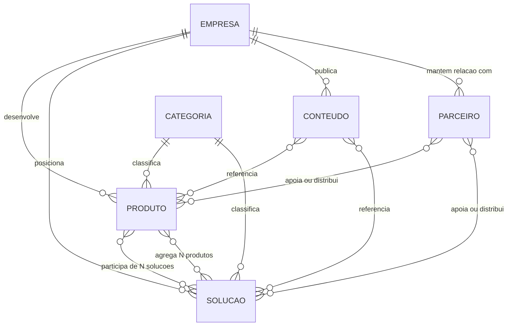
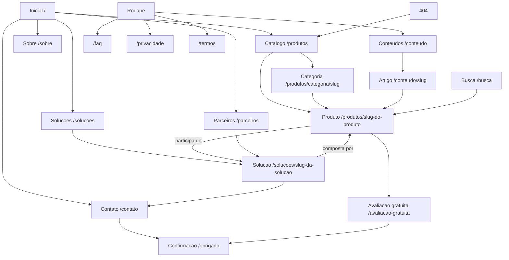
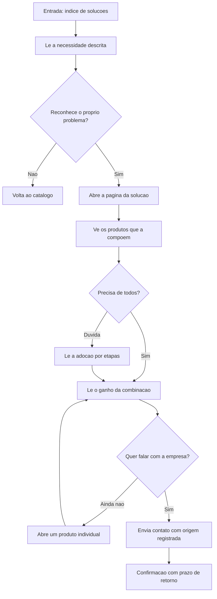
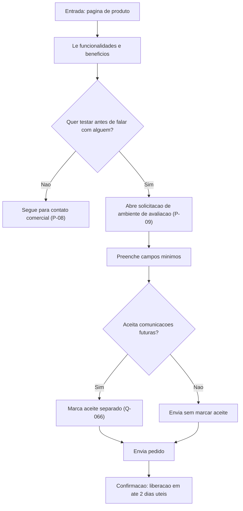
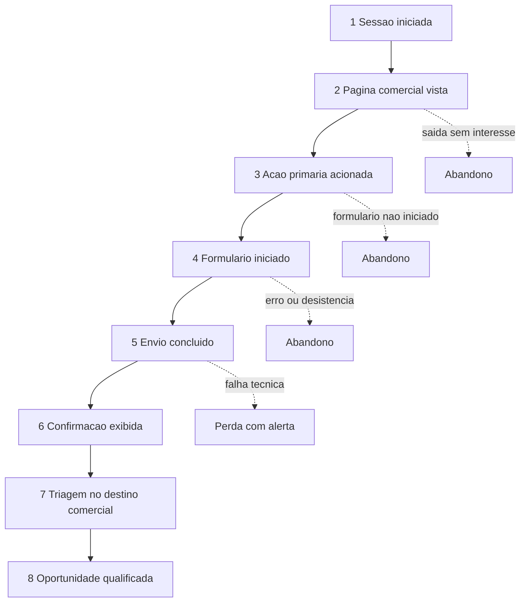
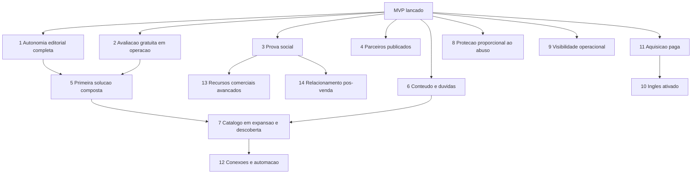

# PRD — Site institucional e de exposição comercial de ArtZan

| Campo | Valor |
|---|---|
| Versão | 2.0 |
| Data | 2026-09-07 |
| Status | Revisado com as respostas do cliente |
| Autor | Time de Produto |
| Escopo | Site institucional público |
| Versão anterior | A versão 1.0, escrita com o negócio ainda indefinido, permanece integralmente preservada em `PRD-v1-backup.md` |

> Este documento **não define tecnologia**: não escolhe framework, plataforma de conteúdo, provedor ou biblioteca; descreve apenas comportamento, conteúdo, estrutura e regras de produto.
> Nesta revisão, os dados de negócio **deixaram de ser hipotéticos**: refletem as 69 respostas do cliente ao formulário `PERGUNTAS-PENDENTES.md`, digeridas em `prd-parts/10-respostas.md`. O que ainda não tem resposta segue marcado como **Pergunta (Q-0xx)** pendente; o que depende de decisão editorial ainda não tomada segue marcado como **Premissa (PR-0xx)**. Nenhum dos dois é mais hipótese genérica de mercado — é lacuna real e específica desta empresa.

## Sumário

1. [1. Resumo executivo](#1-resumo-executivo)
2. [2. Visão do produto](#2-visão-do-produto)
3. [3. Objetivos do negócio](#3-objetivos-do-negócio)
4. [4. Público-alvo](#4-público-alvo)
5. [5. Proposta de valor](#5-proposta-de-valor)
6. [6. Arquitetura de informação](#6-arquitetura-de-informação)
7. [7. Páginas e requisitos](#7-páginas-e-requisitos)
   Páginas públicas P-01 a P-18, com objetivo, conteúdo e seções de cada uma, mais a superfície interna de administração P-19 a P-22 (não pública, não indexada).
8. [8. Jornadas do usuário](#8-jornadas-do-usuário)
9. [9. Requisitos funcionais](#9-requisitos-funcionais)
   RF-001 a RF-206, por área: navegação, inicial, catálogo, produto, soluções, parceiros, formulários, conteúdo institucional, SEO, administração, analytics.
10. [10. Requisitos não funcionais](#10-requisitos-não-funcionais)
    RNF-001 a RNF-107: responsividade, performance, acessibilidade, SEO técnico, segurança, privacidade, compatibilidade, manutenibilidade, escalabilidade, disponibilidade, qualidade.
11. [11. Conteúdo e identidade da marca](#11-conteúdo-e-identidade-da-marca)
12. [12. SEO e descoberta](#12-seo-e-descoberta)
13. [13. Acessibilidade e usabilidade](#13-acessibilidade-e-usabilidade)
14. [14. Conversão e contato comercial](#14-conversão-e-contato-comercial)
15. [15. Métricas e analytics](#15-métricas-e-analytics)
16. [16. Escopo do MVP](#16-escopo-do-mvp)
    O que entra no MVP, Fase 2 e Futuro, o que fica fora, conteúdo mínimo e decisões antes do desenvolvimento.
17. [17. Roadmap de evolução](#17-roadmap-de-evolução)
18. [18. Riscos, premissas e pendências](#18-riscos-premissas-e-pendências)
    Riscos, premissas consolidadas (PR-001 a PR-071), informações faltantes, decisões necessárias e dependências.
19. [19. Critérios gerais de aceite](#19-critérios-gerais-de-aceite)
20. [20. Perguntas em aberto](#20-perguntas-em-aberto)
    As dez mais críticas, bloqueantes, importantes e as que podem esperar.
21. [21. Síntese final e próximos passos](#21-síntese-final-e-próximos-passos)

## 1. Resumo executivo

**ArtZan** (nome comercial confirmado — Q-001) é uma empresa de software em constituição que desenvolverá um **ecossistema de produtos digitais**. O portfólio de lançamento tem **cinco ofertas** (Q-004): quatro softwares de prateleira — gestão geral de empresa (Sistema Lara, nome confirmado), alocação de quadras, scout para partidas esportivas e placar esportivo, os três últimos ainda sem nome aprovado (seção 11) — e um serviço sob encomenda, desenvolvimento de integrações entre sistemas, tratado à parte por não ter formato de prateleira (seção 6).

O site é o **ponto central de exposição da empresa**: identidade institucional, catálogo de softwares, soluções compostas (sem nenhuma publicável no lançamento, ver seção 3), empresas parceiras e informações relevantes para clientes, potenciais clientes e interessados. O público de lançamento é **clubes, parques e pequenas e médias empresas** (Q-009, Q-010), com tom levemente neutro para não fechar a leitura nesses três nichos.

**Problema que resolve.** ArtZan não tem canal próprio para explicar o que faz. Não é apenas ausência de presença digital: é a dificuldade de comunicar um portfólio que cresce e só faz sentido pleno quando o visitante entende a relação entre as peças — mesmo que, hoje, ainda não exista combinação pronta para mostrar. Sem canal próprio, cada produto novo exige explicação manual em reunião, e a empresa é percebida como softwares avulsos em vez de ecossistema. Um site artesanal, com página escrita à mão por produto, reproduziria o problema em escala.

**Finalidade comercial.** O site é instrumento de geração de oportunidades, não vitrine passiva. Leva o visitante de "não conheço esta empresa" a "quero testar" ou "quero falar sobre este produto". O modelo comercial é **assinatura recorrente** para os softwares e **projeto sob encomenda** para o serviço de integrações (Q-007), sem preço publicado (Q-008). A conversão do MVP é o **contato comercial qualificado** e o **pedido de ambiente de avaliação gratuita**, não a compra online. **Premissa PR-004:** a venda é concluída por atendimento humano; o site qualifica e encaminha.

**Relação com o ecossistema.** O site é a camada de apresentação do ecossistema, não parte dele: descreve os produtos, não os executa. Cada software tem página gerada por **template obrigatório**. **Premissa PR-003:** a relação produto↔solução é de muitos para muitos — permanece no modelo de dados porque é a razão de ser desta arquitetura, ainda que nenhuma solução composta exista para publicar no lançamento (Q-006). Dela dependem a arquitetura de informação, o modelo de conteúdo e a capacidade de crescer sem reestruturação.

**Resultado esperado.** (1) Canal público capaz de explicar empresa e produtos, e apresentar o serviço de integrações, sem intervenção comercial prévia; (2) catálogo que aceita produto, categoria, solução e parceiro novos por cadastro, sem alterar estrutura, navegação ou código; (3) caminho de conversão claro em toda página comercial, incluindo o pedido de avaliação gratuita; (4) base de conteúdo preparada para busca orgânica desde o lançamento; (5) apresentação consistente, de modo que o vigésimo produto tenha a mesma qualidade editorial do primeiro.

**Maturidade.** **Premissa PR-007 (confirmada — Q-021):** no lançamento não há clientes, cases, depoimentos ou logos publicáveis; um cliente pode autorizar a citação de um caso em breve, mas o bloco de credibilidade permanece previsto e vazio até isso se confirmar. O site precisa convencer sem prova social — o que altera decisões de conteúdo das seções 5 e 7. A promessa comercial verificável do lançamento é o **período de avaliação gratuita** (Q-022), sem prazo em dias divulgado neste documento.

## 2. Visão do produto

### 2.1 Conceito e posição no negócio

O site é um **catálogo institucional navegável de um ecossistema de software**, em quatro camadas que se referenciam: empresa, produtos, soluções e parceiros. Não é folheto com lista de produtos anexada; é estrutura de dados publicada, com template por entidade e relações navegáveis nos dois sentidos. Posição no negócio: primeiro contato da maioria dos interessados, principal ativo de explicação do portfólio e origem do funil comercial. A camada de soluções existe no modelo desde já, mesmo sem nenhum registro publicável no lançamento (Q-006, ver 2.4 e seção 3).

### 2.2 A empresa como marca principal

ArtZan é a marca-guarda-chuva; os softwares são produtos **de** ArtZan, nunca marcas independentes — inclusive os ainda a nomear (11.19) e o serviço de integrações, que dispensa nome próprio (11.20). Consequências: identidade visual única; nenhum produto ganha site, subdomínio ou navegação próprios no MVP; o nome da empresa identifica toda página de produto e solução. Isso protege o ativo mais escasso de uma empresa nova — reconhecimento acumulado. **Identidade visual existe** (Q-003): logotipo `Logo.png`, paleta, tipografia e regras de aplicação na seção 11 — sem manual de marca externo (Q-055), este PRD é a própria referência.

### 2.3 Os softwares como produtos

Cada software é **entidade de catálogo**, com página, endereço e conjunto fixo de campos, autoexplicativa: quem chega direto nela entende qual problema o produto resolve, para quem, o que faz e como contratar. Produtos não são módulos de um sistema maior — a decisão de negócio é vender software pequeno e delimitado. O portfólio tem **quatro produtos** nesse formato — os três sem nome confirmado são identificados primeiro pela função, com o nome proposto (11.19) como complemento a aprovar. **Premissa PR-008:** todo produto usa o mesmo template obrigatório, sem páginas artesanais.

### 2.4 As soluções conjuntas como combinações de produtos

Solução é **entidade derivada**: combina dois ou mais produtos para atender necessidade mais ampla do que qualquer um isolado. Não é produto novo — referencia as páginas dos produtos e acrescenta o ganho da combinação. Relação bidirecional: da solução veem-se os produtos; do produto veem-se as soluções. **Premissa PR-010:** solução composta exige no mínimo dois produtos do próprio portfólio. **No lançamento não existe nenhuma solução composta** (Q-006): o modelo acima permanece porque é a razão de ser desta arquitetura, mas a página pública correspondente é adiada até a primeira solução existir (seção 3; P-05, P-06).

### 2.5 Os parceiros como parte do ecossistema

Parceiros são organizações externas com relação declarada com ArtZan — tecnologia, implantação, revenda ou indicação. Existem para dar credibilidade a uma empresa nova e explicar como o cliente será atendido além do software. Não são clientes e não podem ser exibidos de forma que sugira isso. **Premissa PR-018:** nenhuma marca de terceiro é publicada sem autorização formal registrada. **No lançamento há um parceiro em vista, ainda não confirmado e sem autorização de uso de marca** (Q-025) — a página permanece condicionada a essa confirmação (P-07).

### 2.6 Modelo conceitual do ecossistema

Produto e Solução mantêm relação **muitos-para-muitos**. Categoria classifica Produtos e Soluções sem exigir pertencimento único. Parceiro e Conteúdo os referenciam sem exclusividade. Nenhuma dessas relações pode ser texto escrito à mão: todas são vínculos entre registros.

### 2.7 O que este site NÃO é

| Não é | Justificativa |
|---|---|
| **Aplicação** | Não executa nenhum software do portfólio, não processa dados de cliente, não simula funcionalidades. Executar acoplaria o ciclo de vida do site ao de cada produto — exatamente o que a estratégia de portfólio crescente evita. |
| **Área logada de cliente** | Sem autenticação, painel de cliente, suporte ou gestão de licenças voltados a quem compra o software. Sem base de clientes no lançamento (PR-007), a área não teria usuários e imporia requisitos de segurança e suporte desproporcionais. **Premissa PR-001 (confirmada):** o site público segue anônimo no MVP. Isso não inclui o **painel interno de administração de conteúdo** (Q-033): superfície distinta, de uso exclusivo dos dois sócios, fora da arquitetura de informação pública e não indexada (P-19 a P-22, seção 7). |
| **E-commerce** | Sem carrinho, checkout ou contratação online, mesmo com o modelo comercial já definido — **assinatura recorrente ou projeto sob encomenda** (Q-007) —, porque a contratação depende de negociação de escopo ou onboarding humano. **Premissa PR-005 (confirmada — Q-008):** preço não é publicado no MVP; o valor depende do projeto. |

Nenhuma exclusão é permanente: são decisões de escopo, revisáveis quando houver base de clientes, modelo comercial fechado e demanda observada.

### 2.8 Princípios de produto

Em conflito entre requisitos, prevalece o princípio de ordem mais alta.

| # | Princípio | Consequência prática no site |
|---|---|---|
| 1 | Clareza | Nenhum texto depende de conhecimento prévio da marca; termo próprio é explicado na primeira ocorrência. |
| 2 | Apresentação profissional | Nenhuma página publicada tem lacuna visível, imagem ausente ou seção "em breve". |
| 3 | Foco nos produtos | A inicial dedica mais espaço a produtos e soluções que ao institucional; o catálogo fica a um clique de qualquer página. |
| 4 | Venda individual ou conjunta | Toda página de produto é completa em si e exibe as soluções de que participa (bloco omitido enquanto não houver solução vinculada — hoje sempre, Q-006). |
| 5 | Escalabilidade | Adicionar produto, categoria, solução ou parceiro é cadastro — nunca mudança de estrutura, menu ou código. |
| 6 | Conversão | Toda página de produto e solução termina com chamada para ação; nenhuma página é beco sem saída. |
| 7 | Manutenção simples | Campos objetivos e obrigatórios explícitos; nada exige editor técnico (**PR-009**). |
| 8 | Experiência consistente | Ordem fixa de seções e mínimos de preenchimento fazem o vigésimo produto parecer tão cuidado quanto o primeiro. |
| 9 | Mobile-first | Hierarquia, tamanho de listas e comprimento de formulários são definidos primeiro para tela pequena (**PR-017**). |
| 10 | SEO desde a concepção | URLs, títulos, hierarquia de cabeçalhos e metadados são parte do modelo de conteúdo, não ajuste posterior. |
| 11 | Acessibilidade | Contraste, foco visível, navegação por teclado, texto alternativo e rótulo de formulário são critérios de aceite. |
| 12 | Performance | Peso de imagens, itens por listagem e recursos de terceiros são restrições de projeto. |
| 13 | Evolução gradual | Busca, filtros, paginação e blog têm **gatilhos objetivos** (6.6) em vez de entrarem "porque todo site tem". |

## 3. Objetivos do negócio

| ID | Objetivo | Por que importa | Como se manifesta no site | Indicador | Horizonte |
|---|---|---|---|---|---|
| OB-01 | Apresentar ArtZan ao mercado | Empresa desconhecida; sem apresentação clara não há confiança para iniciar conversa | Proposta de valor na inicial e página institucional | Visitantes únicos; leitura do institucional; profundidade de navegação | MVP |
| OB-02 | Divulgar o portfólio | Os produtos são o objeto da venda; o portfólio já está definido (quatro softwares e um serviço, Q-004), mas hoje só existe na explicação verbal | Catálogo dos quatro softwares, mais apresentação à parte do serviço (seção 6) | Visualizações por produto; % de sessões que alcançam um produto ou o bloco de serviço | MVP |
| OB-03 | Gerar oportunidades comerciais | O site é a origem prevista do funil | Formulários acessíveis de toda página comercial, incluindo o pedido de ambiente de avaliação gratuita (P-09) | Nº de contatos e de pedidos de avaliação gratuita; conversão por página de origem | MVP |
| OB-04 | Facilitar o contato | Fricção de contato é perda direta em ciclo consultivo | Chamadas para ação, formulário curto, WhatsApp e e-mail institucional no rodapé (Q-012) | Início vs. conclusão de formulário; tempo até o retorno — compromisso de até 2 dias úteis (Q-013) | MVP |
| OB-05 | Fortalecer marca e confiabilidade | Sem cases nem clientes (PR-007), credibilidade vem de consistência e cuidado | Identidade única (seção 11), linguagem padronizada, páginas legais publicadas | Taxa de rejeição; visitantes recorrentes | MVP |
| OB-06 | Apresentar parcerias | Parceiros ampliam a capacidade percebida de entrega de uma empresa pequena | Página de parceiros e vínculo com produtos; hoje um único parceiro em vista, ainda não confirmado (Q-025) | Visualizações e contatos originados na página | MVP (condicionado, ver P-07) |
| OB-07 | Expandir o portfólio sem retrabalho | Retrabalho estrutural a cada lançamento inviabiliza a estratégia | Modelo de conteúdo com entidades e relações; templates; gatilhos | Esforço para publicar produto novo; mudanças estruturais por lançamento | MVP |
| OB-08 | Sustentar descoberta orgânica | Empresa sem audiência depende de busca para ser encontrada | URLs estáveis, campos de SEO no modelo, hierarquia por produto, estrutura reservada para inglês sem ativação (Q-011) | Sessões orgânicas; páginas indexadas; entradas diretas em produto | MVP (base) / Fase 2 (conteúdo) |
| OB-09 | Sustentar a promessa de ecossistema e preparar a venda combinada para quando existir a primeira solução | Diferencial estrutural do negócio, mas sem solução composta no lançamento (Q-006) a promessa precisa se sustentar sem catálogo de soluções prontas | Mensagem de ecossistema na proposta de valor (5.3) e no institucional; modelo de dados e template de solução prontos (PR-003, P-05, P-06), sem página pública até a primeira solução | Sem indicador ainda — depende de existir solução publicada para medir sessões que veem produto **e** solução | MVP (promessa) / Futuro (1ª solução, sem data — P-05, P-06) |

**Por que ainda não há metas numéricas.** O portfólio e o modelo comercial já estão definidos (Q-004, Q-007), e o prazo de resposta comercial também (até 2 dias úteis, Q-013), mas isso ainda não basta para metas de volume: não existe histórico de tráfego, e capacidade de atendimento, ciclo de venda e ticket seguem sem definição. Qualquer número além do já respondido seria arbitrário e viraria critério de aceite falso. **Pergunta Q-015:** que volume de oportunidades por mês o time comercial consegue atender e qual a expectativa mínima de sucesso? **Pergunta Q-016:** qual o ciclo de venda e o ticket esperado por produto e, quando houver, por solução? **Pergunta Q-017:** quais indicadores serão acompanhados, com que periodicidade e por quem?

## 4. Público-alvo

O segmento e o porte já são conhecidos (Q-009, Q-010): **clubes, parques e pequenas e médias empresas**. Os perfis abaixo são hipóteses construídas a partir dessa resposta — o cliente definiu o alvo, não uma pesquisa com o alvo; segue sem existir pesquisa ou base de clientes que os valide em detalhe. O mercado é o Brasil; a estrutura do site é preparada para tradução básica ao inglês, sem o idioma ativo no MVP (Q-011, ver 6.4 e 6.7). Cuidado editorial que atravessa todos os perfis: tom **levemente neutro** — o site prioriza os três nichos sem soar exclusivo deles, para não fechar a porta a outros segmentos.

| ID | Perfil | Quem é | O que procura | Dúvidas | Ação esperada | Entrada provável | Conteúdo decisivo |
|---|---|---|---|---|---|---|---|
| PU-01 | Decisor de negócio | Sócio, diretor ou gestor com autoridade de compra em um clube, parque ou pequena/média empresa | Saber se a empresa é confiável e se o portfólio resolve um problema que custa dinheiro ou tempo na operação | "Quem é essa empresa?"; "vale o investimento?" | Solicitar contato comercial ou ambiente de avaliação gratuita | Inicial; produto | Proposta de valor, benefícios em resultado, institucional, período de avaliação gratuita, parceiros (quando houver) |
| PU-02 | Gestor com dor operacional | Responsável por processo manual, disperso ou falho — controle de sócios, reservas de espaço, escala de eventos, ou equivalente numa PME fora desses nichos | Reconhecer a própria dor descrita com precisão | "Serve para o meu caso?"; "muda muito a rotina?" | Pedir ambiente de avaliação gratuita | Produto (via busca) | "Problema que resolve", casos de uso, funcionalidades, período de avaliação gratuita |
| PU-03 | Buscador de software específico | Já sabe o tipo de sistema de que precisa | Comparar rápido o que o produto faz | "Faz o que preciso?"; "quanto custa?"; "integra?" | Abrir o produto e pedir ambiente de avaliação gratuita | Produto, vindo de busca | Funcionalidades, imagens (quando existirem, Q-005), integrações, informações comerciais |
| PU-04 | Cliente de múltiplos produtos | Problema atravessa mais de um processo da operação | Entender o ganho de combinar produtos | "Preciso de mais de um?"; "posso começar por um?" | Contato descrevendo a necessidade ampla | Catálogo; produto | Promessa de ecossistema (5.3); sem página de solução para consultar no lançamento (Q-006, ver J-03) — depende do texto institucional e da consistência entre produtos |
| PU-05 | Parceiro ou revenda | Consultoria, integrador, revendedor | Entender portfólio e modelo de parceria | "Trabalham com canal?"; "que parceria existe?" | Contato identificado como parceiro | Parceiros; inicial | Tipos de parceria, natureza da relação, canal de contato |
| PU-06 | Avaliador técnico (TI) | Analista ou consultor que valida a escolha | Verificar viabilidade, integrações e risco | "Integra com nossos sistemas?"; "como ficam os dados?" | Aprovar internamente ou questionar | Produto; FAQ | Integrações, requisitos, privacidade e tratamento de dados |
| PU-07 | Visitante orgânico sem contexto | Chega por busca a uma página interna | Saber se aquilo responde à dúvida e quem está por trás | "Que empresa é essa?"; "é séria?" | Aprofundar até um produto ou o institucional | Produto, conteúdo | Identificação da empresa em toda página; caminho ao catálogo e institucional |
| PU-08 | Candidato ou curioso institucional | Profissional, estudante, imprensa, fornecedor | Entender a empresa e como falar com ela | "O que fazem?"; "contratam?" | Encontrar institucional e contato | Sobre a empresa | Sobre e contato geral. **Secundário:** não orienta layout, prioridade nem conversão no MVP |

### 4.1 Priorização de públicos no MVP

O MVP atende com prioridade **PU-01, PU-02, PU-03 e PU-04**: perfis ligados a OB-03, servidos por catálogo, produto e formulários (mesma estrutura de OB-02 e OB-07). A página de solução, que também os serviria, fica **Futura** (P-05, P-06: Q-006). **PU-04** é atendido mais fracamente que na v1.0 — sem a página que materializava sua necessidade ampla, depende do texto institucional e da consistência entre produtos (J-03). **PU-06** é atendido parcialmente: espaço reservado para integrações e requisitos, mas profundidade técnica depende de imagens que ainda não existem (Q-005). **PU-05** é atendido pela página de parceiros — hoje condicionada a parceiro ainda não confirmado (Q-025) — e por campo de assunto no formulário, sem trilha própria. **PU-07** é atendido por decisão estrutural: toda página interna identifica a empresa e oferece caminho ao catálogo e ao institucional. **PU-08** é atendido pelo institucional e pelo contato, sem investimento adicional.

## 5. Proposta de valor

### 5.1 Os 10 primeiros segundos

Em qualquer página de entrada o visitante deve compreender, sem rolar e sem clicar: **o que ArtZan faz**, **para quem**, **que problema resolve** e **qual o próximo passo**. Em páginas internas soma-se **onde estou** — produto individual ou solução composta. Daí três regras: a primeira tela declara a atuação em linguagem do cliente, não em jargão interno; nenhuma frase de abertura depende de conhecimento prévio da marca; existe exatamente uma ação primária visível, sem chamadas concorrentes de mesmo peso.

### 5.2 Estrutura da mensagem em três níveis

| Nível | O que promete | Onde aparece | Regra |
|---|---|---|---|
| 1. Empresa | Por que ArtZan existe e que classe de problema ataca | Inicial, institucional, rodapé, títulos | Formulação única, repetida sem variação |
| 2. Produto | Qual problema aquele software resolve, para quem, com que resultado | Página de produto e card do catálogo | Uma promessa por produto; não repete a da empresa nem a de outro produto |
| 3. Combinação | O que a união entrega que nenhum produto entrega sozinho | Página de solução e bloco de soluções no produto | Deve nomear ganho exclusivo; se for a soma óbvia das partes, a solução não se justifica |

A hierarquia é obrigatória: o nível 2 herda o contexto do 1, e o 3 herda o dos dois. Quem entra direto no nível 2 ou 3 (PU-03, PU-07) precisa conseguir subir por navegação explícita. **Nível 3 é, por ora, teórico:** sem solução composta no lançamento (Q-006), nenhuma página aplica essa camada hoje — ela volta a valer quando a primeira solução for publicada (P-05, P-06).

### 5.3 Esqueleto de mensagem, agora preenchido no nível 1

O nível 1 (empresa) já pode ser preenchido com os diferenciais informados pelo cliente (5.4). Os níveis 2 e 3 permanecem esqueleto: não há copy específica aprovada por produto, e não há solução composta no lançamento (Q-006) — preenchê-los agora inventaria informação que o cliente não forneceu.

**Nível 1 — empresa (preenchido)**
- ArtZan desenvolve softwares para clubes, parques e pequenas e médias empresas que enfrentam processos manuais, dispersos ou caros de manter (Q-009, Q-010).
- Cada software resolve um problema específico da operação. A promessa de que, combinados, cobrem um processo mais completo depende da primeira solução composta (Q-006) — por ora é compromisso institucional, não catálogo (OB-09, seção 3).
- Prova de credibilidade disponível no lançamento: **período de avaliação gratuita** (Q-022) — sem cases nem clientes publicáveis ainda (PR-007, Q-021). Ação: solicitar avaliação gratuita ou falar com a equipe.

**Nível 2 — produto (esqueleto, a preencher por produto)**
- `[Nome do produto — ex.: Sistema Lara] resolve [dor específica da operação] para [papel ou área], entregando [resultado observável].`
- `Indicado para quem [situação atual do cliente].`
- `Principais capacidades: [capacidade 1], [capacidade 2], [capacidade 3].`

**Nível 3 — combinação (esqueleto, sem aplicação até existir a primeira solução, Q-006)**
- `[Solução] reúne [Produto A] e [Produto B] para [necessidade ampla].`
- `Juntos entregam [ganho que nenhum produto entrega isolado].`
- `Pode ser adotada por etapas, começando por [produto de entrada].`

Exemplos de nomenclatura usados em revisão interna devem ser marcados como fictícios (`[Produto A]`, `Software Alfa (exemplo fictício)`) e nunca publicados. Os nomes de produto propostos em 11.19 são **sugestões a aprovar**, não fatos — até a aprovação (Q-084), usar a descrição funcional como identificação principal, com o nome proposto como complemento. Sistema Lara é o único nome já confirmado.

### 5.4 Diferenciais confirmados pelo cliente

A v1.0 deixava este bloco como lacuna proposital. O cliente respondeu às cinco perguntas que sustentavam essa lacuna; nenhum número foi informado, e nenhum entra aqui por invenção.

| Diferencial | Resposta do cliente | Onde aparece |
|---|---|---|
| Adaptação e versatilidade | Softwares adaptados e versáteis (Q-018) | Nível 1 da mensagem (5.3); benefícios da inicial (P-01) |
| Valores acessíveis | Razão de existirem vários softwares menores em vez de uma suíte única (Q-019) | Benefícios da inicial; institucional (P-02) |
| Facilidade de uso | Ganho de integrar os produtos entre si (Q-020) | Nível 1 da mensagem; bloco de benefícios |
| Período de avaliação gratuita | Promessa comercial verificável no lançamento (Q-022) | Ação primária em toda página de produto (P-04, P-09) |
| Prova social | Nenhuma no lançamento; um cliente pode autorizar um caso em breve (Q-021) | Bloco de elementos de confiança (P-01) permanece previsto e vazio até essa autorização existir de fato |

**Regra que continua valendo.** Nenhuma afirmação numérica entra em nenhum desses pontos — o cliente não informou percentual, prazo em dias, quantidade de clientes ou valor de referência. "Acessível" e "fácil de usar" são qualificações aprovadas pelo cliente, não métricas, e devem ser escritas sem número de apoio (princípio 2, 2.8).

## 6. Arquitetura de informação

### 6.1 Menu principal e justificativa

| Item | Destino | Por que existe |
|---|---|---|
| Softwares | `/produtos` | Objeto da venda e principal motivo de visita (OB-02) |
| Soluções | `/solucoes` | Materializa a venda combinada quando existir a primeira solução (OB-09); **oculto no lançamento** — nenhuma solução composta existe hoje (Q-006), ver P-05 |
| Parceiros | `/parceiros` | Credibilidade de empresa nova; atende PU-05 (OB-06); **condicionado** — depende de parceiro confirmado e autorizado (Q-025), ver P-07 |
| Sobre | `/sobre` | Responde "quem é essa empresa", obrigatória para PU-01 e PU-07 (OB-01) |
| Contato | `/contato` | Conversão sempre disponível (OB-03, OB-04) |

São até **cinco itens fixos**, que não crescem com o portfólio (OB-07): menu que lista produtos exige alteração a cada lançamento. No lançamento, três aparecem sempre — Softwares, Sobre, Contato; Soluções e Parceiros só aparecem quando houver conteúdo que os sustente (mesmo princípio de PR-011, agora estendido a soluções): item de menu para listagem vazia destrói credibilidade (princípio 2) mais que sua ausência. "Contato" é ação destacada. A administração (P-19 em diante) não integra este menu (seção 7).

### 6.2 Regras de submenu

1. Submenu só existe com mais de um destino real; nunca para um único link.
2. Submenu **não lista produtos, soluções ou parceiros** — lista categorias, estáveis e em número controlado.
3. O submenu de "Softwares" só é ativado quando as categorias forem exibidas (6.6); antes disso o item leva direto ao catálogo.
4. Profundidade máxima de dois níveis; um terceiro indica informação que pertence a uma página, não à navegação.
5. Em tela pequena o menu abre por controle único, mantém a ordem e não esconde a ação de contato.
6. Itens legais e utilitários (privacidade, termos, FAQ, conteúdo) ficam no rodapé.

### 6.3 Mapa do site

Os nós de Soluções (`SOL`, `SOLI`) representam o template pronto no modelo de dados (2.6, PR-003), mas sem página pública no lançamento: nenhuma solução composta existe hoje (Q-006; ver P-05, P-06), e o caminho fica invisível até a primeira ser publicada. A superfície de administração (P-19 a P-22) não aparece neste mapa porque não é página pública nem indexável — ver seção 7.

### 6.4 Padrão canônico de URLs

**Domínio confirmado: `artzan.com.br`, sujeito a alteração (Q-002).** Todas as URLs abaixo usam esse domínio; se ele mudar, os padrões de rota permanecem os mesmos.

| Página | Padrão |
|---|---|
| Inicial | `https://artzan.com.br/` |
| Institucional | `https://artzan.com.br/sobre` |
| Catálogo | `https://artzan.com.br/produtos` |
| **Produto** | `https://artzan.com.br/produtos/[slug-do-produto]` |
| Categoria | `https://artzan.com.br/produtos/categoria/[slug-da-categoria]` (só quando ativadas) |
| Índice de soluções | `https://artzan.com.br/solucoes` (Futuro — ver P-05) |
| **Solução** | `https://artzan.com.br/solucoes/[slug-da-solucao]` (Futuro — ver P-06) |
| Parceiros / Contato / Avaliação gratuita | `https://artzan.com.br/parceiros`, `/contato`, `/avaliacao-gratuita` |
| Confirmação | `https://artzan.com.br/obrigado` (não indexável) |
| Conteúdo | `https://artzan.com.br/conteudo` e `/conteudo/[slug]` (sem data na URL) |
| FAQ e legais | `https://artzan.com.br/faq`, `/privacidade`, `/termos` |
| Busca | `https://artzan.com.br/busca` (não indexável) |
| Administração | Não pública, não indexável, endereço não divulgado no site — ver seção 7 (P-19 a P-22) |

Regras: a URL de produto **nunca** inclui categoria — um produto pode pertencer a mais de uma e a URL deixaria de ser estável; a URL de solução nunca inclui os produtos que a compõem, pela mesma razão; não há identificadores numéricos; um endereço publicado nunca é reaproveitado para outro conteúdo.

**Slugs reais dos quatro softwares de prateleira (Q-004):**

| Produto (identificação funcional) | Nome proposto (11.19) | Slug |
|---|---|---|
| Gestão geral de empresa | Sistema Lara — **confirmado** | `/produtos/sistema-lara` |
| Alocação de quadras | Theo — proposta, a aprovar (Q-084) | `/produtos/alocacao-de-quadras` (provisório até nome aprovado) |
| Scout para partidas esportivas | Iago — proposta, a aprovar (Q-084) | `/produtos/scout-esportivo` (provisório) |
| Placar esportivo | Nina — proposta, a aprovar (Q-084) | `/produtos/placar-esportivo` (provisório) |

**O quinto item do portfólio não é rota de catálogo.** Desenvolvimento de integrações é serviço sob encomenda, não software de prateleira (11.20): sem escopo fixo, sem ambiente de avaliação, sem captura de tela representativa — ver justificativa completa em P-04. Não recebe slug nem card; aparece como bloco em `/sobre` (P-02), com ação própria de contato.

**Preparação para inglês, sem ativação (Q-011).** Requisito de estrutura: os padrões acima reservam um prefixo de idioma (ex.: `/en/produtos/...`), sem publicá-lo — nenhuma rota, menu ou conteúdo em inglês é construído no MVP. O modelo de conteúdo (6.7) reserva os mesmos campos em inglês, hoje vazios.

### 6.5 Regras de slug

1. Apenas letras minúsculas, números e hífen; sem acento, cedilha, espaço ou caractere especial.
2. Derivado do nome oficial, sem prefixos como "software-" ou "solucao-", que se repetiriam em todo o catálogo.
3. Único dentro do tipo; conflito bloqueia a publicação e exige resolução manual, nunca sufixo numérico automático.
4. De 2 a 5 palavras, limite de 60 caracteres, sem ano, versão ou termo temporal.
5. **Premissa PR-014:** slug imutável após a publicação; renomeação inevitável exige redirecionamento permanente, e o endereço antigo não é reutilizado.
6. Gerado automaticamente a partir do nome, editável apenas antes da primeira publicação.
7. Para os três produtos ainda sem nome aprovado (11.19, Q-084), o slug provisório desta revisão deriva da descrição funcional (tabela de 6.4); será revisado para o nome definitivo antes da primeira publicação, com redirecionamento permanente do endereço provisório (regra 5).

### 6.6 Crescimento do catálogo: gatilhos de ativação

**Premissa PR-002 (confirmada e precisada — Q-004):** o portfólio de lançamento tem exatamente **4 softwares de prateleira** no catálogo (mais um serviço sob encomenda tratado à parte, 6.4) — o que torna filtros, busca e paginação prejudiciais no início: aumentam a carga cognitiva e sugerem catálogo maior do que o real.

| Recurso | Gatilho | Justificativa |
|---|---|---|
| Grade simples | Sempre | Estado inicial |
| Agrupamento por categoria | 7 produtos | Abaixo disso a leitura sequencial é mais rápida que a triagem |
| Filtro por categoria | 10 produtos, ou 4 categorias com 2+ produtos | Filtro só ajuda quando remove quantidade relevante |
| Ordenação | 12 produtos | Antes não há o que ordenar de forma útil |
| Busca interna | 15 produtos ou 20 conteúdos | Busca com poucos resultados frustra mais do que ajuda |
| Paginação | 24 produtos | Mantém a listagem leve |
| Categoria com URL própria | Filtro ativo **e** descrição editorial da categoria | Categoria sem texto próprio não sustenta indexação |
| Filtro de soluções por produto | 7 soluções | Mesma lógica do catálogo |

Todos esses recursos existem no modelo de conteúdo desde o MVP, ainda que desligados. **Premissa PR-013:** categorias existem como entidade desde o início, mesmo sem exibição, para que a ativação seja configuração e não migração. **Os gatilhos numéricos acima são mantidos como estão neste PRD (Q-023).**

**Com o portfólio real, o catálogo fica abaixo de todos os gatilhos desta tabela** — 4 softwares publicáveis (PR-002), ou 5 somando o serviço que nem entra no catálogo (6.4), muito abaixo do primeiro gatilho (7). Dito explicitamente: **nada além da grade simples é construído no lançamento** — categoria, filtro, ordenação, busca e paginação permanecem apenas modelados (PR-013), prontos para ativar por configuração quando o portfólio crescer.

### 6.7 Modelo de conteúdo

Base da escalabilidade; referenciado pelas demais partes do PRD. "SEO" marca campos que alimentam títulos, descrições, dados estruturados ou compartilhamento.

**Preparação para inglês (Q-011).** Nome, resumo, descrição e título/descrição de SEO — em todas as entidades abaixo — reservam um valor equivalente em inglês, hoje vazio e não publicado: requisito de estrutura, não conteúdo pronto, por isso não repetido campo a campo nas tabelas.

**Produto**

| Campo | Obrig. | SEO | Observação |
|---|---|---|---|
| Nome | Sim | Sim | Base do título da página |
| Slug | Sim | Sim | Regras de 6.5 |
| Resumo de uma linha | Sim | Sim | Card e base da descrição |
| Problema que resolve | Sim | Sim | 1 a 3 parágrafos |
| Descrição completa | Sim | Sim | — |
| Público-alvo | Sim | Não | Papéis ou tipos de organização |
| Funcionalidades | Sim (mín. 3) | Sim | Título + descrição curta |
| Benefícios | Sim (mín. 3) | Não | Redigidos como resultado |
| Categoria(s) | Sim (mín. 1) | Sim | Relação N:N |
| Imagem de destaque | Sim | Sim | Captura de tela real (Q-005), moldura padrão (11.17), nunca ilustração genérica; card e compartilhamento. Nenhuma existe hoje — ver consequência em P-04 |
| Galeria de telas | Não | Não | Capturas adicionais, mesma moldura padrão (11.17); continuam opcionais mesmo depois de a imagem de destaque existir |
| Vídeo/demonstração | Não | Não | — |
| Integrações | Não | Não | Só quando existirem de fato |
| Informações comerciais | Sim | Não | Modelo de contratação: assinatura recorrente (softwares) ou projeto sob encomenda (Q-007); preço não publicado (PR-005, Q-008) |
| Soluções das quais participa | Derivado | Sim | Vínculo N:N, nunca digitado |
| Produtos relacionados | Não | Não | Manual ou derivado por categoria |
| Destaque na inicial | Não | Não | Booleano com ordem |
| Título e descrição de SEO | Não | Sim | Automáticos a partir de nome e resumo |
| Status de publicação | Sim | Não | Rascunho / publicado |
| Datas de publicação e atualização | Sim (auto) | Sim | — |

**Solução composta**

Nenhum registro existe no lançamento (Q-006) — tabela mantida para quando a primeira solução for definida (Futuro, ver P-05, P-06).

| Campo | Obrig. | SEO | Observação |
|---|---|---|---|
| Nome | Sim | Sim | Nomeia a necessidade, não os produtos |
| Slug / Resumo | Sim | Sim | — |
| Necessidade ou cenário atendido | Sim | Sim | — |
| Produtos que compõem | Sim (mín. 2) | Sim | Relação N:N (PR-010) |
| Ganho da combinação | Sim | Sim | Ganho exclusivo da união |
| Público-alvo | Sim | Não | — |
| Casos de uso | Não | Sim | — |
| Adoção por etapas | Não | Não | Produto de entrada |
| Imagem de destaque | Sim | Sim | — |
| Categoria(s) / Parceiros envolvidos | Não | Sim / Não | Relações N:N |
| Título e descrição de SEO | Não | Sim | — |
| Status de publicação | Sim | Não | — |

**Parceiro**

Um parceiro está em vista, ainda não confirmado nem autorizado (Q-025) — nenhum registro é publicado enquanto isso não se resolver (PR-018).

| Campo | Obrig. | SEO | Observação |
|---|---|---|---|
| Nome | Sim | Não | — |
| Logo | Sim | Não | Texto alternativo obrigatório |
| Descrição curta | Sim | Não | 1 a 3 linhas |
| Tipo de parceria | Sim | Não | Taxonomia de P-07 |
| Natureza da relação | Sim | Não | O que a parceria entrega ao cliente |
| Produtos/soluções relacionados | Não | Não | Relação N:N |
| Link externo | Não | Não | Nova aba, sem transferir autoridade de busca |
| Autorização de uso de marca | Sim | Não | Controle interno; sem ele não publica (PR-018) |
| Ordem / Status | Sim | Não | — |

**Categoria**

| Campo | Obrig. | SEO | Observação |
|---|---|---|---|
| Nome / Slug | Sim | Sim | — |
| Descrição curta | Não | Sim | Obrigatória se ganhar URL própria |
| Ordem de exibição | Não | Não | — |
| Visível publicamente | Sim | Não | Permite existir sem ser exibida (PR-013) |

**Página institucional**

| Campo | Obrig. | SEO | Observação |
|---|---|---|---|
| Título / Slug | Sim | Sim | Slug fixo para páginas de menu |
| Corpo em blocos | Sim | Sim | Blocos reordenáveis, sem editar estrutura |
| Imagem de destaque | Não | Sim | — |
| Título e descrição de SEO | Não | Sim | — |
| Indexável | Sim | Sim | Falso em `/obrigado` e `/busca` |
| Data de atualização | Sim (auto) | Não | Relevante para páginas legais |

**Item de conteúdo**

| Campo | Obrig. | SEO | Observação |
|---|---|---|---|
| Título / Slug / Resumo / Corpo | Sim | Sim | Slug sem data |
| Data de publicação | Sim | Sim | — |
| Tema editorial | Não | Sim | — |
| Produtos e soluções relacionados | Não | Sim | Leva tráfego ao catálogo |
| Imagem de destaque | Sim | Sim | — |
| Autor / Status | Não / Sim | Não | — |

### 6.8 Relação entre empresa, produtos, soluções e parceiros

Navegação cruzada obrigatória e bidirecional: **Produto → Solução** (lista as soluções de que participa, geradas por vínculo; sem vínculo o bloco é omitido, nunca exibido vazio — no lançamento este bloco é **sempre** omitido, porque não há solução composta publicada, Q-006); **Solução → Produto** (lista os produtos com link, sem duplicar a descrição de cada um); **Produto ↔ Produto** (complementaridade derivada por categoria ou manual, sempre rotulada "relacionado", nunca "solução"); **Parceiro → Produto/Solução** (indica em que parte do portfólio o parceiro atua); **Produto/Solução → Empresa** (toda página interna oferece caminho ao institucional, atendendo PU-07); **Conteúdo → Produto/Solução** (artigos referenciam entidades do catálogo, virando porta de entrada do portfólio).

### 6.9 Regras de crescimento sem reestruturação

1. O menu **não lista produtos, soluções ou parceiros individualmente** e não muda quando o portfólio cresce.
2. **Nenhuma página de produto ou solução é escrita fora do template** — não existe "página especial" para produto estratégico.
3. Toda listagem é gerada a partir dos registros publicados, jamais mantida como lista fixa.
4. A relação produto↔solução é vínculo entre registros, nunca texto digitado: incluir um produto numa solução não pode exigir reescrever nenhuma das duas páginas.
5. Categorias, filtros, busca e paginação já existem no modelo e são **ativados por configuração** nos gatilhos de 6.6.
6. Blocos da inicial que exibem produtos, soluções ou parceiros são alimentados por seleção de registros com limite de itens; não contêm texto sobre entidades específicas.
7. Produto retirado do portfólio é despublicado, não apagado: a URL redireciona para o catálogo ou para o sucessor, preservando o histórico de busca.
8. Nenhum requisito assume número fixo de produtos, soluções, categorias ou parceiros — inclusive **zero**, tratado como estado válido em cada listagem.

## 7. Páginas e requisitos

Cada página recebe identificador P-xx. Os requisitos numerados (RF/RNF) pertencem às seções 9 e 10 deste PRD; aqui os comportamentos são descritos em texto.

**Prazo declarado (Q-029): setembro de 2026** — o mês corrente. **Risco de severidade máxima, não silenciado aqui:** no mesmo conjunto de respostas, o escopo aumentou — painel de administração (P-19 a P-22), ambiente de avaliação por tempo determinado (P-09), preparação estrutural para inglês (6.4, 6.7), quatro páginas de produto com prints ainda inexistentes (P-04, Q-005) e identidade visual a derivar do logotipo (seção 11). Nenhuma página aqui assume que esse escopo cabe no prazo sem corte. A avaliação formal, o recorte defensável e a decisão entre cortar escopo ou mover a data são tratados nas seções 16 e 18; aqui o efeito aparece na prioridade de cada página.

### P-01 — Página inicial — MVP

**Objetivo.** Explicar em uma tela o que ArtZan faz, mostrar o portfólio, sustentar a promessa de ecossistema e conduzir ao contato ou à avaliação gratuita. **Público.** PU-01, PU-04; secundariamente PU-02 e PU-05.
**Conteúdo necessário.** Proposta de valor institucional, apresentação da empresa, produtos em destaque, soluções, parceiros, benefícios, elementos de confiança, chamadas para ação, rodapé.

**Seções em ordem.**
1. **Proposta de valor** — frase principal, apoio e ação primária única. Sem carrossel: mensagem rotativa impede fixar a promessa em quem vê o site uma vez.
2. **Apresentação da empresa** — 2 a 4 linhas com link para `/sobre`; responde a PU-01 antes que ele desista.
3. **Destaque dos softwares** — 3 a 6 produtos com o card do catálogo (P-03) e link "ver todos"; ordem por campo de destaque, não por código. No lançamento, isso corresponde a mostrar até os 4 produtos existentes (Q-004).
4. **Apresentação de soluções** — 2 a 4 soluções, produtos que a compõem e o ganho em uma linha; materializa OB-09 quando houver solução publicada. **No lançamento, omitida por completo** (Q-006) — a promessa de ecossistema fica a cargo da proposta de valor e do institucional.
5. **Benefícios** — 3 a 6 benefícios do modelo de portfólio (adotar por etapas, escopo sob medida, valores acessíveis, softwares adaptados e versáteis), redigidos como resultado, com base nos diferenciais confirmados pelo cliente (5.4, Q-018, Q-019).
6. **Empresas parceiras** — faixa de logos com título explicativo; **condicional**, só renderizada com ao menos um parceiro publicado e autorizado — hoje nenhum (Q-025).
7. **Elementos de confiança.**
8. **Chamada para ação final** — repete a ação primária, com alternativa de menor compromisso ("conhecer os softwares").
9. **Rodapé.**

**Chamadas para ação.** No máximo uma ação primária por seção. A ação primária global é o contato comercial; a secundária é explorar o catálogo. É proibido haver chamadas de peso visual idêntico competindo na mesma tela.
**Elementos de confiança sem prova social.** Não há prova social no lançamento (Q-021); um cliente pode autorizar um caso em breve, mas isso não se antecipa. Até lá, a confiança vem de: identificação completa da empresa no rodapé; período de avaliação gratuita (Q-022); páginas legais datadas; clareza sobre o pós-envio do formulário; parceiros, quando existirem; consistência de apresentação. **Proibido:** logo genérico, número inventado, selo sem lastro, depoimento fictício.

**Rodapé — quatro colunas** (empilhadas em tela pequena, mesma ordem):

| Coluna | Conteúdo |
|---|---|
| 1 Empresa | Identificação de ArtZan, frase institucional, links `/sobre` e `/parceiros` (quando houver) |
| 2 Portfólio | `/produtos` e, quando ativadas, categorias principais; `/solucoes` só quando houver a primeira solução (Q-006) |
| 3 Contato | `/contato`, `/avaliacao-gratuita`, WhatsApp e e-mail institucional (Q-012), horário de atendimento |
| 4 Institucional e legal | `/faq`, `/conteudo`, `/privacidade`, `/termos`, direitos e data de atualização |

**Ações.** Abrir contato ou avaliação gratuita; navegar para catálogo, solução, parceiro ou institucional. **Relação.** Hub: liga-se a P-02 a P-09 e ao rodapé.
**Requisitos específicos.** Blocos de produtos, soluções e parceiros são alimentados por registros publicados, com limite de itens e comportamento definido para lista vazia (seção omitida, nunca espaço em branco). Ordem das seções fixa; quantidade de itens configurável.
**Aceite.** [ ] Proposta de valor compreensível sem rolagem em tela pequena; [ ] exatamente uma ação primária na primeira tela; [ ] blocos gerados por registros; [ ] nenhum bloco vazio renderizado; [ ] produto em destaque leva à sua página em um clique; [ ] rodapé com as quatro colunas; [ ] nenhum elemento de confiança não verificável publicado.
**Prioridade.** MVP — é a entrada da marca e a única página que apresenta o ecossistema inteiro; sem ela, OB-01, OB-05 e OB-09 ficam sem suporte.

### P-02 — Sobre a empresa — MVP

**Objetivo.** Responder "quem é essa empresa" a quem precisa confiar antes de comprar. **Público.** PU-01, PU-07, PU-08.
**Conteúdo e seções.** Promessa institucional; o que fazemos; como trabalhamos; por que um ecossistema de produtos; desenvolvimento de integrações, como parágrafo independente com ação própria de contato — não é produto de catálogo (11.20, 6.4); equipe (opcional, sem decisão registrada); chamada para contato.
**Interface e ações.** Texto em blocos, imagem opcional, links para catálogo e contato; ação própria ("Fale sobre seu projeto") no bloco de integrações, distinta da ação de avaliação gratuita. **Relação.** Recebe tráfego de P-01, do rodapé e de toda página interna (PU-07).
**Requisitos específicos.** Página institucional editável em blocos; não pode conter afirmação não verificável sobre tamanho, tempo de mercado ou clientes.
**Aceite.** [ ] Explica o modelo de portfólio; [ ] identifica a empresa; [ ] termina com caminho para catálogo e contato; [ ] nenhuma informação inventada.
**Prioridade.** MVP — empresa desconhecida sem institucional não passa da primeira triagem de PU-01.

### P-03 — Catálogo de softwares — MVP

**Objetivo.** Permitir que o visitante identifique, em uma varredura, qual produto resolve seu problema. **Público.** PU-02, PU-03, PU-04, PU-06.
**Conteúdo e seções.** Título e introdução curta sobre o portfólio; listagem de todos os produtos publicados; caminho para soluções; chamada para contato ao final.
**Como os produtos são apresentados.** Grade uniforme de cards de mesmo tamanho e estrutura, sem hierarquia visual entre produtos: card maior para um produto quebraria a comparabilidade e criaria manutenção manual.
**Campos exatos do card.** (1) imagem de destaque; (2) nome; (3) resumo de uma linha; (4) rótulo de categoria, quando exibida; (5) selo "participa de soluções", quando houver vínculo; (6) ação "ver detalhes" com o nome do produto associado, para tecnologias assistivas. Nada além disso: preço não entra (PR-005) e lista de funcionalidades não entra, porque destruiria a comparabilidade da grade.
**Filtros, categorias e busca.** Ativados pelos gatilhos de 6.6 — agrupamento em 7 produtos, filtro em 10 produtos ou 4 categorias relevantes, busca em 15 produtos. Com filtro ativo: seleção múltipla, contagem de resultados visível, estado sem resultados com opção de limpar filtro e link para contato. Antes dos gatilhos, busca é ruído: catálogo que cabe na tela não precisa ser pesquisado.
**Acesso ao produto.** Todo o card é acionável, com destino único; nenhuma informação relevante existe apenas no card.
**Sinalização de soluções.** O selo indica existência, não quantidade, para não sugerir ranking entre produtos. No lançamento este selo nunca aparece — nenhum produto tem vínculo com solução composta (Q-006) —, mas o campo permanece no modelo para quando houver.
**Estados de exceção.** *Poucos produtos (4 no lançamento, PR-002 confirmada)* — mesma grade, sem filtro, sem busca; a introdução assume portfólio em formação e reforça contato e avaliação gratuita (não soluções, Q-006). Proibido card falso ou item "em breve" sem página. *Catálogo vazio* — mensagem objetiva e chamada para contato.
**Ações e relação.** Abrir produto, filtrar, buscar, ir a soluções, contato. Origem de P-04; destino de P-01, do menu, de P-15 e P-17.
**Aceite.** [ ] Todos os produtos publicados aparecem, sem lista fixa; [ ] todos os cards têm os mesmos campos; [ ] filtro e busca desativados abaixo dos gatilhos; [ ] estados vazio e com poucos produtos tratados; [ ] selo de solução só com vínculo existente.
**Prioridade.** MVP — sustenta OB-02 e é o principal ponto de decisão de navegação.

### P-04 — Página individual de software — MVP

**Objetivo.** Explicar um produto de forma autossuficiente e conduzir a contato ou ao pedido de ambiente de avaliação gratuita. **Público.** PU-02, PU-03, PU-06; PU-07 quando vem de busca.

**O quinto item do portfólio não usa este template.** Das cinco ofertas (Q-004), quatro são softwares — Sistema Lara (confirmado) e três a nomear (11.19) — e seguem o template abaixo. A quinta, integrações sob encomenda, não tem escopo fixo nem imagem representativa única: encaixá-la à força geraria seções vazias na própria página que deve provar competência pela precisão (11.20). Ela é bloco independente em `/sobre` (P-02), com ação própria, sem página nem card no catálogo (6.4).

**Template obrigatório — ordem fixa**

| # | Seção | Obrigatória | Regra |
|---|---|---|---|
| 1 | Nome, resumo de uma linha, categoria, ação primária | Sim | Primeiro conteúdo da página |
| 2 | Problema que resolve | Sim | Linguagem do cliente; conecta PU-02 ao produto |
| 3 | Para quem é | Sim | Papéis ou tipos de organização; evita lead desqualificado |
| 4 | Principais funcionalidades | Sim (mín. 3) | Título curto + uma linha por item |
| 5 | Benefícios | Sim (mín. 3) | Resultado, não recurso; sem repetir a seção 4 |
| 6 | Imagens | Sim, antes de publicar | Captura de tela real (Q-005); nunca imagem genérica |
| 7 | Integrações | Condicional | Só quando existirem; relevante para PU-06 |
| 8 | Informações comerciais | Sim | Assinatura recorrente ou projeto sob encomenda (Q-007); sem preço no MVP (PR-005, Q-008) |
| 9 | Soluções das quais participa | Derivada | Gerada por vínculo; hoje sempre omitida — nenhum vínculo existe (Q-006) |
| 10 | Produtos relacionados | Opcional | Rotulados "relacionados", nunca "solução" |
| 11 | Chamada para contato ou avaliação gratuita | Sim | Nenhuma página de produto termina sem ação |

**Nenhum print existe hoje.** O cliente confirmou que haverá capturas reais (Q-005), mas nenhuma foi produzida até o fechamento desta revisão — **nenhum dos quatro produtos pode ser publicado por completo** enquanto isso não mudar, o que se soma ao risco de prazo do início da seção 7.
**Ausência de preço.** Texto padrão único em todo o catálogo, explicando que o valor depende do projeto; frases evasivas variando por produto quebrariam o princípio 8. **O preço depende do projeto e não é publicado (Q-008); PR-005 confirmada.**
**Como o template garante consistência.** Ordem fixa, não editável por produto; seções sem conteúdo são omitidas, nunca improvisadas; os mínimos (3 funcionalidades, 3 benefícios) impedem páginas rasas; as seções derivadas (9 e 10) se atualizam sozinhas, quando houver o que derivar. É o mecanismo que sustenta OB-07 no nível da página.
**Interface, ações e relação.** Breadcrumb catálogo → produto; galeria quando existir; ação primária acessível durante a leitura; links para produtos relacionados e, quando existir, soluções. Origem: P-03, P-01, P-11, busca externa, e P-06 quando existir solução vinculada (Futuro). Destino: P-08, P-09, e P-06 nas mesmas condições.
**Requisitos específicos.** Gerada pelo template para qualquer produto cadastrado; publicar exige todos os campos obrigatórios, inclusive imagem real; compreensível para quem chega sem contexto, identificando ArtZan e oferecendo caminho ao institucional.
**Aceite.** [ ] Todas as páginas seguem a mesma ordem; [ ] nenhuma seção obrigatória vazia em produto publicado; [ ] seções sem conteúdo omitidas; [ ] produto publicado tem captura de tela real (Q-005), nunca genérica ou ausente; [ ] bloco de soluções reflete os vínculos atuais sem edição manual; [ ] ação de contato ou avaliação gratuita visível ao fim; [ ] publicar produto novo não exige alteração estrutural.
**Prioridade.** MVP — destino de maior valor comercial; bloqueada, na prática, até existir imagem real por produto (Q-005).

### P-05 — Índice de soluções — Futuro (sem data; ativa quando existir a primeira solução)

**Mudança de status em relação à v1.0.** Nenhuma solução composta existe no lançamento (Q-006). Reclassificada de MVP para **Futuro**: uma listagem sempre vazia não tem retorno, e um item de menu levando a ela destrói credibilidade mais que a ausência do item (princípio 2, 2.8) — por isso a construção é **adiada**, não só desligada, dado o cronograma já sobrecarregado (risco no início da seção 7). O modelo produto↔solução (PR-003, 2.6) e o template abaixo seguem especificados: ativar a página será configuração e conteúdo, não reconstrução (OB-07).
**Gatilho de ativação.** Existir ao menos uma solução composta definida pelo cliente, cumprindo os quatro critérios de P-06. Não há data prevista — depende de um evento de negócio, não de calendário.
**Objetivo (para quando ativada).** Mostrar que os produtos se combinam e conduzir à solução adequada. **Público.** PU-01, PU-04.
**Conteúdo e seções (para quando ativada).** Explicação curta do que é solução composta em ArtZan; grade de soluções com nome, resumo, produtos que a compõem e ganho em uma linha; caminho ao catálogo; chamada para ação.
**Requisitos específicos.** Listagem gerada por registros; filtro por produto ativado em 7 soluções; enquanto não houver solução publicada, o item de menu permanece oculto (6.1) — nunca leva a página vazia.
**Aceite (a verificar quando construída).** [ ] Cada card mostra os produtos que compõem a solução; [ ] o texto distingue solução de produto; [ ] estado vazio tratado.
**Prioridade.** Futuro — sem esta página a venda combinada (OB-09, revisado) segue como promessa institucional até existir a primeira solução.

### P-06 — Página individual de solução — Futuro (sem data; ativa quando existir a primeira solução)

**Mudança de status.** Mesma razão de P-05: nenhuma solução composta existe no lançamento (Q-006). O critério e o template abaixo são especificação de referência — nada é descartado, só adiado. Quando a primeira solução existir, P-05 e esta página devem ser reavaliadas para o lançamento seguinte, sem esperar um "MVP 2" formal.
**Objetivo (para quando ativada).** Explicar uma necessidade ampla, mostrar que a combinação de produtos a resolve e converter em contato. **Público.** PU-01, PU-04; PU-02 quando a dor atravessa processos.
**Critério para existir uma solução composta.** Quatro condições cumulativas: (1) reúne **dois ou mais** produtos do portfólio (PR-010); (2) atende necessidade **nomeável pelo cliente**, não agrupamento interno por conveniência; (3) declara **ganho exclusivo da combinação**, que nenhum produto entrega isolado; (4) tem caminho de adoção descrito, ainda que por etapas. Combinações que não passam nos quatro critérios permanecem como "produtos relacionados", sem página própria.
**Seções em ordem.** 1. Nome e resumo da necessidade; 2. Cenário ou problema amplo; 3. Produtos que compõem, com card e link; 4. Ganho da combinação (obrigatório); 5. Casos de uso (opcional); 6. Adoção por etapas (opcional); 7. Parceiros envolvidos (opcional); 8. Chamada para contato.
**Como relacionar produtos.** Por vínculo entre registros, exibindo o card padrão do catálogo. A solução **não reescreve** a descrição do produto: referencia — o que evita divergência quando o produto é atualizado.
**Como evitar confusão entre produto e solução.** *Rotulagem:* todo título de solução é precedido do rótulo "Solução" e todo título de produto do rótulo "Software", fixos e não editáveis. *Linguagem:* produto usa verbos de capacidade ("faz", "controla", "registra"); solução usa verbos de cobertura ("cobre", "conecta", "integra"). Solução nunca é descrita com funcionalidades próprias — se tiver, é produto novo. *Visual:* tratamentos distintos e consistentes; o card de solução sempre exibe os produtos que a compõem. *Breadcrumb:* `Início › Soluções › [Solução]` e `Início › Softwares › [Produto]`, sempre visível. *URL:* namespaces separados e nunca aninhados (6.4).
**Expansão sem reescrita.** Incluir ou remover produto é alterar o vínculo: a página se recompõe e as páginas de produto afetadas se atualizam. Apenas o "ganho da combinação" exige revisão editorial quando a composição muda — e o sistema deve sinalizar essa pendência ao editor.
**Mesmo produto em várias soluções.** Situação normal. A página do produto lista todas as soluções sem hierarquia; cada solução exibe o produto com o mesmo card; nenhum texto da página de produto pode assumir uma solução específica como contexto — é proibido escrever "faz parte da nossa solução de X" fora do bloco derivado.
**Aceite (a verificar quando construída).** [ ] Mínimo de dois produtos vinculados por registro; [ ] ganho da combinação preenchido e não sendo a soma óbvia das partes; [ ] rótulo, breadcrumb e URL distinguem solução de produto; [ ] alterar a composição não exige reescrever a página; [ ] produto em várias soluções aparece corretamente em todas.
**Prioridade.** Futuro — ver P-05. É onde OB-09 (revisado) se converterá em oportunidade concreta, quando existir a primeira solução.

### P-07 — Parceiros — MVP (condicionado)

**Objetivo.** Apresentar as organizações do ecossistema e reforçar credibilidade. **Público.** PU-05, PU-01, PU-06.
**Conteúdo e seções.** Introdução sobre o papel das parcerias; lista agrupada por tipo, com nome, logo, descrição curta, tipo de parceria, natureza da relação e link ou ação; bloco "seja um parceiro" com caminho para contato.

**Taxonomia de tipos de parceria — confirmada (Q-024)**

O cliente confirmou que a taxonomia abaixo corresponde aos modelos de parceria pretendidos, sem alteração.

| Tipo | Descrição |
|---|---|
| Tecnológico | Integração entre produtos ou infraestrutura complementar |
| Implantação | Executa implantação, configuração e treinamento junto ao cliente |
| Revenda | Comercializa produtos ou soluções de ArtZan |
| Indicação | Encaminha oportunidades sem participar da entrega |
| Institucional | Associações, entidades e programas dos quais ArtZan participa |

Nenhum parceiro real é citado neste documento.
**Uso de marca de terceiros.** Logo e nome só são publicados com autorização formal registrada no modelo de conteúdo (PR-018); a descrição da relação é acordada com o parceiro; o link externo não transfere autoridade de busca; a remoção deve ser imediata mediante solicitação.
**Sem parceiro confirmado no lançamento.** **Premissa PR-011:** a lista pode estar vazia — é o estado atual (Q-025: há um parceiro em vista, mas a parceria não está confirmada e não existe autorização de uso de marca). Nesse caso a página não é publicada, o item de menu é ocultado e a faixa da inicial é omitida — nunca substituída por logos genéricos ou texto que sugira parcerias inexistentes. O bloco "seja um parceiro" pode permanecer como página simples se houver interesse em captar canal.
**Aceite.** [ ] Nenhum parceiro publicado sem autorização; [ ] tipo de parceria visível; [ ] estado vazio oculta página e menu; [ ] nenhum parceiro fictício.
**Prioridade.** MVP, condicionado à confirmação do parceiro e à autorização de marca (Q-025, PR-011 acima) — sem outra mudança de escopo.

### P-08 — Contato comercial — MVP

**Objetivo.** Capturar oportunidades com qualificação mínima e sem fricção. **Público.** PU-01 a PU-05.
**Conteúdo e seções.** Frase de contexto; formulário; canais alternativos — **WhatsApp e e-mail institucional (Q-012)**, exibidos com o mesmo destaque do formulário, não como rodapé secundário; aviso de privacidade; aceite separado para receber comunicações futuras (Q-066).
**Requisitos específicos.** Campos mínimos: nome, e-mail, empresa, assunto (com opção "sou parceiro"), produto de interesse e mensagem — sem campo de solução (indisponível, Q-006) nem de qualificação adicional (Q-062, PR-046 confirmada). Campo de interesse pré-preenchido quando a origem é página de produto. Validação clara por campo; sem captcha no início, mas com ponto de extensão previsto para incluí-lo depois (Q-030, PR-050 corrigida); confirmação de envio; link para `/privacidade`; aceite de comunicações futuras separado, nunca pré-marcado (Q-066). Leads chegam à caixa de e-mail institucional (ainda não criada, Q-031, Q-063); um dos sócios responde em **até 2 dias úteis** (Q-013, triagem Q-064). **Sem ferramenta de gestão comercial** — só a caixa de e-mail (Q-014, PR-021 confirmada). **Premissa PR-012 (confirmada — Q-012):** WhatsApp e e-mail são canais diretos tão confirmados quanto o formulário.
**Aceite.** [ ] Funciona em tela pequena; [ ] o erro identifica o campo; [ ] origem registrada; [ ] confirmação exibida com prazo de até 2 dias úteis; [ ] aviso de privacidade presente; [ ] WhatsApp e e-mail visíveis com o mesmo destaque do formulário; [ ] aceite de comunicações futuras é opt-in separado, nunca pré-marcado.
**Prioridade.** MVP — sem ele não há OB-03.

### P-09 — Solicitação de ambiente de avaliação gratuita — MVP

**Objetivo.** Atender quem já escolheu um produto e quer testá-lo na prática, solicitando acesso a um **ambiente próprio para teste por tempo determinado** (Q-026) — não mais uma demonstração conduzida por pessoa, como a v1.0 assumia. **Público.** PU-02, PU-03, PU-06.
**Conteúdo e seções.** Frase de contexto explicando que a avaliação é um ambiente próprio, com prazo determinado; formulário; aviso de privacidade; aceite separado para comunicações futuras (Q-066).
**Requisitos específicos.** Variante do formulário de P-08, não página independente: mesmos campos base, mais identificação do produto de interesse. **Premissa PR-016 (corrigida — Q-026):** a v1.0 assumia demonstração conduzida por pessoa; agora é ambiente próprio de teste, provisionado após o pedido — a página deixa claro que o acesso não é imediato, e sim liberado pela equipe no mesmo prazo de P-08 (até 2 dias úteis, Q-013). A duração do próprio período de avaliação não tem prazo divulgado. Aceite de comunicações futuras separado, nunca pré-marcado (Q-066).
**Ações.** Enviar pedido de ambiente de avaliação; aceitar, ou não, receber comunicações futuras, separadamente.
**Aceite.** [ ] Produto de origem identificado; [ ] texto deixa claro que o ambiente é temporário e liberado após análise da equipe, não instantâneo; [ ] prazo de liberação comunicado como até 2 dias úteis (Q-013), sem prometer a duração do período de teste em si; [ ] aceite de comunicações futuras é opt-in separado (Q-066); [ ] confirmação exibida.
**Prioridade.** MVP — conversão de maior intenção, chamada final do template de produto (P-04) e a promessa comercial verificável da proposta de valor (Q-022, seção 5).

### P-10 — Índice de conteúdos (blog) — Fase 2

**Objetivo.** Atrair tráfego orgânico de quem ainda não busca a marca e criar porta de entrada ao catálogo (OB-08). **Público.** PU-07, PU-02. **Requisitos.** Listagem por data com resumo, imagem e tema; vínculo com produtos e soluções. **Aceite.** [ ] Listagem gerada por registros; [ ] cada item leva ao artigo.
**Prioridade.** **Fase 2** — conteúdo sem cadência sustentada envelhece e produz o efeito oposto: um blog com dois artigos antigos comunica abandono. **Premissa PR-015 (confirmada — Q-027):** blog não é pré-requisito de lançamento e permanece Fase 2; responsável e cadência editorial continuam sem definição, mas isso deixa de ser bloqueio por não ser exigência do MVP.

### P-11 — Item de conteúdo — Fase 2

**Objetivo.** Responder a uma dúvida específica e conduzir ao produto ou solução correspondente. **Público.** PU-07, PU-02. **Requisitos.** Template único; bloco obrigatório de produtos e soluções relacionados ao final; identificação da empresa para quem chega de busca. **Aceite.** [ ] Todo artigo leva a ao menos um destino do catálogo ou ao contato. **Prioridade.** Fase 2, junto de P-10.

### P-12 — FAQ — Fase 2

**Objetivo.** Reduzir dúvidas repetidas no atendimento e responder objeções de PU-01 e PU-06 antes do contato. **Requisitos.** Perguntas agrupadas por tema — contratação, suporte, integrações, tratamento de dados —, com itens vinculáveis a produtos. **Aceite.** [ ] Nenhuma resposta baseada em suposição.
**Prioridade.** **Fase 2** — perguntas frequentes reais só são conhecidas depois de haver contatos reais; um FAQ presumido no lançamento seria conteúdo sem lastro.

### P-13 — Política de privacidade — MVP

**Objetivo.** Informar o tratamento dos dados pessoais coletados por formulários e ferramentas de medição. **Público.** PU-06, PU-01. **Requisitos.** Página institucional com data de atualização visível, linguagem acessível, finalidades descritas e canal para exercício de direitos; referenciada por todo formulário. **Aceite.** [ ] Acessível do rodapé e de todo formulário; [ ] data visível.
**Prioridade.** **MVP, não negociável** — há coleta de dados desde o primeiro dia (P-08, P-09). **Premissa PR-019 (confirmada — Q-028):** haverá setor jurídico responsável pelos textos legais; o site apenas publica o que for validado por ele.

### P-14 — Termos de uso — MVP

**Objetivo.** Definir condições de uso do site, propriedade intelectual do conteúdo e limites de responsabilidade. **Requisitos.** Mesmo template institucional de P-13, com data de atualização. **Aceite.** [ ] Acessível do rodapé; [ ] data visível. **Prioridade.** MVP — complementa P-13 e sustenta a percepção de seriedade (OB-05) a custo baixo.

### P-15 — Página não encontrada (404) — MVP

**Objetivo.** Recuperar quem chegou a endereço inválido — inevitável quando conteúdo é despublicado ou links externos envelhecem. **Requisitos.** Explicação objetiva sem culpar o visitante; caminhos para inicial, catálogo, soluções e contato; busca quando ativada; mesma identidade das demais páginas. **Aceite.** [ ] Oferece ao menos três caminhos de retorno. **Prioridade.** MVP — custo baixo e evita perder tráfego orgânico, o mais caro de conquistar (OB-08).

### P-16 — Confirmação de envio — MVP

**Objetivo.** Confirmar o recebimento, informar o prazo de retorno e oferecer o próximo passo em vez de encerrar a sessão. **Requisitos.** Mensagem de confirmação; prazo de resposta comunicado — até 2 dias úteis (Q-013); sugestões de navegação; página não indexável, o que também permite medir conversões com precisão. **Aceite.** [ ] Prazo informado; [ ] ao menos um próximo passo oferecido; [ ] não indexável. **Prioridade.** MVP — sem confirmação explícita o visitante reenvia o formulário ou abandona sem saber se foi atendido.

### P-17 — Busca no site — Futuro

**Objetivo.** Encontrar produtos, soluções e conteúdos quando o volume tornar a navegação insuficiente. **Requisitos.** Busca unificada com resultados rotulados por tipo e estado sem resultados que ofereça caminho ao catálogo e ao contato. **Aceite.** [ ] Resultados identificam o tipo de entidade. **Prioridade.** **Futuro** — com um catálogo de 4 produtos (PR-002 confirmada) a busca não é usada e ainda sugere catálogo maior do que o real; ativação pelo gatilho de 6.6.

### P-18 — Categoria de produtos — Fase 2

**Objetivo.** Agrupar produtos por tipo de problema e criar página com potencial de indexação para termos de categoria. **Requisitos.** Listagem filtrada com descrição editorial própria obrigatória; sem essa descrição a página não é publicada, para não gerar conteúdo raso. **Aceite.** [ ] Descrição própria presente; [ ] listagem gerada por vínculo. **Prioridade.** Fase 2, condicionada ao gatilho de 6.6.

### Superfície de administração (não pública)

O cliente confirmou que haverá um **painel simples de administração** (Q-033), resolvendo o que a v1.0 deixava em aberto. Convém registrar com honestidade o que isso significa: um painel administrativo é **software com autenticação, sessão, permissão e superfície de ataque próprios** — não é item pequeno dentro de um site institucional, mesmo "simples". Entra aqui como páginas novas, numeradas a partir de **P-19** sem renumerar nenhuma existente, mas como **superfície separada da arquitetura de informação pública** (seção 6).

**Por que não entra na arquitetura pública nem é indexado.** P-01 a P-18 são construídas para serem encontradas (menu, URLs estáveis, SEO — seção 6). O painel é o oposto: existe para **não** ser encontrado por ninguém além dos dois sócios (Q-034). Por isso: nenhuma página administrativa aparece no menu (6.1), no mapa do site (6.3) ou em listagem gerada por registros; nenhuma é indexável — mais estrito que `/obrigado` e `/busca` (6.4), porque indexar login ou edição de conteúdo é risco de segurança, não só ruído de SEO; o endereço não é divulgado publicamente — quem precisa dele o recebe por canal direto dos sócios.

**Papéis e corte mínimo viável.** Operação pelos dois sócios, sem hierarquia de aprovação; infraestrutura, despublicação e renomeação são responsabilidade deles (Q-034, Q-071, Q-072). Corte proposto: administra só **conteúdo do catálogo e institucional** (6.7); **não** é ferramenta de leads (seguem na caixa de e-mail, Q-014); **não** tem gestão de usuários — os dois acessos são provisionados diretamente, sem convite de terceiros. Reduz superfície de ataque e esforço, mas autenticação e permissão mínima seguem sendo software real. **Efeito no cronograma:** escopo novo, somado ao prazo de setembro de 2026 já sob risco (seções 7, 16 e 18) — não é "só um CRUD".

#### P-19 — Autenticação da administração — MVP

**Objetivo.** Restringir o acesso aos dois sócios (Q-034), sem hierarquia de aprovação. **Público.** Interno, nunca visitante público.
**Conteúdo.** Formulário de entrada; recuperação de acesso; encerramento de sessão.
**Requisitos específicos.** Não indexável, sem link público (ver justificativa acima); sessão expira por inatividade; sem autocadastro — acessos provisionados diretamente pelos sócios. **Este documento não escolhe o mecanismo** (senha, link mágico, terceiro): decisão de implementação.
**Aceite.** [ ] Acesso exige autenticação bem-sucedida; [ ] nenhuma tela administrativa acessível sem sessão válida; [ ] não indexável; [ ] nenhum link público leva a ela.
**Prioridade.** MVP — pré-requisito de P-20 a P-22.

#### P-20 — Painel inicial da administração — MVP

**Objetivo.** Dar visão geral do que precisa atenção — itens em rascunho, campos pendentes, produtos ainda sem imagem (Q-005). **Público.** Os dois sócios.
**Conteúdo.** Resumo por tipo de entidade (produtos, categorias, soluções, parceiros, páginas institucionais) com contagem de publicados e em rascunho; atalhos para P-21 e P-22.
**Requisitos específicos.** Não inclui leads comerciais — continuam na caixa de e-mail, fora do painel (Q-014).
**Aceite.** [ ] Contagem real por tipo de entidade; [ ] leva a cada área em um clique; [ ] não indexável.
**Prioridade.** MVP — sem visão geral, publicar conteúdo depende de conferir cada área manualmente, o que falha rápido com só dois operadores acumulando outras funções.

#### P-21 — Gestão de catálogo — MVP

**Objetivo.** Cadastrar, editar, publicar e despublicar produtos, categorias, soluções e parceiros — as entidades centrais de 6.7. **Público.** Os dois sócios.
**Conteúdo.** Uma área por entidade, com listagem (rascunho e publicado) e formulário de edição com os campos de 6.7 — inclusive os reservados para inglês (Q-011, sem ativação) e a imagem obrigatória antes de publicar (Q-005).
**Requisitos específicos.** Publicar exige todos os campos obrigatórios, inclusive imagem real — o painel bloqueia a publicação sem ela; slug automático, editável só antes da primeira publicação (6.5); despublicar preserva o registro e redireciona a URL (6.9); editar vínculo produto-solução não exige reescrever texto (6.9). **Este documento não define a interface de edição:** decisão de implementação.
**Aceite.** [ ] Todas as entidades de 6.7 administráveis aqui; [ ] publicação bloqueada sem os campos obrigatórios, inclusive imagem; [ ] despublicar nunca apaga o registro; [ ] editar vínculo atualiza as páginas públicas sem reescrita manual.
**Prioridade.** MVP — sem esta tela, publicar os quatro produtos depende de intervenção técnica direta, contra o princípio 7 (PR-009).

#### P-22 — Gestão de páginas institucionais e legais — MVP

**Objetivo.** Editar Sobre, FAQ, privacidade, termos e, quando ativado, o blog (P-10, P-11). **Público.** Os dois sócios, com apoio do setor jurídico (Q-028).
**Conteúdo.** Listagem das páginas institucionais; edição em blocos (6.7); data de atualização automática, obrigatória em páginas legais.
**Requisitos específicos.** Não permite criar página fora do conjunto já previsto no menu e no rodapé (6.1, 6.2) — administra conteúdo dentro da estrutura deste PRD, não a estrutura em si.
**Aceite.** [ ] Data de atualização correta após cada edição; [ ] páginas legais não publicam sem texto validado pelo setor jurídico (Q-028).
**Prioridade.** MVP — P-13 e P-14 já são MVP não negociável; sem edição própria, atualizar depende de intervenção técnica.

## 8. Jornadas do usuário

### J-01 — Descoberta institucional até o contato

**Entrada.** Página inicial (indicação, campanha, busca pelo nome da empresa). **Público.** PU-01.
**Etapas e decisões.** Lê a proposta de valor e decide se a empresa é relevante → percorre os produtos em destaque → abre o catálogo → abre um produto → avalia → aciona contato. Decisões: "faz algo que me interessa?"; "algum produto trata do meu problema?"; "vale iniciar conversa?".
**Resultado esperado.** Contato enviado com produto de interesse identificado.
**Abandono e mitigação.** Proposta genérica → esqueleto de mensagem obrigatório (5.3). Catálogo confuso → cards uniformes e comparáveis (P-03). Desconfiança de empresa nova → institucional acessível de qualquer página e páginas legais publicadas. Formulário longo → campos mínimos, origem pré-preenchida e alternativa por WhatsApp ou e-mail direto (P-08, Q-012).

### J-02 — Busca por software específico até a avaliação gratuita

**Entrada.** Página de produto, vinda de busca externa. **Público.** PU-03.
**Etapas e decisões.** Chega direto no produto → verifica funcionalidades e imagens (quando existirem, Q-005) → checa integrações → procura preço, não encontra e lê a explicação padrão (assinatura recorrente ou projeto sob encomenda, sem valor publicado — Q-007, Q-008) → solicita ambiente de avaliação gratuita (P-09). Decisões: "faz o que preciso?"; "quanto custa?"; "vale pedir para testar sem saber o preço?".
**Resultado esperado.** Pedido de ambiente de avaliação gratuita com produto identificado, liberado pela equipe em até 2 dias úteis (Q-013).
**Abandono e mitigação.** Ausência de preço como bloqueio → texto padrão único explicando o critério da proposta (P-04). Falta de imagens → prints confirmados (Q-005), ainda não produzidos; omissão limpa, nunca genérica. Dúvida técnica → seção de integrações. Desconhecimento da marca → identificação e caminho institucional em toda página interna. Expectativa de acesso instantâneo → página explica que a liberação depende de análise da equipe (P-09).

### J-03 — Necessidade ampla até a solução composta (Futuro — sem objeto no lançamento)

**Por que muda.** Esta jornada descrevia alguém que reconhece uma necessidade ampla e a resolve abrindo uma solução composta. Sem solução composta no lançamento (Q-006), falta o objeto: não há página de solução para abrir. Só se realiza como abaixo quando a primeira solução for definida (mesmo gatilho de P-05, P-06); até lá, o roteiro é referência.

**O que acontece hoje.** Quem chega com necessidade ampla (PU-04) e não encontra índice de soluções (menu oculto, 6.1) segue caminho substituto: percorre o catálogo → identifica o produto mais próximo do problema → lê, na página do produto, a promessa de ecossistema (nível 1, 5.3) → contata descrevendo a necessidade em texto livre, sem campo estruturado de "solução" (P-08). **Risco.** A percepção de ecossistema depende inteiramente do texto institucional e da consistência entre produtos (2.8, princípio 8) — se falharem, o visitante só vê produtos avulsos, o oposto do posicionamento (OB-09, revisado).

**Jornada de referência, para quando a primeira solução existir:**

**Entrada.** Índice de soluções ou bloco de soluções da inicial. **Público.** PU-04, PU-01.
**Etapas e decisões.** Reconhece a necessidade descrita → abre a solução → vê os produtos que a compõem → avalia se precisa de tudo → lê o caminho de adoção → solicita informações. Decisões: "meu problema é esse?"; "preciso contratar tudo?"; "posso começar por um?".
**Resultado esperado.** Contato com a solução registrada como origem.
**Abandono e mitigação.** Escopo percebido como grande demais → adoção por etapas explícita (P-06). Confusão produto/solução → rótulos fixos, linguagem distinta e breadcrumb. Dúvida sobre o ganho → campo obrigatório "ganho da combinação".

### J-04 — Do parceiro à solução

**Entrada.** Página de parceiros, em geral por indicação do próprio parceiro. **Público.** PU-05, PU-01.
**Etapas e decisões.** Localiza o parceiro → entende o tipo de parceria e a natureza da relação → segue para o produto vinculado (solução só quando existir a primeira, Q-006) → avalia → entra em contato. Decisões: "que relação existe entre as empresas?"; "quem me atende?".
**Resultado esperado.** Contato qualificado com o vínculo de parceria conhecido.
**Abandono e mitigação.** Relação vaga → campo obrigatório de natureza da relação. Beco sem saída → vínculo obrigatório a produtos e soluções quando existir. Ausência de parceiro confirmado → página e menu ocultos (PR-011; o único parceiro em vista ainda não está confirmado, Q-025).

### J-05 — Entrada orgânica em produto até a empresa

**Entrada.** Página de produto ou conteúdo, vinda de busca. **Público.** PU-07.
**Etapas e decisões.** Lê sem contexto de marca → identifica ArtZan → decide se investiga → abre o institucional → volta ao catálogo → contata ou sai. Decisões: "que empresa é essa?"; "é confiável?"; "tem mais coisa útil para mim?".
**Resultado esperado.** Sessão que se aprofunda da página de entrada para o portfólio.
**Abandono e mitigação.** Página interna sem identidade → identificação e breadcrumb obrigatórios. Ausência de próximo passo → toda página de produto e conteúdo termina com ação e links para catálogo e soluções. Institucional que não explica o modelo → seção "por que um ecossistema de produtos" em P-02.

### J-06 — Retorno para comparação entre dois produtos

**Entrada.** Retorno direto ao catálogo ou a produto já visitado. **Público.** PU-02, PU-03, PU-06.
**Justificativa.** O modelo é de produtos pequenos com escopos vizinhos: a dúvida "qual destes dois resolve meu caso?" é estruturalmente provável e, sem resposta, vira contato desqualificado ou abandono.
**Etapas e decisões.** Volta ao catálogo → abre dois produtos em sequência → compara problema resolvido, público-alvo e funcionalidades → verifica se há solução que reúne os dois → decide entre um produto ou a combinação → contata. Decisões: "qual dos dois é o meu caso?"; "são concorrentes internos ou complementares?".
**Resultado esperado.** Contato com escolha definida, ou pedido de orientação citando os dois produtos.
**Abandono e mitigação.** Estruturas divergentes entre páginas → template de ordem fixa, que permite comparar lendo a mesma seção nas duas. Sobreposição aparente → seções "problema que resolve" e "para quem é" obrigatórias e distintas. Combinação não percebida → bloco de soluções derivado em ambas as páginas. Sem comparador no MVP: com apenas 4 produtos (PR-002 confirmada) a consistência do template resolve; o comparador fica como **Futuro**, junto ao gatilho de filtros.

### J-07 — Visitante que pede o ambiente de avaliação gratuita

**Entrada.** Página de produto (P-04), após decidir testar. **Público.** PU-02, PU-03.
**Etapas e decisões.** Abre um produto → lê funcionalidades, benefícios e, quando existirem, as imagens (Q-005) → decide testar em vez de só conversar → abre a solicitação de ambiente de avaliação (P-09) → preenche os campos mínimos → decide se aceita comunicações futuras, em aceite separado (Q-066) → envia → recebe confirmação informando que a liberação do ambiente depende de análise da equipe, em até 2 dias úteis (Q-013) → aguarda contato com instruções de acesso. Decisões: "vale testar antes de falar com alguém?"; "quero também receber novidades por e-mail?"; "quanto tempo vou esperar?".
**Resultado esperado.** Pedido de ambiente de avaliação enviado, com produto identificado, e expectativa correta de prazo: a liberação leva até 2 dias úteis; a duração do próprio período de teste não tem prazo publicado (a definir).
**Abandono e mitigação.** Expectativa de acesso imediato → a página explica que o ambiente é provisionado após análise, não instantâneo (P-09). Formulário percebido como contato genérico → linguagem específica de "ambiente de avaliação". Dúvida sobre comunicações futuras → aceite separado, nunca pré-marcado (Q-066). Silêncio após o envio → confirmação (P-16) com prazo declarado.

---

## 9. Requisitos funcionais

Cada requisito traduz um comportamento já descrito nas seções 1 a 8: nenhum item existe por convenção de mercado. Referências a páginas (`P-xx`), públicos (`PU-xx`), objetivos (`OB-xx`), jornadas (`J-xx`), premissas (`PR-xxx`) e perguntas (`Q-xxx`) apontam para as seções 1 a 8 deste PRD.

### 9.0 Resumo das faixas

| Faixa | Domínio | Requisitos | Dos quais MVP |
|---|---|---|---|
| RF-001..011 | Navegação e estrutura global | 11 | 11 |
| RF-020..028 | Página inicial | 9 | 9 |
| RF-040..050 | Catálogo de softwares | 11 | 5 |
| RF-060..070, RF-222 | Página individual de software e avaliação gratuita | 12 | 11 |
| RF-080..089 | Soluções compostas | 10 | 10 |
| RF-100..107 | Parceiros | 8 | 8 |
| RF-120..132, RF-220..221 | Formulários e contato comercial | 15 | 15 |
| RF-140..147 | Conteúdo e páginas institucionais | 8 | 5 |
| RF-160..172 | SEO, compartilhamento e dados estruturados | 13 | 12 |
| RF-180..193 | Gestão de conteúdo / administração (painel confirmado) | 14 | 14 |
| RF-200..206 | Analytics e medição | 7 | 6 |
| **Total** | — | **118** | **106** |

*Nota: administração cresceu de 8 para 14 requisitos (painel confirmado por Q-033); formulários ganharam 2 (WhatsApp, aceite separado); produto ganhou 1 (avaliação gratuita). Nenhum requisito existente foi renumerado.*

### 9.1 Navegação e estrutura global (RF-001..011)

#### RF-001 — Cabeçalho persistente
- **Descrição:** todo template exibe um cabeçalho fixo ao topo, com identificação da ArtZan, menu principal e ação de contato destacada.
- **Motivo:** J-05 e PU-07 entram por páginas internas sem contexto de marca; sem identificação e saída permanentes, a sessão termina na página de entrada (OB-01, OB-04).
- **Comportamento esperado:** o cabeçalho acompanha a rolagem sem cobrir mais de 15% da altura útil em telas pequenas; a identificação leva à inicial; a ação de contato permanece visível em qualquer largura, inclusive com o menu recolhido.
- **Páginas afetadas:** P-01 a P-18.
- **Prioridade:** MVP.
- **Critérios de aceite:** Ao rolar qualquer página até o fim, o cabeçalho continua acessível sem rolar de volta ao topo. Ao abrir qualquer página interna, a identificação da ArtZan está presente e leva a `/`.
- **Depende de:** Q-003 (identidade visual).

#### RF-002 — Menu principal de cinco itens fixos
- **Descrição:** o menu principal contém exatamente os cinco destinos de 6.1 — Softwares, Soluções, Parceiros, Sobre, Contato — e não cresce com o portfólio.
- **Motivo:** OB-07 exige que publicar produto, solução ou parceiro não altere navegação; menu que lista entidades quebra a cada lançamento.
- **Comportamento esperado:** os itens nunca listam produtos, soluções ou parceiros individualmente. Submenu só é renderizado com dois ou mais destinos reais e apenas para categorias, com profundidade máxima de dois níveis; abaixo do gatilho de filtro (6.6) "Softwares" leva direto a `/produtos`. Destino sem conteúdo publicado — soluções (Q-006) ou parceiros (PR-011) — tem o item ocultado, nunca exibido levando a página vazia.
- **Páginas afetadas:** P-01 a P-18.
- **Prioridade:** MVP.
- **Critérios de aceite:** Dado um catálogo com qualquer quantidade de produtos, quando a inicial é aberta, então o menu apresenta cinco itens. Dado zero parceiros publicados, quando o menu é renderizado, então "Parceiros" não aparece e `/parceiros` não é linkado no rodapé.
- **Depende de:** RF-044, RF-089, RF-105.

#### RF-003 — Menu em tela pequena
- **Descrição:** em larguras reduzidas o menu abre por controle único, preservando ordem e destaque da ação de contato.
- **Motivo:** princípio 9 e PR-017: parte relevante do tráfego é móvel; esconder a conversão atrás de dois toques custa oportunidades (OB-04).
- **Comportamento esperado:** um único controle abre e fecha o menu, com estado anunciado a tecnologias assistivas; a ordem dos itens é idêntica à de tela larga; a ação de contato permanece visível fora do painel recolhido; o painel aberto retém o foco e fecha por tecla de escape e por toque fora dele.
- **Páginas afetadas:** P-01 a P-18.
- **Prioridade:** MVP.
- **Critérios de aceite:** Ao abrir o menu em tela pequena, o foco vai para o primeiro item e não escapa para trás do painel. Ao fechar por escape, o foco retorna ao controle de abertura.
- **Depende de:** RF-002.

#### RF-004 — Rodapé global de quatro colunas
- **Descrição:** todo template encerra com o rodapé de quatro colunas definido em P-01.
- **Motivo:** OB-05 e PU-07: sem prova social (PR-007), identificação completa e páginas legais acessíveis são os elementos de confiança disponíveis.
- **Comportamento esperado:** colunas Empresa, Portfólio, Contato, Institucional e legal, nesta ordem, empilhadas na mesma sequência em tela pequena. Links para destinos sem conteúdo publicado são omitidos. Categorias aparecem na coluna Portfólio apenas quando exibidas publicamente (6.6).
- **Páginas afetadas:** P-01 a P-18.
- **Prioridade:** MVP.
- **Critérios de aceite:** Ao abrir qualquer página, o rodapé apresenta as quatro colunas e os links legais. Ao reduzir a largura, as colunas empilham sem reordenar.
- **Depende de:** RF-028, Q-012.

#### RF-005 — Trilha de navegação (breadcrumb)
- **Descrição:** páginas de produto, solução, categoria e item de conteúdo exibem trilha textual a partir da inicial.
- **Motivo:** J-05 e P-06: a trilha é um dos quatro mecanismos que distinguem produto de solução e permite subir de nível 2 para nível 1 da mensagem (5.2).
- **Comportamento esperado:** formatos fixos `Início › Softwares › [Produto]` e `Início › Soluções › [Solução]`; nunca aninha produto dentro de categoria, coerente com o padrão de URLs de 6.4; o item atual não é link; a trilha antecede o título da página.
- **Páginas afetadas:** P-04, P-06, P-11, P-18.
- **Prioridade:** MVP.
- **Critérios de aceite:** Ao abrir uma página de produto, a trilha mostra dois níveis acima e o segmento "Softwares" leva a `/produtos`. Ao abrir uma solução, o segmento intermediário é "Soluções", nunca um produto.
- **Depende de:** RF-168.

#### RF-006 — Navegação cruzada e ausência de becos sem saída
- **Descrição:** toda página comercial oferece pelo menos um caminho adiante — outra entidade do catálogo, o institucional ou um formulário.
- **Motivo:** princípio 6 e J-01, J-03, J-05: página terminal converte a sessão em abandono.
- **Comportamento esperado:** as relações de 6.8 são renderizadas nos dois sentidos a partir dos vínculos entre registros, nunca de texto digitado; bloco sem vínculo é omitido, jamais exibido vazio; toda página interna oferece caminho para `/sobre` e para `/produtos`.
- **Páginas afetadas:** P-01 a P-11, P-15, P-16, P-18.
- **Prioridade:** MVP.
- **Critérios de aceite:** Ao abrir qualquer página publicada, existe ao menos um link para outra página do site além do cabeçalho e do rodapé. Dado um produto sem solução vinculada, quando a página é aberta, então o bloco de soluções não é renderizado.
- **Depende de:** RF-066, RF-082, RF-106.

#### RF-007 — Página não encontrada
- **Descrição:** endereços inválidos respondem com a página P-15, mantendo cabeçalho, rodapé e identidade.
- **Motivo:** despublicação de produto (6.9, regra 7) e links externos envelhecidos são inevitáveis; tráfego orgânico é o mais caro de conquistar (OB-08).
- **Comportamento esperado:** mensagem objetiva sem culpar o visitante; ao menos três caminhos de retorno — inicial, catálogo e contato —, mais soluções quando houver e busca quando ativada; código de resposta de recurso inexistente, nunca de sucesso; página não indexável.
- **Páginas afetadas:** P-15.
- **Prioridade:** MVP.
- **Critérios de aceite:** Ao acessar um endereço inexistente, a resposta indica recurso não encontrado e a página oferece três ou mais destinos. Ao inspecionar a página, ela não está listada no mapa do site.
- **Depende de:** RF-171.

#### RF-008 — Página de confirmação de envio
- **Descrição:** todo envio bem-sucedido de formulário leva a P-16, com endereço próprio e sem indexação.
- **Motivo:** OB-04 e P-16: sem confirmação explícita o visitante reenvia ou abandona sem saber se foi atendido; o endereço próprio permite medir conversão com precisão (RF-201).
- **Comportamento esperado:** confirma o recebimento, informa o prazo de retorno de **até 2 dias úteis** (Q-013, resolvida; **PR-048, revisada** — a premissa anterior assumia 1 dia útil, definida em outra seção do PRD e citada aqui), sugere ao menos um próximo passo — catálogo, soluções ou institucional — e não repete o formulário. Acesso direto ao endereço sem envio prévio exibe a mesma página sem confirmar recebimento falso.
- **Páginas afetadas:** P-08, P-09, P-16.
- **Prioridade:** MVP.
- **Critérios de aceite:** Dado um envio válido, quando a resposta retorna, então `/obrigado` é exibida com prazo de retorno e ao menos um próximo passo. Ao inspecionar `/obrigado`, ela está marcada como não indexável.
- **Depende de:** RF-125, RF-172, Q-013.

#### RF-009 — Salto para o conteúdo e estados de foco
- **Descrição:** todo template oferece link de salto para o conteúdo principal e mantém indicador de foco visível em todo elemento acionável.
- **Motivo:** princípio 11 e PU-06, que avalia risco e conformidade; navegação por teclado é critério de aceite, não refinamento.
- **Comportamento esperado:** o link de salto é o primeiro elemento focável, torna-se visível ao receber foco e move o foco para o início do conteúdo principal; a ordem de tabulação segue a ordem visual; nenhum elemento acionável perde o indicador de foco; menus, painéis e mensagens de erro devolvem o foco a posição previsível.
- **Páginas afetadas:** P-01 a P-18.
- **Prioridade:** MVP.
- **Critérios de aceite:** Ao pressionar a tecla de tabulação na primeira interação, o link de salto aparece e funciona. Ao percorrer a página apenas por teclado, todo elemento acionável é alcançável e visivelmente focado.
- **Depende de:** RNF-022, RNF-023.

#### RF-010 — Consistência estrutural entre templates
- **Descrição:** os templates de produto, solução, parceiro, institucional e conteúdo compartilham a mesma estrutura de página — cabeçalho, trilha, título, corpo, chamada final e rodapé.
- **Motivo:** princípio 8 e J-06: comparar dois produtos exige encontrar a mesma informação na mesma posição; consistência substitui o comparador no MVP.
- **Comportamento esperado:** nenhuma página publicada usa estrutura própria (6.9, regra 2); a posição da chamada para ação, da trilha e do título é idêntica entre templates; variações são de conteúdo, nunca de arranjo.
- **Páginas afetadas:** P-02, P-04, P-06, P-07, P-11 a P-14, P-18.
- **Prioridade:** MVP.
- **Critérios de aceite:** Dadas duas páginas de produto distintas, quando abertas lado a lado, então as seções aparecem na mesma ordem. Ao publicar um produto novo, nenhuma exceção de layout é criada.
- **Depende de:** RF-060, RF-081, RNF-071.

#### RF-011 — Idioma declarado do documento
- **Descrição:** toda página declara o idioma do conteúdo no documento, e trechos em outro idioma são marcados individualmente.
- **Motivo:** leitores de tela pronunciam conforme a declaração; PR-006 fixa um único idioma no lançamento e a estrutura precisa suportar a mudança sem retrabalho (RNF-083).
- **Comportamento esperado:** o idioma é atributo do documento, não texto fixo em código; nomes próprios e termos técnicos estrangeiros recebem marcação de idioma quando alterarem a pronúncia; a declaração acompanha o conteúdo caso outro idioma seja ativado.
- **Páginas afetadas:** P-01 a P-18.
- **Prioridade:** MVP.
- **Critérios de aceite:** Ao inspecionar qualquer página, o idioma declarado corresponde ao do conteúdo publicado. Ao ativar um segundo idioma no futuro, a declaração muda por configuração, sem alteração de template.
- **Depende de:** PR-006, Q-011.

### 9.2 Página inicial (RF-020..028)

#### RF-020 — Bloco de proposta de valor
- **Descrição:** a primeira seção de P-01 apresenta frase principal, frase de apoio e uma única ação primária.
- **Motivo:** 5.1 exige que o visitante entenda o que a ArtZan faz, para quem e qual o próximo passo sem rolar; é a entrada de J-01 e de PU-01.
- **Comportamento esperado:** sem carrossel nem mensagem rotativa; exatamente uma ação primária na primeira tela, sem chamada concorrente de mesmo peso visual; o texto segue o esqueleto de 5.3 e não pode ser publicado com lacuna visível (princípio 2). **Q-018 e Q-019, resolvidas:** o diferencial declarado é softwares adaptados e versáteis, e a razão de produtos menores é oferecer valores acessíveis; o conteúdo estratégico que sustenta a frase principal deixou de ser pendência — a redação final de marca é atividade de conteúdo, fora do escopo deste PRD de requisitos.
- **Páginas afetadas:** P-01.
- **Prioridade:** MVP.
- **Critérios de aceite:** Ao abrir a inicial em tela pequena, frase principal e ação primária são compreensíveis sem rolagem. Ao inspecionar a primeira tela, existe exatamente uma ação primária.
- **Depende de:** RF-140.

#### RF-021 — Bloco de apresentação da empresa
- **Descrição:** seção curta de 2 a 4 linhas sobre a ArtZan, com link para `/sobre`.
- **Motivo:** PU-01 abandona sem saber quem está por trás; OB-01 e OB-05 dependem de resposta imediata a "que empresa é essa".
- **Comportamento esperado:** texto institucional único, idêntico ao nível 1 da mensagem (5.2), sem variação por campanha; nenhuma afirmação sobre tamanho, tempo de mercado ou clientes (PR-007); link de continuidade sempre presente.
- **Páginas afetadas:** P-01, P-02.
- **Prioridade:** MVP.
- **Critérios de aceite:** Ao abrir a inicial, a seção existe e leva a `/sobre`. Ao comparar com P-02, a formulação institucional é a mesma.
- **Depende de:** RF-140.

#### RF-022 — Destaque de produtos alimentado pelo catálogo
- **Descrição:** o bloco de softwares em destaque é gerado a partir dos produtos publicados marcados como destaque, com limite configurável de 3 a 6 itens.
- **Motivo:** OB-02 e OB-07: lista escrita à mão exigiria editar a inicial a cada lançamento e divergiria do catálogo (6.9, regra 6).
- **Comportamento esperado:** usa o mesmo card de P-03 (RF-041), ordenado pelo campo de ordem de destaque; produto despublicado desaparece do bloco sem edição manual; com menos itens que o mínimo, exibe os existentes sem espaços de preenchimento; com nenhum produto publicado, o bloco é omitido e o link "ver todos" permanece.
- **Páginas afetadas:** P-01, P-03, P-04.
- **Prioridade:** MVP.
- **Critérios de aceite:** Dado um produto novo marcado como destaque, quando publicado, então aparece na inicial sem alteração de código. Dado um produto despublicado, quando a inicial é recarregada, então ele não aparece e nenhum espaço vazio permanece.
- **Depende de:** RF-040, RF-041, RF-186.

#### RF-023 — Bloco de soluções na inicial
- **Descrição:** seção com 2 a 4 soluções publicadas, cada uma indicando os produtos que a compõem e o ganho da combinação em uma linha.
- **Motivo:** OB-09 é o diferencial estrutural do negócio e precisa aparecer na página de maior tráfego; é a entrada alternativa de J-03.
- **Comportamento esperado:** gerado por registros, com limite configurável; cada item mostra os produtos vinculados (RF-082) e leva à página da solução; com zero soluções publicadas o bloco inteiro é omitido, e não substituído por texto explicativo genérico.
- **Páginas afetadas:** P-01, P-05, P-06.
- **Prioridade:** MVP.
- **Critérios de aceite:** Ao abrir a inicial com ao menos uma solução publicada, o bloco lista os produtos de cada solução. Dado zero soluções, quando a inicial é aberta, então a seção não é renderizada.
- **Depende de:** RF-080, RF-082, Q-006.

#### RF-024 — Bloco de benefícios do modelo de portfólio
- **Descrição:** seção com 3 a 6 benefícios do modelo de softwares combináveis, redigidos como resultado para o cliente.
- **Motivo:** PU-01 e PU-04 precisam entender por que vários softwares menores, e não uma suíte; responde às objeções de J-03 antes da página de solução.
- **Comportamento esperado:** cada benefício é uma afirmação verificável sobre o modelo — adoção por etapas, escopo delimitado, integração dentro do mesmo fornecedor —, nunca sobre desempenho de produto não medido; o bloco reflete o diferencial e a razão de produtos menores confirmados por **Q-018 e Q-019** — softwares adaptados e versáteis, com valores acessíveis —, sem texto genérico.
- **Páginas afetadas:** P-01.
- **Prioridade:** MVP.
- **Critérios de aceite:** Ao revisar o bloco, cada item descreve um resultado, não um recurso. Nenhum item contradiz o diferencial declarado em Q-018 e Q-019.
- **Depende de:** RF-140.

#### RF-025 — Faixa de parceiros com estado vazio tratado
- **Descrição:** faixa de logos de parceiros publicados e autorizados, precedida de título que explica o papel das parcerias.
- **Motivo:** OB-06: parceiros ampliam a capacidade percebida de entrega de uma empresa nova, mas exibi-los sem autorização é risco jurídico (PR-018) e sugerir parcerias inexistentes é fraude de percepção.
- **Comportamento esperado:** renderiza somente com ao menos um parceiro publicado, com autorização registrada; com lista vazia (PR-011) a seção inteira é omitida — proibido logo genérico, silhueta, texto "em breve" ou logo de cliente; o título deixa claro que são parceiros, nunca clientes.
- **Páginas afetadas:** P-01, P-07.
- **Prioridade:** MVP.
- **Critérios de aceite:** Dado zero parceiros publicados, quando a inicial é aberta, então nenhuma faixa nem espaço reservado aparece. Dado um parceiro sem autorização registrada, quando se tenta publicá-lo, então ele não é exibido na inicial.
- **Depende de:** RF-103, RF-105, PR-018.

#### RF-026 — Elementos de confiança verificáveis
- **Descrição:** bloco que reúne apenas provas de credibilidade verificáveis disponíveis no lançamento.
- **Motivo:** PR-007 elimina cases, clientes e depoimentos; OB-05 precisa ser sustentado por identificação, transparência e consistência, não por invenção. **Q-021, resolvida:** sem prova social no lançamento; um cliente poderá autorizar um case em breve, mas o bloco permanece previsto e vazio até isso acontecer — nunca preenchido por antecipação.
- **Comportamento esperado:** admite identificação completa da empresa, páginas legais publicadas e datadas, explicação do que acontece após o envio do formulário e parceiros quando existirem. Proibidos: número inventado, selo sem lastro, depoimento fictício, logo de cliente. Sem item verificável, o bloco é omitido — inclusive o espaço para um futuro case, que só aparece quando o cliente autorizar e o case existir de fato.
- **Páginas afetadas:** P-01, P-13, P-14.
- **Prioridade:** MVP.
- **Critérios de aceite:** Ao revisar o bloco, cada item é rastreável a um fato documentado. Nenhum item não verificável é publicado, mesmo com Q-021 resolvida.
- **Depende de:** RF-141.

#### RF-027 — Hierarquia de chamadas para ação
- **Descrição:** a inicial tem uma ação primária global — contato comercial — e uma secundária — explorar o catálogo —, repetidas na chamada final.
- **Motivo:** OB-03 e OB-04; 5.1 proíbe chamadas concorrentes de mesmo peso, que dispersam a decisão em J-01.
- **Comportamento esperado:** no máximo uma ação primária por seção; a ação secundária tem tratamento visual distinto e menor peso; a seção final repete a ação primária e oferece a alternativa de menor compromisso; nenhuma seção termina sem caminho adiante.
- **Páginas afetadas:** P-01, P-08.
- **Prioridade:** MVP.
- **Critérios de aceite:** Ao percorrer a inicial, nenhuma seção apresenta duas ações de peso visual idêntico. Ao chegar ao fim da página, a ação primária está novamente disponível.
- **Depende de:** RF-020, RF-120.

#### RF-028 — Rodapé institucional e identificação da empresa
- **Descrição:** o rodapé da inicial e das demais páginas apresenta a identificação da ArtZan, a frase institucional, os canais de contato e os links legais com data de atualização.
- **Motivo:** sem prova social, a identificação completa é o principal sinal de seriedade (OB-05) e responde à dúvida de PU-07 em J-05.
- **Comportamento esperado:** a identificação inclui razão social e dados de registro quando disponíveis (Q-001); canais diretos aparecem apenas se confirmados (PR-012, Q-012); links legais sempre presentes; a data de atualização das páginas legais é exibida ou linkada.
- **Páginas afetadas:** P-01 a P-18.
- **Prioridade:** MVP.
- **Critérios de aceite:** Ao abrir qualquer página, o rodapé identifica a empresa e linka `/privacidade` e `/termos`. Dado que um canal direto não foi confirmado, quando o rodapé é renderizado, então ele não é exibido com valor de exemplo.
- **Depende de:** RF-004, Q-001, Q-012.

### 9.3 Catálogo de softwares (RF-040..050)

#### RF-040 — Listagem gerada a partir dos registros publicados
- **Descrição:** P-03 lista todos os produtos com status publicado, em grade uniforme, sem lista fixa mantida à mão.
- **Motivo:** OB-02 e OB-07; 6.9, regra 3: listagem manual desatualiza no primeiro lançamento e reintroduz o retrabalho que o modelo evita.
- **Comportamento esperado:** nenhum produto publicado fica de fora e nenhum despublicado permanece; a grade não cria hierarquia visual entre produtos — todos os cards têm o mesmo tamanho e estrutura; a ordem padrão é estável e configurável, nunca aleatória entre carregamentos.
- **Páginas afetadas:** P-03, P-18.
- **Prioridade:** MVP.
- **Critérios de aceite:** Dado um produto publicado, quando o catálogo é aberto, então ele aparece sem qualquer edição da página. Dadas duas visitas seguidas sem mudança de dados, a ordem exibida é idêntica.
- **Depende de:** RF-186.

#### RF-041 — Card de produto com campos exatos
- **Descrição:** o card exibe exatamente seis elementos: imagem de destaque, nome, resumo de uma linha, rótulo de categoria (quando exibida), selo de participação em soluções (quando houver vínculo) e ação de abertura nomeando o produto.
- **Motivo:** J-06 depende de comparabilidade; campo a mais em um card destrói a varredura da grade e cria manutenção manual (P-03).
- **Comportamento esperado:** o card inteiro é acionável com destino único, sem links aninhados concorrentes; nenhuma informação existe apenas no card; preço não entra (PR-005) e lista de funcionalidades não entra; imagem ausente bloqueia a publicação do produto (RF-185), pois é campo obrigatório.
- **Páginas afetadas:** P-01, P-03, P-05, P-06, P-18.
- **Prioridade:** MVP.
- **Critérios de aceite:** Ao abrir o catálogo, todos os cards apresentam os mesmos campos na mesma ordem. Dado um produto sem categoria exibida publicamente, quando o card é renderizado, então o rótulo é omitido sem espaço reservado.
- **Depende de:** RF-040, RF-042.

#### RF-042 — Selo de participação em soluções
- **Descrição:** o card indica que o produto participa de ao menos uma solução, sem informar quantas.
- **Motivo:** OB-09 precisa de sinal já no catálogo; indicar quantidade criaria ranking involuntário entre produtos (P-03).
- **Comportamento esperado:** o selo é derivado do vínculo produto↔solução, nunca de campo digitado; aparece somente quando existe ao menos uma solução publicada contendo o produto; desaparece automaticamente quando o último vínculo é removido ou a solução é despublicada.
- **Páginas afetadas:** P-01, P-03, P-05, P-18.
- **Prioridade:** MVP.
- **Critérios de aceite:** Dado um produto vinculado a três soluções, quando o card é exibido, então o selo não menciona número. Dado que a única solução do produto é despublicada, quando o catálogo recarrega, então o selo desaparece sem edição manual.
- **Depende de:** RF-066, RF-082.

#### RF-043 — Agrupamento por categoria
- **Descrição:** a partir de 7 produtos publicados, a grade passa a ser agrupada por categoria, com título por grupo.
- **Motivo:** gatilho de 6.6: abaixo desse volume a leitura sequencial é mais rápida que a triagem, e o agrupamento sugere catálogo maior do que o real.
- **Comportamento esperado:** produto em mais de uma categoria aparece em cada grupo pertinente, sem duplicar registro; produto sem categoria visível vai para um grupo final neutro; o agrupamento é ativado por configuração, não por alteração de template.
- **Páginas afetadas:** P-03.
- **Prioridade:** Fase 2.
- **Critérios de aceite:** Dado um catálogo com 6 produtos, quando aberto, então não há agrupamento. Dado o sétimo produto publicado, quando o catálogo é aberto, então os grupos por categoria aparecem sem intervenção de desenvolvimento.
- **Depende de:** RF-048, PR-013, Q-023.

#### RF-044 — Filtro por categoria
- **Descrição:** o filtro por categoria é ativado com 10 produtos publicados, ou com 4 categorias que tenham ao menos 2 produtos cada.
- **Motivo:** gatilho de 6.6: filtro só ajuda quando remove quantidade relevante de itens; antes disso é ruído (PU-02, PU-03).
- **Comportamento esperado:** seleção múltipla, contagem de resultados visível, estado selecionado refletido no endereço para permitir compartilhamento, e opção de limpar seleção sempre disponível; com o filtro ativo, o submenu de "Softwares" pode listar categorias (6.2).
- **Páginas afetadas:** P-03, P-18.
- **Prioridade:** Fase 2.
- **Critérios de aceite:** Dado o filtro ativo e duas categorias selecionadas, quando a página é recarregada pelo endereço, então a mesma seleção é restaurada. Ao selecionar categorias, a contagem de resultados é atualizada e visível.
- **Depende de:** RF-043, RF-050, Q-023.

#### RF-045 — Ordenação da listagem
- **Descrição:** controle de ordenação da grade, ativado com 12 produtos publicados.
- **Motivo:** gatilho de 6.6: abaixo desse volume não há o que ordenar de forma útil, e o controle ocuparia espaço que a comparação precisa.
- **Comportamento esperado:** critérios limitados e neutros — alfabético e mais recentes primeiro —, sem ordenação por popularidade ou relevância comercial, que criaria hierarquia entre produtos; a ordenação escolhida é refletida no endereço e preservada ao voltar da página de produto.
- **Páginas afetadas:** P-03.
- **Prioridade:** Fase 2.
- **Critérios de aceite:** Dado o controle ativo, quando um critério é escolhido, então a grade reordena sem recarregar o contexto de filtro. Ao voltar de uma página de produto, o critério anterior permanece aplicado.
- **Depende de:** RF-044, Q-023.

#### RF-046 — Busca dentro do catálogo
- **Descrição:** campo de busca sobre nome, resumo e problema resolvido dos produtos, ativado com 15 produtos publicados ou 20 itens de conteúdo.
- **Motivo:** gatilho de 6.6: busca com poucos resultados frustra mais do que ajuda e sugere catálogo maior do que o real (P-17).
- **Comportamento esperado:** busca por termo parcial, sem sensibilidade a acento e caixa; resultados exibidos na mesma grade de cards; termo refletido no endereço; estado sem resultados tratado por RF-050; a busca unificada de P-17 é evolução deste requisito, não substituto.
- **Páginas afetadas:** P-03, P-17.
- **Prioridade:** Futuro.
- **Critérios de aceite:** Dado o termo digitado sem acentos, quando a busca é executada, então produtos com acento no nome são encontrados. Dado um termo sem correspondência, então o estado sem resultados é exibido com caminho para o contato.
- **Depende de:** RF-048, RF-050, Q-023.

#### RF-047 — Paginação da listagem
- **Descrição:** a listagem passa a paginar com 24 produtos publicados, mantendo no máximo 24 itens por página.
- **Motivo:** gatilho de 6.6 e RNF-011: listagem única com portfólio grande compromete o peso da página e a varredura visual.
- **Comportamento esperado:** cada página tem endereço próprio e indexável; filtros e ordenação são preservados entre páginas; a numeração é navegável por teclado; a primeira página é a canônica da listagem.
- **Páginas afetadas:** P-03, P-05, P-10, P-18.
- **Prioridade:** Fase 2.
- **Critérios de aceite:** Dado um catálogo com 30 produtos, quando aberto, então são exibidos 24 itens e um controle de navegação entre páginas. Ao avançar de página com filtro ativo, o filtro permanece aplicado.
- **Depende de:** RF-044, RF-161, Q-023.

#### RF-048 — Ativação progressiva por configuração
- **Descrição:** agrupamento, filtro, ordenação, busca e paginação existem no modelo desde o MVP e são ligados por configuração quando os gatilhos de 6.6 são atingidos.
- **Motivo:** OB-07 e PR-013: ativar recurso não pode ser migração de dados nem alteração de template; o site precisa acompanhar o crescimento do portfólio sem projeto.
- **Comportamento esperado:** o sistema calcula continuamente as contagens de produtos, categorias com dois ou mais produtos, soluções e conteúdos publicados; ao cruzar um gatilho, sinaliza a quem administra que o recurso pode ser ativado; a ativação é decisão editorial explícita, não automática, para evitar mudança de interface sem aviso.
- **Páginas afetadas:** P-03, P-05, P-10, P-18.
- **Prioridade:** MVP.
- **Critérios de aceite:** Dado que o catálogo atinge 10 produtos, quando a administração é aberta, então há sinalização de que o filtro pode ser ativado. Ao ativar um recurso, nenhuma alteração de código ou de estrutura de dados é necessária.
- **Depende de:** RF-180, Q-023.

#### RF-049 — Estado vazio e catálogo pequeno
- **Descrição:** o catálogo trata como válidos os estados de zero produtos e de 1 a 3 produtos publicados.
- **Motivo:** PR-002 estima 2 a 5 produtos no lançamento, e 6.9 (regra 8) proíbe requisito que assuma número mínimo; catálogo quebrado no primeiro dia contradiz OB-05.
- **Comportamento esperado:** com poucos produtos, mesma grade, sem filtro, busca ou espaço de preenchimento, e introdução que assume portfólio em formação e reforça soluções e contato; com zero produtos, mensagem objetiva e chamada para contato. Proibidos card falso, item "em breve" sem página e produto fictício.
- **Páginas afetadas:** P-03.
- **Prioridade:** MVP.
- **Critérios de aceite:** Dado um catálogo com 2 produtos, quando aberto, então a grade não exibe posições vazias nem placeholders. Dado zero produtos publicados, então a página exibe mensagem e chamada para contato, sem erro.
- **Depende de:** RF-040, PR-002.

#### RF-050 — Estado sem resultados de filtro ou busca
- **Descrição:** quando filtro ou busca não retornam itens, a página exibe estado dedicado com saída.
- **Motivo:** J-06 e PU-03: resultado vazio sem caminho encerra a sessão; a saída converte frustração em contato (OB-03).
- **Comportamento esperado:** informa que nenhum item corresponde ao critério, apresenta ação de limpar filtro ou busca, oferece link para o catálogo completo e para o contato, e preserva o termo digitado para correção.
- **Páginas afetadas:** P-03, P-05, P-17, P-18.
- **Prioridade:** Fase 2.
- **Critérios de aceite:** Dado um filtro sem correspondência, quando aplicado, então a mensagem, a ação de limpar e o link de contato estão presentes. Ao limpar o filtro, a listagem completa é restaurada.
- **Depende de:** RF-044, RF-046.

### 9.4 Página individual de software (RF-060..070, RF-222)

#### RF-060 — Template único obrigatório com ordem fixa
- **Descrição:** toda página de produto é gerada pelo template de P-04, com as onze seções na ordem definida, não editável por produto.
- **Motivo:** PR-008 e princípio 8: página artesanal para produto estratégico quebra a comparabilidade de J-06 e reintroduz retrabalho a cada lançamento (OB-07).
- **Comportamento esperado:** não existe página de produto fora do template; a ordem das seções é idêntica em todo o catálogo; adicionar produto não cria exceção de layout; alterações de template valem para todos os produtos simultaneamente.
- **Páginas afetadas:** P-04.
- **Prioridade:** MVP.
- **Critérios de aceite:** Dadas duas páginas de produto, quando comparadas, então as seções presentes aparecem na mesma ordem. Ao publicar um produto novo, nenhuma página específica é criada manualmente.
- **Depende de:** RF-010, RF-180.

#### RF-061 — Bloco de abertura e rótulo de tipo
- **Descrição:** a primeira seção exibe rótulo "Software", nome, resumo de uma linha, categoria e ação primária.
- **Motivo:** P-06 define o rótulo fixo como um dos quatro mecanismos que impedem a confusão entre produto e solução; PU-03, que entra por busca, precisa se situar em segundos.
- **Comportamento esperado:** o rótulo é fixo e não editável pelo autor do conteúdo; a ação primária é contato ou demonstração, visível sem rolagem em tela pequena; a categoria só é exibida quando visível publicamente.
- **Páginas afetadas:** P-04.
- **Prioridade:** MVP.
- **Critérios de aceite:** Ao abrir qualquer produto, o rótulo "Software" precede o nome. Ao abrir em tela pequena, a ação primária está visível na primeira tela.
- **Depende de:** RF-085.

#### RF-062 — Seções obrigatórias e mínimos de preenchimento
- **Descrição:** problema que resolve, para quem é, funcionalidades (mínimo 3), benefícios (mínimo 3) e informações comerciais são obrigatórios em todo produto publicado.
- **Motivo:** os mínimos impedem páginas rasas e sustentam J-02 e J-06, em que o visitante compara escopos vizinhos; sem eles o vigésimo produto seria pior que o primeiro (princípio 8).
- **Comportamento esperado:** benefícios são redigidos como resultado e não repetem a lista de funcionalidades; "para quem é" descreve papéis ou tipos de organização, evitando lead desqualificado; a publicação é bloqueada se qualquer mínimo não for atendido (RF-185).
- **Páginas afetadas:** P-04.
- **Prioridade:** MVP.
- **Critérios de aceite:** Dado um produto com 2 funcionalidades, quando se tenta publicar, então a publicação é recusada com indicação do campo. Ao abrir um produto publicado, nenhuma seção obrigatória está vazia.
- **Depende de:** RF-185.

#### RF-063 — Renderização condicional de blocos ausentes
- **Descrição:** seções condicionais — mídia, integrações, soluções, produtos relacionados — são omitidas por completo quando não há conteúdo.
- **Motivo:** princípio 2: nenhuma página publicada exibe lacuna, imagem ausente ou "em breve"; espaço vazio comunica descuido a PU-01 e PU-06 (OB-05).
- **Comportamento esperado:** omissão elimina título, espaçamento e separadores da seção, não apenas o conteúdo; nunca há substituição por imagem genérica ou texto de preenchimento; a ausência de uma seção não altera a ordem das demais.
- **Páginas afetadas:** P-04, P-06, P-11.
- **Prioridade:** MVP.
- **Critérios de aceite:** Dado um produto sem integrações, quando a página é aberta, então nem o título nem o espaço da seção aparecem. Dado um produto sem imagens, então nenhuma imagem genérica é exibida.
- **Depende de:** RF-060.

#### RF-064 — Galeria e material de demonstração
- **Descrição:** quando existir material visual do produto, a seção de imagens ou demonstração é obrigatória.
- **Motivo:** J-02 registra a falta de imagens como causa de abandono para PU-03; material existente e não publicado é perda direta de conversão (OB-03). **Q-005, resolvida:** haverá prints de tela dos produtos, com espaço reservado no template desde já — mas RF-041 já torna a imagem de destaque obrigatória para publicar; este requisito trata da galeria adicional, que continua condicionada a existir material além da imagem obrigatória.
- **Comportamento esperado:** cada imagem tem texto alternativo descritivo obrigatório; a galeria é navegável por teclado; vídeo, quando houver, não inicia automaticamente com som e possui alternativa textual; com material de galeria inexistente para um produto específico, a seção é omitida integralmente — nunca com imagem genérica no lugar.
- **Páginas afetadas:** P-04, P-06.
- **Prioridade:** MVP.
- **Critérios de aceite:** Dado material cadastrado, quando a página é aberta, então a galeria é navegável apenas por teclado. Dada uma imagem sem texto alternativo, quando se tenta publicar, então a publicação é recusada.
- **Depende de:** RF-187, RF-041.

#### RF-065 — Informações comerciais e ausência de preço
- **Descrição:** a seção de informações comerciais descreve o modelo de contratação e, na ausência de preço, exibe um texto padrão único para todo o catálogo.
- **Motivo:** PR-005 mantém o preço fora do MVP (**Q-008, resolvida:** o preço depende do projeto e não será publicado; PR-005 continua válida). J-02 mostra que a ausência de preço só não bloqueia se houver explicação do critério — frases evasivas diferentes por produto quebrariam o princípio 8. **Q-007, resolvida:** o modelo comercial é assinatura recorrente **e** projeto sob encomenda — não uma escolha entre os dois —, e cada produto pode se enquadrar em um, no outro, ou nos dois, conforme o escopo.
- **Comportamento esperado:** o texto padrão explica que a ArtZan trabalha com assinatura recorrente e com projeto sob encomenda, conforme o escopo, sem fixar um modelo único para todo o catálogo; é definido uma vez e aplicado a todos os produtos, não editável individualmente; explica que o valor depende do escopo e indica o caminho para proposta; se no futuro a empresa decidir publicar preço público ou faixado, o campo passa a ser exibido em todos os produtos de uma vez.
- **Páginas afetadas:** P-04, P-06.
- **Prioridade:** MVP.
- **Critérios de aceite:** Dadas duas páginas de produto, o texto sobre modelo de contratação e ausência de preço é idêntico. Ao abrir a seção, existe caminho direto para solicitar proposta.
- **Depende de:** PR-005.

#### RF-066 — Soluções das quais o produto participa
- **Descrição:** bloco derivado que lista todas as soluções publicadas que contêm o produto, sem hierarquia entre elas.
- **Motivo:** OB-09 e princípio 4: é o mecanismo que faz publicar uma solução enriquecer automaticamente as páginas de todos os produtos que ela agrega (P-04).
- **Comportamento esperado:** gerado exclusivamente pelo vínculo N:N (PR-003), nunca digitado; ordem estável e sem destaque para nenhuma solução; nenhum texto da página de produto pode assumir uma solução específica como contexto fora deste bloco; sem vínculo, o bloco é omitido.
- **Páginas afetadas:** P-04, P-06.
- **Prioridade:** MVP.
- **Critérios de aceite:** Dado que uma solução nova inclui o produto, quando publicada, então o bloco passa a exibi-la sem edição da página de produto. Dado um produto em três soluções, então as três aparecem sem ordenação por importância.
- **Depende de:** RF-082, RF-086.

#### RF-067 — Produtos relacionados
- **Descrição:** bloco opcional com produtos complementares, derivados por categoria ou selecionados manualmente.
- **Motivo:** J-06: o visitante compara escopos vizinhos; oferecer o produto adjacente reduz a chance de abandono por escolha errada (OB-02).
- **Comportamento esperado:** rotulado sempre como "relacionado", nunca como "solução", para não competir com RF-066; usa o card padrão; exclui o próprio produto e produtos despublicados; sem candidatos, o bloco é omitido.
- **Páginas afetadas:** P-04.
- **Prioridade:** Fase 2.
- **Critérios de aceite:** Ao abrir o bloco, o rótulo não contém a palavra "solução". Dado um produto despublicado que era relacionado, quando a página recarrega, então ele não aparece.
- **Depende de:** RF-041, RF-066.

#### RF-068 — Chamada para contato e demonstração com contexto
- **Descrição:** a página encerra com ação de contato e de demonstração, e a origem é transportada para o formulário.
- **Motivo:** OB-03 e J-02: pedir ao visitante que redigite o produto de interesse é fricção evitável e degrada a qualidade do lead (P-08).
- **Comportamento esperado:** ao acionar a partir de um produto, o campo de interesse do formulário chega pré-preenchido com aquele produto e o campo permanece editável; a origem é registrada mesmo que o visitante altere a seleção; a ação também está acessível durante a leitura, não apenas ao fim.
- **Páginas afetadas:** P-04, P-08, P-09.
- **Prioridade:** MVP.
- **Critérios de aceite:** Dado o acionamento a partir de um produto, quando o formulário abre, então o campo de interesse já contém aquele produto. Ao enviar, o registro do lead indica a página de origem.
- **Depende de:** RF-120, RF-128.

#### RF-069 — Trilha e caminho ao institucional
- **Descrição:** a página exibe a trilha `Início › Softwares › [Produto]` e oferece caminho explícito para `/sobre` e `/produtos`.
- **Motivo:** J-05: PU-07 chega por busca sem contexto de marca; sem identificação e caminho de subida, a sessão termina em uma página só (OB-01, OB-08).
- **Comportamento esperado:** a trilha nunca inclui categoria, coerente com 6.4; a identificação da ArtZan está presente independentemente da rolagem (RF-001); o caminho ao institucional não depende do rodapé como única via.
- **Páginas afetadas:** P-04.
- **Prioridade:** MVP.
- **Critérios de aceite:** Ao entrar direto em uma página de produto, é possível alcançar o catálogo e o institucional em um clique. A trilha exibe exatamente dois níveis acima do produto.
- **Depende de:** RF-005, RF-001.

#### RF-070 — Bloqueio de publicação incompleta
- **Descrição:** um produto só é publicável com todos os campos obrigatórios do modelo de conteúdo (6.7) preenchidos.
- **Motivo:** princípio 2 e princípio 8: a consistência do catálogo depende de a validação ocorrer antes da publicação, não de revisão humana caso a caso.
- **Comportamento esperado:** a tentativa de publicar sem obrigatórios é recusada com indicação de cada campo pendente; rascunhos incompletos podem ser salvos, mas não ficam acessíveis publicamente nem aparecem em listagens, mapa do site ou blocos derivados.
- **Páginas afetadas:** P-04.
- **Prioridade:** MVP.
- **Critérios de aceite:** Dado um produto sem imagem de destaque, quando se tenta publicar, então a operação é recusada nomeando o campo. Dado um rascunho, quando seu endereço é acessado publicamente, então responde como recurso não encontrado.
- **Depende de:** RF-185, RF-186.

#### RF-222 — Registro do pedido de avaliação gratuita, sem provisionamento automático
- **Descrição:** o envio do formulário de P-09 registra o pedido de avaliação gratuita e confirma o recebimento; o site não cria, ativa nem libera automaticamente nenhum ambiente de teste.
- **Motivo:** Q-026 mudou o formato da demonstração para um ambiente próprio de teste por tempo determinado (Q-022, período de avaliação gratuita); isso muda a expectativa do visitante em relação à antiga apresentação conduzida por pessoa (PR-016, revisada) — sem este requisito, um visitante pode razoavelmente esperar acesso imediato ao enviar o formulário, expectativa que o site não tem como cumprir sozinho. Registrar essa fronteira evita prometer automação que não existe.
- **Comportamento esperado:** a página de confirmação (RF-125, P-16) trata o pedido de avaliação exatamente como qualquer outro lead — confirma recebimento e informa o prazo de resposta de até 2 dias úteis (Q-013) —, sem mencionar liberação automática de acesso; a criação e a liberação do ambiente de teste, incluindo suas credenciais e sua duração exata, são decididas e executadas por um dos sócios fora do site, pelos canais confirmados (RF-220, e-mail); o site não integra nem provisiona qualquer sistema de teste — sua responsabilidade termina no registro do pedido e no alerta ao responsável (RNF-092).
- **Páginas afetadas:** P-09, P-16.
- **Prioridade:** MVP.
- **Critérios de aceite:** Ao enviar o formulário de P-09, a confirmação exibida não afirma nem sugere acesso imediato ao software. Nenhuma integração do site cria automaticamente conta, ambiente ou credencial de teste.
- **Depende de:** RF-121, RF-125, RNF-092.

### 9.5 Soluções compostas (RF-080..089)

**Q-006, resolvida: não haverá solução composta publicada no lançamento.** Isso não remove a faixa — o modelo de dados e o relacionamento muitos-para-muitos entre produto e solução são a razão de ser da arquitetura de catálogo (PR-003), e **permanecem MVP** independentemente de existir solução publicada no dia um. Cada requisito abaixo foi reclassificado em duas categorias: (1) **modelo e mecanismo** — vínculo, regras de composição, convenções de nomeação e URL —, que precisam existir desde o lançamento como fundação da primeira solução futura; e (2) **exibição pública** — índice, card, template —, construída no MVP, mas cuja aparição real depende de existir ao menos uma solução publicada. Nenhuma das duas é Fase 2: a diferença é "sempre ativo" versus "construído, ativado na primeira publicação". RF-089 garante que, até lá, nenhum menu ou link leva a uma listagem vazia.

#### RF-080 — Índice de soluções
- **Descrição:** P-05 lista todas as soluções publicadas, precedidas de explicação curta do que é uma solução composta na ArtZan.
- **Motivo:** OB-09 precisa de lugar próprio; sem índice, a venda combinada só existiria dentro de páginas de produto e nunca seria descoberta por PU-04 em J-03.
- **Comportamento esperado:** listagem gerada por registros, com card de solução (RF-081) e caminho para o catálogo e para o contato ao fim; o texto introdutório distingue solução de produto antes da primeira leitura de card.
- **Páginas afetadas:** P-05.
- **Prioridade:** MVP — categoria exibição pública: a página é construída e publicável no lançamento, mas fica sem conteúdo a exibir enquanto não houver nenhuma solução (Q-006); RF-089 rege o comportamento nesse estado.
- **Critérios de aceite:** Ao publicar uma solução, ela aparece no índice sem edição da página. Ao abrir o índice, o texto introdutório explica a diferença entre software e solução.
- **Depende de:** RF-089.

#### RF-081 — Card de solução
- **Descrição:** o card de solução exibe rótulo "Solução", nome, resumo da necessidade, os produtos que a compõem e o ganho em uma linha.
- **Motivo:** P-06: exibir os produtos no próprio card é o que impede que a solução seja lida como um produto novo, e antecipa a resposta de J-03 "preciso contratar tudo?".
- **Comportamento esperado:** tratamento visual distinto do card de produto, consistente em todas as páginas onde aparece; a lista de produtos vem do vínculo, com no mínimo dois itens (PR-010); produto despublicado é removido do card automaticamente.
- **Páginas afetadas:** P-01, P-05, P-07.
- **Prioridade:** MVP — categoria exibição pública: o card é construído no lançamento; sem nenhuma solução publicada (Q-006), ele simplesmente não tem instância para renderizar, coerente com RF-023 e RF-089.
- **Critérios de aceite:** Ao abrir o índice, cada card mostra os produtos que compõem a solução. Ao comparar com o card de produto, o tratamento visual é distinguível sem ler o rótulo.
- **Depende de:** RF-085.

#### RF-082 — Template da página de solução
- **Descrição:** P-06 é gerada por template único com as oito seções na ordem definida, sendo obrigatórias nome e resumo, cenário, produtos que compõem, ganho da combinação e chamada para contato.
- **Motivo:** mesma razão de RF-060 aplicada a soluções: consistência editorial e crescimento sem retrabalho (OB-07, OB-09).
- **Comportamento esperado:** casos de uso, adoção por etapas e parceiros envolvidos são condicionais e omitidos quando ausentes (RF-063); a solução nunca descreve funcionalidades próprias — se tiver, é produto novo, e a publicação deve ser revista.
- **Páginas afetadas:** P-06.
- **Prioridade:** MVP — categoria exibição pública: o template precisa existir para que a primeira solução (quando publicada) já nasça consistente com o restante do site; sem nenhuma solução (Q-006), nenhuma página deste template é gerada.
- **Critérios de aceite:** Dadas duas soluções, as seções presentes aparecem na mesma ordem. Dada uma solução sem casos de uso, quando aberta, então a seção não é renderizada.
- **Depende de:** RF-010, RF-083, RF-084.

#### RF-083 — Composição por vínculo, com card e link
- **Descrição:** a página lista os produtos que compõem a solução usando o card padrão do catálogo, com link para cada página de produto.
- **Motivo:** 6.9, regra 4: a solução referencia e não reescreve o produto, evitando divergência quando o produto é atualizado; J-03 exige avaliar cada peça antes de decidir.
- **Comportamento esperado:** mínimo de dois produtos vinculados (PR-010); a solução não duplica a descrição do produto; produto despublicado sai da composição e, se restar menos de dois, a solução é sinalizada como pendente de revisão e não permanece publicada com composição inválida.
- **Páginas afetadas:** P-06.
- **Prioridade:** MVP — categoria modelo e mecanismo: a regra de composição por vínculo precisa existir antes de qualquer solução ser cadastrada, para que a primeira já nasça correta; não depende de haver solução publicada para ser construída.
- **Critérios de aceite:** Dada uma solução com dois produtos, quando um é despublicado, então a solução é sinalizada e sai do ar até revisão. Ao alterar o resumo de um produto, o card exibido na solução reflete a alteração sem edição da solução.
- **Depende de:** RF-041, RF-186.

#### RF-084 — Ganho da combinação obrigatório
- **Descrição:** campo obrigatório que declara o que a união entrega e nenhum produto entrega isolado.
- **Motivo:** critério 3 de existência de solução (P-06) e nível 3 da mensagem (5.2): se o ganho for a soma óbvia das partes, a solução não se justifica e vira "produtos relacionados".
- **Comportamento esperado:** publicação bloqueada sem o campo; quando a composição muda, o campo é marcado como pendente de revisão editorial e a alteração fica registrada para quem administra; o conteúdo é redigido com verbos de cobertura, não de capacidade.
- **Páginas afetadas:** P-06.
- **Prioridade:** MVP — categoria modelo e mecanismo: é regra de validação do painel (RF-185), necessária desde a primeira solução que qualquer um dos sócios tentar publicar, independentemente de quantas soluções já existirem.
- **Critérios de aceite:** Dada uma solução sem ganho preenchido, quando se tenta publicar, então a operação é recusada. Dado que um produto é adicionado à composição, então o ganho é sinalizado para revisão.
- **Depende de:** RF-083, RF-185.

#### RF-085 — Diferenciação entre produto e solução
- **Descrição:** produto e solução são distinguidos por quatro mecanismos simultâneos: rótulo fixo, linguagem, tratamento visual e trilha com URL em espaços separados.
- **Motivo:** J-03 registra a confusão produto/solução como principal causa de abandono; um único mecanismo não basta para quem chega direto por busca (PU-07).
- **Comportamento esperado:** rótulos "Software" e "Solução" são fixos e não editáveis; produto usa verbos de capacidade e solução verbos de cobertura; os endereços seguem `/produtos/…` e `/solucoes/…`, nunca aninhados (6.4); o card de solução sempre exibe os produtos que a compõem.
- **Páginas afetadas:** P-03, P-04, P-05, P-06.
- **Prioridade:** MVP — categoria modelo e mecanismo: rótulo, convenção de linguagem, tratamento visual e padrão de URL precisam estar definidos antes de existir a primeira solução, para que ela não seja publicada sob uma convenção provisória depois corrigida.
- **Critérios de aceite:** Ao abrir qualquer página de solução, rótulo, trilha e endereço a identificam como solução. Ao revisar textos, nenhuma solução descreve funcionalidades próprias.
- **Depende de:** RF-005, RF-061, RF-081, RF-169.

#### RF-086 — Mesmo produto em várias soluções
- **Descrição:** um produto pode integrar quantas soluções forem cadastradas, sem exclusividade nem limite.
- **Motivo:** PR-003 é a decisão estrutural central do PRD; qualquer restrição a um vínculo por produto inviabilizaria OB-09 e exigiria reestruturação futura.
- **Comportamento esperado:** o produto aparece com o mesmo card em todas as soluções; sua página lista todas elas sem hierarquia; é proibido texto na página de produto assumindo uma solução como contexto fora do bloco derivado (P-06).
- **Páginas afetadas:** P-04, P-05, P-06.
- **Prioridade:** MVP — categoria modelo e mecanismo: é a regra estrutural central do catálogo (PR-003); permanece MVP independentemente de existir solução publicada, porque o próprio modelo de produto (RF-066) depende dela desde o primeiro produto cadastrado.
- **Critérios de aceite:** Dado um produto em três soluções, quando cada solução é aberta, então o produto aparece corretamente nas três. Ao abrir a página do produto, as três soluções são listadas sem ordenação por importância.
- **Depende de:** RF-066, RF-083.

#### RF-087 — Alteração da composição sem reescrever páginas
- **Descrição:** incluir ou remover produto de uma solução é operação sobre o vínculo e não exige editar a página da solução nem a de qualquer produto.
- **Motivo:** OB-07 no nível da entidade: se cada mudança de composição exigisse reescrita, o custo de manter o portfólio cresceria com o quadrado do número de vínculos.
- **Comportamento esperado:** após a alteração, a página da solução se recompõe, os blocos derivados dos produtos afetados se atualizam e o selo do catálogo (RF-042) é recalculado; apenas o ganho da combinação exige revisão editorial, sinalizada por RF-084.
- **Páginas afetadas:** P-03, P-04, P-06.
- **Prioridade:** MVP — categoria modelo e mecanismo: precisa estar pronto antes da primeira solução ser composta, para que incluir o primeiro produto numa solução já funcione por vínculo, sem exigir ajuste posterior.
- **Critérios de aceite:** Dado um produto adicionado a uma solução, quando a página do produto é aberta, então a solução consta do bloco derivado sem edição do produto. Nenhum texto de produto precisou ser alterado.
- **Depende de:** RF-066, RF-083, RF-182.

#### RF-088 — Chamada para ação da solução com contexto
- **Descrição:** a página de solução encerra com chamada para contato que transporta a solução como origem.
- **Motivo:** J-03 termina em "contato com a solução registrada como origem"; sem esse registro não é possível medir a contribuição de OB-09 ao funil.
- **Comportamento esperado:** o campo de interesse do formulário chega pré-preenchido com a solução, editável; o texto da chamada reconhece que a adoção pode ser por etapas, respondendo à objeção "preciso contratar tudo?".
- **Páginas afetadas:** P-06, P-08.
- **Prioridade:** MVP — categoria exibição pública: só se manifesta quando existir página de solução para exibir a chamada (Q-006); o comportamento precisa estar pronto desde o template para que a primeira solução publicada já converta corretamente.
- **Critérios de aceite:** Dado o acionamento a partir de uma solução, quando o formulário abre, então o interesse contém aquela solução. Ao enviar, o lead identifica a solução de origem.
- **Depende de:** RF-120, RF-128.

#### RF-089 — Estado sem soluções e filtro por produto
- **Descrição:** com zero soluções publicadas — o estado confirmado do lançamento —, a página e o item de menu são ocultados; com 7 ou mais soluções, é ativado o filtro por produto.
- **Motivo:** P-05 e gatilho de 6.6: página vazia frustra e comunica portfólio inacabado (princípio 2); filtro antes do volume é ruído. **Q-006, resolvida:** não haverá solução composta no lançamento, o que torna este requisito o comportamento **padrão esperado no dia um**, não uma exceção hipotética — nenhum menu, rodapé ou bloco da inicial (RF-023) pode levar a uma listagem vazia de soluções enquanto essa condição persistir.
- **Comportamento esperado:** o estado vazio remove o item do menu e o link do rodapé, sem página publicada; o mesmo vale para qualquer bloco derivado que dependeria de solução existir (RF-023, RF-066); ao publicar a primeira solução pelo painel, página, menu, rodapé e blocos derivados voltam a aparecer automaticamente, sem intervenção de desenvolvimento; o filtro por produto, quando ativo, usa a mesma mecânica de RF-044, inclusive contagem de resultados e estado sem correspondência.
- **Páginas afetadas:** P-01, P-05, P-06.
- **Prioridade:** MVP (ocultação, ativa desde o lançamento); Fase 2 (filtro, ativado apenas pelo gatilho de volume).
- **Critérios de aceite:** Dado zero soluções publicadas, quando o site é aberto, então "Soluções" não aparece no menu, no rodapé nem na inicial. Dadas 7 soluções, o filtro por produto pode ser ativado por configuração.
- **Depende de:** RF-002, RF-023, RF-048, Q-023.

### 9.6 Parceiros (RF-100..107)

#### RF-100 — Listagem de parceiros agrupada por tipo
- **Descrição:** P-07 apresenta os parceiros publicados agrupados pelo tipo de parceria, precedidos de introdução sobre o papel das parcerias.
- **Motivo:** OB-06 e PU-05: o visitante precisa entender qual é a relação antes do nome; lista sem tipo não responde "quem me atende?" em J-04.
- **Comportamento esperado:** listagem gerada por registros, ordenada por tipo e depois pelo campo de ordem; grupos sem parceiros não são renderizados; a introdução deixa explícito que parceiros não são clientes.
- **Páginas afetadas:** P-07.
- **Prioridade:** MVP.
- **Critérios de aceite:** Ao abrir a página, cada parceiro aparece sob o rótulo do seu tipo. Dado um tipo sem parceiros, então o grupo não é exibido.
- **Depende de:** RF-102, Q-025.

#### RF-101 — Ficha do parceiro
- **Descrição:** cada parceiro exibe nome, logo, descrição curta, tipo de parceria, natureza da relação e, quando houver, link externo e vínculos com produtos ou soluções.
- **Motivo:** J-04 aponta "relação vaga" como causa de abandono; a natureza da relação é campo obrigatório justamente por isso.
- **Comportamento esperado:** todos os campos obrigatórios do modelo (6.7) preenchidos para publicar; a descrição da relação é a acordada com o parceiro; nenhum parceiro fictício ou ilustrativo é publicado.
- **Páginas afetadas:** P-07.
- **Prioridade:** MVP.
- **Critérios de aceite:** Ao abrir a ficha, tipo e natureza da relação estão visíveis. Dado um parceiro sem natureza da relação, quando se tenta publicar, então a operação é recusada.
- **Depende de:** RF-185, PR-018.

#### RF-102 — Taxonomia de tipos de parceria
- **Descrição:** o tipo de parceria é escolhido em taxonomia controlada, editável sem desenvolvimento.
- **Motivo:** OB-06; **Q-024, resolvida:** a taxonomia de P-07 deixa de ser rascunho a validar — o cliente confirmou seguir a proposta do PRD tal como está; texto livre por parceiro tornaria o agrupamento inconsistente e impediria a leitura comparativa.
- **Comportamento esperado:** valores iniciais conforme P-07 — tecnológico, implantação, revenda, indicação, institucional; alterar, acrescentar ou remover tipo é operação de cadastro; um parceiro pode ter mais de um tipo, e nesse caso aparece em cada grupo pertinente.
- **Páginas afetadas:** P-07.
- **Prioridade:** MVP.
- **Critérios de aceite:** Ao cadastrar um parceiro, o tipo é selecionado de lista controlada. Ao acrescentar um tipo novo, nenhuma alteração de código é necessária.
- **Depende de:** RF-181.

#### RF-103 — Autorização de uso de marca de terceiro
- **Descrição:** logo e nome de parceiro só são publicados com autorização formal registrada no cadastro.
- **Motivo:** PR-018 e risco jurídico e reputacional: publicar marca de terceiro sem autorização expõe a ArtZan e contradiz OB-05.
- **Comportamento esperado:** o campo de autorização é obrigatório e bloqueia a publicação quando ausente; a autorização registra data e responsável; a remoção a pedido do parceiro é imediata, retirando-o da página, da faixa da inicial e de qualquer bloco derivado.
- **Páginas afetadas:** P-01, P-07, P-06.
- **Prioridade:** MVP.
- **Critérios de aceite:** Dado um parceiro sem autorização registrada, quando se tenta publicar, então a operação é recusada. Dada uma solicitação de remoção, quando o parceiro é despublicado, então ele desaparece de todas as páginas na mesma operação.
- **Depende de:** RF-186, PR-018.

#### RF-104 — Link externo com atributos de segurança
- **Descrição:** o link para o site do parceiro abre em nova aba, sem transferir autoridade de busca e sem expor o contexto da janela de origem.
- **Motivo:** o link é conveniência para PU-05, não endosso de posicionamento; abrir na mesma aba interromperia J-04 e transferir autoridade beneficiaria terceiros à custa de OB-08.
- **Comportamento esperado:** abertura em nova aba sinalizada visualmente e para tecnologias assistivas; relação de link que impede transferência de autoridade e o acesso da página de destino à janela de origem; links quebrados são detectados pela verificação de RNF-094.
- **Páginas afetadas:** P-07.
- **Prioridade:** MVP.
- **Critérios de aceite:** Ao acionar o link, uma nova aba é aberta e a página de origem permanece. Ao inspecionar o link, ele não transfere autoridade de busca.
- **Depende de:** RNF-094.

#### RF-105 — Comportamento quando não há parceiros
- **Descrição:** com zero parceiros publicados, P-07 não é publicada, o item de menu é ocultado e a faixa da inicial é omitida.
- **Motivo:** PR-011 admite lista vazia no lançamento; página vazia ou logos genéricos comunicariam parcerias inexistentes, o que fere o princípio 2 e a regra de não inventar fatos.
- **Comportamento esperado:** nenhum link para `/parceiros` no menu ou rodapé nesse estado; ao publicar o primeiro parceiro autorizado, página, item de menu e faixa voltam a aparecer sem intervenção de desenvolvimento; o bloco "seja um parceiro" pode permanecer como página simples se houver interesse em captar canal.
- **Páginas afetadas:** P-01, P-07.
- **Prioridade:** MVP.
- **Critérios de aceite:** Dado zero parceiros, quando o site é navegado, então não há caminho para `/parceiros`. Dado o primeiro parceiro publicado, então página, menu e faixa aparecem automaticamente.
- **Depende de:** RF-002, RF-025, Q-025.

#### RF-106 — Vínculo entre parceiro, produto e solução
- **Descrição:** parceiros podem ser vinculados a produtos e soluções, e o vínculo é exibido nos dois sentidos quando existir.
- **Motivo:** J-04 leva do parceiro à solução; sem vínculo, a página de parceiros é beco sem saída e não contribui para OB-03.
- **Comportamento esperado:** relação N:N conforme 6.7; na ficha do parceiro, os produtos e soluções aparecem como links; na página de solução, o bloco de parceiros envolvidos é condicional e omitido quando vazio; despublicar qualquer lado remove o vínculo da exibição.
- **Páginas afetadas:** P-06, P-07.
- **Prioridade:** MVP.
- **Critérios de aceite:** Dado um parceiro vinculado a uma solução, quando a ficha é aberta, então há link para a solução. Dada a solução despublicada, então o vínculo deixa de ser exibido.
- **Depende de:** RF-082, RF-182.

#### RF-107 — Captação de novos parceiros
- **Descrição:** a página de parceiros oferece bloco "seja um parceiro" que leva ao formulário de contato com o assunto já classificado como parceria.
- **Motivo:** PU-05 chega buscando modelo de parceria (4.1), e o volume esperado não justifica página de candidatura própria no lançamento; classificar a origem evita lead mal roteado (RF-129).
- **Comportamento esperado:** o bloco existe mesmo quando não há parceiros publicados, desde que haja interesse comercial em captar canal; ao acionar, o formulário abre com o assunto "sou parceiro" pré-selecionado e editável.
- **Páginas afetadas:** P-07, P-08.
- **Prioridade:** MVP.
- **Critérios de aceite:** Ao acionar o bloco, o formulário abre com o assunto de parceria selecionado. O lead resultante é identificável como candidatura a parceria.
- **Depende de:** RF-120, RF-129.

### 9.7 Formulários e contato comercial (RF-120..132, RF-220..221)

Esta faixa concentra a conversão do MVP (OB-03, OB-04). **Premissa PR-020:** contato e demonstração são os únicos formulários do site no lançamento; não há cadastro, área logada (PR-001) nem assinatura de newsletter. Isso não muda com a resposta a Q-012: WhatsApp e e-mail passam a existir como **canais** de contato ao lado do formulário (RF-220), mas nenhum dos dois é um terceiro formulário — a premissa permanece válida.

#### RF-120 — Formulário de contato comercial
- **Descrição:** P-08 apresenta formulário com nome, e-mail, empresa, assunto, produto ou solução de interesse e mensagem.
- **Motivo:** OB-03: é o único mecanismo de conversão do MVP; PR-004 estabelece que a venda é concluída por atendimento humano, e o formulário faz a qualificação mínima. **Premissa PR-046, confirmada (Q-062):** o cliente decidiu não incluir campo de qualificação comercial; o formulário permanece curto, exatamente como especificado abaixo.
- **Comportamento esperado:** obrigatórios nome, e-mail e mensagem; empresa e interesse são opcionais para não bloquear PU-07; o assunto é lista controlada que inclui a opção "sou parceiro" (PU-05); o formulário cabe em uma tela de celular sem rolagem excessiva, com no máximo seis campos visíveis; nenhum campo de qualificação comercial é adicionado.
- **Páginas afetadas:** P-08.
- **Prioridade:** MVP.
- **Critérios de aceite:** Ao abrir P-08 em tela pequena, todos os campos são utilizáveis sem zoom. Dado o preenchimento apenas dos obrigatórios, o envio é aceito.
- **Depende de:** RF-122, RF-127.

#### RF-121 — Formulário de solicitação de avaliação gratuita
- **Descrição:** P-09 é variante de P-08, com os mesmos campos base mais identificação do produto ou solução de interesse.
- **Motivo:** J-02 termina em pedido de avaliação; tratar como variante, e não como estrutura independente, evita dois fluxos divergentes de manutenção (princípio 7). **Q-026, resolvida:** a demonstração deixou de ser apresentação conduzida por pessoa (**PR-016, revisada** — a versão anterior desta premissa não vale mais) e passa a ser **ambiente próprio para teste por tempo determinado**, oferecido como período de avaliação gratuita (Q-022). Isso muda o pedido: o visitante não está marcando uma apresentação, está solicitando acesso temporário ao software.
- **Comportamento esperado:** identificação do produto ou solução obrigatória, pré-preenchida quando a origem for uma página de catálogo; o campo de disponibilidade de agenda da versão anterior deste requisito deixa de existir, porque não há apresentação por pessoa a agendar; o texto da página informa, sem ambiguidade, que o envio é um **pedido** de avaliação gratuita e que a liberação do ambiente de teste é feita por um dos sócios depois do envio, nunca automaticamente pelo site (RF-222); nenhum prazo de duração do período de avaliação é anunciado no formulário além do que a resposta humana confirmar.
- **Páginas afetadas:** P-04, P-06, P-09.
- **Prioridade:** MVP.
- **Critérios de aceite:** Dado o acesso a partir de um produto, quando P-09 abre, então o produto está identificado. Ao abrir P-09, o texto informa que o pedido será avaliado por um sócio e que o acesso ao ambiente de teste não é concedido no momento do envio.
- **Depende de:** RF-068, RF-128, RF-222.

#### RF-122 — Validação em tempo real e no envio
- **Descrição:** os campos são validados ao perder o foco e novamente no envio, antes de qualquer processamento.
- **Motivo:** OB-04: erro descoberto só após o envio faz o visitante recomeçar e é causa direta de abandono em J-01.
- **Comportamento esperado:** validação de formato de e-mail, de comprimento mínimo da mensagem e de campos obrigatórios; a validação no cliente é conveniência e a validação no servidor é obrigatória, jamais dispensada; campo corrigido tem o erro removido imediatamente; o envio só é bloqueado por erro real, nunca por formatação cosmética de telefone ou nome.
- **Páginas afetadas:** P-08, P-09.
- **Prioridade:** MVP.
- **Critérios de aceite:** Dado um e-mail inválido, quando o campo perde o foco, então o erro é exibido antes do envio. Dado um envio manipulado sem os obrigatórios, então o servidor recusa a requisição.
- **Depende de:** RF-123.

#### RF-123 — Mensagens de erro por campo
- **Descrição:** cada erro é exibido junto do campo correspondente, em texto que descreve como corrigir.
- **Motivo:** P-08 exige que o erro identifique o campo; mensagem genérica no topo obriga o visitante a caçar o problema e degrada a acessibilidade para PU-06.
- **Comportamento esperado:** a mensagem é associada programaticamente ao campo e anunciada por tecnologias assistivas; o erro não depende apenas de cor; ao falhar o envio, o foco vai ao primeiro campo com erro e um resumo indica a quantidade de pendências; o texto informa a correção, não apenas a falha.
- **Páginas afetadas:** P-08, P-09.
- **Prioridade:** MVP.
- **Critérios de aceite:** Dado um envio com três erros, quando submetido, então o foco vai ao primeiro campo inválido e cada erro aparece junto do seu campo. Ao usar leitor de tela, a mensagem de erro é anunciada com o rótulo do campo.
- **Depende de:** RF-131.

#### RF-124 — Estado de carregamento e prevenção de envio duplicado
- **Descrição:** durante o processamento, o formulário exibe estado de envio em andamento e impede reenvio.
- **Motivo:** sem retorno visível, o visitante clica novamente e gera leads duplicados, que sobrecarregam o time e distorcem a medição de OB-03.
- **Comportamento esperado:** a ação de envio é desabilitada e rotulada como em andamento, com anúncio para tecnologias assistivas; envios idênticos do mesmo remetente em janela curta são descartados no servidor; o duplo clique nunca gera dois registros; o estado dura até a resposta, com tempo limite e mensagem de falha (RF-132).
- **Páginas afetadas:** P-08, P-09.
- **Prioridade:** MVP.
- **Critérios de aceite:** Dado um duplo clique no envio, então apenas um lead é registrado. Durante o processamento, a ação de envio está desabilitada e o estado é anunciado.
- **Depende de:** RF-126, RF-132.

#### RF-125 — Confirmação de sucesso
- **Descrição:** o envio bem-sucedido leva a P-16, com confirmação, prazo de retorno e próximo passo.
- **Motivo:** OB-04 e P-16: sem confirmação explícita o visitante reenvia ou abandona; o destino próprio permite medir conversão sem inferência (RF-201).
- **Comportamento esperado:** a confirmação informa o prazo de resposta de **até 2 dias úteis** (Q-013, resolvida) e nunca promete prazo não confirmado; oferece ao menos um caminho de continuidade; o conteúdo do formulário não é reexibido, evitando reenvio acidental.
- **Páginas afetadas:** P-08, P-09, P-16.
- **Prioridade:** MVP.
- **Critérios de aceite:** Dado um envio válido, então `/obrigado` é exibida com o prazo de até 2 dias úteis e um próximo passo. Ao voltar no navegador, o formulário não reenvia os dados.
- **Depende de:** RF-008.

#### RF-126 — Proteção contra envio automatizado, com ponto de extensão para captcha
- **Descrição:** os formulários são protegidos por campo-armadilha invisível, limitação de taxa por origem e validação de tempo mínimo de preenchimento; a estrutura do envio reserva um ponto de extensão para incluir um desafio interativo (captcha) no futuro, sem ativá-lo no lançamento.
- **Motivo:** formulário público sem proteção recebe envio automatizado desde a primeira indexação, o que polui o funil de OB-03 e faz o time perder confiança no canal. **Q-030, resolvida:** sem desafio interativo no lançamento — evita o atrito e o risco de acessibilidade que um captcha introduziria sem volume real de abuso que o justifique. **PR-050 (revisada):** deixa de ser apenas "exclusão do desafio interativo" e passa a exigir que o ponto de extensão exista desde o desenho inicial, para que ativar um captcha depois seja configuração, não reconstrução do fluxo de envio.
- **Comportamento esperado:** o campo-armadilha não é perceptível nem alcançável por teclado ou leitor de tela, e seu preenchimento descarta o envio silenciosamente; a limitação de taxa restringe envios por origem em janela de tempo, com mensagem clara ao visitante legítimo que a atingir; preenchimento em tempo inferior a poucos segundos é tratado como automatizado; o fluxo de envio prevê um passo de verificação adicional — hoje sem efeito — onde um desafio interativo poderia ser inserido sem alterar os demais campos do formulário nem o roteamento do lead (RF-129). Este ponto de extensão é estrutural, não funcionalidade ativa: nenhum desafio é exibido ao visitante enquanto não houver decisão explícita de ativá-lo, tomada com volume real de abuso medido.
- **Páginas afetadas:** P-08, P-09.
- **Prioridade:** MVP.
- **Critérios de aceite:** Dado o campo-armadilha preenchido, então o envio é descartado sem criar lead. Ao navegar por teclado, o campo-armadilha nunca recebe foco. Nenhum desafio interativo é exibido ao visitante no lançamento.
- **Depende de:** RNF-042.

#### RF-127 — Consentimento e vínculo com a política de privacidade
- **Descrição:** todo formulário informa a finalidade do tratamento dos dados da solicitação e liga à política de privacidade antes do envio; a autorização para receber comunicações futuras é pedida à parte, nunca junto deste aviso.
- **Motivo:** obrigação sob a LGPD e requisito de P-13; PU-06 avalia explicitamente como os dados são tratados, e a transparência é elemento de confiança (OB-05). **Q-066, resolvida:** haverá aceite separado para comunicações futuras (RF-221); este requisito trata apenas do consentimento de tratamento dos dados da própria solicitação, que é distinto e não pode se confundir com aquele.
- **Comportamento esperado:** o aviso descreve finalidade, destinatário e prazo de retenção em linguagem simples, com link para `/privacidade`; o consentimento referente ao tratamento dos dados **desta solicitação** é registrado com data, hora e versão do texto vigente; nenhuma casela deste aviso concede permissão para comunicações futuras não relacionadas ao pedido — essa autorização é tratada exclusivamente por RF-221, sempre desmarcada por padrão.
- **Páginas afetadas:** P-08, P-09, P-13.
- **Prioridade:** MVP.
- **Critérios de aceite:** Ao abrir qualquer formulário, o aviso e o link para `/privacidade` estão presentes antes da ação de envio. Ao registrar um lead, a versão do texto de privacidade aceita fica gravada, e o aceite de comunicações futuras (RF-221), quando marcado, fica registrado separadamente do consentimento de tratamento desta solicitação.
- **Depende de:** RF-141, RF-142, RNF-051, RF-221.

#### RF-128 — Registro do contexto de origem
- **Descrição:** cada envio registra a página de origem, o produto ou a solução que o motivou e os parâmetros de campanha, quando houver.
- **Motivo:** OB-03 e OB-09 exigem saber qual página e qual entidade do catálogo geraram a oportunidade; sem isso não é possível avaliar contribuição de produto, de solução ou de parceiro.
- **Comportamento esperado:** a origem é capturada automaticamente e não depende do preenchimento do visitante; permanece registrada mesmo que o campo de interesse seja alterado; envio direto por `/contato`, sem origem, é registrado como origem geral, estado válido e não erro.
- **Páginas afetadas:** P-04, P-06, P-07, P-08, P-09.
- **Prioridade:** MVP.
- **Critérios de aceite:** Dado o envio a partir de uma solução, então o registro identifica a solução e a página. Dado o acesso direto a `/contato`, então o lead é registrado com origem geral, sem falha.
- **Depende de:** RF-068, RF-088, RF-202.

#### RF-129 — Roteamento do lead
- **Descrição:** cada envio é entregue ao destino comercial definido, classificado por assunto e por origem.
- **Motivo:** J-04 e PU-05 produzem leads de natureza diferente do comercial; roteamento indistinto atrasa a resposta e contradiz OB-04. **Q-013 e Q-014, resolvidas:** o destino é a caixa de e-mail compartilhada da ArtZan; um dos dois sócios responde em até 2 dias úteis, e a triagem de qual sócio responde é decidida entre eles (Q-064).
- **Comportamento esperado:** entrega ao destino confirmado, com assunto legível que identifique tipo de formulário, produto ou solução de origem e classificação do assunto; a falha de entrega dispara alerta operacional (RNF-092); nenhum lead é descartado silenciosamente. **Premissa PR-021, confirmada (Q-014):** no MVP o destino é uma caixa de mensagens compartilhada, sem integração com ferramenta de gestão comercial.
- **Páginas afetadas:** P-08, P-09.
- **Prioridade:** MVP.
- **Critérios de aceite:** Dado um envio classificado como parceria, então o destino recebe a classificação no assunto. Dada uma falha de entrega, então um alerta é gerado e o envio fica registrado para reprocessamento.
- **Depende de:** RNF-092.

#### RF-130 — Confirmação por e-mail ao remetente
- **Descrição:** o visitante recebe mensagem automática confirmando o recebimento e informando o prazo de retorno.
- **Motivo:** OB-04 e OB-05: a confirmação em tela desaparece ao fechar a aba; a mensagem cria registro para o visitante e reduz reenvios, sustentando a percepção de seriedade sem prova social.
- **Comportamento esperado:** mensagem transacional, sem conteúdo comercial nem rastreamento de abertura; repete o resumo do pedido e o produto ou solução de interesse; o remetente é um endereço do domínio próprio (**artzan.com.br**, sujeito a alteração), autenticado, para não cair em caixa de spam. **Premissa PR-022:** o e-mail é transacional e não constitui comunicação de marketing, dispensando consentimento adicional. **Q-031, parcialmente resolvida:** haverá e-mail institucional no domínio da ArtZan; o endereço específico ainda não foi criado, então a caixa exata e quem acompanha as respostas a ela continuam pendentes até a criação.
- **Páginas afetadas:** P-08, P-09.
- **Prioridade:** MVP.
- **Critérios de aceite:** Dado um envio válido, então a confirmação chega ao e-mail informado com o prazo de retorno de até 2 dias úteis. Ao inspecionar a mensagem, não há rastreamento de abertura nem conteúdo promocional.
- **Depende de:** RNF-053.

#### RF-131 — Acessibilidade dos formulários
- **Descrição:** todo campo tem rótulo visível e associado, e a interação completa é possível apenas por teclado.
- **Motivo:** princípio 11 e RNF-020: formulário inacessível elimina parte do público de OB-03; PU-06 pode avaliar acessibilidade como critério de contratação.
- **Comportamento esperado:** rótulo persistente, nunca substituído por texto interno que desaparece ao digitar; campos obrigatórios sinalizados em texto, não só por símbolo ou cor; agrupamento com legenda para conjuntos de opções; mensagens de erro e de sucesso anunciadas por região de status; ordem de tabulação igual à ordem visual.
- **Páginas afetadas:** P-08, P-09.
- **Prioridade:** MVP.
- **Critérios de aceite:** Ao percorrer o formulário por teclado, todos os campos e a ação de envio são alcançáveis e rotulados. Ao remover o estilo visual, cada campo continua identificável pelo rótulo.
- **Depende de:** RNF-020, RNF-027.

#### RF-132 — Tratamento de falha de envio
- **Descrição:** falha de processamento exibe mensagem clara, preserva o conteúdo digitado e oferece alternativa de contato.
- **Motivo:** perder um lead por falha silenciosa é o pior defeito possível deste site (RNF-092); obrigar o visitante a redigitar após erro equivale a perdê-lo (OB-03).
- **Comportamento esperado:** a mensagem distingue falha temporária de dado inválido; todos os campos preenchidos são mantidos; é oferecida ao menos uma alternativa — nova tentativa e os canais diretos confirmados por Q-012: e-mail e WhatsApp (RF-220); a falha é registrada e alertada, nunca apenas exibida.
- **Páginas afetadas:** P-08, P-09.
- **Prioridade:** MVP.
- **Critérios de aceite:** Dada uma falha de servidor, quando a resposta retorna, então o conteúdo digitado permanece no formulário, com o canal de WhatsApp ou e-mail oferecido como alternativa imediata. Dada a mesma falha, então um alerta operacional é gerado.
- **Depende de:** RNF-092, RF-220.

#### RF-220 — Canal de contato por WhatsApp
- **Descrição:** o site oferece um ponto de acionamento de WhatsApp como canal de contato direto, ao lado do formulário e do e-mail.
- **Motivo:** **Q-012, resolvida:** WhatsApp e e-mail passam a existir como canais de contato além do formulário. PU-07 e visitantes que preferem contato imediato a preencher formulário ganham uma via mais direta; sem especificar o comportamento por dispositivo, o acionamento pode falhar silenciosamente em desktop, onde não há aplicativo nativo instalado por padrão.
- **Comportamento esperado:** em dispositivo móvel com aplicativo de WhatsApp instalado, o acionamento abre uma conversa já direcionada ao número da ArtZan; em desktop, o acionamento abre a versão web do WhatsApp em nova aba ou exibe o número para contato manual — nunca falha silenciosamente nem exige que o visitante descubra o número por conta própria; nenhuma mensagem é pré-preenchida com dado que o visitante não digitou; o site **não acompanha nem registra o conteúdo da conversa** que ocorre fora dele — apenas o evento de acionamento do canal é mensurável (RF-200), nunca o teor trocado no aplicativo.
- **Páginas afetadas:** P-01 a P-18.
- **Prioridade:** MVP.
- **Critérios de aceite:** Ao acionar o ponto de contato de WhatsApp em desktop, o visitante recebe um caminho utilizável para iniciar a conversa, sem falha silenciosa. Ao inspecionar a medição do site, nenhum conteúdo da conversa de WhatsApp é capturado.
- **Depende de:** RF-004, RF-028.

#### RF-221 — Aceite separado para comunicações futuras
- **Descrição:** todo formulário oferece uma opção separada e desmarcada por padrão para o visitante autorizar o recebimento de comunicações futuras não relacionadas ao pedido enviado.
- **Motivo:** **Q-066, resolvida:** o cliente confirmou que haverá aceite separado para comunicações futuras. Esse aceite é distinto do consentimento de tratamento dos dados da própria solicitação (RF-127): um autoriza responder ao pedido feito agora; o outro autoriza contato futuro sem pedido correspondente, e misturar os dois violaria a exigência de consentimento específico da LGPD.
- **Comportamento esperado:** a opção aparece como casela própria, sempre desmarcada por padrão, com texto que explica o que o visitante está autorizando e a diferença em relação ao consentimento obrigatório de RF-127; marcar ou não essa opção nunca bloqueia o envio do formulário; a escolha é registrada com data, hora e versão do texto aceito (RNF-057), da mesma forma que o consentimento de tratamento; o visitante pode revogar esse aceite pelo mesmo canal usado para exercer direitos do titular (RNF-054).
- **Páginas afetadas:** P-08, P-09.
- **Prioridade:** MVP.
- **Critérios de aceite:** Ao abrir qualquer formulário, a opção de comunicações futuras está desmarcada por padrão e visualmente distinta do aviso de tratamento de dados da solicitação. Ao enviar sem marcar essa opção, o envio é aceito normalmente.
- **Depende de:** RF-127, RNF-057.

### 9.8 Conteúdo e páginas institucionais (RF-140..147)

#### RF-140 — Página institucional sobre a empresa
- **Descrição:** P-02 é montada em blocos reordenáveis e explica promessa institucional, o que a empresa faz, como trabalha e por que um ecossistema de produtos.
- **Motivo:** OB-01 e OB-05: PU-01 e PU-07 não avançam sem saber quem está por trás; a seção "por que um ecossistema" responde à objeção estrutural de J-05.
- **Comportamento esperado:** blocos reordenáveis sem edição de estrutura; nenhuma afirmação não verificável sobre tamanho, tempo de mercado, clientes ou resultados (PR-007); encerra com caminho para catálogo e contato; equipe é bloco opcional — **Q-021, resolvida:** mantém a decisão de não incluir prova social de cliente no lançamento (case ou depoimento seguem vazios até autorização), mas isso não impede publicar a equipe, que é fato verificável sobre a própria ArtZan e não depende de autorização de terceiro.
- **Páginas afetadas:** P-02.
- **Prioridade:** MVP.
- **Critérios de aceite:** Ao abrir P-02, o modelo de portfólio está explicado e há caminho para `/produtos` e `/contato`. Ao revisar o texto, nenhuma afirmação depende de dado inexistente.
- **Depende de:** RF-146.

#### RF-141 — Páginas legais publicadas e datadas
- **Descrição:** P-13 e P-14 são publicadas desde o lançamento, com data de atualização visível e acesso a partir do rodapé e de todo formulário.
- **Motivo:** há coleta de dados pessoais desde o primeiro dia (P-08, P-09); a publicação é obrigação legal e, simultaneamente, elemento de confiança verificável (OB-05, RF-026).
- **Comportamento esperado:** mesmo template institucional; linguagem acessível; finalidades descritas e canal para exercício de direitos indicado; a data de vigência aparece no topo do documento, não apenas no rodapé; PR-019 mantém a redação sob responsabilidade do cliente. **Q-028, resolvida:** haverá setor jurídico responsável pelos textos, o que dá a PR-019 um responsável nomeado em vez de uma obrigação genérica do cliente.
- **Páginas afetadas:** P-13, P-14, P-08, P-09.
- **Prioridade:** MVP.
- **Critérios de aceite:** Ao abrir `/privacidade`, a data de vigência está visível sem rolagem. Ao abrir qualquer formulário, há link direto para `/privacidade`.
- **Depende de:** RF-127, PR-019.

#### RF-142 — Versionamento dos textos legais
- **Descrição:** cada alteração de texto legal gera nova versão identificada, com data de vigência e histórico preservado.
- **Motivo:** o consentimento registrado em RF-127 só tem valor se for possível demonstrar qual texto vigia no momento da coleta; sem versão, a prova se perde.
- **Comportamento esperado:** a versão vigente é a exibida publicamente; versões anteriores são preservadas e recuperáveis; a data de vigência é obrigatória e não pode ser retroativa; alteração relevante é comunicada no aviso das páginas de formulário. **Q-032, resolvida:** o histórico de versões é **apenas interno** — não há tela pública de versões anteriores; a recuperação serve para prova e auditoria (RNF-057), acessível a quem opera o site, não ao visitante.
- **Páginas afetadas:** P-13, P-14.
- **Prioridade:** MVP.
- **Critérios de aceite:** Dada uma nova versão publicada, então a data de vigência muda e a versão anterior permanece recuperável internamente, sem tela pública dedicada a ela. Ao consultar um lead, a versão do texto aceita é identificável.
- **Depende de:** RF-127, RF-186.

#### RF-143 — Perguntas frequentes
- **Descrição:** P-12 agrupa perguntas por tema — contratação, suporte, integrações e tratamento de dados — com itens vinculáveis a produtos.
- **Motivo:** reduz dúvidas repetidas no atendimento e antecipa objeções de PU-01 e PU-06 antes do contato, melhorando a qualidade dos leads de OB-03.
- **Comportamento esperado:** nenhuma resposta baseada em suposição — as perguntas vêm de contatos reais, o que só existe após o lançamento; cada item pode referenciar produtos e soluções; o conteúdo alimenta os dados estruturados de RF-169.
- **Páginas afetadas:** P-12.
- **Prioridade:** Fase 2.
- **Critérios de aceite:** Ao publicar, cada resposta é rastreável a uma dúvida efetivamente recebida. Ao abrir um item vinculado a produto, há link para a página do produto.
- **Depende de:** RF-169.

#### RF-144 — Índice de conteúdos
- **Descrição:** P-10 lista itens de conteúdo publicados, com título, resumo, imagem, tema e data.
- **Motivo:** OB-08 na sua parcela de Fase 2: a empresa não tem autoridade acumulada e depende de conteúdo para ser encontrada por quem ainda não busca a marca (PU-07).
- **Comportamento esperado:** listagem gerada por registros, ordenada por data de publicação; paginação ativada pelo mesmo gatilho de RF-047; sem itens publicados, a página e o link de rodapé não são exibidos, evitando o efeito de abandono descrito em P-10 (PR-015).
- **Páginas afetadas:** P-10.
- **Prioridade:** Fase 2.
- **Critérios de aceite:** Ao publicar um item, ele aparece no índice sem edição da página. Dado zero itens, então não há link para `/conteudo`.
- **Depende de:** RF-147, Q-027.

#### RF-145 — Item de conteúdo
- **Descrição:** P-11 usa template único, com bloco obrigatório de produtos e soluções relacionados ao final.
- **Motivo:** conteúdo sem destino no catálogo gera visita sem valor comercial; o bloco converte tráfego orgânico em navegação de portfólio (OB-02, OB-08, J-05).
- **Comportamento esperado:** publicar exige ao menos um destino — produto, solução ou contato; identificação da ArtZan presente para quem chega por busca; a URL não contém data (6.4), preservando estabilidade quando o conteúdo é atualizado.
- **Páginas afetadas:** P-11.
- **Prioridade:** Fase 2.
- **Critérios de aceite:** Dado um item sem destino vinculado, quando se tenta publicar, então a operação é recusada. Ao abrir o item, existe caminho para o catálogo.
- **Depende de:** RF-144, RF-170.

#### RF-146 — Reuso de blocos de conteúdo
- **Descrição:** páginas institucionais são montadas a partir de uma biblioteca de blocos reutilizáveis, sem edição de estrutura.
- **Motivo:** princípio 7 e PR-009: a equipe é reduzida e não técnica; criar página institucional não pode exigir desenvolvimento nem produzir arranjos divergentes (RF-010).
- **Comportamento esperado:** os blocos disponíveis são finitos e documentados; a ordem é ajustável; um bloco alterado na biblioteca reflete em todas as páginas que o usam; nenhum bloco permite inserir estrutura arbitrária que quebre o padrão visual ou a hierarquia de cabeçalhos.
- **Páginas afetadas:** P-02, P-12, P-13, P-14.
- **Prioridade:** MVP.
- **Critérios de aceite:** Ao criar uma página institucional nova, ela é montada apenas com blocos existentes. Ao reordenar blocos, a hierarquia de cabeçalhos permanece válida.
- **Depende de:** RF-162, RF-181.

#### RF-147 — Política de publicação e despublicação
- **Descrição:** qualquer entidade tem estado de rascunho ou publicado, e a despublicação preserva o endereço com destino alternativo.
- **Motivo:** 6.9, regra 7: produto retirado do portfólio é despublicado, não apagado; a URL preservada protege o histórico de busca conquistado, ativo mais caro de reconstruir (OB-08).
- **Comportamento esperado:** rascunho não aparece em listagens, blocos derivados, mapa do site nem busca interna, e seu endereço responde como não encontrado; ao despublicar, o endereço passa a redirecionar permanentemente para o catálogo ou para o sucessor indicado; o endereço nunca é reaproveitado para outro conteúdo (6.4).
- **Páginas afetadas:** P-03 a P-11, P-18.
- **Prioridade:** MVP.
- **Critérios de aceite:** Dado um produto despublicado com sucessor indicado, quando seu endereço é acessado, então há redirecionamento permanente ao sucessor. Dado um rascunho, então ele não consta do mapa do site.
- **Depende de:** RF-163, RF-171, RF-186.

### 9.9 SEO, compartilhamento e dados estruturados (RF-160..172)

#### RF-160 — Título e descrição por template
- **Descrição:** cada template gera título e descrição de página a partir dos campos do registro, com possibilidade de sobrescrita manual.
- **Motivo:** OB-08: a empresa não tem audiência e depende de busca; título escrito à mão por página não escala com o portfólio (OB-07) e é a primeira coisa esquecida em um lançamento.
- **Comportamento esperado:** o padrão automático combina nome da entidade e nome da ArtZan para o título, e o resumo de uma linha para a descrição; a sobrescrita é opcional e por registro; títulos são únicos em todo o site; comprimentos respeitam os limites usuais de exibição em resultados de busca, com aviso ao editor quando excedidos.
- **Páginas afetadas:** P-01 a P-18.
- **Prioridade:** MVP.
- **Critérios de aceite:** Ao publicar um produto sem preencher campos de SEO, título e descrição são gerados automaticamente. Dadas duas páginas quaisquer, seus títulos são diferentes.
- **Depende de:** RF-180.

#### RF-161 — Endereço canônico
- **Descrição:** toda página declara seu endereço canônico absoluto.
- **Motivo:** filtros, ordenação, paginação e parâmetros de campanha criam variantes do mesmo conteúdo; sem canônico, a autoridade se divide e OB-08 é prejudicado.
- **Comportamento esperado:** listagens filtradas e ordenadas apontam para a listagem base; páginas paginadas são canônicas de si mesmas; parâmetros de campanha nunca alteram o canônico; o canônico usa o domínio **artzan.com.br** (Q-002 resolvida; domínio sujeito a alteração futura, caso em que todo canônico é regerado a partir da configuração única, nunca por edição manual de página), com um único formato de endereço. **Preparação para inglês (Q-011):** a montagem do canônico já reserva onde um identificador de idioma entraria caso um segundo idioma seja ativado (RNF-083); enquanto o site publicar um único idioma, essa preparação fica inativa e o canônico não muda de formato.
- **Páginas afetadas:** P-01 a P-18.
- **Prioridade:** MVP.
- **Critérios de aceite:** Ao abrir o catálogo com filtro aplicado, o canônico aponta para `/produtos`. Ao acessar uma página com parâmetro de campanha, o canônico permanece sem parâmetros.
- **Depende de:** RF-170.

#### RF-162 — Hierarquia de cabeçalhos
- **Descrição:** cada página tem um único cabeçalho de primeiro nível e hierarquia sem saltos.
- **Motivo:** é simultaneamente requisito de leitura por tecnologias assistivas (RNF-025) e de interpretação do conteúdo por buscadores (OB-08); não pode depender da disciplina do editor.
- **Comportamento esperado:** o template define os níveis; blocos de conteúdo não permitem escolher nível arbitrário que quebre a sequência; o cabeçalho de primeiro nível corresponde ao nome da entidade; a validação ocorre antes da publicação.
- **Páginas afetadas:** P-01 a P-18.
- **Prioridade:** MVP.
- **Critérios de aceite:** Ao inspecionar qualquer página, existe exatamente um cabeçalho de primeiro nível. Ao percorrer os cabeçalhos, não há salto de nível.
- **Depende de:** RF-146, RNF-025.

#### RF-163 — Mapa do site gerado na publicação
- **Descrição:** o mapa do site é regenerado automaticamente a cada publicação ou despublicação.
- **Motivo:** OB-07 e OB-08: manter lista manual de endereços é exatamente o retrabalho que o modelo evita, e mapa desatualizado atrasa a indexação de produto novo.
- **Comportamento esperado:** inclui apenas páginas indexáveis e publicadas, com data da última modificação; exclui `/obrigado`, `/busca`, rascunhos e páginas despublicadas; é referenciado pelo arquivo de diretrizes para robôs (RF-164); a regeneração não depende de ação manual do editor.
- **Páginas afetadas:** P-01 a P-18.
- **Prioridade:** MVP.
- **Critérios de aceite:** Dado um produto publicado, então ele consta do mapa do site sem intervenção. Dado um produto despublicado, então ele é removido do mapa na mesma operação.
- **Depende de:** RF-147, RF-172.

#### RF-164 — Diretrizes para robôs de indexação
- **Descrição:** o site publica arquivo de diretrizes para robôs, referenciando o mapa do site e restringindo o que não deve ser rastreado.
- **Motivo:** sem diretriz explícita, páginas utilitárias e variantes com parâmetro consomem orçamento de rastreamento e competem com as páginas comerciais (OB-08).
- **Comportamento esperado:** libera o conteúdo público; restringe endereços utilitários e resultados de busca interna; o ambiente de homologação bloqueia integralmente a indexação, e essa configuração nunca é promovida junto com o conteúdo para produção.
- **Páginas afetadas:** todo o site.
- **Prioridade:** MVP.
- **Critérios de aceite:** Ao consultar o arquivo, o mapa do site está referenciado e `/busca` está restrito. Ao consultar o mesmo arquivo em homologação, toda indexação está bloqueada.
- **Depende de:** RF-163, RNF-103.

#### RF-165 — Cartão de compartilhamento
- **Descrição:** cada página fornece título, descrição, imagem e tipo para pré-visualização em redes e mensageiros.
- **Motivo:** J-04 e o ciclo consultivo de PU-01 envolvem repassar links internamente; link sem pré-visualização perde contexto e reduz a chance de abertura (OB-03).
- **Comportamento esperado:** usa a imagem de destaque da entidade; na ausência dela, uma imagem institucional padrão; nunca compartilha imagem quebrada nem espaço vazio; título e descrição derivam de RF-160; as dimensões seguem o formato aceito pelos principais leitores de link.
- **Páginas afetadas:** P-01 a P-18.
- **Prioridade:** MVP.
- **Critérios de aceite:** Ao compartilhar uma página de produto, a pré-visualização mostra nome, resumo e imagem do produto. Dada uma página sem imagem própria, então a imagem institucional é usada.
- **Depende de:** RF-160, RF-187.

#### RF-166 — Dados estruturados de organização
- **Descrição:** a inicial e as páginas institucionais declaram os dados estruturados de organização, com nome, endereço do site, logotipo e canais de contato confirmados.
- **Motivo:** OB-01 e OB-05: para empresa desconhecida, a declaração explícita de identidade é o que permite ao buscador associar o site à entidade; sem ela, a marca nova não é reconhecida.
- **Comportamento esperado:** apenas dados confirmados são declarados — nada de canal, endereço ou perfil inventado (Q-001, Q-002, Q-012); os dados são gerados a partir de configuração única, não repetidos manualmente por página.
- **Páginas afetadas:** P-01, P-02.
- **Prioridade:** MVP.
- **Critérios de aceite:** Ao validar a inicial, os dados de organização são reconhecidos sem erro. Dado um canal não confirmado, então ele não é declarado.
- **Depende de:** RF-028, Q-001, Q-002, Q-012.

#### RF-167 — Dados estruturados de produto e solução
- **Descrição:** páginas de produto declaram dados estruturados do tipo aplicação de software; páginas de solução declaram dados de oferta de serviço, sem se apresentarem como produto único.
- **Motivo:** OB-02 e OB-08: PU-03 chega por busca de software específico, e a declaração explícita aumenta a chance de apresentação enriquecida; declarar solução como produto contradiz RF-085.
- **Comportamento esperado:** os campos são preenchidos a partir do modelo de conteúdo, nunca digitados por página; preço só é declarado se Q-008 autorizar publicação — enquanto vigorar PR-005, o campo de oferta é omitido em vez de declarado como zero ou indefinido; avaliações não são declaradas na ausência de avaliações reais.
- **Páginas afetadas:** P-04, P-06.
- **Prioridade:** MVP.
- **Critérios de aceite:** Ao validar uma página de produto, os dados são reconhecidos sem erro nem aviso de campo obrigatório ausente. Enquanto o preço não for público, nenhum campo de oferta é declarado.
- **Depende de:** RF-065, PR-005, Q-008.

#### RF-168 — Dados estruturados da trilha de navegação
- **Descrição:** páginas com trilha declaram os dados estruturados correspondentes, refletindo exatamente a trilha visível.
- **Motivo:** exibe o caminho no resultado de busca, reforçando a distinção entre software e solução (RF-085) para quem ainda não conhece a marca (PU-07).
- **Comportamento esperado:** a declaração é gerada a partir da mesma fonte da trilha visível, impedindo divergência; nunca inclui categoria em páginas de produto, coerente com 6.4.
- **Páginas afetadas:** P-04, P-06, P-11, P-18.
- **Prioridade:** MVP.
- **Critérios de aceite:** Ao validar uma página de produto, a trilha declarada coincide com a exibida. Nenhuma trilha declarada contém segmento inexistente na navegação.
- **Depende de:** RF-005.

#### RF-169 — Dados estruturados de perguntas frequentes
- **Descrição:** quando P-12 existir, suas perguntas e respostas são declaradas como dados estruturados de perguntas frequentes.
- **Motivo:** amplia a presença em resultados para dúvidas de PU-01 e PU-06 sem produzir conteúdo adicional; depende de FAQ real, que só existe após contatos reais (RF-143).
- **Comportamento esperado:** só declara perguntas efetivamente publicadas na página; não declara conteúdo oculto; se P-12 não existir, nenhuma declaração é emitida.
- **Páginas afetadas:** P-12.
- **Prioridade:** Fase 2.
- **Critérios de aceite:** Ao validar P-12, cada par declarado corresponde a um item visível na página. Sem P-12 publicada, nenhuma declaração desse tipo existe no site.
- **Depende de:** RF-143.

#### RF-170 — Conformidade com o padrão de URLs
- **Descrição:** todos os endereços seguem o padrão canônico de 6.4 e as regras de slug de 6.5.
- **Motivo:** URL de produto contendo categoria deixaria de ser estável quando o produto entrasse em uma segunda categoria — situação normal no modelo N:N (PR-003) — e quebraria links conquistados (OB-08). **Preparação para inglês (Q-011, resolvida):** deixa de ser preparação genérica e vira requisito concreto de estrutura — o padrão de endereço precisa reservar, desde já, onde um segmento de idioma seria inserido, para que ativar um segundo idioma (RNF-083) não exija redefinir o padrão nem gerar colisão com endereços já publicados em português.
- **Comportamento esperado:** slug com letras minúsculas, números e hífen, sem acento, de 2 a 5 palavras e até 60 caracteres; sem identificador numérico; sem prefixo repetitivo; conflito de slug bloqueia a publicação e exige resolução manual, nunca sufixo automático; slug editável apenas antes da primeira publicação (PR-014); a composição do endereço já isola o segmento de idioma dos demais segmentos (tipo de entidade e slug), de modo que o lançamento em português usa a estrutura preparada sem precisar declará-la — nenhum idioma é ativado por este requisito.
- **Páginas afetadas:** P-01 a P-18.
- **Prioridade:** MVP.
- **Critérios de aceite:** Dado um nome com acentos, quando o slug é gerado, então ele não contém acentos nem espaços. Dado um slug já existente no mesmo tipo, então a publicação é recusada.
- **Depende de:** RF-171, PR-014.

#### RF-171 — Redirecionamento permanente
- **Descrição:** mudança inevitável de slug e despublicação de entidade geram redirecionamento permanente do endereço antigo.
- **Motivo:** PR-014 e 6.9, regra 7: endereço publicado é compromisso público; perdê-lo destrói autoridade acumulada e produz erro para quem chegou por link externo (OB-08).
- **Comportamento esperado:** o redirecionamento é permanente, aponta ao sucessor indicado ou ao catálogo, e o endereço antigo nunca é reaproveitado para outro conteúdo; cadeias de redirecionamento são resolvidas para um único salto; a criação do redirecionamento é automática na operação de renomear ou despublicar.
- **Páginas afetadas:** P-03 a P-11, P-15, P-18.
- **Prioridade:** MVP.
- **Critérios de aceite:** Dado um slug alterado, quando o endereço antigo é acessado, então há redirecionamento permanente ao novo. Nenhuma cadeia de redirecionamento tem mais de um salto.
- **Depende de:** RF-147, RF-170.

#### RF-172 — Controle de indexação de páginas utilitárias
- **Descrição:** `/obrigado`, `/busca`, resultados filtrados e páginas de rascunho são marcados como não indexáveis.
- **Motivo:** indexar a confirmação de envio distorce a medição de conversão (RF-201) e coloca no resultado de busca páginas sem valor para o visitante, prejudicando a percepção do site (OB-05, OB-08).
- **Comportamento esperado:** a indexabilidade é campo do modelo de conteúdo (6.7), configurável por página institucional; páginas não indexáveis também ficam fora do mapa do site; o bloqueio não impede o acesso direto por quem tem o endereço.
- **Páginas afetadas:** P-16, P-17, P-03, P-18.
- **Prioridade:** MVP.
- **Critérios de aceite:** Ao inspecionar `/obrigado`, ela está marcada como não indexável e ausente do mapa do site. Ao inspecionar uma listagem filtrada, ela não é indexável e aponta canônico para a listagem base.
- **Depende de:** RF-161, RF-163.

### 9.10 Gestão de conteúdo e administração (RF-180..193)

**Q-033, resolvida.** Resposta literal do cliente: "Um painel simples de administração deve ser feito sim." Esta faixa deixa de comparar duas formas possíveis de implementação — o painel (antiga opção B) é o caminho escolhido; a edição por arquivo versionado (antiga opção A) não será construída. A faixa agora especifica, por capacidade, o painel real que os dois sócios da ArtZan vão usar para cadastrar, validar, pré-visualizar, publicar e manter todo o conteúdo do site.

**Nota de honestidade que este PRD não pode omitir.** Um painel com autenticação e edição de conteúdo público é software com superfície de ataque própria — não é acréscimo pequeno a um site institucional. Ele soma ao site os requisitos de autenticação, sessão, controle de tentativa de acesso e proteção de rota administrativa (seção 10.5), a mesma disciplina de correção de vulnerabilidade e cópia de segurança de qualquer aplicação com login (RNF-044, RNF-095), e agrava o conflito de prazo já registrado para setembro de 2026: painel é desenvolvimento novo, não configuração de site pronto. O corte mínimo descrito abaixo é deliberadamente estreito — dois usuários, sem hierarquia, sem recurso além do necessário para publicar e corrigir conteúdo — porque o prazo declarado não comporta mais do que isto.

**Papéis.** Os dois sócios operam o painel com o mesmo nível de acesso. Q-034, resolvida: "tudo executado pelos dois sócios no início. Sem hierarquia de aprovação." Não há papel de editor distinto de publicador, nem papel administrativo acima dos dois — a versão anterior deste requisito (RF-183) previa essa hierarquia; ela deixou de existir. Cada sócio tem conta individual, nunca compartilhada, para que toda ação fique associada a uma pessoa (RF-192, RNF-046), não para restringir o que cada um pode fazer.

#### RF-180 — Publicar produto sem desenvolvimento
- **Descrição:** o painel de administração permite cadastrar e publicar um produto novo, com todos os campos e vínculos de 6.7, sem alterar código nem estrutura.
- **Motivo:** é o requisito central de OB-07 e a razão de existir do modelo de conteúdo; se publicar produto exigir desenvolvimento, toda a estratégia de portfólio crescente falha. A forma de administração deixou de ser uma escolha em aberto (Q-033, resolvida): é um painel, não edição de arquivo por pessoa técnica.
- **Comportamento esperado:** o painel cobre todos os campos obrigatórios e opcionais do produto, a seleção de categorias e o vínculo com soluções; publicar não exige nova versão do sistema; a página resultante é idêntica em estrutura às demais (RF-060).
- **Páginas afetadas:** P-03, P-04, administração.
- **Prioridade:** MVP.
- **Critérios de aceite:** Dado um produto novo com conteúdo pronto, quando publicado pelo painel, então ele aparece no catálogo e tem página própria sem alteração de código. Ao publicar, nenhuma alteração estrutural é registrada.
- **Depende de:** RF-185, RF-188.

#### RF-181 — Publicar solução, parceiro, categoria, página institucional e conteúdo
- **Descrição:** o mesmo painel permite cadastrar e publicar soluções, parceiros, categorias, páginas institucionais e itens de conteúdo.
- **Motivo:** 6.9, regra 5, e OB-06 e OB-09: se apenas produto for gerenciável, soluções e parceiros voltam a ser páginas artesanais e o problema retorna por outra porta; a mesma lógica vale para as páginas institucionais, que dependem da biblioteca de blocos de RF-146 para não repetir o problema por uma terceira via.
- **Comportamento esperado:** categorias existem desde o MVP mesmo sem exibição pública (PR-013), com campo de visibilidade; páginas institucionais são montadas e reordenadas a partir da biblioteca de blocos de RF-146 pelo próprio painel, sem exigir desenvolvimento; itens de conteúdo entram na Fase 2 junto de P-10 e P-11; a taxonomia de tipos de parceria é editável (RF-102).
- **Páginas afetadas:** P-02, P-05 a P-07, P-10, P-11, P-13, P-14, P-18, administração.
- **Prioridade:** MVP (produto, solução, parceiro, categoria, página institucional); Fase 2 (conteúdo).
- **Critérios de aceite:** Ao cadastrar uma categoria não visível, ela existe no modelo e não aparece publicamente. Ao publicar uma solução ou atualizar uma página institucional pelo painel, a alteração aparece no site sem desenvolvimento.
- **Depende de:** RF-180, PR-013.

#### RF-182 — Gestão de vínculos entre entidades
- **Descrição:** os vínculos produto↔solução, produto↔categoria, parceiro↔produto e parceiro↔solução são criados e removidos como relação, não como texto.
- **Motivo:** PR-003 e 6.9, regra 4: é o vínculo que faz publicar uma solução enriquecer as páginas dos produtos; digitar a relação reintroduz divergência e retrabalho.
- **Comportamento esperado:** cada vínculo é editável dos dois lados, com o mesmo efeito; a remoção de um vínculo atualiza imediatamente todos os blocos derivados; o sistema impede vínculo com entidade inexistente e alerta quando a remoção deixa uma solução com menos de dois produtos (RF-083).
- **Páginas afetadas:** P-03, P-04, P-06, P-07, administração.
- **Prioridade:** MVP.
- **Critérios de aceite:** Dado um vínculo criado pelo lado da solução, quando a página do produto é aberta, então a solução consta do bloco derivado. Ao remover o vínculo, ambos os lados são atualizados na mesma operação.
- **Depende de:** RF-066, RF-083, RF-106.

#### RF-183 — Acesso sem hierarquia entre os dois sócios
- **Descrição:** o acesso de publicação é individual — uma conta por sócio —, mas sem diferenciação de papel: qualquer um dos dois pode criar, editar, publicar e despublicar qualquer entidade e alterar qualquer configuração do painel.
- **Motivo:** Q-034, resolvida, decidiu o que a versão anterior deste requisito deixava em aberto: os dois sócios executam tudo, sem hierarquia de aprovação. **Premissa PR-023 (corrigida):** o acesso de publicação no lançamento é de exatamente duas pessoas — os sócios da ArtZan —, não "até três" como a premissa original assumia antes da resposta a Q-034. Contas individuais continuam obrigatórias — não para restringir ação, mas porque publicação tem efeito público e legal (RF-141) e a responsabilidade por um erro publicado só é apurável se a conta não for compartilhada (RNF-046).
- **Comportamento esperado:** cada sócio autentica com credencial própria (RF-188); nenhuma tela do painel é exclusiva de um papel superior — não existe configuração, texto legal ou gatilho (RF-048) reservado a um papel "administrador" distinto de um papel "editor", porque esse papel superior não existe; a conta identifica o autor de cada ação para o registro de auditoria (RF-192), não para bloquear o que ele pode fazer.
- **Páginas afetadas:** administração.
- **Prioridade:** MVP.
- **Critérios de aceite:** Dado um dos dois sócios autenticado, quando tenta publicar, editar ou despublicar qualquer entidade, então a operação é permitida sem exigir aprovação da outra conta. Ao consultar uma publicação, o sócio responsável é identificável.
- **Depende de:** RF-188, RF-192, RNF-046.

#### RF-184 — Pré-visualização antes de publicar
- **Descrição:** o painel permite ver a página exatamente como ficará publicada, antes de torná-la pública.
- **Motivo:** princípio 2: página com lacuna visível já publicada compromete a percepção da marca (OB-05); a pré-visualização evita corrigir em produção. Sem hierarquia de aprovação entre os dois sócios (RF-183) e sem segunda pessoa revisando antes de publicar, a pré-visualização é o único ponto de checagem entre o cadastro e a publicação — deixa de ser refinamento de Fase 2 e passa a ser parte do corte mínimo viável do painel confirmado por Q-033.
- **Comportamento esperado:** a pré-visualização usa o template real, inclusive blocos derivados e omissões condicionais; o endereço de pré-visualização não é indexável nem descobrível por navegação; expira ou exige autenticação.
- **Páginas afetadas:** P-04, P-06, P-07, P-11, administração.
- **Prioridade:** MVP.
- **Critérios de aceite:** Ao pré-visualizar um produto sem integrações, a seção correspondente não aparece, como na página publicada. O endereço de pré-visualização não é indexável.
- **Depende de:** RF-063, RF-172, RF-188.

#### RF-185 — Validação de campos obrigatórios na publicação
- **Descrição:** a publicação é bloqueada enquanto houver campo obrigatório ou mínimo de itens não atendido.
- **Motivo:** princípio 8: a consistência entre o primeiro e o vigésimo produto não pode depender de revisão humana; a validação é o mecanismo que a garante (P-04).
- **Comportamento esperado:** valida obrigatórios de 6.7, mínimo de 3 funcionalidades e 3 benefícios em produto, mínimo de 2 produtos e ganho preenchido em solução, autorização de marca em parceiro e texto alternativo em toda imagem; a recusa nomeia cada pendência; rascunho incompleto pode ser salvo.
- **Páginas afetadas:** P-04, P-06, P-07, P-11.
- **Prioridade:** MVP.
- **Critérios de aceite:** Dada uma solução com um único produto vinculado, quando se tenta publicar, então a operação é recusada nomeando a pendência. Dado um rascunho incompleto, então ele é salvo sem publicar.
- **Depende de:** RF-070, RF-084, RF-103.

#### RF-186 — Publicação e despublicação com efeito imediato
- **Descrição:** publicar e despublicar uma entidade atualiza listagens, blocos derivados, mapa do site e redirecionamentos na mesma operação.
- **Motivo:** OB-07: se a propagação exigir etapas manuais, alguma será esquecida e o site exibirá estado inconsistente — produto no catálogo mas com página fora do ar, ou o inverso.
- **Comportamento esperado:** a operação é atômica do ponto de vista do visitante; entidade despublicada sai de todas as listagens e blocos derivados e passa a redirecionar (RF-171); o histórico de quem publicou, quando e o que mudou fica registrado (RF-192).
- **Páginas afetadas:** P-01 a P-11, P-18, administração.
- **Prioridade:** MVP.
- **Critérios de aceite:** Dado um produto despublicado, quando o catálogo, a inicial e as soluções são recarregados, então ele não aparece em nenhum deles. Ao consultar o histórico, a operação está registrada com autor e data.
- **Depende de:** RF-147, RF-163, RF-171, RF-192.

#### RF-187 — Gestão de mídia
- **Descrição:** imagens e vídeos são carregados uma vez pelo painel, reutilizáveis entre entidades, com texto alternativo obrigatório.
- **Motivo:** RF-064 e RNF-026 exigem texto alternativo; RNF-012 exige controle de peso; sem gestão central, cada editor sobe versões diferentes da mesma imagem e o orçamento de performance é rompido.
- **Comportamento esperado:** o texto alternativo é obrigatório no momento do carregamento e impede o uso da imagem sem ele; o sistema gera as variações de tamanho necessárias (RNF-006) e recusa arquivos acima do limite definido em RNF-011; imagem em uso não pode ser excluída sem aviso das páginas afetadas.
- **Páginas afetadas:** P-01 a P-11, administração.
- **Prioridade:** MVP.
- **Critérios de aceite:** Dada uma imagem sem texto alternativo, quando se tenta usá-la, então a operação é recusada. Ao carregar uma imagem, as variações responsivas são geradas sem ação manual.
- **Depende de:** RF-064, RNF-006, RNF-012.

#### RF-188 — Autenticação individual de acesso ao painel
- **Descrição:** o acesso ao painel de administração exige autenticação individual dos dois sócios da ArtZan, com credencial própria por pessoa; não existe acesso anônimo nem conta genérica compartilhada.
- **Motivo:** é a base de toda a faixa 9.10: sem autenticação não há como restringir quem publica, nem como atribuir uma alteração a um autor (RF-192, RNF-046); um painel de conteúdo público sem login equivaleria a publicar sem controle algum.
- **Comportamento esperado:** cada sócio possui credencial individual; a tela de acesso não revela, a quem tenta entrar sem sucesso, se o identificador informado existe, para não facilitar tentativa dirigida; toda tentativa de acesso, bem-sucedida ou não, fica associada a data e hora; o painel inteiro — não apenas a ação de publicar — fica atrás dessa autenticação, incluindo listagens e rascunhos ainda não publicados.
- **Páginas afetadas:** administração.
- **Prioridade:** MVP.
- **Critérios de aceite:** Dada uma tentativa de acesso sem credencial válida, então o painel nega a entrada sem revelar qual campo está incorreto. Dado um acesso bem-sucedido, então a sessão fica associada ao sócio autenticado desde a primeira tela.
- **Depende de:** RNF-047, RNF-048.

#### RF-189 — Sessão do painel e expiração por inatividade
- **Descrição:** a sessão autenticada no painel expira automaticamente após um período de inatividade, exigindo nova autenticação para continuar.
- **Motivo:** sessão que nunca expira em uma máquina compartilhada ou esquecida aberta é a forma mais comum de acesso indevido a um painel de conteúdo; o painel administra conteúdo público (RF-180, RF-181), então uma sessão aberta indevidamente pode publicar em nome do sócio dono da conta.
- **Comportamento esperado:** a expiração ocorre por tempo de inatividade, não por tempo fixo de uso contínuo; ao expirar, o painel exige nova autenticação antes de qualquer leitura ou alteração; alteração em rascunho não salva antes da expiração não é publicada silenciosamente — o sócio é avisado antes de perder trabalho não salvo, sempre que tecnicamente detectável; encerrar a sessão manualmente invalida o acesso imediatamente, mesmo em outra aba ou dispositivo.
- **Páginas afetadas:** administração.
- **Prioridade:** MVP.
- **Critérios de aceite:** Dada uma sessão inativa além do limite definido, quando qualquer ação é tentada, então o painel exige nova autenticação antes de prosseguir. Ao encerrar a sessão manualmente, uma aba diferente com a mesma sessão anterior também perde o acesso.
- **Depende de:** RF-188, RNF-048.

#### RF-190 — Recuperação de acesso
- **Descrição:** existe um caminho para um sócio recuperar o acesso ao painel caso perca a credencial, sem depender de suporte técnico externo a cada ocorrência.
- **Motivo:** com exatamente dois usuários (RF-183) e nenhum papel de suporte técnico permanente confirmado, perder acesso sem caminho de recuperação poderia travar a publicação inteira do site até uma intervenção manual fora do painel.
- **Comportamento esperado:** a recuperação usa um canal que já existe de forma independente do painel — o e-mail institucional do sócio (RF-028, Q-012) —, nunca uma pergunta de segurança previsível nem um canal que o próprio painel controla sozinho; o link ou código de recuperação expira em pouco tempo e só pode ser usado uma vez; a recuperação bem-sucedida encerra qualquer sessão anterior daquela conta; toda recuperação usada fica registrada como evento de segurança.
- **Páginas afetadas:** administração.
- **Prioridade:** MVP.
- **Critérios de aceite:** Dado um pedido de recuperação, quando o canal de e-mail confirma a identidade, então uma nova credencial pode ser definida sem intervenção manual de terceiro. Dado um link de recuperação já usado uma vez, quando reaberto, então ele não concede acesso novamente.
- **Depende de:** RF-188, RNF-049.

#### RF-191 — Painel central de listagem das entidades
- **Descrição:** o painel apresenta uma listagem central de produtos, soluções, parceiros e páginas institucionais, com o estado de cada um — rascunho ou publicado — e acesso direto à edição.
- **Motivo:** RF-180 e RF-181 garantem que cada entidade pode ser cadastrada e publicada; sem uma visão de conjunto, os dois sócios (RF-183) não têm como saber, sem abrir cada registro, o que está publicado, o que é rascunho esquecido e o que precisa de revisão — por exemplo, uma solução sinalizada por RF-083 com composição inválida.
- **Comportamento esperado:** a listagem mostra nome, tipo, estado e data da última alteração de cada entidade; permite abrir qualquer item diretamente para edição ou pré-visualização (RF-184); sinaliza visualmente entidades pendentes de revisão editorial (RF-084, RF-083) ou com campo obrigatório incompleto; não exige que o sócio memorize endereços para localizar o que precisa alterar.
- **Páginas afetadas:** administração.
- **Prioridade:** MVP.
- **Critérios de aceite:** Ao abrir o painel, é possível ver todas as entidades e seu estado sem abrir cada uma individualmente. Dada uma solução sinalizada como pendente de revisão (RF-083), então ela aparece destacada na listagem.
- **Depende de:** RF-180, RF-181, RF-188.

#### RF-192 — Registro de auditoria de alterações
- **Descrição:** toda criação, alteração, publicação, despublicação e exclusão de mídia realizada no painel fica registrada com autor, data e hora, consultável por quem acessa o painel.
- **Motivo:** RF-183 remove a hierarquia de aprovação entre os dois sócios; sem hierarquia, o registro de quem fez o quê e quando é o único mecanismo de responsabilização que resta, e sua ausência tornaria impossível investigar um erro publicado ou uma alteração indevida (RNF-046).
- **Comportamento esperado:** cada evento de auditoria identifica a entidade afetada, o tipo de ação, o autor e o momento; o registro existe mesmo quando as duas contas têm exatamente o mesmo nível de acesso; este registro no nível de ação — o que foi feito, por quem, quando — é exigido desde o lançamento; o histórico campo a campo, com o texto anterior recuperável, continua tratado por RNF-077 como capacidade de Fase 2, sem prejuízo de este registro mais simples já valer como trilha de auditoria mínima do MVP.
- **Páginas afetadas:** administração.
- **Prioridade:** MVP.
- **Critérios de aceite:** Dada qualquer publicação, despublicação ou exclusão de mídia, então o registro de auditoria mostra quem, quando e em qual entidade. Ao consultar o histórico de uma entidade, a sequência de ações é legível sem acesso a registro técnico bruto.
- **Depende de:** RF-186, RF-188, RNF-046.

#### RF-193 — Comportamento de erro no painel administrativo
- **Descrição:** toda falha do painel — de validação, de salvamento ou de sessão — é comunicada ao sócio de forma clara, sem perda do conteúdo em edição.
- **Motivo:** o painel é operado pelos próprios sócios, sem suporte técnico dedicado (RF-183); uma falha muda de contratempo administrável para conteúdo perdido e publicação travada se não for tratada explicitamente — o mesmo princípio que RF-132 aplica ao formulário público vale aqui, com o agravante de que o painel também é o único caminho de publicar e corrigir o site.
- **Comportamento esperado:** falha de validação (RF-185) nomeia o campo pendente, nunca uma mensagem genérica; falha de salvamento por instabilidade técnica preserva o conteúdo digitado na tela e oferece nova tentativa, sem obrigar o sócio a redigitar; expiração de sessão em meio à edição (RF-189) avisa antes de descartar alterações não salvas sempre que for tecnicamente detectável; nenhuma falha do painel publica ou despublica conteúdo por engano — a operação falha por completo ou é concluída por completo.
- **Páginas afetadas:** administração.
- **Prioridade:** MVP.
- **Critérios de aceite:** Dada uma falha de salvamento por instabilidade técnica, quando ocorre, então o conteúdo digitado permanece disponível para nova tentativa. Dada uma tentativa de publicar com campo pendente, então o painel nomeia o campo em vez de recusar genericamente.
- **Depende de:** RF-185, RF-189.

### 9.11 Analytics e medição (RF-200..206)

**Premissa PR-024:** haverá uma única ferramenta de medição, escolhida fora deste PRD; nenhum outro recurso de terceiro é carregado no site no MVP.

#### RF-200 — Instrumentação de eventos de navegação
- **Descrição:** o site registra visualização de página e as interações que representam progresso de jornada.
- **Motivo:** OB-01, OB-02 e OB-09 têm indicadores declarados na seção 3 — profundidade de navegação, visualizações por produto, sessões que veem produto e solução — que não existem sem instrumentação.
- **Comportamento esperado:** eventos mínimos: abertura de página de produto e de solução, acionamento de card no catálogo, uso de filtro ou busca quando ativos, e clique em link de parceiro; cada evento identifica a entidade por slug, nunca por identificador interno instável; a instrumentação é definida por template, não repetida por página.
- **Páginas afetadas:** P-01 a P-11.
- **Prioridade:** MVP.
- **Critérios de aceite:** Ao abrir uma página de produto, um evento identificando aquele produto é registrado. Ao publicar um produto novo, ele é medido sem instrumentação adicional.
- **Depende de:** RF-203.

#### RF-201 — Eventos de conversão
- **Descrição:** início de formulário, envio bem-sucedido e falha de envio são registrados como eventos distintos.
- **Motivo:** OB-03 e OB-04 medem "início versus conclusão de formulário"; sem os três eventos não é possível distinguir desinteresse de fricção de fluxo quebrado.
- **Comportamento esperado:** o evento de conversão carrega tipo de formulário, página de origem e entidade de interesse; a confirmação em `/obrigado` é o marco de sucesso, o que exige que a página não seja indexável (RF-172); nenhum dado preenchido pelo visitante é enviado ao evento.
- **Páginas afetadas:** P-04, P-06, P-08, P-09, P-16.
- **Prioridade:** MVP.
- **Critérios de aceite:** Dado um envio válido a partir de um produto, então o evento de conversão identifica o produto. Dada uma falha de envio, então um evento de falha distinto é registrado.
- **Depende de:** RF-128, RF-204.

#### RF-202 — Identificação de origem de tráfego
- **Descrição:** o site preserva e registra a origem da sessão — canal, campanha e página de entrada.
- **Motivo:** OB-03 exige avaliar conversão por página de origem, e OB-08 exige separar tráfego orgânico de direto e de indicação; sem origem preservada, todo lead parece direto.
- **Comportamento esperado:** parâmetros de campanha são lidos, preservados durante a sessão e anexados ao envio do formulário (RF-128); os parâmetros nunca alteram o canônico (RF-161); a origem é armazenada apenas pelo tempo da sessão.
- **Páginas afetadas:** P-01 a P-11.
- **Prioridade:** MVP.
- **Critérios de aceite:** Dada uma entrada com parâmetro de campanha e navegação até o contato, então o lead registra a campanha. Ao consultar o canônico da página de entrada, ele não contém parâmetros.
- **Depende de:** RF-128, RF-161.

#### RF-203 — Consentimento antes de rastreamento não essencial
- **Descrição:** nenhuma medição não essencial é executada antes de consentimento explícito do visitante.
- **Motivo:** exigência de tratamento lícito sob a LGPD e coerência com o discurso de transparência que sustenta OB-05 diante de PU-06.
- **Comportamento esperado:** o aviso é apresentado sem bloquear a leitura do conteúdo, com opções equivalentes de aceitar e recusar — recusar não pode ser mais difícil que aceitar; a escolha é registrada com data e versão do aviso e pode ser alterada a qualquer momento por acesso permanente no rodapé; sem consentimento, apenas medições estritamente necessárias ao funcionamento ocorrem.
- **Páginas afetadas:** P-01 a P-18, P-13.
- **Prioridade:** MVP.
- **Critérios de aceite:** Dado que o visitante não respondeu ao aviso, então nenhum evento não essencial é enviado. Ao recusar, a escolha persiste entre páginas e é revisável pelo rodapé.
- **Depende de:** RNF-051, RNF-055.

#### RF-204 — Ausência de dados pessoais em eventos
- **Descrição:** nenhum evento de medição carrega dado pessoal ou conteúdo digitado pelo visitante.
- **Motivo:** minimização é obrigação legal (RNF-050) e reduz a superfície de incidente; conteúdo de formulário em ferramenta de medição é vazamento por desenho.
- **Comportamento esperado:** eventos carregam apenas identificadores de página e de entidade, tipo de formulário e resultado; nome, e-mail, empresa e mensagem nunca são enviados; endereços de página com dado pessoal em parâmetro são proibidos por construção.
- **Páginas afetadas:** P-08, P-09, P-16.
- **Prioridade:** MVP.
- **Critérios de aceite:** Ao inspecionar os eventos de um envio, nenhum campo contém dado do visitante. Nenhum endereço do site transporta dado pessoal em parâmetro.
- **Depende de:** RF-201, RNF-050.

#### RF-205 — Relatório por página e por entidade do catálogo
- **Descrição:** os indicadores da seção 3 podem ser lidos por página e por produto, solução e parceiro.
- **Motivo:** OB-02, OB-06 e OB-09 têm indicadores por entidade; relatório apenas agregado não responde qual produto atrai e qual não se justifica manter no catálogo.
- **Comportamento esperado:** os eventos identificam a entidade por slug estável (RF-200), permitindo agrupar sem configuração por item; entidade nova entra no relatório automaticamente; a periodicidade e o responsável dependem de Q-017.
- **Páginas afetadas:** P-03 a P-07.
- **Prioridade:** Fase 2.
- **Critérios de aceite:** Ao publicar um produto novo, ele aparece no relatório sem configuração adicional. É possível comparar visualizações entre dois produtos no mesmo período.
- **Depende de:** RF-200, Q-017.

#### RF-206 — Medição do funil de formulário
- **Descrição:** a razão entre início e conclusão de formulário é apurável por tipo de formulário e por página de origem.
- **Motivo:** indicador explícito de OB-04; sem ele, uma queda de conversão é indistinguível de queda de tráfego, e a fricção do formulário nunca é corrigida.
- **Comportamento esperado:** o início é registrado na primeira interação com um campo, uma vez por sessão e formulário; abandono é inferido pela ausência de conclusão, sem rastrear conteúdo digitado; erros de validação por campo são contabilizados de forma agregada, permitindo identificar o campo que mais bloqueia.
- **Páginas afetadas:** P-08, P-09.
- **Prioridade:** MVP.
- **Critérios de aceite:** Dado um formulário iniciado e não enviado, então há evento de início e nenhum de conclusão. É possível identificar qual campo gera mais erros de validação sem acessar o conteúdo digitado.
- **Depende de:** RF-201, RF-204.

### 9.12 Rastreabilidade entre objetivos e requisitos

| Objetivo | Requisitos que o sustentam |
|---|---|
| OB-01 Apresentar a ArtZan ao mercado | RF-001, RF-011, RF-020, RF-021, RF-026, RF-028, RF-069, RF-140, RF-166, RF-200 |
| OB-02 Divulgar o portfólio | RF-022, RF-040, RF-041, RF-047, RF-049, RF-060, RF-062, RF-067, RF-160, RF-167, RF-205 |
| OB-03 Gerar oportunidades comerciais | RF-027, RF-068, RF-088, RF-107, RF-120, RF-121, RF-124, RF-126, RF-128, RF-129, RF-132, RF-201, RF-222 |
| OB-04 Facilitar o contato | RF-001, RF-003, RF-008, RF-122, RF-123, RF-125, RF-130, RF-131, RF-206, RF-220 |
| OB-05 Fortalecer marca e confiabilidade | RF-004, RF-010, RF-026, RF-028, RF-063, RF-125, RF-140, RF-141, RF-142, RF-166, RF-221 |
| OB-06 Apresentar parcerias | RF-025, RF-100, RF-101, RF-102, RF-103, RF-104, RF-105, RF-106, RF-107 |
| OB-07 Expandir o portfólio sem retrabalho | RF-002, RF-022, RF-040, RF-043 a RF-048, RF-060, RF-066, RF-087, RF-163, RF-180, RF-181, RF-182, RF-186, RF-191, RF-192 |
| OB-08 Sustentar descoberta orgânica | RF-005, RF-007, RF-144, RF-145, RF-147, RF-160 a RF-165, RF-168 a RF-172 |
| OB-09 Posicionar a venda combinada | RF-023, RF-042, RF-066, RF-080 a RF-089, RF-128, RF-167 |

Nenhum requisito desta seção existe sem objetivo associado. Requisitos de infraestrutura editorial e de acesso ao painel (RF-183 a RF-185, RF-187 a RF-190, RF-193) sustentam OB-07 indiretamente, ao garantir que a publicação seja operação de rotina e não projeto — RF-191 e RF-192 foram listados explicitamente acima por sustentarem também, de forma direta, a visibilidade sobre o próprio portfólio.

## 10. Requisitos não funcionais

Todos os limites numéricos abaixo são compromissos verificáveis, não intenções. Onde o número depende de dado que o cliente ainda não forneceu, ele é registrado como premissa e vinculado a uma pergunta.

| Faixa | Domínio | Requisitos |
|---|---|---|
| RNF-001..006 | Responsividade | 6 |
| RNF-010..016 | Performance | 7 |
| RNF-020..029 | Acessibilidade | 10 |
| RNF-030..037 | SEO técnico | 8 |
| RNF-040..049, RNF-110 | Segurança | 11 |
| RNF-050..057 | Privacidade e proteção de dados | 8 |
| RNF-060..065 | Compatibilidade | 6 |
| RNF-070..077 | Manutenibilidade e modelo de conteúdo | 8 |
| RNF-080..085 | Escalabilidade | 6 |
| RNF-090..097 | Disponibilidade e monitoramento | 8 |
| RNF-100..107 | Qualidade da futura implementação | 8 |
| **Total** | — | **86** |

*Nota: contagem corrigida (acessibilidade e SEO já tinham RNF-028, RNF-029 e RNF-037 não contados antes) e somada aos itens novos de segurança do painel (RNF-047 a RNF-049, RNF-110).*

### 10.1 Responsividade (RNF-001..006)

#### RNF-001 — Concepção mobile-first
- **Descrição:** hierarquia de conteúdo, tamanho de listagens e comprimento de formulários são definidos primeiro para tela pequena e depois ampliados.
- **Motivo:** princípio 9 e PR-017; desenhar para tela grande e adaptar produz formulários longos e listagens densas que colapsam justamente onde está a maior parte do tráfego.
- **Métrica ou verificação:** revisão de cada template em largura de 360 pixels antes da aprovação do desenho para larguras maiores.
- **Prioridade:** MVP.
- **Critérios de aceite:** Ao abrir a inicial em 360 pixels, proposta de valor e ação primária são legíveis sem rolagem. Ao abrir P-08 na mesma largura, o formulário é preenchível sem zoom.

#### RNF-002 — Faixas de viewport suportadas
- **Descrição:** o site funciona de 320 a 1920 pixels de largura, com pontos de adaptação em telefone, tablet e desktop.
- **Motivo:** definir a faixa evita discussão caso a caso e torna verificável o que "responsivo" significa; abaixo de 320 pixels não há dispositivo relevante em uso.
- **Métrica ou verificação:** verificação em 320, 360, 768, 1024, 1440 e 1920 pixels em cada template.
- **Prioridade:** MVP.
- **Critérios de aceite:** Em cada uma das seis larguras, nenhum conteúdo é cortado, sobreposto ou ilegível. Nenhum texto fica menor que 16 pixels no corpo em telas pequenas.

#### RNF-003 — Ausência de rolagem horizontal
- **Descrição:** nenhuma página produz rolagem horizontal do corpo em nenhuma largura suportada.
- **Motivo:** rolagem horizontal é o sintoma mais visível de layout quebrado e destrói a percepção de cuidado que sustenta OB-05 sem prova social.
- **Métrica ou verificação:** medição da largura do documento contra a largura da janela em todas as larguras de RNF-002 e em todos os templates.
- **Prioridade:** MVP.
- **Critérios de aceite:** Em 320 pixels, nenhuma página apresenta barra de rolagem horizontal. Nenhum elemento excede a largura da janela, incluindo tabelas e imagens.

#### RNF-004 — Alvos de toque
- **Descrição:** todo elemento acionável tem área mínima de 44 por 44 pixels e espaçamento suficiente para evitar acionamento acidental.
- **Motivo:** requisito de acessibilidade e de conversão: alvo pequeno em card de catálogo e em ação de formulário custa oportunidades diretamente (OB-03).
- **Métrica ou verificação:** medição da área acionável de cards, itens de menu, ações de formulário e paginação em tela pequena.
- **Prioridade:** MVP.
- **Critérios de aceite:** Ao medir qualquer elemento acionável em tela pequena, a área é igual ou superior a 44 por 44 pixels. Elementos adjacentes têm ao menos 8 pixels de separação.

#### RNF-005 — Conteúdo largo com rolagem própria
- **Descrição:** tabelas, diagramas e blocos de texto pré-formatado rolam dentro de seu próprio contêiner, nunca empurrando a página.
- **Motivo:** o modelo de conteúdo admite tabelas comparativas e diagramas; sem contenção, um único conteúdo largo quebra RNF-003 em todas as páginas que o utilizam.
- **Métrica ou verificação:** inserção de tabela com o dobro da largura da janela em cada template que aceite conteúdo largo.
- **Prioridade:** MVP.
- **Critérios de aceite:** Dada uma tabela mais larga que a tela, quando a página é aberta, então a tabela rola isoladamente. O corpo da página permanece sem rolagem horizontal.

#### RNF-006 — Imagens responsivas
- **Descrição:** cada imagem é servida em variação compatível com a largura e a densidade do dispositivo, com dimensões declaradas.
- **Motivo:** servir a imagem de desktop ao telefone rompe o orçamento de peso de RNF-011; dimensões ausentes provocam deslocamento de layout e violam RNF-010.
- **Métrica ou verificação:** comparação do peso transferido de imagens em 360 e em 1440 pixels; verificação de dimensões declaradas em todas as imagens.
- **Prioridade:** MVP.
- **Critérios de aceite:** Em 360 pixels, o peso de imagens é ao menos 50% menor que em 1440. Nenhuma imagem provoca deslocamento visível durante o carregamento.

### 10.2 Performance (RNF-010..016)

**Premissa PR-025:** o orçamento abaixo foi calibrado para conexão móvel de qualidade média e dispositivo de faixa intermediária, hipótese a revisar quando houver dados reais de audiência. **Q-035, resolvida:** sem restrição de orçamento de infraestrutura que impeça sustentar estes limites.

#### RNF-010 — Orçamento de métricas de experiência
- **Descrição:** cada página pública cumpre, no percentil 75 dos acessos móveis: maior conteúdo visível renderizado em até 2,5 segundos; resposta à interação em até 200 milissegundos; deslocamento cumulativo de layout até 0,1.
- **Motivo:** OB-08 e OB-03: lentidão em página de produto reduz indexação e conversão simultaneamente; PU-03 chega por busca e compara alternativas em segundos.
- **Métrica ou verificação:** medição em laboratório antes de cada publicação e acompanhamento de campo mensal, sempre no percentil 75.
- **Prioridade:** MVP.
- **Critérios de aceite:** Ao medir a inicial e uma página de produto em conexão móvel simulada, os três limites são cumpridos. Nenhuma publicação ocorre com regressão acima de 10% em qualquer das três métricas.

#### RNF-011 — Peso e número de requisições por página
- **Descrição:** peso total transferido no primeiro acesso: até 1.200 KB na inicial, 1.000 KB em página de produto ou solução, 600 KB em páginas institucionais e legais; até 50 requisições e no máximo 150 KB de script.
- **Motivo:** limites concretos transformam performance em restrição de projeto (princípio 12) em vez de ajuste posterior, e protegem o orçamento contra decisões visuais tomadas isoladamente.
- **Métrica ou verificação:** medição do peso transferido e da contagem de requisições por template, com cache vazio.
- **Prioridade:** MVP.
- **Critérios de aceite:** Ao carregar uma página de produto com cache vazio, o total transferido não excede 1.000 KB. Nenhuma página excede 50 requisições no primeiro acesso.

#### RNF-012 — Otimização e formatos modernos de imagem
- **Descrição:** imagens são comprimidas, servidas em formato moderno com alternativa compatível, e nenhuma imagem individual excede 200 KB.
- **Motivo:** imagem é o maior componente de peso em site de catálogo; sem limite por arquivo, o orçamento de RNF-011 é rompido pelo primeiro produto com galeria.
- **Métrica ou verificação:** verificação automática do tamanho e do formato no momento do carregamento da mídia (RF-187).
- **Prioridade:** MVP.
- **Critérios de aceite:** Dada uma imagem acima de 200 KB após otimização, quando carregada, então o sistema recusa ou reprocessa o arquivo. Todas as imagens públicas são servidas em formato moderno quando o navegador suporta.

#### RNF-013 — Carregamento diferido abaixo da dobra
- **Descrição:** imagens, vídeos e blocos não visíveis na primeira tela são carregados sob demanda; a imagem principal da primeira tela nunca é diferida.
- **Motivo:** catálogo e galerias carregam muitos elementos que o visitante pode nunca ver; diferir o que está fora da tela é o ganho de maior relação entre efeito e custo em RNF-010.
- **Métrica ou verificação:** comparação do peso do primeiro acesso com e sem rolagem, por template.
- **Prioridade:** MVP.
- **Critérios de aceite:** Ao abrir o catálogo sem rolar, apenas as imagens visíveis foram transferidas. A imagem principal da primeira tela não é diferida e não atrasa a métrica de maior conteúdo visível.

#### RNF-014 — Fontes sem bloqueio de renderização
- **Descrição:** no máximo duas famílias e quatro arquivos de fonte, com peso total até 150 KB, exibindo texto imediatamente com fonte alternativa até o carregamento.
- **Motivo:** fonte bloqueante produz tela sem texto e piora a métrica de maior conteúdo visível; a alternativa mal escolhida produz deslocamento e viola RNF-010.
- **Métrica ou verificação:** medição do peso das fontes e observação da renderização de texto em conexão lenta simulada.
- **Prioridade:** MVP.
- **Critérios de aceite:** Em conexão lenta, o texto é legível antes do carregamento completo das fontes. O deslocamento causado pela troca de fonte mantém o total dentro de 0,1.

#### RNF-015 — Política de cache
- **Descrição:** recursos estáticos são armazenados em cache por longo prazo com identificação por versão; documentos são revalidados a cada acesso.
- **Motivo:** visitantes recorrentes são indicador de OB-05, e a segunda visita precisa ser sensivelmente mais rápida; sem versionamento, publicar conteúdo novo não chega a quem já visitou.
- **Métrica ou verificação:** comparação do peso transferido entre primeira e segunda visita; verificação de que uma publicação é visível em até 5 minutos.
- **Prioridade:** MVP.
- **Critérios de aceite:** Na segunda visita, o peso transferido cai ao menos 60%. Ao publicar uma alteração, ela é visível para novos acessos em até 5 minutos.

#### RNF-016 — Verificação do orçamento antes de cada publicação
- **Descrição:** nenhuma publicação que altere template, mídia ou recursos de terceiros ocorre sem verificação prévia do orçamento de RNF-010 a RNF-014.
- **Motivo:** orçamento não verificado é degradado silenciosamente por acréscimos individualmente pequenos; a verificação preventiva é mais barata que a correção após queda de indexação.
- **Métrica ou verificação:** execução da medição em ambiente de homologação (RNF-103) e registro do resultado no checklist de publicação (RNF-102).
- **Prioridade:** MVP.
- **Critérios de aceite:** Dada uma alteração que rompa qualquer limite, então a publicação é bloqueada até correção ou revisão explícita do orçamento. Cada publicação tem resultado de medição registrado.

### 10.3 Acessibilidade (RNF-020..029)

A política detalhada consta da seção 13. Aqui ficam os requisitos verificáveis.

#### RNF-020 — Conformidade WCAG 2.2 nível AA
- **Descrição:** todas as páginas públicas cumprem os critérios de sucesso do nível AA da WCAG 2.2.
- **Motivo:** princípio 11 e PU-06, que pode avaliar acessibilidade como critério de contratação; adiar acessibilidade multiplica o custo de correção quando o portfólio já cresceu. **Premissa PR-026, confirmada. Q-036, resolvida:** sem exigência legal, de edital ou de cliente acima do padrão — sem laudo formal, sem auditoria externa. A meta AA permanece por **decisão técnica** deste PRD, não por obrigação legal, e continua exigível como critério de qualidade interno mesmo sem cobrança externa.
- **Métrica ou verificação:** auditoria por template — não por página — combinando verificação automatizada e revisão manual dos critérios não automatizáveis, conduzida internamente, sem laudo formal nem auditoria externa contratada.
- **Prioridade:** MVP.
- **Critérios de aceite:** Ao auditar cada template, nenhum critério AA é violado. Toda não conformidade encontrada é corrigida ou registrada com prazo antes da publicação.

#### RNF-021 — Contraste
- **Descrição:** texto comum tem contraste mínimo de 4,5:1; texto grande e elementos de interface, 3:1.
- **Motivo:** é a falha de acessibilidade mais comum e a mais fácil de evitar na definição da identidade visual; corrigir depois exige refazer a paleta (Q-003).
- **Métrica ou verificação:** medição de cada par de cores da paleta, incluindo estados de foco, erro e desabilitado, antes da aprovação da identidade.
- **Prioridade:** MVP.
- **Critérios de aceite:** Ao medir todas as combinações publicadas, nenhuma fica abaixo do mínimo. Mensagens de erro e estados de foco também cumprem o limite.

#### RNF-022 — Navegação completa por teclado
- **Descrição:** toda funcionalidade é operável apenas por teclado, sem armadilhas de foco.
- **Motivo:** menus, galerias e formulários são os pontos onde a operação por teclado costuma quebrar, e são exatamente os elementos de conversão de OB-03.
- **Métrica ou verificação:** percurso completo de cada template apenas por teclado, incluindo abrir menu, filtrar, navegar galeria e enviar formulário.
- **Prioridade:** MVP.
- **Critérios de aceite:** Ao percorrer qualquer página por teclado, todas as funções são alcançáveis e executáveis. Nenhum componente retém o foco sem via de saída.

#### RNF-023 — Foco visível e previsível
- **Descrição:** o indicador de foco é visível em todo elemento acionável, com contraste suficiente, e a ordem de foco acompanha a ordem visual.
- **Motivo:** sem indicador, a navegação por teclado é tecnicamente possível e praticamente inutilizável; a ordem divergente confunde inclusive quem enxerga.
- **Métrica ou verificação:** inspeção do indicador em todos os componentes e comparação entre ordem de tabulação e ordem visual por template.
- **Prioridade:** MVP.
- **Critérios de aceite:** Ao tabular por qualquer página, cada elemento focado é claramente identificável. A ordem de foco não salta entre regiões distantes da página.

#### RNF-024 — Respeito à redução de movimento
- **Descrição:** animações e transições são suprimidas ou reduzidas quando o visitante indica preferência por movimento reduzido.
- **Motivo:** movimento não solicitado provoca desconforto e desorientação em parte do público; ignorar a preferência declarada é violação direta de um critério verificável.
- **Métrica ou verificação:** verificação de cada componente animado com a preferência de movimento reduzido ativada no sistema.
- **Prioridade:** MVP.
- **Critérios de aceite:** Com a preferência ativada, nenhuma animação decorativa é executada. Nenhuma informação depende exclusivamente de movimento para ser compreendida.

#### RNF-025 — Semântica e estrutura do documento
- **Descrição:** cada página usa marcos de região, listas, tabelas e cabeçalhos conforme o significado do conteúdo, com hierarquia sem saltos.
- **Motivo:** é o que permite a navegação por regiões e por cabeçalhos em leitores de tela, e simultaneamente sustenta a interpretação do conteúdo por buscadores (RF-162, OB-08).
- **Métrica ou verificação:** navegação por regiões e por lista de cabeçalhos em leitor de tela, por template.
- **Prioridade:** MVP.
- **Critérios de aceite:** Ao listar os cabeçalhos de qualquer página, a estrutura descreve o conteúdo sem saltos de nível. Cabeçalho, navegação, conteúdo principal e rodapé são identificáveis como regiões.

#### RNF-026 — Textos alternativos
- **Descrição:** toda imagem informativa tem texto alternativo descritivo; imagens decorativas são marcadas como tal.
- **Motivo:** galeria de produto e logos de parceiros são conteúdo, não decoração; sem alternativa, PU-06 e usuários de leitor de tela perdem informação decisiva (J-02).
- **Métrica ou verificação:** validação obrigatória no carregamento da mídia (RF-187) e revisão amostral da qualidade descritiva antes da publicação.
- **Prioridade:** MVP.
- **Critérios de aceite:** Nenhuma imagem publicada está sem alternativa ou sem marcação decorativa. Logos de parceiros identificam o nome da organização no texto alternativo.

#### RNF-027 — Formulários acessíveis
- **Descrição:** rótulos persistentes e associados, erros anunciados, agrupamentos com legenda e instruções que não dependem apenas de cor.
- **Motivo:** o formulário é o ponto de conversão único do MVP; uma falha de acessibilidade ali elimina parte do público de OB-03 sem deixar rastro na medição.
- **Métrica ou verificação:** preenchimento completo dos formulários com leitor de tela e apenas com teclado, incluindo o caminho de erro.
- **Prioridade:** MVP.
- **Critérios de aceite:** Ao submeter um formulário inválido com leitor de tela, cada erro é anunciado com o rótulo do campo. Nenhum campo obrigatório é sinalizado apenas por cor ou símbolo.

#### RNF-028 — Conteúdo com avanço automático pausável
- **Descrição:** bloco cujo conteúdo avança sozinho, sem ação do visitante (destaques da inicial, logos de parceiros), tem controle de pausa sempre visível e operável por teclado.
- **Motivo:** RF-022 e RF-025 crescem com o catálogo (OB-02, OB-06) e podem virar rotação automática; sem pausa, o conteúdo desaparece antes de parte do público lê-lo — falha distinta da resposta a movimento reduzido de RNF-024.
- **Métrica ou verificação:** inspeção de todo bloco com rotação ativa, confirmando pausa acessível por teclado e leitor de tela.
- **Prioridade:** MVP.
- **Critérios de aceite:** Pausado pelo visitante, o conteúdo não retoma sozinho. Nenhum bloco depende do cursor sobre o elemento para pausar.

#### RNF-029 — Verificação de acessibilidade a cada publicação
- **Descrição:** toda publicação de conteúdo novo passa por verificação automatizada e checagem manual dos critérios não automatizáveis antes de ficar pública.
- **Motivo:** a auditoria de RNF-020 cobre o template; conteúdo novo, redigido por quem não tem formação em acessibilidade (PR-023), pode reintroduzir falha sem deixar rastro até a próxima auditoria completa.
- **Métrica ou verificação:** resultado registrado no checklist de publicação (RNF-102) de cada entidade.
- **Prioridade:** MVP.
- **Critérios de aceite:** Publicação sem registro de verificação é bloqueada. O resultado da verificação é consultável por entidade.

### 10.4 SEO técnico (RNF-030..037)

#### RNF-030 — Indexabilidade das páginas públicas
- **Descrição:** toda página pública responde com status de sucesso, sem bloqueio de indexação não intencional, e é alcançável por crawler sem autenticação.
- **Motivo:** OB-08 depende de descoberta orgânica; um bloqueio esquecido em produção — por exemplo herdado da homologação (RF-164) — torna o conteúdo invisível sem sintoma visual.
- **Métrica ou verificação:** varredura do site em até 24 horas após cada publicação, comparando páginas esperadas às rastreáveis.
- **Prioridade:** MVP.
- **Critérios de aceite:** Nenhuma página do catálogo, de soluções ou institucional retorna bloqueio de indexação. A homologação mostra bloqueio total (RF-164).

#### RNF-031 — Conteúdo principal disponível sem execução de script
- **Descrição:** nome, resumo e texto principal de cada entidade estão presentes na resposta do servidor, sem depender de script.
- **Motivo:** crawlers de compartilhamento (RF-165) e parte dos buscadores não executam todo script; conteúdo que só existe após processamento no navegador fica invisível a eles, prejudicando OB-02.
- **Métrica ou verificação:** obtenção da resposta do servidor com script desativado, por template, conferindo a presença do texto principal.
- **Prioridade:** MVP.
- **Critérios de aceite:** Sem executar script, nome e resumo de um produto estão presentes na resposta. Nenhuma entidade depende de interação para revelar seu conteúdo principal.

#### RNF-032 — Integridade estrutural dos endereços publicados
- **Descrição:** todo endereço já publicado continua resolvendo para o conteúdo pretendido ao longo do tempo.
- **Motivo:** RF-170 e RF-171 definem geração de slug e redirecionamento; sem verificação, uma falha nesse mecanismo passa despercebida até quebrar um link externo e a autoridade acumulada (OB-08) com ele.
- **Métrica ou verificação:** auditoria mensal de todo endereço já publicado, confirmando sucesso direto ou redirecionamento de um único salto.
- **Prioridade:** MVP.
- **Critérios de aceite:** Nenhum endereço já publicado retorna erro na auditoria. Nenhuma cadeia de redirecionamento tem mais de um salto.

#### RNF-033 — Tempo de resposta do servidor
- **Descrição:** o servidor inicia a resposta de qualquer página pública em até 600 milissegundos no percentil 75.
- **Motivo:** o orçamento de RNF-010 é medido a partir da resposta do servidor; um servidor lento consome a margem antes de a página começar a renderizar. A calibração de **Premissa PR-025** aplica-se aqui.
- **Métrica ou verificação:** tempo até o primeiro byte de resposta, por template, na mesma verificação de RNF-016.
- **Prioridade:** MVP.
- **Critérios de aceite:** No percentil 75, a resposta inicia em até 600 ms. Nenhuma publicação piora esse tempo sem revisão explícita.

#### RNF-034 — Validade de sitemap e diretrizes para robôs
- **Descrição:** o mapa do site e o arquivo de diretrizes para robôs são tecnicamente válidos e refletem o estado publicado.
- **Motivo:** RF-163 e RF-164 garantem que existem e são regenerados; um mapa com endereço quebrado é pior que a ausência dele, pois o buscador passa a desconfiar dos demais endereços listados.
- **Métrica ou verificação:** validação de formato do mapa e checagem de que entidades publicadas nas últimas 24h constam dele, a cada publicação.
- **Prioridade:** MVP.
- **Critérios de aceite:** Nenhum endereço do mapa retorna erro. Uma entidade publicada aparece no mapa antes da próxima verificação.

#### RNF-035 — Ausência de conteúdo duplicado entre produto e solução
- **Descrição:** nenhum par de páginas publicadas repete o mesmo bloco de texto substancial como conteúdo principal.
- **Motivo:** RF-085 exige que solução não descreva funcionalidade própria; texto copiado do produto para a solução faz buscadores tratarem as páginas como concorrentes, dividindo a autoridade de que OB-09 depende.
- **Métrica ou verificação:** comparação de similaridade de texto entre solução e produtos componentes, antes da publicação.
- **Prioridade:** MVP.
- **Critérios de aceite:** Nenhum bloco de texto principal é idêntico entre solução e produtos que a compõem. Texto copiado é sinalizado antes de ir ao ar.

#### RNF-036 — Validade dos dados estruturados
- **Descrição:** todo dado estruturado declarado (RF-166 a RF-169) é reconhecido sem erro pelas ferramentas de validação de referência.
- **Motivo:** dado estruturado com erro é pior que a ausência: pode penalizar a confiabilidade do domínio inteiro, prejudicando OB-01, OB-02 e OB-09 ao mesmo tempo.
- **Métrica ou verificação:** validação de cada template com dado estruturado, a cada alteração de campo do modelo de conteúdo.
- **Prioridade:** MVP.
- **Critérios de aceite:** Nenhuma página publicada reporta erro de validação. Aviso de campo recomendado ausente é tratado antes da próxima publicação.

#### RNF-037 — Controle de indexação de páginas utilitárias
- **Descrição:** `/obrigado`, `/busca`, listagens filtradas e rascunhos nunca aparecem em resultado de busca.
- **Motivo:** garante o resultado do comportamento de RF-172; página de confirmação indexada distorce a métrica de conversão (RF-201) e expõe página sem valor, contra OB-05.
- **Métrica ou verificação:** busca mensal pelo endereço dessas páginas nos mecanismos de referência do mercado brasileiro.
- **Prioridade:** MVP.
- **Critérios de aceite:** Nenhum resultado indexado aparece para `/obrigado` ou `/busca`. Listagem filtrada não aparece como resultado distinto da listagem base.

### 10.5 Segurança (RNF-040..049, RNF-110)

#### RNF-040 — HTTPS obrigatório com redirecionamento permanente
- **Descrição:** todo acesso ao site é servido exclusivamente sobre conexão criptografada; acesso não criptografado é redirecionado de forma permanente.
- **Motivo:** formulários coletam dado pessoal desde o primeiro dia (RF-120, RF-121); conexão aberta expõe esse dado em trânsito e contradiz a seriedade que sustenta OB-05.
- **Métrica ou verificação:** tentativa de acesso não criptografado em cada endereço público, confirmando redirecionamento.
- **Prioridade:** MVP.
- **Critérios de aceite:** Acesso sem criptografia redireciona de forma permanente à versão criptografada. Nenhum recurso carrega por conexão aberta.

#### RNF-041 — Cabeçalhos de segurança do navegador
- **Descrição:** toda resposta declara diretrizes que restringem origem de script e estilo, forçam conexão criptografada, impedem interpretação incorreta de arquivo, limitam vazamento de origem e restringem recursos sensíveis do navegador.
- **Motivo:** o site publica formulário e recurso de terceiro (PR-024); sem essas diretrizes, uma falha de outra natureza (RNF-044) fica mais fácil de explorar contra o visitante.
- **Métrica ou verificação:** inspeção das diretrizes em toda resposta, por template, com ferramenta de referência.
- **Prioridade:** MVP.
- **Critérios de aceite:** Toda página pública declara as diretrizes listadas. Nenhuma é enfraquecida sem revisão registrada.

#### RNF-042 — Proteção contra envio automatizado
- **Descrição:** os formulários recusam ou descartam envio identificado como automatizado, sem depender de um único mecanismo.
- **Motivo:** site novo sem histórico é alvo fácil de automação; leads falsos poluem a caixa compartilhada (PR-021) e obrigam quem responde (PR-023) a triar lixo antes de uma oportunidade real (OB-03).
- **Métrica ou verificação:** envio automatizado simulado contra os dois formulários, confirmando descarte sem atrito perceptível a um envio humano.
- **Prioridade:** MVP.
- **Critérios de aceite:** Envio automatizado simulado é descartado sem gerar lead. Envio humano legítimo não sofre fricção adicional por padrão — ver Q-030.

#### RNF-043 — Proteção do endpoint que recebe os formulários
- **Descrição:** o ponto que recebe os formulários valida origem, formato, tamanho e método da requisição, rejeitando o que não corresponde ao esperado.
- **Motivo:** é a superfície que aceita dado externo sem autenticação; endpoint sem validação própria aceita payload arbitrário, o vetor mais comum de abuso. **Q-047, resolvida:** teste de intrusão fica para fase posterior ao lançamento, não antes — decisão que passa a valer também para o painel de administração (seção 9.10), cuja superfície de ataque própria (autenticação, sessão) só será submetida a teste de intrusão depois de lançada, não antes.
- **Métrica ou verificação:** requisição fora do formato esperado, confirmando rejeição sem expor detalhe interno.
- **Prioridade:** MVP.
- **Critérios de aceite:** Requisição de origem não reconhecida é rejeitada antes de gerar lead. Nenhum erro exposto revela detalhe da implementação.

#### RNF-044 — Gestão de dependências e correção de vulnerabilidades
- **Descrição:** todo componente de terceiro usado na construção do site é verificado contra vulnerabilidade conhecida, com correção em prazo definido por severidade.
- **Motivo:** vulnerabilidade não corrigida em componente de construção é a porta de entrada mais comum de comprometimento de site institucional. **Premissa PR-027:** a correção é rotina contínua da equipe de publicação. **Q-044, resolvida:** o cliente decidiu não incluir um procedimento formal de resposta a incidente de segurança por enquanto. **Risco registrado:** com o painel de administração confirmado (seção 9.10) ampliando a superfície de ataque do site, a ausência de um procedimento formal significa que, havendo incidente, a resposta dependerá de decisão ad hoc dos dois sócios no momento, sem passo a passo predefinido — risco aceito nesta fase, não eliminado por este requisito.
- **Métrica ou verificação:** verificação periódica automatizada, com prazo de correção contado a partir do alerta.
- **Prioridade:** MVP.
- **Critérios de aceite:** Nenhuma vulnerabilidade de severidade alta passa do prazo definido sem correção. Toda correção é registrada com data.

#### RNF-045 — Ausência de segredo no código entregue ao navegador
- **Descrição:** nenhuma chave, senha, token ou credencial aparece no código ou arquivo entregue ao navegador do visitante.
- **Motivo:** tudo que chega ao navegador é publicamente inspecionável; credencial exposta compromete o serviço de destino, risco desproporcional a qualquer atalho.
- **Métrica ou verificação:** varredura do código entregue ao navegador em busca de padrão de credencial, a cada publicação que altere script.
- **Prioridade:** MVP.
- **Critérios de aceite:** Nenhuma credencial é encontrada na varredura. Chamada que exija segredo é sempre intermediada pelo servidor.

#### RNF-046 — Controle de acesso à publicação
- **Descrição:** publicar ou alterar conteúdo exige autenticação individual, associada a quem publicou e quando.
- **Motivo:** publicação tem efeito público e legal (RF-141); com exatamente duas pessoas autorizadas — os sócios da ArtZan (**PR-023, corrigida** por Q-034: não "até três" como a premissa original assumia) —, conta compartilhada impede apurar responsabilidade por erro publicado (RF-183).
- **Métrica ou verificação:** tentativa de publicar sem autenticação válida e conferência de autoria em publicações reais.
- **Prioridade:** MVP.
- **Critérios de aceite:** Publicação sem sessão autenticada é recusada. Autor e data da última publicação são identificáveis em qualquer entidade.

#### RNF-047 — Autenticação segura de acesso administrativo
- **Descrição:** as credenciais de acesso ao painel são armazenadas e verificadas de forma segura, nunca em texto legível, com exigência mínima de robustez para a senha ou equivalente de cada sócio.
- **Motivo:** o painel de administração confirmado por Q-033 é a porta de entrada para publicar e alterar todo o conteúdo público (seção 9.10); uma credencial mal protegida ou fácil de adivinhar anula todos os demais controles de acesso do painel (RF-188), incluindo o registro de autoria de que RNF-046 depende.
- **Métrica ou verificação:** verificação de que nenhuma credencial é armazenada de forma reversível ou legível, e de que a política mínima de robustez é aplicada no cadastro e na troca de credencial.
- **Prioridade:** MVP.
- **Critérios de aceite:** Nenhuma credencial de acesso ao painel é encontrada em texto legível em qualquer armazenamento inspecionado. Uma tentativa de definir credencial abaixo do mínimo de robustez é recusada.

#### RNF-048 — Proteção de sessão administrativa
- **Descrição:** a sessão autenticada do painel é protegida contra reuso, interceptação e persistência além do necessário.
- **Motivo:** RF-189 exige expiração por inatividade; este item cobre a segurança técnica da sessão em si — sem ela, uma sessão capturada ou reaproveitada permitiria publicar em nome de um sócio sem que ele tivesse autenticado.
- **Métrica ou verificação:** verificação de que a sessão trafega apenas por conexão criptografada (RNF-040), de que encerrar a sessão a invalida de fato no servidor, e de que uma sessão antiga não pode ser reaproveitada após o encerramento ou a expiração.
- **Prioridade:** MVP.
- **Critérios de aceite:** Uma sessão encerrada não concede mais acesso, mesmo reapresentada tecnicamente. Nenhuma sessão do painel trafega fora de conexão criptografada.

#### RNF-049 — Controle de tentativas de acesso
- **Descrição:** tentativas repetidas e malsucedidas de autenticação no painel são limitadas, com atraso ou bloqueio temporário progressivo.
- **Motivo:** um painel com apenas duas contas conhecidas (RF-183) é alvo previsível de tentativa automatizada de adivinhação de credencial; sem limite de tentativas, a autenticação individual de RF-188 é apenas um obstáculo de tempo para um ataque automatizado, não uma proteção real.
- **Métrica ou verificação:** simulação de tentativas repetidas de acesso, confirmando atraso ou bloqueio progressivo sem exigir intervenção manual para tentativas legítimas eventuais.
- **Prioridade:** MVP.
- **Critérios de aceite:** Após um número definido de tentativas malsucedidas seguidas, uma nova tentativa imediata é atrasada ou bloqueada temporariamente. O bloqueio não exige suporte técnico externo para ser resolvido pelo próprio sócio.

#### RNF-110 — Proteção das rotas administrativas contra indexação e acesso anônimo
- **Descrição:** o painel de administração e todos os seus endereços não são indexáveis, não são descobríveis por navegação pública e não expõem qualquer conteúdo a quem não estiver autenticado. **Nota de numeração:** a faixa RNF-040..049 preencheu-se com RNF-047 a RNF-049; este item, exigido pela mesma confirmação do painel (Q-033), continua a partir de RNF-110, conforme a regra de não renumerar itens existentes.
- **Motivo:** um painel de conteúdo é o alvo mais valioso do site para um ataque, precisamente por poder publicar em nome da ArtZan (RF-183); deixá-lo indexável ou parcialmente visível sem autenticação equivale a anunciar publicamente onde atacar, e a listar para buscadores um caminho que RF-164 já trata como não indexável para a homologação — o mesmo cuidado se estende ao painel em produção.
- **Métrica ou verificação:** verificação de que nenhum endereço do painel aparece no mapa do site (RF-163) ou é rastreável pelo arquivo de diretrizes para robôs (RF-164); tentativa de acessar qualquer tela do painel sem autenticação, confirmando ausência de conteúdo ou de metadado sensível na resposta.
- **Prioridade:** MVP.
- **Critérios de aceite:** Nenhum endereço do painel consta do mapa do site nem é permitido pelas diretrizes para robôs. Uma requisição não autenticada a qualquer tela do painel não recebe conteúdo administrativo, apenas o redirecionamento ou a recusa de acesso.

### 10.6 Privacidade e proteção de dados (RNF-050..057)

#### RNF-050 — Minimização dos dados coletados
- **Descrição:** cada formulário coleta apenas os campos necessários para responder ao pedido, sem campo especulativo.
- **Motivo:** obrigação da LGPD que reduz superfície de incidente (RF-204); campo além do necessário também é fricção que reduz conclusão do formulário (OB-04).
- **Métrica ou verificação:** revisão de cada campo de RF-120 e RF-121 contra a finalidade declarada, antes da publicação.
- **Prioridade:** MVP.
- **Critérios de aceite:** Todo campo tem finalidade explicável. Nenhum campo obrigatório é alheio ao atendimento do pedido.

#### RNF-051 — Base legal e consentimento sob a LGPD
- **Descrição:** todo tratamento de dado pessoal tem base legal identificada; quando a base for consentimento, ele é específico, informado e registrável.
- **Motivo:** obrigação central da lei; sem base legal por finalidade, formulário e medição ficam expostos a questionamento (RF-127, RF-203).
- **Métrica ou verificação:** verificação de que cada finalidade — contato, demonstração, medição — tem base legal documentada antes do lançamento.
- **Prioridade:** MVP.
- **Critérios de aceite:** Cada finalidade de tratamento tem base legal identificada. Onde a base é consentimento, o registro existe por envio.

#### RNF-052 — Aviso de privacidade acessível de qualquer página
- **Descrição:** existe caminho para a política de privacidade a partir do rodapé de toda página e de todo formulário, em um passo.
- **Motivo:** RF-141 publica a política desde o lançamento; aviso inalcançável de qualquer ponto equivale a não existir no momento em que o visitante mais precisa dele.
- **Métrica ou verificação:** verificação da presença do link em cada template publicado.
- **Prioridade:** MVP.
- **Critérios de aceite:** A política é alcançável em um clique de qualquer página. Nenhum template omite o link de rodapé.

#### RNF-053 — Prazo de retenção definido
- **Descrição:** cada categoria de dado pessoal tem prazo de retenção definido e declarado, após o qual o dado é eliminado ou anonimizado.
- **Motivo:** RF-127 exige que o aviso descreva prazo de retenção; sem prazo real por trás, a declaração não resiste a uma auditoria. **Pergunta Q-042:** ver Q-065, que trata do prazo de retenção e da validação jurídica dos dados de formulário.
- **Métrica ou verificação:** conferência de que o prazo declarado corresponde a rotina real de eliminação, não apenas texto.
- **Prioridade:** MVP.
- **Critérios de aceite:** O aviso declara prazo de retenção por categoria de dado. Passado o prazo, o dado não é mais encontrado em texto claro.

#### RNF-054 — Atendimento aos direitos do titular
- **Descrição:** existe canal identificado para o titular solicitar acesso, correção ou eliminação de seu dado, com prazo de resposta definido.
- **Motivo:** direito garantido pela LGPD mesmo sem área logada; sem canal claro, um direito legal vira obrigação que ninguém sabe cumprir na primeira solicitação real. **Pergunta Q-043:** qual canal e prazo de resposta serão usados?
- **Métrica ou verificação:** verificação de que o canal está descrito no aviso e há responsável interno designado.
- **Prioridade:** MVP.
- **Critérios de aceite:** O canal para exercício de direitos está identificado no aviso. Solicitação simulada recebe resposta dentro do prazo declarado.

#### RNF-055 — Tratamento de cookies e recursos de terceiros
- **Descrição:** nenhum cookie ou recurso de terceiro não essencial é carregado antes do consentimento; os essenciais são listados e justificados.
- **Motivo:** RF-203 exige que medição não essencial dependa de consentimento prévio; sem isso aplicado tecnicamente, o aviso de cookies é só texto enquanto o rastreamento já ocorre — o que a LGPD veda.
- **Métrica ou verificação:** inspeção dos recursos carregados antes de qualquer resposta ao aviso.
- **Prioridade:** MVP.
- **Critérios de aceite:** Antes de resposta ao aviso, só recursos essenciais carregam. A lista declarada corresponde à lista carregada.

#### RNF-056 — Transferência internacional de dados
- **Descrição:** quando um fornecedor contratado processa dado pessoal fora do Brasil, o aviso de privacidade declara o fato e a salvaguarda aplicável.
- **Motivo:** PR-024, e possivelmente hospedagem e e-mail transacional (RF-130), podem operar fora do país. **Q-040, resolvida:** "provavelmente sim" — o cliente confirmou ser provável que o tratamento ocorra fora do Brasil. **Premissa PR-031 (atualizada):** diante dessa resposta, o aviso de privacidade passa a declarar a transferência internacional como **cenário possível desde a publicação**, em vez de esperar a confirmação final de cada fornecedor para só então incluir o texto.
- **Métrica ou verificação:** conferência da localização de processamento de cada fornecedor antes do lançamento, cruzada com o texto de transferência já publicado no aviso.
- **Prioridade:** MVP.
- **Critérios de aceite:** O aviso de privacidade inclui, desde o lançamento, o texto de transferência internacional como cenário possível. A localização de cada fornecedor é identificada e, havendo transferência confirmada, o aviso passa a declará-la nominalmente.

#### RNF-057 — Registro do consentimento com data e versão
- **Descrição:** todo consentimento coletado é registrado com o texto exato aceito, sua versão e o momento da aceitação.
- **Motivo:** RF-142 garante isso para o texto legal; este item estende o mesmo padrão ao ato de aceitar, sem o qual a empresa não demonstra o que foi consentido. **Aplica-se aos dois consentimentos distintos do formulário:** o consentimento de tratamento dos dados da solicitação (RF-127) e o aceite separado para comunicações futuras (RF-221, Q-066) — cada um com seu próprio registro de texto, versão e momento, nunca um registro combinado que confunda os dois.
- **Métrica ou verificação:** conferência por amostragem de que todo registro — tanto o de tratamento quanto o de comunicações futuras — inclui os três elementos, a cada nova versão dos textos legais.
- **Prioridade:** MVP.
- **Critérios de aceite:** Um consentimento registrado traz versão do texto, data e identifica a qual dos dois consentimentos se refere. Nova versão do texto não altera registros já coletados sob a anterior.

### 10.7 Compatibilidade (RNF-060..065)

#### RNF-060 — Critério objetivo de navegadores suportados
- **Descrição:** suporte completo apenas às versões recentes de cada navegador relevante, cobrindo mobile e desktop, sem compromisso de suportar navegador ou versão descontinuados.
- **Motivo:** **Q-037, resolvida:** o cliente aceitou suportar apenas dispositivos e versões recentes, mesmo com o risco de excluir parte do público, desde que mobile e desktop estejam ambos garantidos. Esta decisão substitui a formulação mais conservadora da versão anterior deste requisito, que hesitava em fechar esse corte por preocupação com ambientes corporativos desatualizados (PU-06). **Consequência assumida, registrada com honestidade:** quem acessa por navegador ou sistema descontinuado — inclusive parte de PU-06 em ambiente corporativo desatualizado — pode ter experiência degradada ou indisponível; o cliente decidiu aceitar essa perda em vez de arcar com o custo de suportar versões antigas indefinidamente. **Premissa PR-028:** sem dado real de audiência, usa-se referência genérica de mercado no Brasil para definir o que conta como "recente".
- **Métrica ou verificação:** verificação de cada template nas versões recentes de navegador, em mobile e em desktop, a cada mudança relevante da camada visual.
- **Prioridade:** MVP.
- **Critérios de aceite:** Nenhuma função essencial falha nas versões recentes testadas, tanto em mobile quanto em desktop. O critério, a lista testada e a data ficam documentados, junto do registro explícito de que suporte a versões antigas foi conscientemente descartado.

#### RNF-061 — Degradação graciosa
- **Descrição:** quando um recurso visual não é suportado por um navegador específico, o conteúdo permanece acessível em versão simplificada, nunca ausente.
- **Motivo:** princípio 2 — seção quebrada prejudica OB-05 mais que seção simples; degradar graciosamente separa suporte limitado de site quebrado.
- **Métrica ou verificação:** verificação de cada template com o recurso mais recente desativado.
- **Prioridade:** MVP.
- **Critérios de aceite:** Sem o recurso avançado, o conteúdo essencial permanece legível e operável. Nenhum elemento aparece quebrado ou sobreposto.

#### RNF-062 — Operação essencial sem JavaScript
- **Descrição:** navegar, ler conteúdo e enviar os formulários continuam funcionando com script desativado no navegador do visitante.
- **Motivo:** distinto de RNF-031, focado no crawler: aqui o público é humano — bloqueador ou falha de rede desativam script para um visitante real, e perder o envio nesse caso é perder oportunidade comercial (OB-03).
- **Métrica ou verificação:** percurso completo de navegação e envio de formulário com script desativado.
- **Prioridade:** Fase 2.
- **Critérios de aceite:** Com script desativado, toda página é navegável e legível. O formulário de contato pode ser enviado, ainda que sem validação em tempo real.

#### RNF-063 — Comportamento em impressão das páginas legais
- **Descrição:** privacidade e termos de uso produzem impressão legível, com texto completo, sem elemento de navegação nem corte entre páginas.
- **Motivo:** um titular pode precisar arquivar o texto vigente (RF-141) fora do site; documento com efeito legal exige esse cuidado que página institucional comum dispensa.
- **Métrica ou verificação:** geração de impressão de P-13 e P-14, conferindo texto completo sem corte.
- **Prioridade:** MVP.
- **Critérios de aceite:** A impressão da política de privacidade traz todo o texto vigente legível. Nenhum menu aparece na versão impressa.

#### RNF-064 — Suporte a zoom até 200%
- **Descrição:** toda página permanece legível e operável com ampliação de até 200% no navegador, sem perda de conteúdo nem rolagem horizontal.
- **Motivo:** teste de compatibilidade entre camada visual e ampliação; falhar remove conteúdo de quem depende de zoom, sem que a equipe de conteúdo perceba em uso normal.
- **Métrica ou verificação:** teste de cada template com ampliação de 200%, sem alterar configuração do sistema operacional.
- **Prioridade:** MVP.
- **Critérios de aceite:** A 200%, nenhum texto ou controle é cortado. O corpo não produz rolagem horizontal, coerente com RNF-003.

#### RNF-065 — Tolerância a bloqueadores de conteúdo comuns
- **Descrição:** navegação, leitura e envio de formulário continuam funcionando com bloqueador de anúncios ou rastreamento ativo no navegador.
- **Motivo:** parte do público técnico (PU-06) navega com bloqueador por padrão; se a ferramenta única de medição (PR-024) for bloqueada, a perda é só de dado — nunca deve virar perda comercial.
- **Métrica ou verificação:** percurso completo do site com bloqueador ativado, confirmando que só a medição é afetada.
- **Prioridade:** MVP.
- **Critérios de aceite:** Com bloqueador ativo, o envio de formulário funciona normalmente. Só eventos de medição são impedidos.

### 10.8 Manutenibilidade e modelo de conteúdo (RNF-070..077)

#### RNF-070 — Separação entre conteúdo e apresentação
- **Descrição:** campos de cada entidade vivem separados do código de layout, cor e tipografia; alterar um não exige tocar o outro.
- **Motivo:** princípio 5 e OB-07 — se publicar exigisse editar apresentação, o modelo de conteúdo seria ficção.
- **Métrica ou verificação:** verificação de que alteração de conteúdo não produz alteração de apresentação, por amostragem a cada publicação.
- **Prioridade:** MVP.
- **Critérios de aceite:** Publicar um produto novo não altera arquivo de apresentação. Alterar um token visual não edita conteúdo de entidade.

#### RNF-071 — Template único por tipo de entidade
- **Descrição:** existe exatamente um template por tipo — produto, solução, parceiro, institucional; nenhuma entidade usa arranjo próprio.
- **Motivo:** RF-010 exige consistência estrutural; exceção "para produto estratégico" quebra a comparação que substitui o comparador no MVP (J-06).
- **Métrica ou verificação:** verificação de que toda página de um tipo usa o mesmo template, sem arranjo alternativo no sistema.
- **Prioridade:** MVP.
- **Critérios de aceite:** Duas páginas de produto quaisquer têm estrutura idêntica. Nenhum mecanismo permite publicar fora do template único.

#### RNF-072 — Biblioteca de componentes e tokens visuais
- **Descrição:** cor, tipografia, espaçamento e componentes são definidos uma vez, em referência única, reutilizada por todos os templates.
- **Motivo:** sem referência única, cada template redefine os mesmos valores com pequenas diferenças, repetindo na camada visual o problema que o princípio 8 evita no conteúdo.
- **Métrica ou verificação:** verificação de que nenhum template declara valor visual fora da referência única.
- **Prioridade:** MVP.
- **Critérios de aceite:** Alterar um token na referência reflete em todos os templates. Nenhum template declara valor equivalente por conta própria.

#### RNF-073 — Glossário de termos aplicado de forma consistente
- **Descrição:** termos que distinguem software, solução, parceiro e demais conceitos têm definição única, aplicada de forma idêntica em todo texto publicado.
- **Motivo:** RF-085 depende de rótulo consistente; glossário aplicado parcialmente reabre a confusão que RF-085 existe para fechar, sobretudo com novas pessoas redigindo conteúdo (PR-023).
- **Métrica ou verificação:** revisão de todo texto publicado contra o glossário, antes de cada publicação.
- **Prioridade:** MVP.
- **Critérios de aceite:** Os termos do glossário aparecem sem variação de rótulo. Termo fora do glossário para conceito já nomeado é sinalizado antes de publicar.

#### RNF-074 — Proibição de conteúdo de negócio fixo no código
- **Descrição:** nenhum nome de produto, solução, parceiro ou dado do negócio aparece escrito diretamente em código; todo esse conteúdo vem do registro correspondente.
- **Motivo:** um texto de negócio esquecido em código, multiplicado ao longo do crescimento do portfólio (OB-07), vira segunda fonte de verdade divergente do conteúdo publicado.
- **Métrica ou verificação:** varredura do código em busca de texto de entidade publicada, a cada revisão de arquitetura.
- **Prioridade:** MVP.
- **Critérios de aceite:** Nenhum nome de produto, solução ou parceiro publicado aparece fixo no código-fonte. Remover um registro não deixa vestígio de texto no código.

#### RNF-075 — Tempo alvo para publicar um produto novo
- **Descrição:** pessoa sem perfil técnico publica um produto novo, com campos e vínculos já redigidos, em até 60 minutos.
- **Motivo:** este alvo era o critério de escolha entre as duas opções de administração que a seção 9.10 comparava enquanto Q-033 estava aberta; com o painel confirmado, deixa de ser critério de escolha e passa a ser o **alvo de desempenho do próprio painel** — teste direto de que OB-07 se cumpre na prática, não apenas no modelo de dados. **Premissa PR-035:** os 60 minutos cobrem campos e vínculos preenchidos no painel, não a produção de texto e imagem.
- **Métrica ou verificação:** cronometragem de uma publicação completa pelo painel em homologação (RNF-103), feita por um dos sócios sem apoio técnico externo.
- **Prioridade:** MVP.
- **Critérios de aceite:** A publicação de um produto com conteúdo pronto, feita por um dos sócios usando apenas o painel, não excede 60 minutos. Nenhuma etapa exige suporte técnico externo ao papel dos dois sócios (RF-183).

#### RNF-076 — Documentação mínima de publicação
- **Descrição:** existe guia curto e atualizado descrevendo como publicar cada tipo de entidade e o que cada campo espera.
- **Motivo:** com até três publicadores (PR-023) e possível troca de pessoas, o conhecimento de publicar não pode existir só na memória de quem operou o lançamento.
- **Métrica ou verificação:** verificação de que o guia cobre todo campo obrigatório (6.7) e é revisado a cada mudança de campo.
- **Prioridade:** MVP.
- **Critérios de aceite:** Seguindo só o guia, uma pessoa nova publica um produto de teste sem apoio adicional. Mudança de campo atualiza o guia antes da próxima publicação.

#### RNF-077 — Rastreabilidade de alteração de conteúdo
- **Descrição:** toda alteração relevante de conteúdo publicado é identificável — o que mudou, quando e por quem — além do registro de autoria de RNF-046.
- **Motivo:** RNF-046 registra quem publicou; RF-192 (seção 9.10) garante, desde o MVP, um registro no nível de ação — o quê, quem, quando — suficiente como trilha de auditoria mínima entre os dois sócios sem hierarquia de aprovação. Este item vai além: garante recuperar o **texto anterior campo a campo**, necessário para investigar um erro relatado com precisão ou reverter uma alteração isolada sem reconstrução manual — capacidade mais cara de construir, por isso continua Fase 2, sem prejuízo de o registro mais simples de RF-192 já valer desde o lançamento.
- **Métrica ou verificação:** verificação de que alteração de campo em entidade publicada gera registro comparável ao estado anterior.
- **Prioridade:** Fase 2.
- **Critérios de aceite:** O histórico de uma entidade mostra o texto anterior a uma alteração específica. Reverter um campo não exige reconstrução manual.

### 10.9 Escalabilidade (RNF-080..085)

#### RNF-080 — Crescimento do catálogo em uma ordem de magnitude
- **Descrição:** o site opera sem mudança estrutural com catálogo de dezenas de produtos e soluções, ordem de magnitude acima da estimativa de lançamento (PR-002).
- **Motivo:** princípio 5 e OB-07 só se comprovam além do cenário de lançamento; modelo que degrada com dezenas de produtos só adiou o problema.
- **Métrica ou verificação:** povoamento de homologação (RNF-103) com dezenas de produtos de teste, verificando listagens, blocos derivados e tempo de publicação.
- **Prioridade:** Fase 2.
- **Critérios de aceite:** Com dezenas de produtos de teste, nenhuma listagem degrada perceptivelmente. Nenhuma alteração estrutural é necessária.

#### RNF-081 — Custo marginal constante de adicionar uma entidade
- **Descrição:** o esforço de publicar o vigésimo produto é o mesmo esforço do primeiro.
- **Motivo:** tradução verificável de OB-07 em custo de operação; entidade que exige mais esforço que a anterior torna o crescimento do portfólio progressivamente mais caro.
- **Métrica ou verificação:** comparação do tempo de publicação (RNF-075) entre as primeiras entidades e entidades cadastradas após o crescimento em homologação.
- **Prioridade:** Fase 2.
- **Critérios de aceite:** O tempo de publicação da vigésima entidade não excede o da primeira. Nenhuma entidade adicional exige alteração de código.

#### RNF-082 — Ativação progressiva sem migração
- **Descrição:** categoria, filtro, ordenação, busca e paginação já existem no modelo e são ligados por configuração, sem migração de dado, nos gatilhos de 6.6.
- **Motivo:** PR-013 já garante isso para categoria; este item estende a garantia aos demais recursos, para que atingir um gatilho seja ativar uma opção, não um projeto de migração. **Q-023, confirmada:** os gatilhos numéricos do PRD são mantidos; com os cinco itens de portfólio confirmados (seção 2 do digesto de respostas), o catálogo de lançamento fica **abaixo de todos os gatilhos** — nenhum destes recursos é ativado no dia um: catálogo simples, sem agrupamento, sem filtro, sem ordenação, sem busca e sem paginação.
- **Métrica ou verificação:** ativação de cada recurso em homologação antes do catálogo real atingir o gatilho, confirmando ausência de migração.
- **Prioridade:** MVP (existência); Fase 2 (ativação conforme o gatilho).
- **Critérios de aceite:** Ativar filtro por categoria em homologação não exige reeditar produto existente. A ativação é revertível sem perda de dado. Com os cinco produtos do lançamento, nenhum destes recursos aparece ligado.

#### RNF-083 — Preparação para múltiplos idiomas sem ativação no MVP
- **Descrição:** a estrutura suporta declarar e alternar o idioma do conteúdo por configuração — incluindo o segmento de idioma já isolado no padrão de URL (RF-170) e no canônico (RF-161) —, mesmo publicando um único idioma no lançamento.
- **Motivo:** PR-006 fixa um idioma no MVP, mas OB-08 pode exigir alcance internacional depois. **Q-011, resolvida:** a preparação para inglês deixa de ser genérica e vira requisito concreto de estrutura — não basta a intenção declarada; o padrão de URL e o canônico precisam reservar, desde o lançamento, o ponto exato onde um segundo idioma entraria, para que ativá-lo depois não exija refazer template, conteúdo nem endereço já publicado.
- **Métrica ou verificação:** verificação de que o idioma é atributo de configuração (RF-011), não texto fixo, em todo template, e de que o padrão de URL (RF-170) e o canônico (RF-161) já isolam o segmento de idioma na composição do endereço.
- **Prioridade:** MVP (estrutura); Futuro (ativação).
- **Critérios de aceite:** O idioma declarado vem de configuração em qualquer template. Simular um segundo idioma em homologação não altera a estrutura dos templates nem o padrão de URL já publicado em português.

#### RNF-084 — Comportamento das listagens em volume alto
- **Descrição:** catálogo, soluções e parceiros mantêm o mesmo tempo de resposta e clareza de leitura independente do número de itens, respeitando a paginação de 6.6.
- **Motivo:** modelo que promete escalar (princípio 5) mas degrada em volume alto transfere o problema para a experiência do visitante, prejudicando páginas de maior intenção comercial (OB-02, OB-03).
- **Métrica ou verificação:** medição do orçamento de RNF-011 na listagem povoada com o volume de RNF-080, sem degradar mais de 10%.
- **Prioridade:** Fase 2.
- **Critérios de aceite:** Com dezenas de itens e paginação ativa, o peso da listagem permanece dentro do orçamento de RNF-011. Nenhuma listagem carrega todos os itens de uma vez com paginação ativa.

#### RNF-085 — Crescimento do volume de mídia
- **Descrição:** o crescimento de imagens e vídeos que acompanha o catálogo não degrada o carregamento de nenhuma página nem exige reorganização manual do acervo.
- **Motivo:** RF-187 centraliza a gestão de mídia para este cenário; sem controle de volume, a primeira publicação que ultrapassar um limite não previsto rompe o orçamento de RNF-011 sem aviso.
- **Métrica ou verificação:** verificação do orçamento de imagem (RNF-012) após inserção de volume equivalente ao catálogo maior (RNF-080).
- **Prioridade:** Fase 2.
- **Critérios de aceite:** Com acervo ampliado, nenhuma página ultrapassa o orçamento de RNF-011. Localizar uma imagem carregada não depende de busca manual por nome de arquivo.

### 10.10 Disponibilidade e monitoramento (RNF-090..097)

#### RNF-090 — Alvo de disponibilidade declarado
- **Descrição:** declara-se meta de disponibilidade mensal de 99,5% para o site, referência de aceitação do provedor e de qualquer incidente.
- **Motivo:** sem alvo declarado, indisponibilidade não tem critério de gravidade, e a empresa não pode cobrar o provedor por um padrão nunca explicitado. **Premissa PR-029:** 99,5% assume hospedagem convencional sem redundância dedicada. **Q-038, resolvida:** "manter a premissa do PRD" — o alvo de 99,5% permanece, sem meta contratual adicional do provedor confirmada até o momento.
- **Métrica ou verificação:** apuração mensal do percentual real contra o alvo declarado, a partir do que o provedor de hospedagem reportar e da observação direta; **RNF-091 registra que não há verificação externa independente** — a apuração deste item herda a mesma limitação, sem prova externa própria.
- **Prioridade:** MVP.
- **Critérios de aceite:** O percentual mensal apurado é comparável ao alvo, com a fonte do dado (provedor ou observação direta) identificada. Indisponibilidade que rompe o alvo é registrada com causa e duração, quando percebida.

#### RNF-091 — Ausência de monitoramento externo de disponibilidade e risco residual
- **Descrição:** o site não contrata serviço externo de verificação de disponibilidade no lançamento; a percepção de indisponibilidade depende do que o provedor de hospedagem oferecer nativamente e da observação direta pelos sócios.
- **Motivo:** **Q-039, resolvida:** o cliente decidiu que monitoramento externo não é necessário — decisão consciente de custo, não omissão do PRD. **Risco residual assumido, registrado com honestidade:** sem verificação independente de fora da própria infraestrutura, uma queda completa do site pode não gerar alerta automático algum; a empresa pode saber da indisponibilidade só por reclamação de visitante ou checagem manual não sistemática, e o tempo entre a queda e sua percepção não tem limite superior garantido — ao contrário do que a verificação externa descartada garantiria. Este risco é aceito, não mitigado por este requisito.
- **Métrica ou verificação:** revisão periódica, pelos sócios, de que o site responde normalmente, complementada pelo painel do provedor de hospedagem quando disponível; não há verificação automatizada de terceiro.
- **Prioridade:** Futuro — decisão de não fazer registrada no lançamento; pode ser reconsiderada a qualquer momento por decisão comercial, sem exigir mudança estrutural do site.
- **Critérios de aceite:** A decisão de não contratar monitoramento externo, sua data e o risco residual ficam documentados e acessíveis a quem opera o site. Nenhuma parte deste PRD volta a afirmar que existe monitoramento externo contratado.

#### RNF-092 — Alerta obrigatório em falha no envio de formulário
- **Descrição:** toda falha no processamento ou entrega de um formulário gera alerta a um responsável operacional em até 15 minutos, além do erro mostrado ao visitante.
- **Motivo:** uma solicitação comercial perdida em silêncio é o pior defeito possível deste site — os dois formulários são o único ponto de conversão do MVP (PR-020, OB-03, OB-04). RF-128, RF-130 e RF-132 já assumem este alerta como dependência. **Tensão com RNF-091 resolvida explicitamente:** este alerta não depende do monitoramento externo que RNF-091 deixou de contratar — é a própria aplicação que detecta sua falha de processamento ou de entrega e dispara a notificação, mecanismo tecnicamente independente de um serviço externo verificar se o site está no ar. **Risco residual desta solução:** se a falha for grave o suficiente para tirar o site inteiro do ar — não apenas o processamento de um formulário —, a própria aplicação pode não conseguir disparar o alerta; esse cenário mais grave só seria coberto por verificação externa, que RNF-091 registra como não contratada. Este requisito garante o alerta para falha de processamento com o site no ar; não cobre o site inteiro fora do ar.
- **Métrica ou verificação:** simulação de falha de entrega em cada formulário, confirmando alerta a um responsável humano gerado pela própria aplicação, sem depender de serviço externo.
- **Prioridade:** MVP.
- **Critérios de aceite:** Falha simulada gera alerta em até 15 minutos. Nenhuma falha fica registrada apenas em log sem notificação ativa. O alerta continua funcionando mesmo sem qualquer monitoramento externo contratado.

#### RNF-093 — Monitoramento de erros técnicos
- **Descrição:** falhas de execução nas páginas públicas são capturadas e agregadas em painel consultável, sem depender de relato de visitante.
- **Motivo:** erro que quebra página de produto reduz OB-02 e OB-03 tão silenciosamente quanto falha de formulário. **Premissa PR-032:** categoria operacional distinta da ferramenta única de PR-024. **Pergunta Q-041:** isso conta como exceção à restrição de ferramenta única, ou compete pelo mesmo espaço de decisão?
- **Métrica ou verificação:** verificação periódica do painel, comparando com incidentes relatados por outros canais.
- **Prioridade:** Fase 2.
- **Critérios de aceite:** Erro simulado aparece no painel sem relato manual. Nenhum erro em produção fica sem registro consultável.

#### RNF-094 — Verificação periódica de links quebrados
- **Descrição:** todo link interno e externo publicado, incluindo os de parceiros (RF-104), é verificado semanalmente.
- **Motivo:** link externo de parceiro está fora do controle do site, e link interno quebrado costuma ser sintoma de despublicação sem redirecionamento (RF-171); os dois corroem a experiência sem que ninguém precise reportar.
- **Métrica ou verificação:** varredura semanal de todo link publicado, com pendências enviadas ao responsável.
- **Prioridade:** Fase 2.
- **Critérios de aceite:** A varredura semanal identifica qualquer link com erro. Link de parceiro quebrado é sinalizado sem depender de relato do visitante.

#### RNF-095 — Cópia de segurança do conteúdo e teste de restauração
- **Descrição:** o conteúdo publicado é copiado em rotina regular, com retenção mínima de 30 dias, e a restauração é testada periodicamente.
- **Motivo:** o conteúdo é o ativo central do site (6.7); perdê-lo sem cópia recente equivale a recomeçar a estratégia de portfólio do zero. **Premissa PR-030:** retenção mínima de 30 dias. **Pergunta Q-046:** qual será o provedor de hospedagem, do qual depende esta rotina e a homologação (RNF-103)?
- **Métrica ou verificação:** restauração completa a partir da cópia mais recente, em ambiente separado, comparando ao conteúdo de origem.
- **Prioridade:** MVP.
- **Critérios de aceite:** Restauração de teste reproduz o conteúdo sem perda. A cópia ocorre sem ação manual de quem publica.

#### RNF-096 — Monitoramento de desempenho em produção com dados reais
- **Descrição:** as métricas de RNF-010 são observadas a partir de acessos reais em produção, não só em laboratório antes da publicação.
- **Motivo:** a medição de laboratório de RNF-016 é simulada; só dado real revela se o orçamento se sustenta na distribuição real de dispositivo e conexão, coerente com a calibração de PR-025.
- **Métrica ou verificação:** acompanhamento mensal das três métricas no percentil 75 de acessos reais, comparado ao laboratório da última publicação.
- **Prioridade:** Fase 2.
- **Critérios de aceite:** Relatório mensal apresenta as três métricas medidas em produção. Divergência relevante entre laboratório e produção é investigada.

#### RNF-097 — Janela e procedimento de publicação
- **Descrição:** existe procedimento definido para quando e como uma publicação ocorre, incluindo o que fazer se algo sair errado logo depois.
- **Motivo:** sem procedimento, cada publicação depende da memória de quem a executa, aumentando a chance de pular um passo do checklist (RNF-102) sob pressão. **Premissa PR-034, confirmada (Q-045: "sem restrição"):** qualquer um dos dois sócios pode publicar em qualquer horário útil, sem plantão dedicado nem janela proibida.
- **Métrica ou verificação:** verificação de que o procedimento inclui os passos do checklist (RNF-102) e o caminho de reversão (RNF-107).
- **Prioridade:** MVP.
- **Critérios de aceite:** Qualquer publicador segue o mesmo procedimento. Problema logo após publicar tem caminho de reversão sem consulta externa.

### 10.11 Qualidade da futura implementação (RNF-100..107)

#### RNF-100 — Verificação combinada de acessibilidade e performance antes de publicar
- **Descrição:** nenhuma publicação que altere template, estilo ou recurso de terceiro ocorre sem os resultados de RNF-029 e RNF-016 registrados e aprovados.
- **Motivo:** verificação como responsabilidade individual depende de disciplina pessoal; um bloqueio único torna a verificação parte do processo, não passo opcional sob prazo apertado.
- **Métrica ou verificação:** bloqueio automático de publicação sem os dois registros no checklist (RNF-102), testado em homologação (RNF-103).
- **Prioridade:** MVP.
- **Critérios de aceite:** Publicação sem um dos dois registros é impedida. Toda publicação efetivada tem os dois resultados rastreáveis.

#### RNF-101 — Revisão editorial obrigatória antes de publicar
- **Descrição:** todo texto novo é lido por uma segunda pessoa antes de publicado, verificando ortografia, glossário (RNF-073) e ausência de afirmação não verificável (PR-007).
- **Motivo:** princípio 2 — erro de texto publicado é a falha mais visível e evitável; equipe pequena (PR-023) tende a pular a segunda leitura sob pressão.
- **Métrica ou verificação:** verificação de que toda publicação de texto tem um segundo nome associado à revisão.
- **Prioridade:** MVP.
- **Critérios de aceite:** Nenhum texto é publicado sem revisão registrada de outra pessoa. Erro de glossário encontrado na revisão bloqueia a publicação.

#### RNF-102 — Checklist de publicação
- **Descrição:** toda publicação passa por lista de verificação única, com os itens desta seção marcados como cumpridos antes de ir ao ar.
- **Motivo:** une as verificações de acessibilidade (RNF-029), performance (RNF-016) e homologação (RNF-103) em um único ponto de controle, já citado por RNF-016 como o registro do resultado.
- **Métrica ou verificação:** auditoria amostral de publicações passadas, confirmando checklist preenchido, não apenas assumido.
- **Prioridade:** MVP.
- **Critérios de aceite:** Toda publicação tem checklist preenchido associado. Item não marcado impede concluir a publicação.

#### RNF-103 — Ambiente de homologação equivalente à produção
- **Descrição:** existe ambiente separado do público, com a mesma estrutura e configuração da produção, onde toda alteração é verificada antes de ir ao ar.
- **Motivo:** é o ambiente que RNF-016, RNF-029 e RF-164 já assumem; sem equivalência real, verificação aprovada ali pode falhar de forma inesperada em produção. **Premissa PR-033:** réplica reduzida, no mesmo orçamento de PR-025, sem restrição adicional (Q-035, resolvida).
- **Métrica ou verificação:** comparação de configuração entre homologação e produção a cada alteração de infraestrutura; bloqueio de indexação verificado com RF-164.
- **Prioridade:** MVP.
- **Critérios de aceite:** Alteração verificada em homologação produz o mesmo resultado em produção. A homologação nunca é indexável.

#### RNF-104 — Padrão de marcação semântica
- **Descrição:** existe padrão documentado de marcação para cabeçalho, região, lista, tabela e formulário, aplicado de forma idêntica em todo template.
- **Motivo:** RNF-025 e RF-162 exigem estrutura consistente; sem padrão documentado, cada template implementa a exigência de forma ligeiramente diferente, e a diferença aparece nos casos que a auditoria de RNF-020 precisa achar um a um.
- **Métrica ou verificação:** verificação de que todo template segue o padrão, incluída na auditoria de RNF-020.
- **Prioridade:** MVP.
- **Critérios de aceite:** A mesma estrutura de conteúdo usa a mesma marcação em templates distintos. O padrão é referência única para template novo.

#### RNF-105 — Versionamento do conteúdo e do código
- **Descrição:** toda alteração de código de template é registrada em histórico com autor e data, no espírito do versionamento já exigido para texto legal (RF-142) e conteúdo (RNF-077).
- **Motivo:** sem histórico de código, uma regressão de template não pode ser localizada nem revertida isoladamente, obrigando reconstrução manual sob pressão.
- **Métrica ou verificação:** verificação de que toda alteração de template em produção corresponde a registro de histórico identificável.
- **Prioridade:** MVP.
- **Critérios de aceite:** Uma alteração de template é associável a autor e data. É possível recuperar o estado anterior a uma alteração específica.

#### RNF-106 — Critério de pronto da implementação
- **Descrição:** existe lista única de condições que um template deve cumprir para ser considerado pronto, cobrindo ao menos responsividade, performance, acessibilidade, SEO técnico e segurança.
- **Motivo:** sem critério explícito, "pronto" fica sujeito à interpretação de quem implementa, e a seção 10 não se traduz em prática sem um ponto de verificação formal antes da entrega.
- **Métrica ou verificação:** verificação de que nenhum template entra em produção sem passar pela lista completa, com resultado registrado.
- **Prioridade:** MVP.
- **Critérios de aceite:** Um template novo só é publicado após cumprir a lista de pronto. A lista é idêntica para qualquer template, novo ou alterado.

#### RNF-107 — Possibilidade de reverter uma publicação
- **Descrição:** qualquer publicação pode ser desfeita, retornando a entidade e páginas que a referenciam ao estado imediatamente anterior.
- **Motivo:** RNF-097 já assume este caminho no procedimento de publicação; sem reversão real, o remédio para uma publicação com problema é nova publicação corretiva — mais lenta e arriscada que desfazer.
- **Métrica ou verificação:** reversão de publicação de teste em homologação, confirmando que blocos derivados (RF-186) retornam ao estado anterior na mesma operação.
- **Prioridade:** Fase 2.
- **Critérios de aceite:** Reverter retorna a entidade ao estado anterior em uma operação. Nenhum bloco derivado referencia o estado revertido depois.

---

## 11. Conteúdo e identidade da marca

Esta seção define **como se escreve e como se apresenta** o site da ArtZan. Ela não substitui o esqueleto de mensagem de 5.3 — aquele diz *o que* dizer, e agora está alimentado pelas respostas de posicionamento (Q-018 a Q-022); esta diz *de que forma* qualquer texto e qualquer elemento visual são produzidos.

A seção mudou de natureza nesta revisão. Antes era só verbal, porque não havia marca. Hoje existe nome confirmado (ArtZan), domínio (`artzan.com.br`, sujeito a alteração), logotipo entregue (`Logo.png`) e tom de voz aprovado (Q-050). O sistema visual derivado do logotipo entra em 11.11 a 11.17: **identidade verbal e identidade visual são a mesma norma**, e separá-las em documentos distintos é o começo da divergência entre o que o site diz e o que o site parece.

**Premissa PR-040 (confirmada — Q-050, Q-051):** o site tem **uma única voz**, a da ArtZan. Nenhum software recebe personalidade, tom ou vocabulário próprios (2.2). A decisão por **nomes de produto independentes, sem família de marca** (Q-051), aumenta a importância dessa premissa: se o nome não carrega a marca, são o texto e o sistema visual que precisam carregá-la, em toda página.

**Premissa PR-061 (nova):** não existe manual de marca externo (Q-055) e não haverá agência — a identidade é produzida no próprio projeto, a partir do logotipo. **Este PRD é a referência normativa de marca**, verbal e visual; divergência entre o publicado e o que está aqui é erro de publicação (11.9), não questão de gosto.

### 11.1 Tom de voz

**Aprovado — Q-050.** Os seis atributos abaixo deixaram de ser proposta: o cliente os aprovou como estão. Passam a valer como norma verificável na revisão editorial (11.9) — texto que viole um deles não é discussão de estilo, é publicação bloqueada. O cliente também confirmou que **não há restrição de vocabulário setorial** (Q-059): nenhum termo regulado ou sigla obrigatória limita a redação, e a única restrição do site é o glossário de 11.8.

**Por que este tom.** Empresa **nova**, **sem histórico publicável**, **sem clientes ou cases** (PR-007), vendendo software para clubes, parques e pequenas e médias empresas (Q-009, Q-010), com decisão consultiva e atendimento humano ao final (PR-004). Três consequências calibram tudo: **toda afirmação será testada**, e a promessa desmentida contamina o que foi dito antes; **não há reserva de confiança para gastar**, de modo que cada superlativo não coberto vira dívida; e **a competência aparece no texto, não na declaração** — sem prova social, o único lugar onde a empresa demonstra entender o problema é a precisão com que o descreve. Daí o tom: **competente e verificável**. Seis atributos, cada um com o seu limite.

| # | Atributo | O que é | O que não é |
|---|---|---|---|
| 1 | **Claro** | Linguagem do cliente; uma ideia por frase; termo próprio explicado na primeira ocorrência | Didatismo condescendente, texto infantilizado, explicação do óbvio |
| 2 | **Específico** | Nomeia o que o software faz, para quem e com que resultado observável | Adjetivo no lugar do fato; "completo", "robusto", "inovador" sem o que os sustente |
| 3 | **Direto** | Frase curta, verbo concreto, sujeito explícito, ordem natural | Secura ou rispidez; frase telegráfica que economiza a informação necessária |
| 4 | **Confiante sem exagero** | Afirma o que a empresa faz e assume o que ainda não faz | Autoproclamação de liderança, pioneirismo ou superioridade não comprovada |
| 5 | **Profissional e próximo** | Trata o leitor por "você"; escreve como um profissional que vai atendê-lo | Gíria, emoji, exclamação, humor, intimidade forçada, "a gente" |
| 6 | **Consistente** | Mesmo termo para o mesmo conceito, sempre (11.8); mesma ordem de argumento entre páginas | Variação de vocabulário "para não repetir"; sinônimo criativo que cria dúvida |

**Exemplos por atributo.** Usam os produtos reais do portfólio (Q-004) para que a norma seja avaliada sobre o material que de fato existe. **Nenhum texto abaixo é conteúdo aprovado para publicação** — é ilustração do padrão, e os nomes ainda não confirmados (11.19) aparecem pela descrição funcional, conforme PR-063.

| # | Adequado | Inadequado | Por quê |
|---|---|---|---|
| 1 | `O software de alocação de quadras registra reservas, horários e responsáveis em um único lugar.` | `Uma poderosa ferramenta de gestão inteligente end-to-end para o seu espaço esportivo.` | O segundo não permite ao leitor saber o que o software faz |
| 2 | `Elimina o registro duplicado entre a planilha de reservas e o caderno da recepção.` | `Aumenta drasticamente a produtividade da sua equipe.` | "Drasticamente" é uma medida que a ArtZan não tem |
| 3 | `Você contrata o Sistema Lara isolado e acrescenta outro software quando precisar.` | `A contratação pode se dar de forma isolada ou, alternativamente, mediante composição posterior.` | Mesma informação, metade das palavras |
| 4 | `A ArtZan desenvolve softwares para a operação de clubes, parques e pequenas empresas. Comece por um e amplie conforme a necessidade.` | `A ArtZan é referência no mercado e líder em transformação digital.` | Empresa nova não é referência de nada; a frase se desmente sozinha |
| 5 | `Peça uma avaliação gratuita e use o Sistema Lara com os seus próprios dados.` | `Bora organizar sua empresa de uma vez? 🚀` | O comprador de software B2B lê como falta de seriedade |
| 6 | `O Sistema Lara é um software da ArtZan.` (sempre "software") | `O Sistema Lara é nossa plataforma, um módulo do nosso ecossistema, uma ferramenta...` | Quatro palavras para uma coisa só; o leitor passa a duvidar do que é |

**Sobre o "tom levemente neutro" (Q-009).** O cliente pediu que a comunicação não se fechasse nos três nichos citados. A tradução verbal: o **nível institucional** (P-01, P-02) fala de operação e de porte, não de esporte; o esporte aparece no **nível de produto**, onde é o assunto. A armadilha é confundir neutralidade com vagueza — trocar "clube" por "organizações de diversos segmentos" produz o texto genérico que o atributo 2 proíbe. Regra: **neutro na abrangência, específico na descrição** — diz-se para quem serve com exemplo concreto, nunca com categoria abstrata, e não se afirma exclusividade de nicho.

### 11.2 Princípios de redação

1. **Frase curta.** Alvo de até 20 palavras por frase; acima de 25, quebrar. Um parágrafo tem no máximo 4 linhas em tela pequena.
2. **Benefício antes de funcionalidade.** O leitor decide pelo resultado e confirma pelo recurso. A ordem "faz X, o que permite Y" vira "Y, porque faz X" sempre que a frase couber.
3. **Verbo concreto.** "Registra", "aprova", "concilia", "envia", "bloqueia". Proibidos como verbo principal: "otimizar", "potencializar", "alavancar", "revolucionar", "empoderar", "transformar" quando não houver objeto verificável.
4. **Proibição de jargão vazio.** Não se publica: "solução completa", "de ponta a ponta" sem dizer quais pontas, "inteligente", "disruptivo", "sinergia", "one-stop-shop", "tecnologia de última geração", "estado da arte".
5. **Proibição de superlativo não comprovável.** "Melhor", "líder", "maior", "mais rápido do mercado", "número 1", "pioneiro" só existem com fonte publicável ao lado. Sem fonte, o adjetivo é cortado — não é substituído por outro adjetivo.
6. **Número só quando real.** Percentual, quantidade de clientes, tempo de implantação, economia estimada e prazo só entram com origem verificável e responsável identificado. É proibido número "ilustrativo". Vale também para arredondamentos ("mais de 100 empresas") — o mesmo padrão de PR-007 e do princípio 2 de 2.8.
7. **Nada depende de conhecimento prévio da marca.** Nenhum texto começa assumindo que o leitor já sabe quem é ArtZan ou o que é [Produto A] (princípio 1 de 2.8; público PU-07).
8. **Uma promessa por bloco.** Se um parágrafo defende duas coisas, são dois parágrafos ou um deles é supérfluo.
9. **Voz ativa e segunda pessoa.** "Você acompanha", não "é possível acompanhar". Primeira pessoa do plural apenas no institucional (P-02).
10. **Sem comparação nominal com concorrentes.** Comparar com a situação atual do cliente (planilha, processo manual, retrabalho) é permitido; nomear concorrente, não.

### 11.3 Estrutura padrão de textos por tipo de bloco

Os limites abaixo são **decisões de projeto**, derivadas de duas restrições: (a) o layout mobile-first (PR-017) — o texto precisa caber sem truncar em grade de cards de altura uniforme, exigida por P-03; e (b) o comportamento de exibição em busca e em compartilhamento — buscadores truncam por largura em pixels, não por contagem de caracteres, de modo que o número em caracteres é uma **aproximação operacional segura**, não uma regra do buscador.

Três colunas de limite: **ideal** (alvo editorial), **máximo** (bloqueia publicação) e **mínimo** (impede página rasa, ver 12.7).

| Tipo de bloco | Onde aparece | Mín. | Ideal | Máx. | Justificativa |
|---|---|---|---|---|---|
| Título de página (H1) | Todas | 15 | 30–55 | 70 | Duas linhas em tela de 360 px; base do título de busca |
| Subtítulo de apoio | P-01, P-03, P-05, P-04, P-06 | 40 | 80–130 | 160 | Três linhas em tela pequena sem empurrar a ação primária para fora da primeira tela |
| Chamada de seção (H2) | Todas | 8 | 20–45 | 60 | Uma linha em tela pequena; serve à varredura (11.7) |
| Resumo de uma linha | Card de produto e solução | 45 | 60–90 | 110 | Duas linhas em card de grade uniforme (P-03); é a base da descrição de busca |
| Texto de card (institucional/parceiro) | P-01, P-07 | 40 | 70–120 | 150 | Três linhas sem quebrar a altura da grade |
| Descrição curta de produto | Card, listagem, compartilhamento | 90 | 110–150 | 160 | Reaproveitada como base da descrição de busca (12.2) |
| Descrição longa de produto | P-04, seção "descrição completa" | 500 | 900–1800 | 3000 | Piso combate conteúdo raso (12.7); teto evita página que ninguém termina |
| "Problema que resolve" | P-04 | 400 | 600–1200 | 2000 | É a seção que prova competência (11.1); abaixo do piso não descreve dor nenhuma |
| Título de funcionalidade | P-04 | 8 | 15–35 | 45 | Uma linha em coluna estreita |
| Descrição de funcionalidade | P-04 | 40 | 60–110 | 140 | Uma linha por item, conforme P-04 |
| Benefício | P-01, P-04, P-06 | 30 | 40–85 | 100 | Redigido como resultado, cabe em uma linha |
| Ganho da combinação | P-06 | 200 | 300–800 | 1200 | Campo obrigatório; abaixo do piso vira soma óbvia das partes |
| Rótulo de botão | Todas | 6 | 12–22 | 28 | 1 a 3 palavras; alvo de toque confortável sem quebra de linha (13.9) |
| Rótulo de campo | P-08, P-09 | 3 | 5–20 | 30 | Rótulo persistente acima do campo (13.6) |
| Texto de erro de campo | P-08, P-09 | 20 | 35–90 | 120 | Diz o que houve e como resolver (13.7) |
| Texto de erro global | P-08, P-09 | 40 | 80–150 | 200 | Inclui caminho alternativo |
| Texto de sucesso | P-16 | 40 | 70–160 | 220 | Confirma, informa prazo e oferece próximo passo |
| Estado vazio (título) | P-03, P-05, P-07, P-17 | 10 | 20–40 | 50 | — |
| Estado vazio (apoio) | idem | 30 | 60–120 | 160 | Explica e oferece saída, nunca só "nada encontrado" |
| Título de busca | Páginas indexáveis | 25 | 45–58 | 60 | Ver 12.2 |
| Descrição de busca | Páginas indexáveis | 90 | 120–155 | 158 | Ver 12.2 |
| Texto alternativo | Imagens informativas | 5 | 40–100 | 125 | Ver 13.4 |
| Rótulo de categoria | Cards e filtros | 3 | 8–20 | 24 | Cabe como etiqueta sem quebrar a grade |
| Item de lista | Todas | 15 | 30–90 | 110 | Uma linha em tela pequena (11.7) |

**Linhas sem objeto no lançamento.** Sem solução composta (Q-006), as linhas "Ganho da combinação" e as menções a P-05/P-06 permanecem válidas mas sem conteúdo a validar. Não são apagadas porque o limite editorial precisa estar decidido antes do primeiro texto: redescobri-lo quando a primeira solução for escrita é como se produz a divergência que 11.3 existe para evitar. Idem para P-10/P-11 (blog, Fase 2 — Q-027).

**Premissa PR-041:** os limites são validados no momento da edição: **aviso** ao ultrapassar o ideal e **bloqueio de publicação** ao ultrapassar o máximo ou ficar abaixo do mínimo. Sem validação na origem, os limites são recomendação e serão ignorados na décima publicação. Os requisitos das faixas RF-180..199 e RNF-070..079 implementam essa validação.

### 11.4 Padrão de nomenclatura de produtos

**Situação atual.** O portfólio de lançamento tem quatro softwares de prateleira e um serviço (Q-004). Um único nome está confirmado — **Sistema Lara**, para a gestão geral de empresa. Os outros três continuam sem nome aprovado; as propostas estão em 11.19 e dependem de Q-084. As regras abaixo deixam de ser hipotéticas: são o crivo pelo qual as propostas de 11.19 passaram e o crivo pelo qual passará o vigésimo produto.

**Premissa PR-042:** o portfólio crescerá continuamente; portanto o padrão de nomes é decidido uma vez, para a família inteira, e não caso a caso.

**Premissa PR-063 (nova):** nome de produto não aprovado **não é publicado**. Até Q-084, a identificação pública de cada software é a **descrição funcional** ("software de alocação de quadras"), e o nome proposto circula só em documento interno. Publicar nome provisório cria slug imutável (PR-014), termo de marca a defender (12.8) e expectativa de continuidade — três coisas que a troca do nome destrói de uma vez.

**Regras**

1. **Extensão.** Nome de produto com 1 ou 2 palavras, até 20 caracteres. O nome aparece em card de grade uniforme, breadcrumb, rótulo "Software", título de busca (que ainda leva o sufixo da marca) e assunto de formulário. Nome longo quebra os quatro.
2. **Pronunciabilidade.** Precisa ser dito ao telefone e escrito depois de ouvido, sem soletração. Vendas consultivas (PR-004) são conversas faladas.
3. **Digitabilidade.** Sem hífen interno, sem número, sem caractere acentuado, sem letra duplicada incomum, sem grafia "criativa" (troca de "s" por "z", vogal suprimida). O nome vira slug (6.5) e termo de busca; grafia ambígua divide o tráfego do próprio nome.
4. **Unicidade dentro do portfólio.** Dois produtos não podem ter nomes que se confundam na leitura rápida do catálogo — a jornada J-06 depende disso. Nomes que compartilham raiz só são aceitos se os produtos forem realmente da mesma família.
5. **Risco de colisão de marca.** Antes de adotar, verificar: registro de marca na classe correspondente, disponibilidade do termo como slug no domínio próprio, existência de software homônimo no mesmo mercado e sentido indesejado em inglês, já que a estrutura é preparada para tradução (Q-011). Nome não verificado não é publicado. **O registro de marca continua indefinido (Q-052): nenhum nome, inclusive Sistema Lara, pode ser tratado ou apresentado como marca registrada.**
6. **Relação com o nome da empresa — decidido (Q-051): padrão (a), nomes independentes.** Dos três padrões possíveis — (a) **nomes independentes** sob a assinatura "um software da ArtZan"; (b) **família com prefixo ou sufixo da marca** (`ArtZan [Termo]`); (c) **radical comum** entre produtos —, o cliente escolheu o (a): nomes sem parentesco entre si, ao menos no início. A consequência operacional é obrigatória e não opcional: como o nome do produto não carrega a marca, **a assinatura institucional precisa aparecer em toda página de produto** — no cabeçalho, no rodapé e na própria frase de identificação ("O Sistema Lara é um software da ArtZan"). Sem isso, o padrão (a) produz quatro produtos órfãos e nenhuma marca-guarda-chuva, que é exatamente o ativo que 2.2 pretende construir. É também o motivo de PR-040 valer com mais força aqui do que valeria sob o padrão (b).
7. **Sufixos e famílias.** Sufixos de versão, edição, porte ou plano ("Pro", "Plus", "Enterprise", "2.0") são **proibidos no MVP**. O modelo comercial agora existe — assinatura recorrente e projeto sob encomenda (Q-007) —, mas **não há preço publicado nem faixas de contratação definidas** (Q-008, PR-005): o sufixo prometeria uma diferenciação por nível que não existe e comprometeria o slug, que é imutável (PR-014). A proibição cai quando houver faixas reais, publicadas e distintas entre si — não antes.
8. **Descritivo x abstrato.** Nome descritivo é encontrável em busca e explica-se sozinho, mas envelhece quando o escopo do produto cresce e limita o registro de marca. Nome abstrato é registrável e duradouro, mas exige que o descritor funcional apareça sempre ao lado (12.2). A escolha é de negócio, não de site.
9. **O que evitar.** Sigla sem significado; termo genérico do mercado que não pode ser registrado nem disputado em busca; nome que descreva a tecnologia em vez do problema do cliente; referência interna do time; termo temporal ou de moda; nome que já é o rótulo fixo da interface ("Solução", "Software", "Plataforma").
10. **Registro.** Todo nome aprovado entra no glossário controlado (11.8) com grafia única — inclusive maiúsculas — e passa a ser a única forma escrita em todo o site. "Sistema Lara" já está registrado assim: as duas palavras, sempre juntas, sempre com as duas maiúsculas, nunca "Lara" isolado em texto publicado.

**Sistema Lara passa em todas as regras:** duas palavras dentro do limite; dito e escrito ao telefone sem soletração; sem hífen, número ou acento; foneticamente distante dos demais propostos; e abstrato quanto à função, o que satisfaz a regra 8 pelo lado do registro **ao custo de exigir o descritor funcional sempre ao lado** ("Sistema Lara — gestão de empresa"). O custo não é opcional: sem o descritor o nome não diz nada a quem chega pela busca com intenção transacional.

**Pergunta Q-051 — respondida.** Padrão (a), nomes independentes, sem família de marca no início. Ver regra 6.
**Pergunta Q-052 — permanece aberta.** O cliente respondeu "a definir" quanto ao registro de marca. Enquanto não houver decisão: nenhum nome é publicado com símbolo de marca registrada, nenhum texto afirma exclusividade sobre o nome, e a verificação formal de disponibilidade segue como pré-requisito de publicação de qualquer nome novo (Q-083).

### 11.5 Como apresentar a empresa sem tempo de mercado, cases ou equipe

O problema é concreto: as três provas usuais de um site B2B — tempo de mercado, clientes e tamanho — estão indisponíveis (PR-007). A tentação é preenchê-las com formulação vaga ("anos de experiência combinada", "atendemos empresas de diversos setores"). Isso é proibido: é a mesma classe de invenção que a regra 6 de 11.2 veda, e é detectável.

**A troca é explícita: substituir prova de tamanho por prova de método.** O que uma empresa nova pode demonstrar publicamente, sem mentir:

| Elemento de credibilidade | O que se publica | Por que funciona | Dependência |
|---|---|---|---|
| **Precisão na descrição do problema** | Seção "problema que resolve" de cada produto, escrita na linguagem do cliente | Quem descreve a dor com exatidão demonstra que já a viu; é a prova mais barata e a mais convincente | Q-004, Q-009 |
| **Clareza sobre o escopo** | O que o software faz e o que **não** faz; para quem é e para quem não é | Delimitar escopo é sinal de maturidade; promessa ilimitada é sinal contrário | Q-004 |
| **Identificação completa** | Razão social, CNPJ, endereço e canal de contato no rodapé de todas as páginas | Empresa que se identifica assume responsabilidade; a ausência é lida como risco | **Confirmado — Q-053.** Valores ainda não fornecidos: Q-086 |
| **Promessa verificável** | Período de avaliação gratuita em ambiente próprio, com prazo determinado (Q-022, Q-026) | É a prova mais forte disponível no lançamento: em vez de afirmar qualidade, oferece verificação direta. Substitui, na prática, o depoimento que não existe | Q-089 (duração e se ela é divulgada) |
| **Transparência do processo comercial** | O que acontece após o envio: responde **um dos dois sócios**, em **até 2 dias úteis**, por e-mail (Q-013, Q-064) | Reduz o risco percebido do primeiro contato, que é a barreira real de PU-01 | **Confirmado — Q-013** |
| **Páginas legais publicadas e datadas** | P-13 e P-14, com data de atualização visível | Custo baixo, sinal alto de operação real (OB-05) | **Confirmado — Q-028:** há setor jurídico responsável |
| **Explicação do modelo de negócio** | "Por que vários softwares menores" em P-02: **valores acessíveis** (Q-019) e softwares adaptados e versáteis (Q-018) | Transforma a pequenez em decisão deliberada, não em limitação | **Confirmado — Q-018, Q-019** |
| **Parceiros** | P-07, quando existirem e autorizados (PR-018) | Capacidade de entrega emprestada, declarada com honestidade (11.6) | Q-025: um parceiro em vista, **não confirmado**; Q-054 sem autorização |
| **Experiência da equipe** | Trajetória profissional dos dois sócios, quando houver autorização deles | Prova pessoal substitui prova institucional enquanto ela não existe | Sem resposta específica; depende de decisão dos sócios |
| **Consistência de apresentação** | Template idêntico, sem lacuna, sem "em breve" (princípio 2 de 2.8) | Um site sem falhas é, ele próprio, evidência de cuidado operacional | — |

**Prova social: confirmado que não há no lançamento (Q-021)**, com um cliente que **poderá ceder o uso da marca em breve**. Duas consequências: o bloco de credibilidade da inicial é **construído e mantido vazio**, oculto pela regra de estado vazio de PR-011 — construí-lo depois significa mexer no layout da página mais sensível no momento de maior pressa; e o primeiro logotipo entra pelas regras de 11.6 e PR-018, com autorização escrita e com o rótulo correto, porque quem cede a marca é **cliente**, não parceiro.

**O que continua proibido, agora por decisão e não por lacuna:** selo sem lastro, logo genérico, contador de clientes, depoimento fictício ou "ilustrativo", mapa de atuação sem operação, prêmio inexistente, imagem de banco que simule equipe ou escritório. Bloco de credibilidade sem conteúdo verificável é **omitido**, nunca preenchido.

**Como falar do tempo de mercado sem mentir e sem se diminuir.** Três formulações aceitáveis, em ordem de preferência: (1) não mencionar tempo de mercado e falar de método e escopo; (2) declarar o recorte temporal como escolha ("ArtZan nasceu para..."), sem transformar novidade em argumento de venda; (3) declarar explicitamente a fase, se houver decisão do cliente nesse sentido. É proibido ocultar a informação e simultaneamente sugerir o contrário — usar plural corporativo grandioso, citar "nossos escritórios", falar em "clientes" no plural genérico.

### 11.6 Como apresentar parceiros

Parceiro não é cliente e não é endosso. A linguagem precisa deixar isso legível sem esforço, porque a leitura por varredura (11.7) confunde as duas coisas por padrão: uma faixa de logos é interpretada como carteira de clientes salvo indicação em contrário.

1. **Rotulagem explícita e não editável.** Toda faixa e toda listagem de parceiro leva título que declara a natureza — "Empresas parceiras" — e nunca aparece sob título ambíguo ("Quem confia", "Trabalham com a gente", "Eles usam").
2. **Cada parceiro declara o tipo de parceria** (taxonomia de P-07) e a **natureza da relação** — campos obrigatórios do modelo (6.7). Logo sem essas duas informações não é publicado.
3. **Verbos permitidos:** "é parceiro de tecnologia", "realiza implantação", "comercializa", "encaminha oportunidades", "integra com". **Verbos proibidos:** "recomenda", "aprova", "certifica", "endossa", "confia", "escolheu" — todos afirmam algo sobre a opinião de um terceiro.
4. **Nenhuma frase pode sugerir relação comercial inexistente.** Citar tecnologia de terceiro que a empresa apenas utiliza não cria parceria; a menção, se necessária, aparece como informação técnica em "integrações" (P-04), fora da página de parceiros.
5. **Descrição redigida em conjunto.** **Q-054 — respondida: não existe autorização de uso de marca de nenhum parceiro.** PR-018 vale na forma mais estrita: sem autorização escrita, nada é publicado — nem logotipo, nem nome, nem descrição da relação. Com um parceiro em vista mas não confirmado (Q-025), o estado esperado de P-07 no lançamento é **página inteira ausente** (regra 7). A autorização, quando vier, precisa cobrir o logotipo **e** o texto que descreve a relação.
6. **Simetria.** Todos os parceiros recebem o mesmo espaço e o mesmo tratamento visual; destaque de um parceiro é uma afirmação comercial que exige acordo.
7. **Sem parceiro, sem bloco.** Estado vazio oculta página, item de menu e faixa da inicial (PR-011) — nunca substitui por logos genéricos.

### 11.7 Densidade de texto e hierarquia de leitura

**O risco.** Um site que precisa explicar um modelo pouco usual (softwares pequenos vendidos isolados ou combinados) tende a compensar com texto. Excesso de texto não aumenta a compreensão: reduz a leitura, empurra a ação primária para fora da tela e piora o desempenho (RNF-010..019).

**Regra de densidade por seção**

| Contexto | Teto de texto corrido | Regra adicional |
|---|---|---|
| Primeira tela de qualquer página | 1 título + 1 apoio + 1 ação | Nada mais compete com a ação primária (5.1) |
| Seção da página inicial | 90 palavras | Máximo 2 parágrafos; o resto é lista, card ou link |
| Seção de página de produto/solução | 180 palavras | Exceto "problema que resolve" e "descrição completa" |
| Parágrafo | 4 linhas em tela pequena (~320 caracteres) | Acima disso, quebrar |
| Lista | 3 a 7 itens | Menos de 3 é parágrafo; mais de 7 vira tabela ou seção |
| Item de lista | 1 linha (até 110 caracteres) | Item que precisa de duas linhas é subtítulo com apoio |

**Hierarquia de leitura em três níveis.** Toda página é escrita para ser compreendida em três profundidades, e as três precisam funcionar isoladamente:

- **Nível 1 — varredura (5 a 10 segundos):** só títulos, rótulos, nomes de produto e rótulos de botão. Teste: lendo apenas isso, o visitante sabe onde está, o que a empresa faz e qual é o próximo passo. Se não souber, o problema está nos títulos, não no corpo.
- **Nível 2 — leitura parcial (30 a 60 segundos):** títulos, subtítulos, primeira frase de cada parágrafo e listas. Regra decorrente: **a primeira frase de cada parágrafo carrega a informação principal**; ela nunca é preparatória ("Neste tópico vamos falar sobre...").
- **Nível 3 — leitura completa:** corpo integral, para o avaliador técnico (PU-06) e para quem compara dois produtos (J-06).

**Quando cortar.** Corta-se a frase que: (a) repete o que o título já disse; (b) não muda nenhuma decisão do leitor; (c) contém adjetivo sem fato que o sustente; (d) explica o óbvio do mercado do próprio leitor; (e) descreve o processo interno de ArtZan em vez do resultado para o cliente; (f) só existe para preencher um espaço de layout. **Teste final:** se a página cortada em 30% continua respondendo às perguntas do público-alvo (seção 4), o corte era necessário.

### 11.8 Consistência entre páginas: glossário de termos controlados

Um termo por conceito, sem sinônimos. A regra vale para textos publicados, rótulos de interface, mensagens de erro, assunto de formulário e nomes de evento de medição. **Premissa PR-058:** o glossário é normativo — divergência bloqueia a publicação na revisão editorial (11.9).

| Conceito | Termo único | Significado fixo | Sinônimos proibidos |
|---|---|---|---|
| Unidade vendável de software | **Software** (público) / **produto** (interno e modelo de conteúdo) | Um dos softwares do portfólio, vendido isolado ou combinado | sistema, ferramenta, app, aplicativo, plataforma, módulo, serviço, solução |
| Combinação de dois ou mais softwares | **Solução** | Entidade derivada que reúne 2+ softwares para uma necessidade ampla (PR-010). **Sem objeto no lançamento** (Q-006): o termo fica reservado e **não é usado em nenhum texto publicado** até a primeira solução existir — usá-lo antes descreveria algo que o visitante não encontra | pacote, combo, suíte, bundle, kit, plano, plataforma. E, no lançamento, o próprio termo "solução" em texto genérico ("nossa solução para...") |
| Parte interna de um software | **Funcionalidade** | O que o software faz | recurso, feature, função, módulo, ferramenta |
| Resultado para o cliente | **Benefício** | Efeito observável do uso, não o recurso que o produz | vantagem, diferencial, ganho (reservado a "ganho da combinação") |
| Agrupamento de softwares por tipo de problema | **Categoria** | Classificação N:N, sem pertencimento único (6.7) | segmento, linha, família, tipo, vertical |
| Peça de um sistema maior | *(termo banido)* | A ArtZan não vende módulos: cada software é delimitado e autônomo (2.3) | **"módulo" é proibido em todo o site** |
| Nível ou faixa de contratação | *(termo banido no MVP)* | O modelo comercial existe — assinatura recorrente e projeto sob encomenda (Q-007) —, mas **não há faixas nem preço publicado** (Q-008, PR-005): "plano" prometeria uma estrutura de níveis inexistente | **"plano", "pacote", "licença" só quando houver faixas reais e publicadas** |
| Forma de contratar | **Modelo de contratação** | Texto padrão único do catálogo (P-04, seção 8). Duas formas nomeadas: **assinatura** (recorrente) e **projeto sob encomenda** (Q-007), sem valor publicado | plano, pacote, oferta, condições, mensalidade, licença |
| Teste do software pelo próprio visitante | **Avaliação gratuita** | Ambiente próprio, por tempo determinado, liberado pela equipe após análise do pedido (Q-022, Q-026). É a promessa verificável do lançamento e a ação primária do site | demo, demonstração, trial, teste grátis, período de testes, tour, POC, piloto, degustação |
| Apresentação conduzida por pessoa | *(termo em reserva)* | **"Demonstração" deixou de ser o termo do MVP** (Q-026). Se um dia existir sessão conduzida por pessoa, ela volta com este nome — e nunca como sinônimo de avaliação gratuita | não usar "demonstração" para descrever a avaliação gratuita, em nenhuma superfície |
| Organização externa com relação declarada | **Parceiro** | P-07 e 11.6 | apoiador, patrocinador, aliado, colaborador, cliente |
| Organização que contrata | **Cliente** | Uso restrito: proibido no plural genérico enquanto não houver clientes (PR-007) | conta, parceiro |
| Pessoa que acessa o site | **Visitante** | Vocabulário interno; não aparece em texto publicado | usuário, lead, prospect |
| Solicitação enviada pelo formulário | **Solicitação de contato** (público) / **oportunidade** (interno) | Registro gerado por P-08 ou P-09 | lead (aceito só em documento interno), pedido, cadastro |
| Conexão existente entre um software da ArtZan e um sistema de terceiro | **Integração** | Ligação real e em funcionamento, publicada só quando existir de fato (P-04, seção 7). É **característica de um software**, nunca uma oferta | conector, plug-in, sincronização, interface, API (em texto publicado) |
| Serviço de construir essas conexões sob encomenda | **Desenvolvimento de integrações** | Serviço de engenharia, sem escopo fixo, apresentado à parte do catálogo (11.20). É **oferta comercial**, nunca característica de um software | "Integrações" isolado como nome da oferta; "integrador"; "serviço de integração"; e qualquer forma que omita a palavra "desenvolvimento" |
| A superfície interna de edição de conteúdo | **Painel de administração** | Área restrita aos dois sócios (P-19 a P-22, Q-033, Q-034), fora do site público, não indexável | CMS, admin, backoffice, gerenciador, dashboard, área logada |
| Textos editoriais | **Conteúdo** (público) / **item de conteúdo** (interno) | P-10 e P-11 | blog, post, notícia, matéria |
| A empresa | **ArtZan** | Nome por extenso na primeira ocorrência de cada página | a companhia, a organização, a gente, nós (fora de P-02), a startup, a casa |
| Conjunto do portfólio | **Ecossistema** | Uso exclusivo no nível 1 da mensagem (5.2); nunca em página de produto | universo, família, suíte, hub |
| Início do uso pelo cliente | **Implantação** | — | onboarding, ativação, setup |

**Pergunta Q-055 — respondida: não existe manual de marca nem vocabulário prévio.** O glossário acima não concorre com nada e não precisa ser reconciliado com material anterior: ele **é** o vocabulário oficial da ArtZan a partir da publicação deste PRD (PR-061). A consequência é maior do que parece — não há uma segunda fonte a consultar quando surgir dúvida de termo, e é por isso que a tabela precisa ser exaustiva e a coluna de sinônimos proibidos precisa ser lida como lista fechada de erros, não como sugestão.

#### O conflito do termo "integração" e como ele se resolve

Havia uma colisão real de vocabulário, criada pela própria resposta do cliente: "Integração" já era termo controlado com um sentido — **conexão entre um software da ArtZan e um sistema de terceiro** — e o portfólio passou a incluir uma oferta cujo nome natural é praticamente a mesma palavra: **desenvolvimento de integrações entre sistemas** (Q-004). Sem tratamento, a mesma palavra passaria a significar duas coisas de categorias diferentes — uma característica técnica de um produto e um serviço vendido —, e a confusão apareceria exatamente onde é mais cara: um visitante lendo a seção "Integrações" de uma página de produto pensaria estar diante de uma oferta de projeto; um visitante lendo a oferta de serviço pensaria que os softwares já vêm conectados aos sistemas dele.

**Decisão: dois termos distintos, separados pela palavra "desenvolvimento", que nunca aparece em um e nunca falta no outro.**

| Termo controlado | Categoria gramatical e conceitual | Definição sem ambiguidade | Onde aparece | Onde é proibido |
|---|---|---|---|---|
| **Integração** | Substantivo contável; **característica** de um software | Conexão existente e em funcionamento entre um software do catálogo da ArtZan e um sistema de terceiro, identificada pelo nome do sistema de terceiro | Seção "Integrações" de P-04, quando existirem (P-04, seção 7); FAQ; texto de produto | Como nome de oferta, de serviço, de card, de item de menu ou de ação. Nunca leva preço, nunca leva ação primária própria |
| **Desenvolvimento de integrações** | Locução nominal completa; **oferta de serviço** | Serviço de engenharia sob encomenda, sem escopo fixo, para construir conexões entre sistemas do cliente. Apresentado à parte do catálogo de software (11.20) | Bloco próprio no institucional (P-02), com ação de contato própria; FAQ; texto comercial | Dentro da seção "Integrações" de qualquer página de produto; em card do catálogo com rótulo "Software"; abreviado para "Integrações" |

**Premissa PR-064 (nova) — regra de desambiguação, verificável na revisão editorial (11.9):**

1. A palavra "integração" ou "integrações", **sozinha**, sempre significa o **primeiro** sentido: uma conexão que já existe. Essa é a acepção padrão do site, e é a que fica no glossário sem qualificador.
2. A oferta de serviço **sempre** carrega o substantivo "desenvolvimento". Na primeira ocorrência de cada página, por extenso: "desenvolvimento de integrações entre sistemas". Nas seguintes, "desenvolvimento de integrações". Nunca "integrações" isolado, nunca "serviço de integração", nunca uma sigla.
3. As duas acepções **nunca aparecem na mesma seção**. A oferta vive em bloco próprio no institucional; a característica vive na seção 7 do template de produto. A separação física é o que dispensa o leitor de desambiguar por conta própria — e o texto foi escrito para funcionar mesmo em leitura por varredura (11.7), onde ninguém lê o qualificador.
4. **A oferta não recebe nome próprio de marca.** A lista de 11.19 propõe um nome também para ela; a recomendação de 11.20 é não usá-lo. Um nome próprio criaria uma terceira forma de se referir à mesma coisa e reabriria a ambiguidade pelo outro lado — além de dar peso de marca a um serviço sob encomenda que não o sustenta.
5. **Um sistema de terceiro citado na seção "Integrações" não vira oferta.** Mencionar que um software se conecta a um sistema não afirma que a ArtZan desenvolve conexões para aquele sistema. A regra 4 de 11.6 já proíbe o inverso — criar parceria a partir de menção técnica — e vale aqui pela mesma razão.

Consequência de vocabulário: os quatro softwares **têm** integrações; a ArtZan **desenvolve** integrações. Verbo diferente, sujeito diferente, seção diferente.

### 11.9 Checklist de revisão editorial antes de publicar

**Premissa PR-043:** todo texto publicado passa por **um único revisor** designado, e a revisão é etapa obrigatória do fluxo de publicação (faixa RF-180..199), não uma boa intenção. Com equipe reduzida e não técnica (PR-009), revisão distribuída produz divergência já no terceiro produto.

- [ ] Todos os campos obrigatórios do tipo de entidade preenchidos (6.7); nenhuma seção improvisada para preencher espaço.
- [ ] Limites mínimos e máximos de 11.3 respeitados em todos os campos.
- [ ] Volume mínimo de conteúdo único atingido (12.7).
- [ ] Glossário de 11.8 respeitado; nenhum sinônimo proibido no texto.
- [ ] Nenhum superlativo, jargão vazio ou número sem fonte (11.2, regras 4 a 6).
- [ ] Nenhuma afirmação sobre clientes, tamanho, tempo de mercado ou prêmio (11.5).
- [ ] Texto compreensível para quem nunca ouviu falar de ArtZan; primeira ocorrência de termo próprio explicada.
- [ ] Nível 1 de leitura funciona: só os títulos já respondem "onde estou / o que é / qual o próximo passo".
- [ ] Nenhuma frase idêntica a outra página de produto, exceto os textos padrão declarados.
- [ ] Rótulo "Software" ou "Serviço" correto; o rótulo "Solução" não é usado enquanto não houver solução publicada (11.8).
- [ ] Regra de desambiguação de "integração" respeitada (PR-064): a oferta sempre com "desenvolvimento", e as duas acepções fora da mesma seção.
- [ ] Nome de produto: apenas nomes aprovados (PR-063). Os três a nomear aparecem pela descrição funcional até Q-084.
- [ ] Sistema visual respeitado: só tokens de 11.12, um raio por categoria, borda de 1 px, nenhuma sombra em elemento estático (11.15).
- [ ] Logotipo aplicado conforme 11.16: versão correta para o tema, área de proteção, tamanho mínimo, sem deformação.
- [ ] Nenhuma cor, tipografia ou componente exclusivo de um produto (11.17).
- [ ] Ação primária presente, única na seção e com rótulo do inventário de 14.1.
- [ ] Título e descrição de busca dentro dos limites e sem duplicidade com outra página (12.2).
- [ ] Texto alternativo presente e adequado ao tipo de imagem (13.4).
- [ ] Links internos com texto descritivo, sem "clique aqui" e sem âncora repetida apontando para destinos diferentes (12.9).
- [ ] Nenhum texto essencial dentro de imagem (13.11).
- [ ] Revisão ortográfica e gramatical em português do Brasil (PR-006).

### 11.10 Pendências de marca

**O que era lacuna deixou de ser.** Na versão anterior desta seção, oito itens de identidade estavam abertos e sete deles bloqueavam o cronograma. Hoje o quadro se inverteu: nome, domínio, logotipo, paleta, tipografia, posicionamento e tom de voz estão resolvidos, e as subseções 11.11 a 11.17 os transformam em norma aplicável. Registrar o que **saiu** da lista é tão importante quanto registrar o que ficou, porque as decisões de cronograma tomadas na seção 18 dependem de saber exatamente o que ainda trava.

**Resolvido — não retorna como pendência:**

| Item | Situação | Onde vive agora |
|---|---|---|
| **Nome da empresa** | **ArtZan** — confirmado (Q-001) | Todo o PRD; glossário 11.8 |
| **Domínio** | **artzan.com.br** — confirmado (Q-002), com nota de provisoriedade: sujeito a alteração | 6.4, 12.1, 12.5 |
| **Logotipo** | Entregue: `Logo.png`. Leitura, regras de uso e versões derivadas | 11.11, 11.16 |
| **Paleta de cores** | Extraída do logotipo por amostragem, com contraste verificado nos dois temas | 11.12, 11.13, 13.3 |
| **Tipografia** | Proposta fechada com duas famílias abertas e escala definida | 11.14 |
| **Posicionamento** | Diferencial, razão do portfólio, ganho e promessa verificável (Q-018 a Q-022) | 5.2, 5.3, 11.5 |
| **Tom de voz** | **Aprovado** (Q-050), sem restrição de vocabulário setorial (Q-059) | 11.1 |
| **Produção da identidade** | **Q-056 respondida:** produzida no próprio projeto, a partir do logotipo, sem agência e sem manual externo (Q-055) | PR-061 |

**O que continua pendente.** Três frentes, e só as duas primeiras travam publicação.

| Pendência | Situação | Impacto se não resolvida | Quando trava |
|---|---|---|---|
| **Aprovação dos nomes de produto** | Três dos quatro softwares sem nome aprovado. Propostas em 11.19, decisão em **Q-084** | Slug, título de busca, dados estruturados, assunto de formulário e o próprio card do catálogo dependem do nome. Enquanto não houver, publica-se pela descrição funcional (PR-063) — o que é aceitável, mas custa a distintividade de marca na busca (12.8) e obriga a redirecionamento permanente quando o nome entrar (12.1, regra 5) | **Antes da publicação de cada página de produto.** Adiar não impede o lançamento; impede que o endereço nasça definitivo |
| **Registro de marca** | **Q-052 continua "a definir".** Nenhum nome verificado quanto a registro, domínio ou uso por terceiros — inclusive Sistema Lara e o próprio nome ArtZan | Adotar um nome que colida com marca de terceiro custa muito mais depois da publicação: troca de nome, troca de slug, perda do histórico de indexação e retrabalho de todo material. É o risco de maior custo assimétrico desta seção | **Antes de aprovar qualquer nome em Q-084**, e antes de tratar qualquer nome como ativo defensável. A verificação em si é Q-083 |
| **Dados institucionais do rodapé** | **Q-053 decidiu publicar** razão social, CNPJ, endereço e canal de contato. **Os valores não foram fornecidos** — Q-086 | O rodapé e os dados estruturados de organização (12.4) são um dos poucos sinais de "esta empresa existe" disponíveis a uma marca desconhecida (11.5). Rodapé sem eles não impede o site de funcionar, mas descarta gratuitamente um sinal de credibilidade que já foi decidido publicar | **Antes da publicação.** Não trava desenho nem redação: trava o conteúdo de um bloco fixo |
| **Assinatura de marca (tagline)** | Não definida, e o cliente não a pediu | Aparece em rodapé, compartilhamento e título da inicial; sem ela usa-se a descrição funcional, que é aceitável | **Não trava.** Pode entrar depois, dentro dos limites de 11.3 |
| **Versões derivadas do logotipo** | Só existe a versão principal em imagem rasterizada. Faltam monograma isolado, reversa para tema escuro, monocromática e favicon (11.16) | Cabeçalho em tema escuro, ícone de aba e imagem de compartilhamento (12.6) ficam sem ativo definitivo | **Antes do desenho de interface e da publicação.** Depende de Q-077 e Q-078 |

**Pergunta Q-086 (nova):** quais são a razão social, o CNPJ e o endereço a publicar no rodapé e nos dados estruturados (12.4), e a partir de que data eles podem ser publicados? A empresa está em constituição; se o registro ainda não estiver concluído no lançamento, é preciso decidir explicitamente entre publicar o rodapé incompleto — com o canal de contato apenas — e adiar a publicação do bloco, porque publicar identificação fiscal errada é pior do que não publicá-la.

### 11.11 Leitura do logotipo

As subseções anteriores normatizam a palavra. Da 11.11 à 11.17 a mesma norma se estende ao que o visitante vê antes de ler — e o ponto de partida não é preferência estética, é o único ativo de marca entregue: o arquivo `Logo.png`, de 911 × 691 px. Tudo o que segue é **derivado** dele por observação direta, incluindo amostragem de cor em pontos específicos da imagem. Onde houve escolha, ela está declarada como tal.

**Monograma.** Duas formas angulares sobrepostas, construídas só com segmentos retos e vértices agudos — nenhuma curva em todo o traçado. A forma da esquerda, que sugere o "A", é preenchida num azul-marinho quase preto, sólido e único. A da direita, que sugere o "Z", é preenchida com um gradiente leve entre dois azuis, mais escuro numa ponta e mais claro e saturado na outra: é o único gradiente de toda a peça. As duas se encaixam por uma aresta diagonal compartilhada, formando um contorno único em vez de duas letras lado a lado — a ideia é **fusão, não justaposição**, que é também o que 2.2 pede da marca-guarda-chuva sobre produtos independentes.

**Wordmark.** "ARTZAN" em caixa alta, com espaçamento entre letras nitidamente mais largo que o de leitura corrida e desenho anguloso coerente com o monograma — o ápice do "A" repete o ângulo do pico. Todas as letras usam a mesma tinta escura, exceto o "Z", no tom azul chapado mais claro do gradiente: referência direta de volta ao monograma. O wordmark ocupa a mesma largura do monograma (medido: ambos ≈ 844 px) e sua caixa alta corresponde a cerca de 15% da altura total da peça — proporção que vira unidade de medida em 11.16.

**Fundo e ausência de efeito.** Fundo branco, sem moldura, sombra, contorno ou relevo. A peça já nasce **flat**. O "flat e clean" pedido pelo cliente não é direção nova a impor: é a descrição do logotipo que já existe, estendida ao resto do site.

**Quatro consequências atravessam as subseções seguintes.** Geometria sem curvas → cantos pequenos e discretos, nunca arredondamento pronunciado nem forma "pílula" (11.15). Tinta escura dominante, com o azul marcando um único elemento → o azul fica reservado ao que for acionável e nunca é fundo de seção (11.12). Gradiente único e contido → não se reproduz fora do arquivo do logotipo (11.15). Caixa alta com espaçamento largo, só no wordmark → mesmo tratamento em rótulo curto, e texto corrido nunca em caixa alta (11.14, 13.8).

### 11.12 Paleta

Valores obtidos por **amostragem de pixel** no arquivo, dentro dos preenchimentos sólidos e longe de bordas com serrilhado — não por estimativa visual: `#172738` no "A" e nas letras do wordmark exceto o "Z"; `#0E66B4` no "Z" do wordmark; `#0E4988` e `#106AB6` nos extremos escuro e claro do gradiente do monograma; `#FFFFFF` no fundo.

Desses cinco pontos monta-se o sistema funcional. Os tokens são nomeados **por função, não por cor** — "ação primária", não "azul" —, o que permite trocar um valor sem reescrever o site e torna o tema escuro uma troca de coluna em vez de uma redecoração.

| Token | Tema claro | Tema escuro | Origem |
|---|---|---|---|
| Superfície | `#FFFFFF` | `#0B121B` | Fundo do logotipo / neutro desenhado |
| Superfície elevada | `#F3F6FA` | `#131B26` | Neutro desenhado, leve inclinação para o matiz da tinta |
| Texto principal | `#172738` | `#EDF1F5` | Tinta do monograma / inverso desenhado |
| Texto secundário | `#5A6974` | `#A9B3C0` | Neutro desenhado na família de matiz da tinta |
| Borda | `#85919D` | `#78818A` | Neutro desenhado, calibrado para contraste de interface |
| Ação primária | `#0E66B4` | `#0E66B4` | Tom chapado da letra "Z" do wordmark |
| Ação primária em foco | `#0E4988` | `#106AB6` | Extremos do gradiente do monograma |
| Ação secundária | `#172738` | `#EDF1F5` | Reaproveita o texto principal do tema |
| Destaque | `#106AB6` | `#5AA9E6` | Extremo claro do gradiente / variação clareada |
| Sucesso | `#14783C` | `#3FCB6B` | Verde desenhado, fora do logotipo |
| Atenção | `#B24400` | `#F5B94D` | Laranja desenhado, fora do logotipo |
| Erro | `#B3261E` | `#FF7A70` | Vermelho desenhado, fora do logotipo |

**Premissa PR-062 (nova): o azul é exclusivo da ação primária.** A ação secundária usa a cor de texto principal do tema, em rótulo e contorno, nunca em preenchimento. A razão é a regra de 14.1 — no máximo uma ação primária por seção, e nunca duas de mesmo peso na mesma tela: se a secundária também fosse azul, duas ações disputariam o destaque e a hierarquia de conversão desapareceria por decisão de cor. Sucesso, atenção e erro são estados, não ações, e não competem. Confirmação pendente em Q-074.

**Contraste dos pares que o site usa de fato.** Fórmula de luminância relativa do WCAG 2.x; mínimo de 4,5:1 para texto normal e 3:1 para texto grande e elementos de interface. **Todos atendem nos dois temas.** É a base concreta de 13.3.

| Par (sobre a superfície do tema) | Claro | Escuro | Mínimo |
|---|---|---|---|
| Texto principal | 15,18:1 | 16,57:1 | 4,5:1 |
| Texto principal sobre superfície elevada | 14,00:1 | — | 4,5:1 |
| Texto secundário | 5,66:1 | 8,86:1 | 4,5:1 |
| Texto secundário sobre superfície elevada | 5,23:1 | — | 4,5:1 |
| Borda (contorno funcional de campo e botão) | 3,21:1 | 4,75:1 | 3:1 |
| Rótulo branco sobre ação primária | 5,87:1 | — | 4,5:1 |
| Rótulo branco sobre ação primária em foco | 9,02:1 | 5,59:1 | 4,5:1 |
| Ação primária (contraste não textual do botão) | — | 3,20:1 | 3:1 |
| Ação secundária | 15,18:1 | 16,57:1 | 4,5:1 |
| Destaque | 5,59:1 | 7,39:1 | 4,5:1 |
| Sucesso | 5,55:1 | 8,93:1 | 4,5:1 |
| Atenção | 5,65:1 | 10,68:1 | 4,5:1 |
| Erro | 6,54:1 | 7,41:1 | 4,5:1 |

**Três valores falharam na primeira montagem e foram corrigidos** — o registro explica por que a paleta não pode ser "ajustada para ficar mais bonita" sem refazer a conta. A borda do tema claro, num cinza comum de paletas "clean" (próximo de `#D7DCE2`), media 1,38:1 contra o branco, insuficiente para contorno funcional, e foi escurecida até `#85919D`. A borda do tema escuro tinha o problema oposto — um tom próximo da superfície elevada (`#2A3542`) media 1,51:1 — e foi clareada até `#78818A`. E os laranjas vivos típicos de aviso (faixa de `#F0A020`) medem entre 2:1 e 3:1 contra branco; a cor de atenção foi escurecida até `#B24400`, o tom mais vívido que ainda passa.

**O azul da marca como texto: tratado, não presumido.** O tom do wordmark passa como texto normal sobre branco com 5,87:1, mas a margem é estreita: azuis só um pouco mais claros e vívidos, do tipo comum em marcas de tecnologia (testados `#2E86D6` e `#3B82F6`), caem para 3,82:1 e 3,68:1 — abaixo do mínimo. **O azul aprovado é este valor exato, não "um azul parecido"**, e qualquer clareamento futuro por preferência estética exige nova verificação antes de entrar em texto, ícone ou rótulo de botão.

**Pergunta Q-073:** a paleta acima está aprovada como oficial? **Pergunta Q-074:** confirma-se PR-062, com o azul reservado à ação primária e a secundária no tom de texto principal?

### 11.13 Tema claro e escuro

O tema claro é o principal: o logotipo foi desenhado para fundo branco e toda a leitura de 11.11 depende desse contraste. O tema escuro é montado com a coluna correspondente de 11.12, já verificada. **Se os dois temas serão oferecidos, e por qual mecanismo, é decisão de implementação** — o que esta seção garante é que, se forem, nenhum par precisa ser reinventado nem reverificado.

**O logotipo no tema escuro não pode ser o mesmo arquivo.** A tinta quase preta (`#172738`) se aproxima demais da superfície escura (`#0B121B`): a peça perderia leitura por contraste insuficiente, não por decisão de estilo. É necessária uma **versão reversa**, em que a forma escura passa a usar o texto principal do tema escuro (`#EDF1F5`) e a forma azul mantém a identidade cromática, que já tem contraste comprovado contra fundo escuro. Essa versão não existe como arquivo: é pendência de 11.10, dependente de Q-077 e Q-078.

### 11.14 Tipografia

Duas famílias de **licença aberta** — o modelo é o SIL Open Font License: sem custo, sem fornecedor a contratar, sem dependência de terceiro que possa mudar de política. Nenhuma fonte proprietária ou paga.

**Títulos: família geométrica de traço anguloso**, referência Space Grotesk ou equivalente aberto de mesmo desenho. Os ápices angulares de "A" e "N" seguem a lógica do monograma, e números de largura uniforme ajudam onde o portfólio mostra número em tela — placar e scout —, já que número que muda de largura ao atualizar prejudica a leitura rápida de um placar. **Texto corrido: família humanista desenhada para tela**, referência Inter ou equivalente aberto. Título tolera traço com personalidade por aparecer em poucas palavras; texto corrido precisa ser lido rápido e sem fadiga em blocos de várias linhas (11.7), e famílias para tela diferenciam melhor caracteres parecidos ("I", "l", "1") e cobrem por completo a acentuação do português (PR-006).

| Nível | Tamanho | Peso | Uso |
|---|---|---|---|
| H1 | 32–40 px | 700 | Título de página |
| H2 | 24–28 px | 600 | Chamada de seção |
| H3 | 20 px | 600 | Título de funcionalidade, subtítulo de card |
| Corpo | 16 px | 400 | Todo texto corrido — piso, nunca menor |
| Apoio / legenda | 14 px | 400 | Rótulo de campo, legenda, texto de erro |
| Rótulo de botão | 14–16 px | 500 | Ação primária e secundária |

**Corpo mínimo de 16 px, sem exceção.** Abaixo disso o texto cansa em tela pequena (PR-017) e parte dos navegadores móveis reage ao foco de um campo menor com zoom automático indesejado — problema de uso que atinge exatamente o formulário que é a única conversão do site. **Espaçamento de letras** só em caixa alta e só em elemento curto — rótulo de navegação, etiqueta, botão —, ecoando o wordmark: +4% do tamanho da fonte. Títulos ficam em caixa normal e sem espaçamento adicional, porque caixa alta em frase inteira lê mais devagar na varredura de nível 1 (11.7) e é proibida em bloco de texto por 13.8.

**Pergunta Q-075:** a proposta acima pode ser adotada, ou já existe fonte em uso em outro material da empresa — cartão, apresentação, assinatura de e-mail — que deva prevalecer por consistência?

### 11.15 Princípios de aplicação flat e clean

"Flat e clean" é a direção declarada pelo cliente e a descrição da peça que ele entregou. Aqui deixa de ser adjetivo e vira regra verificável no checklist de 11.9.

**Proibido, sempre:** sombra difusa em elemento estático (card, cabeçalho, seção, imagem); qualquer efeito de profundidade — bisel, relevo, brilho, textura, contorno duplo; gradiente fora do arquivo do logotipo, em botão, fundo de seção, ícone ou faixa; mais de duas famílias tipográficas ou mais de três pesos na mesma tela; borda decorativa empilhada.

**Obrigatório, sempre:** preenchimento sólido, só com os tokens de 11.12; **um raio de canto por categoria** — 4 px em controle pequeno, 8 px em card, container e imagem, nenhum outro valor; **uma única espessura de borda, 1 px**, em todo contorno; respiro em escala de 8 px (8/16/24/32/48/64/96), com preenchimento interno mínimo de card de 24 px em tela grande e 16 px em tela pequena, e 64 px entre seções. O raio pequeno decorre da origem: o logotipo é anguloso (11.11), e arredondamento amplo contradiria a peça que dá origem ao sistema.

**Onde existe elevação.** Só em camada temporariamente sobreposta ao conteúdo — modal, menu suspenso, aviso temporário, texto de apoio sob o cursor —, com uma única sombra padrão, difusa e de baixo contraste. Card, cabeçalho, rodapé e seção nunca recebem sombra: separam-se do fundo pela borda de 1 px, porque estão no mesmo plano da página e não flutuando sobre ela.

**O gradiente não se espalha.** Ele vive só dentro do arquivo de imagem do logotipo — cabeçalho, rodapé, ícone maior, imagem de compartilhamento. Nenhuma outra superfície reproduz gradiente, nem com as mesmas cores; **inclusive os dois tons vindos das extremidades do próprio gradiente** (`#0E4988`, `#106AB6`) entram no sistema como cor sólida única, nunca em transição.

**Pergunta Q-076:** o raio de canto (4 px / 8 px) e a borda de 1 px podem ser adotados como padrão único, ou há preferência por um estilo ainda mais anguloso, com raio zero?

### 11.16 Uso do logotipo

**Área de proteção.** Mínimo, em todos os lados, igual à altura da caixa alta do wordmark medida no arquivo — cerca de 15% da altura da peça. Nenhum texto, borda, imagem ou outro logotipo entra nela; vale também para faixas de logotipo de parceiro (11.6, regra 6), onde a simetria de espaço é uma afirmação sobre a relação.

**Tamanho mínimo.** Peça completa: nunca abaixo de 120 px de largura em tela nem de 30 mm em impresso — abaixo disso os traços finos do wordmark perdem legibilidade. Em espaço menor, usa-se **só o monograma**, nunca o conjunto reduzido.

**Versões necessárias**, das quais só a primeira existe: (1) principal, cores completas, tema claro; (2) monograma isolado, para favicon, ícone e espaço quadrado pequeno; (3) reversa para tema escuro (11.13); (4) monocromática, para impressão em uma cor e fundo fotográfico não controlado.

**Favicon:** só o monograma. Em 16 e 32 px o gradiente não se sustenta — usa-se a versão monocromática ou de dois tons chapados; ícones maiores podem manter o gradiente. **Imagem padrão de compartilhamento:** proporção larga, alvo de 1200 × 630 px (12.6), logotipo em cores completas, centralizado, sobre a superfície do tema claro, respeitando a área de proteção, **nunca sobre fotografia**. É esta a imagem que satisfaz PR-055.

**Nunca fazer:** esticar, achatar ou girar; usar cor fora da paleta; recriar o gradiente com outras cores; adicionar sombra, contorno ou brilho; separar monograma de wordmark na versão principal; arredondar os vértices.

**Pergunta Q-077:** existe arquivo vetorial original, ou só o `Logo.png`? Sem vetor, toda versão derivada exige reconstrução do traçado, com risco de divergência geométrica. **Pergunta Q-078:** quem produz essas versões e em que prazo — trava cabeçalho, rodapé, favicon e imagem de compartilhamento (11.10). **Pergunta Q-079:** existe papelaria, apresentação ou assinatura de e-mail com identidade própria que deva seguir este sistema, ou o site é a primeira aplicação da marca?

### 11.17 Identidade de produto sem competir com a marca

O portfólio crescerá continuamente (PR-042, OB-07), e a regra abaixo existe para que o vigésimo produto não exija decisão de identidade nova. É a tradução visual de PR-040: se vozes diferentes por produto fragmentam a marca, identidades visuais diferentes fazem o mesmo dano pela imagem. Sob o padrão de nomes independentes de Q-051, essa regra passa a ser o principal mecanismo de coesão que resta.

Cada produto usa **o mesmo sistema** — mesma paleta, mesma tipografia, mesmos componentes — e se diferencia por três elementos e só por eles: **o nome**, com o tratamento tipográfico de qualquer H2/H3 (11.14), sem destaque gráfico próprio; **um ícone monocromático simples**, no mesmo traço e peso dos demais, na cor de texto principal ou de ação primária, nunca uma cor exclusiva por produto; e **a captura de tela real** (Q-005), único elemento que de fato varia, sempre dentro de moldura padrão idêntica — mesma proporção, mesma borda de 1 px, sem bisel nem sombra de dispositivo.

**Nunca:** logotipo próprio de produto, paleta exclusiva, família tipográfica diferente, componente que não exista em outro produto. A regra será testada primeiro no placar e no scout, produtos com apelo visual próprio, do tipo que gera pedido de "uma identidade mais esportiva": o lugar desse apelo é a **captura de tela** e o texto que descreve o problema, não a paleta nem a tipografia.

**Pergunta Q-080:** confirma-se que nenhum produto recebe paleta, tipografia ou logotipo próprios? **Pergunta Q-081:** quando a primeira captura existir, quem aprova o enquadramento — o revisor único de PR-043 ou um dos sócios em outra função? **Pergunta Q-082:** quem produz o conjunto de ícones por produto, e já existe conjunto interno reaproveitável?

### 11.18 Critérios aplicados às propostas de nome

Somam-se às dez regras de 11.4 e foram o crivo das doze opções de 11.19: curto; pronunciável em português sem soletração; sem ambiguidade de grafia; sem depender de trocadilho em inglês; sem termo genérico do setor, que não é registrável nem disputável em busca; sem colisão óbvia com marca conhecida que haja razão para suspeitar. O padrão é o (a) de 11.4, decidido em Q-051.

**Referência de estilo: Sistema Lara** — nome próprio, curto, humano e abstrato quanto à função. As doze opções seguem a mesma lógica **sem repetir som, raiz ou estrutura de "Lara" entre si**: a regra 4 de 11.4 é a que mais elimina candidatos, porque um catálogo lido por varredura (11.7) confunde nomes foneticamente vizinhos antes de qualquer outra coisa.

**Aviso válido para as doze opções:** nenhuma verificação de registro de marca, de disponibilidade de domínio ou slug, ou de uso por terceiros no mesmo mercado foi ou pôde ser feita neste documento. **Nenhum nome está disponível até prova em contrário**, e a coluna "Risco" registra suspeitas de senso comum, não resultado de busca formal.

**Pergunta Q-083:** quem faz a verificação formal de registro de marca, domínio e uso por terceiros para os nomes aprovados, e em que ponto do cronograma — antes de qualquer publicação, conforme a regra 5 de 11.4?

### 11.19 Nomes propostos por produto

**Um nome confirmado, três a aprovar.** A distinção não é formalidade: **Sistema Lara** foi decidido pelo cliente e é fato do PRD, usado em texto publicado, em slug e em dados estruturados. **Theo, Iago e Nina são propostas deste documento** — sem aprovação, sem verificação de registro, sem qualquer estatuto de decisão. Até Q-084, valem por PR-063: circulam em documento interno e não aparecem no site, onde a identificação é a descrição funcional. O quinto item **não recebe nome** (11.20, PR-064).

| Produto | Nome | Origem e por que combina | Risco identificado |
|---|---|---|---|
| Gestão geral de empresa | **Sistema Lara** — **confirmado** | Decidido pelo cliente; único publicável | Registro de marca não verificado (Q-052) |
| Alocação de quadras | **Theo** — proposta | Forma curta de Theodoro; curto, caloroso, distante em som de "Lara" | Muito popular hoje, pode datar; a grafia "Téo" pode dividir a busca |
| ↳ | Ivo | Tradicional em português, curto e direto ao telefone | Pode soar antiquado para parte do público |
| ↳ | Rian | Adaptação de "Ryan" à grafia portuguesa; soa ativo | Grafia concorre com "Ryan" (regra 3 de 11.4); comum internacionalmente |
| Scout esportivo | **Iago** — proposta | Forma portuguesa e galega de Tiago; sonoro e distinto dos demais | Associação com o vilão de "Otelo" e com personagem de animação; busca dividida com "Tiago" |
| ↳ | Rafa | Diminutivo de Rafael, muito reconhecível | Apelido comum, inclusive de atleta famoso; baixa distintividade para registro |
| ↳ | Vico | Diminutivo pouco comum de Vítor ou Ludovico; ritmo ativo | Pouco reconhecível como nome autônomo; pode exigir explicação de pronúncia |
| Placar esportivo | **Nina** — proposta | Curto, comum a várias línguas latinas; cadência distinta de "Lara" | Já usado como nome de assistente virtual por outra empresa de software |
| ↳ | Bia | Diminutivo de Beatriz, fácil e caloroso | Já em uso como assistente virtual por banco brasileiro; alta exposição por figuras públicas |
| ↳ | Mel | Uma sílaba, extremamente direto | É também palavra comum do português: ambiguidade de busca e de registro |

**Quinto item.** Se o cliente rejeitar a decisão de 11.20 e insistir em tratá-lo como produto de prateleira, as opções sóbrias e de raiz portuguesa que passam pelos critérios de 11.18 são **Renan** (recomendada), **Aldo** — que coincide com marca internacional de varejo conhecida — e **Ike**, de som anglófono e grafia ambígua para quem só a ouviu. As três têm distintividade baixa, o que reforça o argumento da descrição funcional.

**Nota de coerência sonora.** Lara, Theo, Iago e Nina não compartilham sílaba tônica, terminação nem número de sílabas — o que satisfaz a regra 4 de 11.4 e mantém o catálogo legível na varredura. É também o argumento contra substituir um deles por um nome escolhido isoladamente depois: o conjunto foi montado como conjunto.

**Pergunta Q-084:** dentre as opções acima, ou variações delas, quais o cliente aprova para seguir à verificação formal de Q-083? Sem resposta, os três produtos permanecem identificados pela descrição funcional (PR-063), com o custo de slug provisório registrado em 11.10.

### 11.20 O quinto item do portfólio: serviço, não produto de catálogo

Desenvolvimento de integrações entre sistemas não tem as características dos outros quatro itens: não tem escopo fixo, não comporta ambiente de avaliação por tempo determinado (Q-026) como um software pronto, e não produz captura de tela representativa única (Q-005) — cada projeto é diferente por definição. Encaixá-lo no template obrigatório de produto (P-04) forçaria seções vazias ou genéricas na própria página que deveria provar competência pela precisão (11.1), quebrando a consistência que é hoje o principal argumento de credibilidade da empresa (11.5). Um catálogo com quatro páginas completas e uma malformada é pior do que um catálogo com quatro.

**Decisão adotada no PRD: oferta de serviço apresentada à parte, fora do catálogo de software.** A inicial e o catálogo continuam alimentados só pelo catálogo de software, sem um quinto card no padrão de software — se um dia houver visibilidade equivalente, o card leva rótulo **"Serviço"**, nunca "Software" (11.8). A oferta vive em bloco curto e independente no institucional (P-02), com ação própria de contato, nunca a ação de avaliação gratuita, que pertence aos softwares prontos (14.1). A colisão de vocabulário está resolvida em 11.8 por PR-064, que é a razão de o serviço nunca ser chamado só de "integrações". E nome próprio é dispensável: serviço sob encomenda é referido pela descrição funcional, sem o peso de marca que um software vendido por assinatura precisa carregar.

**Pergunta Q-085:** confirma-se esta decisão, já adotada no restante do PRD, ou o cliente prefere tratar o desenvolvimento de integrações como quinto produto de prateleira, aceitando a inconsistência descrita acima? A pergunta permanece aberta porque a escolha é comercial, e a resposta muda catálogo, inicial e glossário ao mesmo tempo — convém decidi-la antes da redação das páginas de produto.

## 12. SEO e descoberta

A ArtZan não tem audiência, backlinks, histórico de domínio nem reconhecimento de marca. Duas consequências orientam toda esta seção: **(a)** o site não disputa termos genéricos de alta concorrência no primeiro ano, e planejar como se disputasse produz frustração e decisões erradas; **(b)** o que está sob controle da empresa — estrutura, unicidade de conteúdo, metadados, semântica e velocidade — é exatamente onde o esforço deve ir. Os requisitos das faixas RF-160..179 e RNF-030..039 implementam as políticas descritas aqui.

**O que mudou nesta revisão.** A versão anterior entregava apenas o **método** de levantamento de palavras-chave (12.8), porque não havia produto, público nem domínio definidos: qualquer termo escrito seria invenção. Agora há domínio (`artzan.com.br`), quatro softwares com função conhecida, um serviço, e um público declarado — clubes, parques e pequenas e médias empresas (Q-009, Q-010). O método permanece intacto e passa a ser **aplicado** em 12.10, que propõe os eixos temáticos e as intenções que decorrem desse portfólio. O limite continua rígido e vale a pena declarar antes: **nenhum volume de busca, dificuldade, posição ou estatística de mercado aparece neste documento.** Nada disso foi medido, nenhuma ferramenta foi consultada, e um número inventado aqui viraria meta falsa no painel de 15.7. O que 12.10 entrega são hipóteses estruturadas, prontas para validação — não um plano.

**Duas mudanças estruturais de escopo afetam o mapa de páginas indexáveis:**

1. **Não haverá solução composta no lançamento** (Q-006). P-05 e P-06 foram reclassificadas para Futuro; o namespace `/solucoes` existe no modelo mas não gera nenhuma página indexável. O efeito principal está em 12.9, cujo risco central perde objeto.
2. **Há um painel de administração** (Q-033, P-19 a P-22). **Premissa PR-066 (nova): nenhuma rota administrativa é indexável, rastreável ou listada em qualquer superfície pública.** O tratamento é mais estrito que o de `/obrigado` e `/busca`, e a razão não é de descoberta e sim de segurança: indexar uma tela de autenticação ou de edição de conteúdo publica a existência e o endereço de uma superfície de ataque. As regras concretas estão em 12.5.

### 12.1 Estrutura de URLs

O padrão canônico é o de 6.4 e não é alterado por esta seção. Reafirmação das regras, com o que elas implicam em manutenção:

1. **Minúsculas, hífen, sem acento, sem cedilha, sem caractere especial** (6.5). Variações de caixa são normalizadas por redirecionamento permanente, não servidas em paralelo.
2. **Sem parâmetro de consulta em URL indexável.** Filtro e ordenação de catálogo (6.6) não geram endereço próprio indexável; a página filtrada aponta para a listagem base (12.5). Parâmetro de campanha é aceito por ser inevitável, e não gera versão indexável (12.5).
3. **Sem identificador numérico, sem data, sem versão** — nem em produto, nem em solução, nem em conteúdo (6.4).
4. **A URL de produto nunca contém categoria; a de solução nunca contém produtos** (6.4). Um produto pertence a N categorias e participa de N soluções (PR-003); qualquer aninhamento tornaria a URL instável.
5. **Slug imutável após a publicação** (PR-014). Renomeação inevitável exige redirecionamento permanente do endereço antigo para o novo, e o endereço antigo **nunca** é reaproveitado para outro conteúdo.
6. **Despublicação não apaga endereço.** Produto retirado do portfólio redireciona permanentemente para o catálogo ou para o produto sucessor (6.9, regra 7), preservando o histórico de indexação — o ativo mais caro de reconstruir.
7. **Uma única forma canônica de host** (com ou sem `www`, sempre em conexão segura) e **uma única convenção de barra final**, ambas garantidas por redirecionamento permanente. Duas formas servidas em paralelo dividem sinais entre endereços idênticos.
8. **Cadeia de redirecionamento no máximo em um salto.** Redirecionamentos encadeados perdem sinal e tempo de carregamento; quando um endereço já redirecionado precisa mudar de novo, a origem é reapontada para o destino final.
9. **Rotas administrativas fora do namespace público e sem link de entrada** (PR-066). Não aparecem em menu, rodapé, mapa do site ou listagem gerada por registros; o endereço é comunicado aos dois sócios por canal direto.

**O domínio é real, e isso adianta três decisões que estavam paradas.** Com `artzan.com.br` definido: o host canônico único e a convenção de barra final podem ser fixados antes da primeira publicação, e não depois (regra 7 — corrigir isso depois custa uma rodada inteira de redirecionamentos); o e-mail institucional passa a ter domínio próprio, o que importa para a entregabilidade da confirmação automática de 14.3 e para a coerência do rodapé; e os endereços canônicos absolutos exigidos em 12.5 e 12.6 deixam de ser placeholder. Permanece a nota de provisoriedade: o cliente registrou que o domínio está **sujeito a alteração**. Enquanto essa possibilidade existir, vale a regra 5 na sua forma mais dura — troca de domínio depois da indexação é a operação mais cara desta seção, porque redireciona **todo** o site de uma vez e reinicia o histórico do endereço novo.

**Preparação para inglês na estrutura, sem ativar o idioma (Q-011).** O cliente pediu estrutura preparada para tradução básica ao inglês, e isso deixou de ser preparação genérica: é requisito. O que se decide agora, para não retrabalhar depois:

1. **Prefixo de idioma no caminho**, no padrão `/en/...` espelhando a árvore em português, que permanece na raiz sem prefixo. É o formato que não depende de subdomínio nem de domínio adicional — os dois custam registro, configuração e, no caso do subdomínio, reconstrução parcial de autoridade.
2. **Nenhuma rota em inglês é publicada, gerada ou listada no lançamento.** A preparação é de modelo de conteúdo (campos reservados, hoje vazios) e de convenção de endereço — não de conteúdo.
3. **Canonical de cada página aponta para si mesma, no seu próprio idioma.** Uma versão traduzida nunca aponta canônico para a versão portuguesa: são conteúdos distintos para públicos distintos, e canonicalizar entre idiomas apaga a versão traduzida do índice — o mesmo erro estrutural que a regra 4 de 12.5 proíbe entre produto e solução.
4. **A declaração de idioma alternativo entre versões só é publicada quando as duas versões existirem.** Declarar alternativa para página inexistente produz erro de rastreamento e nenhum benefício.
5. **O slug traduzido é um slug novo, não uma variação do português.** Vale a regra 5: publicado uma vez, imutável.

### 12.2 Títulos e descrições de busca

**Nenhuma palavra-chave é inventada aqui.** As fórmulas abaixo continuam sendo fórmulas: os termos que as preenchem saem do método de 12.8 e dos eixos de 12.10, depois da validação com ferramenta. O que mudou é que agora há **descritores funcionais reais** — "gestão de empresa", "alocação de quadras", "scout esportivo", "placar esportivo" — que não são palavras-chave e sim a descrição do que cada software faz, escrita pelo próprio cliente. Usá-los nas fórmulas não é inventar termo; é parar de usar placeholder onde existe fato.

**Regras gerais.** Um título por página, único em todo o site; alvo de 45 a 58 caracteres e teto de 60; sufixo fixo de marca `| ArtZan` em todas as páginas exceto a inicial, onde a marca vem primeiro; nunca empilhar termos separados por vírgula; nunca repetir o nome da marca duas vezes; a descrição de busca não é fator de posicionamento, é **texto de venda no resultado** e por isso termina com um convite à ação. Buscadores truncam por largura em pixels e podem reescrever ambos — os limites são operacionais, não garantias.

| Página | Fórmula do título | Fórmula da descrição de busca (120–155) |
|---|---|---|
| P-01 Inicial | `ArtZan — [o que faz] para [tipo de cliente]` | `ArtZan desenvolve [categoria de software] para [tipo de cliente] que enfrentam [dor do cliente]. Conheça os softwares e as soluções.` |
| P-02 Sobre | `Quem somos \| ArtZan` | `Como ArtZan desenvolve softwares para [dor do cliente] e por que o portfólio é composto por produtos independentes que se combinam.` |
| P-03 Catálogo | `Softwares \| ArtZan` | `Conheça os softwares de ArtZan: cada um resolve [escopo delimitado do problema] e pode ser contratado isolado ou combinado.` |
| P-04 Produto | `[Nome ou descrição funcional] — [descritor de 2 a 4 palavras] \| ArtZan` — ex.: `Sistema Lara — gestão de empresa \| ArtZan` | `[Produto] resolve [dor específica] para [papel ou área]. Veja funcionalidades, integrações e peça uma avaliação gratuita.` |
| P-05 Soluções | `Soluções \| ArtZan` | **Sem objeto no lançamento** (Q-006): página Futuro, não indexável enquanto não existir solução |
| P-06 Solução | `[Solução] — solução para [necessidade] \| ArtZan` | **Sem objeto no lançamento.** Fórmula preservada para quando a primeira solução existir |
| P-07 Parceiros | `Parceiros \| ArtZan` | `Empresas parceiras da ArtZan em tecnologia, implantação e distribuição, e o papel de cada uma no atendimento ao cliente.` |
| P-08 Contato | `Contato comercial \| ArtZan` | `Fale com a ArtZan sobre os softwares do catálogo ou sobre desenvolvimento de integrações. Resposta em até 2 dias úteis.` |
| P-09 Avaliação gratuita | `Solicitar avaliação gratuita \| ArtZan` | `Peça um ambiente de avaliação gratuita e teste o software da ArtZan com os seus próprios dados, por tempo determinado.` |
| P-11 Conteúdo | `[Título do artigo] \| ArtZan` | Resumo do artigo, com a dúvida que ele responde e o produto ou solução relacionado |
| P-12 FAQ | `Perguntas frequentes \| ArtZan` | `Respostas sobre contratação, implantação, integrações e tratamento de dados dos softwares de ArtZan.` |
| P-13/P-14 Legais | `[Nome do documento] \| ArtZan` | Descrição objetiva; sem apelo comercial |
| P-18 Categoria | `[Categoria] — softwares para [contexto] \| ArtZan` | `Softwares de ArtZan para [contexto da categoria]. Compare o escopo de cada um e veja quais se combinam.` |
| P-15/P-16/P-17 | Título descritivo; **páginas não indexáveis** (6.4) | Não se aplica |
| P-19 a P-22 Administração | Título interno, sem sufixo de marca; **não indexáveis, não rastreáveis** (PR-066) | Não se aplica: nenhuma descrição de busca é gerada |

**O quinto item não tem página nem título próprios.** O desenvolvimento de integrações vive em bloco do institucional (11.20), o que significa que a intenção de busca correspondente é atendida por P-02 e pela FAQ — e mal, porque P-02 já disputa a intenção institucional. É uma perda de descoberta assumida em troca de consistência de catálogo, e o gatilho para revê-la está em 12.10.

**O título de produto sob a decisão de nomes.** Enquanto Q-084 não for respondida, três dos quatro produtos entram na fórmula pela descrição funcional — `Alocação de quadras — reservas e horários | ArtZan`. Quando o nome for aprovado, o título passa a `Theo — alocação de quadras | ArtZan` e o endereço muda, com redirecionamento permanente (12.1, regra 5). A ordem importa: o **nome vem primeiro** e o descritor depois, porque é o nome que ocupa a posição de maior peso e é ele que se pretende ensinar ao mercado. Sistema Lara já entra assim desde o primeiro dia.

**Regras de geração e de exceção.** Título e descrição são **gerados automaticamente** a partir de nome e resumo (6.7) e podem ser sobrescritos por campo próprio; sobrescrever é a exceção, não a rotina. Se o nome do produto for longo, corta-se o descritor funcional, nunca a marca — exceto na inicial. Descrição vazia é preferível a descrição duplicada: o campo em branco deixa o buscador extrair do corpo; o campo duplicado entre páginas é sinal ativo de conteúdo repetido. Nenhuma página indexável pode compartilhar título com outra — verificação obrigatória na publicação.

### 12.3 Hierarquia de títulos por template

Regras válidas para todos: **exatamente um H1 por página**; nenhum nível pulado; título é estrutura, não estilo — texto grande que não é seção não vira título; o logotipo do cabeçalho não é H1; rodapé e navegação não usam H1 ou H2.

| Template | H1 | H2 | H3 |
|---|---|---|---|
| P-01 Inicial | Proposta de valor (o que a empresa faz), não o nome isolado da marca | Cada uma das 9 seções fixas | Nome de cada produto, solução ou benefício dentro do bloco |
| P-02 Sobre | Título da página institucional | Cada bloco de conteúdo | Subitens do bloco |
| P-03 Catálogo | `Softwares` (com o complemento do subtítulo à parte) | Nome da categoria quando o agrupamento estiver ativo (6.6); caso contrário, nome do produto | Nome do produto quando houver agrupamento |
| P-04 Produto | Nome do produto | Cada uma das 11 seções do template, na ordem fixa | Título de cada funcionalidade; nome de cada solução no bloco derivado |
| P-05 Soluções | `Soluções` | Nome de cada solução | Nomes dos produtos que a compõem |
| P-06 Solução | Nome da solução | Cada uma das 8 seções, na ordem fixa | Nome de cada produto que compõe; cada caso de uso |
| P-07 Parceiros | `Parceiros` | Tipo de parceria | Nome de cada parceiro |
| P-08 / P-09 | Ação da página ("Contato comercial", "Solicitar avaliação gratuita") | Agrupamentos do formulário, quando houver mais de um | Não usar |
| P-10 / P-11 | Título do índice / do artigo | Seções do artigo | Subseções |
| P-12 FAQ | `Perguntas frequentes` | Tema | Texto da pergunta |
| P-13 / P-14 | Nome do documento | Cláusula ou capítulo | Subitens |
| P-15 404 | Explicação objetiva | Não usar; os caminhos de retorno são lista de links | — |
| P-16 Obrigado | Confirmação do envio | Não usar | — |
| P-17 Busca | `Resultados para [termo]` | Tipo de entidade (Softwares, Soluções, Conteúdos) | Nome do item |
| P-18 Categoria | Nome da categoria | Blocos da descrição editorial; listagem | Nome do produto |

### 12.4 Dados estruturados

Objetivo: permitir que o buscador identifique **quem é a empresa** e **o que é cada página**, sem prometer exibição enriquecida.

**Premissa PR-056 (revisada e confirmada):** os dados estruturados declaram apenas o que é verificável e visível na própria página. Continua proibido declarar avaliação, nota, número de opiniões, preço ou disponibilidade — não existem (PR-005, PR-007, Q-008), e declará-los é falsear informação em campo de leitura automática. **A revisão é de escopo, não de princípio:** o conjunto do verificável **cresceu**. Passaram a existir logotipo real, domínio real, quatro softwares com função definida e a decisão de publicar razão social, CNPJ e endereço (Q-053). Cada um desses itens entra na declaração assim que tiver valor — e nenhum entra antes, o que mantém Q-086 como bloqueio dos campos de identificação fiscal.

| Tipo | Onde | Campos (descritos, sem sintaxe) | Por que existe |
|---|---|---|---|
| **Organization** | Uma vez por site, na inicial | Nome (**ArtZan**); razão social e identificação fiscal (Q-053, valores em Q-086); endereço do site (`artzan.com.br`); logotipo (`Logo.png` e derivados de 11.16); descrição curta; ponto de contato do tipo comercial com e-mail institucional e canal de WhatsApp (Q-012), idioma atendido e área atendida (Brasil, Q-011); endereço físico quando disponível | É o registro de identidade da empresa. Para marca nova e desconhecida, é o principal sinal de "esta entidade existe e é esta aqui" (OB-01, OB-05). É também o campo que mais ganhou com as respostas do cliente: saiu de quase vazio para quase completo |
| **WebSite** | Uma vez por site, na inicial | Nome do site; endereço; editor (vínculo com Organization); idioma | Associa o domínio à organização e evita que a marca seja lida como termo genérico |
| **SoftwareApplication** | Cada uma das quatro páginas de produto (P-04) | Nome — ou descrição funcional enquanto o nome não for aprovado (PR-063); descrição; endereço; imagem; categoria de aplicação; fornecedor (vínculo com Organization); requisitos e integrações quando existirem | Descreve o produto como software, não como página genérica. **Sem campo de oferta**, porque não há preço (Q-008, PR-005) — a ausência elimina a chance de exibição enriquecida, e isso é aceito: a finalidade é identificação da entidade, não estrela no resultado. **O serviço de desenvolvimento de integrações não recebe este tipo:** não é aplicação de software, e declará-lo como tal criaria a mesma entidade falsa que a linha abaixo evita |
| **BreadcrumbList** | P-04, P-11, P-18 (P-06 quando existir) | Sequência de níveis com nome e endereço, igual ao breadcrumb visível | Comunica a posição na hierarquia. A separação de namespaces que ele reforçava entre produto e solução (12.9) fica em espera junto com as soluções |
| **WebPage / ItemList** | P-06 Solução — **Futuro** | Página com nome, descrição e endereço; lista ordenada dos produtos que compõem | Não existe tipo nativo para "combinação de softwares". Representar a solução como página que **lista** produtos é a descrição honesta: a solução não é um software, é um conjunto (2.4). Sem objeto no lançamento (Q-006); a definição fica registrada para não ser reaberta depois |
| **FAQPage** | P-12, Fase 2 | Pares de pergunta e resposta, idênticos ao texto visível | Só com perguntas reais vindas do atendimento. A exibição enriquecida depende do buscador e pode ser restringida; o dado é publicado pela precisão semântica, não pela promessa de exibição |
| **Article** | P-11, Fase 2 | Título; resumo; data de publicação; data de atualização; autor; imagem; editor | Datas e autoria de conteúdo editorial |
| **ContactPage / AboutPage** | P-08, P-02 | Identificação do tipo de página, vinculada à Organization | Opcional, custo baixo, ajuda na desambiguação institucional |

**Regras transversais.** Todo dado estruturado espelha conteúdo **visível** na página; nenhum campo descreve o que o visitante não vê. Os dados são gerados a partir do modelo de conteúdo (6.7), nunca digitados por página — caso contrário divergem na primeira atualização. Páginas não indexáveis (`/obrigado`, `/busca`) e **todas as rotas administrativas** (PR-066) não recebem dados estruturados. Um erro em dado estruturado é falha de publicação, não ajuste posterior: a validação entra no checklist de 11.9.

**Sobre a avaliação gratuita: não se declara como oferta.** A promessa verificável do lançamento (Q-022) é comercialmente forte e a tentação de declará-la em campo de leitura automática é previsível. Não se faz, por duas razões independentes: declarar uma oferta sem preço em campo estruturado é declaração incompleta, do tipo que 12.4 proíbe desde a primeira versão; e a avaliação **não é acesso imediato** — depende de análise e liberação pela equipe em até 2 dias úteis (P-09). Um campo que sugira teste instantâneo descreveria um comportamento que o site não tem. A avaliação gratuita aparece como **texto visível** na página, onde o visitante lê a condição junto com a promessa.

### 12.5 Sitemap, robots e canonical

**Mapa do site (sitemap).**
1. Gerado automaticamente a partir dos registros publicados; nunca mantido à mão — lista manual é a primeira coisa a divergir quando o portfólio cresce (OB-07).
2. Contém **apenas** endereços canônicos, indexáveis, publicados e que respondem com sucesso. Ficam de fora: `/obrigado`, `/busca`, **todas as rotas administrativas (P-19 a P-22)**, rascunhos, endereços redirecionados, versões filtradas do catálogo, qualquer endereço com parâmetro e — no lançamento — `/solucoes` e tudo abaixo dele, que não existem (Q-006).
3. A data de última modificação reflete **alteração real de conteúdo**. Atualizá-la a cada publicação técnica do site destrói o valor do campo.
4. Regenerado automaticamente a cada publicação, despublicação ou alteração de slug.
5. Enquanto o volume for pequeno (PR-002), um único arquivo basta; a segmentação por tipo de entidade só é necessária ao se aproximar dos limites do protocolo (dezenas de milhares de endereços), o que não ocorrerá no horizonte deste PRD.
6. Endereço do mapa declarado no arquivo de diretrizes de rastreamento e informado às ferramentas de webmaster dos buscadores. **Q-057 — respondida: os dois sócios** administram o registro do site nas ferramentas de webmaster e recebem os avisos de erro de indexação. É a mesma dupla responsável por conteúdo, painel, triagem comercial e métricas (Q-058, Q-064, Q-069, Q-071) — concentração que resolve a pendência de responsável e cria outra, tratada em 15.2: não existe um segundo par de olhos, e o que ninguém olhar simplesmente não é olhado.

**Mapa de páginas indexáveis no lançamento.** Com quatro produtos, nenhuma solução, blog em Fase 2 e categorias condicionadas, o conjunto real é pequeno o suficiente para ser listado por extenso — e listá-lo tem valor prático: qualquer endereço fora desta lista aparecendo no índice é sinal de erro de configuração.

| Grupo | Endereços | Situação |
|---|---|---|
| Institucional | `/` e `/sobre` | Indexáveis. `/sobre` contém também o bloco do serviço de desenvolvimento de integrações (11.20) |
| Catálogo e produtos | `/produtos` e as quatro páginas de produto | Indexáveis. Slugs provisórios enquanto Q-084 não for respondida (12.1, regra 5) |
| Conversão | `/contato`, `/avaliacao-gratuita` | Indexáveis: são páginas de intenção transacional e destino legítimo de busca por marca |
| Legais e apoio | `/privacidade`, `/termos`, `/faq` | Indexáveis |
| Parceiros | `/parceiros` | **Ausente no lançamento** — sem parceiro autorizado (Q-025, Q-054, PR-011) |
| Soluções | `/solucoes` e abaixo | **Ausentes** — Futuro (Q-006) |
| Conteúdo | `/conteudo` e abaixo | **Ausentes** — Fase 2 (Q-027) |
| Categorias | `/produtos/categoria/...` | **Ausentes** — condicionadas ao gatilho de 6.6, que quatro produtos não atingem |
| Não indexáveis | `/obrigado`, `/busca` | Publicadas, marcadas como não indexáveis |
| Administração | P-19 a P-22 | **Não indexáveis, não rastreáveis, não divulgadas** (PR-066) |

Sete a nove endereços indexáveis no lançamento. É pouco, e é o número correto: cada um deles precisa passar nos pisos de 12.7, e é mais defensável ter nove páginas que os cumprem do que trinta que não.

**Diretrizes de rastreamento (robots).**
1. Rastreamento liberado para todo o conteúdo público; **nenhum bloqueio de folhas de estilo, scripts ou imagens** — bloqueá-los impede o buscador de avaliar a página como o visitante a vê.
2. `/busca` e qualquer caminho com parâmetro de busca interna são desautorizados ao rastreamento: geram infinitas combinações sem valor.
3. `/obrigado` **não** é bloqueado por essas diretrizes: é marcado como não indexável na própria página. Bloquear o rastreamento impediria o buscador de ler a marcação de não indexação — o efeito seria o contrário do pretendido.
4. Ambientes de homologação e pré-produção são bloqueados **e** protegidos por autenticação. Diretriz de rastreamento sozinha não impede indexação por links externos.
5. Nenhuma regra de bloqueio é usada como controle de segurança ou de privacidade: o arquivo é público e legível por qualquer pessoa.
6. **O painel de administração é o caso em que a regra 5 tem consequência prática.** Listar o caminho administrativo no arquivo de diretrizes o publicaria para qualquer pessoa que abrisse o arquivo — inclusive quem procura exatamente por isso. A proteção correta é em camadas, na ordem: autenticação obrigatória em toda rota (P-19), marcação de não indexação na própria resposta, ausência total de link de entrada a partir de qualquer página pública, e ausência do endereço em mapa do site e em dados estruturados. **Não se acrescenta o caminho ao arquivo de diretrizes.** O que impede a indexação é a marcação na resposta somada à ausência de link; o que impede o acesso é a autenticação — e só ela.
7. **O ambiente de avaliação gratuita segue a mesma lógica.** É acesso individual concedido a um visitante, não conteúdo público: autenticado, não indexável, sem link a partir do site e fora do mapa. A página `/avaliacao-gratuita` que **pede** o acesso é pública e indexável; o ambiente entregue depois não é.

**Endereço canônico.**
1. Toda página indexável declara o seu próprio endereço canônico, absoluto, com o host único definido em 12.1.
2. Listagens filtradas ou ordenadas apontam para a listagem base; páginas de resultado paginado apontam para si mesmas.
3. Parâmetros de campanha nunca criam versão canônica distinta.
4. **É proibido apontar canônico entre entidades diferentes** — de produto para solução, de solução para produto, ou entre dois produtos vizinhos. São conteúdos distintos com finalidades distintas; a canonicalização entre eles apagaria uma das páginas do índice. O tratamento correto da concorrência está em 12.9.
5. Página não indexável não declara canônico apontando para outra página indexável.
6. **Canônico é por idioma** (12.1): a futura versão em inglês aponta para si mesma, nunca para a página em português.
7. **Rota administrativa não declara canônico** e não participa de nenhuma relação canônica (PR-066).

### 12.6 Compartilhamento social (Open Graph e equivalentes)

| Campo | Origem | Regra |
|---|---|---|
| Título de compartilhamento | Título de busca da página, sem o sufixo de marca quando o nome do site já é enviado em campo próprio | Até 60 caracteres; ler bem isolado, fora de contexto |
| Descrição de compartilhamento | Descrição de busca da página | 100 a 150 caracteres; frase completa, nunca cortada |
| Endereço | Endereço canônico (12.5) | Sempre absoluto |
| Nome do site | `ArtZan` | Fixo em todas as páginas |
| Tipo de conteúdo | Site para páginas gerais; artigo para P-11 | — |
| Idioma | Português do Brasil (PR-006) | — |
| Imagem de compartilhamento | Ver tabela abaixo | Proporção aproximada de 1,91:1, dimensão alvo de 1200 × 630 pixels, peso abaixo de 300 KB; texto legível em miniatura ou nenhum texto |
| Texto alternativo da imagem | Campo de acessibilidade da imagem (13.4) | Obrigatório |
| Formato de cartão | Imagem grande | Aplicado a todos os templates, para consistência |

**Imagem por template e cascata de substituição.**

| Template | Imagem usada | Se não houver |
|---|---|---|
| P-01, P-02, P-08, P-09, P-13, P-14, P-15, P-16 | Imagem institucional padrão da marca | Não se aplica: a imagem padrão é obrigatória do lançamento |
| P-04 Produto | Imagem de destaque do produto (campo obrigatório, 6.7) | Não pode faltar; sem ela o produto não é publicável |
| P-06 Solução | Imagem de destaque da solução (campo obrigatório) | Não pode faltar |
| P-03, P-05, P-07 | Imagem institucional padrão | — |
| P-11 Conteúdo | Imagem de destaque do artigo (obrigatória) | — |
| P-18 Categoria | Imagem da categoria, se existir | Imagem institucional padrão |

**Premissa PR-055 (revisada — deixou de depender de decisão e passou a depender de produção):** existe **uma** imagem institucional padrão de compartilhamento, usada como substituto sempre que o campo específico estiver vazio. Nunca se compartilha sem imagem — o cartão sem imagem reduz a legibilidade do link e transmite descuido, o oposto do que a estratégia de credibilidade de 11.5 precisa. **A especificação dessa imagem deixou de ser lacuna:** está em 11.16 — logotipo em cores completas, centralizado, sobre a superfície do tema claro, respeitando a área de proteção, alvo de 1200 × 630 px, nunca sobre fotografia. O que ainda falta é o **arquivo**, e ele depende de Q-077 e Q-078. A premissa continua sendo item de bloqueio do lançamento, mas o bloqueio mudou de natureza: era "ninguém sabe o que essa imagem deve ser", agora é "alguém precisa produzi-la conforme 11.16".

**Compartilhamento das páginas de produto.** O campo obrigatório de imagem de destaque de cada produto será a captura de tela real (Q-005), ainda inexistente. Enquanto não existir, o produto **não é publicável** — regra já vigente na tabela acima e reforçada por 12.7. Não se recorre à imagem institucional padrão nesse caso: a cascata de substituição existe para páginas institucionais, não para transformar quatro páginas de produto em quatro cartões idênticos, que é a forma mais visível de anunciar que as páginas são intercambiáveis.

### 12.7 Indexação de páginas de produto e o risco de conteúdo raso

**O risco é estrutural, não hipotético — e o lançamento já o contém em miniatura.** O modelo de negócio é um portfólio de **softwares pequenos**, com escopos vizinhos, descritos por um **template idêntico** (PR-008) com seções curtas. Três forças empurram para páginas quase iguais: o template repete a mesma moldura; produtos vizinhos compartilham vocabulário; e o texto padrão de ausência de preço (P-04) é literalmente idêntico em todas. Quando o vigésimo produto for publicado, o site pode ter vinte páginas cujo conteúdo exclusivo é o nome e três frases. Buscadores tratam esse padrão como conteúdo de baixo valor, e o efeito não é local: páginas rasas em volume rebaixam a avaliação do site inteiro, incluindo as boas.

Com quatro produtos, o volume ainda não é o problema — mas a **vizinhança já é**. Scout para partidas esportivas e placar esportivo compartilham público, vocabulário e contexto de uso: mesmo clube, mesma quadra, muitas vezes a mesma pessoa operando os dois. Alocação de quadras compartilha o público sem compartilhar a função. Se as três páginas descreverem "o problema que resolve" em termos genéricos de "gestão esportiva", as três serão a mesma página com nomes diferentes, e a regra 4 abaixo dispara logo no lançamento. A defesa é a mesma que sustenta 11.5: descrever a dor com exatidão. Um scout registra o que aconteceu em campo para análise posterior; um placar exibe o estado atual de uma partida em andamento para quem está assistindo. São públicos, momentos e telas diferentes — e é isso que o texto precisa deixar evidente já na primeira frase de cada página.

**Volume mínimo de conteúdo único por página de produto.** **Premissa PR-057:** nenhum produto é publicado abaixo destes pisos:

| Requisito | Piso |
|---|---|
| Texto exclusivo da página (excluindo cabeçalho, rodapé, navegação, rótulos de interface e textos padrão) | 1.200 caracteres, aproximadamente 200 palavras |
| Seção "problema que resolve" | 400 caracteres |
| Seção "descrição completa" | 500 caracteres |
| Funcionalidades | 3 itens, cada um com título e descrição de ao menos 40 caracteres |
| Benefícios | 3 itens, cada um com ao menos 30 caracteres |
| Proporção de texto exclusivo | Ao menos 70% do texto da página não pode aparecer em nenhuma outra página do site |
| Imagem de destaque | Própria do produto; imagem genérica de banco não conta como conteúdo |

**Regras de não publicação.**
1. **Página vazia não é publicada.** Produto que não atinge os pisos permanece em rascunho. Não existe "publicar e completar depois" — reproduziria o princípio 2 de 2.8 ao contrário.
2. **Não existe página de produto anunciando produto inexistente.** Nada de "em breve" com endereço próprio (P-03 já o proíbe no card).
3. **Textos padrão são declarados.** Os trechos idênticos entre páginas — ausência de preço, aviso de privacidade, chamada final — são registrados como padrão e **descontados** do cálculo de texto exclusivo.
4. **Verificação de similaridade na publicação.** Duas páginas de produto com "problema que resolve" ou "para quem é" muito próximos disparam alerta editorial. Se dois produtos não conseguem descrever problemas distintos, ou os textos estão preguiçosos, ou os produtos não deveriam ser dois (o que é uma questão de portfólio, não de site).
5. **Mesma regra para soluções e categorias, quando existirem.** Solução sem "ganho da combinação" próprio é a soma das partes e não deveria existir (P-06); categoria sem descrição editorial não recebe URL própria (6.6, P-18). Nenhuma das duas tem objeto no lançamento.
6. **Despublicação preserva endereço** (12.1, regra 6).
7. **O bloco do serviço no institucional não é uma página de produto disfarçada.** Desenvolvimento de integrações não tem página própria (11.20) e, portanto, não é medido pelos pisos desta tabela. Se um dia ganhar página, ela passa a valer — e o serviço terá de descrever escopo e resultado com a mesma precisão exigida de um software, o que é justamente o que 11.20 aponta ser difícil.

### 12.8 Método para levantar palavras-chave

**O método permanece exatamente como estava; o que mudou é que agora ele pode ser executado.** Produtos, segmento e porte de cliente foram definidos (Q-004, Q-009, Q-010). As cinco etapas abaixo continuam sendo a norma; a aplicação delas ao portfólio real está em 12.10, e é uma **proposta de eixos**, não um plano de palavras-chave — a diferença está declarada lá.

**Etapa 1 — Extração a partir do que é real.** As fontes, em ordem de confiabilidade: (a) as palavras que o próprio cliente usa para descrever a dor, colhidas em conversas comerciais e em atendimento; (b) o vocabulário do setor do cliente, não o vocabulário técnico interno; (c) as funcionalidades e integrações reais de cada produto; (d) as perguntas que aparecem no atendimento — que também alimentam P-12. Fonte proibida: adivinhação do time de marketing sobre como o cliente falaria.

**Etapa 2 — Classificação por intenção.** Cada termo levantado é classificado em uma das três intenções, e a intenção determina a página de destino:

| Intenção | O que a pessoa quer | Página que atende | Formato do conteúdo |
|---|---|---|---|
| **Informacional** | Entender o problema, ainda não busca fornecedor | P-11 (Fase 2), P-12 | Explicação, sem apelo de venda na abertura; leva ao catálogo no final |
| **Comparativa** | Já sabe que existe software para isso e compara alternativas | P-18 Categoria, P-05/P-06 Soluções | Escopo, para quem é, o que faz e o que não faz |
| **Transacional** | Quer contratar, avaliar ou ver funcionando | P-04 Produto, P-09 Avaliação gratuita | Funcionalidades, integrações, ação primária visível |
| **De marca** | Busca ArtZan ou o nome de um produto | P-01, P-04 | Identificação inequívoca e dados estruturados (12.4) |

**Etapa 3 — Distribuição: um termo principal por página.** Cada página indexável declara, no modelo de conteúdo, **um** termo principal e no máximo dois secundários. Nenhum termo principal se repete entre páginas — a verificação de unicidade é feita na publicação e é a defesa concreta contra canibalização (12.9). Página sem termo principal declarado é publicável, mas não entra no acompanhamento de busca.

**Etapa 4 — Priorização realista para marca sem autoridade.** A ordem de investimento decorre da probabilidade de resultado no primeiro ano. As qualificações de concorrência abaixo são **estruturais** — decorrem do tipo de termo, não de medição de mercado, que não foi feita:

1. **Termos de marca** (nome da empresa e dos produtos). É obrigação: perder a própria marca na busca é o pior resultado possível e é o único termo que a empresa tem direito de disputar desde o dia um. Duas ressalvas concretas para a ArtZan: "Lara" e "Nina" são nomes próprios comuns, o que significa que **o termo de marca útil é o composto** — "Sistema Lara", "Sistema Lara ArtZan" —, e que a busca pelo primeiro nome isolado não pertence à empresa nem deve ser perseguida. E não se disputa termo de marca de nome não aprovado (PR-063): fazê-lo antes de Q-084 é construir autoridade para um endereço que vai mudar.
2. **Termos de cauda longa e específicos** — a combinação de problema, papel e contexto. Volume individual baixo, intenção alta, concorrência baixa. É onde uma marca nova compete de igual para igual, e conversa diretamente com PU-03.
3. **Termos de categoria e de solução** — a disputa média, que exige conteúdo próprio (P-18 com descrição editorial obrigatória) e tempo.
4. **Termos genéricos de cauda curta** — alto volume, dominados por concorrentes com anos de autoridade. **Não são alvo no primeiro ano.** Perseguí-los produz páginas otimizadas que não ranqueiam e consomem o orçamento editorial que renderia nos itens 1 e 2.

**Etapa 5 — Acompanhamento e revisão.** Revisão trimestral: quais termos trouxeram sessões, quais páginas o buscador escolheu exibir para cada termo (sinal de canibalização, 12.9), quais páginas têm exibição sem clique (título ou descrição fracos) e quais dúvidas novas do atendimento viraram termos.

**Q-058 — respondida: os dois sócios** conduzem a coleta inicial de termos, como fazem com SEO e ferramentas de webmaster (Q-057). A etapa 1 fica, portanto, sem a fonte (a) e (d) na sua forma mais rica — não há histórico de conversas comerciais nem fila de atendimento de onde extrair o vocabulário real do cliente, porque não há clientes (PR-007). A consequência prática é que **o levantamento inicial nasce mais pobre do que o método pressupõe**, e a etapa 5 deixa de ser rotina de refinamento para ser a etapa em que o levantamento de fato acontece: as primeiras mensagens recebidas no formulário (15.8, regra 8) são a primeira fonte real de vocabulário que o site terá.

**Q-059 — respondida: não há restrição de vocabulário setorial.** Nenhum termo regulado ou sigla obrigatória limita os textos. Registrado também em 11.1.

### 12.9 Canibalização: risco adiado, não resolvido

**Estado atual: sem objeto no lançamento.** Este era **o** risco de SEO específico deste site, decorrente de 2.4 — solução e produto falando do mesmo tema, para o mesmo público, com vocabulário parecido, no mesmo domínio. Sem solução composta (Q-006) e com P-05 e P-06 em Futuro, **não existem duas páginas para disputar termo nenhum**. O alerta deixa de valer como risco ativo e passa a valer como risco condicional.

**Gatilho de reativação — basta um dos três:** (1) **a primeira solução composta é publicada**, gatilho principal, a partir do qual todas as regras abaixo voltam a ser condição de publicação; (2) **a primeira página de categoria é publicada** (P-18, condicionada ao gatilho de 6.6), porque categoria disputa o termo genérico do tipo de software e entra na mesma vizinhança lexical dos produtos; (3) **o blog entra no ar** (P-10, P-11, Fase 2 — Q-027), já que artigo escrito para o mesmo termo de uma página de produto é a forma mais comum e mais fácil de cometer sem perceber.

**Premissa PR-065 (nova):** enquanto nenhum gatilho ocorrer, a verificação se limita à regra 1 abaixo — **um termo principal por página, sem repetição em todo o site** —, que continua obrigatória e é a única defesa que funciona antes do problema aparecer. As demais ficam registradas, sem custo de manutenção, e são reativadas em bloco.

**O risco que existe no lançamento é outro, e menor: produto contra produto vizinho.** Não é a canibalização clássica — dois produtos são entidades do mesmo tipo, com o mesmo template e a mesma intenção, e a separação entre eles é puramente lexical. Está tratado em 12.7 (scout e placar). A confusão entre os dois riscos leva à correção errada: entre produto e solução, o remédio é diferenciar **intenção**; entre dois produtos, é diferenciar **escopo**.

**Como o problema se manifestará quando existir.** O buscador escolhe por conta própria qual página exibir e alterna ao longo do tempo — a alternância é o sintoma diagnóstico; a escolha costuma ser a errada, exibindo a página de solução para uma busca transacional; os sinais se dividem entre dois endereços e nenhum acumula o suficiente; e o relatório engana, porque duas páginas medíocres somadas parecem crescimento.

**Regras de prevenção — a regra 1 vale desde o lançamento; as demais são reativadas pelo gatilho.** Implementadas pelas faixas RF-060..079, RF-080..099 e RF-160..179.

**1 —** Um termo principal por página, sem repetição no site (12.8, etapa 3); a verificação de unicidade bloqueia a publicação. **2 —** Intenções separadas por tipo de entidade: produto atende transacional e comparativa de escopo, solução atende comparativa ampla e informacional de processo. **3 —** Léxico distinto, já obrigatório em P-06: produto usa verbos de capacidade ("registra", "controla", "aprova"), solução usa verbos de cobertura ("cobre", "conecta", "integra") — é a separação lexical que impede a disputa pelo mesmo termo. **4 —** Solução nunca descreve funcionalidade, o que seria assumir a intenção transacional do produto. **5 —** Título diferenciado por fórmula fixa (12.2). **6 —** Disciplina de âncoras internas: link para produto usa o nome do produto, link para solução usa o nome da necessidade, nunca a mesma âncora para destinos diferentes. **7 —** Fluxo interno assimétrico: a solução aponta para os produtos com âncora nominal, distribuindo autoridade para as páginas transacionais. **8 —** Nenhum canônico entre produto e solução (12.5, regra 4). **9 —** Categoria é um terceiro competidor e precisa de recorte próprio; sem descrição editorial não é publicada (6.6). **10 —** Monitoramento por termo, não por página: a cada revisão trimestral, verificar qual endereço o buscador exibe para cada termo principal.

**Quando já ocorreu**, nesta ordem e nunca começando pela última: rediferenciar o conteúdo da página que perdeu o foco; reorganizar os links internos, concentrando as âncoras na página que deve vencer; rebaixar deliberadamente uma das páginas para aquele termo, mantendo-a viva para o seu próprio; e consolidar, só quando as duas realmente descrevem a mesma coisa, despublicando e redirecionando permanentemente (12.1, regra 6). **Nunca:** apontar canônico de uma para outra, bloquear a indexação de uma das duas, publicar as duas com o mesmo título variando uma palavra.

### 12.10 Eixos temáticos e intenções propostos para o portfólio real

**O que esta subseção é.** A aplicação do método de 12.8 ao portfólio confirmado em Q-004, para o público de Q-009 e Q-010: os eixos sobre os quais o levantamento vai correr, o mapeamento de cada um à página que o atende e o registro do que precisa ser verificado antes de qualquer decisão.

**O que ela não é, e a distinção é o mais importante aqui.** Não é um plano de palavras-chave. Nenhum volume de busca, grau de dificuldade, posição, sazonalidade ou estimativa de tráfego aparece — nada disso foi medido, nenhuma ferramenta foi consultada, e não há histórico do domínio, que é novo. Um número inventado aqui viraria referência e entraria no painel de 15.7 como meta. **PR-065 vale também aqui: eixo temático é hipótese, termo com volume é dado, e este documento só produz o primeiro.**

**Os seis eixos.** Cada eixo é uma família de assuntos, não um termo. Os "exemplos de formulação" são amostras de como a pessoa provavelmente fala do assunto, para orientar a ferramenta na validação; nenhum é adotado como termo principal antes disso.

| # | Eixo | Público mais provável | Exemplos de formulação a validar | Página que atende |
|---|---|---|---|---|
| 1 | **Gestão geral de empresa** (Sistema Lara) | Sócio-administrador de pequena e média empresa; administração de clube ou parque | Sistema de gestão para empresa pequena; controle de cadastro, contas e rotina administrativa; substituir planilha de controle | P-04 Sistema Lara |
| 2 | **Alocação e reserva de quadras** | Clube, parque, arena, academia; recepção e coordenação | Sistema de reserva de quadra; agenda de quadras; controle de horários e locação de espaço esportivo | P-04 alocação de quadras |
| 3 | **Scout de partidas esportivas** | Comissão técnica, coordenação esportiva, clube formador | Software de scout; registro de estatística de partida; análise de desempenho em jogo | P-04 scout |
| 4 | **Placar esportivo** | Clube, arena, ginásio, organização de torneio; operação de mesa | Placar eletrônico; sistema de marcação de partida; placar para transmissão ou telão | P-04 placar |
| 5 | **Marca** | Quem já ouviu falar: indicação, cartão, proposta comercial | ArtZan; Sistema Lara; ArtZan software | P-01, P-04 |
| 6 | **Desenvolvimento de integrações** | Empresa com dois sistemas que não conversam; avaliador técnico (PU-06) | Integração entre sistemas; conectar sistema a outro; desenvolvimento sob demanda | **Nenhuma página própria** — ver ressalva |

**Três eixos transversais** cruzam os quatro primeiros e são a matéria-prima da cauda longa da etapa 4. **Segmento** (clube, parque, arena, academia, condomínio com área esportiva, pequena e média empresa) é onde a intenção fica específica o suficiente para uma marca sem autoridade competir — "sistema de reserva de quadra **para clube**". **Papel** (sócio-administrador, gestor de operação, recepção, coordenação esportiva, avaliador técnico) determina o vocabulário e não o assunto: o mesmo software é "controle de horários" para a recepção e "ocupação da quadra" para a administração. **Situação atual** (planilha, caderno, agenda de papel, controle manual, sistemas que não conversam) é a formulação usada por quem ainda não sabe que existe software para aquilo, e alimenta a intenção informacional e, na Fase 2, o blog.

**Distribuição por intenção**, com o mapa de páginas real do lançamento:

| Intenção | Eixos que a produzem | Situação no lançamento |
|---|---|---|
| **De marca** | Eixo 5 | Atendida por P-01 e P-04. Único grupo com direito de disputa desde o dia um, com a ressalva de "Lara" e "Nina" isolados (12.8, etapa 4) |
| **Transacional** | Eixos 1 a 4 cruzados com segmento e papel | Atendida por P-04 e, no passo seguinte, `/avaliacao-gratuita`. É onde a promessa verificável (Q-022) tem mais efeito: quem busca com intenção transacional aceita testar antes de falar com alguém |
| **Comparativa** | Eixos 1 a 4 cruzados com segmento | Deveria ser P-18 Categoria, que **não existe no lançamento**. A página de produto assume parte da intenção — aceitável para quatro produtos, insustentável a partir do gatilho de categorias (6.6) |
| **Informacional** | Eixo transversal "situação atual" | Deveria ser o blog, que é **Fase 2**. **Não atendida.** A FAQ absorve o que puder, com perguntas reais do atendimento. É a lacuna consciente do lançamento e a razão de OB-08 ser objetivo de médio prazo |

**Ressalva do eixo 6.** O serviço tem intenção de busca própria e, pela decisão de 11.20, **não tem página onde aterrissar**. O bloco no institucional não compete por termo nenhum: P-02 já tem termo principal institucional, e dar-lhe um segundo violaria a etapa 3 de 12.8. É perda deliberada, com gatilho objetivo: **se o serviço passar a originar solicitações relevantes** (contexto de origem, 14.7), a decisão de não lhe dar página própria é reaberta, com página fora do template de produto e rótulo "Serviço".

**O que precisa ser validado com ferramenta antes de qualquer eixo virar plano**, nesta ordem: **(1) existe busca para o eixo?** — eixo sem procura mensurável não recebe página nem investimento de conteúdo, e é o teste que mais elimina hipóteses; **(2) qual formulação as pessoas usam?** — "reserva de quadra", "aluguel de quadra", "locação de espaço esportivo" e "agenda de quadras" descrevem a mesma coisa sem o mesmo comportamento, e a escolha determina o descritor funcional de 12.2; **(3) que concorrência cada formulação tem?**, o que separa a prioridade 2 (cauda longa disputável) da prioridade 4 (fora do alvo no primeiro ano); **(4) que intenção o buscador atribui hoje ao termo?**, verificável pelo tipo de página que ele já exibe — se exibe listagem de fornecedores, a intenção é comparativa e a página de produto não é o destino certo; **(5) há colisão com os nomes propostos?**, ligação direta com Q-083 e Q-084, porque nome que coincide com termo genérico de alto volume é impossível de disputar e deve ser descartado antes da aprovação.

**Pergunta Q-087 (nova):** quem executa essa validação, com que ferramenta e antes de qual marco do cronograma? Q-057 e Q-058 atribuem SEO aos dois sócios, mas validação com ferramenta é trabalho de escopo diferente — e sem ela os eixos acima permanecem hipótese, o que é aceitável para lançar e insuficiente para investir conteúdo.

## 13. Acessibilidade e usabilidade

### 13.1 Meta de conformidade

**Premissa PR-044 (confirmada como decisão técnica — Q-036, Q-060, Q-061):** o site é entregue em conformidade com as **WCAG 2.2, nível AA**, e a conformidade é **critério de aceite de publicação**, não melhoria posterior. Os requisitos da faixa RNF-020..029 formalizam a meta; esta seção descreve o que ela significa na prática.

**A meta permanece, e agora se sabe exatamente de onde ela vem.** O cliente respondeu que **não há exigência contratual, setorial ou de licitação acima do padrão (Q-060), não haverá laudo formal e não haverá auditoria externa nem teste com pessoas com deficiência antes do lançamento (Q-061, Q-036)**. Isso poderia ser lido como autorização para baixar a meta. Não é, e a distinção precisa ficar registrada: **a meta AA passa a ser decisão técnica do projeto, não obrigação legal.** As três razões que a sustentavam continuam de pé — (a) o público inclui avaliadores técnicos e compradores corporativos (PU-01, PU-06) que podem ter requisito interno de acessibilidade, e um site inacessível é objeção antes da primeira conversa; (b) a maior parte dos critérios AA é decisão de projeto de custo quase zero na origem e cara depois, porque exige refazer paleta, layout e componentes; (c) acessibilidade e descoberta (seção 12) compartilham a mesma base — hierarquia semântica, texto real em vez de imagem, rótulo descritivo e ordem lógica servem às duas. Nenhuma delas dependia de obrigação legal.

**A consequência real da dispensa de auditoria é sobre a verificação, não sobre a meta.** Sem laudo e sem auditoria externa, **o checklist de 13.12 deixa de ser um complemento e passa a ser a única garantia de que a meta foi cumprida** — não há segunda opinião, não há relatório de terceiro, não há teste com usuários reais. Duas decorrências: a lista manual não pode ser tratada como opcional em nenhuma publicação, e nenhuma comunicação do site pode afirmar conformidade como se ela tivesse sido atestada externamente. **Não se publica selo, declaração de conformidade nem página de acessibilidade que afirme certificação.** Uma declaração honesta do que se fez — a meta adotada e a forma de verificação — é publicável; uma que sugira atestado não é, e cairia na mesma regra de PR-007 que proíbe prova sem lastro (11.5).

**O que a meta implica na prática, em uma frase por área:** o site é inteiramente operável por teclado; todo texto tem contraste suficiente; toda imagem informativa tem texto alternativo; a estrutura de títulos e regiões é semântica e não decorativa; os formulários têm rótulo persistente, erro descrito em texto e foco gerenciado; o conteúdo se reorganiza sem rolagem horizontal em telas estreitas e em zoom elevado; e nenhuma animação é imposta a quem pediu menos movimento.

**Critérios adicionados na versão 2.2 que afetam diretamente este site:** foco não obscurecido por elementos fixos (cabeçalho aderente e barra de aviso são os suspeitos usuais); tamanho mínimo de alvo; ausência de movimento de arrastar como única forma de operar um controle; e ausência de reentrada de dados já informados no mesmo processo — relevante no fluxo de formulário de 14.3. **O critério de autenticação acessível passou a se aplicar**, ao contrário do que a versão anterior registrava: o site público continua anônimo (PR-001), mas o painel de administração tem autenticação (P-19) e entra no escopo por 13.13.

**Âmbito de suporte — mais estreito do que esta seção assumia (Q-037).** O cliente decidiu suportar **apenas dispositivos e versões recentes**, aceitando perder parte do público, com a exigência de garantir mobile e desktop. Duas consequências para esta seção, e é importante não confundi-las:

- **O que muda:** as regras abaixo não precisam prever alternativas para navegadores antigos. Indicador de foco, refluxo em telas estreitas, respeito à preferência de movimento reduzido, campos que identificam a própria finalidade e regiões semânticas podem ser especificados na sua forma moderna, sem caminho de contorno. Isso simplifica a implementação e **reduz** o custo da meta AA.
- **O que não muda:** tecnologia assistiva não é navegador. Leitor de tela, ampliador, navegação só por teclado e ajuste de espaçamento do sistema são usados por pessoas que não escolhem a versão do que usam, e frequentemente em combinações mais antigas do que a média. **Restringir versões de navegador não autoriza restringir suporte a tecnologia assistiva**, e o checklist manual de 13.12 continua sendo executado por inteiro. Confundir as duas coisas é o modo mais provável de a decisão de Q-037 virar uma regressão de acessibilidade.
- **Verificação obrigatória em duas larguras**, uma pequena e uma grande, porque a garantia de mobile e desktop é explícita (Q-037) e é onde o refluxo de 13.8 falha primeiro.

**Pergunta Q-088 (nova):** que dispositivos e versões, exatamente, compõem "recentes"? Sem uma definição escrita, "recente" é interpretado de forma diferente a cada publicação, e o critério de aceite de 13.12 deixa de ser verificável — vira opinião de quem estiver testando naquele dia.

### 13.2 Navegação por teclado, foco e ordem

1. **Tudo que é operável por mouse é operável por teclado**, sem exceção: menu, submenu, abertura do menu em tela pequena, campos, filtros, galeria de telas, componentes que expandem e fecham.
2. **Sem armadilha de foco.** É sempre possível entrar e sair de qualquer componente pelo teclado. Componentes que sobrepõem o conteúdo devem devolver o foco ao elemento que os abriu ao serem fechados, e fechar por tecla de escape.
3. **Ordem de foco igual à ordem de leitura.** A sequência acompanha a ordem visual e lógica da página; nenhuma reordenação visual pode inverter a sequência de tabulação. Em telas pequenas, a ordem empilhada é a mesma ordem definida no rodapé (P-01) e nas seções do template (P-04, P-06).
4. **Link de salto (skip link)** como primeiro elemento focável de toda página, levando ao conteúdo principal. Ele é invisível até receber foco e, ao recebê-lo, torna-se plenamente visível — nunca fica oculto de forma permanente nem é removido do fluxo. Com um cabeçalho e um menu presentes em todas as páginas, sem ele o visitante de teclado atravessa a navegação inteira em cada página.
5. **Foco sempre visível**, com indicador próprio do site e não apenas o padrão do navegador: contorno de espessura mínima de 2 pixels, com contraste mínimo de 3:1 contra o fundo adjacente, envolvendo o elemento e sem ser cortado por recorte de contêiner.
6. **Foco nunca obscurecido.** Se houver cabeçalho fixo, barra de consentimento ou aviso persistente, o elemento focado não pode ficar por baixo deles — o deslocamento de rolagem compensa a altura do elemento fixo.
7. **Nenhuma funcionalidade depende de arrastar.** Galeria, carrossel de imagens do produto ou qualquer controle deslizante têm alternativa por clique ou tecla.
8. **Estado de foco distinto do estado de passagem do ponteiro.** Foco e passagem do mouse não podem ser o mesmo tratamento visual, ou o visitante de teclado perde a referência.

### 13.3 Contraste

**A paleta existe, e isso muda a natureza desta subseção.** Na versão anterior ela só podia enunciar mínimos genéricos, porque não havia cor definida — e registrava a paleta como bloqueio de cronograma justamente por isso. Hoje a paleta está definida e **verificada par a par em 11.12**, nos dois temas. Os mínimos abaixo continuam valendo como norma; o que muda é que a verificação deixa de ser exercício aberto e passa a ser conferência de valores conhecidos.

**Os pares do site já foram verificados e atendem.** A tabela de 11.12 é a fonte, e não se duplica aqui para não divergir na primeira alteração. Os resultados que importam a esta seção: texto principal, texto secundário, ação secundária e todas as cores de estado (sucesso, atenção, erro) superam 4,5:1 nos dois temas; o rótulo branco sobre a ação primária atinge 5,87:1 no tema claro e o botão atinge 3,20:1 de contraste não textual no tema escuro; e a borda funcional — a que desenha campo de formulário e contorno de botão — atinge 3,21:1 no tema claro e 4,75:1 no escuro, acima do mínimo de 3:1. **Nenhum par do sistema fica abaixo do exigido.**

**Onde a verificação ainda precisa ser feita, porque 11.12 não cobre:**

| Situação | Mínimo | Por que não está resolvida em 11.12 |
|---|---|---|
| Indicador de foco contra o fundo adjacente | **3:1** | Depende da cor escolhida para o indicador e do fundo sobre o qual ele aparece — inclusive sobre a ação primária azul, o pior caso do sistema |
| Texto sobre captura de tela ou imagem de produto | **4,5:1**, garantido por camada sólida ou semitransparente | A imagem muda a cada produto (Q-005); nunca se confia na área "escura" da foto |
| Texto sobre o gradiente do logotipo | **4,5:1** | Só ocorre na imagem de compartilhamento (11.16); nenhuma outra superfície tem gradiente (11.15) |
| Texto grande, a partir de 24 px ou 18,66 px em negrito | **3:1** | Já atendido com folga por todos os tokens de texto, mas o mínimo fica registrado |
| Estado desabilitado | Sem mínimo obrigatório | Ainda assim deve ser legível, e nunca é o único indicador de estado |

**Regra do azul, herdada de 11.12 e com efeito direto aqui.** O azul de ação primária (`#0E66B4`) passa como texto normal sobre branco por margem estreita: azuis apenas um pouco mais claros reprovam. **Qualquer alteração da paleta por preferência estética obriga a refazer a tabela de 11.12 antes da implementação**, e é isso que o bloqueio de cronograma protegia. O bloqueio não desapareceu — mudou de "definir a paleta" para "não mexer na paleta sem reverificar".

**Regras adicionais, inalteradas.** A cor nunca é o único meio de transmitir informação: erro, sucesso, obrigatoriedade, item selecionado e estado ativo de filtro precisam de texto, ícone ou forma além da cor (13.6). Link dentro de bloco de texto corrido é distinguível sem depender exclusivamente de cor — sublinhado, ou 3:1 em relação ao texto ao redor **somado** a um indicador visual na passagem e no foco. **PR-062 ajuda aqui:** como o azul é exclusivo da ação primária, um link em texto corrido não pode ser identificado só por ser azul, e o sublinhado deixa de ser opcional.

### 13.4 Textos alternativos

Regra por tipo de imagem, aplicável a todos os campos de imagem do modelo de conteúdo (6.7):

| Tipo de imagem | Regra do texto alternativo | Exemplo de forma (placeholder) |
|---|---|---|
| **Logotipo de parceiro** | Nome da organização, sem a palavra "logo" e sem descrever o desenho | `[Parceiro X]` |
| **Logotipo de ArtZan no cabeçalho** | Nome da empresa; quando o logotipo é link para a inicial, o texto descreve o **destino** | `ArtZan — página inicial` |
| **Captura de tela de produto** | O que a tela mostra em termos de função, não de elementos visuais; nunca "captura de tela do sistema" | `Tela de [Produto A] com a lista de [objeto do produto] agrupada por responsável` |
| **Imagem de destaque de produto ou solução** | Descrição funcional curta; se for puramente ilustrativa e não acrescentar informação, é decorativa | Depende do material (Q-005) |
| **Ícone decorativo** | Alternativo **vazio**, para que a tecnologia assistiva o ignore; nunca repetir o rótulo que está ao lado | — |
| **Ícone que é o único conteúdo de um botão** | Descreve a **ação**, não o desenho | `Abrir menu` |
| **Imagem de demonstração ou diagrama** | Alternativo curto identificando o assunto **mais** a informação equivalente disponível como texto na própria página | Diagrama nunca carrega informação exclusiva (13.11) |
| **Imagem que é link** | Descreve o destino, não a imagem | `Ver [Produto A]` |
| **Imagem de compartilhamento** | Texto alternativo obrigatório no campo próprio (12.6) | — |
| **Gráfico ou imagem com dado** | Proibido: dado vive em texto ou tabela (11.2, regra 6; 13.11) | — |

**Regras gerais.** Limite de 125 caracteres (11.3): texto alternativo longo é lido de uma vez, sem pausa, e deixa de ser compreensível. Não começar com "imagem de" ou "foto de" — a tecnologia assistiva já anuncia o tipo. Não repetir a legenda visível nem o título imediatamente adjacente: o leitor de tela ouviria a mesma frase duas vezes. Imagem informativa sem texto alternativo **bloqueia a publicação**; alternativo vazio é uma escolha declarada, não uma omissão.

### 13.5 Hierarquia semântica e regiões de página

1. **Regiões declaradas em toda página:** cabeçalho, navegação principal, conteúdo principal, complementos (quando houver) e rodapé. Elas permitem que o leitor de tela salte diretamente para o conteúdo — a mesma função do link de salto, por outro caminho.
2. **Um único conteúdo principal por página**, contendo tudo que é específico daquela página e nada do que se repete entre páginas.
3. **Regiões repetidas recebem rótulo próprio quando houver mais de uma do mesmo tipo** — por exemplo, a navegação principal e a navegação do rodapé.
4. **Hierarquia de títulos conforme 12.3**, sem pular níveis. Aqui a regra tem duas justificativas convergentes: descoberta (12.3) e navegação por títulos, que é a forma mais usada de percorrer uma página com leitor de tela.
5. **Listas são listas; tabelas são tabelas.** Funcionalidades, benefícios, produtos de uma solução e itens de rodapé são listas de verdade, com contagem anunciada. Tabela só para dado tabular, com cabeçalho de coluna declarado.
6. **Breadcrumb é uma região de navegação identificada**, com o item atual marcado como atual (P-04, P-06, P-18).
7. **O idioma da página é declarado** (PR-006), e qualquer trecho em outro idioma declara o seu próprio — relevante quando houver nome de produto ou termo técnico estrangeiro.
8. **Ordem do conteúdo no código igual à ordem lógica**, para que a leitura linear faça sentido independentemente do arranjo visual.

### 13.6 Formulários acessíveis

Aplica-se a P-08 e P-09 e a qualquer campo do site.

1. **Rótulo persistente e visível acima do campo.** Rótulo dentro do campo (que desaparece ao digitar) é proibido: some justamente quando o visitante precisa conferir o que preencheu, prejudica revisão, autocompletar e memória de trabalho.
2. **Rótulo programaticamente associado ao campo**, de modo que clicar no rótulo mova o foco para o campo e o leitor de tela o anuncie.
3. **Instruções antes do campo, nunca depois.** Formato esperado, obrigatoriedade e restrições aparecem antes de o visitante começar a digitar. Instrução colocada abaixo do campo é lida tarde demais por quem usa leitor de tela.
4. **Obrigatoriedade indicada em texto e programaticamente**, não apenas por asterisco colorido. O critério de 14.2 é manter poucos campos obrigatórios, o que também simplifica isto.
5. **Erros identificados em texto**, junto ao campo, descrevendo o que houve e como resolver (13.7). Cor e ícone são reforço, nunca o único sinal.
6. **Resumo de erros no topo do formulário** quando houver mais de um, com links que levam a cada campo com problema.
7. **Foco movido para o primeiro campo com erro** após uma tentativa de envio inválida, e o erro anunciado por tecnologia assistiva.
8. **Mensagem de sucesso anunciada por leitor de tela** — em região de anúncio dinâmico, se a confirmação ocorrer sem troca de página, ou pelo próprio título da página de confirmação (P-16), que passa a ser o primeiro conteúdo lido.
9. **Nada é reexigido.** Dados já informados no mesmo processo — inclusive o produto de interesse pré-preenchido pela origem (14.7) — não são pedidos de novo, e o preenchimento sobrevive a qualquer erro (14.4).
10. **Campos identificam a sua finalidade** para permitir preenchimento automático de nome, e-mail, organização e telefone: reduz esforço motor e cognitivo e aumenta a taxa de conclusão.
11. **Agrupamentos têm legenda.** Um conjunto de opções (assunto, disponibilidade) é anunciado com o seu título comum.
12. **Nenhuma mudança de contexto automática.** Selecionar uma opção não envia o formulário, não navega e não reorganiza a página sem aviso.
13. **Sem limite de tempo** para preencher. Se houver expiração técnica de sessão do formulário, ela precisa ser longa, avisada e recuperável sem perda de dados.
14. **Envio por um único controle explícito**, com rótulo que descreve o resultado ("Enviar solicitação"), estado de processamento anunciado e proteção contra envio duplicado.

### 13.7 Princípios de redação das mensagens de erro

1. **Diga o que houve, no campo onde houve.** "E-mail inválido" flutuando no topo não localiza nada.
2. **Diga como resolver.** Toda mensagem termina com a ação corretiva, ou o formato esperado.
3. **Nunca culpe o visitante.** Sem "você errou", "você esqueceu", "inválido" isolado. O tom segue 11.1: direto, sem rispidez.
4. **Sem jargão técnico e sem código de erro** como texto principal. Um identificador de ocorrência pode aparecer discretamente, para suporte.
5. **Uma mensagem por problema**, no mesmo lugar, sempre com a mesma redação — a consistência de 11.8 vale para as mensagens.
6. **Erro de sistema assume a responsabilidade** e oferece caminho alternativo (14.4).
7. **Preservar o que foi digitado é parte da mensagem.** Dizer "seus dados continuam preenchidos" reduz o abandono no momento exato em que ele acontece.

### 13.8 Legibilidade

| Parâmetro | Regra | Justificativa |
|---|---|---|
| Corpo de texto | Mínimo **16 px** (ou equivalente relativo); nunca abaixo de 14 px em qualquer texto secundário | Abaixo disso a leitura prolongada em tela pequena (PR-017) exige zoom |
| Altura de linha do corpo | Mínimo **1,5** | Também é o valor que o critério de espaçamento de texto exige suportar sem perda de conteúdo |
| Espaço entre parágrafos | Ao menos **2×** o tamanho da fonte | — |
| Largura da linha | **60 a 75 caracteres** no máximo em telas largas | Linha longa faz o olho perder o retorno; a coluna de texto não ocupa a largura inteira da tela |
| Alinhamento | **Sempre à esquerda**, texto não justificado | Justificação cria rios de espaço branco irregulares, que prejudicam a leitura, especialmente na dislexia |
| Hifenização forçada | Proibida em texto corrido | — |
| Zoom e redimensionamento | O conteúdo permanece utilizável com o texto ampliado em 200% e a página reflui sem rolagem horizontal em largura equivalente a 320 px | Critérios de redimensionamento e refluxo |
| Espaçamento ajustável | O layout suporta ajuste externo de altura de linha, espaço entre parágrafos, letras e palavras sem perda de conteúdo ou função | Critério de espaçamento de texto |
| Maiúsculas | Proibidas em blocos de texto; permitidas apenas em rótulos curtos | Texto todo em maiúsculas elimina a silhueta da palavra e reduz a velocidade de leitura |
| Contraste | Conforme 13.3 | — |

### 13.9 Alvo de toque e espaçamento

- **Mínimo normativo:** 24 × 24 pixels para qualquer alvo, com espaçamento suficiente para que alvos vizinhos não se sobreponham.
- **Padrão adotado pelo projeto:** **44 × 44 pixels** para todo elemento acionável — botões, itens de menu, links do rodapé, controles de galeria, campos e itens de filtro. O mínimo normativo evita reprovação; 44 px evita erro de toque, que é o que realmente custa conversão em tela pequena (PR-017).
- **Espaçamento mínimo de 8 pixels** entre alvos adjacentes.
- **A área acionável pode ser maior que o desenho visível** — um ícone de 24 px pode ter área de toque de 44 px.
- **O card inteiro do catálogo é acionável** (P-03), o que já satisfaz o alvo com folga; nenhum link menor pode ficar aninhado dentro dele.
- **Links em texto corrido**, exceção justificada, mantêm altura de linha de 1,5 para não se colarem entre si.

### 13.10 Movimento e animação

1. **Preferência de movimento reduzido é respeitada.** Quando o sistema do visitante declara essa preferência, transições de deslocamento, paralaxe, animação de entrada por rolagem e movimento automático são desligados ou substituídos por transição simples de opacidade.
2. **Nada se move sozinho por mais de 5 segundos** sem controle de pausa. A página inicial não tem carrossel de mensagem (P-01), o que elimina a fonte mais comum do problema.
3. **Sem piscar.** Nenhum elemento pisca mais de três vezes por segundo.
4. **Movimento nunca carrega informação.** Se algo só é compreendido por meio da animação, a informação também existe como texto ou estado estático.
5. **Animação não atrasa a leitura.** Conteúdo que só aparece após animação de rolagem precisa estar presente e legível mesmo se a animação não executar — o que também protege a indexação (seção 12).
6. **Sem rolagem sequestrada** e sem sobreposição que interrompa a leitura por tempo. O aviso de privacidade, quando existir, não pode cobrir o conteúdo principal nem o foco (13.2, regra 6).

### 13.11 Conteúdo essencial em imagem

**Premissa PR-045: é proibido publicar texto essencial dentro de imagem.** Vale para proposta de valor, benefício, funcionalidade, tabela comparativa, preço, dado, diagrama explicativo e chamada para ação. Exceção única: logotipo.

Cinco razões, e nenhuma é opcional: o texto em imagem não é lido por tecnologia assistiva além do que couber no alternativo de 125 caracteres; não é redimensionado nem reflui no zoom (13.8); não é indexado (seção 12); não pode ser selecionado, copiado ou traduzido; e não pode ser corrigido sem refazer o ativo — o que, num catálogo que cresce (OB-07), significa refazer N imagens a cada mudança de texto padrão.

**Casos limítrofes.** Captura de tela de produto é permitida como **ilustração**, nunca como fonte da informação: tudo que a captura mostra e que importa para a decisão também está escrito na página. Diagrama de arquitetura ou de fluxo segue a mesma regra, com equivalente textual próximo. Imagem de compartilhamento (12.6) pode conter texto curto por ser um cartão isolado, mas o mesmo texto existe no título e na descrição da página.

### 13.12 Checklist de verificação antes de publicar

Separado pelo critério prático: o que uma verificação automática detecta e o que exige uma pessoa. **A lista automatizável não substitui a manual** — a maior parte das falhas relevantes (texto alternativo errado, ordem de foco ilógica, mensagem de erro inútil) passa por qualquer verificação automática.

**Automatizável — bloqueia a publicação**

- [ ] Imagem informativa sem texto alternativo, ou com alternativo idêntico ao nome do arquivo.
- [ ] Campo de formulário sem rótulo associado.
- [ ] Contraste de texto e de componente abaixo dos mínimos de 13.3 na paleta definida.
- [ ] Mais de um H1, nível de título pulado ou título vazio.
- [ ] Idioma da página não declarado.
- [ ] Botão ou link sem nome acessível (inclui botão só com ícone).
- [ ] Link com o mesmo texto apontando para destinos diferentes na mesma página (também é regra de 12.9).
- [ ] Regiões de página ausentes ou duplicadas sem rótulo.
- [ ] Ausência de link de salto.
- [ ] Rolagem horizontal em largura equivalente a 320 px, ou perda de conteúdo em zoom de 200%.
- [ ] Texto abaixo do tamanho mínimo ou altura de linha abaixo de 1,5.
- [ ] Alvo acionável abaixo do mínimo.

**Manual — exige teste por pessoa**

- [ ] Percorrer a página inteira **somente com teclado**, do início ao envio do formulário: ordem lógica, foco sempre visível, nada inalcançável, nada preso, nada escondido sob o cabeçalho fixo.
- [ ] Ler a página inteira **com leitor de tela**: os títulos contam a estrutura, os alternativos fazem sentido, os rótulos de botão dizem o que acontece, o breadcrumb é compreensível.
- [ ] Verificar se **cada texto alternativo descreve a função** e não o desenho (13.4).
- [ ] Enviar o formulário **com erros propositais**: mensagem correta, foco no primeiro erro, erro anunciado, dados preservados, resumo no topo funcional.
- [ ] Enviar o formulário **com sucesso**: confirmação anunciada, prazo informado, próximo passo disponível.
- [ ] Ativar a **preferência de movimento reduzido** e confirmar que nada se move.
- [ ] Ler a página **sem cor** (em escala de cinza): erro, sucesso, obrigatoriedade, filtro ativo e link ainda são identificáveis.
- [ ] Ampliar o **texto em 200%** e conferir que nada se sobrepõe e nada é cortado.
- [ ] Confirmar que **nenhuma informação essencial está dentro de imagem** (13.11).
- [ ] Confirmar que a página faz sentido para quem chega sem contexto de marca (PU-07), lendo apenas o nível 1 de leitura (11.7).
- [ ] Repetir a verificação em **duas larguras**, uma pequena e uma grande, conforme o âmbito de suporte de Q-037 (13.1).

**Q-061 — respondida: não haverá auditoria externa nem teste com pessoas com deficiência antes do lançamento.** A lista manual acima é, portanto, a única verificação que existirá. Duas consequências operacionais: ela é **executada por pessoa, a cada publicação de página nova**, e não pode ser dispensada por pressa de cronograma; e quem a executa é um dos dois sócios (Q-034, Q-069), o que significa que a mesma pessoa que escreveu o conteúdo o verifica — situação reconhecidamente ruim, mitigável apenas pela disciplina de seguir a lista item a item em vez de conferir de memória. **Registrar isso como risco assumido é mais honesto do que registrar a lista como se ela fosse auditoria.**

### 13.13 Acessibilidade do painel de administração

O painel (P-19 a P-22) é a superfície que **mais** será usada em regime diário — os dois sócios publicam produto, atualizam página institucional e corrigem texto por ali —, e é a que costuma ser dispensada de exigência de acessibilidade sob o argumento de que "é interno". O argumento não se sustenta em dois pontos: a equipe é fixa e pequena, o que significa que qualquer necessidade de acessibilidade de qualquer um dos dois é permanente e não contornável por rodízio; e uma ferramenta de uso diário mal construída produz erro de publicação, que sai no site público.

**Premissa PR-067 (nova):** o painel de administração cumpre a mesma meta AA das páginas públicas. As exceções admitidas são de **escopo**, não de nível: não há requisito de descoberta, compartilhamento social nem indexação (PR-066), e não há público externo a considerar.

**O que se aplica sem alteração:** operação completa por teclado e ausência de armadilha de foco (13.2); indicador de foco visível e não obscurecido, o que importa mais aqui do que no site público, porque um painel tem muito mais elementos focáveis por tela; contraste conforme 13.3, com os mesmos tokens de 11.12 — **o painel não recebe paleta própria** (11.17 vale também para superfície interna); rótulo persistente e visível em todo campo, com erro em texto e foco movido para o primeiro erro (13.6); regiões e hierarquia de títulos semânticas (13.5); e alvo de toque de 44 px, porque o painel será usado também em tela pequena.

**O que é específico do painel e não tem equivalente no site público:**

1. **A tela de autenticação entra no escopo** (13.1): rótulos persistentes, erro descrito em texto sem revelar qual campo falhou, e nenhum passo que exija reconhecimento visual ou memorização — o critério de autenticação acessível existe exatamente para isso.
2. **Sessão que expira precisa avisar antes e não pode destruir trabalho.** Um formulário de edição longo perdido por expiração silenciosa é falha de acessibilidade cognitiva além de ser falha de produto. Vale a regra 13 de 13.6: sem limite de tempo para preencher, e recuperação sem perda de dados.
3. **Mensagem de bloqueio de publicação diz o que falta e onde.** O painel bloqueia publicação sem campo obrigatório e sem imagem (P-21). Essa mensagem segue integralmente 13.7: diz o que houve, onde, e como resolver — "faltam a imagem de destaque e o campo 'problema que resolve'", nunca "publicação inválida".
4. **Listagens são tabelas ou listas de verdade** (13.5, regra 5), com cabeçalho de coluna declarado. Uma listagem de conteúdo montada como grade visual sem semântica é ilegível por leitor de tela — e é o padrão mais comum de painel administrativo.
5. **Estado de rascunho e publicado nunca é indicado só por cor** (13.3). É a informação mais consultada do painel e a que mais tenta virar um ponto colorido.
6. **A verificação segue a mesma lista de 13.12**, com uma exclusão declarada: os itens de descoberta e compartilhamento não se aplicam. Nada mais é dispensado.

## 14. Conversão e contato comercial

O site tem **uma conversão principal** no MVP e ela mudou de natureza nesta revisão. Antes era "solicitação de contato comercial", com a demonstração conduzida por pessoa como variante de maior intenção. Agora a ação de maior intenção é o **pedido de avaliação gratuita** — um ambiente próprio para teste por tempo determinado (Q-022, Q-026) —, e o contato comercial passa a ser a alternativa de menor compromisso. A inversão importa: a promessa verificável do lançamento é o teste, não a conversa, e é ela que o site precisa colocar em primeiro plano.

Somam-se dois canais diretos que antes eram hipótese: **WhatsApp e e-mail** (Q-012), tratados em 14.10. Os requisitos das faixas RF-120..139 e RF-200..219 implementam o que segue.

### 14.1 Inventário de chamadas para ação

**Três níveis, com definição funcional e não estética:**

| Nível | Definição | Onde pode aparecer | Peso visual |
|---|---|---|---|
| **Primária** | Leva a um formulário: avaliação gratuita (P-09) ou contato (P-08) | No máximo **uma por seção**; ao menos uma na primeira tela de toda página comercial | Botão de maior destaque, na cor de ação primária (PR-062) |
| **Secundária** | Aprofunda a navegação no portfólio: catálogo, produto, solução, categoria | Livre, desde que não compita em peso com a primária | Botão discreto ou link com destaque |
| **Terciária** | Baixo compromisso e utilidade: institucional, conteúdo, FAQ, legais, link externo de parceiro | Rodapé, fim de seção, dentro de texto | Link |

**Regras invioláveis.** (1) **No máximo uma ação primária por seção**, e nunca duas de mesmo peso visual na mesma tela (P-01, 5.1). (2) **Nenhuma página é beco sem saída** (princípio 6 de 2.8): toda página termina com pelo menos uma ação. (3) **Rótulo começa com verbo no infinitivo** e descreve o resultado; proibidos "Clique aqui", "Saiba mais" isolado, "Enviar" sozinho, "Vamos lá". (4) **O mesmo rótulo sempre para a mesma ação** em todo o site (11.8). (5) Um rótulo nunca aponta para destinos diferentes em páginas diferentes.

**Inventário por página**

| Página | Ação primária | Ação secundária | Ação terciária |
|---|---|---|---|
| **P-01 Inicial** | `Solicitar avaliação gratuita` — na primeira tela e na chamada final | `Ver softwares`; `Ver detalhes` (por card de produto) | `Falar com a equipe`; `Sobre a ArtZan`; rodapé completo |
| **P-02 Sobre** | `Falar com a equipe` — ao final | `Ver softwares` | Canais diretos (14.10) |
| **P-02, bloco do serviço** | `Falar sobre seu projeto` — ação própria do desenvolvimento de integrações (11.20) | — | — |
| **P-03 Catálogo** | `Solicitar avaliação gratuita` — ao final da listagem | `Ver detalhes` (cada card, com o nome ou a descrição funcional do produto associado para tecnologia assistiva) | `Falar com a equipe` |
| **P-04 Produto** | `Solicitar avaliação gratuita` — na primeira tela e na chamada final do template | `Falar com a equipe` (alternativa de menor compromisso, peso menor); `Ver softwares` | Breadcrumb; `Sobre a ArtZan`; canais diretos |
| **P-05 / P-06 Soluções** | — | — | — (páginas ausentes no lançamento, Q-006) |
| **P-07 Parceiros** | `Falar com a equipe` — no bloco "seja um parceiro" | `Ver softwares` | Link externo do parceiro (nova aba, sem transferir autoridade) — página ausente no lançamento (Q-025) |
| **P-08 Contato** | `Enviar solicitação` (envio do formulário) | — (nada compete com o envio) | Canais diretos (14.10); `Política de privacidade` |
| **P-09 Avaliação gratuita** | `Enviar solicitação` | — | Canais diretos; `Política de privacidade` |
| **P-10 / P-11 Conteúdo** | `Solicitar avaliação gratuita` — ao final do artigo | `Ver detalhes` do produto relacionado | `Ver todos os conteúdos` |
| **P-12 FAQ** | `Falar com a equipe` — ao final | `Ver softwares` | Links para produtos citados |
| **P-13 / P-14 Legais** | — (sem ação comercial) | — | Rodapé |
| **P-15 404** | — | `Ver softwares`; `Ir para a página inicial` | `Falar com a equipe` |
| **P-16 Obrigado** | — (a conversão já ocorreu) | `Ver softwares`; `Ver detalhes` do produto de origem | `Ver conteúdos` |
| **P-17 Busca** | — | Resultados; `Ver softwares` no estado sem resultados | `Falar com a equipe` no estado sem resultados |
| **P-18 Categoria** | `Solicitar avaliação gratuita` — ao final | `Ver detalhes` (cada produto) | `Ver todos os softwares` |
| **Rodapé (todas)** | — | `Ver softwares` | Institucional, FAQ, legais, **WhatsApp e e-mail** (14.10) |
| **P-19 a P-22 Administração** | — | — | — (superfície interna; nenhuma ação comercial) |

**Duas ações primárias diferentes, e a regra que decide qual usar.** A avaliação gratuita é a ação primária de toda página que fala de um software específico ou do catálogo: quem já está diante do produto tem o que testar. `Falar com a equipe` é a ação primária das páginas que **não** têm um produto no contexto — institucional, FAQ, recuperação — porque pedir avaliação sem saber de qual software é a contradição que P-09 proíbe. Nas páginas de produto as duas convivem, com pesos distintos: a avaliação em botão de ação primária, o contato como alternativa de menor compromisso e menor peso. Nunca as duas com o mesmo destaque na mesma seção — é literalmente a regra 1 abaixo, e é também a razão de PR-062 reservar o azul a uma única ação.

**O rótulo mudou e o antigo não volta.** `Solicitar demonstração` sai do inventário: descreve uma apresentação conduzida por pessoa, que não é o que o site oferece (Q-026, 11.8). O rótulo único é `Solicitar avaliação gratuita`, e as regras 4 e 5 abaixo o tornam obrigatório em todas as superfícies — inclusive no assunto do formulário, na confirmação e no nome do evento de medição (14.8).

Em P-15 e P-17 a ação primária é deliberadamente ausente: são páginas de recuperação, e o objetivo é devolver o visitante ao conteúdo, não empurrá-lo para um formulário que ele não pediu.

### 14.2 O que o visitante pode enviar

**Princípio.** Cada campo é uma decisão que o visitante precisa tomar, e cada decisão é uma oportunidade de desistir. Um campo só existe se **muda o que o time comercial faz ao receber a solicitação**. Campo que apenas alimenta relatório é fricção paga com conversão perdida. Como a venda é concluída por pessoa (PR-004), a qualificação profunda acontece na conversa — o formulário só precisa permitir **priorizar e preparar** o primeiro contato.

**Formulário de contato (P-08)**

| Campo | Obrigatório | Por que existe / custo de fricção |
|---|---|---|
| Nome | Sim | Necessário para responder e para o tratamento na resposta. Fricção mínima, valor alto |
| E-mail | Sim | É o canal de resposta. Sem ele nada funciona. Fricção mínima |
| Empresa | Sim | Separa oportunidade B2B de curiosidade e permite pesquisa prévia antes do retorno — é o campo que mais muda a preparação do atendimento. Fricção baixa, valor alto |
| Assunto | Sim, com opções | Roteia a solicitação (comercial, parceria, suporte, outro) e atende PU-05 sem trilha própria (4.1). Fricção quase nula: é escolha, não digitação |
| Produto ou solução de interesse | Sim, **pré-preenchido pela origem** (14.7) | Muda a qualificação e alimenta a métrica de produto com mais interesse (15.2). Fricção zero quando vem de P-04 ou P-06; quando vem de página institucional, oferece a opção "ainda não sei" |
| Mensagem | Sim | É onde o visitante descreve a própria dor — o dado mais valioso da solicitação e o que mais encurta o ciclo. Fricção real, e assumida |
| Telefone | **Não** | Útil para retorno rápido, mas obrigá-lo expõe o visitante a uma ligação não solicitada, o que reduz envios. Opcional, com a explicação de que só será usado se ele preferir esse canal |
| Cargo ou área | **Não** | Ajuda a qualificar, mas o mesmo dado aparece na conversa. Não justifica ser obrigatório |
| Aceite de comunicações futuras | **Não**, desmarcado | **Confirmado — Q-066:** haverá aceite separado. Especificação completa abaixo |

**Formulário de avaliação gratuita (P-09).** É **variante** do formulário de contato, não estrutura independente: mesmos campos base, com três diferenças. O campo de produto é **obrigatório e sem a opção "ainda não sei"** — pedir avaliação de nada é contradição. Acrescenta-se **contexto atual** como campo opcional livre — como o processo é feito hoje —, que é o que permite provisionar um ambiente com sentido para o cenário do visitante. **Sai o campo de disponibilidade preferida** que a versão anterior previa: ele existia para marcar horário de uma demonstração conduzida, e não há horário a marcar num ambiente de teste liberado após análise (Q-026).

**Q-062 — respondida: não.** O time comercial não precisa de dado de qualificação antes do primeiro contato. **PR-046 confirmada:** o formulário permanece curto, e a qualificação profunda acontece na conversa. A troca descrita abaixo — menos campos, mais triagem manual — é, portanto, uma decisão do cliente e não uma proposta deste documento.

**Aceite de comunicações futuras: como se separa, exatamente (Q-066).** A separação não é gráfica, é lógica, e precisa resistir a três testes: o visitante consegue enviar sem aceitar; o texto de um não descreve o outro; e a recusa não muda nada no que ele pediu.

| Elemento | Regra |
|---|---|
| **Base do envio** | A solicitação é respondida **independentemente do aceite**. Responder a um pedido não é comunicação de marketing e não depende de consentimento adicional |
| **Estado inicial** | **Desmarcado**, sempre. Caixa pré-marcada não é consentimento; é um item que o visitante precisa descobrir para desfazer |
| **Posição** | Depois dos campos e **depois** do aviso de tratamento de dados, imediatamente antes do botão de envio — nunca dentro do mesmo bloco de texto do aviso |
| **Texto proposto** | `Quero receber e-mails da ArtZan sobre novidades e novos softwares. Você pode cancelar a qualquer momento.` |
| **O que o texto não pode fazer** | Não pode condicionar ("aceite para receber sua avaliação"), não pode agrupar duas permissões numa caixa só, e não pode usar negativa dupla ("não desejo deixar de receber") |
| **Efeito da recusa** | Nenhum sobre o envio, o prazo, o conteúdo da resposta ou a liberação do ambiente de avaliação. Está escrito na própria página, não só na política |
| **Registro** | Guarda-se a escolha, a data e a versão do texto exibido — sem isso não há como demonstrar o consentimento depois. Registro interno, nunca enviado à medição (15.9) |
| **Revogação** | Link de cancelamento em toda mensagem enviada com base nesse aceite, e no canal de direitos do titular indicado em P-13 |

**Premissa PR-069 (nova):** o aceite de comunicações futuras é opcional, desmarcado, separado do consentimento de tratamento dos dados da solicitação, e sua recusa nunca altera o atendimento. **Pergunta Q-089 (nova):** o texto acima precisa de validação do setor jurídico (Q-028) antes da publicação — quem valida e em que prazo, considerando que ele aparece em duas páginas de MVP não negociável?

**Premissa PR-046:** o formulário é curto por decisão; a qualificação profunda ocorre no atendimento humano. **Premissa PR-047:** não há envio de arquivo anexo no MVP — o anexo agrega superfície de risco e custo de tratamento sem demanda demonstrada.

**O que se ganha e o que se perde com um formulário curto.** Ganha-se taxa de conclusão, especialmente em tela pequena (PR-017), onde cada campo adicional é uma rolagem a mais e uma abertura de teclado a mais; ganha-se acessibilidade, porque menos campos significam menos rótulos, menos erros e menos gestão de foco (13.6); e ganha-se velocidade de resposta, porque o time lê menos para decidir o que fazer. Perde-se qualificação automática: chegarão solicitações de porte, orçamento ou aderência incompatíveis, e alguém precisará triá-las manualmente. **A troca é deliberada e favorável enquanto o volume for baixo:** com poucas solicitações por mês, o custo de triar uma solicitação ruim é minutos; o custo de perder uma boa por excesso de campos é uma oportunidade inteira. Quando o volume crescer a ponto de a triagem consumir tempo relevante, acrescentam-se campos de qualificação — e a decisão será baseada em dados reais, não em suposição. **A avaliação gratuita acrescenta um custo novo a essa conta:** cada pedido aceito consome provisionamento de ambiente, não só minutos de leitura. Se a proporção de pedidos sem aderência crescer, o primeiro ajuste não é acrescentar campo ao formulário — é **explicar melhor na própria página para quem o software serve**, o que é matéria de 11.5 e custa menos conversão.

### 14.3 Fluxo de contato ponta a ponta

1. **Entrada com contexto.** O visitante aciona uma ação primária em P-04, P-06 ou em qualquer página. O produto ou solução de origem é registrado e pré-preenchido (14.7). O contexto aparece de forma visível para o visitante — ele precisa ver que está falando sobre `[Produto A]` e poder mudar.
2. **Preenchimento.** Rótulos persistentes, instruções antes dos campos, campos identificados para preenchimento automático (13.6). Nada de validação agressiva enquanto se digita: a validação de formato ocorre ao sair do campo; a de obrigatoriedade, no envio.
3. **Validação.** Erros mostrados junto aos campos, com resumo no topo se houver mais de um, foco no primeiro erro e anúncio por tecnologia assistiva (13.6).
4. **Envio.** Controle único, estado de processamento anunciado, bloqueio de duplo envio. Camadas de proteção contra spam operam sem interação do visitante (14.6).
5. **Confirmação na tela.** Redirecionamento para P-16 (`/obrigado`, não indexável), que confirma o recebimento, informa **o prazo de resposta**, indica **por qual canal** a resposta virá e oferece ao menos um próximo passo relacionado à origem. Página própria em vez de mensagem embutida por três motivos: é anunciada com clareza por leitor de tela, sobrevive à atualização da página e permite medir a conversão sem ambiguidade (15.4).
6. **Confirmação por e-mail ao visitante.** Mensagem curta e automática: o que foi recebido, sobre o que é, o prazo e como responder. Não é opcional — é a única evidência que o visitante guarda de que o envio funcionou, e reduz reenvios. Contém o resumo do que ele escreveu.
7. **Destino interno.** A solicitação chega à caixa de e-mail comercial (14.5) com todos os campos, o contexto de origem e o horário. **Premissa PR-048 (corrigida — Q-013):** o prazo de resposta comunicado ao visitante é de **até 2 dias úteis**, e quem responde é **um dos dois sócios** (Q-064). A versão anterior assumia um dia útil, número provisório que a resposta do cliente contradisse. A correção é para pior do ponto de vista da promessa e para melhor do ponto de vista do cumprimento — e é essa a ordem certa: um prazo folgado e cumprido vale mais que um prazo curto e quebrado, porque o dano de OB-05 vem do descumprimento, não da duração. O prazo aparece com a mesma redação em todos os lugares: página de formulário, confirmação em tela (P-16), e-mail automático e resposta padrão. **Um número diferente em qualquer uma dessas superfícies é falha de publicação** (11.8).
7a. **Pedido de avaliação gratuita: dois prazos, e só um é prometido.** O prazo de **até 2 dias úteis** é o da **resposta ao pedido**, não o da liberação do ambiente e muito menos a duração da avaliação. A página e a confirmação dizem isso explicitamente: a equipe analisa o pedido e retorna com as instruções de acesso, e a avaliação não é instantânea. Prometer acesso imediato é o erro mais provável desta página, porque é o que o visitante espera de "avaliação gratuita" em outros sites. **Pergunta Q-090 (nova):** qual é a duração do período de avaliação e ela é divulgada no site? Publicá-la torna a promessa mais concreta; omiti-la preserva flexibilidade caso a caso — mas a decisão precisa ser tomada, porque a página não pode ficar ambígua sobre quanto tempo o visitante terá.
8. **Registro e rastreabilidade.** Toda solicitação recebe identificador próprio e fica registrada de forma independente do canal de entrega (14.5).
9. **Falha em qualquer etapa.** Nada do que o visitante digitou é perdido; a mensagem explica e oferece caminho alternativo (14.4); e a falha gera **alerta interno**, porque uma falha silenciosa de envio é indistinguível de "ninguém entrou em contato" — o pior modo de falha possível deste site.

### 14.4 Mensagens de sucesso e de erro

Textos propostos, com placeholders onde envolvem dado do negócio. **Premissa: o visitante nunca perde o que digitou.** Em nenhuma condição de erro o formulário é limpo, recarregado sem estado ou reiniciado.

**Sucesso**

| Situação | Texto proposto |
|---|---|
| Contato enviado (P-16) | `Recebemos sua mensagem. Um de nós responde em até 2 dias úteis por e-mail. Enviamos uma confirmação para o endereço informado.` |
| Avaliação gratuita enviada (P-16) | `Recebemos seu pedido de avaliação do [Produto]. Analisamos o pedido e enviamos as instruções de acesso em até 2 dias úteis. O ambiente não é liberado automaticamente.` |
| Contato de parceria enviado | `Recebemos seu interesse em parceria. Respondemos em até 2 dias úteis com os próximos passos.` |
| Aceite de comunicações marcado | Acrescentar à confirmação: `Você também aceitou receber nossos e-mails. Pode cancelar quando quiser.` |

**Erros de validação**

| Situação | Texto proposto |
|---|---|
| Campo obrigatório vazio (nome) | `Informe seu nome para que possamos responder.` |
| Campo obrigatório vazio (e-mail) | `Informe um e-mail para receber a resposta.` |
| Formato de e-mail inválido | `Verifique o e-mail: o formato esperado é nome@dominio.com.` |
| Empresa vazia | `Informe o nome da empresa. Isso nos ajuda a preparar o contato.` |
| Mensagem vazia | `Escreva em poucas linhas o que você precisa resolver.` |
| Mensagem curta demais | `Conte um pouco mais: quanto mais claro o cenário, mais objetiva é a resposta.` |
| Assunto não selecionado | `Selecione um assunto para direcionarmos sua mensagem.` |
| Produto de interesse não selecionado (P-09) | `Escolha o software que você quer avaliar.` |
| Vários erros | `Faltam [N] informações para enviar. Os campos com problema estão indicados abaixo.` |

**Erros de envio**

| Situação | Texto proposto | Comportamento |
|---|---|---|
| Falha de rede | `Não foi possível enviar agora: a conexão falhou. Seus dados continuam preenchidos. Tente novamente em alguns instantes, ou fale com a gente pelo WhatsApp ou por e-mail.` | Botão volta ao estado ativo; nada é limpo |
| Falha do servidor | `Tivemos um problema ao registrar sua solicitação. Nada do que você escreveu foi perdido. Tente enviar novamente, ou fale com a gente pelo WhatsApp ou por e-mail.` | Gera alerta interno (14.3, item 9) |
| Tempo de resposta esgotado | `O envio demorou mais do que o esperado e não foi concluído. Seus dados continuam preenchidos. Tente novamente, ou fale com a gente pelo WhatsApp ou por e-mail.` | Nunca dizer "enviado" sem confirmação |
| Envio duplicado detectado | `Sua solicitação já foi enviada. Se precisar acrescentar alguma informação, responda ao e-mail de confirmação.` | Não cria segundo registro |
| Bloqueio por proteção contra spam | Mesma mensagem de falha do servidor, sem acusação | Nunca informar que foi classificado como spam; registra ocorrência internamente para revisão (14.6) |

Nenhuma mensagem menciona código de erro, nome de sistema ou detalhe de infraestrutura (13.7, regra 4). **Toda mensagem de erro de envio oferece os dois canais diretos como alternativa** (14.10): é o momento em que a alternativa vale mais, porque o visitante já decidiu falar com a empresa e está sendo impedido por um problema que não é dele.

### 14.5 Destino das solicitações

**Decidido — Q-014: caixa de e-mail, sem ferramenta de gestão comercial no início. PR-021 confirmada.** A escolha estrutural que a versão anterior deixava aberta foi feita pelo cliente, e vale registrar o que ela custa, para que ninguém se surpreenda depois. A caixa de e-mail é simples, imediata, sem contrato nem integração, e todos veem tudo — adequada ao volume baixo previsto (PR-002) e a um time de duas pessoas. Em troca, **não há estado**: não se sabe quem está atendendo nem se algo já foi respondido; o histórico se dispersa em respostas individuais; e medir tempo de resposta e taxa de qualificação vira trabalho manual. Isso tem efeito direto na seção 15: três das métricas de negócio de 15.2 dependem de dado que a caixa de e-mail não produz sozinha, e por isso são declaradas como apuração manual, não automática.

**Gatilho objetivo para reabrir a decisão:** quando houver mais de uma pessoa atendendo, ou quando a apuração manual do tempo de resposta e da qualificação passar a consumir tempo relevante todo mês. Antes disso, ferramenta de relacionamento é custo, configuração e disciplina de preenchimento sem contrapartida — e ferramenta abandonada é pior que nenhuma.

**Requisitos que valem de qualquer forma — não negociáveis:**

1. **Rastreabilidade completa.** Toda solicitação tem identificador próprio, horário, todos os campos e o contexto de origem (14.7), consultável depois.
2. **Registro independente do canal de entrega.** A solicitação é persistida em um registro do próprio site **antes** de ser encaminhada. Se a entrega falhar, o dado existe. Depender exclusivamente do encaminhamento é aceitar perder oportunidades silenciosamente.
3. **Alerta em caso de falha de envio ou de encaminhamento**, para um destino monitorado, com o identificador da solicitação.
4. **Confirmação de entrega verificável**: é preciso saber que a solicitação chegou, e não apenas que foi enviada.
5. **Sem dado pessoal em ferramenta de medição** (15.9). A analítica registra que houve uma conversão e sua origem, nunca quem converteu.
6. **Retenção e finalidade declaradas** em P-13, coerentes com o que o site realmente faz.

**Q-063 — respondida em parte: haverá e-mail institucional no domínio próprio, ainda não criado.** É pré-requisito de publicação, não item de melhoria: sem ele, a confirmação automática de 14.3 sai de um endereço que não corresponde ao site, o que prejudica entregabilidade e credibilidade ao mesmo tempo, e o rodapé (Q-053) não tem canal a publicar. **Q-064 — respondida: um dos dois sócios** faz a triagem. Como são apenas dois e não há hierarquia (Q-034), permanece sem resposta o procedimento de ausência: com uma única caixa e duas pessoas, férias ou indisponibilidade simultânea significam solicitações paradas dentro do prazo prometido de 2 dias úteis. **Não é pergunta nova, é risco operacional a registrar:** a mitigação mínima é que os dois tenham acesso à caixa desde o primeiro dia e que o alerta de falha de envio (item 3 acima) chegue aos dois, não a um.

### 14.6 Proteção contra spam

Camadas em ordem crescente de custo de usabilidade. **Adotam-se as camadas 1 a 6. A camada 7 não é adotada agora, mas deixa de ser tratada como último recurso: passa a ser um ponto de extensão previsto** (Q-030, PR-050 corrigida).

| # | Camada | Custo para o visitante | Observação |
|---|---|---|---|
| 1 | **Campo isca invisível** | Zero | Campo oculto que humanos não preenchem. Precisa ser ocultado de forma que tecnologia assistiva também o ignore e o preenchimento automático não o alcance — caso contrário, bloqueia justamente quem usa leitor de tela |
| 2 | **Tempo mínimo de preenchimento** | Zero | Envio em menos de poucos segundos é automatizado. O limite é baixo para não punir quem usa preenchimento automático |
| 3 | **Token de origem do formulário** | Zero | Vinculado à sessão, de uso único e validade limitada; impede envio direto ao destino sem passar pela página. A expiração precisa ser longa e recuperável sem perda de dados (13.6, regra 13) |
| 4 | **Limitação de taxa por origem** | Zero em uso normal | Poucos envios por janela de tempo. Risco real de falso positivo em rede corporativa compartilhada — por isso a mensagem de bloqueio nunca acusa e sempre oferece canal alternativo (14.4) |
| 5 | **Validação de formato e de existência do domínio de e-mail** | Baixo | Verifica sintaxe e se o domínio pode receber mensagens. **Proibido bloquear provedores gratuitos:** empresas pequenas — parte relevante do público — os usam legitimamente. Domínio descartável pode ser recusado com mensagem clara |
| 6 | **Triagem no destino** | Zero | Filtro e revisão humana no destino (14.5). Com volume baixo, resolve o resíduo |
| 7 | **Desafio interativo (CAPTCHA)** | **Alto** | **Não ativo no lançamento, previsto como extensão**, ver abaixo |

**Por que o desafio interativo fica por último — e por que "por último" não é "nunca".** Ele é o único item da lista cujo custo recai sobre o **visitante legítimo**, e recai desproporcionalmente sobre quem já tem mais dificuldade: exige acuidade visual ou auditiva, coordenação motora e carga cognitiva adicional; alternativas de áudio e outras vias historicamente funcionam mal com tecnologia assistiva; e ele adiciona um recurso de terceiro à página, com implicações de desempenho (faixa RNF-010..019) e de privacidade (15.9). Este site tem **uma única conversão**: qualquer atrito no último passo do único caminho de receita é caro. Somando: o desafio protege um formulário que recebe poucos envios por mês, ao custo de reduzir os envios legítimos e criar barreira de acessibilidade contra a meta de 13.1.

**Premissa PR-050 (corrigida — Q-030):** não haverá desafio interativo no lançamento, **e a arquitetura do formulário prevê explicitamente o ponto onde ele será acoplado depois.** A correção é pequena no texto e grande na prática: a versão anterior tratava o captcha como exclusão simples, o que autorizaria construir o envio sem lugar previsto para ele — e acrescentá-lo depois significaria mexer na validação, na gestão de foco (13.6) e na mensagem de bloqueio (14.4) de uma só vez, no momento em que o site estiver sob ataque de spam, que é o pior momento possível para refatorar o único caminho de conversão.

**O que "ponto de extensão previsto" exige, sem escolher fornecedor nem formato:** a etapa de verificação antes do envio é um passo **isolado** do fluxo, capaz de reprovar o envio sem que o restante da validação precise mudar; a mensagem de bloqueio já existe e já é neutra (14.4), de modo que a camada nova não introduz texto novo; a página já reserva o lugar do controle no fluxo de foco, para que a inclusão não reordene a tabulação; e o desempenho de um recurso de terceiro (faixa RNF-010..019) e o seu efeito de privacidade (15.9) são avaliados **antes** da adoção, não depois. **Este documento não escolhe o mecanismo** — desafio visual, verificação sem interação ou outro — porque a escolha depende do tipo de abuso que aparecer.

**Gatilho objetivo de ativação:** se, com as camadas 1 a 6 ativas, o volume de envios indesejados passar a exigir triagem humana relevante — mais envios inválidos do que válidos por duas semanas consecutivas —, reforçam-se primeiro as camadas 2 a 5 e só então se ativa a camada 7, preferindo o formato que não exige interação do visitante na maior parte dos casos. **Com um dos dois sócios triando manualmente (Q-064), o limiar de "triagem relevante" é baixo:** duas pessoas acumulando outras funções sentem o custo do spam antes do que um time dedicado sentiria.

### 14.7 Contexto de origem da solicitação

Toda solicitação registra **de onde partiu**. Não é um detalhe de implementação: é o que transforma um formulário genérico em informação comercial, e é o insumo da métrica "produtos que mais geram interesse" (15.2) e do objetivo OB-09.

**Premissa PR-049:** nenhuma solicitação é registrada sem contexto de origem; quando a origem for institucional, o contexto é registrado como tal, e não fica vazio.

| Dado registrado | Origem | Para que serve |
|---|---|---|
| Página de origem (endereço canônico) | Página onde a ação foi acionada | Identifica o caminho real de conversão (15.5) |
| Tipo de entidade (produto, solução, categoria, institucional, conteúdo, parceiro) | Template da página | Permite comparar a conversão de produto contra a de solução (OB-09) |
| Identificador do produto ou solução | Registro vinculado | Alimenta a métrica de interesse por produto e a qualificação da conversa |
| Ação que originou o envio (primária, secundária, rodapé, bloco final) | Componente acionado | Mostra qual chamada funciona e onde |
| Formulário utilizado (contato ou demonstração) | Página de destino | Separa intenções de níveis diferentes (15.5) |
| Canal de chegada ao site | Parâmetros de campanha ou origem de referência, sem identificação pessoal | Liga o esforço de divulgação ao resultado (15.2) |
| Categoria de dispositivo | Contexto técnico | Valida as decisões mobile-first (PR-017) |
| Data e hora | Sistema | Base do tempo de resposta (15.2) |

**Regras.** O contexto é registrado automaticamente, sem esforço do visitante, e o campo de interesse aparece **pré-preenchido e editável** (P-08). O visitante vê e pode alterar o contexto — nada é coletado de forma oculta que ele não possa verificar na tela. O contexto acompanha a solicitação até o destino interno (14.5) e é enviado também na notificação, para que quem atende saiba do que se trata antes de abrir o registro. Nenhum dado pessoal adicional é inferido ou anexado.

### 14.8 Eventos de conversão a medir

Convenção de nomes, fixa e obrigatória: **letras minúsculas, sem acento, palavras separadas por sublinhado, em português, no formato objeto_ação, no passado.** Nome de evento nunca muda depois de publicado — renomear quebra a série histórica, que é o único ativo que a medição acumula. Nenhum evento carrega dado pessoal (15.9).

| Nome do evento | Quando dispara | Classificação |
|---|---|---|
| `contato_iniciado` | Primeira interação com qualquer campo do formulário de P-08 | Micro-conversão |
| `contato_enviado` | Confirmação de recebimento da solicitação de contato | **Conversão** |
| `contato_falhou` | Erro de rede, de servidor ou tempo esgotado no envio de P-08 | Diagnóstico |
| `avaliacao_iniciada` | Primeira interação com qualquer campo do formulário de P-09 | Micro-conversão |
| `avaliacao_enviada` | Confirmação de recebimento do pedido de avaliação gratuita | **Conversão principal** |
| `avaliacao_falhou` | Erro no envio de P-09 | Diagnóstico |
| `parceria_enviada` | Envio concluído com assunto de parceria selecionado | **Conversão** (secundária, OB-06) |
| `cta_primaria_clicada` | Acionamento de qualquer ação primária (14.1) | Micro-conversão |
| `cta_secundaria_clicada` | Acionamento de ação secundária | Micro-conversão |
| `whatsapp_acionado` | Acionamento do canal de WhatsApp publicado (Q-012) | **Conversão de canal direto**, com a ressalva de 14.10 |
| `email_direto_acionado` | Acionamento do e-mail institucional publicado | **Conversão de canal direto** |
| `comunicacoes_aceitas` | Envio concluído com o aceite de comunicações marcado (Q-066) | Diagnóstico. **Sem qualquer dado da pessoa** (15.9): registra-se que houve aceite, nunca quem aceitou |
| `formulario_com_erro` | Tentativa de envio bloqueada por validação | Diagnóstico |

**Os nomes mudaram antes de existirem, e é a única janela em que isso é possível.** `demonstracao_iniciada`, `demonstracao_enviada` e `demonstracao_falhou` saem do inventário e são substituídos pela família `avaliacao_*`. A regra de imutabilidade de nome vale a partir da **publicação**: nenhum destes eventos foi publicado ainda, então a renomeação não quebra série histórica nenhuma. Depois do lançamento, a mesma mudança seria proibida — e é exatamente por isso que ela é feita agora, junto com a mudança de conceito que a motivou (Q-026). Manter `demonstracao_enviada` para medir pedido de avaliação criaria a pior espécie de dívida de medição: um nome que descreve outra coisa, lido por quem não estava presente na decisão.

**`canal_direto_acionado` foi dividido em dois.** O evento único da versão anterior não distinguia WhatsApp de e-mail, e os dois têm comportamentos muito diferentes depois do clique (14.10). Como a distinção muda decisão — qual canal manter, onde publicá-lo, o que esperar de rastreabilidade —, ela justifica dois eventos em vez de um, pela regra de admissão de 15.1.

Eventos de comportamento que não são conversão estão na tabela completa de 15.4.

### 14.9 O que não faremos no MVP e por quê

**Premissa PR-059 (corrigida — Q-033):** o MVP **do site público** não terá chat ao vivo, agendamento automático, autoatendimento de proposta nem cadastro de visitante — todos confirmados fora pelo cliente. **A correção é o que saiu da lista: haverá painel de administração** (P-19 a P-22). A versão anterior tratava a administração de conteúdo como decisão em aberto e a mantinha implicitamente ao lado dessas exclusões; ela deixou de ser hipótese e passou a ser software a construir, com autenticação, sessão e permissão próprias.

**A distinção que a correção obriga a fazer.** "Sem cadastro e sem área logada" continua verdadeiro para o **visitante**: o site público é anônimo (PR-001), ninguém se cadastra, ninguém tem conta. E é falso para a **operação**: os dois sócios autenticam-se para publicar. As duas afirmações convivem porque descrevem superfícies diferentes, e a tabela abaixo passa a dizer isso explicitamente na linha correspondente — deixá-la como estava faria o PRD negar, numa seção, o que outra seção especifica. Nenhuma das exclusões é permanente; cada uma tem gatilho objetivo de reavaliação, na mesma lógica de 6.6 — nenhum recurso entra por ser comum em outros sites (princípio 13 de 2.8).

| Recurso | Por que fica fora | O que o substitui no MVP | Gatilho de reavaliação |
|---|---|---|---|
| **Chat ao vivo** | Confirmado fora. Chat exige presença humana em horário declarado; com dois sócios acumulando funções (PR-009, Q-034) e venda consultiva (PR-004), a resposta provável é "ninguém disponível" — pior do que não oferecer o canal, porque a expectativa foi criada e frustrada no momento de maior interesse. Acrescenta ainda recurso de terceiro na página, com custo de desempenho e de privacidade | Formulário curto com prazo explícito (14.3) e **WhatsApp** (14.10), que cobre boa parte da expectativa de conversa imediata sem exigir presença contínua | Pessoa dedicada ao atendimento em horário fixo e volume que justifique |
| **Agendamento automático** | Confirmado fora. E agora **perdeu o objeto**: com o formato definido como ambiente de teste (Q-026), não há horário a marcar. Uma agenda com poucos horários visíveis também sinalizaria escassez de forma involuntária | Nada: o pedido de avaliação não envolve marcação de horário | Retorno de um formato conduzido por pessoa, que hoje não existe |
| **Autoatendimento de proposta** | Confirmado fora. O modelo comercial existe (assinatura e projeto sob encomenda, Q-007), mas **o preço depende do projeto e não é publicado** (Q-008): um simulador precisaria inventar números, violando a regra 6 de 11.2 | Texto padrão único sobre modelo de contratação (P-04) e contato comercial | Preço definido e escopo padronizável por produto |
| **Cadastro e área logada do visitante** | Sem clientes no lançamento (PR-007) não há usuários; o site público é anônimo (PR-001). Autenticação de visitante traria requisitos de segurança, recuperação de acesso e suporte desproporcionais ao valor entregue | Todo o conteúdo público é acessível sem barreira | Existência de base de clientes com necessidade declarada de área própria |
| **Painel de administração** | **Não é mais exclusão — entrou no escopo (Q-033).** Fica registrado aqui para desfazer a leitura anterior: administração de conteúdo não é "área logada de cliente" e nunca esteve na mesma categoria | Nada o substitui: é construído (P-19 a P-22), operado pelos dois sócios, sem hierarquia de aprovação (Q-034) | — |
| **Ambiente de avaliação gratuita** | **Também não é exclusão.** É a promessa comercial do lançamento (Q-022) e a ação primária do site. O que fica de fora é o **provisionamento automático**: o pedido é analisado por uma pessoa e o acesso é liberado em até 2 dias úteis (14.3) | Pedido por formulário, com liberação manual | Volume de pedidos em que a liberação manual se torne o gargalo |
| **Área de materiais com formulário obrigatório** | Trocar conteúdo por dado cadastral gera volume de contatos de baixa intenção e polui a única métrica de conversão do site | Conteúdo aberto (P-10, P-11, Fase 2) | Volume de tráfego que justifique segmentar intenção |

### 14.10 Canais diretos: WhatsApp e e-mail

O cliente confirmou **WhatsApp e e-mail além do formulário** (Q-012). Não são detalhe de rodapé: mudam o inventário de ações, a medição e a promessa de prazo, e por isso ganham subseção própria.

**Por que valem a pena.** Parte relevante do público — clubes, parques e empresas pequenas (Q-009, Q-010) — resolve assunto comercial por WhatsApp como padrão, e para essas pessoas um formulário é a via mais lenta e mais formal. Oferecer o canal que o visitante já usa remove atrito real. **E o WhatsApp cobre, sem custo de presença contínua, boa parte do que um chat ao vivo cobriria** (14.9): a mensagem fica registrada e é respondida quando alguém puder, sem a promessa implícita de resposta imediata que um chat na página cria.

**Onde cada canal aparece, e onde não aparece:**

| Superfície | WhatsApp | E-mail | Regra |
|---|---|---|---|
| Rodapé (todas as páginas) | Sim | Sim | Ambos sempre visíveis, junto da identificação da empresa (Q-053) |
| P-08 Contato | Sim, abaixo do formulário | Sim | Nunca acima nem ao lado do formulário: não competem com a ação primária |
| P-09 Avaliação gratuita | **Não em destaque** | Sim, discreto | O pedido de avaliação precisa dos campos estruturados para provisionar o ambiente; um pedido por WhatsApp chega sem contexto de origem e sem aceite registrado (14.7, Q-066) |
| P-04 Produto | Não | Não | A ação da página é a avaliação gratuita. Canal direto aqui divide a atenção da única conversão que a página existe para produzir |
| P-01, P-02, P-12 FAQ | Terciário, em texto | Terciário | Nível terciário do inventário de 14.1 |
| Mensagem de erro de envio (14.4) | Sim | Sim | É onde a alternativa mais vale: o visitante quis falar e foi impedido por falha técnica |
| P-15 404, P-16 Obrigado | Não | Não | Não são momentos de contato |

**Regras de publicação.** O número e o endereço são os mesmos em todas as superfícies e entram no glossário como valor único (11.8) — dois números diferentes em duas páginas destroem a confiança mais rápido do que a ausência de um deles. O horário de atendimento é declarado junto do WhatsApp; sem essa declaração, o canal promete imediatismo que dois sócios não sustentam. **O prazo de até 2 dias úteis vale para os três canais**, sem exceção: prometer resposta mais rápida no WhatsApp cria um segundo prazo que ninguém controla.

**O que se perde em rastreabilidade quando o visitante sai pelo WhatsApp — e é bastante.** O site consegue registrar **o clique** (`whatsapp_acionado`, 14.8) e nada além disso. A partir daí:

1. **Não se sabe se a conversa aconteceu.** O clique pode não virar mensagem, e o abandono entre um e outro é invisível — o mesmo problema que a etapa 4 do funil (15.5) existe para separar, aqui sem solução.
2. **Não há contexto de origem** (14.7). A solicitação por WhatsApp chega sem página de origem, sem tipo de entidade, sem produto de interesse e sem canal de chegada. **PR-049 fica sem efeito nesse caminho**, e a métrica "produtos que mais geram interesse" (15.2) enxerga apenas quem passou pelo formulário.
3. **Não há registro próprio do site** (14.5, requisito 2): a solicitação existe só no aplicativo de mensagens, fora de qualquer registro que o site controle.
4. **Não há aceite de comunicações registrado** (Q-066): quem chega por WhatsApp não passou pela caixa de aceite, e tratá-lo como se tivesse aceitado seria falsear consentimento.
5. **Não há confirmação automática nem identificador de solicitação**, portanto não há como medir tempo até o primeiro retorno pelo caminho automático.

**Premissa PR-068 (nova):** os canais diretos são **complementares e nunca substituem o formulário** nas páginas em que a conversão depende de contexto estruturado — P-04 e P-09. O que se perde em rastreabilidade é aceito conscientemente em troca de atrito menor onde o atrito é maior, e **é compensado por uma prática manual, não por tecnologia**: quem atender pelo WhatsApp registra, na própria caixa de e-mail comercial, o produto de interesse e a origem informada pela pessoa. Sem essa disciplina, o crescimento do canal direto aparece nos relatórios como **queda** de conversão do site — a interpretação errada mais provável de toda a seção 15, e a razão de 15.2 passar a ler as duas contagens juntas.

**Pergunta Q-091 (nova):** qual número de WhatsApp e qual endereço de e-mail serão publicados, e com que horário de atendimento declarado? Depende do e-mail institucional ainda não criado (Q-063) e de uma decisão sobre usar número pessoal de um dos sócios ou linha própria — a primeira opção é gratuita e imediata, e amarra um canal comercial a um telefone particular.

## 15. Métricas e analytics

### 15.1 Dois conjuntos que não se misturam

**Métricas de negócio** medem **resultado**: o que aconteceu de valor para a empresa. Respondem "o site está gerando oportunidades?" e são as únicas que justificam o investimento. **Métricas de uso** medem **comportamento**: o que as pessoas fazem no site. Respondem "por que o resultado é este?" e servem para diagnosticar, nunca para declarar sucesso.

A separação importa porque a confusão entre as duas é o erro mais comum e o mais caro: um site com tráfego crescente e nenhuma solicitação parece saudável em qualquer relatório de uso e é um fracasso de negócio. O inverso também vale: poucas visitas com alta conversão é um problema de divulgação, não de site — e a decisão correspondente é completamente diferente.

**Regra de admissão: métrica que não muda decisão não entra.** Toda métrica desta seção declara explicitamente qual decisão ela altera. Métrica sem decisão associada é ruído: ocupa espaço no painel, consome tempo de leitura e cria a ilusão de acompanhamento.

**Premissa PR-054:** o site mede **até o envio da solicitação**. As etapas posteriores — triagem, qualificação, proposta, fechamento — pertencem ao destino comercial (14.5) e só entram nas métricas de negócio se esse destino as registrar. Enquanto não houver esse registro, a métrica é declarada como indisponível, e não estimada.

### 15.2 Métricas de negócio

**Q-069 — respondida: os dois sócios** acompanham o painel e as métricas. A coluna "Quem acompanha" desaparece das tabelas de 15.2 e 15.3 porque não distingue nada: não há responsável comercial, de conteúdo e técnico como papéis separados — são as mesmas duas pessoas em todas as linhas, e manter três rótulos diferentes sugeriria uma divisão de trabalho que não existe.

**A concentração é um risco a registrar, não um detalhe de atribuição.** Os dois sócios respondem por conteúdo, painel de administração, triagem comercial, SEO, ferramentas de webmaster e métricas (Q-034, Q-057, Q-058, Q-064, Q-069, Q-071). Três consequências diretas para esta seção: **(a)** o painel de 15.7 precisa ser legível em minutos, porque quem o lê tem outras seis funções — a regra dos dez segundos por bloco deixa de ser elegância e vira condição de uso; **(b)** métrica que exige apuração manual (todas as que dependem da caixa de e-mail, 14.5) será a primeira a ser abandonada, e por isso cada uma declara explicitamente abaixo que é manual; **(c)** não há segundo par de olhos — o que ninguém olhar simplesmente não é olhado, e é por isso que o único alerta ativo do painel (bloco 5 de 15.7) precisa chegar por notificação aos dois, não esperar alguém abrir um relatório.

**Q-017 — permanece "a definir"** quanto a quais indicadores o cliente quer acompanhar e com que periodicidade. As cadências propostas abaixo continuam sendo proposta deste documento, não decisão do cliente.

| Métrica | Definição | Como é calculada | Fonte | Cadência | Que decisão muda |
|---|---|---|---|---|---|
| **Oportunidades geradas** | Pedidos de avaliação gratuita e solicitações de contato recebidos e válidos no período | `avaliacao_enviada` + `contato_enviado` + `whatsapp_acionado` + `email_direto_acionado`, descontados os envios de teste e os inválidos na triagem. **Lida sempre em duas contagens separadas — formulário e canal direto** —, porque a segunda não tem contexto de origem (14.10) e migração entre elas parece queda quando somada | Registro de solicitações (14.5) | Semanal | É a métrica de existência do site. Se for zero por período prolongado com tráfego, o problema está no caminho de conversão, não na divulgação |
| **Oportunidades qualificadas** | Subconjunto que os sócios consideram aderente após a triagem | Marcação manual na triagem, dividida pelo total. **Apuração manual:** a caixa de e-mail não produz esse dado sozinha (14.5) | Triagem (14.5) | Mensal | Se a taxa for baixa, o problema é de **público**: ou o conteúdo atrai o perfil errado, ou a página não diz com clareza para quem o software serve (11.5). Q-062 fechou a porta do campo extra |
| **Taxa de qualificação** | Oportunidades qualificadas ÷ oportunidades geradas | Percentual. Apuração manual | Triagem | Mensal | Decide o que ajustar na mensagem das páginas — o caminho do campo extra está fechado por Q-062 |
| **Produtos que mais geram interesse** | Distribuição das solicitações pelo produto de origem (14.7) | Contagem por identificador de entidade. **Só enxerga o que veio por formulário** (14.10) | Contexto de origem | Mensal | Decide **onde investir conteúdo** e, no limite, informa a estratégia de portfólio: com quatro produtos, um que nunca aparece ou não interessa ou não está sendo encontrado — e a diferença entre as duas causas se lê comparando com as visualizações |
| **Participação das soluções na origem** | Percentual das solicitações originadas em P-05/P-06 contra P-04 | — | — | — | **Sem objeto no lançamento** (Q-006): não há solução, logo não há origem a medir. **Gatilho:** volta a valer no dia em que a primeira solução for publicada, junto com 12.9. Até lá, OB-09 é medido pela métrica abaixo |
| **Interesse no serviço de integrações** | Solicitações cujo assunto é desenvolvimento de integrações (11.20) | Contagem por assunto do formulário | Registro de solicitações | Mensal | É o gatilho de 12.10: se o serviço originar solicitações relevantes sem ter página própria, a decisão de não lhe dar página é reaberta |
| **Custo por oportunidade** | Investimento do período ÷ oportunidades geradas | Só calculável com investimento declarado | Registro financeiro + solicitações | Mensal | **Indisponível no lançamento — Q-067 respondida: não haverá mídia paga.** Sem investimento não há custo a dividir, e a métrica não é estimada nem substituída por proxy. Volta a existir se houver campanha paga depois |
| **Tempo até o primeiro retorno** | Intervalo entre o envio e a primeira resposta ao visitante | Média e pior caso. **Apuração manual**, comparando horário de recebimento e de resposta na caixa (14.5) | Caixa de e-mail | Semanal | Valida ou desmente os **2 dias úteis** prometidos (PR-048 corrigida). Prometer e não cumprir é dano direto a OB-05, e com dois sócios acumulando funções é a métrica com maior chance de deteriorar sem ninguém perceber |
| **Solicitações por canal de chegada** | Distribuição por origem de tráfego, sem identificação pessoal | Contagem por canal | Contexto de origem (14.7) | Mensal | Decide onde repetir esforço de divulgação. **Sem mídia paga (Q-067), o conjunto se resume a busca, acesso direto e indicação** — o que torna a leitura mais simples e mais pobre |
| **Interesse de parceria** | Solicitações com assunto de parceria | Contagem de `parceria_enviada` | Registro de solicitações | Trimestral | Mede OB-06 e informa se P-07 justifica investimento adicional |

### 15.3 Métricas de uso

| Métrica | Definição | Como é calculada | Fonte | Cadência | Que decisão muda |
|---|---|---|---|---|---|
| **Visitantes e sessões** | Volume de acesso no período | Contagem de sessões e de visitantes distintos | Medição do site | Semanal | Contextualiza todas as taxas (15.8). Isoladamente não decide nada |
| **Sessões que alcançam uma página comercial** | Percentual de sessões que veem ao menos um produto | Sessões com `produto_visualizado` ÷ sessões | Medição do site | Semanal | Mede OB-02. Se for baixo, o problema está na inicial e na navegação, não no produto |
| **Páginas por sessão** | Profundidade média de navegação | Páginas ÷ sessões | Medição do site | Mensal | Sinaliza se a navegação cruzada (6.8) funciona. Interpretar com cuidado: valor alto também pode significar que a pessoa não encontra o que procura |
| **Profundidade de rolagem** | Percentual de sessões que atinge 75% da altura da página | Evento de rolagem por página | Medição do site | Mensal | Diz se o conteúdo abaixo da dobra é lido. Se a chamada final nunca é vista, ela precisa subir |
| **Taxa de início de formulário** | Sessões em página de formulário que interagem com algum campo | `contato_iniciado` e `avaliacao_iniciada` ÷ visualizações de P-08 e P-09, lidas separadamente | Medição do site | Semanal | Separa dois problemas distintos: chegar ao formulário e começar a preencher |
| **Taxa de conclusão de formulário** | Envios concluídos ÷ formulários iniciados | Percentual | Medição do site | Semanal | Se estiver baixa, o problema está nos campos (14.2), nos erros (14.4) ou no desempenho |
| **Taxa de erro de validação** | Tentativas bloqueadas por validação ÷ tentativas de envio | `formulario_com_erro` ÷ tentativas | Medição do site | Semanal | Identifica o campo que trava as pessoas. Um campo concentrando erros é um campo mal redigido, não um visitante desatento |
| **Taxa de falha de envio** | Falhas técnicas ÷ tentativas de envio | `contato_falhou` + `avaliacao_falhou` ÷ tentativas | Medição do site | **Diária, com alerta ativo** | Falha de envio é perda direta de receita. Qualquer valor acima de zero exige investigação (14.3, item 9). **É o único indicador que não espera alguém abrir o painel** — ver PR-070 |
| **Caminho até a conversão** | Sequência de páginas que precede o envio | Análise de percurso | Medição do site | Mensal | Mostra qual conteúdo participa da decisão e merece investimento |
| **Entradas orgânicas por página** | Sessões que começam em uma página vinda de busca | Contagem por página de entrada | Medição do site e ferramentas de webmaster | Mensal | Mede OB-08 e alimenta a revisão de termos (12.8, etapa 5) |
| **Alternância de página por termo** | Qual endereço o buscador exibe para cada termo principal | Comparação entre revisões | Ferramentas de webmaster | Trimestral | Diagnóstico de canibalização. **Sem objeto enquanto não houver solução, categoria ou blog** (12.9): com quatro páginas de produto de escopos distintos, a alternância indicaria antes um problema de diferenciação de escopo (12.7) |
| **Desempenho técnico** | Carregamento, resposta à interação e estabilidade visual | Conforme os limites da faixa RNF-010..019 | Medição de campo e de laboratório | Mensal e a cada publicação | Desempenho ruim reduz conversão e descoberta ao mesmo tempo. **Sem monitoramento externo contratado (Q-039), a verificação é feita na publicação e na leitura mensal** — não há vigilância contínua entre uma e outra |
| **Erros 404** | Acessos a endereços inexistentes | Contagem por endereço de origem | Registro do servidor | Mensal | Identifica link quebrado e redirecionamento faltante (12.1, regra 5) |

### 15.4 Eventos a instrumentar

Convenção de nomes conforme 14.8. **Nenhuma propriedade contém dado pessoal** (15.9): nem nome, nem e-mail, nem conteúdo digitado, nem identificador que permita reconhecer a pessoa.

| Evento | Gatilho | Propriedades | Página | Métrica que alimenta |
|---|---|---|---|---|
| `pagina_vista` | Carregamento de qualquer página | tipo de página, identificador da entidade, categoria, canal de chegada, categoria de dispositivo | Todas | Visitantes, sessões, entradas orgânicas |
| `produto_visualizado` | Carregamento de P-04 | identificador do produto, categorias, origem interna | P-04 | Sessões que alcançam página comercial; interesse por produto |
| `solucao_visualizada` | Carregamento de P-06 | identificador da solução, quantidade de produtos que a compõem | P-06 | **Sem objeto no lançamento** (Q-006); definido para não ser reaberto |
| `catalogo_visualizado` | Carregamento de P-03 | quantidade de produtos exibidos, filtro ativo | P-03 | Navegação até o produto |
| `catalogo_filtrado` | Aplicação de filtro ou ordenação | categorias selecionadas, quantidade de resultados | P-03 | **Sem objeto no lançamento:** quatro produtos ficam abaixo de todos os gatilhos de 6.6, e o catálogo não tem filtro nem busca. Volta com o gatilho |
| `busca_realizada` | Envio de busca interna (quando ativa) | termo buscado, quantidade de resultados | P-17 | Lacunas de conteúdo; termos que as pessoas usam (12.8) |
| `produto_a_partir_de_solucao` / `solucao_a_partir_de_produto` | Navegação cruzada entre produto e solução | entidade de origem e de destino | P-04, P-06 | **Sem objeto no lançamento** (Q-006). Definidos agora porque nome de evento é imutável depois de publicado |
| `cta_primaria_clicada` | Acionamento de ação primária | rótulo do botão, posição na página, tipo de entidade de origem | Todas as comerciais | Intenção; qual chamada funciona |
| `cta_secundaria_clicada` | Acionamento de ação secundária | rótulo, posição | Todas | Navegação de aprofundamento |
| `rolagem_75` | 75% da altura da página alcançados | tipo de página | Todas | Profundidade de rolagem |
| `contato_iniciado` | Primeira interação com campo de P-08 | tipo de entidade de origem, identificador da entidade | P-08 | Taxa de início de formulário |
| `avaliacao_iniciada` | Primeira interação com campo de P-09 | identificador do produto | P-09 | Taxa de início |
| `formulario_com_erro` | Tentativa de envio bloqueada por validação | nome do campo com erro, quantidade de erros, formulário | P-08, P-09 | Taxa de erro de validação |
| `contato_enviado` | Confirmação de recebimento em P-08 | tipo e identificador da entidade de origem, assunto, formulário, canal de chegada | P-16 | **Oportunidades geradas** |
| `avaliacao_enviada` | Confirmação de recebimento em P-09 | identificador do produto, aceite de comunicações (sim ou não, sem qualquer dado da pessoa) | P-16 | **Oportunidades geradas — conversão principal** |
| `parceria_enviada` | Envio concluído com assunto de parceria | tipo de parceria de interesse | P-16 | OB-06 |
| `contato_falhou` / `avaliacao_falhou` | Erro de rede, servidor ou tempo esgotado | tipo de falha, formulário | P-08, P-09 | **Taxa de falha de envio (com alerta)** |
| `whatsapp_acionado` | Acionamento do canal de WhatsApp | página de origem, tipo de entidade | Rodapé, P-08, erro de envio | Conversões fora do formulário. **Só o clique é observável** (14.10) |
| `email_direto_acionado` | Acionamento do e-mail institucional publicado | página de origem | Rodapé, P-08, P-09 | Conversões fora do formulário |
| `parceiro_link_externo` | Clique em link externo de parceiro | identificador do parceiro | P-07 | Uso da página de parceiros (OB-06) |
| `erro_404` | Carregamento de P-15 | endereço solicitado, origem | P-15 | Erros 404 |

**Regras de instrumentação.** Um evento por acontecimento — nunca dois nomes para o mesmo fato. Propriedades usam **identificadores de registro**, não textos livres, para não quebrarem quando o nome de um produto for ajustado. Nome de evento e de propriedade são imutáveis após a publicação. Todo evento novo passa pela mesma pergunta de admissão: qual decisão ele muda?

### 15.5 Funil do site até o contato

| # | Etapa | Como é medida | Taxa derivada | O que o valor baixo indica |
|---|---|---|---|---|
| 1 | Sessão iniciada | `pagina_vista` (primeira da sessão) | — | Problema de divulgação, não de site |
| 2 | Página comercial vista | `produto_visualizado` | Etapa 2 ÷ 1 — **alcance comercial** | A inicial e a navegação não conduzem ao portfólio (OB-02) |
| 3 | Ação primária acionada | `cta_primaria_clicada` | Etapa 3 ÷ 2 — **intenção** | A página não convence, ou a chamada está mal posicionada, ou o preço ausente barra a decisão (Q-008). **A avaliação gratuita existe justamente para atenuar esta etapa:** testar custa menos ao visitante do que perguntar preço |
| 4 | Formulário iniciado | `contato_iniciado` ou `avaliacao_iniciada` | Etapa 4 ÷ 3 — **engajamento** | O formulário assusta à primeira vista: tamanho, campos obrigatórios, ausência de contexto |
| 5 | Envio concluído | `contato_enviado` ou `avaliacao_enviada` | Etapa 5 ÷ 4 — **conclusão** | Campos, erros de validação ou falhas técnicas (15.3) |
| 6 | Confirmação exibida | Visualização de P-16 | Deve ser igual à etapa 5 | Divergência entre 5 e 6 indica falha de medição ou de redirecionamento |
| — | **Conversão total do site** | Etapa 5 ÷ etapa 1 | — | Indicador único de OB-03; ler apenas com volume suficiente (15.8) |
| 7 | Solicitação triada | Destino comercial (14.5) | — | Fora do site (PR-054) |
| 8 | Oportunidade qualificada | Destino comercial | Etapa 8 ÷ 5 — **qualificação** | Público errado ou expectativa mal calibrada nas páginas |

O ponto 4 do funil só existe porque o abandono entre "clicou na ação" e "começou a preencher" e o abandono entre "começou" e "enviou" têm causas e correções completamente diferentes. Sem essa separação, uma queda de conversão não indica onde agir.

### 15.6 Métricas por objetivo

| Objetivo | Métrica principal | Métricas de apoio |
|---|---|---|
| **OB-01** Apresentar a empresa | Visitantes e sessões; visualizações de P-02 | Profundidade de rolagem em P-01 e P-02; entradas por termo de marca |
| **OB-02** Divulgar o portfólio | Sessões que alcançam uma página comercial | Visualizações por produto; caminho catálogo → produto; `catalogo_filtrado` |
| **OB-03** Gerar oportunidades | **Oportunidades geradas** | Conversão total do site; conversão por página de origem |
| **OB-04** Facilitar o contato | Taxa de conclusão de formulário | Taxa de início; taxa de erro de validação; `whatsapp_acionado` e `email_direto_acionado`; tempo até o primeiro retorno |
| **OB-05** Fortalecer marca e confiabilidade | Visitantes recorrentes | Sessões de duração muito curta em página de entrada; visualizações de páginas legais; entradas por termo de marca |
| **OB-06** Apresentar parcerias | Solicitações com assunto de parceria | Visualizações de P-07; `parceiro_link_externo`; solicitações originadas em P-07 |
| **OB-07** Expandir sem retrabalho | Esforço para publicar um produto novo (medido em horas e em etapas, fora da analítica) | Número de alterações estruturais por lançamento; publicações bloqueadas por campo obrigatório ausente |
| **OB-08** Sustentar descoberta orgânica | Entradas orgânicas por página | Páginas indexadas; exibições e cliques por termo; alternância de página por termo (12.9) |
| **OB-09** Posicionar a venda combinada | **Sem métrica no lançamento** (Q-006) | Enquanto não houver solução, OB-09 é uma promessa de ecossistema, não um catálogo: mede-se indiretamente pelo percentual de sessões que veem **mais de um** produto e por solicitações que citam mais de um software na mensagem — apuração manual, na leitura das mensagens (15.8, regra 8). **Gatilho:** a métrica própria volta com a primeira solução publicada |

OB-07 é o único objetivo cuja métrica **não** vem da analítica: ele é medido no processo editorial. Registrá-lo assim mesmo evita que ele seja esquecido por não ter número automático — e ele é o objetivo que sustenta toda a arquitetura da seção 6.

### 15.7 Painel mínimo de lançamento

Uma tela, seis blocos. Cada bloco responde a **uma** pergunta em uma olhada; o que não responder a uma pergunta desta lista não entra no painel. **Quem lê são os dois sócios (Q-069)**, que acumulam outras seis funções — a economia de atenção não é preferência de projeto, é a condição para que o painel seja aberto alguma vez.

| Bloco | Pergunta que responde | Conteúdo |
|---|---|---|
| 1. Oportunidades | Quantas chegaram no período e de onde? | Contagem do período, comparação com o período anterior, divisão entre **pedido de avaliação, contato e canal direto**, e as cinco origens mais frequentes |
| 2. Interesse por produto | Sobre o que as pessoas querem falar? | Ranking dos quatro produtos por solicitação recebida e por visualização, lado a lado — a diferença entre os dois rankings é o achado mais útil do painel: muita visita e pouca solicitação é problema de página; pouca visita e muita solicitação é problema de descoberta |
| 3. Audiência | Quantas pessoas chegaram e por qual caminho? | Sessões, visitantes, canais de chegada, cinco páginas de entrada mais frequentes |
| 4. Funil | Onde as pessoas param? | Etapas 1 a 5 de 15.5, em números absolutos **e** percentuais |
| 5. Saúde técnica | Algo está quebrado? | Falhas de envio, erros de validação por campo, 404 mais frequentes, indicadores de desempenho (faixa RNF-010..019). Único bloco com alerta ativo (PR-070) |
| 6. Descoberta | Estamos sendo encontrados? | Páginas indexadas — sete a nove no lançamento (12.5) —, entradas orgânicas, exibições e cliques por termo principal, e situação dos eixos de 12.10 ainda não validados |

**Regras do painel.** Números absolutos sempre visíveis ao lado de qualquer percentual (15.8). **Comparação apenas com o período anterior — Q-068 confirmou que não há meta numérica para o primeiro trimestre**, e o painel não exibe barra de progresso, semáforo nem qualquer elemento que sugira uma meta inventada. Nenhum bloco exige interpretação de mais de dez segundos. O bloco 5 é o único com alerta ativo.

**Ferramenta única de medição, sem escolha de fornecedor.** A decisão de concentrar a medição em uma única ferramenta permanece — duas ferramentas produzem dois números diferentes para o mesmo fato, e a discussão sobre qual está certo consome mais tempo do que a decisão que os números deveriam apoiar. **Este documento não escolhe qual**, e a escolha precisa respeitar 15.9: sem dado pessoal em evento, sem rastreamento entre sites, e capaz de operar em modo reduzido enquanto não houver manifestação do visitante.

**Premissa PR-070 (nova) — o alerta sem monitoramento externo.** O cliente dispensou monitoração externa (Q-039), e esta seção contava com ela em dois pontos: a leitura diária da taxa de falha de envio e a vigilância contínua de desempenho e disponibilidade. A tensão se resolve assim, sem contratar nada: **o alerta de falha de envio continua obrigatório e é gerado pelo próprio site** — quando o registro da solicitação ou o encaminhamento falha (14.3, item 9; 14.5, requisito 3), o sistema notifica **os dois sócios**, com o identificador da solicitação. É alerta de aplicação, não sonda externa. **O que se perde, e fica declarado:** se o site inteiro estiver fora do ar, não há quem avise — um alerta gerado pelo próprio site não dispara quando o site não responde. A lacuna é consequência aceita de Q-039, e a mitigação disponível é barata e manual: os dois sócios abrem o site como parte da rotina, e o bloco 5 do painel é o primeiro a ser lido, não o último.

### 15.8 Como ler os primeiros meses sem tirar conclusão errada

**O problema é matemático, não de interpretação.** Com pouco tráfego, uma taxa de conversão é uma estimativa com margem de erro grande — e a margem é frequentemente maior do que a diferença que se pretende observar.

Duas contas ilustram a ordem de grandeza, usando o intervalo de confiança de 95% para uma proporção:

- **200 sessões e 4 envios** (2,0%): o intervalo vai de aproximadamente **0,8% a 5,0%**. A conversão real pode ser seis vezes maior ou duas vezes menor do que a observada. Nenhuma decisão pode se apoiar nisso.
- **1.000 sessões e 30 envios** (3,0%): o intervalo vai de aproximadamente **2,1% a 4,3%**. Ainda é largo, mas já permite dizer que a conversão não é 1% nem 8%.

São propriedades da amostra, não estatísticas de mercado: valem para qualquer site com esses volumes.

**Regras operacionais para os primeiros meses**

1. **Piso de leitura de taxa:** nenhuma taxa é interpretada com menos de **30 eventos no numerador** e **1.000 sessões no denominador** no período. Abaixo disso, o painel exibe o número absoluto e omite o percentual.
2. **Contagens absolutas em primeiro lugar.** "Recebemos 6 solicitações este mês, 4 sobre `[Produto A]`" é informação acionável. "A conversão caiu 30%" com base em duas solicitações a menos não é.
3. **Janelas móveis.** Ler acumulado de 28 dias em vez de semanas isoladas; a variação semanal com volume baixo é quase toda ruído.
4. **Sem comparação entre versões no primeiro ano.** Testes comparativos exigem volume que este site não terá (PR-002 e ausência de audiência); comparações feitas com pouco volume produzem "vencedores" aleatórios que induzem a mudanças erradas e permanentes.
5. **Sem reação a um único ponto fora da curva.** Uma semana ruim não gera mudança; três leituras consecutivas na mesma direção, sim.
6. **Exceção: erro é lido no primeiro caso.** Falha de envio, 404 relevante ou campo que trava as pessoas não têm piso estatístico — uma única ocorrência já é acionável, porque não é uma estimativa, é um defeito.
7. **Os três primeiros meses são calibração. Premissa PR-053 (confirmada — Q-068):** o cliente não fixou meta numérica para o primeiro trimestre. Os três primeiros meses estabelecem a linha de base; nenhuma meta é fixada antes disso, e nenhum julgamento sobre o desempenho do site é emitido nesse período além da verificação de que tudo funciona (bloco 5 do painel). **Premissa PR-071 (nova):** enquanto não houver meta acordada, toda leitura é comparativa com o período anterior e descritiva — o painel relata o que aconteceu, nunca avalia contra um número que ninguém definiu.
8. **Leitura qualitativa vale mais no início.** Com seis solicitações no mês, **ler as seis mensagens** ensina mais sobre a adequação do conteúdo do que qualquer taxa. O texto que o visitante escreve é a fonte mais rica que o site tem no lançamento — e alimenta diretamente P-12 e o método de 12.8.

**Q-067 e Q-068 — respondidas, e as duas respostas agravam o mesmo problema.** Não haverá mídia paga no lançamento, embora ela seja possível depois, e não há meta numérica para o primeiro trimestre. Somadas, elas transformam o alerta desta subseção de recomendação prudente em **condição de leitura obrigatória**, por três razões encadeadas:

1. **Sem mídia paga, o volume inicial será o menor possível.** Um site novo, em domínio novo, sem audiência, sem backlinks e sem reconhecimento de marca (seção 12) recebe, no começo, quase só acesso direto e indicação. As contas acima — 200 sessões, 1.000 sessões — não são pessimismo: são a ordem de grandeza realista de um lançamento sem divulgação paga. **Com esse volume, praticamente nenhuma taxa desta seção é interpretável no primeiro trimestre**, e o piso da regra 1 abaixo será atingido tarde, se for atingido.
2. **Sem meta, não há com o que comparar** — e é exatamente por isso que a tentação de inventar uma comparação aumenta. O erro previsível é adotar uma referência de mercado ouvida em algum lugar ("conversão normal de site B2B") como se fosse meta. **É proibido:** nenhum benchmark externo entra neste PRD nem no painel, porque não há fonte publicável para ele e porque a comparação com sites de outra audiência e outro histórico não diz nada sobre este.
3. **A conclusão errada mais provável é "o site não funciona".** Poucas solicitações no primeiro trimestre é o resultado esperado de um site sem divulgação, não evidência de falha do site. A distinção tem consequência prática: se o problema for de divulgação, mexer nas páginas não resolve — e três meses de reescrita de texto terão sido gastos contra a causa errada. O diagnóstico correto é o do início de 15.1: tráfego baixo com conversão razoável é problema de divulgação; tráfego razoável com conversão nula é problema de site.

**Consequência operacional:** nos primeiros três meses, o único bloco do painel que exige ação é o 5 (saúde técnica), e a fonte de aprendizado mais rica é a leitura das mensagens recebidas, não as taxas. Se e quando houver mídia paga, o custo por oportunidade (15.2) volta a ser calculável e o funil ganha volume para ser lido — mas a decisão de investir é do cliente e não é assumida aqui.

### 15.9 Consentimento e privacidade na medição

**Premissa PR-051:** nenhuma métrica deste PRD depende de coletar dado pessoal além do necessário. A medição registra **comportamento agregado e contexto de origem**, nunca identidade.

1. **Nenhum dado pessoal em evento.** Nome, e-mail, telefone, empresa e conteúdo digitado **nunca** são enviados como propriedade de evento (15.4). O que se mede é que houve uma conversão e de onde ela partiu, não quem a fez.
2. **Nenhum campo de formulário é enviado à medição** — inclusive o texto da mensagem, que é o dado mais sensível do site.
3. **Sem rastreamento entre sites e sem perfil publicitário no MVP.** Não há publicidade nem remarketing; portanto não há justificativa para identificadores dessa natureza.
4. **Consentimento para o que não é essencial.** **Premissa PR-052:** medição que exija armazenamento no navegador além do estritamente necessário ao funcionamento só ocorre após manifestação do visitante. Enquanto não houver manifestação, a medição opera em modo reduzido ou não opera — nunca em modo completo "até o visitante recusar".
5. **O aviso de consentimento não pode prejudicar a acessibilidade** nem obscurecer o foco (13.2, regra 6), e recusar precisa ser tão fácil quanto aceitar, com a mesma quantidade de cliques.
6. **Coerência com a política de privacidade.** Tudo que é medido está descrito em P-13, em linguagem compreensível, com finalidade e prazo de retenção. É proibido medir o que a política não declara.
7. **Endereço de rede e demais dados técnicos** usados nas camadas antifraude (14.6) têm finalidade e prazo próprios, curtos, e não alimentam a analítica.
8. **Minimização também no destino comercial.** O que chega ao destino (14.5) é o necessário para responder; nada é coletado "para o caso de servir depois".
9. **Direitos do titular** exercíveis pelo canal indicado em P-13, com procedimento definido para exclusão de uma solicitação.

**Transferência internacional de dados — Q-040: provavelmente sim.** O cliente informou que os dados provavelmente serão tratados fora do Brasil. Isso não altera nenhuma regra desta subseção, mas altera o que P-13 precisa dizer: o aviso de privacidade declara a transferência internacional **como cenário possível**, em linguagem compreensível, junto da finalidade. Vale também para a ferramenta de medição — se ela processar dados fora do país, isso é parte do que a política declara, e a regra 6 acima já proíbe medir o que a política não declara.

**Q-065 — permanece aberta.** Base legal e prazo de retenção continuam "a definir", a serem seguidos conforme a LGPD e validados pelo setor jurídico (Q-028, PR-019). Enquanto não houver definição, nada é publicado em P-13 sobre retenção — omitir é melhor que publicar prazo que não se cumpre. **Q-043 também segue aberta:** canal e prazo para exercício de direitos do titular, dependência direta do item 9 acima.

**Q-066 — respondida: haverá aceite explícito e separado.** O texto proposto e as regras de separação estão em 14.2, e a validação jurídica desse texto é Q-089.

**Q-069 — respondida: os dois sócios** têm acesso ao painel e agem quando um indicador se deteriora. O risco que a pergunta antecipava — painel sem responsável, que ninguém lê — não desapareceu; mudou de forma. Agora há responsável nomeado, mas é o mesmo par que responde por conteúdo, administração, triagem, SEO e infraestrutura. **A mitigação não é organizacional, é de projeto:** painel curto (15.7), um único alerta ativo que chega por notificação (PR-070) e nenhuma métrica que exija apuração manual semanal. Tudo o que depender de disciplina recorrente de duas pessoas sobrecarregadas será abandonado, e é melhor projetar contando com isso.

---

## 16. Escopo do MVP

> As 69 perguntas pendentes foram respondidas em 2026-09-07 (`PERGUNTAS-PENDENTES.md`). O escopo abaixo já as incorpora e **mudou nos dois sentidos**: cresceu com o painel de administração, a avaliação gratuita, a preparação para inglês, quatro páginas de produto com imagens inexistentes e a identidade visual a derivar do logotipo; encolheu com a saída das páginas de solução e com a confirmação de que quatro softwares ficam abaixo de todos os gatilhos de filtro, busca, ordenação e paginação. O conflito entre esse escopo e a data declarada está em **16.9**, não escondido aqui.

**Definição de sucesso do MVP.** O MVP está pronto quando **três condições** valem ao mesmo tempo:

1. **Conversão pública.** Um visitante que nunca ouviu falar da ArtZan entende, sozinho, o que a empresa faz, identifica qual software trata do problema dele e envia uma solicitação — de contato (P-08) ou de **ambiente de avaliação gratuita** (P-09) — que chega confirmada e rastreável a um dos dois sócios, com prazo de até 2 dias úteis informado na confirmação.
2. **Autonomia editorial.** Os dois sócios cadastram, editam, publicam e despublicam um produto pelo **painel de administração** (P-19 a P-22), sem intervenção do desenvolvimento e sem alterar código.
3. **Nada se perde em silêncio.** Falha de envio dispara alerta interno e preserva os dados digitados (RNF-092).

As três são obrigatórias. Só a primeira é artesanal disfarçado de produto; só a segunda é ferramenta interna sem público; falhar na terceira é perder exatamente o que o projeto existe para capturar.

### 16.1 O que entra no MVP

**Por página.** Prioridade já fixada nas seções 1-8; aqui, o que mudou com as respostas.

| Página | Justificativa e mudança |
|---|---|
| P-01 Inicial | Única página que expõe o portfólio inteiro. Bloco de soluções omitido (Q-006); faixa de parceiros condicional |
| P-02 Sobre | Responde "quem é essa empresa" sem prova social. Passa a apresentar também o serviço de integrações (11.20, D-13) |
| P-03 Catálogo | Principal ponto de decisão. Grade simples com 4 softwares, sem filtro, busca, ordenação ou paginação |
| P-04 Produto | Maior valor comercial; hospeda o template obrigatório. **Bloqueada até existir print real por produto** (Q-005) |
| P-07 Parceiros | Condicionada a parceiro confirmado e autorizado; cenário provável é ausência (Q-025, Q-054, RF-105) |
| P-08 Contato | Ganha **WhatsApp e e-mail institucional** com o mesmo destaque do formulário (RF-220) e **aceite separado** de comunicações futuras (RF-221) |
| P-09 Avaliação gratuita | Deixa de ser "demonstração": vira **solicitação de ambiente de avaliação**, em `/avaliacao-gratuita`; o site registra o pedido e não provisiona nada (RF-222) |
| P-13 Privacidade | Não negociável. Passa a declarar transferência internacional como cenário possível (Q-040) |
| P-14 Termos | Complementa P-13; validação pelo setor jurídico confirmada (Q-028) |
| P-15 404 | Protege tráfego orgânico. Sem mudança |
| P-16 Confirmação | Fecha o fluxo; prazo comunicado passa a **2 dias úteis** (Q-013) |
| **P-19 a P-22 Administração** | **Novas** (Q-033): autenticação, painel inicial, gestão de catálogo e gestão institucional/legal — superfície interna, não indexada, para os dois sócios |

**Por capacidade transversal** — o MVP não é a soma das telas; é isso somado ao mecanismo que faz o portfólio crescer sem reabrir projeto:

| Capacidade | Por que está no MVP |
|---|---|
| Template obrigatório por produto (PR-008, RF-060..063) | Qualidade igual do 1º ao 20º produto |
| Modelo de conteúdo com entidades e relações (6.7) | Condição estrutural de OB-07; reverter exige migração |
| Relação produto↔solução N:N (PR-003) | **Permanece mesmo sem solução publicada**: é a razão de ser da arquitetura |
| Categorias e gatilhos modelados e desligados (PR-013, 6.6) | Ativar filtro ou busca vira configuração, não projeto |
| **Painel de administração (RF-180..193)** | Q-033 converteu capacidade abstrata em software: autenticação, sessão, auditoria e bloqueio de publicação incompleta |
| Publicação sem desenvolvimento (RF-185, RF-186) | Núcleo de OB-07, verificável pelo painel (CA-31) |
| Piso de conteúdo único por produto (PR-057) | Defesa contra conteúdo raso desde o primeiro produto |
| **Preparação estrutural para inglês (RNF-083)** | Campos e endereço reservam o idioma; retrofitar depois é o retrabalho mais caro |
| **WhatsApp e e-mail como canais (RF-220)** | A conversão deixa de depender de um caminho só |
| **Aceite separado de comunicações futuras (RF-221)** | Consentimento e permissão de marketing não podem se confundir |
| **Fronteira do pedido de avaliação (RF-222)** | O site registra e alerta; provisionamento acontece fora dele |
| SEO no modelo (RF-160..172) | Título, URL e dados estruturados nascem com o registro |
| Mobile-first e acessibilidade AA | Critério de aceite por template, sem obrigação legal (Q-036) |
| **Identidade derivada do logotipo (11.11–11.17)** | Sem agência nem manual externo: paleta, tipografia e versões do logotipo são entregáveis do projeto |
| Eventos, funil e alerta de falha (RF-200..206, RNF-092) | A linha de base começa no lançamento e não se recupera depois |
| Antispam silencioso com **extensão para captcha** (PR-050) | Ativar depois precisa ser configuração, não reconstrução |
| Voz única e glossário normativo (PR-040, PR-058) | Consistência em escala, sem depender do redator |

**Volume do MVP:** **118 requisitos funcionais, 106 deles MVP**, e **86 não funcionais**. Administração cresceu de 8 para 14 requisitos; formulários ganharam 2; produto ganhou 1; segurança ganhou 4. Nenhum foi renumerado.

### 16.2 O que fica para a Fase 2

Com **4 softwares publicáveis** (5 contando o serviço, que nem entra no catálogo), o portfólio fica **abaixo de todos os gatilhos numéricos** de 6.6, mantidos como estão (Q-023). Não é adiamento por prazo: é aritmética do portfólio real. **Nada além da grade simples é construído no lançamento.**

| Item | Gatilho de ativação |
|---|---|
| Agrupamento por categoria (RF-043) | 7 produtos publicados |
| Filtro por categoria (RF-044) | 10 produtos, ou 4 categorias com 2+ produtos |
| Ordenação (RF-045) | 12 produtos |
| Paginação (RF-047) | 24 produtos |
| Estado sem resultados (RF-050) | Junto do filtro ou busca que o ativar |
| Filtro de soluções por produto (RF-089) | 7 soluções — hoje, zero |
| Categoria com página própria (P-18) | Filtro ativo **e** descrição editorial escrita |
| Blog (P-10, P-11) | Responsável e cadência definidos; Q-027 confirmou que não é pré-requisito |
| FAQ e dados estruturados (P-12) | Volume real de dúvidas do atendimento |
| Produtos relacionados (RF-067) | Catálogo com produtos vizinhos o bastante |
| Pré-visualização antes de publicar (RF-184) | Ritmo que torne arriscado revisar em produção |
| Relatório por entidade (RF-205) | Volume acima do piso estatístico (15.8) |
| **Ativação do captcha (PR-050 corrigida)** | Mais envios inválidos que válidos por duas semanas; a extensão já nasce no MVP |

### 16.3 O que fica para o Futuro

| Item | Por quê | Gatilho |
|---|---|---|
| **Índice de soluções (P-05) e página de solução (P-06)** | **Reclassificadas de MVP para Futuro** (Q-006): sem solução composta, construir a página é construir um vazio; o menu fica oculto | Primeira solução com 2+ produtos e ganho escrito (RF-084) |
| **Jornada J-03** | Fica sem objeto no lançamento; permanece como roteiro de referência | Mesmo gatilho de P-05 e P-06 |
| Busca no site (P-17) | Com 4 produtos não é usada e sugere catálogo maior que o real | 15 produtos ou 20 conteúdos |
| Comparador de produtos (J-06) | Template consistente já resolve a dúvida com poucos produtos | Produtos de escopo vizinho gerando dúvida frequente |
| **Publicação efetiva em inglês** | A estrutura entra no MVP; conteúdo, seletor e indexação por idioma não | Mercado fora do Brasil exigindo inglês (Q-011) |
| **Monitoramento externo** | Q-039: cliente decidiu que não é necessário; fica como risco residual (RNF-091), não pendência técnica | Primeira indisponibilidade percebida por reclamação |

### 16.4 O que explicitamente não faz parte do projeto

| Excluído | Justificativa |
|---|---|
| Área logada **de cliente** | Sem clientes, sem usuário para autenticar (PR-001, PR-007). **Não confundir com o painel** (P-19 a P-22): superfície interna dos dois sócios, não indexada — PR-059 deixou de excluí-la |
| Gestão de leads no painel | Q-014: leads seguem na caixa de e-mail; trazer o funil dobraria superfície de ataque e esforço |
| Gestão de usuários no painel | Dois acessos provisionados diretamente (Q-034); sem convite, hierarquia ou aprovação |
| **Provisionamento automático do ambiente de avaliação** | RF-222: o site registra e alerta; criar acesso e liberar credenciais é operação humana |
| E-commerce | Assinatura e projeto sob encomenda, sem preço publicado (Q-007, Q-008) |
| Autoatendimento de proposta/calculadora | Preço depende do projeto; número ilustrativo violaria 11.2 |
| Aplicação (executar produto) | Acoplaria o site ao ciclo de vida de cada produto |
| Portal de cliente | Sem cliente e sem suporte modelado — mesmo erro da área logada |
| Chat ao vivo | Dois sócios acumulando funções tornariam "ninguém disponível" a resposta provável |
| Agendamento automático | Q-026 eliminou a apresentação por pessoa; não há agenda a marcar |
| Procedimento publicado de resposta a incidente | Q-044: não incluir por enquanto — decisão registrada, não omissão |
| Teste de intrusão antes do lançamento | Q-047: posteriormente. O painel eleva o risco (R-16) e a decisão deve ser revisitada |

### 16.5 Funcionalidades que podem ser adiadas sem perda comercial

**Critério para adiar sob pressão de prazo:** só se, ao mesmo tempo, (a) a ausência não impede nenhuma jornada central de terminar; (b) não é requisito jurídico, de acessibilidade ou de segurança; (c) adicionar depois não exige retrabalho estrutural; (d) há substituto que preserve "nenhuma lacuna visível" — nunca um "em breve".

| Adiável | Substituto imediato |
|---|---|
| Fluxo dedicado "seja um parceiro" (RF-107) | Assunto "sou parceiro" no formulário de contato |
| Histórico público de versões legais | Q-032: histórico só interno; data de atualização visível |
| Mecanismo formal de reuso de blocos (RF-146) | Duplicação simples com revisão reforçada |
| Painel de medição curado (15.7) no dia 1 | Dados brutos lidos pelos sócios; instrumentação e alerta não são adiáveis |
| Profundidade da seção de integrações | Já é condicional — omitida quando não há integração (Q-070) |
| **P-20 (painel inicial)** | Acesso direto às listagens; perde-se a visão de "o que falta publicar", não a capacidade de publicar |
| **P-22 (gestão institucional)** | Textos publicados na entrega; atualizar exige desenvolvedor até a etapa seguinte — só aceitável com o texto jurídico já final |

**Nunca cortar:** P-13 e P-14 publicadas, datadas e validadas; alerta de falha (RNF-092); validação de obrigatórios com imagem real (RF-185, PR-057); acessibilidade AA; autenticação e proteção das rotas administrativas (RNF-047 a RNF-049, RNF-110); aceite separado (RF-221); qualquer item de 16.4.

### 16.6 Conteúdo mínimo para lançar

**É o item mais concreto do escopo e o principal caminho crítico — não o desenvolvimento.** As respostas confirmaram o portfólio e confirmaram também que boa parte do material a exibir **ainda não existe como arquivo**. A coluna final distingue **bloqueia o lançamento** (sem isso não se publica nada) de **bloqueia a página** (aquela página não sobe; o resto sobe sem lacuna visível).

| Item | Mínimo exigido | Situação e efeito |
|---|---|---|
| Nome e domínio | ArtZan; `artzan.com.br`, sujeito a alteração | **Resolvido** (Q-001, Q-002) |
| **Quatro produtos escritos** | Campos de 6.7 e piso de PR-057: texto único, 3 funcionalidades, 3 benefícios, problema que resolve, para quem é | Textos a redigir; três nomes não aprovados (Q-084). **Bloqueia o lançamento** — card sem destino é pior que catálogo pequeno |
| **Prints de tela** | Uma imagem real por produto publicado, na moldura padrão de 11.17 | **Não existem** (Q-005, sem responsável nem data). **Bloqueia a página**, e o painel impede publicar sem imagem; com zero prints, trava o lançamento inteiro |
| Textos institucionais (P-02) | Promessa, o que faz, como trabalha, serviço de integrações — sem afirmação não verificável | A redigir, com base confirmada (Q-018 a Q-020). **Bloqueia o lançamento** |
| **Textos legais (P-13, P-14)** | Validados pelo setor jurídico, datados, com transferência internacional declarada | Não entregues; base legal e retenção a definir (Q-065). **Bloqueia o lançamento**, não negociável |
| **Dados de rodapé** | Razão social, CNPJ, endereço e canal (Q-053) | Valores não fornecidos. **Bloqueia o lançamento** — sem eles o site não identifica quem responde por ele |
| **E-mail institucional no domínio** | Caixa operante para receber leads e remeter confirmações | **Não criada** (Q-031, Q-063). **Bloqueia o lançamento** — o formulário aponta para lugar nenhum |
| **Ambiente de avaliação gratuita** | Existir, com duração definida e alguém que libere em até 2 dias úteis | **Não confirmado.** Pré-requisito **de negócio**, não de site: P-09 subiria tecnicamente sem ele, e esse é o perigo (R-19). Sem ambiente, P-09 sai do lançamento |
| Identidade visual aplicada | Paleta e tipografia aplicadas, contraste verificado (CA-45) | Sistema proposto, **aprovação pendente** (Q-073 a Q-076). **Bloqueia o lançamento** |
| **Versões derivadas do logotipo** | Monograma isolado, reversa, monocromática e favicon (11.16) | **Não existem**; pode não haver vetor (Q-077, Q-078). **Bloqueia o lançamento** |
| Imagem padrão de compartilhamento | Uma imagem próxima de 1200×630, logotipo sobre superfície clara | A produzir junto das versões derivadas. **Bloqueia o lançamento** (12.6) |
| Autorização de marca do parceiro | Registrada (PR-018), **se** houver parceiro | Inexistente (Q-054). **Bloqueia a página** P-07, que já é condicional |
| Revisão editorial e de acessibilidade | Checklists de 11.9 e 13.12 aprovados pelos sócios | Processo definido, execução pendente. **Bloqueia o lançamento** |

**Sem rodeio:** dos doze itens, **cinco não existem hoje em nenhuma forma** — prints, e-mail institucional, textos legais entregues, versões derivadas do logotipo e ambiente de avaliação. Nenhum é produzido por desenvolvimento. Enquanto faltarem, **nenhuma velocidade de construção antecipa o lançamento**: a data discutida em 16.9 é definida pelo conteúdo, não pelo código.

### 16.7 Decisões antes de começar o desenvolvimento

As respostas de 2026-09-07 **resolveram a maior parte da lista original**; o estado item a item está em 18.4.

**Já resolvidas:** D-01 (ArtZan, logotipo existente, identidade derivada no projeto), D-02 (painel), D-03 (caixa de e-mail dos sócios, 2 dias úteis), D-04 (preço sob consulta), D-06 (português com estrutura para inglês), D-07 (sem captcha agora, com ponto de extensão), D-09 (os dois sócios revisam e triam).

**Ainda abertas, em ordem de urgência:**

1. **D-11 — Cortar escopo ou mover a data.** Define o que sequer começa a ser construído (16.9).
2. **D-12 — Aprovação dos nomes de produto.** Bloqueia texto, endereço e slug, imutável depois de publicado (PR-014).
3. **D-14 — Aprovação do sistema visual** e produção das versões derivadas do logotipo. Bloqueia cabeçalho, rodapé, favicon e compartilhamento.
4. **D-17 — Ambiente de avaliação:** quem provisiona, por quanto tempo. Define se P-09 entra ou sai.
5. **D-15 — Hospedagem e monitoramento de erro.** Bloqueia homologação, endereços e envio de e-mail.
6. **D-16 — Base legal, retenção e direitos do titular**, com o setor jurídico. Bloqueia P-13.
7. **D-05 — Parceiro no lançamento.** Cenário provável é ausência.
8. **D-08 — Ferramenta de medição.** A linha de base começa no lançamento e não se recupera depois.
9. **D-13 — Serviço de integrações** à parte ou como card do catálogo (Q-085).

### 16.8 Estimativa de esforço relativo

Sem prazo em dias ou semanas: **este documento não converte esforço em calendário**, e nada aqui é promessa de entrega. A tabela compara blocos entre si; a variação mostra o efeito das respostas de 2026-09-07.

| Bloco | Esforço | Var. | O que domina o custo |
|---|---|---|---|
| **Painel de administração (RF-180..193, P-19 a P-22, RNF-047..049)** | **Grande** | **▲ maior adição** | Autenticação, sessão, recuperação de acesso, auditoria, validação de publicação e proteção de rotas. "Simples" descreve a interface, não o custo |
| Template de produto + modelo de conteúdo (RF-060..070, RF-181..187) | Grande | = | Mecanismo do qual a estratégia depende; vínculos N:N permanecem mesmo sem solução publicada |
| Formulários, roteamento, e-mail, WhatsApp (RF-120..132, RF-220..222) | Grande | ▲ leve | Tratamento de falha, alerta e rastreabilidade; soma aceite separado, WhatsApp e a fronteira do pedido de avaliação |
| Navegação, cabeçalho, rodapé, catálogo (RF-001..011, RF-040..050) | Médio | ▼ | Catálogo vira grade simples; filtro, busca e paginação ficam desligados |
| **Identidade visual aplicada (11.11..11.17)** | Médio | ▲ novo | Tokens, escala tipográfica, componentes, versões do logotipo e contraste par a par |
| SEO e **reserva estrutural de idioma** (RF-160..172, RNF-083) | Médio, no início | ▲ leve | Parte do desenho de cada template; a reserva é barata agora e cara depois |
| Template de solução (RF-080..089) | Pequeno | ▼▼ | **Páginas saem do MVP**; permanecem só o modelo e o vínculo |
| Institucional, legais, 404 | Pequeno | = | Depende dos textos existirem (16.6), não da construção |
| Parceiros (RF-100..107) | Quase zero sem parceiro | ▼ | Interface só se houver o que mostrar |
| Analytics, funil, alerta (RF-200..206, RNF-092) | Pequeno a médio | = | O esforço está em garantir o alerta **sem** monitoramento externo |
| Acessibilidade e responsividade | Sobretaxa em todos os blocos | = | Cada template soma AA e mobile-first — inclusive o painel |

**O que domina o calendário não é técnico.** Primeiro, a existência do conteúdo de 16.6 — cinco itens não existem. Segundo, o painel, bloco comparável ao próprio site público, que entrou depois do prazo declarado. Terceiro, D-11: enquanto não for decidida, qualquer construção pode estar sendo feita para um escopo que será cortado.

### 16.9 Recorte de lançamento sob o prazo declarado

**O dado, sem interpretação:** a data alvo é **setembro de 2026** (Q-029) e hoje é **07 de setembro de 2026** — o prazo é o mês corrente. No mesmo conjunto de respostas, o escopo aumentou: painel de administração, avaliação gratuita, preparação para inglês, quatro páginas de produto com prints inexistentes e identidade visual a derivar do logotipo.

Este documento **não afirma que esse escopo cabe nesse prazo** e não estima em dias o que caberia — não há base, e um número inventado seria pior que nenhum. O que cabe fazer com honestidade é separar o inegociável do cortável e mostrar o preço de cada caminho. A escolha é do cliente, registrada como **D-11**.

**Piso inegociável — abaixo disto não é lançamento, é publicação de rascunho:** inicial, institucional e catálogo sem lacuna visível e sem "em breve"; **ao menos um** produto completo, com print real, dentro do piso de conteúdo único; contato funcionando ponta a ponta (formulário, WhatsApp, e-mail, confirmação com prazo e alerta de falha testado); privacidade e termos publicados, datados e validados juridicamente, com aceite separado de comunicações futuras; 404, identidade aplicada com contraste verificado, acessibilidade AA e responsividade; e dados de rodapé completos.

**Três caminhos, comparados:**

| | **A — Data mantida, escopo cortado** | **B — Data movida, escopo completo** | **C — Duas etapas** |
|---|---|---|---|
| **Entra na data** | Piso inegociável + produtos com print pronto + preparação para inglês | Nada; a data se desloca até 16.1 estar pronto | O mesmo da A, publicado como lançamento real |
| **Sai ou espera** | Painel; P-09; P-07; produtos sem print | Nada sai | Painel e P-09 vão para a etapa 2, com data acordada no mesmo ato |
| **Publicação do conteúdo** | Técnica, pelo desenvolvimento, na entrega | Pelo painel, como especificado | Técnica na etapa 1; painel assume na etapa 2 |
| **O que se perde** | Autonomia editorial (condição 2) e a promessa verificável (Q-022): site dependente de desenvolvedor e sem o argumento de conversão mais forte | O marco comercial da data; se houver compromisso externo, o custo é de negócio | Nada em definitivo, mas semanas operando sem autonomia editorial e sem avaliação gratuita |
| **Risco principal** | "Provisório" virar permanente: painel sem data vira painel cancelado | A data escorregar de novo, já que o caminho crítico é o conteúdo de 16.6 | Etapa 2 sem data no mesmo ato degenera em Alternativa A |
| **Contraindicação** | Se a avaliação gratuita for a espinha do discurso comercial | Se a data tiver compromisso externo real (Q-089) | Se não houver disposição de assinar a data da etapa 2 junto |
| **Efeito em PR-060** | Mantida | Mantida | **Superada** — deixa de ser evento único |

**Recomendação do PRD: Alternativa C**, com duas condições. Primeira, a data da etapa 2 é acordada por escrito junto com a etapa 1, e o painel entra nela como primeiro item — não como intenção. Segunda, enquanto o painel não existir, nenhuma publicação é feita fora do modelo de dados de 6.7: publicar "na mão" cria exatamente o retrabalho que o painel existe para evitar. Se alguma das duas condições não for aceita, a Alternativa B é preferível à A — mover a data custa menos que lançar um site que a própria empresa não consegue manter.

**Três cortes que não devem ser feitos, nem na Alternativa A:** a preparação estrutural para inglês (barata agora, retrabalho depois); a validação de publicação com imagem obrigatória, cuja remoção equivale a autorizar catálogo com espaço vazio; e o alerta de falha de envio, que é a diferença entre perder uma oportunidade e nem saber que ela existiu.

**Sobre P-09, o que o cliente precisa ver.** A avaliação gratuita é o item de maior valor comercial das respostas: é a única promessa verificável que a empresa tem (Q-022), sem nenhuma prova social (Q-021). Cortá-la custa mais, comercialmente, do que cortar o painel. Mas publicá-la **sem** ambiente pronto é pior que cortá-la — o site receberia pedidos que ninguém atende em 2 dias úteis. A ordem correta é: primeiro existir o ambiente, depois publicar a página.

## 17. Roadmap de evolução

Nada aqui é requisito do MVP nem deve ser antecipado para 16.1. A ordem mudou com as respostas de 2026-09-07: as ondas agora têm pré-condição conhecida e, em dois casos, recebem **item que saiu do MVP**. Cada onda mantém pré-condição de negócio (o que precisa ser verdade para começar) e indicador de necessidade (o que se observa para saber que chegou a hora). Nenhuma tem data.

| Onda | Itens | Pré-condição de negócio | Indicador de necessidade |
|---|---|---|---|
| **1. Autonomia editorial completa** *(só se D-11 escolher A ou C)* | Painel de administração completo (P-19 a P-22) | Etapa 1 publicada e data da etapa 2 acordada por escrito | Toda alteração de conteúdo passando por desenvolvedor |
| **2. Avaliação gratuita em operação** *(só se P-09 sair do lançamento)* | P-09 publicada, com liberação humana operante | Ambiente de teste existente, com duração e responsável (D-17) | Contatos pedindo para testar antes de conversar |
| **3. Prova social** | Logo do primeiro cliente, depois case e depoimento | Um cliente poderá ceder a logo (Q-021), sob autorização formal (PR-018) | Primeira autorização assinada; primeiras vendas |
| **4. Parceiros publicados** | Página, faixa da inicial e item de menu | Parceiro confirmado (Q-025) **e** autorização de marca (Q-054) — hoje nenhum dos dois | Parceria formalizada |
| **5. Primeira solução composta** | **P-05 e P-06, que saíram do MVP** (Q-006); vínculos já existem no modelo | Duas ofertas que combinem de fato, com ganho escrito (RF-084) | Cliente comprando dois produtos e pedindo que conversem |
| **6. Conteúdo e dúvidas** | Blog (P-10, P-11); FAQ (P-12) | Responsável e cadência definidos (Q-027) | Dúvidas repetidas no atendimento; orgânico estagnado |
| **7. Catálogo em expansão e descoberta** | Categoria, filtro, ordenação, paginação (6.6); busca (P-17); comparador (J-06) | Portfólio ultrapassando os gatilhos, mantidos como estão (Q-023) | Catálogo chegando a 7, 10, 12, 15 produtos |
| **8. Proteção proporcional ao abuso** | Ativação do captcha no **ponto de extensão já previsto** | Nenhuma: a extensão é construída no MVP, só a ativação espera | Mais envios inválidos que válidos por duas semanas |
| **9. Visibilidade operacional** | Monitoramento de erro (Q-041); verificação externa, se revista (Q-039); teste de intrusão (Q-047) | Reconhecer que uma queda pode passar despercebida | Indisponibilidade descoberta por reclamação de visitante |
| **10. Inglês ativado** | Tradução dos campos reservados, seletor, endereços por idioma | **Estrutura preparada desde o MVP** (Q-011): é ativação, não reconstrução | Tráfego ou contato relevante em inglês |
| **11. Aquisição paga** | Páginas de destino, parâmetros de campanha, medição por origem | **Possível, não planejada** (Q-067) | Volume acima do que o orgânico entrega |
| **12. Conexões e automação** | Gestão de relacionamento; automação; conteúdo sobre integração com sistemas de terceiros (Q-070) | Volume que torne a caixa de e-mail um gargalo (PR-021) | Tempo até o primeiro retorno piorando |
| **13. Recursos comerciais avançados** | Preço público ou faixado; calculadora | Preço fechado o bastante para publicar (hoje: sob consulta) | Contatos pedindo preço antes de qualquer conversa |
| **14. Relacionamento pós-venda** | Área de clientes; portal de suporte | Base de clientes com necessidade declarada — reverte PR-001 e PR-007 | Volume de suporte que justifique canal dedicado |

Ondas 1 e 2 só existem se D-11 tirar painel e avaliação gratuita da data de lançamento — são dívida do recorte, não evolução. As ondas 3, 4, 6, 8, 9 e 11 podem começar de forma independente. As demais dependem de uma anterior ter avançado de fato, não de alguém decidir que chegou a hora.

## 18. Riscos, premissas e pendências

### 18.1 Riscos

> ### 🔴 R-15 — Severidade máxima: o prazo declarado é o mês corrente e o escopo cresceu
>
> **O fato.** Data alvo: **setembro de 2026** (Q-029). Hoje: **07 de setembro de 2026**. No mesmo conjunto de respostas, o escopo aumentou em cinco frentes: painel de administração, avaliação gratuita, preparação para inglês, quatro páginas de produto com prints **inexistentes** e identidade visual a derivar do logotipo.
>
> **Por que é máximo.** Não é risco de execução, que se mitiga trabalhando melhor: é contradição declarada entre duas respostas do próprio cliente. E o caminho crítico não é o desenvolvimento — cinco itens de 16.6 não existem, e nenhum é produzido por quem constrói o site.
>
> **Sinais de alerta.** Construção iniciada sem D-11 decidida; semana encerrada sem prints, e-mail institucional e textos legais; plano que só fecha se tudo chegar no mesmo dia; conversa que trate o painel como "um CRUD simples".
>
> **Consequência se ignorado.** Uma de três, todas ruins: publicar um site com lacuna visível; publicar P-09 sem ambiente, quebrando a única promessa verificável na primeira semana; ou não publicar nada e deixar a data passar sem decisão — a pior, porque gasta o prazo **e** a confiança sem produzir escolha.
>
> **Mitigação.** Não há mitigação técnica. As saídas estão em **16.9**; a escolha é do cliente, em **D-11**, com prazo **imediato**.

**Reavaliação de R-01 a R-14.** Coluna **Variação** contra a v1.0: ✔ superado, ▼ caiu, = igual, ▲ subiu.

| ID | Risco | Prob. | Impacto | Var. | Sinal de alerta | Mitigação |
|---|---|---|---|---|---|---|
| R-01 | Identidade indefinida no início do design | Muito baixa | Alto | **✔** | Aprovação de paleta parada (Q-073 a Q-076) | Logotipo existe; paleta e tipografia derivadas dele: resta aprovar, não criar |
| R-02 | Portfólio não definido a tempo | Muito baixa | Alto | **✔** | — | Q-004: falta nome (D-12), não existência |
| R-03 | Conteúdo depende do cliente e atrasa | **Alta** | Alto | **▲** | Semana sem print, texto legal ou rodapé | Inventário com nível de bloqueio (16.6); recorte de 16.9 |
| R-04 | Ausência de prova social reduz conversão | Alta (fato) | Médio | = | Conversão baixa sem outra causa | Avaliação gratuita como promessa verificável (Q-022) |
| R-05 | Canibalização produto × solução na busca | Nula hoje | Médio | **▼** | Volta com a primeira solução publicada | Sem página de solução não há disputa; 12.9 segue escrita |
| R-06 | Catálogo cresce e perde curadoria | Baixa, crescente | Médio | ▼ | Ultrapassar gatilhos sem ativação | Quatro produtos ficam muito abaixo; categorias modeladas |
| R-07 | Formulário falha em silêncio | Baixa | **Alto** | = | Divergência entre envio e confirmação | Registro independente e alerta obrigatório (RNF-092) |
| R-08 | Expectativa de tráfego orgânico rápido | Alta | Médio | = | Cobrança antes da calibração | Linha de base de três meses; Q-068 sem meta |
| R-09 | Decisão de forma de publicação atrasa | **Nula** | Alto | **✔** | — | Q-033 resolveu D-02; o risco virou construir (R-17) |
| R-10 | Escopo cresce durante a execução | **Alta — já ocorreu** | Médio-alto | **▲** | Pedido novo sem revisar D-11 | Critério de 16.5; toda adição exige reabrir 16.9 |
| R-11 | Parceiro e autorização não resolvidos | **Alta** | Baixo-médio | **▲** | Congelamento sem confirmação | P-07 condicional; RF-105 trata o vazio |
| R-12 | Destino dos leads indefinido na execução | Baixa na decisão, **alta na execução** | Alto | ▼ / ▲ | Lançamento sem a caixa criada | Q-013 e Q-064 resolvidas; a caixa segue inexistente (R-22) |
| R-13 | Preço e modelo comercial indefinidos | **Baixa** | Médio | **▼** | Texto de preço divergente entre produtos | Q-007 e Q-008 resolvidas; texto único (RF-065) |
| R-14 | Revisor sobrecarregado | Baixa, cresce | Médio | = | Atraso entre pronto e publicado | Sem hierarquia (Q-034); checklists objetivos |

**Riscos novos, a partir de R-15.**

| ID | Risco | Prob. | Impacto | Sinal de alerta | Mitigação |
|---|---|---|---|---|---|
| **R-15** | **Prazo declarado incompatível com o escopo ampliado** | **Alta** | **Máximo** | Ver quadro acima | 16.9 e D-11, com prazo imediato |
| **R-16** | Painel como **superfície de ataque** em site antes só de leitura | Média | **Alto** | Rota acessível sem sessão; tentativa repetida sem bloqueio; login indexado | RNF-047 a RNF-049 e RNF-110; corte mínimo (16.4); Q-047 deve ser reaberta |
| **R-17** | Painel como **esforço** subestimado por ser "simples" | **Alta** | Alto | Estimativa que ignore recuperação de acesso, auditoria e validação | Dimensionamento de 16.8; corte mínimo e Alternativa C |
| **R-18** | **Sem monitoramento externo**, queda pode não gerar alerta | Média | Médio-alto | Indisponibilidade descoberta por reclamação | Q-039 é decisão do cliente; RNF-091 registra o risco residual; RNF-092 cobre falha de formulário, não o site fora do ar |
| **R-19** | **Avaliação gratuita: o site promete, outra equipe cumpre** | **Alta com D-17 aberta** | **Alto** | P-09 pronta sem ambiente definido; primeiro pedido sem resposta | RF-222 fixa a fronteira; 16.9 recomenda não publicar antes do ambiente existir |
| **R-20** | **Logo de parceiro publicada sem autorização** | Média | Alto se ocorrer | Pedido para "adiantar" a logo antes da assinatura | PR-018 inegociável (RF-103); CA-13 audita antes do lançamento |
| **R-21** | **Prints não ficam prontos** e travam a publicação | **Alta** | **Alto** | Produto sem imagem na semana do congelamento | Bloqueio proposital (RF-185, CA-37); 16.9 permite lançar só com os completos |
| **R-22** | **E-mail institucional inexistente**: leads sem destino | **Alta** | **Alto** | CA-15 impossível de executar | Bloqueio em 16.6; criação é responsabilidade dos sócios (Q-071) |
| **R-23** | **Nome publicado antes da verificação de marca** | Média | Médio-alto | Aprovação (Q-084) sem verificação (Q-083) | Nenhum nome tratado como registrado; slug imutável (PR-014); D-12 exige verificação antes |

### 18.2 Premissas consolidadas

Todas as premissas do documento. **Impacto** = efeito no PRD se a premissa for falsa. A coluna **Situação** foi acrescentada após as respostas de 2026-09-07: **Confirmada** (a resposta sustenta a premissa como escrita), **Corrigida** (o enunciado original não vale mais; a correção está ao lado), **Aberta** (segue como suposição, sem confirmação) e **Superada** (o objeto deixou de existir no escopo). Nenhuma foi renumerada ou removida.

| ID | Enunciado | Origem | Impacto se falsa | Situação |
|---|---|---|---|---|
| PR-001 | Site totalmente público e anônimo no MVP, sem área logada | Seções 1–8 | Alto | **Confirmada** — o painel é superfície interna, não área de cliente |
| PR-002 | Portfólio de lançamento pequeno, entre 2 e 5 produtos | Seções 1–8 | Médio | **Confirmada** (Q-004: quatro softwares) |
| PR-003 | Relação produto↔solução é muitos-para-muitos nos dois sentidos | Seções 1–8 | Alto | **Confirmada** — mantida mesmo sem solução publicada |
| PR-004 | Venda concluída por atendimento humano; o site qualifica e encaminha | Seções 1–8 | Alto | **Confirmada** (Q-007, Q-013) |
| PR-005 | Preço não é publicado no MVP | Seções 1–8 | Médio | **Confirmada** (Q-008) |
| PR-006 | Site publicado em um único idioma, português do Brasil | Seções 1–8 | Alto | **Confirmada**, com estrutura reservada para inglês (Q-011) |
| PR-007 | Sem clientes, cases, depoimentos ou logos no lançamento | Seções 1–8 | Médio | **Confirmada** (Q-021), com logo possível em seguida |
| PR-008 | Todo produto publicado usa o mesmo template obrigatório | Seções 1–8 | Alto | **Confirmada** — reforça manter o serviço fora do template (11.20) |
| PR-009 | Conteúdo mantido por equipe reduzida e não técnica | Seções 1–8 | Alto | **Confirmada** (Q-034) — justificativa direta do painel |
| PR-010 | Solução composta exige no mínimo dois produtos | Seções 1–8 | Médio | **Confirmada**, sem efeito prático: nenhuma solução existe |
| PR-011 | A lista de parceiros pode estar vazia no lançamento | Seções 1–8 | Baixo | **Confirmada** — cenário provável (Q-025) |
| PR-012 | Formulário é o canal principal de contato | Seções 1–8 | Médio | **Confirmada** como canal instrumentado; WhatsApp e e-mail entram no mesmo destaque (Q-012) |
| PR-013 | Categorias existem no modelo desde o início, mesmo sem exibição | Seções 1–8 | Médio | **Confirmada** (Q-023) |
| PR-014 | Slug imutável após publicação; renomeação exige redirecionamento | Seções 1–8 | Médio | **Confirmada** — crítica por causa dos nomes pendentes (R-23) |
| PR-015 | Blog e conteúdo editorial não são pré-requisito de lançamento | Seções 1–8 | Baixo | **Confirmada** (Q-027) |
| PR-016 | Demonstração conduzida por pessoa, sem acesso imediato ao software | Seções 1–8 | Médio | **Corrigida** (Q-026): é ambiente próprio de teste por tempo determinado, liberado por um dos sócios |
| PR-017 | Parte relevante do tráfego será móvel | Seções 1–8 | Alto | **Confirmada por decisão** (Q-037), sem dado de audiência |
| PR-018 | Marca de terceiro só com autorização formal registrada | Seções 1–8 | Alto | **Confirmada** (Q-054: não existe autorização) |
| PR-019 | Textos legais fornecidos e validados pelo cliente | Seções 1–8 | Alto | **Confirmada** (Q-028: setor jurídico) |
| PR-020 | Contato e demonstração são os únicos formulários no lançamento | Seções 9–10 | Médio | **Confirmada** — WhatsApp e e-mail são canais, não formulários |
| PR-021 | Destino é caixa de mensagens compartilhada, sem CRM | Seções 9–10 | Médio | **Confirmada** (Q-014) |
| PR-022 | E-mail de confirmação é transacional, não é marketing | Seções 9–10 | Médio | **Confirmada** — reforçada pelo aceite separado (Q-066) |
| PR-023 | Até três pessoas com acesso de publicação no lançamento | Seções 9–10 | Baixo | **Corrigida** (Q-034): exatamente dois sócios, conta individual, sem hierarquia |
| PR-024 | Uma única ferramenta de medição, escolhida fora deste PRD | Seções 9–10 | Médio | **Aberta** — ferramenta não escolhida (D-08, Q-041) |
| PR-025 | Orçamento de performance calibrado para conexão móvel média | Seções 9–10 | Médio | **Confirmada** — sem restrição de orçamento (Q-035) |
| PR-026 | Sem exigência contratual adicional de acessibilidade além de AA | Seções 9–10 | Baixo-médio | **Confirmada** (Q-036, Q-060, Q-061) |
| PR-027 | Correção de vulnerabilidades e dependências é rotina operacional contínua da mesma equipe de publicação | Seções 9–10 | Médio | **Confirmada** (Q-071), agravada pelo painel (R-16) |
| PR-028 | Critério de navegadores suportados usa referência genérica de mercado até haver dado real de audiência | Seções 9–10 | Baixo | **Corrigida** (Q-037): decisão declarada — só versões recentes, garantindo mobile e desktop |
| PR-029 | Meta de disponibilidade assumida em 99,5% mensal, compatível com hospedagem convencional sem redundância dedicada | Seções 9–10 | Alto | **Confirmada** (Q-038) |
| PR-030 | Cópia de segurança do conteúdo assume retenção mínima de 30 dias | Seções 9–10 | Baixo | **Aberta** — depende da hospedagem (Q-046) |
| PR-031 | Até confirmação dos fornecedores contratados, assume-se possível processamento de dado fora do Brasil | Seções 9–10 | Médio | **Corrigida** (Q-040): é **provável**, e o aviso declara desde a publicação |
| PR-032 | Monitoramento de erro e de desempenho real é categoria operacional distinta da ferramenta única de PR-024 | Seções 9–10 | Médio | **Aberta** (Q-041) |
| PR-033 | Ambiente de homologação é réplica reduzida da produção, no mesmo orçamento de hospedagem de PR-025 | Seções 9–10 | Médio | **Aberta** (Q-046) — é onde CA-24 e CA-31 se executam |
| PR-034 | Qualquer publicador autorizado pode publicar em qualquer horário útil, sem plantão dedicado no MVP | Seções 9–10 | Médio | **Confirmada** (Q-045) |
| PR-035 | Alvo de 60 minutos para publicar um produto novo cobre campos e vínculos, exclui texto e imagem | Seções 9–10 | Alto | **Confirmada** — agora verificável no painel (CA-31) |
| PR-040 | Uma única voz, a de ArtZan; nenhum produto tem tom próprio | Seções 11–15 | Médio | **Confirmada** (Q-050, Q-059) |
| PR-041 | Limites de caracteres validados na edição | Seções 11–15 | Baixo | **Confirmada** — executada no painel (RF-185) |
| PR-042 | Nomes de produto ainda não existem; padrão único para a família | Seções 11–15 | Alto | **Corrigida** (Q-004, Q-051): Sistema Lara já existe e o padrão é de nomes independentes, sem família de marca |
| PR-043 | Todo texto passa por um único revisor designado | Seções 11–15 | Médio | **Corrigida** (Q-034): não há revisor distinto do publicador; os dois sócios revisam e publicam |
| PR-044 | WCAG 2.2 nível AA como critério de aceite | Seções 11–15 | Alto | **Confirmada por decisão técnica**, sem obrigação legal (Q-036) |
| PR-045 | Nenhum texto essencial dentro de imagem, exceto o logotipo | Seções 11–15 | Médio | **Confirmada** — vale para os prints de tela (Q-005) |
| PR-046 | Formulário curto por decisão; qualificação no atendimento humano | Seções 11–15 | Médio | **Confirmada** (Q-062) |
| PR-047 | Sem envio de anexo nos formulários do MVP | Seções 11–15 | Baixo | **Confirmada** |
| PR-048 | Prazo de resposta de um dia útil, provisório até Q-013 | Seções 11–15 | Alto | **Corrigida** (Q-013): **até 2 dias úteis**, por um dos sócios; deixa de ser provisório |
| PR-049 | Nenhuma solicitação sem contexto de origem | Seções 11–15 | Médio | **Confirmada** — vale também para o pedido de avaliação (RF-222) |
| PR-050 | Sem desafio interativo no MVP; camadas 1-6 de 14.6 | Seções 11–15 | Baixo-médio | **Corrigida** (Q-030): exige **ponto de extensão** para captcha desde o desenho |
| PR-051 | Nenhuma métrica com dado pessoal além do necessário | Seções 11–15 | Alto | **Confirmada** |
| PR-052 | Medição não essencial só após manifestação do visitante | Seções 11–15 | Alto | **Confirmada** — reforçada por Q-065 |
| PR-053 | Três primeiros meses são linha de base; sem meta antes disso | Seções 11–15 | Médio | **Confirmada** (Q-068) |
| PR-054 | O site mede até o envio; o resto depende do destino comercial | Seções 11–15 | Médio | **Confirmada** — reforçada por RF-222 |
| PR-055 | Existe uma imagem institucional padrão de compartilhamento | Seções 11–15 | Médio | **Aberta** — não existe como arquivo (Q-078) |
| PR-056 | Dados estruturados só declaram o verificável | Seções 11–15 | Alto | **Confirmada** — nenhum nome é declarável como marca registrada (Q-052) |
| PR-057 | Nenhum produto publicado abaixo do piso de conteúdo único | Seções 11–15 | Alto | **Confirmada** — aplicada pelo painel |
| PR-058 | Glossário normativo bloqueia publicação divergente | Seções 11–15 | Médio | **Confirmada**, com colisão a resolver: "integração" tem duas acepções (11.20) |
| PR-059 | Sem chat, agendamento automático, proposta automática e cadastro no MVP | Seções 11–15 | Alto | **Corrigida** (Q-033): o cadastro excluído é o **de visitante**; deixou de excluir o painel de administração |
| PR-060 | Lançamento do MVP como evento único: 16.1 publica em bloco, sem fases parciais internas | Seções 16–21 | Médio | **Aberta** — depende de D-11; a Alternativa C a **supera** |
| PR-066 | Rotas administrativas não são indexáveis, rastreáveis nem listadas publicamente | Seções 11–15 | Alto | **Confirmada** — regra 9 de 12.1 formaliza a segurança |
| PR-067 | Painel de administração cumpre meta de acessibilidade AA | Seções 11–15 | Médio | **Confirmada** — conforme 13.13 |
| PR-068 | Canais diretos complementam mas não substituem o formulário em P-04 e P-09 | Seções 11–15 | Médio | **Confirmada** — compensado por prática manual (14.10) |
| PR-069 | Aceite de comunicações futuras é opcional, desmarcado e separado do consentimento | Seções 11–15 | Alto | **Aberta** — depende de validação jurídica (Q-089) |
| PR-070 | Alerta de falha de envio gerado pelo próprio site sem monitoramento externo | Seções 11–15 | Alto | **Confirmada** — sistema notifica os dois sócios (Q-039) |
| PR-071 | Leitura de métricas comparativa com período anterior enquanto sem meta acordada | Seções 11–15 | Médio | **Confirmada** — prática de 15.7 e 15.8 |
| **PR-061** | O ambiente de avaliação gratuita é criado, liberado e encerrado **fora do site**, sem integração automática | Seções 16–21 | Alto | **Confirmada** quanto ao site (RF-222); **Aberta** quanto a quem o opera (D-17) |
| **PR-062** | O painel administra só conteúdo do catálogo e institucional: não gerencia leads nem usuários | Seções 16–21 | Médio | **Confirmada** (Q-014, Q-034) — corte mínimo viável de 16.8 |
| **PR-063** | Os prints de tela serão produzidos pelo cliente antes do congelamento de conteúdo | Seções 16–21 | **Alto** | **Aberta** — sem responsável nem data (Q-086, R-21) |
| **PR-064** | A identidade visual é derivada do logotipo existente, no próprio projeto, sem agência nem manual externo | Seções 16–21 | Médio | **Confirmada** (Q-003, Q-055, Q-056) |
| **PR-065** | Nenhum nome de produto está verificado quanto a marca, domínio ou uso por terceiros | Seções 16–21 | Alto | **Aberta** (Q-052, Q-083, Q-084) |

### 18.3 Informações faltantes

A lista da v1.0 dizia que "quase tudo" faltava. Isso deixou de ser verdade: o que falta agora é **pouco, específico e quase todo de produção — não de decisão**.

**Marca.** Definidos nome, domínio, logotipo, paleta, tipografia e estilo. Faltam as **versões derivadas do logotipo** e a imagem de compartilhamento, com a dúvida sobre existir arquivo vetorial (Q-077, Q-078), e a **aprovação formal** do sistema proposto (Q-073 a Q-076).

**Produto.** Existem quatro softwares e um serviço. Faltam **três nomes comerciais** (Q-084), a **verificação de marca e domínio** dos que forem aprovados (Q-083, Q-052) e os **prints de tela**, que bloqueiam a publicação de cada produto (Q-086).

**Comercial.** Definidos segmento, porte, modelo, diferencial e promessa verificável. Faltam **volume atendível** (Q-015), **ciclo de venda e ticket** (Q-016) e **quais indicadores acompanhar, por quem** (Q-017). Nenhum bloqueia o lançamento; os três bloqueiam saber se o site funcionou.

**Operacional.** Resolvidos destino, triagem e prazo. Faltam a **caixa de e-mail institucional** (Q-031, Q-063), a **hospedagem** (Q-046), a **ferramenta de medição** e o monitoramento de erro (D-08, Q-041), e quem opera o **ambiente de avaliação**, com que duração (Q-087).

**Jurídico.** Há setor jurídico e a lista do rodapé está definida. Faltam **base legal e retenção** (Q-065), **canal de direitos do titular** (Q-043), os **valores reais** de razão social, CNPJ e endereço, e a **autorização de marca** do parceiro (Q-054).

**Prazo.** Falta a decisão mais importante: **D-11**.

### 18.4 Decisões necessárias

**Estado de D-01 a D-10 após as respostas.** Item resolvido é marcado como resolvido, nunca apagado, para que ninguém o reabra por esquecimento.

| ID | Decisão | Situação | Resolvida por / o que falta |
|---|---|---|---|
| D-01 | Nome e identidade visual | **Resolvida** | Q-001 (ArtZan), Q-002 (`artzan.com.br`), Q-003 (logotipo existente), Q-056 (identidade produzida no projeto). Resíduo em D-14 |
| D-02 | Forma de publicação de conteúdo | **Resolvida** | Q-033: haverá painel simples de administração; RF-180..193 viraram construção |
| D-03 | Destino dos leads | **Resolvida** | Q-013 e Q-014: caixa institucional, sem CRM, resposta em até 2 dias úteis. Resíduo: a caixa não existe (R-22) |
| D-04 | Preço público, faixado ou sob consulta | **Resolvida** | Q-007 e Q-008: assinatura e projeto sob encomenda, preço não publicado |
| D-05 | Parceiros no lançamento | **Aberta** | Q-025 e Q-054: parceiro não confirmado, sem autorização. Cenário provável: lançar sem parceiro |
| D-06 | Idioma único ou múltiplo | **Resolvida** | Q-011: português no lançamento, estrutura reservada para inglês |
| D-07 | Desafio interativo antispam | **Resolvida** | Q-030: sem desafio agora, com ponto de extensão obrigatório |
| D-08 | Ferramenta de medição | **Aberta** | Q-069 definiu quem acompanha; a ferramenta e Q-041 seguem sem decisão |
| D-09 | Responsável editorial e de triagem | **Resolvida** | Q-034 e Q-064: os dois sócios, sem hierarquia |
| D-10 | Prazo alvo e orçamento | **Resolvida quanto ao dado** | Q-029 (setembro de 2026) e Q-035 (sem restrição). A consequência virou **D-11** |

**Decisões novas, a partir de D-11.**

| ID | Decisão | Opções | Quem decide | Prazo | Consequência de adiar |
|---|---|---|---|---|---|
| **D-11** | **Cortar escopo ou mover a data** | (a) data mantida, escopo cortado; (b) data movida, escopo completo; (c) duas etapas — **recomendada** (16.9) | **Cliente / sócios** | **Imediato, antes de qualquer construção** | A decisão é tomada por omissão: a data chega, nada está pronto, e perde-se o prazo **e** a escolha do que entregar nele |
| **D-12** | Aprovação dos nomes de produto e momento da verificação de marca | (a) aprovar as propostas; (b) variações; (c) outros nomes | Cliente, com verificação por quem for designado (Q-083) | Antes de redigir as páginas de produto | Texto e slug ficam congelados; slug é imutável após publicação (PR-014) |
| **D-13** | Modelagem do serviço de integrações | (a) oferta à parte — **recomendada** (11.20); (b) quinto card do catálogo | Cliente | Antes de fechar inicial e catálogo | Página de produto malformada na superfície que deveria provar precisão |
| **D-14** | Aprovação do sistema visual e produção das versões derivadas do logotipo | (a) aprovar como proposto; (b) ajustar antes de aplicar | Cliente + quem produzir as versões (Q-078) | Antes de fechar cabeçalho, rodapé e favicon | Nenhuma tela final fecha; o lançamento trava por arquivo, não por código |
| **D-15** | Hospedagem e monitoramento de erro | Critério técnico, sem fornecedor indicado aqui | Sócios + desenvolvimento | Antes de publicar em endereço definitivo | Sem homologação não se executa CA-24 nem CA-31; falhas de aplicação ficam invisíveis |
| **D-16** | Base legal, retenção e canal de direitos do titular | Definição jurídica conforme a LGPD (Q-065, Q-043) | Setor jurídico do cliente | Antes de publicar P-13 | P-13 não publica; sem P-13 não há formulário |
| **D-17** | Ambiente de avaliação: quem provisiona, duração, capacidade | (a) pronto antes do lançamento, P-09 entra; (b) depois, P-09 sai | Cliente / equipe de produto | Antes de publicar P-09 | O site promete o que ninguém entrega (R-19) |

### 18.5 Dependências

| Dependência | Origem | Bloqueia enquanto pendente | Situação |
|---|---|---|---|
| **Decisão D-11 (prazo × escopo)** | Cliente | Praticamente tudo: define o que se constrói e em que ordem | **Pendente, urgência máxima** |
| **Prints de tela** | Cliente / Produto | Publicação de cada P-04 e do catálogo | Sem data (Q-005, Q-086) |
| **E-mail institucional** | Sócios | Recebimento de leads, remetente das confirmações, CA-15 | Não criado (Q-031, Q-063) |
| **Textos legais validados** | Setor jurídico | P-13, P-14 e, por serem inegociáveis, o lançamento | Não entregues (Q-028) |
| **Dados de rodapé** | Cliente | Rodapé de todas as páginas | Valores não fornecidos (Q-053) |
| **Versões derivadas do logotipo** | Produção da identidade | Cabeçalho, rodapé, favicon, compartilhamento, tema escuro | Não existem (Q-077, Q-078) |
| **Nomes aprovados e verificados** | Cliente | Redação das páginas de produto, endereços e slugs | Um confirmado, três propostos (Q-084) |
| **Ambiente de avaliação** | Cliente / Produto | Publicação responsável de P-09 | Não confirmado (D-17) |
| **Hospedagem e homologação** | Sócios / dev. | Endereços definitivos, e-mail, CA-24 e CA-31 | A definir (Q-046) |
| **Ferramenta de medição** | Sócios / dev. | Instrumentação e início da linha de base | A definir (D-08) |
| **Autorização de marca do parceiro** | Cliente / parceiro | P-07 e a faixa de logos | Inexistente (Q-054) |

### 18.6 Impactos possíveis no escopo

Cenários reescritos com o que se sabe hoje: dois saíram por terem deixado de ser possíveis, dois entraram por terem se tornado prováveis.

**Sem parceiro — cenário provável, não hipótese.** P-07 não é publicada; menu, faixa da inicial e qualquer referência ficam ocultos, sem substituto genérico (RF-105). Perde-se um elemento de credibilidade com que já não se contava. Se o parceiro confirmar depois, publicar é operação de conteúdo pelo painel.

**Prints não ficam prontos — bloqueio real.** O painel impede publicar produto sem imagem, e isso é proposital. Com nenhum print não há catálogo nem lançamento; com alguns, publicam-se só os produtos completos e o catálogo nasce menor que o portfólio — honesto e reversível, ao contrário de um card levando a página vazia. A escolha entre esperar todos e publicar os prontos é do cliente, junto de D-11.

**Ambiente de avaliação não pronto.** P-09 sai, e a chamada final do template de produto aponta para o contato (P-08), sem nenhuma menção a avaliação gratuita em lugar algum — meia promessa é pior que nenhuma. Quando o ambiente existir, P-09 é a onda 2.

**Painel não cabe no prazo.** Corte mínimo: mantêm-se P-19 e P-21, que já entregam a condição 2 da definição de sucesso; adiam-se P-20 e P-22. Se nem isso couber, o conteúdo é publicado tecnicamente na entrega e o painel vira a onda 1, com data por escrito — sob pena de a dependência de desenvolvedor virar permanente.

**Um ou dois produtos completos.** O catálogo opera no estado "poucos produtos", que já é o normal com quatro; nenhum gatilho muda. A promessa de ecossistema, sem página de solução, passa a depender do institucional e da proposta de valor.

**Nome muda depois de publicado.** O slug antigo redireciona (PR-014, RF-171) e o histórico é preservado, mas o custo é de reconhecimento: material já distribuído aponta para um nome que mudou. Por isso D-12 vem antes da redação.

**Preço passa a ser publicado.** O texto padrão (RF-065) dá lugar a um campo validado na publicação. Impacto de conteúdo, não estrutural, se a decisão vier antes da redação.

**Inglês exigido antes do previsto.** Deixou de ser o maior retrabalho da lista: a estrutura já reserva campos e o ponto do endereço (RNF-083). O custo remanescente é de conteúdo e operação, não de arquitetura.

## 19. Critérios gerais de aceite

Cada critério é verificável por observação ou medição; a coluna final diz como. **CA-01 a CA-35 foram revisados** contra o escopo real; **CA-36 a CA-48 são novos** e cobrem o que as respostas de 2026-09-07 acrescentaram — painel de administração, avaliação gratuita, WhatsApp, identidade visual aplicada e preparação para inglês. Nenhum identificador foi renumerado. Critérios cujo objeto não existe no lançamento (soluções) permanecem escritos e são verificados **no modelo de dados, em homologação**, não na página pública.

### 19.1 Navegação

| ID | Critério | Verificação |
|---|---|---|
| CA-01 | Os itens do menu não mudam ao publicar produto, categoria, solução ou parceiro; destino sem conteúdo — soluções e parceiros no lançamento — fica **oculto**, nunca leva a página vazia | Publicar um de cada tipo e conferir o menu; confirmar que "Soluções" e "Parceiros" não aparecem |
| CA-02 | Nenhuma página publicada é beco sem saída | Amostrar um exemplar de cada template; checar ação de saída |
| CA-03 | Breadcrumb reflete a hierarquia em produto, solução e categoria | Comparar com o mapa do site (6.3) |

### 19.2 Conteúdo

| ID | Critério | Verificação |
|---|---|---|
| CA-04 | Nenhum texto tem superlativo, jargão vazio, número sem fonte ou afirmação não verificável (11.2, 11.5) | Checklist de 11.9 aplicado por um dos sócios antes de publicar (PR-043 corrigida: não há revisor separado do publicador) |
| CA-05 | Glossário controlado (11.8) usado de forma consistente entre páginas, inclusive nas duas acepções de "integração" — recurso de produto e serviço sob encomenda | Busca pelos sinônimos proibidos antes de publicar; conferir que cada ocorrência de "integração" tem contexto que a distingue |

### 19.3 Produtos

| ID | Critério | Verificação |
|---|---|---|
| CA-06 | Página de produto segue a ordem fixa do template; obrigatórias preenchidas, ausentes omitidas | Comparar com 6.7 e RF-060..063 |
| CA-07 | Nenhum produto abaixo do piso de conteúdo único (PR-057) | Contar caracteres e % de texto exclusivo antes de publicar |
| CA-08 | Bloco de soluções do produto reflete os vínculos, ou **some por completo** quando não houver — que é o estado de todos os produtos no lançamento | Publicar produto sem vínculo e confirmar ausência do bloco, sem texto substituto; criar vínculo em teste e conferir atualização sem edição manual |
| CA-09 | Nenhuma página de produto exibe preço; texto padrão idêntico em todas, coerente com assinatura recorrente **e** projeto sob encomenda | Comparar o texto entre produtos publicados |

### 19.4 Soluções

*Sem solução composta no lançamento (Q-006): P-05 e P-06 são Futuro. Os três critérios permanecem e são verificados no modelo, em homologação, para garantir que a arquitetura N:N continua íntegra.*

| ID | Critério | Verificação |
|---|---|---|
| CA-10 | Solução tem 2+ produtos e "ganho da combinação" preenchido, distinto da soma das partes | Em homologação, tentar publicar solução com 1 produto e confirmar bloqueio (RF-185) |
| CA-11 | Rótulo, breadcrumb, URL e léxico distinguem solução de produto | Inspeção cruzada de amostra em homologação (12.9); no site público, confirmar que nenhuma referência a solução aparece enquanto não houver nenhuma |
| CA-12 | Alterar a composição atualiza a página sem reescrita manual | Alterar vínculo em teste e conferir atualização |

### 19.5 Parceiros

| ID | Critério | Verificação |
|---|---|---|
| CA-13 | Nenhum parceiro exibido sem autorização formal registrada (PR-018) | Auditar registro de autorização antes do lançamento; hoje não existe nenhuma |
| CA-14 | Com zero parceiros — **o estado esperado no lançamento** — página, item de menu e faixa da inicial ficam ocultos, sem substituto genérico e sem "em breve" | Testar o estado vazio como caso principal, não como exceção |

### 19.6 Formulários e conversão

| ID | Critério | Verificação |
|---|---|---|
| CA-15 | **Entrega confirmada:** solicitação enviada chega à caixa institucional com identificador rastreável, independente do canal e do tipo de formulário — contato ou avaliação gratuita | Enviar solicitação de teste ponta a ponta, dos dois formulários; conferir mesmo identificador no destino. **Exige a caixa institucional criada** (R-22) |
| CA-16 | **Alerta de falha:** falha simulada de entrega dispara alerta interno sem perda dos dados digitados, sem depender de monitoramento externo | Simular indisponibilidade do canal em teste; conferir alerta e dados preservados; confirmar que o alerta funciona com zero serviços externos contratados (RNF-091, RNF-092) |
| CA-17 | Envio bem-sucedido redireciona à confirmação com **prazo de até 2 dias úteis**, próximo passo e página não indexável | Completar envio; inspecionar o prazo exibido, a página e a marcação de indexação |
| CA-18 | Contexto de origem registrado automaticamente e visível antes do envio | Originar envio de uma página de produto; conferir campo pré-preenchido |
| CA-19 | Nenhuma ação primária compete em peso com outra na mesma tela | Inspeção visual de cada template comercial |

### 19.7 Responsividade e acessibilidade

| ID | Critério | Verificação |
|---|---|---|
| CA-20 | Sem rolagem horizontal em 320px; alvos acionáveis no tamanho mínimo | Teste no viewport mínimo suportado |
| CA-21 | Toda página cumpre WCAG 2.2 nível AA, por template | Checklist automatizável + manual de 13.12 |
| CA-22 | Erro de formulário anunciado por leitor de tela junto ao campo, sem depender só de cor | Teste manual de 13.12 |
| CA-23 | Toda imagem informativa tem texto alternativo descritivo; decorativas marcadas | Bloqueio automático no carregamento sem alternativo (RF-187) |

### 19.8 Performance

| ID | Critério | Verificação |
|---|---|---|
| CA-24 | Página nova ou alterada verificada contra o orçamento de performance antes de publicar | Medição em homologação antes de cada publicação |
| CA-25 | Nenhuma imagem excede o peso máximo; variações responsivas automáticas | Inspeção de peso após carregamento de mídia nova |

### 19.9 SEO

| ID | Critério | Verificação |
|---|---|---|
| CA-26 | Nenhuma página compartilha título, URL canônica ou H1 duplicado com outra | Verificação de unicidade e de estrutura na publicação |
| CA-27 | Mapa do site regenerado a cada publicação/despublicação, só com endereços canônicos | Publicar/despublicar entidade de teste; conferir mapa |

### 19.10 Segurança e privacidade

| ID | Critério | Verificação |
|---|---|---|
| CA-28 | Nenhum dado pessoal enviado como propriedade de evento | Inspecionar eventos disparados num envio de teste |
| CA-29 | Medição não essencial só após manifestação; recusa tão simples quanto aceite | Testar aceite e recusa do aviso de consentimento |
| CA-30 | Privacidade acessível do rodapé e de todo formulário, com data visível | Navegar a partir de cada formulário e do rodapé |

### 19.11 Manutenibilidade e escalabilidade

| ID | Critério | Verificação |
|---|---|---|
| CA-31 | **Teste de escalabilidade, agora executado pelo painel:** um dos sócios, sem apoio do desenvolvimento, publica um produto novo do zero — e, em homologação, uma solução que o inclua — sem alterar código nem tocar em outra página, dentro do tempo-alvo de RNF-070..075 (PR-035) | Executar em homologação, cronometrado, **operado por um sócio e não por quem construiu o site**. Se o painel ficar fora do lançamento (16.9), o critério fica **explicitamente não cumprido** e vira dívida da etapa seguinte — nunca aprovado por equivalência |
| CA-32 | Remover vínculo produto-solução atualiza as duas páginas na mesma operação | Remover vínculo em teste; comparar antes/depois |
| CA-33 | Despublicar retira a entidade de listagens/blocos e ativa redirecionamento na mesma operação, sem apagar o registro | Despublicar entidade de teste pelo painel; conferir catálogo, endereço antigo e permanência do registro |

### 19.12 Qualidade geral

| ID | Critério | Verificação |
|---|---|---|
| CA-34 | Nenhuma página tem lacuna visível, imagem ausente ou seção "em breve" | Revisão visual de todas as páginas antes do lançamento |
| CA-35 | Todo requisito MVP tem verificação cumprida; nenhum item adiado sem decisão formal registrada — inclusive os itens cortados por D-11 | Conferir 16.1 contra o estado real do site antes de publicar, e conferir cada corte contra a alternativa escolhida em 16.9 |

### 19.13 Painel de administração (novo)

| ID | Critério | Verificação |
|---|---|---|
| CA-36 | Nenhuma tela administrativa é acessível sem sessão válida; as rotas não são indexáveis e nenhum link público leva a elas | Abrir cada tela sem autenticação; inspecionar indexação; varrer o site em busca de links para o painel |
| CA-37 | O painel **bloqueia a publicação** sem os campos obrigatórios de 6.7, inclusive imagem real, nomeando o campo pendente | Tentar publicar sem imagem e sem cada obrigatório; conferir bloqueio e mensagem |
| CA-38 | Despublicar preserva o registro e ativa o redirecionamento na mesma operação; a auditoria mostra quem alterou, quando e o quê | Despublicar entidade de teste; conferir registro, redirecionamento e entrada de auditoria |
| CA-39 | Falha de salvamento ou expiração de sessão não descarta o texto digitado nem publica por engano | Simular instabilidade e expiração durante a edição |
| CA-40 | Cada sócio entra com conta individual; sem conta compartilhada, autocadastro ou convite | Conferir as contas; tentar autocadastro e confirmar que não há caminho |

### 19.14 Avaliação gratuita e canais diretos (novo)

| ID | Critério | Verificação |
|---|---|---|
| CA-41 | A página deixa claro que o ambiente é **temporário e liberado por uma pessoa** em até 2 dias úteis, sem prometer acesso imediato | Ler a página e a confirmação procurando qualquer promessa de acesso instantâneo |
| CA-42 | O pedido chega ao destino com o produto identificado e o mesmo rastreio dos demais leads; o site não provisiona nada | Enviar pedido de teste a partir de uma página de produto |
| CA-43 | WhatsApp e e-mail aparecem com o mesmo destaque do formulário em P-08 e funcionam em tela pequena | Abrir P-08 no viewport mínimo; acionar cada canal e confirmar o destino |
| CA-44 | O aceite de comunicações futuras é separado, **nunca pré-marcado**, e registrado à parte do consentimento da solicitação | Enviar um formulário com e outro sem o aceite; conferir os registros distintos |

### 19.15 Identidade visual aplicada (novo)

| ID | Critério | Verificação |
|---|---|---|
| CA-45 | Toda tela usa só os tokens definidos a partir do logotipo, e **cada par texto/fundo atinge o mínimo de contraste** (4,5:1 normal, 3:1 texto grande e interface) | Medir cada par usado, nos dois temas; nenhum entra em produção sem medição registrada |
| CA-46 | Nenhum gradiente fora do logotipo; um raio por categoria; uma espessura de borda; no máximo duas famílias; corpo nunca abaixo de 16 px | Inspeção por template contra 11.14 e 11.15 |
| CA-47 | O logotipo é legível em cada contexto — principal, monograma no favicon e **reversa em tema escuro** —, com área de proteção e sem distorção | Conferir cabeçalho, rodapé, favicon, compartilhamento e tema escuro |

### 19.16 Preparação para inglês (novo)

| ID | Critério | Verificação |
|---|---|---|
| CA-48 | Cada entidade tem os campos em inglês reservados e vazios, e o padrão de endereço reserva o ponto do idioma — **sem nada em inglês publicado ou indexado** | Inspecionar o modelo e o padrão de endereço; confirmar que nenhuma rota em inglês está acessível |

### 19.17 Definição de pronto para o lançamento

**Se D-11 escolher um recorte, cada item cortado vira dívida explícita, com destino acordado — nunca some daqui.**

**Conteúdo e negócio:** inventário de 16.6 completo para tudo o que será publicado, com os cinco itens inexistentes resolvidos ou formalmente cortados; nenhum produto sem print real (CA-34, CA-37); textos legais validados, datados e publicados; dados de rodapé publicados; nenhum parceiro sem autorização registrada (CA-13).

**Operação:** caixa de e-mail institucional criada e operante; CA-15 validado ponta a ponta nos dois formulários; CA-16 testado sem depender de monitoramento externo; triagem e prazo de 2 dias úteis assumidos pelos sócios; ambiente de avaliação existente **ou** P-09 formalmente fora do lançamento (D-17).

**Produto e técnica:** CA-31 executado por um sócio pelo painel — ou registrado como dívida, se o painel foi cortado; CA-36 a CA-40 aprovados, se o painel entrar; CA-45 a CA-47 aprovados; nenhuma página violando 11.9 ou 13.12; orçamento de performance verificado por template; reserva de idioma verificada (CA-48).

**Decisão:** **D-11 decidida e registrada**, com a alternativa escolhida e a lista de cortes assinada; D-12, D-14, D-16 e D-17 resolvidas para tudo o que for publicado; toda decisão adiada com destino no roadmap da seção 17.

## 20. Perguntas em aberto

> **As 69 perguntas originais do PRD foram respondidas em 2026-09-07.** O formulário respondido está em `PERGUNTAS-PENDENTES.md`, que é a fonte de verdade das respostas — em caso de divergência com qualquer texto deste PRD, vale o formulário. Esta seção deixou de listar todas as perguntas e passa a listar **apenas o que continua em aberto**, mantendo os identificadores originais. Uma pergunta respondida com "a definir" **continua aberta**: a resposta registrou a ausência de decisão, não criou um fato.

**As sete mais críticas, hoje** — são poucas, e essa é a boa notícia da rodada: **Q-088** (prazo × escopo) · **Q-089** (compromisso externo na data) · **Q-086** (prints) · **Q-031/Q-063** (e-mail institucional) · **Q-065** (base legal e retenção) · **Q-087** (ambiente de avaliação) · **Q-078** (versões do logotipo). Nenhuma é técnica, nenhuma depende do desenvolvimento, e todas travam o lançamento se ficarem sem resposta.

### 20.1 Bloco A — Bloqueiam o lançamento

Sem resposta, alguma parte do site não pode ser publicada, ou seria publicada prometendo o que não se cumpre.

| ID | Pergunta | O que trava |
|---|---|---|
| **Q-088** *(nova)* | O cliente mantém setembro de 2026 com o recorte da Alternativa A, move a data (B) ou lança em duas etapas (C, recomendada)? | D-11 e, com ela, o que sequer começa a ser construído |
| **Q-089** *(nova)* | Existe compromisso externo — evento, campanha, contrato — que torne setembro de 2026 uma data rígida, ou é meta interna? | O critério para decidir Q-088; sem isso a escolha é feita no escuro |
| **Q-086** *(nova)* | Quem produz os prints de tela, até quando, e quem aprova o enquadramento? | Cada página de produto e, com zero prints, o catálogo inteiro |
| **Q-087** *(nova)* | Quem provisiona o ambiente de avaliação, com que duração e capacidade, e quem garante a liberação em até 2 dias úteis? | P-09 e a única promessa comercial verificável do site |
| **Q-031 / Q-063** | Quando a caixa institucional no domínio será criada e qual endereço remete as confirmações? | Recebimento de leads, remetente das confirmações e o teste CA-15 |
| **Q-065** *(e Q-042)* | Qual a base legal e o prazo de retenção dos dados de formulário? | P-13 e, com ela, todo o site comercial |
| **Q-043** | Qual o canal e o prazo de resposta a direitos do titular? | Conteúdo obrigatório de P-13 |
| **Q-046** | Qual o provedor de hospedagem? | Homologação, endereços definitivos, e-mail, CA-24 e CA-31 |
| **Q-077** | Existe arquivo vetorial do logotipo, ou apenas o `Logo.png`? | Sem vetor, cada versão derivada exige reconstrução do traçado |
| **Q-078** | Quem produz as versões derivadas do logotipo, e em que prazo? | Cabeçalho, rodapé, favicon, compartilhamento e tema escuro |
| **Q-073** | A paleta extraída do logotipo está aprovada como oficial? | Aplicação da identidade em todas as telas e o critério CA-45 |
| **Q-084** | Quais nomes de produto o cliente aprova? | Redação das páginas, endereços e slugs, imutáveis após publicar |
| **Q-090** *(nova)* | Qual o número de WhatsApp institucional e em que horário há resposta humana nele? | O canal direto de P-08: publicar número sem ninguém do outro lado é pior que não publicar |

### 20.2 Bloco B — Afetam conteúdo, marca e operação, sem bloquear a publicação

Sem resposta, o site é publicado, mas alguma decisão fica pendurada ou algum conteúdo nasce provisório.

| ID | Pergunta | Efeito de continuar sem resposta |
|---|---|---|
| **Q-025** | O parceiro em vista se confirma antes do lançamento? | P-07 permanece oculta; a onda 4 não começa |
| **Q-054** | Qual a abrangência da autorização de marca do parceiro? | Mesmo confirmado, não pode ser publicado (PR-018) |
| **Q-052** | Haverá registro de marca para os nomes de produto? | Risco de trocar nome depois de publicado (R-23) |
| **Q-083** | Quem faz a verificação formal de marca e domínio, e quando? | Q-084 aprovaria nomes que ninguém verificou |
| **Q-074** | Confirma-se reservar o azul só à ação primária? | Regra de destaque de ação em todos os templates |
| **Q-075** | A dupla tipográfica proposta pode ser adotada? | Consistência entre o site e material comercial existente |
| **Q-076** | Raio de canto e espessura de borda propostos, ou raio zero? | Aparência de todos os componentes |
| **Q-079** | Há papelaria ou apresentação que deva seguir este sistema? | Marca coerente fora do site |
| **Q-080** | Confirma-se que nenhum produto tem identidade própria? | Fragmentação visual a partir do segundo produto |
| **Q-081** | Quem aprova o enquadramento das capturas de tela? | Uniformidade da moldura padrão (11.17) |
| **Q-082** | Quem produz os ícones por produto? | Card do catálogo e cabeçalho da página de produto |
| **Q-085** | O serviço de integrações vai à parte ou vira card do catálogo? | Estrutura da inicial, do catálogo e do glossário (D-13) |
| **Q-041** | Monitoramento de erro é exceção à ferramenta única? | Falhas de aplicação sem destino definido (R-18) |
| **Q-017** | Quais indicadores acompanhar, com que periodicidade e por quem? | Publica-se sem saber o que contaria como sucesso |

### 20.3 Bloco C — Podem esperar

Afetam Fase 2, o roadmap ou decisões deliberadamente adiadas. Ficam registradas para não se perderem.

| ID | Pergunta | Quando volta à mesa |
|---|---|---|
| **Q-015** | Volume de oportunidades atendível por mês? | Com fluxo real de contatos; hoje o limite é dois sócios respondendo em 2 dias úteis |
| **Q-016** | Ciclo de venda e ticket esperado? | Após as primeiras vendas; condiciona a leitura das métricas e a onda 13 |
| **Q-067** | Haverá mídia paga? | "Não de início, mas possível" — volta na onda 11 |
| **Q-068** | Meta numérica do primeiro trimestre? | Após os três meses de linha de base (PR-053) |
| **Q-027** | Responsável e cadência do blog? | "Não é pré-requisito" — volta na onda 6; sem resposta, o blog não é publicado |
| **Q-044** | Procedimento de resposta a incidente? | "Não incluir por enquanto". **Deveria ser reaberta por causa do painel** (R-16) |
| **Q-047** | Teste de intrusão? | "Posteriormente". Mesma ressalva de Q-044 |

**Respondidas de forma conclusiva, portanto fora desta lista:** Q-001 a Q-014, Q-018 a Q-024, Q-026, Q-028 a Q-030, Q-032 a Q-040, Q-045, Q-050, Q-051, Q-053, Q-055 a Q-062, Q-064, Q-066, Q-069 a Q-072. Q-048 e Q-049 nunca existiram no PRD; Q-042 é remissão a Q-065. Onde a resposta gerou uma decisão nova, ela está em 18.4, não aqui.

## 21. Síntese final e próximos passos

*Esta seção é escrita para ser lida sozinha, por quem não leu o resto do documento.*

**A empresa.** A **ArtZan** é uma empresa de software em constituição. Vende **quatro softwares** — gestão geral de empresa (Sistema Lara, único nome confirmado), alocação de quadras, scout para partidas esportivas e placar esportivo — e, à parte deles, um **serviço de desenvolvimento de integrações entre sistemas**, que não é produto de prateleira e por isso não entra no catálogo de software. O público é formado por **clubes, parques e pequenas e médias empresas**, no Brasil, com tom que prioriza esses nichos sem se fechar neles. O modelo comercial é **assinatura recorrente e projeto sob encomenda**; o preço depende do projeto e **não é publicado**. A empresa não tem clientes citáveis, cases, depoimentos ou logos: a credibilidade no lançamento vem da precisão do que está escrito e de uma promessa verificável — o **período de avaliação gratuita**, um ambiente próprio de teste por tempo determinado.

**O site.** É o canal que explica, sem reunião comercial prévia, o que a empresa faz e o que cada software resolve. Núcleo: inicial, institucional, catálogo dos quatro softwares e página individual de produto. Conversão: contato — com formulário, **WhatsApp e e-mail institucional no mesmo nível de destaque** — e **solicitação de ambiente de avaliação gratuita**, que o site registra e uma pessoa libera em até 2 dias úteis. Operação e confiança: privacidade, termos, 404 e confirmação de envio. Parceiros permanece condicionada: há um parceiro em vista, não confirmado e sem autorização de marca, e sem isso a página não é publicada. **Não há solução composta no lançamento**: o índice e a página de solução saíram do MVP e viraram item de roadmap, embora o modelo de dados que as sustenta permaneça. Blog, FAQ, busca, filtros e paginação ficam para depois — com quatro produtos, o catálogo fica abaixo de todos os gatilhos que justificariam qualquer um deles.

**Além do site público, um painel.** Os dois sócios cadastram, editam, publicam e despublicam conteúdo por um **painel de administração** próprio, não indexado e sem link público, que bloqueia a publicação de produto sem imagem real e registra quem alterou o quê. É a diferença entre um site que a empresa mantém sozinha e um que depende de desenvolvedor para cada correção — e é também a maior adição de esforço do projeto, porque é software com autenticação, sessão e superfície de ataque próprias.

**O que sustenta tudo isso.** Um template obrigatório garante que o quarto e o vigésimo produto tenham a mesma qualidade. Um modelo de conteúdo baseado em entidades e vínculos permite publicar sem reescrever páginas. Formulários curtos, com origem registrada, entregam cada solicitação com rastreabilidade e **alerta obrigatório em caso de falha** — perder uma oportunidade em silêncio é o pior defeito possível deste site. Identidade visual derivada do próprio logotipo, acessibilidade AA, desempenho móvel, SEO e a estrutura já reservada para uma futura versão em inglês nascem dentro de cada template. Em números: **118 requisitos funcionais, 106 deles no MVP, e 86 não funcionais.**

**O problema mais importante deste documento.** A data alvo declarada é **setembro de 2026** e hoje é **07 de setembro de 2026** — o prazo é o mês corrente. No mesmo conjunto de respostas em que essa data foi confirmada, o escopo **aumentou**: painel de administração, avaliação gratuita, preparação para inglês, quatro páginas de produto e a aplicação da identidade visual. Pior: o caminho crítico não é o desenvolvimento. Cinco insumos que bloqueiam o lançamento **não existem hoje em nenhuma forma** — os prints de tela dos produtos, a caixa de e-mail institucional no domínio, os textos legais validados, as versões derivadas do logotipo e o próprio ambiente de avaliação. Nenhum deles é produzido por quem constrói o site.

Este PRD não finge que esse escopo cabe nesse prazo e não estima em dias o que caberia. Ele faz o que é possível fazer com honestidade: define o **piso inegociável** abaixo do qual publicar não é lançar, e compara três caminhos — manter a data cortando escopo, mover a data mantendo o escopo, ou lançar em duas etapas com a data da segunda acordada por escrito no mesmo ato. A recomendação é a terceira. A escolha é do cliente.

**Próximos passos, em ordem:**

1. **Cliente — decidir o prazo (D-11, perguntas Q-088 e Q-089).** Nada mais começa com segurança antes disso. Adiar essa decisão é decidi-la por omissão: a data chega, nada está pronto, e perde-se o prazo **e** a chance de escolher o que entregar nele.
2. **Cliente — destravar os cinco insumos inexistentes:** prints de tela com responsável e data, caixa de e-mail institucional criada, textos legais com o setor jurídico, versões derivadas do logotipo e definição de quem opera o ambiente de avaliação.
3. **Cliente — aprovar nomes e sistema visual** (Q-084, Q-073 a Q-078), lembrando que endereço publicado não muda sem custo e que nenhum nome está verificado quanto a registro de marca.
4. **Desenvolvimento — construir na ordem que a decisão de prazo definir**, começando pelo modelo de conteúdo e pelo template de produto, e sem abrir mão da reserva estrutural de idioma, da validação de publicação e do alerta de falha.
5. **Conteúdo — redigir os quatro produtos e o institucional** dentro do piso de conteúdo único, aplicando o glossário desde a primeira frase.
6. **Cliente e desenvolvimento — cumprir a definição de pronto de 19.17** antes de publicar, incluindo o teste em que um dos sócios publica um produto sozinho, pelo painel.
7. **Todos — tratar os três primeiros meses como calibração:** ler contagens absolutas, não taxas, e avançar no roadmap apenas quando a pré-condição de cada onda se cumprir de fato.
