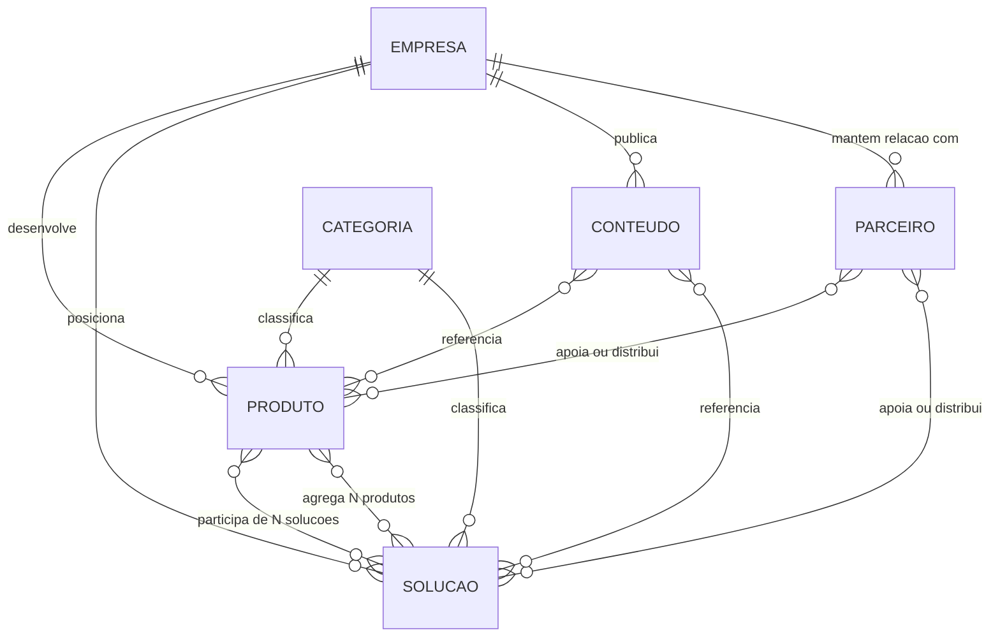
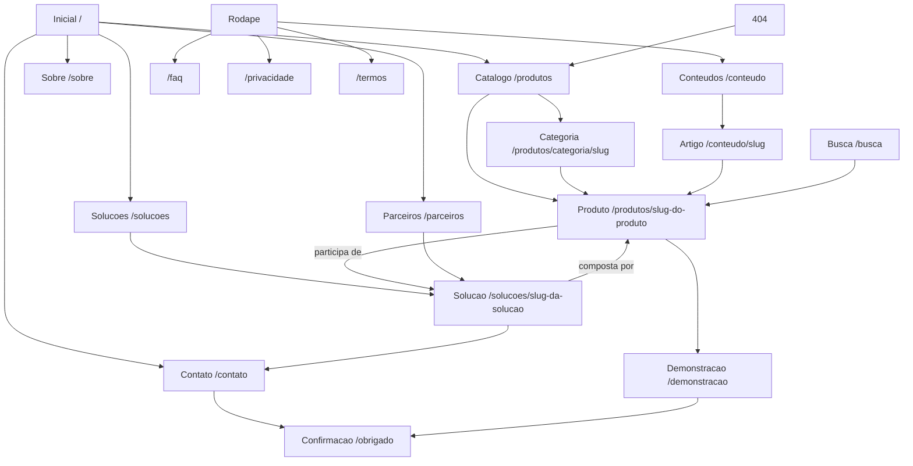
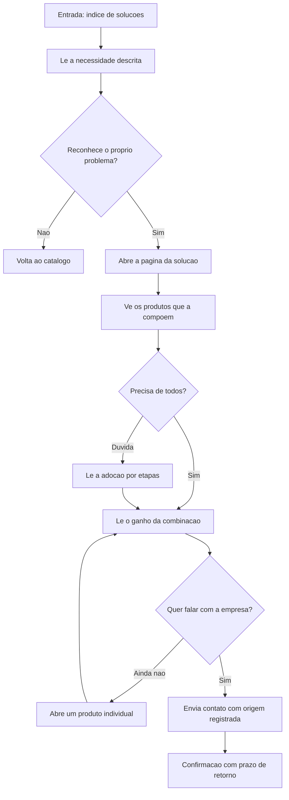

# PRD — Site institucional e de exposição comercial de [EMPRESA]

| Campo | Valor |
|---|---|
| Versão | 1.0 |
| Data | 2026-09-07 |
| Status | Rascunho para revisão |
| Autor | Time de Produto |
| Escopo | Site institucional público |

> Este documento **não define tecnologia**: não escolhe framework, plataforma de conteúdo, provedor ou biblioteca; descreve apenas comportamento, conteúdo, estrutura e regras de produto.
> Todo dado de negócio marcado como **Premissa (PR-0xx)** ou **Pergunta (Q-0xx)** é pendência real, assumida provisoriamente, e exige validação do cliente antes do desenvolvimento.

## 1. Resumo executivo

[EMPRESA] é uma empresa de software em constituição que desenvolverá um **ecossistema de produtos digitais**: vários softwares menores, cada um com finalidade própria, vendidos individualmente, contratados em conjunto ou apresentados como soluções complementares, com expansão contínua do portfólio. **Pergunta Q-001:** qual o nome comercial confirmado — "ArtZan", nome do diretório do projeto, é o nome oficial?

O site é o **ponto central de exposição da empresa**: identidade institucional, catálogo de softwares, soluções compostas, empresas parceiras e informações relevantes para clientes, potenciais clientes e interessados.

**Problema que resolve.** [EMPRESA] não tem canal próprio para explicar o que faz. O problema não é apenas ausência de presença digital: é a dificuldade de comunicar um portfólio que cresce, é vendido isolado ou combinado, e só faz sentido pleno quando o visitante entende a relação entre as peças. Sem canal próprio, cada produto novo exige explicação manual em reunião, cada combinação é narrada caso a caso, e a empresa é percebida como softwares avulsos em vez de ecossistema. Um site artesanal, com página escrita à mão por produto, reproduziria o problema em escala: retrabalho de estrutura e conteúdo a cada lançamento.

**Finalidade comercial.** O site é instrumento de geração de oportunidades, não vitrine passiva. Leva o visitante de "não conheço esta empresa" a "quero falar sobre este produto ou esta combinação". A conversão do MVP é o **contato comercial qualificado**, não a compra online. **Premissa PR-004:** a venda é concluída por atendimento humano; o site qualifica e encaminha.

**Relação com o ecossistema.** O site é a camada de apresentação do ecossistema, não parte dele: descreve os produtos, não os executa. Cada software tem página gerada por **template obrigatório**; cada solução agrega produtos existentes. **Premissa PR-003:** a relação produto↔solução é de muitos para muitos — um produto participa de N soluções, uma solução agrega N produtos. É a decisão estrutural central deste PRD: dela dependem a arquitetura de informação, o modelo de conteúdo e a capacidade de crescer sem reestruturação.

**Resultado esperado.** (1) Canal público capaz de explicar empresa, produtos e combinações sem intervenção comercial prévia; (2) catálogo que aceita produto, categoria, solução e parceiro novos por cadastro, sem alterar estrutura, navegação ou código; (3) caminho de conversão claro em toda página comercial; (4) base de conteúdo preparada para busca orgânica desde o lançamento, já que a empresa não tem autoridade acumulada; (5) apresentação consistente, de modo que o vigésimo produto tenha a mesma qualidade editorial do primeiro.

**Maturidade.** **Premissa PR-007:** no lançamento não há clientes, cases, depoimentos ou logos de clientes publicáveis. O site precisa convencer sem prova social — o que altera decisões de conteúdo descritas nas seções 5 e 7.

## 2. Visão do produto

### 2.1 Conceito e posição no negócio

O site é um **catálogo institucional navegável de um ecossistema de software**, em quatro camadas que se referenciam: empresa, produtos, soluções e parceiros. Não é folheto com lista de produtos anexada; é estrutura de dados publicada, com template por entidade e relações navegáveis nos dois sentidos. Posição no negócio: primeiro contato da maioria dos interessados, principal ativo de explicação do portfólio e origem do funil comercial.

### 2.2 A empresa como marca principal

[EMPRESA] é a marca-guarda-chuva; os softwares são produtos **de** [EMPRESA], nunca marcas independentes competindo entre si. Consequências: identidade visual única; nenhum produto ganha site, subdomínio ou navegação próprios no MVP; o nome da empresa identifica toda página de produto e solução; a promessa institucional é hierarquicamente superior à de cada produto. Isso protege o ativo mais escasso de uma empresa nova — reconhecimento acumulado. **Pergunta Q-003:** existe identidade visual, logotipo ou manual de marca?

### 2.3 Os softwares como produtos

Cada software é **entidade de catálogo**, com página, endereço e conjunto fixo de campos, autoexplicativa: quem chega direto nela entende qual problema o produto resolve, para quem, o que faz e como contratar. Produtos não são apresentados como módulos de um sistema maior — a decisão de negócio é vender software pequeno e delimitado. **Premissa PR-008:** todo produto usa o mesmo template obrigatório, sem páginas artesanais.

### 2.4 As soluções conjuntas como combinações de produtos

Solução é **entidade derivada**: combina dois ou mais produtos para atender necessidade mais ampla do que qualquer um isolado. Não é produto novo — referencia as páginas dos produtos e acrescenta o ganho da combinação. Relação bidirecional: da solução veem-se os produtos; do produto veem-se as soluções. **Premissa PR-010:** solução composta exige no mínimo dois produtos do próprio portfólio.

### 2.5 Os parceiros como parte do ecossistema

Parceiros são organizações externas com relação declarada com [EMPRESA] — tecnologia, implantação, revenda ou indicação. Existem para dar credibilidade a uma empresa nova e explicar como o cliente será atendido além do software. Não são clientes e não podem ser exibidos de forma que sugira isso. **Premissa PR-018:** nenhuma marca de terceiro é publicada sem autorização formal registrada.

### 2.6 Modelo conceitual do ecossistema

Produto e Solução mantêm relação **muitos-para-muitos**. Categoria classifica Produtos e Soluções sem exigir pertencimento único. Parceiro e Conteúdo os referenciam sem exclusividade. Nenhuma dessas relações pode ser texto escrito à mão: todas são vínculos entre registros.

### 2.7 O que este site NÃO é

| Não é | Justificativa |
|---|---|
| **Aplicação** | Não executa nenhum software do portfólio, não processa dados de cliente, não simula funcionalidades. Executar acoplaria o ciclo de vida do site ao de cada produto — exatamente o que a estratégia de portfólio crescente evita. |
| **Área logada** | Sem autenticação, painel, suporte ou gestão de licenças. Sem base de clientes no lançamento (PR-007), a área não teria usuários e imporia requisitos de segurança e suporte desproporcionais. **Premissa PR-001:** o site é público e anônimo no MVP. |
| **E-commerce** | Sem carrinho, checkout ou contratação online. O modelo comercial não está definido (Q-007) e a venda combinada exige negociação de escopo. **Premissa PR-005:** preço não é publicado no MVP. |

Nenhuma exclusão é permanente: são decisões de escopo, revisáveis quando houver base de clientes, modelo comercial fechado e demanda observada.

### 2.8 Princípios de produto

Em conflito entre requisitos, prevalece o princípio de ordem mais alta.

| # | Princípio | Consequência prática no site |
|---|---|---|
| 1 | Clareza | Nenhum texto depende de conhecimento prévio da marca; termo próprio é explicado na primeira ocorrência. |
| 2 | Apresentação profissional | Nenhuma página publicada tem lacuna visível, imagem ausente ou seção "em breve". |
| 3 | Foco nos produtos | A inicial dedica mais espaço a produtos e soluções que ao institucional; o catálogo fica a um clique de qualquer página. |
| 4 | Venda individual ou conjunta | Toda página de produto é completa em si e exibe as soluções de que participa. |
| 5 | Escalabilidade | Adicionar produto, categoria, solução ou parceiro é cadastro — nunca mudança de estrutura, menu ou código. |
| 6 | Conversão | Toda página de produto e solução termina com chamada para ação; nenhuma página é beco sem saída. |
| 7 | Manutenção simples | Campos objetivos e obrigatórios explícitos; nada exige editor técnico (**PR-009**). |
| 8 | Experiência consistente | Ordem fixa de seções e mínimos de preenchimento fazem o vigésimo produto parecer tão cuidado quanto o primeiro. |
| 9 | Mobile-first | Hierarquia, tamanho de listas e comprimento de formulários são definidos primeiro para tela pequena (**PR-017**). |
| 10 | SEO desde a concepção | URLs, títulos, hierarquia de cabeçalhos e metadados são parte do modelo de conteúdo, não ajuste posterior. |
| 11 | Acessibilidade | Contraste, foco visível, navegação por teclado, texto alternativo e rótulo de formulário são critérios de aceite. |
| 12 | Performance | Peso de imagens, itens por listagem e recursos de terceiros são restrições de projeto. |
| 13 | Evolução gradual | Busca, filtros, paginação e blog têm **gatilhos objetivos** (6.6) em vez de entrarem "porque todo site tem". |

## 3. Objetivos do negócio

| ID | Objetivo | Por que importa | Como se manifesta no site | Indicador | Horizonte |
|---|---|---|---|---|---|
| OB-01 | Apresentar [EMPRESA] ao mercado | Empresa desconhecida; sem apresentação clara não há confiança para iniciar conversa | Proposta de valor na inicial e página institucional | Visitantes únicos; leitura do institucional; profundidade de navegação | MVP |
| OB-02 | Divulgar o portfólio | Os produtos são o objeto da venda e hoje só existem na explicação verbal | Catálogo completo e página individual por produto | Visualizações por produto; % de sessões que alcançam um produto | MVP |
| OB-03 | Gerar oportunidades comerciais | O site é a origem prevista do funil | Formulários acessíveis de toda página comercial | Nº de contatos e demonstrações; conversão por página de origem | MVP |
| OB-04 | Facilitar o contato | Fricção de contato é perda direta em ciclo consultivo | Chamadas para ação, formulário curto, canais no rodapé | Início vs. conclusão de formulário; tempo até o retorno | MVP |
| OB-05 | Fortalecer marca e confiabilidade | Sem cases nem clientes (PR-007), credibilidade vem de consistência e cuidado | Identidade única, linguagem padronizada, páginas legais publicadas | Taxa de rejeição; visitantes recorrentes | MVP |
| OB-06 | Apresentar parcerias | Parceiros ampliam a capacidade percebida de entrega de uma empresa pequena | Página de parceiros e vínculo com produtos e soluções | Visualizações e contatos originados na página | MVP (condicionado, ver P-07) |
| OB-07 | Expandir o portfólio sem retrabalho | Retrabalho estrutural a cada lançamento inviabiliza a estratégia | Modelo de conteúdo com entidades e relações; templates; gatilhos | Esforço para publicar produto novo; mudanças estruturais por lançamento | MVP |
| OB-08 | Sustentar descoberta orgânica | Empresa sem audiência depende de busca para ser encontrada | URLs estáveis, campos de SEO no modelo, hierarquia por produto | Sessões orgânicas; páginas indexadas; entradas diretas em produto | MVP (base) / Fase 2 (conteúdo) |
| OB-09 | Posicionar a venda combinada | Diferencial estrutural do negócio; sem isso vira catálogo avulso | Soluções compostas com página própria e vínculo bidirecional | % de sessões que veem produto **e** solução; contatos vindos de solução | MVP |

**Por que ainda não há metas numéricas.** Não existe histórico de tráfego, o portfólio não está definido e o modelo comercial não está fechado; qualquer número seria arbitrário e viraria critério de aceite falso. Para converter indicadores em metas é preciso definir capacidade de atendimento, ciclo de venda, ticket alvo e o baseline dos três primeiros meses. **Pergunta Q-015:** que volume de oportunidades por mês o time comercial consegue atender e qual a expectativa mínima de sucesso? **Pergunta Q-016:** qual o ciclo de venda e o ticket esperado por produto e por solução? **Pergunta Q-017:** quais indicadores serão acompanhados, com que periodicidade e por quem?

## 4. Público-alvo

Perfis são hipóteses derivadas do modelo de negócio informado; não há pesquisa nem base de clientes que os valide. **Pergunta Q-009:** qual o segmento ou vertical alvo? **Pergunta Q-010:** qual o porte de cliente pretendido? **Pergunta Q-011:** qual o mercado geográfico e haverá mais de um idioma? Sem essas respostas, linguagem, profundidade técnica e priorização de conteúdo permanecem provisórias.

| ID | Perfil | Quem é | O que procura | Dúvidas | Ação esperada | Entrada provável | Conteúdo decisivo |
|---|---|---|---|---|---|---|---|
| PU-01 | Decisor de negócio | Sócio ou diretor com autoridade de compra | Saber se a empresa é confiável e se o portfólio resolve problema que custa dinheiro | "Quem é essa empresa?"; "vale o investimento?" | Solicitar contato comercial | Inicial; solução | Proposta de valor, benefícios em resultado, institucional, parceiros |
| PU-02 | Gestor com dor operacional | Responsável por processo manual, disperso ou falho | Reconhecer a própria dor descrita com precisão | "Serve para o meu caso?"; "muda muito a rotina?" | Pedir demonstração | Produto (via busca); solução | "Problema que resolve", casos de uso, funcionalidades |
| PU-03 | Buscador de software específico | Já sabe o tipo de sistema de que precisa | Comparar rápido o que o produto faz | "Faz o que preciso?"; "quanto custa?"; "integra?" | Abrir o produto e pedir demonstração | Produto, vindo de busca | Funcionalidades, imagens, integrações, informações comerciais |
| PU-04 | Cliente de múltiplos produtos | Problema atravessa mais de um processo | Entender o ganho de combinar produtos | "Preciso de tudo?"; "posso começar por um?" | Contato sobre uma solução | Índice de soluções; solução | Ganho da combinação, composição, adoção por etapas |
| PU-05 | Parceiro ou revenda | Consultoria, integrador, revendedor | Entender portfólio e modelo de parceria | "Trabalham com canal?"; "que parceria existe?" | Contato identificado como parceiro | Parceiros; inicial | Tipos de parceria, natureza da relação, canal de contato |
| PU-06 | Avaliador técnico (TI) | Analista ou consultor que valida a escolha | Verificar viabilidade, integrações e risco | "Integra com nossos sistemas?"; "como ficam os dados?" | Aprovar internamente ou questionar | Produto; FAQ | Integrações, requisitos, privacidade e tratamento de dados |
| PU-07 | Visitante orgânico sem contexto | Chega por busca a uma página interna | Saber se aquilo responde à dúvida e quem está por trás | "Que empresa é essa?"; "é séria?" | Aprofundar até um produto ou o institucional | Produto, solução, conteúdo | Identificação da empresa em toda página; caminho ao catálogo e institucional |
| PU-08 | Candidato ou curioso institucional | Profissional, estudante, imprensa, fornecedor | Entender a empresa e como falar com ela | "O que fazem?"; "contratam?" | Encontrar institucional e contato | Sobre a empresa | Sobre e contato geral. **Secundário:** não orienta layout, prioridade nem conversão no MVP |

### 4.1 Priorização de públicos no MVP

O MVP atende com prioridade **PU-01, PU-02, PU-03 e PU-04**: são os perfis ligados a OB-03, e a estrutura que os serve — catálogo, produto, solução e formulários — é a mesma exigida por OB-02, OB-07 e OB-09. **PU-06** é atendido parcialmente: o template reserva espaço para integrações e requisitos, mas profundidade técnica depende de produtos definidos (Q-004). **PU-05** é atendido pela página de parceiros e por um campo de assunto no formulário, sem trilha própria — o volume esperado não justifica página de candidatura no lançamento. **PU-07** é atendido por decisão estrutural, não por página: toda página interna identifica a empresa e oferece caminho ao catálogo e ao institucional. **PU-08** é atendido pelo institucional e pelo contato, sem investimento adicional.

## 5. Proposta de valor

### 5.1 Os 10 primeiros segundos

Em qualquer página de entrada o visitante deve compreender, sem rolar e sem clicar: **o que [EMPRESA] faz**, **para quem**, **que problema resolve** e **qual o próximo passo**. Em páginas internas soma-se **onde estou** — produto individual ou solução composta. Daí três regras: a primeira tela declara a atuação em linguagem do cliente, não em jargão interno; nenhuma frase de abertura depende de conhecimento prévio da marca; existe exatamente uma ação primária visível, sem chamadas concorrentes de mesmo peso.

### 5.2 Estrutura da mensagem em três níveis

| Nível | O que promete | Onde aparece | Regra |
|---|---|---|---|
| 1. Empresa | Por que [EMPRESA] existe e que classe de problema ataca | Inicial, institucional, rodapé, títulos | Formulação única, repetida sem variação |
| 2. Produto | Qual problema aquele software resolve, para quem, com que resultado | Página de produto e card do catálogo | Uma promessa por produto; não repete a da empresa nem a de outro produto |
| 3. Combinação | O que a união entrega que nenhum produto entrega sozinho | Página de solução e bloco de soluções no produto | Deve nomear ganho exclusivo; se for a soma óbvia das partes, a solução não se justifica |

A hierarquia é obrigatória: o nível 2 herda o contexto do 1, e o 3 herda o dos dois. Quem entra direto no nível 2 ou 3 (PU-03, PU-07) precisa conseguir subir por navegação explícita.

### 5.3 Esqueleto de mensagem a preencher pelo time de conteúdo

As lacunas são intencionais e **não devem ser preenchidas por este documento**: nenhum diferencial foi informado, e inventá-lo comprometeria o posicionamento.

**Nível 1 — empresa**
- `[EMPRESA] desenvolve [categoria de software] para [categoria de cliente] que enfrentam [dor principal].`
- `Cada software resolve [escopo delimitado do problema]. Combinados, cobrem [processo ou ciclo completo].`
- `[prova de credibilidade disponível no lançamento]` · Ação: `[ação primária]`

**Nível 2 — produto**
- `[Produto] resolve [dor específica] para [papel ou área], entregando [resultado observável].`
- `Indicado para quem [situação atual do cliente].`
- `Principais capacidades: [capacidade 1], [capacidade 2], [capacidade 3].`

**Nível 3 — combinação**
- `[Solução] reúne [Produto A] e [Produto B] para [necessidade ampla].`
- `Juntos entregam [ganho que nenhum produto entrega isolado].`
- `Pode ser adotada por etapas, começando por [produto de entrada].`

Exemplos de nomenclatura usados em revisão interna devem ser marcados como fictícios (`[Produto A]`, `Software Alfa (exemplo fictício)`) e nunca publicados.

### 5.4 Diferenciais ainda não definidos

- **Pergunta Q-018:** o que [EMPRESA] faz melhor ou diferente das alternativas atuais, incluindo planilhas, processos manuais e concorrentes diretos?
- **Pergunta Q-019:** por que vários softwares menores em vez de uma suíte única, e qual o benefício concreto para o cliente (custo de entrada, velocidade de implantação, escopo sob medida, independência entre áreas)?
- **Pergunta Q-020:** o que a integração entre os produtos entrega que combinar ferramentas de fornecedores diferentes não entrega?
- **Pergunta Q-021:** quais provas de credibilidade existirão no lançamento, sem cases nem logos de clientes — experiência da equipe, piloto autorizado a ser citado, parceiro de referência, certificação, garantia contratual, política de suporte?
- **Pergunta Q-022:** haverá promessa comercial verificável, como prazo de implantação, garantia de migração ou período de avaliação?

Enquanto Q-018 a Q-022 não forem respondidas, qualquer bloco de "diferenciais" permanece como lacuna e **não pode ser publicado preenchido com texto genérico** (princípio 2).

## 6. Arquitetura de informação

### 6.1 Menu principal e justificativa

| Item | Destino | Por que existe |
|---|---|---|
| Softwares | `/produtos` | Objeto da venda e principal motivo de visita (OB-02) |
| Soluções | `/solucoes` | Materializa a venda combinada, diferencial estrutural do modelo (OB-09) |
| Parceiros | `/parceiros` | Credibilidade de empresa nova; atende PU-05 (OB-06) |
| Sobre | `/sobre` | Responde "quem é essa empresa", obrigatória para PU-01 e PU-07 (OB-01) |
| Contato | `/contato` | Conversão sempre disponível (OB-03, OB-04) |

São **cinco itens fixos**, que não crescem com o portfólio — decisão que garante OB-07: menu que lista produtos exige alteração de navegação a cada lançamento e se torna inutilizável rapidamente. "Contato" é apresentado como ação destacada.

### 6.2 Regras de submenu

1. Submenu só existe com mais de um destino real; nunca para um único link.
2. Submenu **não lista produtos, soluções ou parceiros** — lista categorias, estáveis e em número controlado.
3. O submenu de "Softwares" só é ativado quando as categorias forem exibidas (6.6); antes disso o item leva direto ao catálogo.
4. Profundidade máxima de dois níveis; um terceiro indica informação que pertence a uma página, não à navegação.
5. Em tela pequena o menu abre por controle único, mantém a ordem e não esconde a ação de contato.
6. Itens legais e utilitários (privacidade, termos, FAQ, conteúdo) ficam no rodapé.

### 6.3 Mapa do site

### 6.4 Padrão canônico de URLs

**Pergunta Q-002:** qual será o domínio do site?

| Página | Padrão |
|---|---|
| Inicial | `https://[dominio]/` |
| Institucional | `https://[dominio]/sobre` |
| Catálogo | `https://[dominio]/produtos` |
| **Produto** | `https://[dominio]/produtos/[slug-do-produto]` |
| Categoria | `https://[dominio]/produtos/categoria/[slug-da-categoria]` (só quando ativadas) |
| Índice de soluções | `https://[dominio]/solucoes` |
| **Solução** | `https://[dominio]/solucoes/[slug-da-solucao]` |
| Parceiros / Contato / Demonstração | `https://[dominio]/parceiros`, `/contato`, `/demonstracao` |
| Confirmação | `https://[dominio]/obrigado` (não indexável) |
| Conteúdo | `https://[dominio]/conteudo` e `/conteudo/[slug]` (sem data na URL) |
| FAQ e legais | `https://[dominio]/faq`, `/privacidade`, `/termos` |
| Busca | `https://[dominio]/busca` (não indexável) |

Regras: a URL de produto **nunca** inclui categoria — um produto pode pertencer a mais de uma e a URL deixaria de ser estável; a URL de solução nunca inclui os produtos que a compõem, pela mesma razão; não há identificadores numéricos; um endereço publicado nunca é reaproveitado para outro conteúdo.

### 6.5 Regras de slug

1. Apenas letras minúsculas, números e hífen; sem acento, cedilha, espaço ou caractere especial.
2. Derivado do nome oficial, sem prefixos como "software-" ou "solucao-", que se repetiriam em todo o catálogo.
3. Único dentro do tipo; conflito bloqueia a publicação e exige resolução manual, nunca sufixo numérico automático.
4. De 2 a 5 palavras, limite de 60 caracteres, sem ano, versão ou termo temporal.
5. **Premissa PR-014:** slug imutável após a publicação; renomeação inevitável exige redirecionamento permanente, e o endereço antigo não é reutilizado.
6. Gerado automaticamente a partir do nome, editável apenas antes da primeira publicação.

### 6.6 Crescimento do catálogo: gatilhos de ativação

**Premissa PR-002:** o portfólio de lançamento será pequeno — estimativa de trabalho entre 2 e 5 produtos —, o que torna filtros, busca e paginação prejudiciais no início: aumentam a carga cognitiva e sugerem catálogo maior do que o real.

| Recurso | Gatilho | Justificativa |
|---|---|---|
| Grade simples | Sempre | Estado inicial |
| Agrupamento por categoria | 7 produtos | Abaixo disso a leitura sequencial é mais rápida que a triagem |
| Filtro por categoria | 10 produtos, ou 4 categorias com 2+ produtos | Filtro só ajuda quando remove quantidade relevante |
| Ordenação | 12 produtos | Antes não há o que ordenar de forma útil |
| Busca interna | 15 produtos ou 20 conteúdos | Busca com poucos resultados frustra mais do que ajuda |
| Paginação | 24 produtos | Mantém a listagem leve |
| Categoria com URL própria | Filtro ativo **e** descrição editorial da categoria | Categoria sem texto próprio não sustenta indexação |
| Filtro de soluções por produto | 7 soluções | Mesma lógica do catálogo |

Todos esses recursos existem no modelo de conteúdo desde o MVP, ainda que desligados. **Premissa PR-013:** categorias existem como entidade desde o início, mesmo sem exibição, para que a ativação seja configuração e não migração. **Pergunta Q-023:** os gatilhos numéricos são aceitos ou devem ser ajustados ao ritmo previsto de lançamentos?

### 6.7 Modelo de conteúdo

Base da escalabilidade; referenciado pelas demais partes do PRD. "SEO" marca campos que alimentam títulos, descrições, dados estruturados ou compartilhamento.

**Produto**

| Campo | Obrig. | SEO | Observação |
|---|---|---|---|
| Nome | Sim | Sim | Base do título da página |
| Slug | Sim | Sim | Regras de 6.5 |
| Resumo de uma linha | Sim | Sim | Card e base da descrição |
| Problema que resolve | Sim | Sim | 1 a 3 parágrafos |
| Descrição completa | Sim | Sim | — |
| Público-alvo | Sim | Não | Papéis ou tipos de organização |
| Funcionalidades | Sim (mín. 3) | Sim | Título + descrição curta |
| Benefícios | Sim (mín. 3) | Não | Redigidos como resultado |
| Categoria(s) | Sim (mín. 1) | Sim | Relação N:N |
| Imagem de destaque | Sim | Sim | Card e compartilhamento |
| Galeria de telas | Não | Não | Obrigatória quando o material existir (Q-005) |
| Vídeo/demonstração | Não | Não | — |
| Integrações | Não | Não | Só quando existirem de fato |
| Informações comerciais | Sim | Não | Modelo de contratação; preço opcional (PR-005) |
| Soluções das quais participa | Derivado | Sim | Vínculo N:N, nunca digitado |
| Produtos relacionados | Não | Não | Manual ou derivado por categoria |
| Destaque na inicial | Não | Não | Booleano com ordem |
| Título e descrição de SEO | Não | Sim | Automáticos a partir de nome e resumo |
| Status de publicação | Sim | Não | Rascunho / publicado |
| Datas de publicação e atualização | Sim (auto) | Sim | — |

**Solução composta**

| Campo | Obrig. | SEO | Observação |
|---|---|---|---|
| Nome | Sim | Sim | Nomeia a necessidade, não os produtos |
| Slug / Resumo | Sim | Sim | — |
| Necessidade ou cenário atendido | Sim | Sim | — |
| Produtos que compõem | Sim (mín. 2) | Sim | Relação N:N (PR-010) |
| Ganho da combinação | Sim | Sim | Ganho exclusivo da união |
| Público-alvo | Sim | Não | — |
| Casos de uso | Não | Sim | — |
| Adoção por etapas | Não | Não | Produto de entrada |
| Imagem de destaque | Sim | Sim | — |
| Categoria(s) / Parceiros envolvidos | Não | Sim / Não | Relações N:N |
| Título e descrição de SEO | Não | Sim | — |
| Status de publicação | Sim | Não | — |

**Parceiro**

| Campo | Obrig. | SEO | Observação |
|---|---|---|---|
| Nome | Sim | Não | — |
| Logo | Sim | Não | Texto alternativo obrigatório |
| Descrição curta | Sim | Não | 1 a 3 linhas |
| Tipo de parceria | Sim | Não | Taxonomia de P-07 |
| Natureza da relação | Sim | Não | O que a parceria entrega ao cliente |
| Produtos/soluções relacionados | Não | Não | Relação N:N |
| Link externo | Não | Não | Nova aba, sem transferir autoridade de busca |
| Autorização de uso de marca | Sim | Não | Controle interno; sem ele não publica (PR-018) |
| Ordem / Status | Sim | Não | — |

**Categoria**

| Campo | Obrig. | SEO | Observação |
|---|---|---|---|
| Nome / Slug | Sim | Sim | — |
| Descrição curta | Não | Sim | Obrigatória se ganhar URL própria |
| Ordem de exibição | Não | Não | — |
| Visível publicamente | Sim | Não | Permite existir sem ser exibida (PR-013) |

**Página institucional**

| Campo | Obrig. | SEO | Observação |
|---|---|---|---|
| Título / Slug | Sim | Sim | Slug fixo para páginas de menu |
| Corpo em blocos | Sim | Sim | Blocos reordenáveis, sem editar estrutura |
| Imagem de destaque | Não | Sim | — |
| Título e descrição de SEO | Não | Sim | — |
| Indexável | Sim | Sim | Falso em `/obrigado` e `/busca` |
| Data de atualização | Sim (auto) | Não | Relevante para páginas legais |

**Item de conteúdo**

| Campo | Obrig. | SEO | Observação |
|---|---|---|---|
| Título / Slug / Resumo / Corpo | Sim | Sim | Slug sem data |
| Data de publicação | Sim | Sim | — |
| Tema editorial | Não | Sim | — |
| Produtos e soluções relacionados | Não | Sim | Leva tráfego ao catálogo |
| Imagem de destaque | Sim | Sim | — |
| Autor / Status | Não / Sim | Não | — |

### 6.8 Relação entre empresa, produtos, soluções e parceiros

Navegação cruzada obrigatória e bidirecional: **Produto → Solução** (lista as soluções de que participa, geradas por vínculo; sem vínculo o bloco é omitido, nunca exibido vazio); **Solução → Produto** (lista os produtos com link, sem duplicar a descrição de cada um); **Produto ↔ Produto** (complementaridade derivada por categoria ou manual, sempre rotulada "relacionado", nunca "solução"); **Parceiro → Produto/Solução** (indica em que parte do portfólio o parceiro atua); **Produto/Solução → Empresa** (toda página interna oferece caminho ao institucional, atendendo PU-07); **Conteúdo → Produto/Solução** (artigos referenciam entidades do catálogo, virando porta de entrada do portfólio).

### 6.9 Regras de crescimento sem reestruturação

1. O menu **não lista produtos, soluções ou parceiros individualmente** e não muda quando o portfólio cresce.
2. **Nenhuma página de produto ou solução é escrita fora do template** — não existe "página especial" para produto estratégico.
3. Toda listagem é gerada a partir dos registros publicados, jamais mantida como lista fixa.
4. A relação produto↔solução é vínculo entre registros, nunca texto digitado: incluir um produto numa solução não pode exigir reescrever nenhuma das duas páginas.
5. Categorias, filtros, busca e paginação já existem no modelo e são **ativados por configuração** nos gatilhos de 6.6.
6. Blocos da inicial que exibem produtos, soluções ou parceiros são alimentados por seleção de registros com limite de itens; não contêm texto sobre entidades específicas.
7. Produto retirado do portfólio é despublicado, não apagado: a URL redireciona para o catálogo ou para o sucessor, preservando o histórico de busca.
8. Nenhum requisito assume número fixo de produtos, soluções, categorias ou parceiros — inclusive **zero**, tratado como estado válido em cada listagem.

## 7. Páginas e requisitos

Cada página recebe identificador P-xx. Os requisitos numerados (RF/RNF) pertencem a outra parte do PRD; aqui os comportamentos são descritos em texto. **Pergunta Q-029:** existe data alvo de lançamento ou restrição de orçamento que altere a priorização entre MVP, Fase 2 e Futuro?

### P-01 — Página inicial — MVP

**Objetivo.** Explicar em uma tela o que [EMPRESA] faz, mostrar o portfólio, evidenciar a venda combinada e conduzir ao contato. **Público.** PU-01, PU-04; secundariamente PU-02 e PU-05.
**Conteúdo necessário.** Proposta de valor institucional, apresentação da empresa, produtos em destaque, soluções, parceiros, benefícios, elementos de confiança, chamadas para ação, rodapé.

**Seções em ordem.**
1. **Proposta de valor** — frase principal, apoio e ação primária única. Sem carrossel: mensagem rotativa impede fixar a promessa em quem vê o site uma vez.
2. **Apresentação da empresa** — 2 a 4 linhas com link para `/sobre`; responde a PU-01 antes que ele desista.
3. **Destaque dos softwares** — 3 a 6 produtos com o card do catálogo (P-03) e link "ver todos"; ordem por campo de destaque, não por código.
4. **Apresentação de soluções** — 2 a 4 soluções, cada uma indicando os produtos que a compõem e o ganho em uma linha; materializa OB-09 na página de maior tráfego.
5. **Benefícios** — 3 a 6 benefícios do modelo de portfólio (adotar por etapas, escopo sob medida, integração sem trocar de fornecedor), redigidos como resultado; conteúdo condicionado a Q-018 e Q-019.
6. **Empresas parceiras** — faixa de logos com título explicativo; **condicional**, só renderizada com ao menos um parceiro publicado e autorizado.
7. **Elementos de confiança.**
8. **Chamada para ação final** — repete a ação primária, com alternativa de menor compromisso ("conhecer os softwares").
9. **Rodapé.**

**Chamadas para ação.** No máximo uma ação primária por seção. A ação primária global é o contato comercial; a secundária é explorar o catálogo. É proibido haver chamadas de peso visual idêntico competindo na mesma tela.
**Elementos de confiança sem prova social.** Sem clientes nem depoimentos (PR-007), a confiança vem de: identificação completa da empresa no rodapé; páginas legais publicadas e datadas; clareza sobre o que acontece após o envio do formulário; parceiros, quando existirem; consistência de apresentação. **Proibido:** logo genérico, número inventado, selo sem lastro, depoimento fictício. Enquanto Q-021 não for respondida, o bloco exibe apenas o verificável.

**Rodapé — quatro colunas** (empilhadas em tela pequena, mesma ordem):

| Coluna | Conteúdo |
|---|---|
| 1 Empresa | Identificação de [EMPRESA], frase institucional, links `/sobre` e `/parceiros` |
| 2 Portfólio | `/produtos`, `/solucoes` e, quando ativadas, categorias principais |
| 3 Contato | `/contato`, `/demonstracao`, canais diretos (Q-012), horário de atendimento |
| 4 Institucional e legal | `/faq`, `/conteudo`, `/privacidade`, `/termos`, direitos e data de atualização |

**Ações.** Abrir contato ou demonstração; navegar para catálogo, solução, parceiro ou institucional. **Relação.** Hub: liga-se a P-02 a P-09 e ao rodapé.
**Requisitos específicos.** Blocos de produtos, soluções e parceiros são alimentados por registros publicados, com limite de itens e comportamento definido para lista vazia (seção omitida, nunca espaço em branco). Ordem das seções fixa; quantidade de itens configurável.
**Aceite.** [ ] Proposta de valor compreensível sem rolagem em tela pequena; [ ] exatamente uma ação primária na primeira tela; [ ] blocos gerados por registros; [ ] nenhum bloco vazio renderizado; [ ] produto em destaque leva à sua página em um clique; [ ] rodapé com as quatro colunas; [ ] nenhum elemento de confiança não verificável publicado.
**Prioridade.** MVP — é a entrada da marca e a única página que apresenta o ecossistema inteiro; sem ela, OB-01, OB-05 e OB-09 ficam sem suporte.

### P-02 — Sobre a empresa — MVP

**Objetivo.** Responder "quem é essa empresa" a quem precisa confiar antes de comprar. **Público.** PU-01, PU-07, PU-08.
**Conteúdo e seções.** Promessa institucional; o que fazemos; como trabalhamos; por que um ecossistema de produtos; equipe (opcional, condicionada a Q-021); chamada para contato.
**Interface e ações.** Texto em blocos, imagem opcional, links para catálogo e contato. **Relação.** Recebe tráfego de P-01, do rodapé e de toda página interna (PU-07).
**Requisitos específicos.** Página institucional editável em blocos; não pode conter afirmação não verificável sobre tamanho, tempo de mercado ou clientes.
**Aceite.** [ ] Explica o modelo de portfólio; [ ] identifica a empresa; [ ] termina com caminho para catálogo e contato; [ ] nenhuma informação inventada.
**Prioridade.** MVP — empresa desconhecida sem institucional não passa da primeira triagem de PU-01.

### P-03 — Catálogo de softwares — MVP

**Objetivo.** Permitir que o visitante identifique, em uma varredura, qual produto resolve seu problema. **Público.** PU-02, PU-03, PU-04, PU-06.
**Conteúdo e seções.** Título e introdução curta sobre o portfólio; listagem de todos os produtos publicados; caminho para soluções; chamada para contato ao final.
**Como os produtos são apresentados.** Grade uniforme de cards de mesmo tamanho e estrutura, sem hierarquia visual entre produtos: card maior para um produto quebraria a comparabilidade e criaria manutenção manual.
**Campos exatos do card.** (1) imagem de destaque; (2) nome; (3) resumo de uma linha; (4) rótulo de categoria, quando exibida; (5) selo "participa de soluções", quando houver vínculo; (6) ação "ver detalhes" com o nome do produto associado, para tecnologias assistivas. Nada além disso: preço não entra (PR-005) e lista de funcionalidades não entra, porque destruiria a comparabilidade da grade.
**Filtros, categorias e busca.** Ativados pelos gatilhos de 6.6 — agrupamento em 7 produtos, filtro em 10 produtos ou 4 categorias relevantes, busca em 15 produtos. Com filtro ativo: seleção múltipla, contagem de resultados visível, estado sem resultados com opção de limpar filtro e link para contato. Antes dos gatilhos, busca é ruído: catálogo que cabe na tela não precisa ser pesquisado.
**Acesso ao produto.** Todo o card é acionável, com destino único; nenhuma informação relevante existe apenas no card.
**Sinalização de soluções.** O selo indica existência, não quantidade, para não sugerir ranking entre produtos.
**Estados de exceção.** *Poucos produtos (1 a 3)* — estado esperado no lançamento (PR-002): mesma grade, sem filtro, sem busca, sem espaços de preenchimento; a introdução assume portfólio em formação e reforça soluções e contato. Proibido card falso, item "em breve" sem página ou produto fictício. *Catálogo vazio* — mensagem objetiva e chamada para contato, sem página quebrada.
**Ações e relação.** Abrir produto, filtrar, buscar, ir a soluções, contato. Origem de P-04; destino de P-01, do menu, de P-15 e P-17.
**Aceite.** [ ] Todos os produtos publicados aparecem, sem lista fixa; [ ] todos os cards têm os mesmos campos; [ ] filtro e busca desativados abaixo dos gatilhos; [ ] estados vazio e com poucos produtos tratados; [ ] selo de solução só com vínculo existente.
**Prioridade.** MVP — sustenta OB-02 e é o principal ponto de decisão de navegação.

### P-04 — Página individual de software — MVP

**Objetivo.** Explicar um produto de forma autossuficiente e conduzir a contato ou demonstração. **Público.** PU-02, PU-03, PU-06; PU-07 quando vem de busca.

**Template obrigatório — ordem fixa**

| # | Seção | Obrigatória | Regra |
|---|---|---|---|
| 1 | Nome, resumo de uma linha, categoria, ação primária | Sim | Primeiro conteúdo da página |
| 2 | Problema que resolve | Sim | Linguagem do cliente; conecta PU-02 ao produto |
| 3 | Para quem é | Sim | Papéis ou tipos de organização; evita lead desqualificado |
| 4 | Principais funcionalidades | Sim (mín. 3) | Título curto + uma linha por item |
| 5 | Benefícios | Sim (mín. 3) | Resultado, não recurso; sem repetir a seção 4 |
| 6 | Imagens ou demonstração | Condicional | Obrigatória quando houver material (Q-005); omitida por completo se não houver — nunca substituída por imagem genérica |
| 7 | Integrações | Condicional | Só quando existirem; relevante para PU-06 |
| 8 | Informações comerciais | Sim | Modelo de contratação; sem preço no MVP (PR-005) |
| 9 | Soluções das quais participa | Derivada | Gerada por vínculo; omitida se não houver |
| 10 | Produtos relacionados | Opcional | Rotulados "relacionados", nunca "solução" |
| 11 | Chamada para contato ou demonstração | Sim | Nenhuma página de produto termina sem ação |

**Ausência de preço.** Texto padrão único em todo o catálogo, explicando que o valor depende do escopo e indicando o caminho para proposta; frases evasivas variando por produto quebrariam o princípio 8. **Pergunta Q-008:** o preço será público, faixado ou sob consulta? A resposta altera todos os produtos de uma vez.
**Como o template garante consistência.** A ordem é fixa e não editável por produto; seções sem conteúdo são omitidas, nunca improvisadas; os mínimos (3 funcionalidades, 3 benefícios) impedem páginas rasas; e as seções derivadas (9 e 10) se atualizam sozinhas — publicar uma solução nova enriquece automaticamente as páginas de todos os produtos que ela agrega. É o mecanismo que sustenta OB-07 no nível da página.
**Interface, ações e relação.** Breadcrumb catálogo → produto; galeria quando existir; ação primária acessível durante a leitura; links para soluções e produtos relacionados. Origem: P-03, P-01, P-06, P-11, busca externa. Destino: P-06, P-08, P-09.
**Requisitos específicos.** A página é gerada pelo template para qualquer produto cadastrado; publicar exige todos os campos obrigatórios; deve ser compreensível para quem chega sem contexto, identificando [EMPRESA] e oferecendo caminho ao institucional.
**Aceite.** [ ] Todas as páginas de produto seguem a mesma ordem; [ ] nenhuma seção obrigatória vazia em produto publicado; [ ] seções sem conteúdo omitidas; [ ] bloco de soluções reflete os vínculos atuais sem edição manual; [ ] ação de contato ou demonstração visível ao fim; [ ] publicar produto novo não exige alteração estrutural.
**Prioridade.** MVP — destino de maior valor comercial e principal ponto de entrada orgânica.

### P-05 — Índice de soluções — MVP

**Objetivo.** Mostrar que os produtos se combinam e conduzir à solução adequada. **Público.** PU-01, PU-04.
**Conteúdo e seções.** Explicação curta do que é solução composta em [EMPRESA]; grade de soluções com nome, resumo, produtos que a compõem e ganho em uma linha; caminho ao catálogo; chamada para ação.
**Requisitos específicos.** Listagem gerada por registros; filtro por produto ativado em 7 soluções; se não houver soluções, o item de menu é ocultado em vez de levar a página vazia.
**Aceite.** [ ] Cada card mostra os produtos que compõem a solução; [ ] o texto distingue solução de produto; [ ] estado vazio tratado.
**Prioridade.** MVP — sem esta página a venda combinada (OB-09) não tem lugar próprio. **Pergunta Q-006:** quais soluções compostas existirão no lançamento? Se nenhuma, P-05 e P-06 passam a Fase 2 e o item de menu é removido.

### P-06 — Página individual de solução — MVP

**Objetivo.** Explicar uma necessidade ampla, mostrar que a combinação de produtos a resolve e converter em contato. **Público.** PU-01, PU-04; PU-02 quando a dor atravessa processos.
**Critério para existir uma solução composta.** Quatro condições cumulativas: (1) reúne **dois ou mais** produtos do portfólio (PR-010); (2) atende necessidade **nomeável pelo cliente**, não agrupamento interno por conveniência; (3) declara **ganho exclusivo da combinação**, que nenhum produto entrega isolado; (4) tem caminho de adoção descrito, ainda que por etapas. Combinações que não passam nos quatro critérios permanecem como "produtos relacionados", sem página própria.
**Seções em ordem.** 1. Nome e resumo da necessidade; 2. Cenário ou problema amplo; 3. Produtos que compõem, com card e link; 4. Ganho da combinação (obrigatório); 5. Casos de uso (opcional); 6. Adoção por etapas (opcional); 7. Parceiros envolvidos (opcional); 8. Chamada para contato.
**Como relacionar produtos.** Por vínculo entre registros, exibindo o card padrão do catálogo. A solução **não reescreve** a descrição do produto: referencia — o que evita divergência quando o produto é atualizado.
**Como evitar confusão entre produto e solução.** *Rotulagem:* todo título de solução é precedido do rótulo "Solução" e todo título de produto do rótulo "Software", fixos e não editáveis. *Linguagem:* produto usa verbos de capacidade ("faz", "controla", "registra"); solução usa verbos de cobertura ("cobre", "conecta", "integra"). Solução nunca é descrita com funcionalidades próprias — se tiver, é produto novo. *Visual:* tratamentos distintos e consistentes; o card de solução sempre exibe os produtos que a compõem. *Breadcrumb:* `Início › Soluções › [Solução]` e `Início › Softwares › [Produto]`, sempre visível. *URL:* namespaces separados e nunca aninhados (6.4).
**Expansão sem reescrita.** Incluir ou remover produto é alterar o vínculo: a página se recompõe e as páginas de produto afetadas se atualizam. Apenas o "ganho da combinação" exige revisão editorial quando a composição muda — e o sistema deve sinalizar essa pendência ao editor.
**Mesmo produto em várias soluções.** Situação normal. A página do produto lista todas as soluções sem hierarquia; cada solução exibe o produto com o mesmo card; nenhum texto da página de produto pode assumir uma solução específica como contexto — é proibido escrever "faz parte da nossa solução de X" fora do bloco derivado.
**Aceite.** [ ] Mínimo de dois produtos vinculados por registro; [ ] ganho da combinação preenchido e não sendo a soma óbvia das partes; [ ] rótulo, breadcrumb e URL distinguem solução de produto; [ ] alterar a composição não exige reescrever a página; [ ] produto em várias soluções aparece corretamente em todas.
**Prioridade.** MVP, condicionada a Q-006 — é onde OB-09 se converte em oportunidade.

### P-07 — Parceiros — MVP (condicionado)

**Objetivo.** Apresentar as organizações do ecossistema e reforçar credibilidade. **Público.** PU-05, PU-01, PU-06.
**Conteúdo e seções.** Introdução sobre o papel das parcerias; lista agrupada por tipo, com nome, logo, descrição curta, tipo de parceria, natureza da relação e link ou ação; bloco "seja um parceiro" com caminho para contato.

**Taxonomia de tipos de parceria — rascunho a validar**

| Tipo | Descrição provisória |
|---|---|
| Tecnológico | Integração entre produtos ou infraestrutura complementar |
| Implantação | Executa implantação, configuração e treinamento junto ao cliente |
| Revenda | Comercializa produtos ou soluções de [EMPRESA] |
| Indicação | Encaminha oportunidades sem participar da entrega |
| Institucional | Associações, entidades e programas dos quais [EMPRESA] participa |

**Pergunta Q-024:** esta taxonomia corresponde aos modelos de parceria pretendidos? Nenhum parceiro real é citado neste documento.
**Uso de marca de terceiros.** Logo e nome só são publicados com autorização formal registrada no modelo de conteúdo (PR-018); a descrição da relação é acordada com o parceiro; o link externo não transfere autoridade de busca; a remoção deve ser imediata mediante solicitação.
**Sem parceiros no lançamento.** **Premissa PR-011:** a lista pode estar vazia. Nesse caso a página não é publicada, o item de menu é ocultado e a faixa da inicial é omitida — nunca substituída por logos genéricos ou texto que sugira parcerias inexistentes. O bloco "seja um parceiro" pode permanecer como página simples se houver interesse em captar canal.
**Aceite.** [ ] Nenhum parceiro publicado sem autorização; [ ] tipo de parceria visível; [ ] estado vazio oculta página e menu; [ ] nenhum parceiro fictício.
**Prioridade.** MVP, condicionado — entra no lançamento se houver ao menos um parceiro autorizado. **Pergunta Q-025:** existirão parceiros no lançamento e há autorização de uso de marca obtida? Caso contrário, Fase 2.

### P-08 — Contato comercial — MVP

**Objetivo.** Capturar oportunidades com qualificação mínima e sem fricção. **Público.** PU-01 a PU-05.
**Conteúdo e seções.** Frase de contexto; formulário; canais alternativos; aviso de privacidade.
**Requisitos específicos.** Campos mínimos: nome, e-mail, empresa, assunto (com opção "sou parceiro" para PU-05), produto ou solução de interesse e mensagem. O campo de interesse é pré-preenchido quando a origem é uma página de produto ou solução, atribuindo a origem sem esforço do visitante. Validação com mensagem clara por campo, proteção contra envio automatizado, confirmação de envio e informação sobre uso dos dados com link para `/privacidade`. **Premissa PR-012:** o formulário é o canal principal; canais diretos dependem de confirmação.
**Aceite.** [ ] Funciona em tela pequena; [ ] o erro identifica o campo; [ ] origem registrada; [ ] confirmação exibida; [ ] aviso de privacidade presente.
**Prioridade.** MVP — sem ele não há OB-03. **Pergunta Q-012:** quais canais de contato existirão? **Pergunta Q-013:** quem recebe os leads e com que prazo de resposta? **Pergunta Q-014:** os envios devem ser encaminhados a alguma ferramenta de gestão comercial?

### P-09 — Solicitação de demonstração — MVP

**Objetivo.** Atender quem já escolheu um produto e quer vê-lo funcionando. **Público.** PU-02, PU-03, PU-06.
**Requisitos específicos.** Variante do formulário de P-08, não página de estrutura independente: mesmos campos base, mais identificação do produto ou solução e disponibilidade de agenda. Deve explicitar que a demonstração é conduzida por pessoa (**Premissa PR-016**), evitando a expectativa de acesso imediato ao software. **Pergunta Q-026:** haverá demonstração ao vivo, ambiente de avaliação, vídeo gravado ou apresentação comercial?
**Aceite.** [ ] Produto de origem identificado; [ ] formato da demonstração explicado; [ ] confirmação exibida.
**Prioridade.** MVP — conversão de maior intenção e chamada final do template de produto.

### P-10 — Índice de conteúdos (blog) — Fase 2

**Objetivo.** Atrair tráfego orgânico de quem ainda não busca a marca e criar porta de entrada ao catálogo (OB-08). **Público.** PU-07, PU-02. **Requisitos.** Listagem por data com resumo, imagem e tema; vínculo com produtos e soluções. **Aceite.** [ ] Listagem gerada por registros; [ ] cada item leva ao artigo.
**Prioridade.** **Fase 2** — conteúdo sem cadência sustentada envelhece e produz o efeito oposto: um blog com dois artigos antigos comunica abandono. **Premissa PR-015:** blog não é pré-requisito de lançamento. **Pergunta Q-027:** existe responsável e cadência editorial definidos?

### P-11 — Item de conteúdo — Fase 2

**Objetivo.** Responder a uma dúvida específica e conduzir ao produto ou solução correspondente. **Público.** PU-07, PU-02. **Requisitos.** Template único; bloco obrigatório de produtos e soluções relacionados ao final; identificação da empresa para quem chega de busca. **Aceite.** [ ] Todo artigo leva a ao menos um destino do catálogo ou ao contato. **Prioridade.** Fase 2, junto de P-10.

### P-12 — FAQ — Fase 2

**Objetivo.** Reduzir dúvidas repetidas no atendimento e responder objeções de PU-01 e PU-06 antes do contato. **Requisitos.** Perguntas agrupadas por tema — contratação, suporte, integrações, tratamento de dados —, com itens vinculáveis a produtos. **Aceite.** [ ] Nenhuma resposta baseada em suposição.
**Prioridade.** **Fase 2** — perguntas frequentes reais só são conhecidas depois de haver contatos reais; um FAQ presumido no lançamento seria conteúdo sem lastro.

### P-13 — Política de privacidade — MVP

**Objetivo.** Informar o tratamento dos dados pessoais coletados por formulários e ferramentas de medição. **Público.** PU-06, PU-01. **Requisitos.** Página institucional com data de atualização visível, linguagem acessível, finalidades descritas e canal para exercício de direitos; referenciada por todo formulário. **Aceite.** [ ] Acessível do rodapé e de todo formulário; [ ] data visível.
**Prioridade.** **MVP, não negociável** — há coleta de dados desde o primeiro dia (P-08, P-09). **Premissa PR-019:** o conteúdo jurídico é fornecido e validado pelo cliente; o site apenas publica. **Pergunta Q-028:** quem redige e valida os textos legais?

### P-14 — Termos de uso — MVP

**Objetivo.** Definir condições de uso do site, propriedade intelectual do conteúdo e limites de responsabilidade. **Requisitos.** Mesmo template institucional de P-13, com data de atualização. **Aceite.** [ ] Acessível do rodapé; [ ] data visível. **Prioridade.** MVP — complementa P-13 e sustenta a percepção de seriedade (OB-05) a custo baixo.

### P-15 — Página não encontrada (404) — MVP

**Objetivo.** Recuperar quem chegou a endereço inválido — inevitável quando conteúdo é despublicado ou links externos envelhecem. **Requisitos.** Explicação objetiva sem culpar o visitante; caminhos para inicial, catálogo, soluções e contato; busca quando ativada; mesma identidade das demais páginas. **Aceite.** [ ] Oferece ao menos três caminhos de retorno. **Prioridade.** MVP — custo baixo e evita perder tráfego orgânico, o mais caro de conquistar (OB-08).

### P-16 — Confirmação de envio — MVP

**Objetivo.** Confirmar o recebimento, informar o prazo de retorno e oferecer o próximo passo em vez de encerrar a sessão. **Requisitos.** Mensagem de confirmação; prazo de resposta (Q-013); sugestões de navegação; página não indexável, o que também permite medir conversões com precisão. **Aceite.** [ ] Prazo informado; [ ] ao menos um próximo passo oferecido; [ ] não indexável. **Prioridade.** MVP — sem confirmação explícita o visitante reenvia o formulário ou abandona sem saber se foi atendido.

### P-17 — Busca no site — Futuro

**Objetivo.** Encontrar produtos, soluções e conteúdos quando o volume tornar a navegação insuficiente. **Requisitos.** Busca unificada com resultados rotulados por tipo e estado sem resultados que ofereça caminho ao catálogo e ao contato. **Aceite.** [ ] Resultados identificam o tipo de entidade. **Prioridade.** **Futuro** — com portfólio pequeno (PR-002) a busca não é usada e ainda sugere catálogo maior do que o real; ativação pelo gatilho de 6.6.

### P-18 — Categoria de produtos — Fase 2

**Objetivo.** Agrupar produtos por tipo de problema e criar página com potencial de indexação para termos de categoria. **Requisitos.** Listagem filtrada com descrição editorial própria obrigatória; sem essa descrição a página não é publicada, para não gerar conteúdo raso. **Aceite.** [ ] Descrição própria presente; [ ] listagem gerada por vínculo. **Prioridade.** Fase 2, condicionada ao gatilho de 6.6.

## 8. Jornadas do usuário

### J-01 — Descoberta institucional até o contato

**Entrada.** Página inicial (indicação, campanha, busca pelo nome da empresa). **Público.** PU-01.
**Etapas e decisões.** Lê a proposta de valor e decide se a empresa é relevante → percorre os produtos em destaque → abre o catálogo → abre um produto → avalia → aciona contato. Decisões: "faz algo que me interessa?"; "algum produto trata do meu problema?"; "vale iniciar conversa?".
**Resultado esperado.** Contato enviado com produto de interesse identificado.
**Abandono e mitigação.** Proposta genérica → esqueleto de mensagem obrigatório (5.3). Catálogo confuso → cards uniformes e comparáveis (P-03). Desconfiança de empresa nova → institucional acessível de qualquer página e páginas legais publicadas. Formulário longo → campos mínimos e origem pré-preenchida (P-08).

### J-02 — Busca por software específico até a demonstração

**Entrada.** Página de produto, vinda de busca externa. **Público.** PU-03.
**Etapas e decisões.** Chega direto no produto → verifica funcionalidades e imagens → checa integrações → procura preço, não encontra e lê a explicação padrão → solicita demonstração. Decisões: "faz o que preciso?"; "quanto custa?"; "vale pedir demonstração sem saber o preço?".
**Resultado esperado.** Pedido de demonstração com produto identificado.
**Abandono e mitigação.** Ausência de preço como bloqueio → texto padrão único explicando o critério da proposta (P-04). Falta de imagens → material obrigatório quando existir e omissão limpa quando não existir (Q-005). Dúvida técnica → seção de integrações. Desconhecimento da marca → identificação e caminho ao institucional em toda página interna.

### J-03 — Necessidade ampla até a solução composta

**Entrada.** Índice de soluções ou bloco de soluções da inicial. **Público.** PU-04, PU-01.
**Etapas e decisões.** Reconhece a necessidade descrita → abre a solução → vê os produtos que a compõem → avalia se precisa de tudo → lê o caminho de adoção → solicita informações. Decisões: "meu problema é esse?"; "preciso contratar tudo?"; "posso começar por um?".
**Resultado esperado.** Contato com a solução registrada como origem.
**Abandono e mitigação.** Escopo percebido como grande demais → adoção por etapas explícita (P-06). Confusão produto/solução → rótulos fixos, linguagem distinta e breadcrumb. Dúvida sobre o ganho → campo obrigatório "ganho da combinação".

### J-04 — Do parceiro à solução

**Entrada.** Página de parceiros, em geral por indicação do próprio parceiro. **Público.** PU-05, PU-01.
**Etapas e decisões.** Localiza o parceiro → entende o tipo de parceria e a natureza da relação → segue para a solução ou produto vinculado → avalia → entra em contato. Decisões: "que relação existe entre as empresas?"; "quem me atende?".
**Resultado esperado.** Contato qualificado com o vínculo de parceria conhecido.
**Abandono e mitigação.** Relação vaga → campo obrigatório de natureza da relação. Página como beco sem saída → vínculo obrigatório a produtos e soluções quando existir. Ausência de parceiros → página e menu ocultos, evitando frustração (PR-011).

### J-05 — Entrada orgânica em produto até a empresa

**Entrada.** Página de produto ou conteúdo, vinda de busca. **Público.** PU-07.
**Etapas e decisões.** Lê sem contexto de marca → identifica [EMPRESA] → decide se investiga → abre o institucional → volta ao catálogo → contata ou sai. Decisões: "que empresa é essa?"; "é confiável?"; "tem mais coisa útil para mim?".
**Resultado esperado.** Sessão que se aprofunda da página de entrada para o portfólio.
**Abandono e mitigação.** Página interna sem identidade → identificação e breadcrumb obrigatórios. Ausência de próximo passo → toda página de produto e conteúdo termina com ação e links para catálogo e soluções. Institucional que não explica o modelo → seção "por que um ecossistema de produtos" em P-02.

### J-06 — Retorno para comparação entre dois produtos

**Entrada.** Retorno direto ao catálogo ou a produto já visitado. **Público.** PU-02, PU-03, PU-06.
**Justificativa.** O modelo é de produtos pequenos com escopos vizinhos: a dúvida "qual destes dois resolve meu caso?" é estruturalmente provável e, sem resposta, vira contato desqualificado ou abandono.
**Etapas e decisões.** Volta ao catálogo → abre dois produtos em sequência → compara problema resolvido, público-alvo e funcionalidades → verifica se há solução que reúne os dois → decide entre um produto ou a combinação → contata. Decisões: "qual dos dois é o meu caso?"; "são concorrentes internos ou complementares?".
**Resultado esperado.** Contato com escolha definida, ou pedido de orientação citando os dois produtos.
**Abandono e mitigação.** Estruturas divergentes entre páginas → template de ordem fixa, que permite comparar lendo a mesma seção nas duas. Sobreposição aparente → seções "problema que resolve" e "para quem é" obrigatórias e distintas. Combinação não percebida → bloco de soluções derivado em ambas as páginas. Sem comparador no MVP: com poucos produtos (PR-002) a consistência do template resolve; o comparador fica como **Futuro**, junto ao gatilho de filtros.

## 8.9 Premissas registradas nesta parte

| ID | Enunciado |
|---|---|
| PR-001 | Site totalmente público e anônimo no MVP, sem área logada |
| PR-002 | Portfólio de lançamento pequeno, estimado entre 2 e 5 produtos |
| PR-003 | Relação produto↔solução é muitos-para-muitos nos dois sentidos |
| PR-004 | Venda concluída por atendimento humano; o site qualifica e encaminha |
| PR-005 | Preço não é publicado no MVP |
| PR-006 | Site publicado em um único idioma, português do Brasil |
| PR-007 | Sem clientes, cases, depoimentos ou logos de clientes no lançamento |
| PR-008 | Todo produto publicado usa o mesmo template obrigatório |
| PR-009 | Conteúdo mantido por equipe reduzida e não técnica |
| PR-010 | Solução composta exige no mínimo dois produtos do portfólio |
| PR-011 | A lista de parceiros pode estar vazia no lançamento |
| PR-012 | Formulário é o canal principal de contato; canais diretos a confirmar |
| PR-013 | Categorias existem no modelo desde o início, mesmo sem exibição |
| PR-014 | Slug imutável após publicação; renomeação exige redirecionamento permanente |
| PR-015 | Blog e conteúdo editorial não são pré-requisito de lançamento |
| PR-016 | Demonstração conduzida por pessoa, sem acesso imediato ao software |
| PR-017 | Parte relevante do tráfego será móvel, orientando o desenho mobile-first |
| PR-018 | Marca de terceiro só é publicada com autorização formal registrada |
| PR-019 | Textos legais fornecidos e validados pelo cliente; o site apenas publica |

**PR-006** aplica-se a todo o documento: um único idioma no lançamento, com internacionalização tratada apenas se Q-011 indicar outro mercado.

## 8.10 Perguntas registradas nesta parte

| ID | Pergunta |
|---|---|
| Q-001 | Qual o nome comercial confirmado? "ArtZan", nome do diretório, é o nome oficial? |
| Q-002 | Qual será o domínio do site? |
| Q-003 | Existe identidade visual, logotipo ou manual de marca? |
| Q-004 | Quais produtos existirão no lançamento, quantos e com quais nomes e categorias? |
| Q-005 | Existe material visual dos produtos — telas, vídeos, demonstrações — para publicação? |
| Q-006 | Quais soluções compostas existirão no lançamento? |
| Q-007 | Qual o modelo comercial: assinatura, licença, projeto ou misto? |
| Q-008 | O preço será público, faixado ou sob consulta? |
| Q-009 | Qual o segmento ou vertical de mercado alvo? |
| Q-010 | Qual o porte de cliente pretendido? |
| Q-011 | Qual o mercado geográfico e haverá mais de um idioma? |
| Q-012 | Quais canais de contato existirão além do formulário? |
| Q-013 | Quem recebe os leads, em qual destino e com que prazo de resposta? |
| Q-014 | Os envios devem ser encaminhados a alguma ferramenta de gestão comercial? |
| Q-015 | Que volume de oportunidades o time atende e qual a expectativa mínima de sucesso? |
| Q-016 | Qual o ciclo de venda e o ticket esperado por produto e por solução? |
| Q-017 | Quais indicadores serão acompanhados, com que periodicidade e por quem? |
| Q-018 | O que [EMPRESA] faz melhor ou diferente das alternativas atuais? |
| Q-019 | Por que vários softwares menores em vez de uma suíte única, e qual o benefício ao cliente? |
| Q-020 | O que a integração entre os produtos entrega que os concorrentes não entregam? |
| Q-021 | Quais provas de credibilidade existirão no lançamento, sem cases nem clientes? |
| Q-022 | Haverá promessa comercial verificável no lançamento, como prazo ou garantia? |
| Q-023 | Os gatilhos numéricos de categoria, filtro, busca e paginação são aceitos? |
| Q-024 | A taxonomia proposta de tipos de parceria corresponde aos modelos pretendidos? |
| Q-025 | Existirão parceiros no lançamento e há autorização de uso de marca obtida? |
| Q-026 | A demonstração será ao vivo, ambiente de avaliação, vídeo gravado ou apresentação? |
| Q-027 | Existe responsável e cadência editorial definidos para conteúdo? |
| Q-028 | Quem redige e valida os textos legais de privacidade e termos de uso? |
| Q-029 | Existe data alvo de lançamento ou restrição de orçamento que altere a priorização? |
