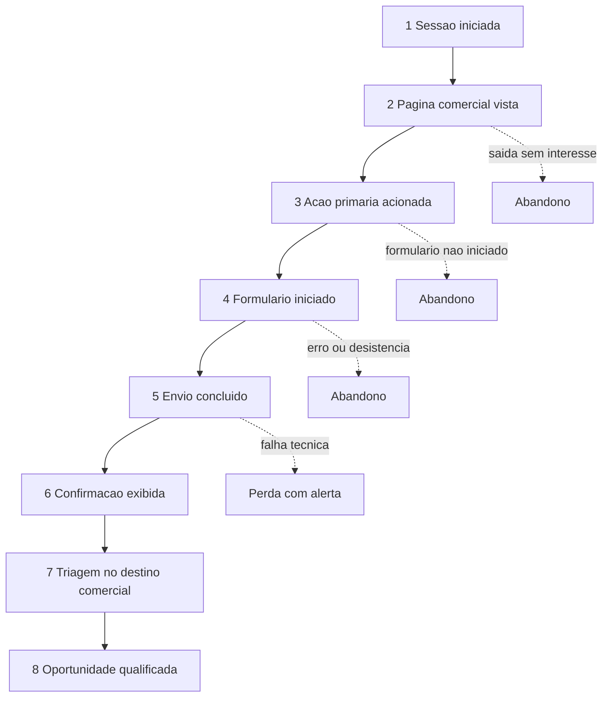

## 11. Conteúdo e identidade da marca

Esta seção define **como se escreve** no site. Ela não substitui o esqueleto de mensagem de 5.3 — aquele diz *o que* dizer e permanece com lacunas até Q-018 a Q-022 serem respondidas; esta diz *de que forma* qualquer texto será escrito, e pode ser aplicada imediatamente, antes de existir um único produto nomeado.

**Premissa PR-040:** o site tem **uma única voz**, a de [EMPRESA]. Nenhum software recebe personalidade, tom ou vocabulário próprios. É consequência direta de 2.2 — a marca-guarda-chuva é o ativo a construir, e vozes distintas por produto fragmentariam o pouco reconhecimento que existe.

### 11.1 Tom de voz

**Por que este tom e não outro.** A situação é específica e restringe as escolhas: uma empresa **nova**, **sem histórico publicável**, **sem clientes ou cases** (PR-007), vendendo **software para outras empresas**, num processo de decisão consultivo e com atendimento humano ao final (PR-004). Três consequências obrigam a calibragem:

1. **Toda afirmação será testada.** O comprador B2B verifica antes de comprar. Uma promessa que a empresa não pode provar não é neutra — ela é descoberta, e a descoberta contamina tudo o que foi dito antes. Uma empresa com dez anos de mercado sobrevive a um exagero; uma empresa desconhecida, não.
2. **Não há reserva de confiança para gastar.** Superlativo ("a melhor", "líder", "revolucionário") funciona como saque numa conta de credibilidade. A conta de [EMPRESA] está zerada. Cada saque não coberto vira dívida.
3. **A competência precisa aparecer no texto, não na declaração.** Como não há prova social, o único lugar onde a empresa demonstra que entende o problema do cliente é a **precisão com que descreve esse problema**. Um texto que descreve a dor com exatidão prova mais do que qualquer adjetivo sobre a própria empresa.

Daí o tom: **competente e verificável**. Seis atributos, cada um com o seu limite.

| # | Atributo | O que é | O que não é |
|---|---|---|---|
| 1 | **Claro** | Linguagem do cliente; uma ideia por frase; termo próprio explicado na primeira ocorrência | Didatismo condescendente, texto infantilizado, explicação do óbvio |
| 2 | **Específico** | Nomeia o que o software faz, para quem e com que resultado observável | Adjetivo no lugar do fato; "completo", "robusto", "inovador" sem o que os sustente |
| 3 | **Direto** | Frase curta, verbo concreto, sujeito explícito, ordem natural | Secura ou rispidez; frase telegráfica que economiza a informação necessária |
| 4 | **Confiante sem exagero** | Afirma o que a empresa faz e assume o que ainda não faz | Autoproclamação de liderança, pioneirismo ou superioridade não comprovada |
| 5 | **Profissional e próximo** | Trata o leitor por "você"; escreve como um profissional que vai atendê-lo | Gíria, emoji, exclamação, humor, intimidade forçada, "a gente" |
| 6 | **Consistente** | Mesmo termo para o mesmo conceito, sempre (11.8); mesma ordem de argumento entre páginas | Variação de vocabulário "para não repetir"; sinônimo criativo que cria dúvida |

**Exemplos por atributo** (apenas placeholders; nenhum texto abaixo é conteúdo real aprovado):

| # | Adequado | Inadequado | Por quê |
|---|---|---|---|
| 1 | `[Produto A] organiza [dor do cliente] em um único lugar, com registro por responsável e prazo.` | `[Produto A] é uma poderosa ferramenta de gestão inteligente end-to-end.` | O segundo não permite ao leitor saber o que o software faz |
| 2 | `Reduz o retrabalho de [dor do cliente] ao eliminar o registro duplicado entre planilha e sistema.` | `Aumenta drasticamente a produtividade da sua equipe.` | "Drasticamente" é uma medida que [EMPRESA] não tem |
| 3 | `Você contrata [Produto A] isolado e acrescenta [Produto B] quando precisar.` | `A contratação pode se dar de forma isolada ou, alternativamente, mediante composição posterior.` | Mesma informação, metade das palavras |
| 4 | `[EMPRESA] desenvolve softwares para [dor do cliente]. Comece por um produto e amplie conforme a necessidade.` | `[EMPRESA] é referência no mercado e líder em transformação digital.` | Empresa nova não é referência de nada; a frase se desmente sozinha |
| 5 | `Fale com a equipe para ver [Produto A] funcionando com os seus dados.` | `Bora resolver [dor do cliente] de uma vez? 🚀` | O comprador de software B2B lê como falta de seriedade |
| 6 | `[Produto A] é um software de [EMPRESA].` (sempre "software") | `[Produto A] é nossa plataforma, um módulo do nosso ecossistema, uma ferramenta...` | Quatro palavras para uma coisa só; o leitor passa a duvidar do que é |

**Pergunta Q-050:** os seis atributos de tom acima estão aprovados pelo cliente, ou há uma personalidade de marca já pretendida que os altere?

### 11.2 Princípios de redação

1. **Frase curta.** Alvo de até 20 palavras por frase; acima de 25, quebrar. Um parágrafo tem no máximo 4 linhas em tela pequena.
2. **Benefício antes de funcionalidade.** O leitor decide pelo resultado e confirma pelo recurso. A ordem "faz X, o que permite Y" vira "Y, porque faz X" sempre que a frase couber.
3. **Verbo concreto.** "Registra", "aprova", "concilia", "envia", "bloqueia". Proibidos como verbo principal: "otimizar", "potencializar", "alavancar", "revolucionar", "empoderar", "transformar" quando não houver objeto verificável.
4. **Proibição de jargão vazio.** Não se publica: "solução completa", "de ponta a ponta" sem dizer quais pontas, "inteligente", "disruptivo", "sinergia", "one-stop-shop", "tecnologia de última geração", "estado da arte".
5. **Proibição de superlativo não comprovável.** "Melhor", "líder", "maior", "mais rápido do mercado", "número 1", "pioneiro" só existem com fonte publicável ao lado. Sem fonte, o adjetivo é cortado — não é substituído por outro adjetivo.
6. **Número só quando real.** Percentual, quantidade de clientes, tempo de implantação, economia estimada e prazo só entram com origem verificável e responsável identificado. É proibido número "ilustrativo". Vale também para arredondamentos ("mais de 100 empresas") — o mesmo padrão de PR-007 e do princípio 2 de 2.8.
7. **Nada depende de conhecimento prévio da marca.** Nenhum texto começa assumindo que o leitor já sabe quem é [EMPRESA] ou o que é [Produto A] (princípio 1 de 2.8; público PU-07).
8. **Uma promessa por bloco.** Se um parágrafo defende duas coisas, são dois parágrafos ou um deles é supérfluo.
9. **Voz ativa e segunda pessoa.** "Você acompanha", não "é possível acompanhar". Primeira pessoa do plural apenas no institucional (P-02).
10. **Sem comparação nominal com concorrentes.** Comparar com a situação atual do cliente (planilha, processo manual, retrabalho) é permitido; nomear concorrente, não.

### 11.3 Estrutura padrão de textos por tipo de bloco

Os limites abaixo são **decisões de projeto**, derivadas de duas restrições: (a) o layout mobile-first (PR-017) — o texto precisa caber sem truncar em grade de cards de altura uniforme, exigida por P-03; e (b) o comportamento de exibição em busca e em compartilhamento — buscadores truncam por largura em pixels, não por contagem de caracteres, de modo que o número em caracteres é uma **aproximação operacional segura**, não uma regra do buscador.

Três colunas de limite: **ideal** (alvo editorial), **máximo** (bloqueia publicação) e **mínimo** (impede página rasa, ver 12.7).

| Tipo de bloco | Onde aparece | Mín. | Ideal | Máx. | Justificativa |
|---|---|---|---|---|---|
| Título de página (H1) | Todas | 15 | 30–55 | 70 | Duas linhas em tela de 360 px; base do título de busca |
| Subtítulo de apoio | P-01, P-03, P-05, P-04, P-06 | 40 | 80–130 | 160 | Três linhas em tela pequena sem empurrar a ação primária para fora da primeira tela |
| Chamada de seção (H2) | Todas | 8 | 20–45 | 60 | Uma linha em tela pequena; serve à varredura (11.7) |
| Resumo de uma linha | Card de produto e solução | 45 | 60–90 | 110 | Duas linhas em card de grade uniforme (P-03); é a base da descrição de busca |
| Texto de card (institucional/parceiro) | P-01, P-07 | 40 | 70–120 | 150 | Três linhas sem quebrar a altura da grade |
| Descrição curta de produto | Card, listagem, compartilhamento | 90 | 110–150 | 160 | Reaproveitada como base da descrição de busca (12.2) |
| Descrição longa de produto | P-04, seção "descrição completa" | 500 | 900–1800 | 3000 | Piso combate conteúdo raso (12.7); teto evita página que ninguém termina |
| "Problema que resolve" | P-04 | 400 | 600–1200 | 2000 | É a seção que prova competência (11.1); abaixo do piso não descreve dor nenhuma |
| Título de funcionalidade | P-04 | 8 | 15–35 | 45 | Uma linha em coluna estreita |
| Descrição de funcionalidade | P-04 | 40 | 60–110 | 140 | Uma linha por item, conforme P-04 |
| Benefício | P-01, P-04, P-06 | 30 | 40–85 | 100 | Redigido como resultado, cabe em uma linha |
| Ganho da combinação | P-06 | 200 | 300–800 | 1200 | Campo obrigatório; abaixo do piso vira soma óbvia das partes |
| Rótulo de botão | Todas | 6 | 12–22 | 28 | 1 a 3 palavras; alvo de toque confortável sem quebra de linha (13.9) |
| Rótulo de campo | P-08, P-09 | 3 | 5–20 | 30 | Rótulo persistente acima do campo (13.6) |
| Texto de erro de campo | P-08, P-09 | 20 | 35–90 | 120 | Diz o que houve e como resolver (13.7) |
| Texto de erro global | P-08, P-09 | 40 | 80–150 | 200 | Inclui caminho alternativo |
| Texto de sucesso | P-16 | 40 | 70–160 | 220 | Confirma, informa prazo e oferece próximo passo |
| Estado vazio (título) | P-03, P-05, P-07, P-17 | 10 | 20–40 | 50 | — |
| Estado vazio (apoio) | idem | 30 | 60–120 | 160 | Explica e oferece saída, nunca só "nada encontrado" |
| Título de busca | Páginas indexáveis | 25 | 45–58 | 60 | Ver 12.2 |
| Descrição de busca | Páginas indexáveis | 90 | 120–155 | 158 | Ver 12.2 |
| Texto alternativo | Imagens informativas | 5 | 40–100 | 125 | Ver 13.4 |
| Rótulo de categoria | Cards e filtros | 3 | 8–20 | 24 | Cabe como etiqueta sem quebrar a grade |
| Item de lista | Todas | 15 | 30–90 | 110 | Uma linha em tela pequena (11.7) |

**Premissa PR-041:** os limites são validados no momento da edição: **aviso** ao ultrapassar o ideal e **bloqueio de publicação** ao ultrapassar o máximo ou ficar abaixo do mínimo. Sem validação na origem, os limites são recomendação e serão ignorados na décima publicação. Os requisitos das faixas RF-180..199 e RNF-070..079 implementam essa validação.

### 11.4 Padrão de nomenclatura de produtos

**Os nomes não existem.** Nenhum produto foi definido (Q-004) e nenhum nome é proposto aqui. O que segue é a **regra a aplicar quando os nomes forem criados** — e ela precisa existir antes do primeiro nome, porque o primeiro nome fixa o padrão dos vinte seguintes.

**Premissa PR-042:** o portfólio crescerá continuamente; portanto o padrão de nomes é decidido uma vez, para a família inteira, e não caso a caso.

**Regras**

1. **Extensão.** Nome de produto com 1 ou 2 palavras, até 20 caracteres. O nome aparece em card de grade uniforme, breadcrumb, rótulo "Software", título de busca (que ainda leva o sufixo da marca) e assunto de formulário. Nome longo quebra os quatro.
2. **Pronunciabilidade.** Precisa ser dito ao telefone e escrito depois de ouvido, sem soletração. Vendas consultivas (PR-004) são conversas faladas.
3. **Digitabilidade.** Sem hífen interno, sem número, sem caractere acentuado, sem letra duplicada incomum, sem grafia "criativa" (troca de "s" por "z", vogal suprimida). O nome vira slug (6.5) e termo de busca; grafia ambígua divide o tráfego do próprio nome.
4. **Unicidade dentro do portfólio.** Dois produtos não podem ter nomes que se confundam na leitura rápida do catálogo — a jornada J-06 depende disso. Nomes que compartilham raiz só são aceitos se os produtos forem realmente da mesma família.
5. **Risco de colisão de marca.** Antes de adotar, verificar: registro de marca na classe correspondente, disponibilidade do termo como slug no domínio próprio, existência de software homônimo no mesmo mercado e sentido indesejado em outro idioma se Q-011 indicar mercado externo. Nome não verificado não é publicado.
6. **Relação com o nome da empresa.** Três padrões possíveis, e a escolha é única para todo o portfólio: (a) **nomes independentes** sob a assinatura "um software de [EMPRESA]"; (b) **família com prefixo ou sufixo da marca** (`[EMPRESA] [Termo]`); (c) **radical comum** compartilhado entre produtos. O padrão (b) reforça a marca-guarda-chuva de 2.2 ao custo de nomes mais longos; o (a) dá autonomia comercial ao produto e exige que a assinatura institucional apareça em toda página; o (c) é o mais frágil, porque cria vizinhança fonética entre produtos e agrava o risco da regra 4.
7. **Sufixos e famílias.** Sufixos de versão, edição, porte ou plano ("Pro", "Plus", "Enterprise", "2.0") são **proibidos no MVP**: não há modelo comercial definido (Q-007) nem preço publicado (PR-005), então o sufixo prometeria uma diferenciação que não existe e comprometeria o slug, que é imutável (PR-014).
8. **Descritivo x abstrato.** Nome descritivo é encontrável em busca e explica-se sozinho, mas envelhece quando o escopo do produto cresce e limita o registro de marca. Nome abstrato é registrável e duradouro, mas exige que o descritor funcional apareça sempre ao lado (12.2). A escolha é de negócio, não de site.
9. **O que evitar.** Sigla sem significado; termo genérico do mercado que não pode ser registrado nem disputado em busca; nome que descreva a tecnologia em vez do problema do cliente; referência interna do time; termo temporal ou de moda; nome que já é o rótulo fixo da interface ("Solução", "Software", "Plataforma").
10. **Registro.** Todo nome aprovado entra no glossário controlado (11.8) com grafia única — inclusive maiúsculas — e passa a ser a única forma escrita em todo o site.

**Pergunta Q-051:** qual dos três padrões de relação entre nome de produto e nome da empresa (independente, família com marca, radical comum) será adotado? **Pergunta Q-052:** haverá registro de marca dos nomes de produto, e quem faz a verificação de disponibilidade antes da publicação?

### 11.5 Como apresentar a empresa sem tempo de mercado, cases ou equipe

O problema é concreto: as três provas usuais de um site B2B — tempo de mercado, clientes e tamanho — estão indisponíveis (PR-007). A tentação é preenchê-las com formulação vaga ("anos de experiência combinada", "atendemos empresas de diversos setores"). Isso é proibido: é a mesma classe de invenção que a regra 6 de 11.2 veda, e é detectável.

**A troca é explícita: substituir prova de tamanho por prova de método.** O que uma empresa nova pode demonstrar publicamente, sem mentir:

| Elemento de credibilidade | O que se publica | Por que funciona | Dependência |
|---|---|---|---|
| **Precisão na descrição do problema** | Seção "problema que resolve" de cada produto, escrita na linguagem do cliente | Quem descreve a dor com exatidão demonstra que já a viu; é a prova mais barata e a mais convincente | Q-004, Q-009 |
| **Clareza sobre o escopo** | O que o software faz e o que **não** faz; para quem é e para quem não é | Delimitar escopo é sinal de maturidade; promessa ilimitada é sinal contrário | Q-004 |
| **Identificação completa** | Razão social, identificação fiscal, endereço e canal de contato no rodapé | Empresa que se identifica assume responsabilidade; a ausência é lida como risco | **Pergunta Q-053** |
| **Transparência do processo comercial** | O que acontece após o envio: quem responde, em quanto tempo, o que vem depois (P-16) | Reduz o risco percebido do primeiro contato, que é a barreira real de PU-01 | Q-013 |
| **Páginas legais publicadas e datadas** | P-13 e P-14, com data de atualização visível | Custo baixo, sinal alto de operação real (OB-05) | Q-028 |
| **Explicação do modelo de negócio** | "Por que vários softwares menores" em P-02 | Transforma a pequenez em decisão deliberada, não em limitação | Q-019 |
| **Parceiros** | P-07, quando existirem e autorizados (PR-018) | Capacidade de entrega emprestada, declarada com honestidade (11.6) | Q-025 |
| **Experiência da equipe** | Trajetória profissional, quando houver autorização das pessoas | Prova pessoal substitui prova institucional enquanto ela não existe | Q-021 |
| **Consistência de apresentação** | Template idêntico, sem lacuna, sem "em breve" (princípio 2 de 2.8) | Um site sem falhas é, ele próprio, evidência de cuidado operacional | — |

**O que é proibido enquanto Q-021 não for respondida:** selo sem lastro, logo genérico, contador de clientes, depoimento fictício ou "ilustrativo", mapa de atuação sem operação, prêmio inexistente, imagem de banco que simule equipe ou escritório. Bloco de credibilidade sem conteúdo verificável é **omitido**, nunca preenchido.

**Como falar do tempo de mercado sem mentir e sem se diminuir.** Três formulações aceitáveis, em ordem de preferência: (1) não mencionar tempo de mercado e falar de método e escopo; (2) declarar o recorte temporal como escolha ("[EMPRESA] nasceu para..."), sem transformar novidade em argumento de venda; (3) declarar explicitamente a fase, se houver decisão do cliente nesse sentido. É proibido ocultar a informação e simultaneamente sugerir o contrário — usar plural corporativo grandioso, citar "nossos escritórios", falar em "clientes" no plural genérico.

### 11.6 Como apresentar parceiros

Parceiro não é cliente e não é endosso. A linguagem precisa deixar isso legível sem esforço, porque a leitura por varredura (11.7) confunde as duas coisas por padrão: uma faixa de logos é interpretada como carteira de clientes salvo indicação em contrário.

1. **Rotulagem explícita e não editável.** Toda faixa e toda listagem de parceiro leva título que declara a natureza — "Empresas parceiras" — e nunca aparece sob título ambíguo ("Quem confia", "Trabalham com a gente", "Eles usam").
2. **Cada parceiro declara o tipo de parceria** (taxonomia de P-07) e a **natureza da relação** — campos obrigatórios do modelo (6.7). Logo sem essas duas informações não é publicado.
3. **Verbos permitidos:** "é parceiro de tecnologia", "realiza implantação", "comercializa", "encaminha oportunidades", "integra com". **Verbos proibidos:** "recomenda", "aprova", "certifica", "endossa", "confia", "escolheu" — todos afirmam algo sobre a opinião de um terceiro.
4. **Nenhuma frase pode sugerir relação comercial inexistente.** Citar tecnologia de terceiro que a empresa apenas utiliza não cria parceria; a menção, se necessária, aparece como informação técnica em "integrações" (P-04), fora da página de parceiros.
5. **Descrição redigida em conjunto.** O texto sobre o parceiro é acordado com ele, além da autorização de uso de marca (PR-018). **Pergunta Q-054:** a autorização obtida cobre também o texto descritivo da relação, ou apenas o uso do logotipo?
6. **Simetria.** Todos os parceiros recebem o mesmo espaço e o mesmo tratamento visual; destaque de um parceiro é uma afirmação comercial que exige acordo.
7. **Sem parceiro, sem bloco.** Estado vazio oculta página, item de menu e faixa da inicial (PR-011) — nunca substitui por logos genéricos.

### 11.7 Densidade de texto e hierarquia de leitura

**O risco.** Um site que precisa explicar um modelo pouco usual (softwares pequenos vendidos isolados ou combinados) tende a compensar com texto. Excesso de texto não aumenta a compreensão: reduz a leitura, empurra a ação primária para fora da tela e piora o desempenho (RNF-010..019).

**Regra de densidade por seção**

| Contexto | Teto de texto corrido | Regra adicional |
|---|---|---|
| Primeira tela de qualquer página | 1 título + 1 apoio + 1 ação | Nada mais compete com a ação primária (5.1) |
| Seção da página inicial | 90 palavras | Máximo 2 parágrafos; o resto é lista, card ou link |
| Seção de página de produto/solução | 180 palavras | Exceto "problema que resolve" e "descrição completa" |
| Parágrafo | 4 linhas em tela pequena (~320 caracteres) | Acima disso, quebrar |
| Lista | 3 a 7 itens | Menos de 3 é parágrafo; mais de 7 vira tabela ou seção |
| Item de lista | 1 linha (até 110 caracteres) | Item que precisa de duas linhas é subtítulo com apoio |

**Hierarquia de leitura em três níveis.** Toda página é escrita para ser compreendida em três profundidades, e as três precisam funcionar isoladamente:

- **Nível 1 — varredura (5 a 10 segundos):** só títulos, rótulos, nomes de produto e rótulos de botão. Teste: lendo apenas isso, o visitante sabe onde está, o que a empresa faz e qual é o próximo passo. Se não souber, o problema está nos títulos, não no corpo.
- **Nível 2 — leitura parcial (30 a 60 segundos):** títulos, subtítulos, primeira frase de cada parágrafo e listas. Regra decorrente: **a primeira frase de cada parágrafo carrega a informação principal**; ela nunca é preparatória ("Neste tópico vamos falar sobre...").
- **Nível 3 — leitura completa:** corpo integral, para o avaliador técnico (PU-06) e para quem compara dois produtos (J-06).

**Quando cortar.** Corta-se a frase que: (a) repete o que o título já disse; (b) não muda nenhuma decisão do leitor; (c) contém adjetivo sem fato que o sustente; (d) explica o óbvio do mercado do próprio leitor; (e) descreve o processo interno de [EMPRESA] em vez do resultado para o cliente; (f) só existe para preencher um espaço de layout. **Teste final:** se a página cortada em 30% continua respondendo às perguntas do público-alvo (seção 4), o corte era necessário.

### 11.8 Consistência entre páginas: glossário de termos controlados

Um termo por conceito, sem sinônimos. A regra vale para textos publicados, rótulos de interface, mensagens de erro, assunto de formulário e nomes de evento de medição. **Premissa PR-058:** o glossário é normativo — divergência bloqueia a publicação na revisão editorial (11.9).

| Conceito | Termo único | Significado fixo | Sinônimos proibidos |
|---|---|---|---|
| Unidade vendável de software | **Software** (público) / **produto** (interno e modelo de conteúdo) | Um dos softwares do portfólio, vendido isolado ou combinado | sistema, ferramenta, app, aplicativo, plataforma, módulo, serviço, solução |
| Combinação de dois ou mais softwares | **Solução** | Entidade derivada que reúne 2+ softwares para uma necessidade ampla (PR-010) | pacote, combo, suíte, bundle, kit, plano, plataforma |
| Parte interna de um software | **Funcionalidade** | O que o software faz | recurso, feature, função, módulo, ferramenta |
| Resultado para o cliente | **Benefício** | Efeito observável do uso, não o recurso que o produz | vantagem, diferencial, ganho (reservado a "ganho da combinação") |
| Agrupamento de softwares por tipo de problema | **Categoria** | Classificação N:N, sem pertencimento único (6.7) | segmento, linha, família, tipo, vertical |
| Peça de um sistema maior | *(termo banido)* | [EMPRESA] não vende módulos: cada software é delimitado e autônomo (2.3) | **"módulo" é proibido em todo o site** |
| Nível ou faixa de contratação | *(termo banido no MVP)* | Sem modelo comercial definido (Q-007) e sem preço publicado (PR-005), "plano" prometeria uma estrutura inexistente | **"plano", "pacote", "licença" só após Q-007/Q-008** |
| Forma de contratar | **Modelo de contratação** | Texto padrão único do catálogo (P-04, seção 8) | plano, pacote, oferta, condições |
| Apresentação conduzida por pessoa | **Demonstração** | Sessão conduzida por alguém de [EMPRESA] (PR-016) | demo, trial, teste grátis, período de avaliação, tour |
| Organização externa com relação declarada | **Parceiro** | P-07 e 11.6 | apoiador, patrocinador, aliado, colaborador, cliente |
| Organização que contrata | **Cliente** | Uso restrito: proibido no plural genérico enquanto não houver clientes (PR-007) | conta, parceiro |
| Pessoa que acessa o site | **Visitante** | Vocabulário interno; não aparece em texto publicado | usuário, lead, prospect |
| Solicitação enviada pelo formulário | **Solicitação de contato** (público) / **oportunidade** (interno) | Registro gerado por P-08 ou P-09 | lead (aceito só em documento interno), pedido, cadastro |
| Conexão com sistema de terceiro | **Integração** | Só publicada quando existir de fato (P-04, seção 7) | conector, plug-in, sincronização |
| Textos editoriais | **Conteúdo** (público) / **item de conteúdo** (interno) | P-10 e P-11 | blog, post, notícia, matéria |
| A empresa | **[EMPRESA]** | Nome por extenso na primeira ocorrência de cada página | a companhia, a organização, a gente, nós (fora de P-02), a startup, a casa |
| Conjunto do portfólio | **Ecossistema** | Uso exclusivo no nível 1 da mensagem (5.2); nunca em página de produto | universo, família, suíte, hub |
| Início do uso pelo cliente | **Implantação** | — | onboarding, ativação, setup |

**Pergunta Q-055:** existe manual de marca, guia de estilo verbal ou vocabulário já em uso na comunicação da empresa que deva substituir ou complementar este glossário?

### 11.9 Checklist de revisão editorial antes de publicar

**Premissa PR-043:** todo texto publicado passa por **um único revisor** designado, e a revisão é etapa obrigatória do fluxo de publicação (faixa RF-180..199), não uma boa intenção. Com equipe reduzida e não técnica (PR-009), revisão distribuída produz divergência já no terceiro produto.

- [ ] Todos os campos obrigatórios do tipo de entidade preenchidos (6.7); nenhuma seção improvisada para preencher espaço.
- [ ] Limites mínimos e máximos de 11.3 respeitados em todos os campos.
- [ ] Volume mínimo de conteúdo único atingido (12.7).
- [ ] Glossário de 11.8 respeitado; nenhum sinônimo proibido no texto.
- [ ] Nenhum superlativo, jargão vazio ou número sem fonte (11.2, regras 4 a 6).
- [ ] Nenhuma afirmação sobre clientes, tamanho, tempo de mercado ou prêmio (11.5).
- [ ] Texto compreensível para quem nunca ouviu falar de [EMPRESA]; primeira ocorrência de termo próprio explicada.
- [ ] Nível 1 de leitura funciona: só os títulos já respondem "onde estou / o que é / qual o próximo passo".
- [ ] Nenhuma frase idêntica a outra página de produto, exceto os textos padrão declarados.
- [ ] Rótulo "Software" ou "Solução" correto; linguagem de capacidade x cobertura conforme P-06.
- [ ] Ação primária presente, única na seção e com rótulo do inventário de 14.1.
- [ ] Título e descrição de busca dentro dos limites e sem duplicidade com outra página (12.2).
- [ ] Texto alternativo presente e adequado ao tipo de imagem (13.4).
- [ ] Links internos com texto descritivo, sem "clique aqui" e sem âncora repetida apontando para destinos diferentes (12.9).
- [ ] Nenhum texto essencial dentro de imagem (13.11).
- [ ] Revisão ortográfica e gramatical em português do Brasil (PR-006).

### 11.10 Pendências de marca

Nada da identidade de marca está definido. As pendências abaixo **bloqueiam etapas do cronograma**, e o impacto é diferente em cada caso — algumas podem esperar até a implementação, outras precisam ser resolvidas antes de qualquer decisão de layout.

| Pendência | Situação | Impacto se não resolvida | Quando trava |
|---|---|---|---|
| **Nome da empresa** | Q-001 permanece aberta; "ArtZan" é o nome do diretório, não confirmação | Todo texto usa `[EMPRESA]`; slug institucional, título de busca, assinatura de rodapé, remetente de e-mail de confirmação e nomes de produto (11.4) dependem dele | **Antes da redação final.** É a primeira dependência do cronograma: nenhum texto é aprovável sem o nome |
| **Domínio** | Q-002 aberta | Sem URL canônica, sem endereço de e-mail no domínio, sem dados estruturados de identificação, sem configuração de compartilhamento (12.5, 12.6) | **Antes da publicação**, e antes de qualquer redirecionamento permanente |
| **Logotipo** | Q-003 aberta | Cabeçalho, rodapé, ícone de aba, imagem de compartilhamento padrão (12.6) e dados estruturados de organização (12.4) ficam sem ativo | **Antes do desenho de interface** |
| **Paleta de cores** | Não definida | Sem paleta não há verificação de contraste (13.3), e contraste é critério de aceite (13.12). Refazer cor depois da implementação obriga a reverificar toda a interface | **Antes do desenho de interface.** Alto custo de retrabalho |
| **Tipografia** | Não definida | Define legibilidade (13.8), limites de caracteres de 11.3 e peso de recursos externos (faixa RNF-010..019) | **Antes do desenho de interface** |
| **Posicionamento** | Q-018 a Q-022 abertas | Sem ele, o nível 1 da mensagem (5.2) e o bloco de benefícios da inicial permanecem lacunas não publicáveis | **Antes da redação da inicial e do institucional.** É a maior dependência de conteúdo |
| **Assinatura de marca (tagline)** | Não definida | Aparece em rodapé, compartilhamento e título da inicial; sem ela usa-se a descrição funcional, que é aceitável e não bloqueia | **Não trava.** Pode entrar depois, desde que os limites de 11.3 sejam respeitados |
| **Tom de voz aprovado** | Q-050 aberta | Reescrita completa se a aprovação vier depois da redação | **Antes da redação** |

**Pergunta Q-056:** quem produz a identidade visual (logotipo, paleta, tipografia), em que prazo, e há orçamento reservado? A resposta define se o desenho de interface começa com identidade pronta ou com um sistema provisório que será substituído — e o segundo caminho implica retrabalho de verificação de contraste e de todos os ativos de compartilhamento.

## 12. SEO e descoberta

[EMPRESA] não tem audiência, backlinks, histórico de domínio nem reconhecimento de marca. Duas consequências orientam toda esta seção: **(a)** o site não disputa termos genéricos de alta concorrência no primeiro ano, e planejar como se disputasse produz frustração e decisões erradas; **(b)** o que está sob controle da empresa — estrutura, unicidade de conteúdo, metadados, semântica e velocidade — é exatamente onde o esforço deve ir. Os requisitos das faixas RF-160..179 e RNF-030..039 implementam as políticas descritas aqui.

### 12.1 Estrutura de URLs

O padrão canônico é o de 6.4 e não é alterado por esta seção. Reafirmação das regras, com o que elas implicam em manutenção:

1. **Minúsculas, hífen, sem acento, sem cedilha, sem caractere especial** (6.5). Variações de caixa são normalizadas por redirecionamento permanente, não servidas em paralelo.
2. **Sem parâmetro de consulta em URL indexável.** Filtro e ordenação de catálogo (6.6) não geram endereço próprio indexável; a página filtrada aponta para a listagem base (12.5). Parâmetro de campanha é aceito por ser inevitável, e não gera versão indexável (12.5).
3. **Sem identificador numérico, sem data, sem versão** — nem em produto, nem em solução, nem em conteúdo (6.4).
4. **A URL de produto nunca contém categoria; a de solução nunca contém produtos** (6.4). Um produto pertence a N categorias e participa de N soluções (PR-003); qualquer aninhamento tornaria a URL instável.
5. **Slug imutável após a publicação** (PR-014). Renomeação inevitável exige redirecionamento permanente do endereço antigo para o novo, e o endereço antigo **nunca** é reaproveitado para outro conteúdo.
6. **Despublicação não apaga endereço.** Produto retirado do portfólio redireciona permanentemente para o catálogo ou para o produto sucessor (6.9, regra 7), preservando o histórico de indexação — o ativo mais caro de reconstruir.
7. **Uma única forma canônica de host** (com ou sem `www`, sempre em conexão segura) e **uma única convenção de barra final**, ambas garantidas por redirecionamento permanente. Duas formas servidas em paralelo dividem sinais entre endereços idênticos.
8. **Cadeia de redirecionamento no máximo em um salto.** Redirecionamentos encadeados perdem sinal e tempo de carregamento; quando um endereço já redirecionado precisa mudar de novo, a origem é reapontada para o destino final.

### 12.2 Títulos e descrições de busca

**Nenhuma palavra-chave é inventada aqui.** As fórmulas abaixo usam placeholders que serão preenchidos com os termos levantados pelo método de 12.8.

**Regras gerais.** Um título por página, único em todo o site; alvo de 45 a 58 caracteres e teto de 60; sufixo fixo de marca `| [EMPRESA]` em todas as páginas exceto a inicial, onde a marca vem primeiro; nunca empilhar termos separados por vírgula; nunca repetir o nome da marca duas vezes; a descrição de busca não é fator de posicionamento, é **texto de venda no resultado** e por isso termina com um convite à ação. Buscadores truncam por largura em pixels e podem reescrever ambos — os limites são operacionais, não garantias.

| Página | Fórmula do título | Fórmula da descrição de busca (120–155) |
|---|---|---|
| P-01 Inicial | `[EMPRESA] — [o que faz] para [tipo de cliente]` | `[EMPRESA] desenvolve [categoria de software] para [tipo de cliente] que enfrentam [dor do cliente]. Conheça os softwares e as soluções.` |
| P-02 Sobre | `Quem somos \| [EMPRESA]` | `Como [EMPRESA] desenvolve softwares para [dor do cliente] e por que o portfólio é composto por produtos independentes que se combinam.` |
| P-03 Catálogo | `Softwares \| [EMPRESA]` | `Conheça os softwares de [EMPRESA]: cada um resolve [escopo delimitado do problema] e pode ser contratado isolado ou combinado.` |
| P-04 Produto | `[Produto A] — [descritor funcional de 2 a 4 palavras] \| [EMPRESA]` | `[Produto A] resolve [dor específica] para [papel ou área]. Veja funcionalidades, integrações e solicite uma demonstração.` |
| P-05 Soluções | `Soluções \| [EMPRESA]` | `Combinações de softwares de [EMPRESA] para necessidades que atravessam mais de um processo. Veja o que cada solução reúne.` |
| P-06 Solução | `[Solução] — solução para [necessidade] \| [EMPRESA]` | `[Solução] reúne [Produto A] e [Produto B] para [necessidade ampla]. Veja o ganho da combinação e como adotar por etapas.` |
| P-07 Parceiros | `Parceiros \| [EMPRESA]` | `Empresas parceiras de [EMPRESA] em tecnologia, implantação e distribuição, e o papel de cada uma no atendimento ao cliente.` |
| P-08 Contato | `Contato comercial \| [EMPRESA]` | `Fale com a equipe de [EMPRESA] sobre [Produto A] ou sobre uma combinação de softwares. Resposta em até [prazo de resposta].` |
| P-09 Demonstração | `Solicitar demonstração \| [EMPRESA]` | `Agende uma demonstração conduzida pela equipe de [EMPRESA] e veja [Produto A] aplicado ao seu cenário.` |
| P-11 Conteúdo | `[Título do artigo] \| [EMPRESA]` | Resumo do artigo, com a dúvida que ele responde e o produto ou solução relacionado |
| P-12 FAQ | `Perguntas frequentes \| [EMPRESA]` | `Respostas sobre contratação, implantação, integrações e tratamento de dados dos softwares de [EMPRESA].` |
| P-13/P-14 Legais | `[Nome do documento] \| [EMPRESA]` | Descrição objetiva; sem apelo comercial |
| P-18 Categoria | `[Categoria] — softwares para [contexto] \| [EMPRESA]` | `Softwares de [EMPRESA] para [contexto da categoria]. Compare o escopo de cada um e veja quais se combinam.` |
| P-15/P-16/P-17 | Título descritivo; **páginas não indexáveis** (6.4) | Não se aplica |

**Regras de geração e de exceção.** Título e descrição são **gerados automaticamente** a partir de nome e resumo (6.7) e podem ser sobrescritos por campo próprio; sobrescrever é a exceção, não a rotina. Se o nome do produto for longo, corta-se o descritor funcional, nunca a marca — exceto na inicial. Descrição vazia é preferível a descrição duplicada: o campo em branco deixa o buscador extrair do corpo; o campo duplicado entre páginas é sinal ativo de conteúdo repetido. Nenhuma página indexável pode compartilhar título com outra — verificação obrigatória na publicação.

### 12.3 Hierarquia de títulos por template

Regras válidas para todos: **exatamente um H1 por página**; nenhum nível pulado; título é estrutura, não estilo — texto grande que não é seção não vira título; o logotipo do cabeçalho não é H1; rodapé e navegação não usam H1 ou H2.

| Template | H1 | H2 | H3 |
|---|---|---|---|
| P-01 Inicial | Proposta de valor (o que a empresa faz), não o nome isolado da marca | Cada uma das 9 seções fixas | Nome de cada produto, solução ou benefício dentro do bloco |
| P-02 Sobre | Título da página institucional | Cada bloco de conteúdo | Subitens do bloco |
| P-03 Catálogo | `Softwares` (com o complemento do subtítulo à parte) | Nome da categoria quando o agrupamento estiver ativo (6.6); caso contrário, nome do produto | Nome do produto quando houver agrupamento |
| P-04 Produto | Nome do produto | Cada uma das 11 seções do template, na ordem fixa | Título de cada funcionalidade; nome de cada solução no bloco derivado |
| P-05 Soluções | `Soluções` | Nome de cada solução | Nomes dos produtos que a compõem |
| P-06 Solução | Nome da solução | Cada uma das 8 seções, na ordem fixa | Nome de cada produto que compõe; cada caso de uso |
| P-07 Parceiros | `Parceiros` | Tipo de parceria | Nome de cada parceiro |
| P-08 / P-09 | Ação da página ("Contato comercial", "Solicitar demonstração") | Agrupamentos do formulário, quando houver mais de um | Não usar |
| P-10 / P-11 | Título do índice / do artigo | Seções do artigo | Subseções |
| P-12 FAQ | `Perguntas frequentes` | Tema | Texto da pergunta |
| P-13 / P-14 | Nome do documento | Cláusula ou capítulo | Subitens |
| P-15 404 | Explicação objetiva | Não usar; os caminhos de retorno são lista de links | — |
| P-16 Obrigado | Confirmação do envio | Não usar | — |
| P-17 Busca | `Resultados para [termo]` | Tipo de entidade (Softwares, Soluções, Conteúdos) | Nome do item |
| P-18 Categoria | Nome da categoria | Blocos da descrição editorial; listagem | Nome do produto |

### 12.4 Dados estruturados

Objetivo: permitir que o buscador identifique **quem é a empresa** e **o que é cada página**, sem prometer exibição enriquecida. **Premissa PR-056:** os dados estruturados declaram apenas o que é verificável e visível na própria página. É proibido declarar avaliação, nota, número de opiniões, preço ou disponibilidade — não existem (PR-005, PR-007), e declará-los é falsear informação em campo de leitura automática.

| Tipo | Onde | Campos (descritos, sem sintaxe) | Por que existe |
|---|---|---|---|
| **Organization** | Uma vez por site, na inicial | Nome; razão social; endereço do site; logotipo; descrição curta; endereços de perfis oficiais; ponto de contato do tipo comercial com e-mail, idioma atendido e área atendida; endereço físico e identificação fiscal quando disponíveis (Q-053) | É o registro de identidade da empresa. Para marca nova e desconhecida, é o principal sinal de "esta entidade existe e é esta aqui" (OB-01, OB-05) |
| **WebSite** | Uma vez por site, na inicial | Nome do site; endereço; editor (vínculo com Organization); idioma | Associa o domínio à organização e evita que a marca seja lida como termo genérico |
| **SoftwareApplication** | Cada página de produto (P-04) | Nome; descrição; endereço; imagem; categoria de aplicação; fornecedor (vínculo com Organization); requisitos e integrações quando existirem | Descreve o produto como software, não como página genérica. **Sem campo de oferta**, porque não há preço (PR-005) — a ausência elimina a chance de exibição enriquecida, e isso é aceito: a finalidade é identificação da entidade, não estrela no resultado |
| **BreadcrumbList** | P-04, P-06, P-11, P-18 | Sequência de níveis com nome e endereço, igual ao breadcrumb visível | Comunica a posição na hierarquia e reforça a separação de namespaces entre produto e solução (12.9) |
| **WebPage / ItemList** | P-06 Solução | Página com nome, descrição e endereço; lista ordenada dos produtos que compõem, cada item com nome e endereço do produto | Não existe tipo nativo para "combinação de softwares". Representar a solução como página que **lista** produtos é a descrição honesta: a solução não é um software, é um conjunto (2.4). Declará-la como software criaria uma entidade inexistente |
| **FAQPage** | P-12, Fase 2 | Pares de pergunta e resposta, idênticos ao texto visível | Só com perguntas reais vindas do atendimento. A exibição enriquecida depende do buscador e pode ser restringida; o dado é publicado pela precisão semântica, não pela promessa de exibição |
| **Article** | P-11, Fase 2 | Título; resumo; data de publicação; data de atualização; autor; imagem; editor | Datas e autoria de conteúdo editorial |
| **ContactPage / AboutPage** | P-08, P-02 | Identificação do tipo de página, vinculada à Organization | Opcional, custo baixo, ajuda na desambiguação institucional |

**Regras transversais.** Todo dado estruturado espelha conteúdo **visível** na página; nenhum campo descreve o que o visitante não vê. Os dados são gerados a partir do modelo de conteúdo (6.7), nunca digitados por página — caso contrário divergem na primeira atualização. Páginas não indexáveis (`/obrigado`, `/busca`) não recebem dados estruturados. Um erro em dado estruturado é falha de publicação, não ajuste posterior: a validação entra no checklist de 11.9.

### 12.5 Sitemap, robots e canonical

**Mapa do site (sitemap).**
1. Gerado automaticamente a partir dos registros publicados; nunca mantido à mão — lista manual é a primeira coisa a divergir quando o portfólio cresce (OB-07).
2. Contém **apenas** endereços canônicos, indexáveis, publicados e que respondem com sucesso. Ficam de fora: `/obrigado`, `/busca`, rascunhos, endereços redirecionados, versões filtradas do catálogo e qualquer endereço com parâmetro.
3. A data de última modificação reflete **alteração real de conteúdo**. Atualizá-la a cada publicação técnica do site destrói o valor do campo.
4. Regenerado automaticamente a cada publicação, despublicação ou alteração de slug.
5. Enquanto o volume for pequeno (PR-002), um único arquivo basta; a segmentação por tipo de entidade só é necessária ao se aproximar dos limites do protocolo (dezenas de milhares de endereços), o que não ocorrerá no horizonte deste PRD.
6. Endereço do mapa declarado no arquivo de diretrizes de rastreamento e informado às ferramentas de webmaster dos buscadores. **Pergunta Q-057:** quem administra o registro do site nas ferramentas de webmaster dos buscadores e recebe os avisos de erro de indexação?

**Diretrizes de rastreamento (robots).**
1. Rastreamento liberado para todo o conteúdo público; **nenhum bloqueio de folhas de estilo, scripts ou imagens** — bloqueá-los impede o buscador de avaliar a página como o visitante a vê.
2. `/busca` e qualquer caminho com parâmetro de busca interna são desautorizados ao rastreamento: geram infinitas combinações sem valor.
3. `/obrigado` **não** é bloqueado por essas diretrizes: é marcado como não indexável na própria página. Bloquear o rastreamento impediria o buscador de ler a marcação de não indexação — o efeito seria o contrário do pretendido.
4. Ambientes de homologação e pré-produção são bloqueados **e** protegidos por autenticação. Diretriz de rastreamento sozinha não impede indexação por links externos.
5. Nenhuma regra de bloqueio é usada como controle de segurança ou de privacidade: o arquivo é público e legível por qualquer pessoa.

**Endereço canônico.**
1. Toda página indexável declara o seu próprio endereço canônico, absoluto, com o host único definido em 12.1.
2. Listagens filtradas ou ordenadas apontam para a listagem base; páginas de resultado paginado apontam para si mesmas.
3. Parâmetros de campanha nunca criam versão canônica distinta.
4. **É proibido apontar canônico entre entidades diferentes** — de produto para solução, ou de solução para produto. São conteúdos distintos com finalidades distintas; a canonicalização entre eles apagaria uma das páginas do índice. O tratamento correto da concorrência entre elas está em 12.9.
5. Página não indexável não declara canônico apontando para outra página indexável.

### 12.6 Compartilhamento social (Open Graph e equivalentes)

| Campo | Origem | Regra |
|---|---|---|
| Título de compartilhamento | Título de busca da página, sem o sufixo de marca quando o nome do site já é enviado em campo próprio | Até 60 caracteres; ler bem isolado, fora de contexto |
| Descrição de compartilhamento | Descrição de busca da página | 100 a 150 caracteres; frase completa, nunca cortada |
| Endereço | Endereço canônico (12.5) | Sempre absoluto |
| Nome do site | `[EMPRESA]` | Fixo em todas as páginas |
| Tipo de conteúdo | Site para páginas gerais; artigo para P-11 | — |
| Idioma | Português do Brasil (PR-006) | — |
| Imagem de compartilhamento | Ver tabela abaixo | Proporção aproximada de 1,91:1, dimensão alvo de 1200 × 630 pixels, peso abaixo de 300 KB; texto legível em miniatura ou nenhum texto |
| Texto alternativo da imagem | Campo de acessibilidade da imagem (13.4) | Obrigatório |
| Formato de cartão | Imagem grande | Aplicado a todos os templates, para consistência |

**Imagem por template e cascata de substituição.**

| Template | Imagem usada | Se não houver |
|---|---|---|
| P-01, P-02, P-08, P-09, P-13, P-14, P-15, P-16 | Imagem institucional padrão da marca | Não se aplica: a imagem padrão é obrigatória do lançamento |
| P-04 Produto | Imagem de destaque do produto (campo obrigatório, 6.7) | Não pode faltar; sem ela o produto não é publicável |
| P-06 Solução | Imagem de destaque da solução (campo obrigatório) | Não pode faltar |
| P-03, P-05, P-07 | Imagem institucional padrão | — |
| P-11 Conteúdo | Imagem de destaque do artigo (obrigatória) | — |
| P-18 Categoria | Imagem da categoria, se existir | Imagem institucional padrão |

**Premissa PR-055:** existe **uma** imagem institucional padrão de compartilhamento, criada junto com a identidade visual, usada como substituto sempre que o campo específico estiver vazio. Nunca se compartilha sem imagem — o cartão sem imagem reduz drasticamente a legibilidade do link e transmite descuido, exatamente o oposto do que a estratégia de credibilidade de 11.5 precisa. A imagem padrão depende da identidade visual (11.10) e é item de bloqueio do lançamento.

### 12.7 Indexação de páginas de produto e o risco de conteúdo raso

**O risco é estrutural, não hipotético.** O modelo de negócio é um portfólio de **softwares pequenos**, com escopos vizinhos, descritos por um **template idêntico** (PR-008) com seções curtas. Três forças empurram para páginas quase iguais: o template repete a mesma moldura; produtos vizinhos compartilham vocabulário; e o texto padrão de ausência de preço (P-04) é literalmente idêntico em todas. Quando o vigésimo produto for publicado, o site pode ter vinte páginas cujo conteúdo exclusivo é o nome e três frases. Buscadores tratam esse padrão como conteúdo de baixo valor, e o efeito não é local: páginas rasas em volume rebaixam a avaliação do site inteiro, incluindo as páginas boas.

**Volume mínimo de conteúdo único por página de produto.** **Premissa PR-057:** nenhum produto é publicado abaixo destes pisos:

| Requisito | Piso |
|---|---|
| Texto exclusivo da página (excluindo cabeçalho, rodapé, navegação, rótulos de interface e textos padrão) | 1.200 caracteres, aproximadamente 200 palavras |
| Seção "problema que resolve" | 400 caracteres |
| Seção "descrição completa" | 500 caracteres |
| Funcionalidades | 3 itens, cada um com título e descrição de ao menos 40 caracteres |
| Benefícios | 3 itens, cada um com ao menos 30 caracteres |
| Proporção de texto exclusivo | Ao menos 70% do texto da página não pode aparecer em nenhuma outra página do site |
| Imagem de destaque | Própria do produto; imagem genérica de banco não conta como conteúdo |

**Regras de não publicação.**
1. **Página vazia não é publicada.** Produto que não atinge os pisos permanece em rascunho. Não existe "publicar e completar depois" — reproduziria o princípio 2 de 2.8 ao contrário.
2. **Não existe página de produto anunciando produto inexistente.** Nada de "em breve" com endereço próprio (P-03 já o proíbe no card).
3. **Textos padrão são declarados.** Os trechos idênticos entre páginas — ausência de preço, aviso de privacidade, chamada final — são registrados como padrão e **descontados** do cálculo de texto exclusivo.
4. **Verificação de similaridade na publicação.** Duas páginas de produto com "problema que resolve" ou "para quem é" muito próximos disparam alerta editorial. Se dois produtos não conseguem descrever problemas distintos, ou os textos estão preguiçosos, ou os produtos não deveriam ser dois (o que é uma questão de portfólio, não de site).
5. **Mesma regra para soluções e categorias.** Solução sem "ganho da combinação" próprio é a soma das partes e não deveria existir (P-06); categoria sem descrição editorial não recebe URL própria (6.6, P-18).
6. **Despublicação preserva endereço** (12.1, regra 6).

### 12.8 Método para levantar palavras-chave

**Nenhum termo é proposto neste documento.** Não há produtos definidos (Q-004), segmento definido (Q-009) nem porte de cliente definido (Q-010); qualquer palavra-chave escrita aqui seria invenção e viraria requisito falso. O que se entrega é o **método**, executável assim que os produtos existirem.

**Etapa 1 — Extração a partir do que é real.** As fontes, em ordem de confiabilidade: (a) as palavras que o próprio cliente usa para descrever a dor, colhidas em conversas comerciais e em atendimento; (b) o vocabulário do setor do cliente, não o vocabulário técnico interno; (c) as funcionalidades e integrações reais de cada produto; (d) as perguntas que aparecem no atendimento — que também alimentam P-12. Fonte proibida: adivinhação do time de marketing sobre como o cliente falaria.

**Etapa 2 — Classificação por intenção.** Cada termo levantado é classificado em uma das três intenções, e a intenção determina a página de destino:

| Intenção | O que a pessoa quer | Página que atende | Formato do conteúdo |
|---|---|---|---|
| **Informacional** | Entender o problema, ainda não busca fornecedor | P-11 (Fase 2), P-12 | Explicação, sem apelo de venda na abertura; leva ao catálogo no final |
| **Comparativa** | Já sabe que existe software para isso e compara alternativas | P-18 Categoria, P-05/P-06 Soluções | Escopo, para quem é, o que faz e o que não faz |
| **Transacional** | Quer contratar, avaliar ou ver funcionando | P-04 Produto, P-09 Demonstração | Funcionalidades, integrações, ação primária visível |
| **De marca** | Busca [EMPRESA] ou o nome de um produto | P-01, P-04 | Identificação inequívoca e dados estruturados (12.4) |

**Etapa 3 — Distribuição: um termo principal por página.** Cada página indexável declara, no modelo de conteúdo, **um** termo principal e no máximo dois secundários. Nenhum termo principal se repete entre páginas — a verificação de unicidade é feita na publicação e é a defesa concreta contra canibalização (12.9). Página sem termo principal declarado é publicável, mas não entra no acompanhamento de busca.

**Etapa 4 — Priorização realista para marca sem autoridade.** A ordem de investimento decorre da probabilidade de resultado no primeiro ano:

1. **Termos de marca** (nome da empresa e dos produtos). Baixo volume, concorrência quase nula, conversão altíssima. É obrigação: perder a própria marca na busca é o pior resultado possível e é o único termo que a empresa tem direito de disputar desde o dia um.
2. **Termos de cauda longa e específicos** — a combinação de problema, papel e contexto. Volume individual baixo, intenção alta, concorrência baixa. É onde uma marca nova compete de igual para igual, e conversa diretamente com PU-03.
3. **Termos de categoria e de solução** — a disputa média, que exige conteúdo próprio (P-18 com descrição editorial obrigatória) e tempo.
4. **Termos genéricos de cauda curta** — alto volume, dominados por concorrentes com anos de autoridade. **Não são alvo no primeiro ano.** Perseguí-los produz páginas otimizadas que não ranqueiam e consomem o orçamento editorial que renderia nos itens 1 e 2.

**Etapa 5 — Acompanhamento e revisão.** Revisão trimestral: quais termos trouxeram sessões, quais páginas o buscador escolheu exibir para cada termo (sinal de canibalização, 12.9), quais páginas têm exibição sem clique (título ou descrição fracos) e quais dúvidas novas do atendimento viraram termos.

**Pergunta Q-058:** quem participa da coleta inicial de termos — comercial, atendimento, sócios — e quando essa conversa acontece? **Pergunta Q-059:** existe alguma restrição de vocabulário imposta pelo mercado do cliente (termo regulado, sigla setorial obrigatória) que deva ser respeitada nos textos?

### 12.9 Canibalização entre página de produto e página de solução

Este é **o risco de SEO específico deste site**, decorrente da decisão estrutural de 2.4: solução e produto falam do mesmo tema, para um público que se sobrepõe, com vocabulário parecido, no mesmo domínio. Não é um risco genérico de qualquer site — é uma consequência direta do modelo produto + solução e precisa de tratamento explícito.

**Como o problema se manifesta.** Uma solução que reúne `[Produto A]` e `[Produto B]` para `[necessidade ampla]` descreve, necessariamente, o mesmo território que as duas páginas de produto. Se ambas forem escritas para o mesmo termo, quatro efeitos aparecem, nesta ordem:

1. **O buscador escolhe por conta própria** qual das páginas exibir, e a escolha alterna ao longo do tempo. A alternância é o sintoma diagnóstico.
2. **A escolha costuma ser a errada.** Para uma busca transacional ("quero um software que faça X"), o buscador pode exibir a página de solução, que fala de escopo amplo e não responde à pergunta — e a taxa de retorno ao resultado aumenta.
3. **Os sinais se dividem.** Links internos, links externos e o histórico de cliques se repartem entre dois endereços; nenhum dos dois acumula o suficiente para competir.
4. **O relatório engana.** Duas páginas com desempenho medíocre parecem "tráfego crescendo" quando somadas, e o problema só é diagnosticado ao olhar termo a termo.

**Regras de prevenção.** Estas regras são de conteúdo e de estrutura; os requisitos das faixas RF-060..079, RF-080..099 e RF-160..179 as implementam.

| # | Regra | Como se verifica |
|---|---|---|
| 1 | **Um termo principal por página, sem repetição em todo o site** (12.8, etapa 3) | Verificação de unicidade bloqueia a publicação |
| 2 | **Intenções separadas por tipo de entidade.** Produto atende intenção transacional e comparativa de escopo; solução atende intenção comparativa ampla e informacional de processo | Campo de intenção no modelo de conteúdo; revisão editorial (11.9) |
| 3 | **Léxico distinto, já obrigatório em P-06.** Produto usa verbos de capacidade ("registra", "controla", "aprova"); solução usa verbos de cobertura ("cobre", "conecta", "integra"). Não é só clareza editorial: é a separação lexical que impede as duas páginas de competirem pelo mesmo termo | Checklist editorial |
| 4 | **Solução nunca descreve funcionalidade.** Já é regra de P-06; aqui ganha razão adicional: descrever funcionalidade é assumir a intenção transacional que pertence ao produto | Bloqueio de campo: solução não tem seção de funcionalidades no template |
| 5 | **Título diferenciado por fórmula fixa** (12.2): produto leva descritor funcional; solução leva "solução para [necessidade]" | Geração automática a partir do template |
| 6 | **Disciplina de âncoras internas.** Link para produto usa **o nome do produto** como texto; link para solução usa **o nome da necessidade**. Nunca a mesma âncora apontando para endereços diferentes | Checklist editorial; verificação automatizável |
| 7 | **Fluxo interno assimétrico.** A solução aponta para os produtos com âncora nominal (é ela quem distribui autoridade para as páginas transacionais); o produto aponta para as soluções pelo bloco derivado, com o nome da solução | Estrutura dos templates (P-04 seção 9, P-06 seção 3) |
| 8 | **Nenhum canônico entre produto e solução** (12.5, regra 4) | Verificação técnica |
| 9 | **Categoria entra como terceiro competidor e precisa de recorte próprio.** A categoria disputa o termo genérico do tipo de software; o produto disputa o nome e a especificidade; a solução disputa o processo. Categoria sem descrição editorial própria não é publicada (6.6) | Regra de publicação de P-18 |
| 10 | **Monitoramento por termo, não por página.** A cada revisão trimestral (12.8, etapa 5), verificar para cada termo principal qual endereço o buscador exibe. Alternância entre dois endereços em revisões consecutivas é diagnóstico de canibalização | Rotina de acompanhamento |

**O que fazer quando a canibalização já ocorreu.** Em ordem, e nunca começando pelo último:

1. **Rediferenciar o conteúdo.** Reescrever a página que perdeu o foco, ajustando léxico, título e termo principal. Resolve a maioria dos casos e não destrói nada.
2. **Reorganizar os links internos.** Concentrar as âncoras do termo disputado na página que deve vencer.
3. **Rebaixar deliberadamente uma das páginas para aquele termo**, mantendo-a viva para o seu próprio termo. Solução e produto continuam existindo — apenas param de disputar o mesmo resultado.
4. **Consolidar.** Só quando as duas páginas realmente descrevem a mesma coisa — o que significa que a solução não passava nos quatro critérios de P-06 e nunca deveria ter existido. Nesse caso a solução é despublicada e redirecionada permanentemente (12.1, regra 6), e a combinação volta a ser "produtos relacionados".

**Nunca fazer:** apontar canônico de uma para outra; bloquear a indexação de uma das duas; publicar as duas com o mesmo título variando uma palavra; usar a página de solução como cópia enriquecida das páginas de produto.

## 13. Acessibilidade e usabilidade

### 13.1 Meta de conformidade

**Premissa PR-044:** o site é entregue em conformidade com as **WCAG 2.2, nível AA**, e a conformidade é **critério de aceite de publicação**, não uma melhoria posterior. Os requisitos da faixa RNF-020..029 formalizam essa meta; esta seção descreve o que ela significa na prática.

**Por que AA e por que agora.** Três razões concretas, nenhuma decorativa: (a) o público inclui avaliadores técnicos e compradores corporativos (PU-01, PU-06) que podem ter requisito interno de acessibilidade — um site inacessível é uma objeção antes mesmo da primeira conversa; (b) a maior parte dos critérios AA é decisão de projeto de custo quase zero na origem e cara depois, porque exige refazer paleta, layout e componentes; (c) acessibilidade e a estratégia de descoberta (seção 12) compartilham a mesma base — hierarquia semântica correta, texto real em vez de imagem, rótulo descritivo e ordem lógica de conteúdo servem às duas.

**O que a meta implica na prática, em uma frase por área:** o site é inteiramente operável por teclado; todo texto tem contraste suficiente; toda imagem informativa tem texto alternativo; a estrutura de títulos e regiões é semântica e não decorativa; os formulários têm rótulo persistente, erro descrito em texto e foco gerenciado; o conteúdo se reorganiza sem rolagem horizontal em telas estreitas e em zoom elevado; e nenhuma animação é imposta a quem pediu menos movimento.

**Critérios adicionados na versão 2.2 que afetam diretamente este site:** foco não obscurecido por elementos fixos (cabeçalho aderente e barra de aviso são os suspeitos usuais); tamanho mínimo de alvo; ausência de movimento de arrastar como única forma de operar um controle; e ausência de reentrada de dados já informados no mesmo processo — relevante no fluxo de formulário de 14.3, onde nada do que foi digitado pode ser exigido duas vezes. Os critérios de autenticação acessível não se aplicam: não há área logada (PR-001).

**Pergunta Q-060:** existe exigência contratual, setorial ou de licitação que obrigue nível superior a AA, laudo formal de acessibilidade ou declaração pública de conformidade?

### 13.2 Navegação por teclado, foco e ordem

1. **Tudo que é operável por mouse é operável por teclado**, sem exceção: menu, submenu, abertura do menu em tela pequena, campos, filtros, galeria de telas, componentes que expandem e fecham.
2. **Sem armadilha de foco.** É sempre possível entrar e sair de qualquer componente pelo teclado. Componentes que sobrepõem o conteúdo devem devolver o foco ao elemento que os abriu ao serem fechados, e fechar por tecla de escape.
3. **Ordem de foco igual à ordem de leitura.** A sequência acompanha a ordem visual e lógica da página; nenhuma reordenação visual pode inverter a sequência de tabulação. Em telas pequenas, a ordem empilhada é a mesma ordem definida no rodapé (P-01) e nas seções do template (P-04, P-06).
4. **Link de salto (skip link)** como primeiro elemento focável de toda página, levando ao conteúdo principal. Ele é invisível até receber foco e, ao recebê-lo, torna-se plenamente visível — nunca fica oculto de forma permanente nem é removido do fluxo. Com um cabeçalho e um menu presentes em todas as páginas, sem ele o visitante de teclado atravessa a navegação inteira em cada página.
5. **Foco sempre visível**, com indicador próprio do site e não apenas o padrão do navegador: contorno de espessura mínima de 2 pixels, com contraste mínimo de 3:1 contra o fundo adjacente, envolvendo o elemento e sem ser cortado por recorte de contêiner.
6. **Foco nunca obscurecido.** Se houver cabeçalho fixo, barra de consentimento ou aviso persistente, o elemento focado não pode ficar por baixo deles — o deslocamento de rolagem compensa a altura do elemento fixo.
7. **Nenhuma funcionalidade depende de arrastar.** Galeria, carrossel de imagens do produto ou qualquer controle deslizante têm alternativa por clique ou tecla.
8. **Estado de foco distinto do estado de passagem do ponteiro.** Foco e passagem do mouse não podem ser o mesmo tratamento visual, ou o visitante de teclado perde a referência.

### 13.3 Contraste

| Elemento | Mínimo | Observação |
|---|---|---|
| Texto corrido e qualquer texto abaixo de 24 px (ou 18,66 px em negrito) | **4,5:1** | Inclui texto sobre imagem e sobre gradiente |
| Texto grande (a partir de 24 px, ou 18,66 px em negrito) | **3:1** | Títulos e números de destaque |
| Componentes de interface (borda de campo, controle, ícone acionável) e objetos gráficos essenciais à compreensão | **3:1** | Um campo de formulário cuja borda não atinge 3:1 é inutilizável para baixa visão |
| Indicador de foco contra o fundo adjacente | **3:1** | Ver 13.2 |
| Texto sobre imagem | **4,5:1** garantido por camada sólida ou semitransparente | Nunca confiar na área "escura" da foto: a foto muda |
| Estado desabilitado | Sem mínimo obrigatório | Ainda assim deve ser legível; nunca é o único indicador de estado |

**Regras adicionais.** A cor nunca é o único meio de transmitir informação: erro, sucesso, obrigatoriedade, item selecionado e estado ativo de filtro precisam de texto, ícone ou forma além da cor (13.6). Link dentro de bloco de texto corrido é distinguível sem depender exclusivamente de cor — sublinhado, ou contraste de 3:1 em relação ao texto ao redor **somado** a um indicador visual na passagem e no foco. A verificação de contraste é feita sobre a paleta real, o que depende da identidade visual (11.10) — e é por isso que a paleta é bloqueio de cronograma.

### 13.4 Textos alternativos

Regra por tipo de imagem, aplicável a todos os campos de imagem do modelo de conteúdo (6.7):

| Tipo de imagem | Regra do texto alternativo | Exemplo de forma (placeholder) |
|---|---|---|
| **Logotipo de parceiro** | Nome da organização, sem a palavra "logo" e sem descrever o desenho | `[Parceiro X]` |
| **Logotipo de [EMPRESA] no cabeçalho** | Nome da empresa; quando o logotipo é link para a inicial, o texto descreve o **destino** | `[EMPRESA] — página inicial` |
| **Captura de tela de produto** | O que a tela mostra em termos de função, não de elementos visuais; nunca "captura de tela do sistema" | `Tela de [Produto A] com a lista de [objeto do produto] agrupada por responsável` |
| **Imagem de destaque de produto ou solução** | Descrição funcional curta; se for puramente ilustrativa e não acrescentar informação, é decorativa | Depende do material (Q-005) |
| **Ícone decorativo** | Alternativo **vazio**, para que a tecnologia assistiva o ignore; nunca repetir o rótulo que está ao lado | — |
| **Ícone que é o único conteúdo de um botão** | Descreve a **ação**, não o desenho | `Abrir menu` |
| **Imagem de demonstração ou diagrama** | Alternativo curto identificando o assunto **mais** a informação equivalente disponível como texto na própria página | Diagrama nunca carrega informação exclusiva (13.11) |
| **Imagem que é link** | Descreve o destino, não a imagem | `Ver [Produto A]` |
| **Imagem de compartilhamento** | Texto alternativo obrigatório no campo próprio (12.6) | — |
| **Gráfico ou imagem com dado** | Proibido: dado vive em texto ou tabela (11.2, regra 6; 13.11) | — |

**Regras gerais.** Limite de 125 caracteres (11.3): texto alternativo longo é lido de uma vez, sem pausa, e deixa de ser compreensível. Não começar com "imagem de" ou "foto de" — a tecnologia assistiva já anuncia o tipo. Não repetir a legenda visível nem o título imediatamente adjacente: o leitor de tela ouviria a mesma frase duas vezes. Imagem informativa sem texto alternativo **bloqueia a publicação**; alternativo vazio é uma escolha declarada, não uma omissão.

### 13.5 Hierarquia semântica e regiões de página

1. **Regiões declaradas em toda página:** cabeçalho, navegação principal, conteúdo principal, complementos (quando houver) e rodapé. Elas permitem que o leitor de tela salte diretamente para o conteúdo — a mesma função do link de salto, por outro caminho.
2. **Um único conteúdo principal por página**, contendo tudo que é específico daquela página e nada do que se repete entre páginas.
3. **Regiões repetidas recebem rótulo próprio quando houver mais de uma do mesmo tipo** — por exemplo, a navegação principal e a navegação do rodapé.
4. **Hierarquia de títulos conforme 12.3**, sem pular níveis. Aqui a regra tem duas justificativas convergentes: descoberta (12.3) e navegação por títulos, que é a forma mais usada de percorrer uma página com leitor de tela.
5. **Listas são listas; tabelas são tabelas.** Funcionalidades, benefícios, produtos de uma solução e itens de rodapé são listas de verdade, com contagem anunciada. Tabela só para dado tabular, com cabeçalho de coluna declarado.
6. **Breadcrumb é uma região de navegação identificada**, com o item atual marcado como atual (P-04, P-06, P-18).
7. **O idioma da página é declarado** (PR-006), e qualquer trecho em outro idioma declara o seu próprio — relevante quando houver nome de produto ou termo técnico estrangeiro.
8. **Ordem do conteúdo no código igual à ordem lógica**, para que a leitura linear faça sentido independentemente do arranjo visual.

### 13.6 Formulários acessíveis

Aplica-se a P-08 e P-09 e a qualquer campo do site.

1. **Rótulo persistente e visível acima do campo.** Rótulo dentro do campo (que desaparece ao digitar) é proibido: some justamente quando o visitante precisa conferir o que preencheu, prejudica revisão, autocompletar e memória de trabalho.
2. **Rótulo programaticamente associado ao campo**, de modo que clicar no rótulo mova o foco para o campo e o leitor de tela o anuncie.
3. **Instruções antes do campo, nunca depois.** Formato esperado, obrigatoriedade e restrições aparecem antes de o visitante começar a digitar. Instrução colocada abaixo do campo é lida tarde demais por quem usa leitor de tela.
4. **Obrigatoriedade indicada em texto e programaticamente**, não apenas por asterisco colorido. O critério de 14.2 é manter poucos campos obrigatórios, o que também simplifica isto.
5. **Erros identificados em texto**, junto ao campo, descrevendo o que houve e como resolver (13.7). Cor e ícone são reforço, nunca o único sinal.
6. **Resumo de erros no topo do formulário** quando houver mais de um, com links que levam a cada campo com problema.
7. **Foco movido para o primeiro campo com erro** após uma tentativa de envio inválida, e o erro anunciado por tecnologia assistiva.
8. **Mensagem de sucesso anunciada por leitor de tela** — em região de anúncio dinâmico, se a confirmação ocorrer sem troca de página, ou pelo próprio título da página de confirmação (P-16), que passa a ser o primeiro conteúdo lido.
9. **Nada é reexigido.** Dados já informados no mesmo processo — inclusive o produto de interesse pré-preenchido pela origem (14.7) — não são pedidos de novo, e o preenchimento sobrevive a qualquer erro (14.4).
10. **Campos identificam a sua finalidade** para permitir preenchimento automático de nome, e-mail, organização e telefone: reduz esforço motor e cognitivo e aumenta a taxa de conclusão.
11. **Agrupamentos têm legenda.** Um conjunto de opções (assunto, disponibilidade) é anunciado com o seu título comum.
12. **Nenhuma mudança de contexto automática.** Selecionar uma opção não envia o formulário, não navega e não reorganiza a página sem aviso.
13. **Sem limite de tempo** para preencher. Se houver expiração técnica de sessão do formulário, ela precisa ser longa, avisada e recuperável sem perda de dados.
14. **Envio por um único controle explícito**, com rótulo que descreve o resultado ("Enviar solicitação"), estado de processamento anunciado e proteção contra envio duplicado.

### 13.7 Princípios de redação das mensagens de erro

1. **Diga o que houve, no campo onde houve.** "E-mail inválido" flutuando no topo não localiza nada.
2. **Diga como resolver.** Toda mensagem termina com a ação corretiva, ou o formato esperado.
3. **Nunca culpe o visitante.** Sem "você errou", "você esqueceu", "inválido" isolado. O tom segue 11.1: direto, sem rispidez.
4. **Sem jargão técnico e sem código de erro** como texto principal. Um identificador de ocorrência pode aparecer discretamente, para suporte.
5. **Uma mensagem por problema**, no mesmo lugar, sempre com a mesma redação — a consistência de 11.8 vale para as mensagens.
6. **Erro de sistema assume a responsabilidade** e oferece caminho alternativo (14.4).
7. **Preservar o que foi digitado é parte da mensagem.** Dizer "seus dados continuam preenchidos" reduz o abandono no momento exato em que ele acontece.

### 13.8 Legibilidade

| Parâmetro | Regra | Justificativa |
|---|---|---|
| Corpo de texto | Mínimo **16 px** (ou equivalente relativo); nunca abaixo de 14 px em qualquer texto secundário | Abaixo disso a leitura prolongada em tela pequena (PR-017) exige zoom |
| Altura de linha do corpo | Mínimo **1,5** | Também é o valor que o critério de espaçamento de texto exige suportar sem perda de conteúdo |
| Espaço entre parágrafos | Ao menos **2×** o tamanho da fonte | — |
| Largura da linha | **60 a 75 caracteres** no máximo em telas largas | Linha longa faz o olho perder o retorno; a coluna de texto não ocupa a largura inteira da tela |
| Alinhamento | **Sempre à esquerda**, texto não justificado | Justificação cria rios de espaço branco irregulares, que prejudicam a leitura, especialmente na dislexia |
| Hifenização forçada | Proibida em texto corrido | — |
| Zoom e redimensionamento | O conteúdo permanece utilizável com o texto ampliado em 200% e a página reflui sem rolagem horizontal em largura equivalente a 320 px | Critérios de redimensionamento e refluxo |
| Espaçamento ajustável | O layout suporta ajuste externo de altura de linha, espaço entre parágrafos, letras e palavras sem perda de conteúdo ou função | Critério de espaçamento de texto |
| Maiúsculas | Proibidas em blocos de texto; permitidas apenas em rótulos curtos | Texto todo em maiúsculas elimina a silhueta da palavra e reduz a velocidade de leitura |
| Contraste | Conforme 13.3 | — |

### 13.9 Alvo de toque e espaçamento

- **Mínimo normativo:** 24 × 24 pixels para qualquer alvo, com espaçamento suficiente para que alvos vizinhos não se sobreponham.
- **Padrão adotado pelo projeto:** **44 × 44 pixels** para todo elemento acionável — botões, itens de menu, links do rodapé, controles de galeria, campos e itens de filtro. O mínimo normativo evita reprovação; 44 px evita erro de toque, que é o que realmente custa conversão em tela pequena (PR-017).
- **Espaçamento mínimo de 8 pixels** entre alvos adjacentes.
- **A área acionável pode ser maior que o desenho visível** — um ícone de 24 px pode ter área de toque de 44 px.
- **O card inteiro do catálogo é acionável** (P-03), o que já satisfaz o alvo com folga; nenhum link menor pode ficar aninhado dentro dele.
- **Links em texto corrido**, exceção justificada, mantêm altura de linha de 1,5 para não se colarem entre si.

### 13.10 Movimento e animação

1. **Preferência de movimento reduzido é respeitada.** Quando o sistema do visitante declara essa preferência, transições de deslocamento, paralaxe, animação de entrada por rolagem e movimento automático são desligados ou substituídos por transição simples de opacidade.
2. **Nada se move sozinho por mais de 5 segundos** sem controle de pausa. A página inicial não tem carrossel de mensagem (P-01), o que elimina a fonte mais comum do problema.
3. **Sem piscar.** Nenhum elemento pisca mais de três vezes por segundo.
4. **Movimento nunca carrega informação.** Se algo só é compreendido por meio da animação, a informação também existe como texto ou estado estático.
5. **Animação não atrasa a leitura.** Conteúdo que só aparece após animação de rolagem precisa estar presente e legível mesmo se a animação não executar — o que também protege a indexação (seção 12).
6. **Sem rolagem sequestrada** e sem sobreposição que interrompa a leitura por tempo. O aviso de privacidade, quando existir, não pode cobrir o conteúdo principal nem o foco (13.2, regra 6).

### 13.11 Conteúdo essencial em imagem

**Premissa PR-045: é proibido publicar texto essencial dentro de imagem.** Vale para proposta de valor, benefício, funcionalidade, tabela comparativa, preço, dado, diagrama explicativo e chamada para ação. Exceção única: logotipo.

Cinco razões, e nenhuma é opcional: o texto em imagem não é lido por tecnologia assistiva além do que couber no alternativo de 125 caracteres; não é redimensionado nem reflui no zoom (13.8); não é indexado (seção 12); não pode ser selecionado, copiado ou traduzido; e não pode ser corrigido sem refazer o ativo — o que, num catálogo que cresce (OB-07), significa refazer N imagens a cada mudança de texto padrão.

**Casos limítrofes.** Captura de tela de produto é permitida como **ilustração**, nunca como fonte da informação: tudo que a captura mostra e que importa para a decisão também está escrito na página. Diagrama de arquitetura ou de fluxo segue a mesma regra, com equivalente textual próximo. Imagem de compartilhamento (12.6) pode conter texto curto por ser um cartão isolado, mas o mesmo texto existe no título e na descrição da página.

### 13.12 Checklist de verificação antes de publicar

Separado pelo critério prático: o que uma verificação automática detecta e o que exige uma pessoa. **A lista automatizável não substitui a manual** — a maior parte das falhas relevantes (texto alternativo errado, ordem de foco ilógica, mensagem de erro inútil) passa por qualquer verificação automática.

**Automatizável — bloqueia a publicação**

- [ ] Imagem informativa sem texto alternativo, ou com alternativo idêntico ao nome do arquivo.
- [ ] Campo de formulário sem rótulo associado.
- [ ] Contraste de texto e de componente abaixo dos mínimos de 13.3 na paleta definida.
- [ ] Mais de um H1, nível de título pulado ou título vazio.
- [ ] Idioma da página não declarado.
- [ ] Botão ou link sem nome acessível (inclui botão só com ícone).
- [ ] Link com o mesmo texto apontando para destinos diferentes na mesma página (também é regra de 12.9).
- [ ] Regiões de página ausentes ou duplicadas sem rótulo.
- [ ] Ausência de link de salto.
- [ ] Rolagem horizontal em largura equivalente a 320 px, ou perda de conteúdo em zoom de 200%.
- [ ] Texto abaixo do tamanho mínimo ou altura de linha abaixo de 1,5.
- [ ] Alvo acionável abaixo do mínimo.

**Manual — exige teste por pessoa**

- [ ] Percorrer a página inteira **somente com teclado**, do início ao envio do formulário: ordem lógica, foco sempre visível, nada inalcançável, nada preso, nada escondido sob o cabeçalho fixo.
- [ ] Ler a página inteira **com leitor de tela**: os títulos contam a estrutura, os alternativos fazem sentido, os rótulos de botão dizem o que acontece, o breadcrumb é compreensível.
- [ ] Verificar se **cada texto alternativo descreve a função** e não o desenho (13.4).
- [ ] Enviar o formulário **com erros propositais**: mensagem correta, foco no primeiro erro, erro anunciado, dados preservados, resumo no topo funcional.
- [ ] Enviar o formulário **com sucesso**: confirmação anunciada, prazo informado, próximo passo disponível.
- [ ] Ativar a **preferência de movimento reduzido** e confirmar que nada se move.
- [ ] Ler a página **sem cor** (em escala de cinza): erro, sucesso, obrigatoriedade, filtro ativo e link ainda são identificáveis.
- [ ] Ampliar o **texto em 200%** e conferir que nada se sobrepõe e nada é cortado.
- [ ] Confirmar que **nenhuma informação essencial está dentro de imagem** (13.11).
- [ ] Confirmar que a página faz sentido para quem chega sem contexto de marca (PU-07), lendo apenas o nível 1 de leitura (11.7).

**Pergunta Q-061:** haverá verificação de acessibilidade por auditoria externa ou por teste com pessoas com deficiência antes do lançamento, e há orçamento para isso?

## 14. Conversão e contato comercial

O site tem **uma** conversão no MVP: a solicitação de contato comercial (OB-03, PR-004). Tudo nesta seção existe para reduzir o atrito entre "entendi o que vocês fazem" e "quero falar sobre isto". Os requisitos das faixas RF-120..139 e RF-200..219 implementam o que segue.

### 14.1 Inventário de chamadas para ação

**Três níveis, com definição funcional e não estética:**

| Nível | Definição | Onde pode aparecer | Peso visual |
|---|---|---|---|
| **Primária** | Leva a um formulário: contato (P-08) ou demonstração (P-09) | No máximo **uma por seção**; ao menos uma na primeira tela de toda página comercial | Botão de maior destaque |
| **Secundária** | Aprofunda a navegação no portfólio: catálogo, produto, solução, categoria | Livre, desde que não compita em peso com a primária | Botão discreto ou link com destaque |
| **Terciária** | Baixo compromisso e utilidade: institucional, conteúdo, FAQ, legais, link externo de parceiro | Rodapé, fim de seção, dentro de texto | Link |

**Regras invioláveis.** (1) **No máximo uma ação primária por seção**, e nunca duas de mesmo peso visual na mesma tela (P-01, 5.1). (2) **Nenhuma página é beco sem saída** (princípio 6 de 2.8): toda página termina com pelo menos uma ação. (3) **Rótulo começa com verbo no infinitivo** e descreve o resultado; proibidos "Clique aqui", "Saiba mais" isolado, "Enviar" sozinho, "Vamos lá". (4) **O mesmo rótulo sempre para a mesma ação** em todo o site (11.8). (5) Um rótulo nunca aponta para destinos diferentes em páginas diferentes.

**Inventário por página**

| Página | Ação primária | Ação secundária | Ação terciária |
|---|---|---|---|
| **P-01 Inicial** | `Falar com a equipe` — na primeira tela e na chamada final | `Ver softwares`; `Conhecer a solução` (por card); `Ver todos os softwares` | `Sobre [EMPRESA]`; rodapé completo |
| **P-02 Sobre** | `Falar com a equipe` — ao final | `Ver softwares` | `Ver parceiros` |
| **P-03 Catálogo** | `Falar com a equipe` — ao final da listagem | `Ver detalhes` (cada card, com o nome do produto associado para tecnologia assistiva); `Ver soluções` | `Limpar filtros` (quando ativo) |
| **P-04 Produto** | `Solicitar demonstração` — na primeira tela e na seção 11 do template | `Falar com a equipe` (alternativa de menor compromisso, peso menor); `Conhecer a solução` (bloco derivado); `Ver softwares` | Breadcrumb; `Sobre [EMPRESA]` |
| **P-05 Soluções** | `Falar com a equipe` — ao final | `Conhecer a solução` (por card); `Ver softwares` | — |
| **P-06 Solução** | `Falar com a equipe` — ao final | `Ver detalhes` (cada produto que compõe); `Solicitar demonstração` (peso secundário aqui, porque a intenção é mais ampla) | Breadcrumb; `Ver parceiros` quando houver vínculo |
| **P-07 Parceiros** | `Falar com a equipe` — no bloco "seja um parceiro", com assunto pré-selecionado | `Ver softwares`; `Conhecer a solução` (quando vinculada) | Link externo do parceiro (nova aba, sem transferir autoridade) |
| **P-08 Contato** | `Enviar solicitação` (envio do formulário) | — (nada compete com o envio) | Canais diretos (Q-012); `Política de privacidade` |
| **P-09 Demonstração** | `Enviar solicitação` | — | Canais diretos; `Política de privacidade` |
| **P-10 / P-11 Conteúdo** | `Falar com a equipe` — ao final do artigo | `Ver detalhes` do produto ou solução relacionados (bloco obrigatório de P-11) | `Ver todos os conteúdos` |
| **P-12 FAQ** | `Falar com a equipe` — ao final | `Ver softwares` | Links para produtos citados |
| **P-13 / P-14 Legais** | — (sem ação comercial) | — | Rodapé |
| **P-15 404** | — | `Ver softwares`; `Ver soluções`; `Ir para a página inicial` | `Falar com a equipe` |
| **P-16 Obrigado** | — (a conversão já ocorreu) | `Ver softwares`; `Conhecer a solução` relacionada à origem | `Ver conteúdos` |
| **P-17 Busca** | — | Resultados; `Ver softwares` no estado sem resultados | `Falar com a equipe` no estado sem resultados |
| **P-18 Categoria** | `Falar com a equipe` — ao final | `Ver detalhes` (cada produto) | `Ver todos os softwares` |
| **Rodapé (todas)** | — | `Ver softwares`; `Ver soluções` | Institucional, conteúdo, FAQ, legais, canais diretos |

Em P-15 e P-17 a ação primária é deliberadamente ausente: são páginas de recuperação, e o objetivo é devolver o visitante ao conteúdo, não empurrá-lo para um formulário que ele não pediu.

### 14.2 O que o visitante pode enviar

**Princípio.** Cada campo é uma decisão que o visitante precisa tomar, e cada decisão é uma oportunidade de desistir. Um campo só existe se **muda o que o time comercial faz ao receber a solicitação**. Campo que apenas alimenta relatório é fricção paga com conversão perdida. Como a venda é concluída por pessoa (PR-004), a qualificação profunda acontece na conversa — o formulário só precisa permitir **priorizar e preparar** o primeiro contato.

**Formulário de contato (P-08)**

| Campo | Obrigatório | Por que existe / custo de fricção |
|---|---|---|
| Nome | Sim | Necessário para responder e para o tratamento na resposta. Fricção mínima, valor alto |
| E-mail | Sim | É o canal de resposta. Sem ele nada funciona. Fricção mínima |
| Empresa | Sim | Separa oportunidade B2B de curiosidade e permite pesquisa prévia antes do retorno — é o campo que mais muda a preparação do atendimento. Fricção baixa, valor alto |
| Assunto | Sim, com opções | Roteia a solicitação (comercial, parceria, suporte, outro) e atende PU-05 sem trilha própria (4.1). Fricção quase nula: é escolha, não digitação |
| Produto ou solução de interesse | Sim, **pré-preenchido pela origem** (14.7) | Muda a qualificação e alimenta a métrica de produto com mais interesse (15.2). Fricção zero quando vem de P-04 ou P-06; quando vem de página institucional, oferece a opção "ainda não sei" |
| Mensagem | Sim | É onde o visitante descreve a própria dor — o dado mais valioso da solicitação e o que mais encurta o ciclo. Fricção real, e assumida |
| Telefone | **Não** | Útil para retorno rápido, mas obrigá-lo expõe o visitante a uma ligação não solicitada, o que reduz envios. Opcional, com a explicação de que só será usado se ele preferir esse canal |
| Cargo ou área | **Não** | Ajuda a qualificar, mas o mesmo dado aparece na conversa. Não justifica ser obrigatório |
| Aceite de comunicações futuras | **Não**, desmarcado | Separado do envio: consentimento para contato de marketing é distinto de responder a uma solicitação (14.3) |

**Formulário de demonstração (P-09).** É **variante** do formulário de contato, não estrutura independente (P-09): mesmos campos base, com três diferenças. O campo de produto ou solução é obrigatório e sem a opção "ainda não sei" — pedir demonstração de nada é contradição. Acrescenta-se **disponibilidade preferida** como campo opcional de faixa (manhã ou tarde, dias úteis), nunca um seletor de agenda, porque não há agendamento automático no MVP (14.9). E acrescenta-se **contexto atual** como campo opcional livre — como o processo é feito hoje —, que é o que permite preparar uma demonstração relevante (PR-016).

**Premissa PR-046:** o formulário é curto por decisão; a qualificação profunda ocorre no atendimento humano. **Premissa PR-047:** não há envio de arquivo anexo no MVP — o anexo agrega superfície de risco e custo de tratamento sem demanda demonstrada.

**O que se ganha e o que se perde com um formulário curto.** Ganha-se taxa de conclusão, especialmente em tela pequena (PR-017), onde cada campo adicional é uma rolagem a mais e uma abertura de teclado a mais; ganha-se acessibilidade, porque menos campos significam menos rótulos, menos erros e menos gestão de foco (13.6); e ganha-se velocidade de resposta, porque o time lê menos para decidir o que fazer. Perde-se qualificação automática: chegarão solicitações de porte, orçamento ou aderência incompatíveis, e alguém precisará triá-las manualmente. **A troca é deliberada e favorável enquanto o volume for baixo:** com poucas solicitações por mês, o custo de triar uma solicitação ruim é minutos; o custo de perder uma boa por excesso de campos é uma oportunidade inteira. Quando o volume crescer a ponto de a triagem consumir tempo relevante, acrescentam-se campos de qualificação — e a decisão será baseada em dados reais, não em suposição. **Pergunta Q-062:** o time comercial precisa de algum dado de qualificação antes do primeiro contato — porte, orçamento, prazo, quantidade de usuários — que justifique um campo adicional?

### 14.3 Fluxo de contato ponta a ponta

1. **Entrada com contexto.** O visitante aciona uma ação primária em P-04, P-06 ou em qualquer página. O produto ou solução de origem é registrado e pré-preenchido (14.7). O contexto aparece de forma visível para o visitante — ele precisa ver que está falando sobre `[Produto A]` e poder mudar.
2. **Preenchimento.** Rótulos persistentes, instruções antes dos campos, campos identificados para preenchimento automático (13.6). Nada de validação agressiva enquanto se digita: a validação de formato ocorre ao sair do campo; a de obrigatoriedade, no envio.
3. **Validação.** Erros mostrados junto aos campos, com resumo no topo se houver mais de um, foco no primeiro erro e anúncio por tecnologia assistiva (13.6).
4. **Envio.** Controle único, estado de processamento anunciado, bloqueio de duplo envio. Camadas de proteção contra spam operam sem interação do visitante (14.6).
5. **Confirmação na tela.** Redirecionamento para P-16 (`/obrigado`, não indexável), que confirma o recebimento, informa **o prazo de resposta**, indica **por qual canal** a resposta virá e oferece ao menos um próximo passo relacionado à origem. Página própria em vez de mensagem embutida por três motivos: é anunciada com clareza por leitor de tela, sobrevive à atualização da página e permite medir a conversão sem ambiguidade (15.4).
6. **Confirmação por e-mail ao visitante.** Mensagem curta e automática: o que foi recebido, sobre o que é, o prazo e como responder. Não é opcional — é a única evidência que o visitante guarda de que o envio funcionou, e reduz reenvios. Contém o resumo do que ele escreveu.
7. **Destino interno.** A solicitação chega ao destino comercial definido (14.5) com todos os campos, o contexto de origem e o horário. **Premissa PR-048:** o prazo de resposta comunicado ao visitante é de **um dia útil** enquanto Q-013 não for respondida — número provisório e explicitamente sujeito a validação, porque prometer prazo que não se cumpre é pior do que não prometer.
8. **Registro e rastreabilidade.** Toda solicitação recebe identificador próprio e fica registrada de forma independente do canal de entrega (14.5).
9. **Falha em qualquer etapa.** Nada do que o visitante digitou é perdido; a mensagem explica e oferece caminho alternativo (14.4); e a falha gera **alerta interno**, porque uma falha silenciosa de envio é indistinguível de "ninguém entrou em contato" — o pior modo de falha possível deste site.

### 14.4 Mensagens de sucesso e de erro

Textos propostos, com placeholders onde envolvem dado do negócio. **Premissa: o visitante nunca perde o que digitou.** Em nenhuma condição de erro o formulário é limpo, recarregado sem estado ou reiniciado.

**Sucesso**

| Situação | Texto proposto |
|---|---|
| Contato enviado (P-16) | `Recebemos sua mensagem. Nossa equipe responde em até [prazo de resposta] por e-mail. Enviamos uma confirmação para o endereço informado.` |
| Demonstração enviada (P-16) | `Recebemos sua solicitação de demonstração de [Produto A]. Entramos em contato em até [prazo de resposta] para combinar o horário. A demonstração é conduzida por uma pessoa da nossa equipe.` |
| Contato de parceria enviado | `Recebemos seu interesse em parceria. Respondemos em até [prazo de resposta] com os próximos passos.` |

**Erros de validação**

| Situação | Texto proposto |
|---|---|
| Campo obrigatório vazio (nome) | `Informe seu nome para que possamos responder.` |
| Campo obrigatório vazio (e-mail) | `Informe um e-mail para receber a resposta.` |
| Formato de e-mail inválido | `Verifique o e-mail: o formato esperado é nome@dominio.com.` |
| Empresa vazia | `Informe o nome da empresa. Isso nos ajuda a preparar o contato.` |
| Mensagem vazia | `Escreva em poucas linhas o que você precisa resolver.` |
| Mensagem curta demais | `Conte um pouco mais: quanto mais claro o cenário, mais objetiva é a resposta.` |
| Assunto não selecionado | `Selecione um assunto para direcionarmos sua mensagem.` |
| Produto de interesse não selecionado (P-09) | `Escolha o software ou a solução que você quer ver funcionando.` |
| Vários erros | `Faltam [N] informações para enviar. Os campos com problema estão indicados abaixo.` |

**Erros de envio**

| Situação | Texto proposto | Comportamento |
|---|---|---|
| Falha de rede | `Não foi possível enviar agora: a conexão falhou. Seus dados continuam preenchidos. Tente novamente em alguns instantes ou escreva para [canal de contato direto].` | Botão volta ao estado ativo; nada é limpo |
| Falha do servidor | `Tivemos um problema ao registrar sua solicitação. Nada do que você escreveu foi perdido. Tente enviar novamente ou escreva para [canal de contato direto].` | Gera alerta interno (14.3, item 9) |
| Tempo de resposta esgotado | `O envio demorou mais do que o esperado e não foi concluído. Seus dados continuam preenchidos. Tente novamente ou escreva para [canal de contato direto].` | Nunca dizer "enviado" sem confirmação |
| Envio duplicado detectado | `Sua solicitação já foi enviada. Se precisar acrescentar alguma informação, responda ao e-mail de confirmação.` | Não cria segundo registro |
| Bloqueio por proteção contra spam | Mesma mensagem de falha do servidor, sem acusação | Nunca informar que foi classificado como spam; registra ocorrência internamente para revisão (14.6) |

Nenhuma mensagem menciona código de erro, nome de sistema ou detalhe de infraestrutura (13.7, regra 4).

### 14.5 Destino das solicitações

**Decisão pendente, sem escolha de fornecedor.** Há duas opções estruturais, e a diferença entre elas não é de ferramenta, é de operação:

| Opção | O que resolve | O que custa | Quando faz sentido |
|---|---|---|---|
| **Caixa de e-mail comercial compartilhada** | Simples, imediata, sem contrato nem integração; todos veem tudo | Não há estado ("quem está atendendo?", "isto já foi respondido?"); histórico se perde em respostas individuais; medir tempo de resposta e taxa de qualificação vira trabalho manual | Volume baixo (PR-002) e time muito pequeno, com disciplina explícita de quem responde o quê |
| **Ferramenta de gestão de relacionamento** | Estado, responsável, histórico, funil e tempo de resposta medidos automaticamente; liga o dado do site ao resultado comercial (15.2) | Custo, configuração, manutenção e uma disciplina de preenchimento que o time precisa sustentar; ferramenta abandonada é pior que nenhuma | Assim que houver mais de uma pessoa atendendo, ou quando a métrica de oportunidades qualificadas precisar ser confiável |

**Requisitos que valem para qualquer das duas — não negociáveis:**

1. **Rastreabilidade completa.** Toda solicitação tem identificador próprio, horário, todos os campos e o contexto de origem (14.7), consultável depois.
2. **Registro independente do canal de entrega.** A solicitação é persistida em um registro do próprio site **antes** de ser encaminhada. Se a entrega falhar, o dado existe. Depender exclusivamente do encaminhamento é aceitar perder oportunidades silenciosamente.
3. **Alerta em caso de falha de envio ou de encaminhamento**, para um destino monitorado, com o identificador da solicitação.
4. **Confirmação de entrega verificável**: é preciso saber que a solicitação chegou, e não apenas que foi enviada.
5. **Sem dado pessoal em ferramenta de medição** (15.9). A analítica registra que houve uma conversão e sua origem, nunca quem converteu.
6. **Retenção e finalidade declaradas** em P-13, coerentes com o que o site realmente faz.

A escolha entre as duas opções permanece aberta (Q-014) e não é feita neste documento. **Pergunta Q-063:** existe endereço de e-mail no domínio próprio para receber e responder as solicitações, e quem tem acesso a ele? **Pergunta Q-064:** quem é o responsável nominal pela triagem diária e qual o procedimento quando ele estiver ausente?

### 14.6 Proteção contra spam

Camadas em ordem crescente de custo de usabilidade. **Adotam-se as camadas 1 a 6; a 7 é último recurso.**

| # | Camada | Custo para o visitante | Observação |
|---|---|---|---|
| 1 | **Campo isca invisível** | Zero | Campo oculto que humanos não preenchem. Precisa ser ocultado de forma que tecnologia assistiva também o ignore e o preenchimento automático não o alcance — caso contrário, bloqueia justamente quem usa leitor de tela |
| 2 | **Tempo mínimo de preenchimento** | Zero | Envio em menos de poucos segundos é automatizado. O limite é baixo para não punir quem usa preenchimento automático |
| 3 | **Token de origem do formulário** | Zero | Vinculado à sessão, de uso único e validade limitada; impede envio direto ao destino sem passar pela página. A expiração precisa ser longa e recuperável sem perda de dados (13.6, regra 13) |
| 4 | **Limitação de taxa por origem** | Zero em uso normal | Poucos envios por janela de tempo. Risco real de falso positivo em rede corporativa compartilhada — por isso a mensagem de bloqueio nunca acusa e sempre oferece canal alternativo (14.4) |
| 5 | **Validação de formato e de existência do domínio de e-mail** | Baixo | Verifica sintaxe e se o domínio pode receber mensagens. **Proibido bloquear provedores gratuitos:** empresas pequenas — parte relevante do público — os usam legitimamente. Domínio descartável pode ser recusado com mensagem clara |
| 6 | **Triagem no destino** | Zero | Filtro e revisão humana no destino (14.5). Com volume baixo, resolve o resíduo |
| 7 | **Desafio interativo (CAPTCHA)** | **Alto** | **Último recurso**, ver abaixo |

**Por que o desafio interativo fica em último lugar.** Ele é o único item da lista cujo custo recai sobre o **visitante legítimo**, e recai desproporcionalmente sobre quem já tem mais dificuldade: exige acuidade visual ou auditiva, coordenação motora e carga cognitiva adicional; alternativas de áudio e outras vias historicamente funcionam mal com tecnologia assistiva; e ele adiciona um recurso de terceiro à página, com implicações de desempenho (faixa RNF-010..019) e de privacidade (15.9). Este site tem **uma única conversão**: qualquer atrito no último passo do único caminho de receita é caro. Somando: o desafio protege um formulário que recebe poucos envios por mês, ao custo de reduzir os envios legítimos e criar barreira de acessibilidade contra a meta de 13.1.

**Premissa PR-050:** não haverá desafio interativo no MVP. **Gatilho objetivo de reavaliação:** se, com as camadas 1 a 6 ativas, o volume de envios indesejados passar a exigir triagem humana relevante — mais envios inválidos do que válidos por duas semanas consecutivas —, avalia-se primeiro o reforço das camadas 2 a 5 e só então um desafio, preferindo o formato que não exige interação do visitante na maior parte dos casos.

### 14.7 Contexto de origem da solicitação

Toda solicitação registra **de onde partiu**. Não é um detalhe de implementação: é o que transforma um formulário genérico em informação comercial, e é o insumo da métrica "produtos que mais geram interesse" (15.2) e do objetivo OB-09.

**Premissa PR-049:** nenhuma solicitação é registrada sem contexto de origem; quando a origem for institucional, o contexto é registrado como tal, e não fica vazio.

| Dado registrado | Origem | Para que serve |
|---|---|---|
| Página de origem (endereço canônico) | Página onde a ação foi acionada | Identifica o caminho real de conversão (15.5) |
| Tipo de entidade (produto, solução, categoria, institucional, conteúdo, parceiro) | Template da página | Permite comparar a conversão de produto contra a de solução (OB-09) |
| Identificador do produto ou solução | Registro vinculado | Alimenta a métrica de interesse por produto e a qualificação da conversa |
| Ação que originou o envio (primária, secundária, rodapé, bloco final) | Componente acionado | Mostra qual chamada funciona e onde |
| Formulário utilizado (contato ou demonstração) | Página de destino | Separa intenções de níveis diferentes (15.5) |
| Canal de chegada ao site | Parâmetros de campanha ou origem de referência, sem identificação pessoal | Liga o esforço de divulgação ao resultado (15.2) |
| Categoria de dispositivo | Contexto técnico | Valida as decisões mobile-first (PR-017) |
| Data e hora | Sistema | Base do tempo de resposta (15.2) |

**Regras.** O contexto é registrado automaticamente, sem esforço do visitante, e o campo de interesse aparece **pré-preenchido e editável** (P-08). O visitante vê e pode alterar o contexto — nada é coletado de forma oculta que ele não possa verificar na tela. O contexto acompanha a solicitação até o destino interno (14.5) e é enviado também na notificação, para que quem atende saiba do que se trata antes de abrir o registro. Nenhum dado pessoal adicional é inferido ou anexado.

### 14.8 Eventos de conversão a medir

Convenção de nomes, fixa e obrigatória: **letras minúsculas, sem acento, palavras separadas por sublinhado, em português, no formato objeto_ação, no passado.** Nome de evento nunca muda depois de publicado — renomear quebra a série histórica, que é o único ativo que a medição acumula. Nenhum evento carrega dado pessoal (15.9).

| Nome do evento | Quando dispara | Classificação |
|---|---|---|
| `contato_iniciado` | Primeira interação com qualquer campo do formulário de P-08 | Micro-conversão |
| `contato_enviado` | Confirmação de recebimento da solicitação de contato | **Conversão** |
| `contato_falhou` | Erro de rede, de servidor ou tempo esgotado no envio de P-08 | Diagnóstico |
| `demonstracao_iniciada` | Primeira interação com qualquer campo do formulário de P-09 | Micro-conversão |
| `demonstracao_enviada` | Confirmação de recebimento da solicitação de demonstração | **Conversão** |
| `demonstracao_falhou` | Erro no envio de P-09 | Diagnóstico |
| `parceria_enviada` | Envio concluído com assunto de parceria selecionado | **Conversão** (secundária, OB-06) |
| `cta_primaria_clicada` | Acionamento de qualquer ação primária (14.1) | Micro-conversão |
| `cta_secundaria_clicada` | Acionamento de ação secundária | Micro-conversão |
| `canal_direto_acionado` | Acionamento de e-mail ou telefone publicado (Q-012) | **Conversão** (fora do formulário) |
| `formulario_com_erro` | Tentativa de envio bloqueada por validação | Diagnóstico |

Eventos de comportamento que não são conversão estão na tabela completa de 15.4.

### 14.9 O que não faremos no MVP e por quê

**Premissa PR-059:** o MVP não terá chat ao vivo, agendamento automático, autoatendimento de proposta nem cadastro de visitante. Nenhuma dessas exclusões é permanente; cada uma tem um gatilho objetivo de reavaliação, na mesma lógica dos gatilhos de crescimento de 6.6 — nenhum recurso entra por ser comum em outros sites (princípio 13 de 2.8).

| Recurso | Por que fica fora | O que o substitui no MVP | Gatilho de reavaliação |
|---|---|---|---|
| **Chat ao vivo** | Chat exige presença humana em horário declarado. Com equipe reduzida (PR-009) e venda consultiva (PR-004), a resposta provável é "ninguém disponível" — o que é pior do que não oferecer o canal, porque a expectativa foi criada e frustrada no momento de maior interesse. Acrescenta ainda recurso de terceiro na página, com custo de desempenho e de privacidade | Formulário curto com prazo de resposta explícito (14.3) e canais diretos no rodapé (Q-012) | Quando houver pessoa dedicada ao atendimento em horário fixo e volume que justifique |
| **Agendamento automático** | Depende de agenda pública compartilhada, de formato de demonstração definido (Q-026) e de disponibilidade previsível. Nenhum dos três existe. Uma agenda com poucos horários visíveis também sinaliza escassez de forma involuntária | Campo opcional de disponibilidade preferida em P-09 (14.2) e combinação por e-mail | Volume de demonstrações em que a troca de mensagens para marcar horário se torne o gargalo |
| **Autoatendimento de proposta** | Exige modelo comercial (Q-007) e preço (Q-008), ambos indefinidos, e a venda combinada exige negociação de escopo (2.7). Um simulador com números inventados violaria a regra 6 de 11.2 | Texto padrão único sobre modelo de contratação (P-04) e contato comercial | Preço definido e escopo padronizável por produto |
| **Cadastro e área logada** | Sem clientes no lançamento (PR-007) não há usuários; o site é público e anônimo (PR-001). Autenticação traria requisitos de segurança, recuperação de acesso, suporte e tratamento de dados desproporcionais ao valor entregue | Todo o conteúdo é público e acessível sem barreira | Existência de base de clientes com necessidade declarada de área própria |
| **Área de materiais com formulário obrigatório** | Trocar conteúdo por dado cadastral gera volume de contatos de baixa intenção e polui a única métrica de conversão do site | Conteúdo aberto (P-10, P-11, Fase 2) | Volume de tráfego que justifique segmentar intenção |

## 15. Métricas e analytics

### 15.1 Dois conjuntos que não se misturam

**Métricas de negócio** medem **resultado**: o que aconteceu de valor para a empresa. Respondem "o site está gerando oportunidades?" e são as únicas que justificam o investimento. **Métricas de uso** medem **comportamento**: o que as pessoas fazem no site. Respondem "por que o resultado é este?" e servem para diagnosticar, nunca para declarar sucesso.

A separação importa porque a confusão entre as duas é o erro mais comum e o mais caro: um site com tráfego crescente e nenhuma solicitação parece saudável em qualquer relatório de uso e é um fracasso de negócio. O inverso também vale: poucas visitas com alta conversão é um problema de divulgação, não de site — e a decisão correspondente é completamente diferente.

**Regra de admissão: métrica que não muda decisão não entra.** Toda métrica desta seção declara explicitamente qual decisão ela altera. Métrica sem decisão associada é ruído: ocupa espaço no painel, consome tempo de leitura e cria a ilusão de acompanhamento.

**Premissa PR-054:** o site mede **até o envio da solicitação**. As etapas posteriores — triagem, qualificação, proposta, fechamento — pertencem ao destino comercial (14.5) e só entram nas métricas de negócio se esse destino as registrar. Enquanto não houver esse registro, a métrica é declarada como indisponível, e não estimada.

### 15.2 Métricas de negócio

Coluna "Quem acompanha" usa papéis, não pessoas: a atribuição nominal é pendência (Q-069, complementando Q-017).

| Métrica | Definição | Como é calculada | Fonte | Quem acompanha | Cadência | Que decisão muda |
|---|---|---|---|---|---|---|
| **Oportunidades geradas** | Solicitações de contato e de demonstração recebidas e válidas no período | Contagem de `contato_enviado` + `demonstracao_enviada` + `canal_direto_acionado`, descontados os envios de teste e os classificados como inválidos na triagem | Registro de solicitações (14.5) | Responsável comercial | Semanal | É a métrica de existência do site. Se for zero por período prolongado com tráfego, o problema está no caminho de conversão, não na divulgação |
| **Oportunidades qualificadas** | Subconjunto que o time considera aderente após a triagem | Contagem marcada na triagem, dividida pelo total | Destino comercial (14.5) | Responsável comercial | Mensal | Se a taxa for baixa, o problema é de **público**: ou o conteúdo atrai o perfil errado, ou o formulário curto (14.2) precisa de um campo de qualificação (Q-062) |
| **Taxa de qualificação** | Oportunidades qualificadas ÷ oportunidades geradas | Percentual | Destino comercial | Responsável comercial | Mensal | Decide entre acrescentar campo ao formulário e ajustar a mensagem das páginas |
| **Produtos e soluções que mais geram interesse** | Distribuição das solicitações pelo produto ou solução de origem (14.7) | Contagem por identificador de entidade | Contexto de origem | Responsável comercial e de conteúdo | Mensal | Decide **onde investir conteúdo** e, no limite, informa a estratégia de portfólio: um produto que nunca aparece ou não interessa ou não está sendo encontrado |
| **Participação das soluções na origem** | Percentual das solicitações originadas em P-05/P-06 contra as originadas em P-04 | Contagem por tipo de entidade | Contexto de origem | Responsável comercial | Mensal | É a medição direta de OB-09. Se as soluções não originam solicitações, a venda combinada não está sendo comunicada |
| **Custo por oportunidade** | Investimento do período ÷ oportunidades geradas | Só calculável com investimento declarado (Q-067) | Registro financeiro + registro de solicitações | Responsável comercial | Mensal | Compara canais de divulgação. **Indisponível enquanto não houver investimento declarado** — não se estima |
| **Tempo até o primeiro retorno** | Intervalo entre o envio e a primeira resposta ao visitante | Média e pior caso | Destino comercial | Responsável comercial | Semanal | Valida ou desmente o prazo prometido em P-16 (PR-048). Prometer e não cumprir é dano direto a OB-05 |
| **Solicitações por canal de chegada** | Distribuição por origem de tráfego, sem identificação pessoal | Contagem por canal | Contexto de origem (14.7) | Responsável comercial | Mensal | Decide onde repetir esforço de divulgação |
| **Interesse de parceria** | Solicitações com assunto de parceria | Contagem de `parceria_enviada` | Registro de solicitações | Responsável comercial | Trimestral | Mede OB-06 e informa se P-07 justifica investimento adicional |

### 15.3 Métricas de uso

| Métrica | Definição | Como é calculada | Fonte | Quem acompanha | Cadência | Que decisão muda |
|---|---|---|---|---|---|---|
| **Visitantes e sessões** | Volume de acesso no período | Contagem de sessões e de visitantes distintos | Medição do site | Responsável de conteúdo | Semanal | Contextualiza todas as taxas (15.8). Isoladamente não decide nada |
| **Sessões que alcançam uma página comercial** | Percentual de sessões que veem ao menos um produto ou solução | Sessões com `produto_visualizado` ou `solucao_visualizada` ÷ sessões | Medição do site | Responsável de conteúdo | Semanal | Mede OB-02. Se for baixo, o problema está na inicial e na navegação, não no produto |
| **Páginas por sessão** | Profundidade média de navegação | Páginas ÷ sessões | Medição do site | Responsável de conteúdo | Mensal | Sinaliza se a navegação cruzada (6.8) funciona. Interpretar com cuidado: valor alto também pode significar que a pessoa não encontra o que procura |
| **Profundidade de rolagem** | Percentual de sessões que atinge 75% da altura da página | Evento de rolagem por página | Medição do site | Responsável de conteúdo | Mensal | Diz se o conteúdo abaixo da dobra é lido. Se a chamada final nunca é vista, ela precisa subir |
| **Taxa de início de formulário** | Sessões em página de formulário que interagem com algum campo | `contato_iniciado` ÷ visualizações de P-08 | Medição do site | Responsável de conteúdo | Semanal | Separa dois problemas distintos: chegar ao formulário e começar a preencher |
| **Taxa de conclusão de formulário** | Envios concluídos ÷ formulários iniciados | Percentual | Medição do site | Responsável de conteúdo | Semanal | Se estiver baixa, o problema está nos campos (14.2), nos erros (14.4) ou no desempenho |
| **Taxa de erro de validação** | Tentativas bloqueadas por validação ÷ tentativas de envio | `formulario_com_erro` ÷ tentativas | Medição do site | Responsável de conteúdo | Semanal | Identifica o campo que trava as pessoas. Um campo concentrando erros é um campo mal redigido, não um visitante desatento |
| **Taxa de falha de envio** | Falhas técnicas ÷ tentativas de envio | `contato_falhou` + `demonstracao_falhou` ÷ tentativas | Medição do site | Responsável técnico | **Diária, com alerta** | Falha de envio é perda direta de receita. Qualquer valor acima de zero exige investigação (14.3, item 9) |
| **Caminho até a conversão** | Sequência de páginas que precede o envio | Análise de percurso | Medição do site | Responsável de conteúdo | Mensal | Mostra qual conteúdo participa da decisão e merece investimento |
| **Entradas orgânicas por página** | Sessões que começam em uma página vinda de busca | Contagem por página de entrada | Medição do site e ferramentas de webmaster | Responsável de conteúdo | Mensal | Mede OB-08 e alimenta a revisão de termos (12.8, etapa 5) |
| **Alternância de página por termo** | Qual endereço o buscador exibe para cada termo principal | Comparação entre revisões | Ferramentas de webmaster | Responsável de conteúdo | Trimestral | Diagnóstico de canibalização (12.9, regra 10) |
| **Desempenho técnico** | Carregamento, resposta à interação e estabilidade visual | Conforme os limites definidos na faixa RNF-010..019 | Medição de campo e de laboratório | Responsável técnico | Mensal e a cada publicação | Desempenho ruim reduz conversão e descoberta ao mesmo tempo; decide priorização técnica |
| **Erros 404** | Acessos a endereços inexistentes | Contagem por endereço de origem | Registro do servidor | Responsável técnico | Mensal | Identifica link quebrado e redirecionamento faltante (12.1, regra 5) |

### 15.4 Eventos a instrumentar

Convenção de nomes conforme 14.8. **Nenhuma propriedade contém dado pessoal** (15.9): nem nome, nem e-mail, nem conteúdo digitado, nem identificador que permita reconhecer a pessoa.

| Evento | Gatilho | Propriedades | Página | Métrica que alimenta |
|---|---|---|---|---|
| `pagina_vista` | Carregamento de qualquer página | tipo de página, identificador da entidade, categoria, canal de chegada, categoria de dispositivo | Todas | Visitantes, sessões, entradas orgânicas |
| `produto_visualizado` | Carregamento de P-04 | identificador do produto, categorias, origem interna | P-04 | Sessões que alcançam página comercial; interesse por produto |
| `solucao_visualizada` | Carregamento de P-06 | identificador da solução, quantidade de produtos que a compõem | P-06 | OB-09; participação das soluções |
| `catalogo_visualizado` | Carregamento de P-03 | quantidade de produtos exibidos, filtro ativo | P-03 | Navegação até o produto |
| `catalogo_filtrado` | Aplicação de filtro ou ordenação | categorias selecionadas, quantidade de resultados | P-03, P-05 | Uso real de filtros; valida os gatilhos de 6.6 |
| `busca_realizada` | Envio de busca interna (quando ativa) | termo buscado, quantidade de resultados | P-17 | Lacunas de conteúdo; termos que as pessoas usam (12.8) |
| `produto_a_partir_de_solucao` | Clique de P-06 para uma página de produto | solução de origem, produto de destino | P-06 | Navegação cruzada (6.8); OB-09 |
| `solucao_a_partir_de_produto` | Clique do bloco derivado de P-04 para uma solução | produto de origem, solução de destino | P-04 | OB-09 |
| `cta_primaria_clicada` | Acionamento de ação primária | rótulo do botão, posição na página, tipo de entidade de origem | Todas as comerciais | Intenção; qual chamada funciona |
| `cta_secundaria_clicada` | Acionamento de ação secundária | rótulo, posição | Todas | Navegação de aprofundamento |
| `rolagem_75` | 75% da altura da página alcançados | tipo de página | Todas | Profundidade de rolagem |
| `contato_iniciado` | Primeira interação com campo de P-08 | tipo de entidade de origem, identificador da entidade | P-08 | Taxa de início de formulário |
| `demonstracao_iniciada` | Primeira interação com campo de P-09 | identificador do produto ou solução | P-09 | Taxa de início |
| `formulario_com_erro` | Tentativa de envio bloqueada por validação | nome do campo com erro, quantidade de erros, formulário | P-08, P-09 | Taxa de erro de validação |
| `contato_enviado` | Confirmação de recebimento em P-08 | tipo e identificador da entidade de origem, assunto, formulário, canal de chegada | P-16 | **Oportunidades geradas** |
| `demonstracao_enviada` | Confirmação de recebimento em P-09 | identificador do produto ou solução, disponibilidade informada (faixa) | P-16 | **Oportunidades geradas** |
| `parceria_enviada` | Envio concluído com assunto de parceria | tipo de parceria de interesse | P-16 | OB-06 |
| `contato_falhou` / `demonstracao_falhou` | Erro de rede, servidor ou tempo esgotado | tipo de falha, formulário | P-08, P-09 | **Taxa de falha de envio (com alerta)** |
| `canal_direto_acionado` | Acionamento de e-mail ou telefone publicado | canal, página de origem | Todas | Conversões fora do formulário |
| `parceiro_link_externo` | Clique em link externo de parceiro | identificador do parceiro | P-07 | Uso da página de parceiros (OB-06) |
| `erro_404` | Carregamento de P-15 | endereço solicitado, origem | P-15 | Erros 404 |

**Regras de instrumentação.** Um evento por acontecimento — nunca dois nomes para o mesmo fato. Propriedades usam **identificadores de registro**, não textos livres, para não quebrarem quando o nome de um produto for ajustado. Nome de evento e de propriedade são imutáveis após a publicação. Todo evento novo passa pela mesma pergunta de admissão: qual decisão ele muda?

### 15.5 Funil do site até o contato

| # | Etapa | Como é medida | Taxa derivada | O que o valor baixo indica |
|---|---|---|---|---|
| 1 | Sessão iniciada | `pagina_vista` (primeira da sessão) | — | Problema de divulgação, não de site |
| 2 | Página comercial vista | `produto_visualizado` ou `solucao_visualizada` | Etapa 2 ÷ 1 — **alcance comercial** | A inicial e a navegação não conduzem ao portfólio (OB-02) |
| 3 | Ação primária acionada | `cta_primaria_clicada` | Etapa 3 ÷ 2 — **intenção** | A página não convence, ou a chamada está mal posicionada, ou o preço ausente barra a decisão (Q-008) |
| 4 | Formulário iniciado | `contato_iniciado` ou `demonstracao_iniciada` | Etapa 4 ÷ 3 — **engajamento** | O formulário assusta à primeira vista: tamanho, campos obrigatórios, ausência de contexto |
| 5 | Envio concluído | `contato_enviado` ou `demonstracao_enviada` | Etapa 5 ÷ 4 — **conclusão** | Campos, erros de validação ou falhas técnicas (15.3) |
| 6 | Confirmação exibida | Visualização de P-16 | Deve ser igual à etapa 5 | Divergência entre 5 e 6 indica falha de medição ou de redirecionamento |
| — | **Conversão total do site** | Etapa 5 ÷ etapa 1 | — | Indicador único de OB-03; ler apenas com volume suficiente (15.8) |
| 7 | Solicitação triada | Destino comercial (14.5) | — | Fora do site (PR-054) |
| 8 | Oportunidade qualificada | Destino comercial | Etapa 8 ÷ 5 — **qualificação** | Público errado ou expectativa mal calibrada nas páginas |

O ponto 4 do funil só existe porque o abandono entre "clicou na ação" e "começou a preencher" e o abandono entre "começou" e "enviou" têm causas e correções completamente diferentes. Sem essa separação, uma queda de conversão não indica onde agir.

### 15.6 Métricas por objetivo

| Objetivo | Métrica principal | Métricas de apoio |
|---|---|---|
| **OB-01** Apresentar a empresa | Visitantes e sessões; visualizações de P-02 | Profundidade de rolagem em P-01 e P-02; entradas por termo de marca |
| **OB-02** Divulgar o portfólio | Sessões que alcançam uma página comercial | Visualizações por produto; caminho catálogo → produto; `catalogo_filtrado` |
| **OB-03** Gerar oportunidades | **Oportunidades geradas** | Conversão total do site; conversão por página de origem |
| **OB-04** Facilitar o contato | Taxa de conclusão de formulário | Taxa de início; taxa de erro de validação; `canal_direto_acionado`; tempo até o primeiro retorno |
| **OB-05** Fortalecer marca e confiabilidade | Visitantes recorrentes | Sessões de duração muito curta em página de entrada; visualizações de páginas legais; entradas por termo de marca |
| **OB-06** Apresentar parcerias | Solicitações com assunto de parceria | Visualizações de P-07; `parceiro_link_externo`; solicitações originadas em P-07 |
| **OB-07** Expandir sem retrabalho | Esforço para publicar um produto novo (medido em horas e em etapas, fora da analítica) | Número de alterações estruturais por lançamento; publicações bloqueadas por campo obrigatório ausente |
| **OB-08** Sustentar descoberta orgânica | Entradas orgânicas por página | Páginas indexadas; exibições e cliques por termo; alternância de página por termo (12.9) |
| **OB-09** Posicionar a venda combinada | Participação das soluções na origem das solicitações | Percentual de sessões que veem produto **e** solução; `solucao_a_partir_de_produto`; `produto_a_partir_de_solucao` |

OB-07 é o único objetivo cuja métrica **não** vem da analítica: ele é medido no processo editorial. Registrá-lo assim mesmo evita que ele seja esquecido por não ter número automático — e ele é o objetivo que sustenta toda a arquitetura da seção 6.

### 15.7 Painel mínimo de lançamento

Uma tela, seis blocos. Cada bloco responde a **uma** pergunta em uma olhada; o que não responder a uma pergunta desta lista não entra no painel.

| Bloco | Pergunta que responde | Conteúdo |
|---|---|---|
| 1. Oportunidades | Quantas chegaram no período e de onde? | Contagem do período, comparação com o período anterior, divisão entre contato e demonstração, e as cinco origens mais frequentes |
| 2. Interesse por produto e solução | Sobre o que as pessoas querem falar? | Ranking de produtos e soluções por solicitação recebida e por visualização, lado a lado — a diferença entre os dois rankings é o achado mais útil do painel |
| 3. Audiência | Quantas pessoas chegaram e por qual caminho? | Sessões, visitantes, canais de chegada, cinco páginas de entrada mais frequentes |
| 4. Funil | Onde as pessoas param? | Etapas 1 a 5 de 15.5, em números absolutos **e** percentuais |
| 5. Saúde técnica | Algo está quebrado? | Falhas de envio, erros de validação por campo, 404 mais frequentes, indicadores de desempenho (faixa RNF-010..019) |
| 6. Descoberta | Estamos sendo encontrados? | Páginas indexadas, entradas orgânicas, exibições e cliques por termo principal |

**Regras do painel.** Números absolutos sempre visíveis ao lado de qualquer percentual (15.8). Comparação com o período anterior, nunca com meta inexistente (Q-068). Nenhum bloco exige interpretação de mais de dez segundos. O bloco 5 é o único com alerta ativo: falha de envio notifica imediatamente, sem esperar a leitura do painel.

### 15.8 Como ler os primeiros meses sem tirar conclusão errada

**O problema é matemático, não de interpretação.** Com pouco tráfego, uma taxa de conversão é uma estimativa com margem de erro grande — e a margem é frequentemente maior do que a diferença que se pretende observar.

Duas contas ilustram a ordem de grandeza, usando o intervalo de confiança de 95% para uma proporção:

- **200 sessões e 4 envios** (2,0%): o intervalo vai de aproximadamente **0,8% a 5,0%**. A conversão real pode ser seis vezes maior ou duas vezes menor do que a observada. Nenhuma decisão pode se apoiar nisso.
- **1.000 sessões e 30 envios** (3,0%): o intervalo vai de aproximadamente **2,1% a 4,3%**. Ainda é largo, mas já permite dizer que a conversão não é 1% nem 8%.

São propriedades da amostra, não estatísticas de mercado: valem para qualquer site com esses volumes.

**Regras operacionais para os primeiros meses**

1. **Piso de leitura de taxa:** nenhuma taxa é interpretada com menos de **30 eventos no numerador** e **1.000 sessões no denominador** no período. Abaixo disso, o painel exibe o número absoluto e omite o percentual.
2. **Contagens absolutas em primeiro lugar.** "Recebemos 6 solicitações este mês, 4 sobre `[Produto A]`" é informação acionável. "A conversão caiu 30%" com base em duas solicitações a menos não é.
3. **Janelas móveis.** Ler acumulado de 28 dias em vez de semanas isoladas; a variação semanal com volume baixo é quase toda ruído.
4. **Sem comparação entre versões no primeiro ano.** Testes comparativos exigem volume que este site não terá (PR-002 e ausência de audiência); comparações feitas com pouco volume produzem "vencedores" aleatórios que induzem a mudanças erradas e permanentes.
5. **Sem reação a um único ponto fora da curva.** Uma semana ruim não gera mudança; três leituras consecutivas na mesma direção, sim.
6. **Exceção: erro é lido no primeiro caso.** Falha de envio, 404 relevante ou campo que trava as pessoas não têm piso estatístico — uma única ocorrência já é acionável, porque não é uma estimativa, é um defeito.
7. **Os três primeiros meses são calibração.** **Premissa PR-053:** os três primeiros meses estabelecem a linha de base; nenhuma meta é fixada antes disso, e nenhum julgamento sobre o desempenho do site é emitido nesse período além da verificação de que tudo funciona (bloco 5 do painel).
8. **Leitura qualitativa vale mais no início.** Com seis solicitações no mês, **ler as seis mensagens** ensina mais sobre a adequação do conteúdo do que qualquer taxa. O texto que o visitante escreve é a fonte mais rica que o site tem no lançamento — e alimenta diretamente P-12 e o método de 12.8.

**Pergunta Q-067:** haverá investimento em mídia paga ou em divulgação no lançamento? A resposta muda a leitura do funil, a viabilidade do custo por oportunidade e a necessidade de parâmetros de campanha nos endereços. **Pergunta Q-068:** existe alguma meta numérica mínima aceitável para o primeiro trimestre, ou o período é assumido como calibração? Complementa Q-015, que trata da capacidade de atendimento.

### 15.9 Consentimento e privacidade na medição

**Premissa PR-051:** nenhuma métrica deste PRD depende de coletar dado pessoal além do necessário. A medição registra **comportamento agregado e contexto de origem**, nunca identidade.

1. **Nenhum dado pessoal em evento.** Nome, e-mail, telefone, empresa e conteúdo digitado **nunca** são enviados como propriedade de evento (15.4). O que se mede é que houve uma conversão e de onde ela partiu, não quem a fez.
2. **Nenhum campo de formulário é enviado à medição** — inclusive o texto da mensagem, que é o dado mais sensível do site.
3. **Sem rastreamento entre sites e sem perfil publicitário no MVP.** Não há publicidade nem remarketing; portanto não há justificativa para identificadores dessa natureza.
4. **Consentimento para o que não é essencial.** **Premissa PR-052:** medição que exija armazenamento no navegador além do estritamente necessário ao funcionamento só ocorre após manifestação do visitante. Enquanto não houver manifestação, a medição opera em modo reduzido ou não opera — nunca em modo completo "até o visitante recusar".
5. **O aviso de consentimento não pode prejudicar a acessibilidade** nem obscurecer o foco (13.2, regra 6), e recusar precisa ser tão fácil quanto aceitar, com a mesma quantidade de cliques.
6. **Coerência com a política de privacidade.** Tudo que é medido está descrito em P-13, em linguagem compreensível, com finalidade e prazo de retenção. É proibido medir o que a política não declara.
7. **Endereço de rede e demais dados técnicos** usados nas camadas antifraude (14.6) têm finalidade e prazo próprios, curtos, e não alimentam a analítica.
8. **Minimização também no destino comercial.** O que chega ao destino (14.5) é o necessário para responder; nada é coletado "para o caso de servir depois".
9. **Direitos do titular** exercíveis pelo canal indicado em P-13, com procedimento definido para exclusão de uma solicitação.

**Pergunta Q-065:** qual a base legal e o prazo de retenção dos dados coletados nos formulários, e quem valida juridicamente essa definição (relacionada a Q-028 e PR-019)? **Pergunta Q-066:** haverá aceite explícito e separado para comunicações futuras, além da resposta à solicitação, e qual o texto aprovado desse aceite? **Pergunta Q-069:** quem tem acesso ao painel de medição e a quem cabe agir quando um indicador se deteriora? Complementa Q-017, que trata de quais indicadores serão acompanhados e com que periodicidade — sem responsável nomeado, o painel existe e ninguém age sobre ele, que é a forma mais silenciosa de o investimento em medição se perder.

## 15.10 Premissas registradas nesta parte

| ID | Enunciado |
|---|---|
| PR-040 | O site tem uma única voz, a de [EMPRESA]; nenhum software tem tom ou vocabulário próprios |
| PR-041 | Limites de caracteres validados na edição: aviso no ideal, bloqueio no máximo e no mínimo |
| PR-042 | Os nomes de produto ainda não existem; o padrão de nomenclatura vale para toda a família, decidido uma única vez |
| PR-043 | Todo texto publicado passa por um único revisor designado, em etapa obrigatória do fluxo |
| PR-044 | Conformidade com WCAG 2.2 nível AA como critério de aceite de publicação |
| PR-045 | Nenhum texto essencial é publicado dentro de imagem; a única exceção é o logotipo |
| PR-046 | Formulário curto por decisão; a qualificação profunda ocorre no atendimento humano |
| PR-047 | Sem envio de arquivo anexo nos formulários do MVP |
| PR-048 | Prazo de resposta comunicado ao visitante é de um dia útil, provisório até Q-013 |
| PR-049 | Nenhuma solicitação é registrada sem contexto de origem |
| PR-050 | Sem desafio interativo (CAPTCHA) no MVP; camadas 1 a 6 de 14.6 |
| PR-051 | Nenhuma métrica depende de coletar dado pessoal além do necessário |
| PR-052 | Medição não essencial só ocorre após manifestação do visitante |
| PR-053 | Os três primeiros meses são linha de base; nenhuma meta é fixada antes disso |
| PR-054 | O site mede até o envio; as etapas comerciais posteriores dependem do destino comercial |
| PR-055 | Existe uma imagem institucional padrão de compartilhamento, usada como substituto |
| PR-056 | Dados estruturados declaram apenas o que é verificável e visível na página |
| PR-057 | Nenhum produto é publicado abaixo do volume mínimo de conteúdo único |
| PR-058 | O glossário de termos controlados é normativo; divergência bloqueia a publicação |
| PR-059 | Sem chat ao vivo, agendamento automático, autoatendimento de proposta e cadastro no MVP |

## 15.11 Perguntas registradas nesta parte

| ID | Pergunta |
|---|---|
| Q-050 | Os seis atributos de tom de voz estão aprovados, ou há personalidade de marca já pretendida? |
| Q-051 | Qual padrão de relação entre nome de produto e nome da empresa: independente, família com marca ou radical comum? |
| Q-052 | Haverá registro de marca dos nomes de produto e quem verifica a disponibilidade antes da publicação? |
| Q-053 | A empresa possui razão social, identificação fiscal e endereço publicáveis no rodapé? |
| Q-054 | A autorização dos parceiros cobre também o texto descritivo da relação, ou apenas o uso do logotipo? |
| Q-055 | Existe manual de marca, guia de estilo verbal ou vocabulário em uso que substitua ou complemente o glossário? |
| Q-056 | Quem produz a identidade visual, em que prazo e com que orçamento? |
| Q-057 | Quem administra o registro do site nas ferramentas de webmaster dos buscadores e recebe os avisos de erro? |
| Q-058 | Quem participa da coleta inicial de termos de busca e quando essa conversa acontece? |
| Q-059 | Existe restrição de vocabulário imposta pelo mercado do cliente que deva ser respeitada nos textos? |
| Q-060 | Existe exigência contratual ou setorial que obrigue nível de acessibilidade superior a AA ou laudo formal? |
| Q-061 | Haverá auditoria externa de acessibilidade ou teste com pessoas com deficiência antes do lançamento? |
| Q-062 | O time comercial precisa de algum dado de qualificação no formulário — porte, orçamento, prazo, usuários? |
| Q-063 | Existe endereço de e-mail no domínio próprio para receber as solicitações e quem tem acesso a ele? |
| Q-064 | Quem é o responsável nominal pela triagem diária e qual o procedimento na ausência dele? |
| Q-065 | Qual a base legal e o prazo de retenção dos dados de formulário, e quem valida juridicamente? |
| Q-066 | Haverá aceite explícito e separado para comunicações futuras, e qual o texto aprovado? |
| Q-067 | Haverá investimento em mídia paga ou divulgação no lançamento? |
| Q-068 | Existe meta numérica mínima para o primeiro trimestre, ou o período é assumido como calibração? |
| Q-069 | Quem tem acesso ao painel de medição e a quem cabe agir quando um indicador se deteriora? |
