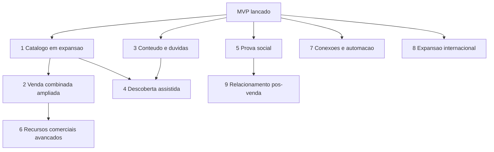

## 16. Escopo do MVP

**Definição de sucesso do MVP em uma frase.** O MVP está pronto quando um visitante que nunca ouviu falar de [EMPRESA] consegue, sozinho, entender o que a empresa faz, identificar um produto ou solução relevante e enviar uma solicitação de contato que chega — confirmada e rastreável — a alguém que vai responder; e quando a equipe consegue publicar um produto ou solução novos sem ajuda do desenvolvimento. As duas metades são obrigatórias: um site que só cumpre a primeira é artesanal disfarçado de produto, e reabre o problema no segundo lançamento.

### 16.1 O que entra no MVP

**Por página** (prioridade já fixada nas seções 1-8; aqui apenas a justificativa):

| Página | Justificativa |
|---|---|
| P-01 Inicial | Única página que expõe o ecossistema inteiro; sustenta OB-01, OB-05, OB-09 |
| P-02 Sobre | Responde "quem é essa empresa" sem prova social (PR-007) |
| P-03 Catálogo | Sustenta OB-02; principal ponto de decisão de navegação |
| P-04 Produto | Maior valor comercial; hospeda o template obrigatório, mecanismo central da escalabilidade |
| P-05 Índice de soluções | Condicionada a Q-006; dá lugar próprio a OB-09 |
| P-06 Solução | Condicionada a Q-006; converte combinação em oportunidade |
| P-07 Parceiros | Condicionada a parceiro autorizado (Q-025); custo zero se ausente (RF-105) |
| P-08 Contato | Sem ela não há OB-03; canal principal (PR-012) |
| P-09 Demonstração | Conversão de maior intenção; variante do formulário de contato |
| P-13 Privacidade | Não negociável: há coleta desde o primeiro formulário |
| P-14 Termos | Complementa P-13 a custo baixo, sustenta OB-05 |
| P-15 404 | Custo baixo; protege tráfego orgânico já conquistado |
| P-16 Confirmação | Fecha o fluxo com prazo e rastreabilidade de conversão |

**Por capacidade transversal** — o MVP não é a soma das telas; é isso somado ao mecanismo que permite o portfólio crescer sem reabrir projeto a cada lançamento:

| Capacidade | Por que está no MVP |
|---|---|
| Template obrigatório por produto/solução (PR-008, RF-060..063, RF-082) | Garante qualidade igual do 1º ao 20º produto |
| Modelo de conteúdo com entidades e relações (6.7, RF-181-182) | Condição estrutural de OB-07; reverter depois exige migração |
| Relação produto↔solução N:N (PR-003, RF-066, RF-083, RF-087) | Sustenta a venda combinada sem reescrever páginas |
| Categorias desde o início, mesmo ocultas (PR-013) | Evita migração quando os gatilhos de 6.6 forem ativados |
| Gatilhos de ativação por configuração (6.6, RF-048) | Ligar filtro/busca/paginação é configuração, não projeto novo |
| Publicação sem desenvolvimento (RF-180, RF-185, RF-186) | Requisito central de OB-07 |
| Papéis e revisão editorial obrigatória (RF-183, PR-043) | Qualidade constante sem perfil técnico contínuo |
| Piso de conteúdo único por produto/solução (PR-057) | Defesa contra conteúdo raso desde o primeiro produto |
| SEO incorporado ao modelo (RF-160..172) | Título, URL, dados estruturados nascem com o registro |
| Mobile-first e acessibilidade AA (RNF-001..006, RNF-020..027) | Critério de aceite desde o 1º template, não auditoria futura |
| Eventos, funil e alerta de falha de envio (RF-200..204, RF-206) | Linha de base (PR-053) começa no lançamento e não se recupera depois |
| Camadas silenciosas antispam (PR-050) | Protege a única conversão sem atrito ao público legítimo |
| Voz única e glossário normativo (PR-040, PR-058) | Consistência em escala, sem depender do redator |

### 16.2 O que fica para a Fase 2

| Item | Gatilho de ativação |
|---|---|
| Agrupamento por categoria (RF-043) | 7 produtos publicados |
| Filtro por categoria (RF-044) | 10 produtos, ou 4 categorias com 2+ produtos |
| Ordenação (RF-045) | 12 produtos |
| Paginação (RF-047) | 24 produtos |
| Estado sem resultados (RF-050) | Junto do filtro/busca que o ativar |
| Filtro de soluções por produto (RF-089) | 7 soluções |
| Categoria com página própria (P-18) | Filtro ativo **e** descrição editorial escrita |
| Blog (P-10, P-11, RF-144, RF-145) | Responsável e cadência definidos (Q-027) |
| FAQ e seus dados estruturados (P-12, RF-143, RF-169) | Volume real de dúvidas do atendimento |
| Produtos relacionados (RF-067) | Catálogo com produtos suficientes para relação lateral valer a pena |
| Pré-visualização antes de publicar (RF-184) | Ritmo de publicação que torne arriscado revisar em produção |
| Relatório por entidade (RF-205) | Volume acima do piso estatístico (15.8: 30 eventos / 1.000 sessões) |

### 16.3 O que fica para o Futuro

| Item | Por que não é Fase 2 | Gatilho |
|---|---|---|
| Busca no site (P-17, RF-046) | Portfólio pequeno (PR-002) torna a busca ruído | 15 produtos ou 20 conteúdos |
| Comparador de produtos (J-06) | Template consistente já resolve a dúvida com poucos produtos | Catálogo com produtos de escopo vizinho o bastante para gerar dúvida frequente |

### 16.4 O que explicitamente não faz parte do projeto

| Excluído | Justificativa |
|---|---|
| Área logada | Sem clientes (PR-007), sem usuário para autenticar; custo de segurança/suporte desproporcional (PR-001) |
| E-commerce | Modelo comercial aberto (Q-007) e preço não publicado (PR-005); cobrar por preço inexistente é custo sem necessidade |
| Autoatendimento de proposta/calculadora | Depende de preço e modelo fechados; número ilustrativo violaria 11.2 |
| Aplicação (executar produto) | Acoplaria o site ao ciclo de vida de cada produto, o oposto da estratégia de portfólio |
| Portal de cliente | Sem cliente, sem suporte modelado — mesmo erro da área logada |
| Chat ao vivo | Equipe reduzida (PR-009) tornaria "ninguém disponível" a resposta provável; custo de terceiro |
| Agendamento automático | Depende de formato de demonstração (Q-026) e agenda previsível, nenhum existe |

### 16.5 Funcionalidades que podem ser adiadas sem perda comercial

**Critério para adiar sob pressão de prazo:** só se, ao mesmo tempo, (a) a ausência não impede nenhuma jornada central (J-01 a J-04) de terminar; (b) não é requisito jurídico, de acessibilidade ou de segurança não negociável; (c) adicionar depois não exige retrabalho estrutural; (d) existe substituto mínimo que preserve "nenhuma lacuna visível" — nunca um "em breve".

| Adiável | Substituto imediato |
|---|---|
| Fluxo dedicado "seja um parceiro" (RF-107) | Link de contato com assunto pré-selecionado |
| Histórico público de versões legais (Q-032) | Data de atualização visível; histórico só interno |
| Mecanismo formal de reuso de blocos (RF-146) | Duplicação simples com revisão reforçada |
| Painel de medição curado (15.7) pronto no dia 1 | Dados brutos lidos manualmente; instrumentação e alerta de falha não são adiáveis |
| Profundidade da seção de integrações (RF-060 §7) | Já é condicional — seção omitida quando não há integração |

**Nunca cortar, mesmo sob pressão:** P-13/P-14 publicadas e datadas; alerta de falha de envio; validação de obrigatórios na publicação (RF-185, PR-057); acessibilidade AA; qualquer item de 16.4.

### 16.6 Conteúdo mínimo para lançar

O maior risco de atraso deste projeto é este, não o desenvolvimento.

| Item | Mínimo exigido | Por que bloqueia |
|---|---|---|
| Nome e domínio | Ambos confirmados (Q-001, Q-002) | Sem nome nenhum texto é aprovável; sem domínio não há URL nem e-mail |
| 1 produto completo | Campos de 6.7 e pisos de PR-057 (~1.200 caracteres únicos, 3 funcionalidades, 3 benefícios, imagem própria) | Catálogo e P-04 ficam vazios sem isso |
| 1 solução válida, se P-05/06 entrarem | 2+ produtos vinculados, ganho preenchido (RF-084) | Sem isso, P-05/06 saem do MVP por definição própria |
| Institucional completo (P-02) | Promessa, o que faz, como trabalha, sem afirmação não verificável | Empresa desconhecida sem isso não passa da triagem de PU-01 |
| Textos legais (P-13, P-14) | Validados juridicamente (PR-019), datados | Páginas MVP não negociáveis |
| Imagem padrão de compartilhamento | Uma imagem, da identidade visual (PR-055) | Bloqueio explícito do lançamento (12.6) |
| Identidade visual mínima | Paleta validada em contraste (RNF-021) | Sem paleta não há verificação de contraste possível |
| Dados de contato operacionais | Destino, prazo de resposta, um canal direto | Sem isso o formulário não tem para onde apontar |
| Autorização de marca por parceiro | Registrada (PR-018), se houver parceiro | Sem ela o parceiro não pode ser publicado (RF-103) |
| Revisão editorial/acessibilidade por página | Checklists de 11.9 e 13.12 aprovados | Portão contra "nenhuma lacuna visível" |

### 16.7 Decisões antes de começar o desenvolvimento

Ordenadas por urgência; detalhe completo em 18.4.

1. **D-01** Nome e identidade da marca — bloqueia redação final e desenho de interface.
2. **D-06** Idioma único ou múltiplo — afeta arquitetura de URLs; caro de retrofitar.
3. **D-10** Prazo alvo e orçamento — define o critério real de corte de escopo.
4. **D-02** Forma de publicação de conteúdo — bloqueia toda a faixa RF-180..199.
5. **D-04** Preço público, faixado ou sob consulta — condiciona todas as páginas de produto.
6. **D-05** Parceiros no lançamento e autorização — condiciona P-07 e o rodapé.
7. **D-03** Destino dos leads — condiciona o roteamento (RF-129).
8. **D-08** Ferramenta de medição — condiciona a instrumentação (RF-200..206).
9. **D-09** Responsável editorial e de triagem — condiciona a prontidão do lançamento.
10. **D-07** Desafio interativo antispam — pode esperar o pós-lançamento, mas o princípio precisa estar acordado antes.

### 16.8 Estimativa de esforço relativo

Sem prazo em dias ou semanas — não há base enquanto 16.7 estiver aberto.

| Bloco | Esforço | O que domina o custo |
|---|---|---|
| Template de produto + modelo de conteúdo + publicação sem código (RF-060..070, RF-180..187) | Grande | Mecanismo do qual toda a estratégia depende; vínculos N:N bidirecionais |
| Formulários, roteamento, e-mail, confirmação (RF-120..132, P-16) | Grande | Tratamento de falha, alerta e rastreabilidade, não a superfície visível |
| Template de solução e diferenciação produto/solução (RF-080..089, 12.9) | Médio | Reaproveita padrões do template de produto, soma lógica de composição |
| Navegação, cabeçalho, rodapé, catálogo com gatilhos desligados (RF-001..011, RF-040..050) | Médio | Nascer com filtro/ordenação/paginação já modelados, mesmo inativos |
| SEO e dados estruturados nos templates (RF-160..172) | Médio, concentrado no início | Parte do desenho de cada template; depois opera quase automaticamente |
| Institucional, legais, 404 (P-02, P-13-15, RF-140..147) | Pequeno | Depende dos textos existirem (16.6), não da construção |
| Parceiros (RF-100..107) | Pequeno, quase zero se D-05 for "sem parceiro" | Modelo de dados existe de qualquer forma; interface só se houver o que mostrar |
| Analytics, funil, painel mínimo (RF-200..206, 15.7) | Pequeno a médio | Instrumentar é direto; o esforço extra é ligar o alerta ao canal de leads |
| Acessibilidade e responsividade | Sobretaxa em todos os blocos, não bloco isolado | Cada template soma o custo de AA e mobile-first à própria construção |

Duas variáveis não técnicas dominam o calendário: a opção escolhida em D-02 (painel custa mais, mas resolve dependência operacional contínua) e quanto do conteúdo de 16.6 já existe quando o desenvolvimento começa.

## 17. Roadmap de evolução

Nada aqui é requisito do MVP nem deve ser antecipado para 16.1.

| Onda | Objetivo | Itens | Pré-condição | Indicador de necessidade |
|---|---|---|---|---|
| 1. Catálogo em expansão | Crescer sem perder curadoria | Novos produtos/categorias; ativação de 6.6 | Portfólio maior, categorias reais | Catálogo se aproxima dos gatilhos de 6.6 |
| 2. Venda combinada ampliada | Ampliar presença comercial das combinações | Novas soluções; filtro de soluções | Produtos suficientes para combinações que passem nos 4 critérios de P-06 | Participação das soluções na origem (15.2) estagnada |
| 3. Conteúdo e dúvidas | Atrair tráfego e reduzir dúvidas | Blog (P-10/11); FAQ (P-12) | Responsável/cadência definidos (Q-027) | Dúvidas repetidas no atendimento |
| 4. Descoberta assistida | Ajudar a encontrar quando navegar não bastar | Busca (P-17); filtros avançados | Volume real (gatilhos de 6.6) | Sessões que alcançam página comercial caindo |
| 5. Prova social | Substituir credibilidade sem prova social por evidência real | Cases, depoimentos, logos autorizados | Clientes reais dispostos a citação | Primeiras vendas concluídas |
| 6. Recursos comerciais avançados | Reduzir fricção para quem já entende o portfólio | Comparação; calculadora; preço público | Modelo comercial e preço fechados (D-04) | Contatos pedindo preço antes de falar com a equipe |
| 7. Conexões e automação | Reduzir triagem e nutrição manuais | Integração com gestão de relacionamento; automação | Volume que torne a triagem manual um gargalo | Tempo até o 1º retorno piorando |
| 8. Expansão internacional | Atender mercado fora do idioma único | Múltiplos idiomas | Mercado geográfico exigindo outro idioma (Q-011) | Tráfego relevante fora do mercado de língua portuguesa |
| 9. Relacionamento pós-venda | Atender clientes além da exposição comercial | Área de clientes; portal de suporte | Base de clientes com necessidade declarada — reverte PR-001/007 | Volume de solicitações de suporte que justifique canal dedicado |

Ondas 1, 3, 5, 7 e 8 podem começar de forma independente. Ondas 2, 4, 6 e 9 dependem de uma anterior ter avançado.

## 18. Riscos, premissas e pendências

### 18.1 Riscos

| ID | Risco | Categoria | Prob. | Impacto | Sinal de alerta | Mitigação no PRD |
|---|---|---|---|---|---|---|
| R-01 | Identidade de marca indefinida quando o design precisa começar | Negócio | Alta | Alto | Data de início do design chega sem paleta aprovada | Sistema visual provisório (11.10); D-01 antes do design |
| R-02 | Portfólio de lançamento não definido a tempo | Negócio/Conteúdo | Alta | Alto | Template pronto sem nenhum produto real (Q-004) | P-03 funciona com 1-3 produtos; piso é ao menos 1 real |
| R-03 | Conteúdo depende do cliente e atrasa | Conteúdo/Prazo | Alta | Alto | Prazo de revisão chega sem entregável | Inventário mínimo explícito (16.6) |
| R-04 | Ausência de prova social reduz conversão | Negócio/Mercado | Alta (fato, PR-007) | Médio | Conclusão de contato abaixo do esperado sem outra causa | Confiança sem prova social (P-01); tom verificável (11.1) |
| R-05 | Canibalização de busca produto x solução | Técnico/Mercado | Média | Médio | Alternância do endereço exibido por termo (15.3) | Regras de 12.9: léxico distinto, título, âncoras |
| R-06 | Portfólio cresce e catálogo perde curadoria | Negócio/Técnico | Média, crescente | Médio | Catálogo ultrapassa gatilhos de 6.6 sem ativação | Gatilhos objetivos (6.6); categorias desde o início (PR-013) |
| R-07 | Formulário falha em silêncio, oportunidade se perde | Técnico/Negócio | Baixa, impacto alto | Alto | Divergência envio x confirmação; falha sem alerta | Registro independente, alerta obrigatório (RNF-092) |
| R-08 | Expectativa de tráfego orgânico rápido para marca nova | Mercado/Negócio | Alta | Médio | Cobrança de resultado antes da calibração (PR-053) | Priorização realista (12.8); leitura estatística (15.8) |
| R-09 | Decisão de forma de publicação (D-02) atrasa | Prazo/Técnico | Média | Alto | Q-033 sem resposta além do combinado | Critério de escolha explícito (9.10); D-02 bloqueante em 16.7 |
| R-10 | Escopo cresce durante a execução | Prazo/Negócio | Alta | Médio-alto | Pedidos fora de 16.1-16.3 sem passar por 16.5 | Critério de adiamento (16.5); taxonomia MVP/Fase2/Futuro |
| R-11 | Parceiros/autorização não resolvidos a tempo | Negócio/Jurídico | Média | Baixo-médio | Q-025 sem resposta perto do lançamento | P-07 já condicionada; RF-105 trata o vazio |
| R-12 | Destino dos leads e triagem indefinidos no lançamento | Operacional | Média | Alto | Lançamento próximo sem resposta a Q-013/063/064 | D-03/D-09 bloqueantes; rastreabilidade de 14.5 funciona mesmo simples |
| R-13 | Preço e modelo comercial seguem indefinidos | Negócio | Média | Médio | Q-007/008 sem resposta mesmo após o lançamento | Texto único consistente (RF-065); D-04 em revisão contínua |
| R-14 | Revisor único sobrecarregado com o ritmo de publicação | Operacional | Baixa no lançamento, cresce | Médio | Atraso sistemático entre pronto e publicado | Papéis diferenciados (RF-183); checklists objetivos (11.9, 13.12) |

### 18.2 Premissas consolidadas

Todas as premissas do documento, agrupadas por origem. Impacto = efeito no restante do PRD se a premissa for falsa.

| ID | Enunciado | Origem | Impacto se falsa |
|---|---|---|---|
| PR-001 | Site totalmente público e anônimo no MVP, sem área logada | Parte 1 | Alto |
| PR-002 | Portfólio de lançamento pequeno, entre 2 e 5 produtos | Parte 1 | Médio |
| PR-003 | Relação produto↔solução é muitos-para-muitos nos dois sentidos | Parte 1 | Alto |
| PR-004 | Venda concluída por atendimento humano; o site qualifica e encaminha | Parte 1 | Alto |
| PR-005 | Preço não é publicado no MVP | Parte 1 | Médio |
| PR-006 | Site publicado em um único idioma, português do Brasil | Parte 1 | Alto |
| PR-007 | Sem clientes, cases, depoimentos ou logos no lançamento | Parte 1 | Médio |
| PR-008 | Todo produto publicado usa o mesmo template obrigatório | Parte 1 | Alto |
| PR-009 | Conteúdo mantido por equipe reduzida e não técnica | Parte 1 | Alto |
| PR-010 | Solução composta exige no mínimo dois produtos | Parte 1 | Médio |
| PR-011 | A lista de parceiros pode estar vazia no lançamento | Parte 1 | Baixo |
| PR-012 | Formulário é o canal principal de contato | Parte 1 | Médio |
| PR-013 | Categorias existem no modelo desde o início, mesmo sem exibição | Parte 1 | Médio |
| PR-014 | Slug imutável após publicação; renomeação exige redirecionamento | Parte 1 | Médio |
| PR-015 | Blog e conteúdo editorial não são pré-requisito de lançamento | Parte 1 | Baixo |
| PR-016 | Demonstração conduzida por pessoa, sem acesso imediato ao software | Parte 1 | Médio |
| PR-017 | Parte relevante do tráfego será móvel | Parte 1 | Alto |
| PR-018 | Marca de terceiro só com autorização formal registrada | Parte 1 | Alto |
| PR-019 | Textos legais fornecidos e validados pelo cliente | Parte 1 | Alto |
| PR-020 | Contato e demonstração são os únicos formulários no lançamento | Parte 2 | Médio |
| PR-021 | Destino é caixa de mensagens compartilhada, sem CRM | Parte 2 | Médio |
| PR-022 | E-mail de confirmação é transacional, não é marketing | Parte 2 | Médio |
| PR-023 | Até três pessoas com acesso de publicação no lançamento | Parte 2 | Baixo |
| PR-024 | Uma única ferramenta de medição, escolhida fora deste PRD | Parte 2 | Médio |
| PR-025 | Orçamento de performance calibrado para conexão móvel média | Parte 2 | Médio |
| PR-026 | Sem exigência contratual adicional de acessibilidade além de AA | Parte 2 | Baixo-médio |
| PR-040 | Uma única voz, a de [EMPRESA]; nenhum produto tem tom próprio | Parte 3 | Médio |
| PR-041 | Limites de caracteres validados na edição | Parte 3 | Baixo |
| PR-042 | Nomes de produto ainda não existem; padrão único para a família | Parte 3 | Alto |
| PR-043 | Todo texto passa por um único revisor designado | Parte 3 | Médio |
| PR-044 | WCAG 2.2 nível AA como critério de aceite | Parte 3 | Alto |
| PR-045 | Nenhum texto essencial dentro de imagem, exceto o logotipo | Parte 3 | Médio |
| PR-046 | Formulário curto por decisão; qualificação no atendimento humano | Parte 3 | Médio |
| PR-047 | Sem envio de anexo nos formulários do MVP | Parte 3 | Baixo |
| PR-048 | Prazo de resposta de um dia útil, provisório até Q-013 | Parte 3 | Alto |
| PR-049 | Nenhuma solicitação sem contexto de origem | Parte 3 | Médio |
| PR-050 | Sem desafio interativo no MVP; camadas 1-6 de 14.6 | Parte 3 | Baixo-médio |
| PR-051 | Nenhuma métrica com dado pessoal além do necessário | Parte 3 | Alto |
| PR-052 | Medição não essencial só após manifestação do visitante | Parte 3 | Alto |
| PR-053 | Três primeiros meses são linha de base; sem meta antes disso | Parte 3 | Médio |
| PR-054 | O site mede até o envio; o resto depende do destino comercial | Parte 3 | Médio |
| PR-055 | Existe uma imagem institucional padrão de compartilhamento | Parte 3 | Médio |
| PR-056 | Dados estruturados só declaram o verificável | Parte 3 | Alto |
| PR-057 | Nenhum produto publicado abaixo do piso de conteúdo único | Parte 3 | Alto |
| PR-058 | Glossário normativo bloqueia publicação divergente | Parte 3 | Médio |
| PR-059 | Sem chat, agendamento automático, proposta automática e cadastro no MVP | Parte 3 | Alto |
| PR-060 | Lançamento do MVP como evento único: 16.1 publica em bloco, sem fases parciais internas | Parte 4 | Médio |

### 18.3 Informações faltantes

**Marca.** Nome, domínio, logo, paleta, tipografia, manual de marca, tagline — nada existe hoje; risco de atraso que nenhuma engenharia mitiga.

**Produto.** Quantidade, nomes, categorias e material visual dos produtos do lançamento (Q-004, Q-005); sem isso o template está pronto e vazio.

**Comercial.** Modelo de contratação, preço, segmento, porte de cliente, mercado geográfico, volume atendível (Q-007 a Q-011, Q-015, Q-016).

**Operacional.** Destino real dos leads, triagem, prazo de resposta, e-mail próprio, ferramenta de medição, administração de webmaster (Q-013, Q-014, Q-057, Q-063, Q-064).

**Jurídico.** Quem redige/valida privacidade e termos, base legal e retenção, razão social publicável, abrangência da autorização de parceiros (Q-028, Q-053, Q-054, Q-065, Q-066).

### 18.4 Decisões necessárias

| ID | Decisão | Opções | Critério | Quem decide | Prazo | Consequência de adiar |
|---|---|---|---|---|---|---|
| D-01 | Nome e identidade visual | (a) Confirmar e produzir identidade completa antes do design; (b) sistema provisório, substituir depois | Custo de retrabalho x pressão de prazo | Cliente | Antes do design | Design não inicia ou refaz tudo depois |
| D-02 | Forma de publicação de conteúdo | (a) Arquivos versionados; (b) painel para equipe não técnica | Frequência de lançamento (Q-004) x perfil técnico disponível (PR-009) | Cliente + dev. | Antes do desenvolvimento | RF-180..199 não pode ser estimado nem iniciado |
| D-03 | Destino dos leads | (a) Caixa compartilhada; (b) ferramenta de gestão de relacionamento | Tamanho do time x necessidade de estado/histórico | Comercial/cliente | Antes de RF-129 | Roteamento e confirmação não finalizam |
| D-04 | Preço público, faixado ou consulta | 3 opções (Q-008) | Ciclo de venda e sensibilidade competitiva | Comercial/cliente | Antes da seção comercial do template | Texto padrão de ausência de preço indefinidamente |
| D-05 | Parceiros no lançamento | (a) Sem parceiros (P-07 oculta); (b) com parceiros autorizados | Autorização obtida a tempo | Cliente | Antes de congelar rodapé/menu | Escopo de P-07 oscila até a reta final |
| D-06 | Idioma único ou múltiplo | (a) Só PT-BR; (b) incluir outro idioma | Mercado geográfico (Q-011) | Cliente | Antes do desenvolvimento | Adicionar depois exige rework estrutural |
| D-07 | Desafio interativo antispam | (a) Só camadas 1-6; (b) acrescentar desafio | Volume de envios inválidos pós-lançamento (gatilho de 14.6) | Dev. + comercial | Princípio antes do formulário; ativação pode esperar | Atrito precoce penaliza público legítimo |
| D-08 | Ferramenta de medição | Critério técnico de privacidade/custo/integração, sem fornecedor indicado | Aderência a 15.9 e ao orçamento de RNF-010..016 | Dev. + privacidade | Antes dos eventos (RF-200..206) | Instrumentação sem destino; painel não se monta |
| D-09 | Responsável editorial/triagem | (a) Papel interno; (b) rotativo entre sócios; (c) apoio externo | Headcount real; limite de 3 acessos (PR-023) | Cliente | Antes do lançamento | Leads sem dono; prazo prometido sem responsável |
| D-10 | Prazo alvo e orçamento | (a) Data fixa, escopo ajustável; (b) escopo fixo, data ajustável | Urgência x completude desejada | Cliente/patrocinador | O quanto antes | Discussão de escopo permanece abstrata |

### 18.5 Dependências

| Dependência | Origem | Bloqueia enquanto pendente |
|---|---|---|
| Nome, identidade, paleta, tipografia | Cliente/Design | Redação final e telas de alta-fidelidade |
| Textos legais validados juridicamente | Cliente/Jurídico | Publicação de P-13/P-14 e o lançamento |
| Definição real de produtos e soluções | Cliente | Conteúdo do catálogo e dimensionamento do esforço |
| Forma de publicação de conteúdo | Cliente/Dev. | Início do desenvolvimento de RF-180..199 |
| Ferramenta de medição | Dev./Cliente | Instrumentação de eventos e painel mínimo |
| Destino dos leads e triagem | Cliente/Comercial | Roteamento (RF-129) e prontidão operacional |
| Domínio e infraestrutura básica | Cliente/Infra | Ambiente de dev., URLs, e-mail transacional |
| Material visual dos produtos | Cliente/Produto | Seção de galeria condicional (RF-064) |
| Autorizações de marca de parceiros | Cliente/Parceiros | Publicação de P-07 |

### 18.6 Impactos possíveis no escopo

**Identidade atrasa:** estrutura avança com sistema provisório (11.10); nenhuma tela final nem verificação de contraste fecha. Risco no cronograma de design, não na arquitetura.

**Sem parceiros no lançamento:** P-07 sai do MVP por definição própria; menu e faixa da inicial ocultos (RF-105). Sem perda de funcionalidade central.

**Apenas um produto no lançamento:** P-03 opera no estado "poucos produtos" (PR-002); P-05/06 saem do MVP porque solução exige 2+ produtos (PR-010). Site continua coerente, só sem venda combinada até o 2º produto.

**Preço público:** texto padrão de RF-065 vira campo de valor no modelo; impacto é de conteúdo e um campo validado na publicação (RF-185), não estrutural — se D-04 vier antes da redação.

**Segundo idioma exigido:** maior risco de retrabalho da lista — endereços por idioma, seletor, conteúdo duplicado, dados estruturados por idioma; custo multiplicado se D-06 chegar depois do desenvolvimento já iniciado.

## 19. Critérios gerais de aceite

Cada critério é verificável por observação ou medição; a coluna final diz como.

### 19.1 Navegação

| ID | Critério | Verificação |
|---|---|---|
| CA-01 | Os cinco itens do menu (6.1) não mudam ao publicar produto, categoria, solução ou parceiro | Publicar um de cada tipo e conferir o menu |
| CA-02 | Nenhuma página publicada é beco sem saída | Amostrar um exemplar de cada template; checar ação de saída |
| CA-03 | Breadcrumb reflete a hierarquia em produto, solução e categoria | Comparar com o mapa do site (6.3) |

### 19.2 Conteúdo

| ID | Critério | Verificação |
|---|---|---|
| CA-04 | Nenhum texto tem superlativo, jargão vazio, número sem fonte ou afirmação não verificável (11.2, 11.5) | Checklist de 11.9 pelo revisor único (PR-043) antes de publicar |
| CA-05 | Glossário controlado (11.8) usado de forma consistente entre páginas | Busca pelos sinônimos proibidos antes de publicar |

### 19.3 Produtos

| ID | Critério | Verificação |
|---|---|---|
| CA-06 | Página de produto segue a ordem fixa do template; obrigatórias preenchidas, ausentes omitidas | Comparar com 6.7 e RF-060..063 |
| CA-07 | Nenhum produto abaixo do piso de conteúdo único (PR-057) | Contar caracteres e % de texto exclusivo antes de publicar |
| CA-08 | Bloco de soluções do produto reflete os vínculos, ou some se não houver | Criar vínculo em teste; conferir atualização sem edição manual |
| CA-09 | Nenhuma página de produto exibe preço; texto padrão idêntico em todas | Comparar o texto entre produtos publicados |

### 19.4 Soluções

| ID | Critério | Verificação |
|---|---|---|
| CA-10 | Solução tem 2+ produtos e "ganho da combinação" preenchido, distinto da soma das partes | Tentar publicar com 1 produto e confirmar bloqueio (RF-185) |
| CA-11 | Rótulo, breadcrumb, URL e léxico distinguem solução de produto | Inspeção cruzada de amostra (12.9) |
| CA-12 | Alterar a composição atualiza a página sem reescrita manual | Alterar vínculo em teste e conferir atualização |

### 19.5 Parceiros

| ID | Critério | Verificação |
|---|---|---|
| CA-13 | Nenhum parceiro exibido sem autorização formal registrada | Auditar registro de autorização antes do lançamento |
| CA-14 | Com zero parceiros, página/menu/faixa ficam ocultos, sem substituto genérico | Testar o estado vazio |

### 19.6 Formulários e conversão

| ID | Critério | Verificação |
|---|---|---|
| CA-15 | **Entrega confirmada:** solicitação enviada chega ao destino comercial com identificador rastreável, independente do canal | Enviar solicitação de teste ponta a ponta; conferir mesmo identificador no destino |
| CA-16 | **Alerta de falha:** falha simulada de entrega dispara alerta interno sem perda dos dados digitados | Simular indisponibilidade do canal em teste; conferir alerta e dados preservados |
| CA-17 | Envio bem-sucedido redireciona à confirmação com prazo, próximo passo, não indexável | Completar envio; inspecionar página e marcação de indexação |
| CA-18 | Contexto de origem registrado automaticamente e visível antes do envio | Originar envio de uma página de produto; conferir campo pré-preenchido |
| CA-19 | Nenhuma ação primária compete em peso com outra na mesma tela | Inspeção visual de cada template comercial |

### 19.7 Responsividade e acessibilidade

| ID | Critério | Verificação |
|---|---|---|
| CA-20 | Sem rolagem horizontal em 320px; alvos acionáveis no tamanho mínimo | Teste no viewport mínimo suportado |
| CA-21 | Toda página cumpre WCAG 2.2 nível AA, por template | Checklist automatizável + manual de 13.12 |
| CA-22 | Erro de formulário anunciado por leitor de tela junto ao campo, sem depender só de cor | Teste manual de 13.12 |
| CA-23 | Toda imagem informativa tem texto alternativo descritivo; decorativas marcadas | Bloqueio automático no carregamento sem alternativo (RF-187) |

### 19.8 Performance

| ID | Critério | Verificação |
|---|---|---|
| CA-24 | Página nova ou alterada verificada contra o orçamento de performance antes de publicar | Medição em homologação antes de cada publicação |
| CA-25 | Nenhuma imagem excede o peso máximo; variações responsivas automáticas | Inspeção de peso após carregamento de mídia nova |

### 19.9 SEO

| ID | Critério | Verificação |
|---|---|---|
| CA-26 | Nenhuma página compartilha título, URL canônica ou H1 duplicado com outra | Verificação de unicidade e de estrutura na publicação |
| CA-27 | Mapa do site regenerado a cada publicação/despublicação, só com endereços canônicos | Publicar/despublicar entidade de teste; conferir mapa |

### 19.10 Segurança e privacidade

| ID | Critério | Verificação |
|---|---|---|
| CA-28 | Nenhum dado pessoal enviado como propriedade de evento | Inspecionar eventos disparados num envio de teste |
| CA-29 | Medição não essencial só após manifestação; recusa tão simples quanto aceite | Testar aceite e recusa do aviso de consentimento |
| CA-30 | Privacidade acessível do rodapé e de todo formulário, com data visível | Navegar a partir de cada formulário e do rodapé |

### 19.11 Manutenibilidade e escalabilidade

| ID | Critério | Verificação |
|---|---|---|
| CA-31 | **Teste prático de escalabilidade:** publicar um produto novo e, em seguida, uma solução nova que o inclua, do zero, sem alterar código e sem tocar em nenhuma outra página, dentro do tempo-alvo do requisito de manutenibilidade correspondente (RNF-070..075) | Executar em homologação, cronometrado, confirmando zero alteração de código ou de outras páginas |
| CA-32 | Remover vínculo produto-solução atualiza as duas páginas na mesma operação | Remover vínculo em teste; comparar antes/depois |
| CA-33 | Despublicar retira a entidade de listagens/blocos e ativa redirecionamento na mesma operação | Despublicar entidade de teste; conferir catálogo e endereço antigo |

### 19.12 Qualidade geral

| ID | Critério | Verificação |
|---|---|---|
| CA-34 | Nenhuma página tem lacuna visível, imagem ausente ou seção "em breve" | Revisão visual de todas as páginas antes do lançamento |
| CA-35 | Todo requisito MVP tem verificação cumprida; nenhum item adiado sem decisão formal | Conferir 16.1 contra o estado real do site antes de publicar |

### 19.13 Definição de pronto para o lançamento

- [ ] Inventário mínimo de 16.6 completo e revisado.
- [ ] Nenhuma página viola os checklists de 11.9 ou 13.12.
- [ ] CA-31 (teste de escalabilidade) executado com sucesso em homologação.
- [ ] CA-16 (alerta de falha) testado e confirmado.
- [ ] CA-15 (entrega confirmada) validado ponta a ponta.
- [ ] Responsável de triagem nomeado desde o dia 1 (D-09 resolvida).
- [ ] Destino dos leads configurado e operacional (D-03 resolvida).
- [ ] Nenhum parceiro publicado sem autorização.
- [ ] Orçamento de performance verificado por template em homologação.
- [ ] D-01, D-02, D-04 e D-06 resolvidas, mesmo que a resposta seja manter o padrão deste PRD.

## 20. Perguntas finais para validação

### 20.1 As dez perguntas mais críticas

**Q-001, Q-004, Q-002, Q-003, Q-033, Q-008, Q-006, Q-029, Q-011, Q-013.**

### 20.2 Bloqueantes — impedem começar o design ou o desenvolvimento

**Nome da empresa e identidade visual:** Q-001 nome comercial confirmado? · Q-002 domínio? · Q-003 identidade visual/logo? · Q-056 quem produz, prazo, orçamento?
**Público-alvo:** Q-011 mercado geográfico e idiomas?
**Escopo do MVP:** Q-029 data alvo/orçamento que altere a priorização?
**Publicação de conteúdo:** Q-033 forma de publicação e pessoa técnica disponível?

### 20.3 Importantes — afetam conteúdo e escopo do MVP

**Produtos e portfólio:** Q-004 quais produtos, quantos, nomes, categorias? · Q-005 material visual existe? · Q-006 quais soluções no lançamento? · Q-051 relação nome de produto/empresa? · Q-052 registro de marca dos produtos? · Q-070 (novo) integração técnica com sistemas de terceiros dos clientes-alvo?
**Posicionamento:** Q-018 diferencial? · Q-019 por que vários softwares? · Q-020 o que a integração entrega? · Q-021 provas de credibilidade? · Q-022 promessa comercial verificável? · Q-050 tom de voz aprovado? · Q-059 restrição de vocabulário do mercado?
**Público-alvo:** Q-009 segmento/vertical? · Q-010 porte de cliente?
**Modelo comercial:** Q-007 modelo comercial? · Q-008 preço público/faixado/consulta?
**Parceiros:** Q-024 taxonomia corresponde? · Q-025 parceiros no lançamento e autorização? · Q-054 abrangência da autorização?
**Contato e operação comercial:** Q-012 canais além do formulário? · Q-013 quem recebe/destino/prazo? · Q-014 encaminhar a CRM? · Q-015 volume atendível? · Q-017 indicadores/periodicidade/responsável? · Q-026 formato da demonstração? · Q-031 e-mail remetente? · Q-062 dado de qualificação exigido? · Q-063 e-mail no domínio próprio? · Q-064 responsável pela triagem?
**Conteúdo e responsáveis:** Q-028 quem redige/valida textos legais? · Q-053 razão social/CNPJ publicáveis?
**Escopo do MVP:** Q-023 gatilhos numéricos aceitos?
**Publicação e administração:** Q-034 quem exerce papéis/aprova? · Q-071 (novo) quem contrata/custeia domínio, e-mail e medição?
**Medição:** Q-035 restrição de orçamento de infraestrutura? · Q-036 exigência legal de acessibilidade acima de AA? · Q-060 idem, com laudo formal? · Q-065 base legal/retenção? · Q-066 aceite separado para comunicações futuras? · Q-069 quem acessa o painel e age?
**Jurídico:** Q-032 histórico de versões legal público ou interno?

### 20.4 Podem esperar — afetam Fase 2 e Futuro

**Modelo comercial:** Q-016 ciclo de venda e ticket?
**Conteúdo e responsáveis:** Q-027 responsável/cadência editorial? · Q-055 manual de marca existe? · Q-058 quem coleta termos de busca?
**Publicação e administração:** Q-057 quem administra webmaster tools? · Q-072 (novo) quem autoriza despublicação/renomeação e como comunica clientes?
**Formulários:** Q-030 desafio interativo antispam?
**Medição:** Q-061 auditoria externa de acessibilidade? · Q-067 investimento em mídia paga? · Q-068 meta numérica do 1º trimestre?

## 21. Síntese final e próximos passos

**Visão do site.** [EMPRESA] é uma empresa de software em constituição que desenvolverá um ecossistema de produtos digitais: softwares menores, vendidos isolados, combinados em soluções compostas ou expandidos com novos lançamentos ao longo do tempo. O site é o ponto central de exposição dessa empresa — o canal que explica, sem depender de reunião comercial prévia, o que a empresa faz, o que cada produto resolve e o que a combinação de produtos entrega além da soma das partes. Ele existe porque, sem canal próprio, cada produto novo exigiria explicação manual e cada combinação seria narrada caso a caso.

**Principais páginas.** Inicial, institucional, catálogo e página de produto formam o núcleo. Índice e página de solução materializam a venda combinada. Parceiros, contato e demonstração completam a conversão. Privacidade, termos, 404 e confirmação sustentam a operação. Conteúdo editorial, FAQ e busca ficam para depois, quando houver volume ou cadência que os justifique.

**Funcionalidades essenciais.** Um template obrigatório garante estrutura e qualidade iguais do primeiro ao vigésimo produto. Um modelo de conteúdo baseado em entidades e relações permite que um produto participe de várias soluções sem reescrever páginas. Formulários curtos, com origem registrada automaticamente, roteiam solicitações com rastreabilidade completa e alerta obrigatório em falha — perder uma oportunidade em silêncio é o pior defeito possível. SEO, acessibilidade AA e desempenho móvel são parte do modelo desde o primeiro template.

**Escopo do MVP em resumo.** Entram as nove páginas centrais (parceiros e soluções condicionadas à existência real de parceiros e soluções compostas) mais o mecanismo de crescimento que as sustenta: template, modelo de conteúdo, vínculos entre entidades, gatilhos já modelados e desligados, publicação sem depender de desenvolvimento. Ficam para depois blog, FAQ e busca, por falta de volume ou cadência, não por importância menor. Ficam permanentemente fora, por decisão e não por prazo: área logada, e-commerce, autoatendimento de proposta, execução de aplicação, portal de cliente, chat ao vivo e agendamento automático — sem necessidade comprovada hoje e com custo desproporcional para uma empresa sem clientes ainda.

**Principais decisões pendentes.** Nome e identidade visual; forma de publicação de conteúdo; destino dos leads e responsável pela triagem; preço público, faixado ou sob consulta; existência de parceiros autorizados; idioma único ou múltiplo; e o prazo alvo que deve orientar qualquer corte de escopo. Nenhuma é técnica — todas dependem do cliente, e o cronograma não absorve o tempo que levarem se forem adiadas.

**Próximos passos recomendados, em ordem:**

1. **Cliente** — responder as sete perguntas bloqueantes de 20.2, priorizando nome, domínio e identidade visual.
2. **Cliente** — fornecer o inventário mínimo de 16.6: produtos e soluções reais, textos institucionais e legais para revisão jurídica.
3. **Design** — a partir do nome e identidade aprovados (ou do sistema provisório de 11.10), produzir paleta validada em contraste, tipografia e os templates de alta-fidelidade do MVP.
4. **Desenvolvimento** — com D-02, D-03, D-06 e D-08 resolvidas, estimar os blocos de 16.8, começando pelo template de produto e pelo modelo de conteúdo.
5. **Conteúdo** — em paralelo, redigir e revisar cada página segundo 11.9 e 13.12, aplicando desde o primeiro texto o glossário e os limites de caracteres.
6. **Cliente + Desenvolvimento** — antes de publicar, executar por completo a definição de pronto de 19.13, incluindo o teste de escalabilidade (CA-31) e a validação ponta a ponta do formulário com alerta de falha (CA-15, CA-16).
7. **Cliente** — designar, antes do lançamento, o responsável pela triagem diária e confirmar o destino operacional das solicitações.
8. **Todos** — tratar os três primeiros meses como calibração (PR-053): ler contagens absolutas, não taxas, e revisitar o roadmap da seção 17 só quando as pré-condições de cada onda se cumprirem de fato.
