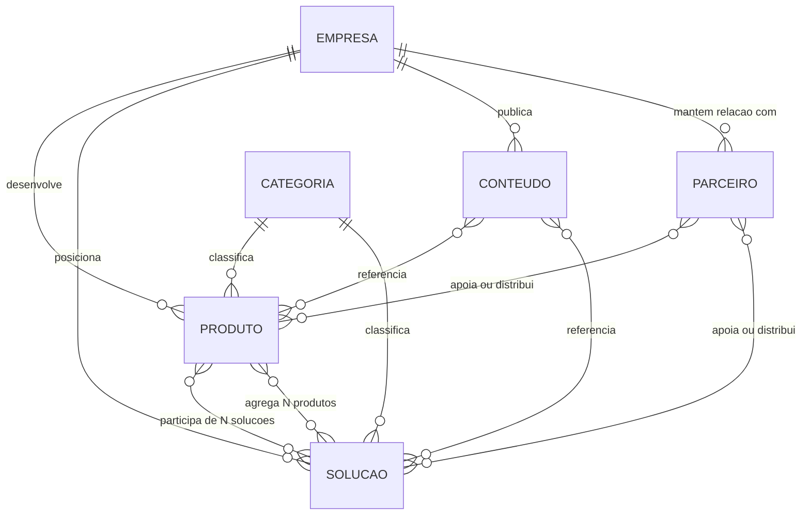
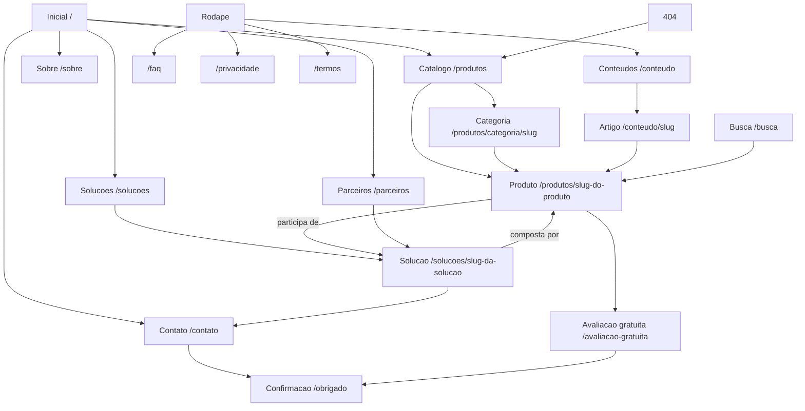
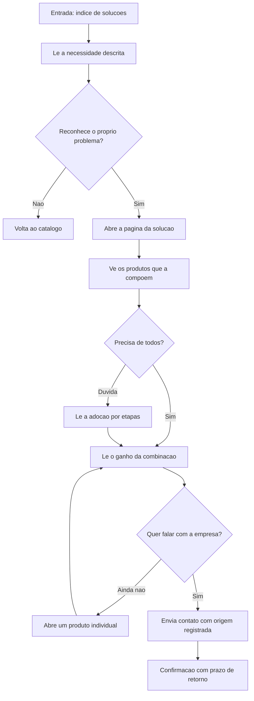
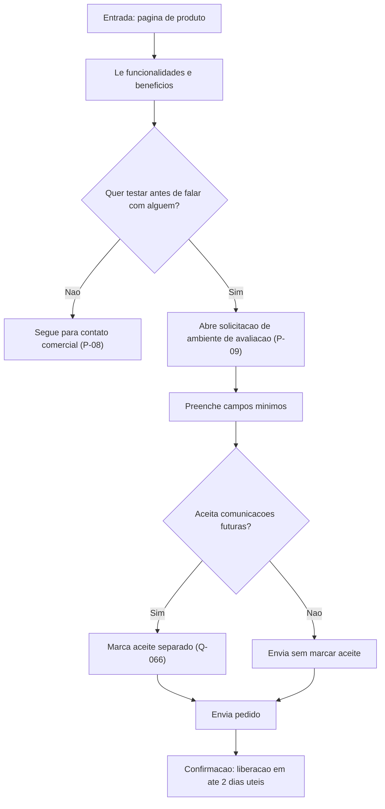

# PRD — Site institucional e de exposição comercial de ArtZan

| Campo | Valor |
|---|---|
| Versão | 2.0 |
| Data | 2026-09-07 |
| Status | Revisado com as respostas do cliente |
| Autor | Time de Produto |
| Escopo | Site institucional público |
| Versão anterior | A versão 1.0, escrita com o negócio ainda indefinido, permanece integralmente preservada em `PRD-v1-backup.md` |

> Este documento **não define tecnologia**: não escolhe framework, plataforma de conteúdo, provedor ou biblioteca; descreve apenas comportamento, conteúdo, estrutura e regras de produto.
> Nesta revisão, os dados de negócio **deixaram de ser hipotéticos**: refletem as 69 respostas do cliente ao formulário `PERGUNTAS-PENDENTES.md`, digeridas em `prd-parts/10-respostas.md`. O que ainda não tem resposta segue marcado como **Pergunta (Q-0xx)** pendente; o que depende de decisão editorial ainda não tomada segue marcado como **Premissa (PR-0xx)**. Nenhum dos dois é mais hipótese genérica de mercado — é lacuna real e específica desta empresa.

## Sumário

1. [1. Resumo executivo](#1-resumo-executivo)
2. [2. Visão do produto](#2-visão-do-produto)
3. [3. Objetivos do negócio](#3-objetivos-do-negócio)
4. [4. Público-alvo](#4-público-alvo)
5. [5. Proposta de valor](#5-proposta-de-valor)
6. [6. Arquitetura de informação](#6-arquitetura-de-informação)
7. [7. Páginas e requisitos](#7-páginas-e-requisitos)
   Páginas públicas P-01 a P-18, com objetivo, conteúdo e seções de cada uma, mais a superfície interna de administração P-19 a P-22 (não pública, não indexada).
8. [8. Jornadas do usuário](#8-jornadas-do-usuário)
9. [9. Requisitos funcionais](#9-requisitos-funcionais)
   RF-001 a RF-206, por área: navegação, inicial, catálogo, produto, soluções, parceiros, formulários, conteúdo institucional, SEO, administração, analytics.
10. [10. Requisitos não funcionais](#10-requisitos-não-funcionais)
    RNF-001 a RNF-107: responsividade, performance, acessibilidade, SEO técnico, segurança, privacidade, compatibilidade, manutenibilidade, escalabilidade, disponibilidade, qualidade.
11. [11. Conteúdo e identidade da marca](#11-conteúdo-e-identidade-da-marca)
12. [12. SEO e descoberta](#12-seo-e-descoberta)
13. [13. Acessibilidade e usabilidade](#13-acessibilidade-e-usabilidade)
14. [14. Conversão e contato comercial](#14-conversão-e-contato-comercial)
15. [15. Métricas e analytics](#15-métricas-e-analytics)
16. [16. Escopo do MVP](#16-escopo-do-mvp)
    O que entra no MVP, Fase 2 e Futuro, o que fica fora, conteúdo mínimo e decisões antes do desenvolvimento.
17. [17. Roadmap de evolução](#17-roadmap-de-evolução)
18. [18. Riscos, premissas e pendências](#18-riscos-premissas-e-pendências)
    Riscos, premissas consolidadas (PR-001 a PR-060), informações faltantes, decisões necessárias e dependências.
19. [19. Critérios gerais de aceite](#19-critérios-gerais-de-aceite)
20. [20. Perguntas finais para validação](#20-perguntas-finais-para-validação)
    As dez mais críticas, bloqueantes, importantes e as que podem esperar.
21. [21. Síntese final e próximos passos](#21-síntese-final-e-próximos-passos)

## 1. Resumo executivo

**ArtZan** (nome comercial confirmado — Q-001) é uma empresa de software em constituição que desenvolverá um **ecossistema de produtos digitais**. O portfólio de lançamento tem **cinco ofertas** (Q-004): quatro softwares de prateleira — gestão geral de empresa (Sistema Lara, nome confirmado), alocação de quadras, scout para partidas esportivas e placar esportivo, os três últimos ainda sem nome aprovado (seção 11) — e um serviço sob encomenda, desenvolvimento de integrações entre sistemas, tratado à parte por não ter formato de prateleira (seção 6).

O site é o **ponto central de exposição da empresa**: identidade institucional, catálogo de softwares, soluções compostas (sem nenhuma publicável no lançamento, ver seção 3), empresas parceiras e informações relevantes para clientes, potenciais clientes e interessados. O público de lançamento é **clubes, parques e pequenas e médias empresas** (Q-009, Q-010), com tom levemente neutro para não fechar a leitura nesses três nichos.

**Problema que resolve.** ArtZan não tem canal próprio para explicar o que faz. Não é apenas ausência de presença digital: é a dificuldade de comunicar um portfólio que cresce e só faz sentido pleno quando o visitante entende a relação entre as peças — mesmo que, hoje, ainda não exista combinação pronta para mostrar. Sem canal próprio, cada produto novo exige explicação manual em reunião, e a empresa é percebida como softwares avulsos em vez de ecossistema. Um site artesanal, com página escrita à mão por produto, reproduziria o problema em escala.

**Finalidade comercial.** O site é instrumento de geração de oportunidades, não vitrine passiva. Leva o visitante de "não conheço esta empresa" a "quero testar" ou "quero falar sobre este produto". O modelo comercial é **assinatura recorrente** para os softwares e **projeto sob encomenda** para o serviço de integrações (Q-007), sem preço publicado (Q-008). A conversão do MVP é o **contato comercial qualificado** e o **pedido de ambiente de avaliação gratuita**, não a compra online. **Premissa PR-004:** a venda é concluída por atendimento humano; o site qualifica e encaminha.

**Relação com o ecossistema.** O site é a camada de apresentação do ecossistema, não parte dele: descreve os produtos, não os executa. Cada software tem página gerada por **template obrigatório**. **Premissa PR-003:** a relação produto↔solução é de muitos para muitos — permanece no modelo de dados porque é a razão de ser desta arquitetura, ainda que nenhuma solução composta exista para publicar no lançamento (Q-006). Dela dependem a arquitetura de informação, o modelo de conteúdo e a capacidade de crescer sem reestruturação.

**Resultado esperado.** (1) Canal público capaz de explicar empresa e produtos, e apresentar o serviço de integrações, sem intervenção comercial prévia; (2) catálogo que aceita produto, categoria, solução e parceiro novos por cadastro, sem alterar estrutura, navegação ou código; (3) caminho de conversão claro em toda página comercial, incluindo o pedido de avaliação gratuita; (4) base de conteúdo preparada para busca orgânica desde o lançamento; (5) apresentação consistente, de modo que o vigésimo produto tenha a mesma qualidade editorial do primeiro.

**Maturidade.** **Premissa PR-007 (confirmada — Q-021):** no lançamento não há clientes, cases, depoimentos ou logos publicáveis; um cliente pode autorizar a citação de um caso em breve, mas o bloco de credibilidade permanece previsto e vazio até isso se confirmar. O site precisa convencer sem prova social — o que altera decisões de conteúdo das seções 5 e 7. A promessa comercial verificável do lançamento é o **período de avaliação gratuita** (Q-022), sem prazo em dias divulgado neste documento.

## 2. Visão do produto

### 2.1 Conceito e posição no negócio

O site é um **catálogo institucional navegável de um ecossistema de software**, em quatro camadas que se referenciam: empresa, produtos, soluções e parceiros. Não é folheto com lista de produtos anexada; é estrutura de dados publicada, com template por entidade e relações navegáveis nos dois sentidos. Posição no negócio: primeiro contato da maioria dos interessados, principal ativo de explicação do portfólio e origem do funil comercial. A camada de soluções existe no modelo desde já, mesmo sem nenhum registro publicável no lançamento (Q-006, ver 2.4 e seção 3).

### 2.2 A empresa como marca principal

ArtZan é a marca-guarda-chuva; os softwares são produtos **de** ArtZan, nunca marcas independentes — inclusive os ainda a nomear (11.19) e o serviço de integrações, que dispensa nome próprio (11.20). Consequências: identidade visual única; nenhum produto ganha site, subdomínio ou navegação próprios no MVP; o nome da empresa identifica toda página de produto e solução. Isso protege o ativo mais escasso de uma empresa nova — reconhecimento acumulado. **Identidade visual existe** (Q-003): logotipo `Logo.png`, paleta, tipografia e regras de aplicação na seção 11 — sem manual de marca externo (Q-055), este PRD é a própria referência.

### 2.3 Os softwares como produtos

Cada software é **entidade de catálogo**, com página, endereço e conjunto fixo de campos, autoexplicativa: quem chega direto nela entende qual problema o produto resolve, para quem, o que faz e como contratar. Produtos não são módulos de um sistema maior — a decisão de negócio é vender software pequeno e delimitado. O portfólio tem **quatro produtos** nesse formato — os três sem nome confirmado são identificados primeiro pela função, com o nome proposto (11.19) como complemento a aprovar. **Premissa PR-008:** todo produto usa o mesmo template obrigatório, sem páginas artesanais.

### 2.4 As soluções conjuntas como combinações de produtos

Solução é **entidade derivada**: combina dois ou mais produtos para atender necessidade mais ampla do que qualquer um isolado. Não é produto novo — referencia as páginas dos produtos e acrescenta o ganho da combinação. Relação bidirecional: da solução veem-se os produtos; do produto veem-se as soluções. **Premissa PR-010:** solução composta exige no mínimo dois produtos do próprio portfólio. **No lançamento não existe nenhuma solução composta** (Q-006): o modelo acima permanece porque é a razão de ser desta arquitetura, mas a página pública correspondente é adiada até a primeira solução existir (seção 3; P-05, P-06).

### 2.5 Os parceiros como parte do ecossistema

Parceiros são organizações externas com relação declarada com ArtZan — tecnologia, implantação, revenda ou indicação. Existem para dar credibilidade a uma empresa nova e explicar como o cliente será atendido além do software. Não são clientes e não podem ser exibidos de forma que sugira isso. **Premissa PR-018:** nenhuma marca de terceiro é publicada sem autorização formal registrada. **No lançamento há um parceiro em vista, ainda não confirmado e sem autorização de uso de marca** (Q-025) — a página permanece condicionada a essa confirmação (P-07).

### 2.6 Modelo conceitual do ecossistema

Produto e Solução mantêm relação **muitos-para-muitos**. Categoria classifica Produtos e Soluções sem exigir pertencimento único. Parceiro e Conteúdo os referenciam sem exclusividade. Nenhuma dessas relações pode ser texto escrito à mão: todas são vínculos entre registros.

### 2.7 O que este site NÃO é

| Não é | Justificativa |
|---|---|
| **Aplicação** | Não executa nenhum software do portfólio, não processa dados de cliente, não simula funcionalidades. Executar acoplaria o ciclo de vida do site ao de cada produto — exatamente o que a estratégia de portfólio crescente evita. |
| **Área logada de cliente** | Sem autenticação, painel de cliente, suporte ou gestão de licenças voltados a quem compra o software. Sem base de clientes no lançamento (PR-007), a área não teria usuários e imporia requisitos de segurança e suporte desproporcionais. **Premissa PR-001 (confirmada):** o site público segue anônimo no MVP. Isso não inclui o **painel interno de administração de conteúdo** (Q-033): superfície distinta, de uso exclusivo dos dois sócios, fora da arquitetura de informação pública e não indexada (P-19 a P-22, seção 7). |
| **E-commerce** | Sem carrinho, checkout ou contratação online, mesmo com o modelo comercial já definido — **assinatura recorrente ou projeto sob encomenda** (Q-007) —, porque a contratação depende de negociação de escopo ou onboarding humano. **Premissa PR-005 (confirmada — Q-008):** preço não é publicado no MVP; o valor depende do projeto. |

Nenhuma exclusão é permanente: são decisões de escopo, revisáveis quando houver base de clientes, modelo comercial fechado e demanda observada.

### 2.8 Princípios de produto

Em conflito entre requisitos, prevalece o princípio de ordem mais alta.

| # | Princípio | Consequência prática no site |
|---|---|---|
| 1 | Clareza | Nenhum texto depende de conhecimento prévio da marca; termo próprio é explicado na primeira ocorrência. |
| 2 | Apresentação profissional | Nenhuma página publicada tem lacuna visível, imagem ausente ou seção "em breve". |
| 3 | Foco nos produtos | A inicial dedica mais espaço a produtos e soluções que ao institucional; o catálogo fica a um clique de qualquer página. |
| 4 | Venda individual ou conjunta | Toda página de produto é completa em si e exibe as soluções de que participa (bloco omitido enquanto não houver solução vinculada — hoje sempre, Q-006). |
| 5 | Escalabilidade | Adicionar produto, categoria, solução ou parceiro é cadastro — nunca mudança de estrutura, menu ou código. |
| 6 | Conversão | Toda página de produto e solução termina com chamada para ação; nenhuma página é beco sem saída. |
| 7 | Manutenção simples | Campos objetivos e obrigatórios explícitos; nada exige editor técnico (**PR-009**). |
| 8 | Experiência consistente | Ordem fixa de seções e mínimos de preenchimento fazem o vigésimo produto parecer tão cuidado quanto o primeiro. |
| 9 | Mobile-first | Hierarquia, tamanho de listas e comprimento de formulários são definidos primeiro para tela pequena (**PR-017**). |
| 10 | SEO desde a concepção | URLs, títulos, hierarquia de cabeçalhos e metadados são parte do modelo de conteúdo, não ajuste posterior. |
| 11 | Acessibilidade | Contraste, foco visível, navegação por teclado, texto alternativo e rótulo de formulário são critérios de aceite. |
| 12 | Performance | Peso de imagens, itens por listagem e recursos de terceiros são restrições de projeto. |
| 13 | Evolução gradual | Busca, filtros, paginação e blog têm **gatilhos objetivos** (6.6) em vez de entrarem "porque todo site tem". |

## 3. Objetivos do negócio

| ID | Objetivo | Por que importa | Como se manifesta no site | Indicador | Horizonte |
|---|---|---|---|---|---|
| OB-01 | Apresentar ArtZan ao mercado | Empresa desconhecida; sem apresentação clara não há confiança para iniciar conversa | Proposta de valor na inicial e página institucional | Visitantes únicos; leitura do institucional; profundidade de navegação | MVP |
| OB-02 | Divulgar o portfólio | Os produtos são o objeto da venda; o portfólio já está definido (quatro softwares e um serviço, Q-004), mas hoje só existe na explicação verbal | Catálogo dos quatro softwares, mais apresentação à parte do serviço (seção 6) | Visualizações por produto; % de sessões que alcançam um produto ou o bloco de serviço | MVP |
| OB-03 | Gerar oportunidades comerciais | O site é a origem prevista do funil | Formulários acessíveis de toda página comercial, incluindo o pedido de ambiente de avaliação gratuita (P-09) | Nº de contatos e de pedidos de avaliação gratuita; conversão por página de origem | MVP |
| OB-04 | Facilitar o contato | Fricção de contato é perda direta em ciclo consultivo | Chamadas para ação, formulário curto, WhatsApp e e-mail institucional no rodapé (Q-012) | Início vs. conclusão de formulário; tempo até o retorno — compromisso de até 2 dias úteis (Q-013) | MVP |
| OB-05 | Fortalecer marca e confiabilidade | Sem cases nem clientes (PR-007), credibilidade vem de consistência e cuidado | Identidade única (seção 11), linguagem padronizada, páginas legais publicadas | Taxa de rejeição; visitantes recorrentes | MVP |
| OB-06 | Apresentar parcerias | Parceiros ampliam a capacidade percebida de entrega de uma empresa pequena | Página de parceiros e vínculo com produtos; hoje um único parceiro em vista, ainda não confirmado (Q-025) | Visualizações e contatos originados na página | MVP (condicionado, ver P-07) |
| OB-07 | Expandir o portfólio sem retrabalho | Retrabalho estrutural a cada lançamento inviabiliza a estratégia | Modelo de conteúdo com entidades e relações; templates; gatilhos | Esforço para publicar produto novo; mudanças estruturais por lançamento | MVP |
| OB-08 | Sustentar descoberta orgânica | Empresa sem audiência depende de busca para ser encontrada | URLs estáveis, campos de SEO no modelo, hierarquia por produto, estrutura reservada para inglês sem ativação (Q-011) | Sessões orgânicas; páginas indexadas; entradas diretas em produto | MVP (base) / Fase 2 (conteúdo) |
| OB-09 | Sustentar a promessa de ecossistema e preparar a venda combinada para quando existir a primeira solução | Diferencial estrutural do negócio, mas sem solução composta no lançamento (Q-006) a promessa precisa se sustentar sem catálogo de soluções prontas | Mensagem de ecossistema na proposta de valor (5.3) e no institucional; modelo de dados e template de solução prontos (PR-003, P-05, P-06), sem página pública até a primeira solução | Sem indicador ainda — depende de existir solução publicada para medir sessões que veem produto **e** solução | MVP (promessa) / Futuro (1ª solução, sem data — P-05, P-06) |

**Por que ainda não há metas numéricas.** O portfólio e o modelo comercial já estão definidos (Q-004, Q-007), e o prazo de resposta comercial também (até 2 dias úteis, Q-013), mas isso ainda não basta para metas de volume: não existe histórico de tráfego, e capacidade de atendimento, ciclo de venda e ticket seguem sem definição. Qualquer número além do já respondido seria arbitrário e viraria critério de aceite falso. **Pergunta Q-015:** que volume de oportunidades por mês o time comercial consegue atender e qual a expectativa mínima de sucesso? **Pergunta Q-016:** qual o ciclo de venda e o ticket esperado por produto e, quando houver, por solução? **Pergunta Q-017:** quais indicadores serão acompanhados, com que periodicidade e por quem?

## 4. Público-alvo

O segmento e o porte já são conhecidos (Q-009, Q-010): **clubes, parques e pequenas e médias empresas**. Os perfis abaixo são hipóteses construídas a partir dessa resposta — o cliente definiu o alvo, não uma pesquisa com o alvo; segue sem existir pesquisa ou base de clientes que os valide em detalhe. O mercado é o Brasil; a estrutura do site é preparada para tradução básica ao inglês, sem o idioma ativo no MVP (Q-011, ver 6.4 e 6.7). Cuidado editorial que atravessa todos os perfis: tom **levemente neutro** — o site prioriza os três nichos sem soar exclusivo deles, para não fechar a porta a outros segmentos.

| ID | Perfil | Quem é | O que procura | Dúvidas | Ação esperada | Entrada provável | Conteúdo decisivo |
|---|---|---|---|---|---|---|---|
| PU-01 | Decisor de negócio | Sócio, diretor ou gestor com autoridade de compra em um clube, parque ou pequena/média empresa | Saber se a empresa é confiável e se o portfólio resolve um problema que custa dinheiro ou tempo na operação | "Quem é essa empresa?"; "vale o investimento?" | Solicitar contato comercial ou ambiente de avaliação gratuita | Inicial; produto | Proposta de valor, benefícios em resultado, institucional, período de avaliação gratuita, parceiros (quando houver) |
| PU-02 | Gestor com dor operacional | Responsável por processo manual, disperso ou falho — controle de sócios, reservas de espaço, escala de eventos, ou equivalente numa PME fora desses nichos | Reconhecer a própria dor descrita com precisão | "Serve para o meu caso?"; "muda muito a rotina?" | Pedir ambiente de avaliação gratuita | Produto (via busca) | "Problema que resolve", casos de uso, funcionalidades, período de avaliação gratuita |
| PU-03 | Buscador de software específico | Já sabe o tipo de sistema de que precisa | Comparar rápido o que o produto faz | "Faz o que preciso?"; "quanto custa?"; "integra?" | Abrir o produto e pedir ambiente de avaliação gratuita | Produto, vindo de busca | Funcionalidades, imagens (quando existirem, Q-005), integrações, informações comerciais |
| PU-04 | Cliente de múltiplos produtos | Problema atravessa mais de um processo da operação | Entender o ganho de combinar produtos | "Preciso de mais de um?"; "posso começar por um?" | Contato descrevendo a necessidade ampla | Catálogo; produto | Promessa de ecossistema (5.3); sem página de solução para consultar no lançamento (Q-006, ver J-03) — depende do texto institucional e da consistência entre produtos |
| PU-05 | Parceiro ou revenda | Consultoria, integrador, revendedor | Entender portfólio e modelo de parceria | "Trabalham com canal?"; "que parceria existe?" | Contato identificado como parceiro | Parceiros; inicial | Tipos de parceria, natureza da relação, canal de contato |
| PU-06 | Avaliador técnico (TI) | Analista ou consultor que valida a escolha | Verificar viabilidade, integrações e risco | "Integra com nossos sistemas?"; "como ficam os dados?" | Aprovar internamente ou questionar | Produto; FAQ | Integrações, requisitos, privacidade e tratamento de dados |
| PU-07 | Visitante orgânico sem contexto | Chega por busca a uma página interna | Saber se aquilo responde à dúvida e quem está por trás | "Que empresa é essa?"; "é séria?" | Aprofundar até um produto ou o institucional | Produto, conteúdo | Identificação da empresa em toda página; caminho ao catálogo e institucional |
| PU-08 | Candidato ou curioso institucional | Profissional, estudante, imprensa, fornecedor | Entender a empresa e como falar com ela | "O que fazem?"; "contratam?" | Encontrar institucional e contato | Sobre a empresa | Sobre e contato geral. **Secundário:** não orienta layout, prioridade nem conversão no MVP |

### 4.1 Priorização de públicos no MVP

O MVP atende com prioridade **PU-01, PU-02, PU-03 e PU-04**: perfis ligados a OB-03, servidos por catálogo, produto e formulários (mesma estrutura de OB-02 e OB-07). A página de solução, que também os serviria, fica **Futura** (P-05, P-06: Q-006). **PU-04** é atendido mais fracamente que na v1.0 — sem a página que materializava sua necessidade ampla, depende do texto institucional e da consistência entre produtos (J-03). **PU-06** é atendido parcialmente: espaço reservado para integrações e requisitos, mas profundidade técnica depende de imagens que ainda não existem (Q-005). **PU-05** é atendido pela página de parceiros — hoje condicionada a parceiro ainda não confirmado (Q-025) — e por campo de assunto no formulário, sem trilha própria. **PU-07** é atendido por decisão estrutural: toda página interna identifica a empresa e oferece caminho ao catálogo e ao institucional. **PU-08** é atendido pelo institucional e pelo contato, sem investimento adicional.

## 5. Proposta de valor

### 5.1 Os 10 primeiros segundos

Em qualquer página de entrada o visitante deve compreender, sem rolar e sem clicar: **o que ArtZan faz**, **para quem**, **que problema resolve** e **qual o próximo passo**. Em páginas internas soma-se **onde estou** — produto individual ou solução composta. Daí três regras: a primeira tela declara a atuação em linguagem do cliente, não em jargão interno; nenhuma frase de abertura depende de conhecimento prévio da marca; existe exatamente uma ação primária visível, sem chamadas concorrentes de mesmo peso.

### 5.2 Estrutura da mensagem em três níveis

| Nível | O que promete | Onde aparece | Regra |
|---|---|---|---|
| 1. Empresa | Por que ArtZan existe e que classe de problema ataca | Inicial, institucional, rodapé, títulos | Formulação única, repetida sem variação |
| 2. Produto | Qual problema aquele software resolve, para quem, com que resultado | Página de produto e card do catálogo | Uma promessa por produto; não repete a da empresa nem a de outro produto |
| 3. Combinação | O que a união entrega que nenhum produto entrega sozinho | Página de solução e bloco de soluções no produto | Deve nomear ganho exclusivo; se for a soma óbvia das partes, a solução não se justifica |

A hierarquia é obrigatória: o nível 2 herda o contexto do 1, e o 3 herda o dos dois. Quem entra direto no nível 2 ou 3 (PU-03, PU-07) precisa conseguir subir por navegação explícita. **Nível 3 é, por ora, teórico:** sem solução composta no lançamento (Q-006), nenhuma página aplica essa camada hoje — ela volta a valer quando a primeira solução for publicada (P-05, P-06).

### 5.3 Esqueleto de mensagem, agora preenchido no nível 1

O nível 1 (empresa) já pode ser preenchido com os diferenciais informados pelo cliente (5.4). Os níveis 2 e 3 permanecem esqueleto: não há copy específica aprovada por produto, e não há solução composta no lançamento (Q-006) — preenchê-los agora inventaria informação que o cliente não forneceu.

**Nível 1 — empresa (preenchido)**
- ArtZan desenvolve softwares para clubes, parques e pequenas e médias empresas que enfrentam processos manuais, dispersos ou caros de manter (Q-009, Q-010).
- Cada software resolve um problema específico da operação. A promessa de que, combinados, cobrem um processo mais completo depende da primeira solução composta (Q-006) — por ora é compromisso institucional, não catálogo (OB-09, seção 3).
- Prova de credibilidade disponível no lançamento: **período de avaliação gratuita** (Q-022) — sem cases nem clientes publicáveis ainda (PR-007, Q-021). Ação: solicitar avaliação gratuita ou falar com a equipe.

**Nível 2 — produto (esqueleto, a preencher por produto)**
- `[Nome do produto — ex.: Sistema Lara] resolve [dor específica da operação] para [papel ou área], entregando [resultado observável].`
- `Indicado para quem [situação atual do cliente].`
- `Principais capacidades: [capacidade 1], [capacidade 2], [capacidade 3].`

**Nível 3 — combinação (esqueleto, sem aplicação até existir a primeira solução, Q-006)**
- `[Solução] reúne [Produto A] e [Produto B] para [necessidade ampla].`
- `Juntos entregam [ganho que nenhum produto entrega isolado].`
- `Pode ser adotada por etapas, começando por [produto de entrada].`

Exemplos de nomenclatura usados em revisão interna devem ser marcados como fictícios (`[Produto A]`, `Software Alfa (exemplo fictício)`) e nunca publicados. Os nomes de produto propostos em 11.19 são **sugestões a aprovar**, não fatos — até a aprovação (Q-084), usar a descrição funcional como identificação principal, com o nome proposto como complemento. Sistema Lara é o único nome já confirmado.

### 5.4 Diferenciais confirmados pelo cliente

A v1.0 deixava este bloco como lacuna proposital. O cliente respondeu às cinco perguntas que sustentavam essa lacuna; nenhum número foi informado, e nenhum entra aqui por invenção.

| Diferencial | Resposta do cliente | Onde aparece |
|---|---|---|
| Adaptação e versatilidade | Softwares adaptados e versáteis (Q-018) | Nível 1 da mensagem (5.3); benefícios da inicial (P-01) |
| Valores acessíveis | Razão de existirem vários softwares menores em vez de uma suíte única (Q-019) | Benefícios da inicial; institucional (P-02) |
| Facilidade de uso | Ganho de integrar os produtos entre si (Q-020) | Nível 1 da mensagem; bloco de benefícios |
| Período de avaliação gratuita | Promessa comercial verificável no lançamento (Q-022) | Ação primária em toda página de produto (P-04, P-09) |
| Prova social | Nenhuma no lançamento; um cliente pode autorizar um caso em breve (Q-021) | Bloco de elementos de confiança (P-01) permanece previsto e vazio até essa autorização existir de fato |

**Regra que continua valendo.** Nenhuma afirmação numérica entra em nenhum desses pontos — o cliente não informou percentual, prazo em dias, quantidade de clientes ou valor de referência. "Acessível" e "fácil de usar" são qualificações aprovadas pelo cliente, não métricas, e devem ser escritas sem número de apoio (princípio 2, 2.8).

## 6. Arquitetura de informação

### 6.1 Menu principal e justificativa

| Item | Destino | Por que existe |
|---|---|---|
| Softwares | `/produtos` | Objeto da venda e principal motivo de visita (OB-02) |
| Soluções | `/solucoes` | Materializa a venda combinada quando existir a primeira solução (OB-09); **oculto no lançamento** — nenhuma solução composta existe hoje (Q-006), ver P-05 |
| Parceiros | `/parceiros` | Credibilidade de empresa nova; atende PU-05 (OB-06); **condicionado** — depende de parceiro confirmado e autorizado (Q-025), ver P-07 |
| Sobre | `/sobre` | Responde "quem é essa empresa", obrigatória para PU-01 e PU-07 (OB-01) |
| Contato | `/contato` | Conversão sempre disponível (OB-03, OB-04) |

São até **cinco itens fixos**, que não crescem com o portfólio (OB-07): menu que lista produtos exige alteração a cada lançamento. No lançamento, três aparecem sempre — Softwares, Sobre, Contato; Soluções e Parceiros só aparecem quando houver conteúdo que os sustente (mesmo princípio de PR-011, agora estendido a soluções): item de menu para listagem vazia destrói credibilidade (princípio 2) mais que sua ausência. "Contato" é ação destacada. A administração (P-19 em diante) não integra este menu (seção 7).

### 6.2 Regras de submenu

1. Submenu só existe com mais de um destino real; nunca para um único link.
2. Submenu **não lista produtos, soluções ou parceiros** — lista categorias, estáveis e em número controlado.
3. O submenu de "Softwares" só é ativado quando as categorias forem exibidas (6.6); antes disso o item leva direto ao catálogo.
4. Profundidade máxima de dois níveis; um terceiro indica informação que pertence a uma página, não à navegação.
5. Em tela pequena o menu abre por controle único, mantém a ordem e não esconde a ação de contato.
6. Itens legais e utilitários (privacidade, termos, FAQ, conteúdo) ficam no rodapé.

### 6.3 Mapa do site

Os nós de Soluções (`SOL`, `SOLI`) representam o template pronto no modelo de dados (2.6, PR-003), mas sem página pública no lançamento: nenhuma solução composta existe hoje (Q-006; ver P-05, P-06), e o caminho fica invisível até a primeira ser publicada. A superfície de administração (P-19 a P-22) não aparece neste mapa porque não é página pública nem indexável — ver seção 7.

### 6.4 Padrão canônico de URLs

**Domínio confirmado: `artzan.com.br`, sujeito a alteração (Q-002).** Todas as URLs abaixo usam esse domínio; se ele mudar, os padrões de rota permanecem os mesmos.

| Página | Padrão |
|---|---|
| Inicial | `https://artzan.com.br/` |
| Institucional | `https://artzan.com.br/sobre` |
| Catálogo | `https://artzan.com.br/produtos` |
| **Produto** | `https://artzan.com.br/produtos/[slug-do-produto]` |
| Categoria | `https://artzan.com.br/produtos/categoria/[slug-da-categoria]` (só quando ativadas) |
| Índice de soluções | `https://artzan.com.br/solucoes` (Futuro — ver P-05) |
| **Solução** | `https://artzan.com.br/solucoes/[slug-da-solucao]` (Futuro — ver P-06) |
| Parceiros / Contato / Avaliação gratuita | `https://artzan.com.br/parceiros`, `/contato`, `/avaliacao-gratuita` |
| Confirmação | `https://artzan.com.br/obrigado` (não indexável) |
| Conteúdo | `https://artzan.com.br/conteudo` e `/conteudo/[slug]` (sem data na URL) |
| FAQ e legais | `https://artzan.com.br/faq`, `/privacidade`, `/termos` |
| Busca | `https://artzan.com.br/busca` (não indexável) |
| Administração | Não pública, não indexável, endereço não divulgado no site — ver seção 7 (P-19 a P-22) |

Regras: a URL de produto **nunca** inclui categoria — um produto pode pertencer a mais de uma e a URL deixaria de ser estável; a URL de solução nunca inclui os produtos que a compõem, pela mesma razão; não há identificadores numéricos; um endereço publicado nunca é reaproveitado para outro conteúdo.

**Slugs reais dos quatro softwares de prateleira (Q-004):**

| Produto (identificação funcional) | Nome proposto (11.19) | Slug |
|---|---|---|
| Gestão geral de empresa | Sistema Lara — **confirmado** | `/produtos/sistema-lara` |
| Alocação de quadras | Theo — proposta, a aprovar (Q-084) | `/produtos/alocacao-de-quadras` (provisório até nome aprovado) |
| Scout para partidas esportivas | Iago — proposta, a aprovar (Q-084) | `/produtos/scout-esportivo` (provisório) |
| Placar esportivo | Nina — proposta, a aprovar (Q-084) | `/produtos/placar-esportivo` (provisório) |

**O quinto item do portfólio não é rota de catálogo.** Desenvolvimento de integrações é serviço sob encomenda, não software de prateleira (11.20): sem escopo fixo, sem ambiente de avaliação, sem captura de tela representativa — ver justificativa completa em P-04. Não recebe slug nem card; aparece como bloco em `/sobre` (P-02), com ação própria de contato.

**Preparação para inglês, sem ativação (Q-011).** Requisito de estrutura: os padrões acima reservam um prefixo de idioma (ex.: `/en/produtos/...`), sem publicá-lo — nenhuma rota, menu ou conteúdo em inglês é construído no MVP. O modelo de conteúdo (6.7) reserva os mesmos campos em inglês, hoje vazios.

### 6.5 Regras de slug

1. Apenas letras minúsculas, números e hífen; sem acento, cedilha, espaço ou caractere especial.
2. Derivado do nome oficial, sem prefixos como "software-" ou "solucao-", que se repetiriam em todo o catálogo.
3. Único dentro do tipo; conflito bloqueia a publicação e exige resolução manual, nunca sufixo numérico automático.
4. De 2 a 5 palavras, limite de 60 caracteres, sem ano, versão ou termo temporal.
5. **Premissa PR-014:** slug imutável após a publicação; renomeação inevitável exige redirecionamento permanente, e o endereço antigo não é reutilizado.
6. Gerado automaticamente a partir do nome, editável apenas antes da primeira publicação.
7. Para os três produtos ainda sem nome aprovado (11.19, Q-084), o slug provisório desta revisão deriva da descrição funcional (tabela de 6.4); será revisado para o nome definitivo antes da primeira publicação, com redirecionamento permanente do endereço provisório (regra 5).

### 6.6 Crescimento do catálogo: gatilhos de ativação

**Premissa PR-002 (confirmada e precisada — Q-004):** o portfólio de lançamento tem exatamente **4 softwares de prateleira** no catálogo (mais um serviço sob encomenda tratado à parte, 6.4) — o que torna filtros, busca e paginação prejudiciais no início: aumentam a carga cognitiva e sugerem catálogo maior do que o real.

| Recurso | Gatilho | Justificativa |
|---|---|---|
| Grade simples | Sempre | Estado inicial |
| Agrupamento por categoria | 7 produtos | Abaixo disso a leitura sequencial é mais rápida que a triagem |
| Filtro por categoria | 10 produtos, ou 4 categorias com 2+ produtos | Filtro só ajuda quando remove quantidade relevante |
| Ordenação | 12 produtos | Antes não há o que ordenar de forma útil |
| Busca interna | 15 produtos ou 20 conteúdos | Busca com poucos resultados frustra mais do que ajuda |
| Paginação | 24 produtos | Mantém a listagem leve |
| Categoria com URL própria | Filtro ativo **e** descrição editorial da categoria | Categoria sem texto próprio não sustenta indexação |
| Filtro de soluções por produto | 7 soluções | Mesma lógica do catálogo |

Todos esses recursos existem no modelo de conteúdo desde o MVP, ainda que desligados. **Premissa PR-013:** categorias existem como entidade desde o início, mesmo sem exibição, para que a ativação seja configuração e não migração. **Os gatilhos numéricos acima são mantidos como estão neste PRD (Q-023).**

**Com o portfólio real, o catálogo fica abaixo de todos os gatilhos desta tabela** — 4 softwares publicáveis (PR-002), ou 5 somando o serviço que nem entra no catálogo (6.4), muito abaixo do primeiro gatilho (7). Dito explicitamente: **nada além da grade simples é construído no lançamento** — categoria, filtro, ordenação, busca e paginação permanecem apenas modelados (PR-013), prontos para ativar por configuração quando o portfólio crescer.

### 6.7 Modelo de conteúdo

Base da escalabilidade; referenciado pelas demais partes do PRD. "SEO" marca campos que alimentam títulos, descrições, dados estruturados ou compartilhamento.

**Preparação para inglês (Q-011).** Nome, resumo, descrição e título/descrição de SEO — em todas as entidades abaixo — reservam um valor equivalente em inglês, hoje vazio e não publicado: requisito de estrutura, não conteúdo pronto, por isso não repetido campo a campo nas tabelas.

**Produto**

| Campo | Obrig. | SEO | Observação |
|---|---|---|---|
| Nome | Sim | Sim | Base do título da página |
| Slug | Sim | Sim | Regras de 6.5 |
| Resumo de uma linha | Sim | Sim | Card e base da descrição |
| Problema que resolve | Sim | Sim | 1 a 3 parágrafos |
| Descrição completa | Sim | Sim | — |
| Público-alvo | Sim | Não | Papéis ou tipos de organização |
| Funcionalidades | Sim (mín. 3) | Sim | Título + descrição curta |
| Benefícios | Sim (mín. 3) | Não | Redigidos como resultado |
| Categoria(s) | Sim (mín. 1) | Sim | Relação N:N |
| Imagem de destaque | Sim | Sim | Captura de tela real (Q-005), moldura padrão (11.17), nunca ilustração genérica; card e compartilhamento. Nenhuma existe hoje — ver consequência em P-04 |
| Galeria de telas | Não | Não | Capturas adicionais, mesma moldura padrão (11.17); continuam opcionais mesmo depois de a imagem de destaque existir |
| Vídeo/demonstração | Não | Não | — |
| Integrações | Não | Não | Só quando existirem de fato |
| Informações comerciais | Sim | Não | Modelo de contratação: assinatura recorrente (softwares) ou projeto sob encomenda (Q-007); preço não publicado (PR-005, Q-008) |
| Soluções das quais participa | Derivado | Sim | Vínculo N:N, nunca digitado |
| Produtos relacionados | Não | Não | Manual ou derivado por categoria |
| Destaque na inicial | Não | Não | Booleano com ordem |
| Título e descrição de SEO | Não | Sim | Automáticos a partir de nome e resumo |
| Status de publicação | Sim | Não | Rascunho / publicado |
| Datas de publicação e atualização | Sim (auto) | Sim | — |

**Solução composta**

Nenhum registro existe no lançamento (Q-006) — tabela mantida para quando a primeira solução for definida (Futuro, ver P-05, P-06).

| Campo | Obrig. | SEO | Observação |
|---|---|---|---|
| Nome | Sim | Sim | Nomeia a necessidade, não os produtos |
| Slug / Resumo | Sim | Sim | — |
| Necessidade ou cenário atendido | Sim | Sim | — |
| Produtos que compõem | Sim (mín. 2) | Sim | Relação N:N (PR-010) |
| Ganho da combinação | Sim | Sim | Ganho exclusivo da união |
| Público-alvo | Sim | Não | — |
| Casos de uso | Não | Sim | — |
| Adoção por etapas | Não | Não | Produto de entrada |
| Imagem de destaque | Sim | Sim | — |
| Categoria(s) / Parceiros envolvidos | Não | Sim / Não | Relações N:N |
| Título e descrição de SEO | Não | Sim | — |
| Status de publicação | Sim | Não | — |

**Parceiro**

Um parceiro está em vista, ainda não confirmado nem autorizado (Q-025) — nenhum registro é publicado enquanto isso não se resolver (PR-018).

| Campo | Obrig. | SEO | Observação |
|---|---|---|---|
| Nome | Sim | Não | — |
| Logo | Sim | Não | Texto alternativo obrigatório |
| Descrição curta | Sim | Não | 1 a 3 linhas |
| Tipo de parceria | Sim | Não | Taxonomia de P-07 |
| Natureza da relação | Sim | Não | O que a parceria entrega ao cliente |
| Produtos/soluções relacionados | Não | Não | Relação N:N |
| Link externo | Não | Não | Nova aba, sem transferir autoridade de busca |
| Autorização de uso de marca | Sim | Não | Controle interno; sem ele não publica (PR-018) |
| Ordem / Status | Sim | Não | — |

**Categoria**

| Campo | Obrig. | SEO | Observação |
|---|---|---|---|
| Nome / Slug | Sim | Sim | — |
| Descrição curta | Não | Sim | Obrigatória se ganhar URL própria |
| Ordem de exibição | Não | Não | — |
| Visível publicamente | Sim | Não | Permite existir sem ser exibida (PR-013) |

**Página institucional**

| Campo | Obrig. | SEO | Observação |
|---|---|---|---|
| Título / Slug | Sim | Sim | Slug fixo para páginas de menu |
| Corpo em blocos | Sim | Sim | Blocos reordenáveis, sem editar estrutura |
| Imagem de destaque | Não | Sim | — |
| Título e descrição de SEO | Não | Sim | — |
| Indexável | Sim | Sim | Falso em `/obrigado` e `/busca` |
| Data de atualização | Sim (auto) | Não | Relevante para páginas legais |

**Item de conteúdo**

| Campo | Obrig. | SEO | Observação |
|---|---|---|---|
| Título / Slug / Resumo / Corpo | Sim | Sim | Slug sem data |
| Data de publicação | Sim | Sim | — |
| Tema editorial | Não | Sim | — |
| Produtos e soluções relacionados | Não | Sim | Leva tráfego ao catálogo |
| Imagem de destaque | Sim | Sim | — |
| Autor / Status | Não / Sim | Não | — |

### 6.8 Relação entre empresa, produtos, soluções e parceiros

Navegação cruzada obrigatória e bidirecional: **Produto → Solução** (lista as soluções de que participa, geradas por vínculo; sem vínculo o bloco é omitido, nunca exibido vazio — no lançamento este bloco é **sempre** omitido, porque não há solução composta publicada, Q-006); **Solução → Produto** (lista os produtos com link, sem duplicar a descrição de cada um); **Produto ↔ Produto** (complementaridade derivada por categoria ou manual, sempre rotulada "relacionado", nunca "solução"); **Parceiro → Produto/Solução** (indica em que parte do portfólio o parceiro atua); **Produto/Solução → Empresa** (toda página interna oferece caminho ao institucional, atendendo PU-07); **Conteúdo → Produto/Solução** (artigos referenciam entidades do catálogo, virando porta de entrada do portfólio).

### 6.9 Regras de crescimento sem reestruturação

1. O menu **não lista produtos, soluções ou parceiros individualmente** e não muda quando o portfólio cresce.
2. **Nenhuma página de produto ou solução é escrita fora do template** — não existe "página especial" para produto estratégico.
3. Toda listagem é gerada a partir dos registros publicados, jamais mantida como lista fixa.
4. A relação produto↔solução é vínculo entre registros, nunca texto digitado: incluir um produto numa solução não pode exigir reescrever nenhuma das duas páginas.
5. Categorias, filtros, busca e paginação já existem no modelo e são **ativados por configuração** nos gatilhos de 6.6.
6. Blocos da inicial que exibem produtos, soluções ou parceiros são alimentados por seleção de registros com limite de itens; não contêm texto sobre entidades específicas.
7. Produto retirado do portfólio é despublicado, não apagado: a URL redireciona para o catálogo ou para o sucessor, preservando o histórico de busca.
8. Nenhum requisito assume número fixo de produtos, soluções, categorias ou parceiros — inclusive **zero**, tratado como estado válido em cada listagem.

## 7. Páginas e requisitos

Cada página recebe identificador P-xx. Os requisitos numerados (RF/RNF) pertencem às seções 9 e 10 deste PRD; aqui os comportamentos são descritos em texto.

**Prazo declarado (Q-029): setembro de 2026** — o mês corrente. **Risco de severidade máxima, não silenciado aqui:** no mesmo conjunto de respostas, o escopo aumentou — painel de administração (P-19 a P-22), ambiente de avaliação por tempo determinado (P-09), preparação estrutural para inglês (6.4, 6.7), quatro páginas de produto com prints ainda inexistentes (P-04, Q-005) e identidade visual a derivar do logotipo (seção 11). Nenhuma página aqui assume que esse escopo cabe no prazo sem corte. A avaliação formal, o recorte defensável e a decisão entre cortar escopo ou mover a data são tratados nas seções 16 e 18; aqui o efeito aparece na prioridade de cada página.

### P-01 — Página inicial — MVP

**Objetivo.** Explicar em uma tela o que ArtZan faz, mostrar o portfólio, sustentar a promessa de ecossistema e conduzir ao contato ou à avaliação gratuita. **Público.** PU-01, PU-04; secundariamente PU-02 e PU-05.
**Conteúdo necessário.** Proposta de valor institucional, apresentação da empresa, produtos em destaque, soluções, parceiros, benefícios, elementos de confiança, chamadas para ação, rodapé.

**Seções em ordem.**
1. **Proposta de valor** — frase principal, apoio e ação primária única. Sem carrossel: mensagem rotativa impede fixar a promessa em quem vê o site uma vez.
2. **Apresentação da empresa** — 2 a 4 linhas com link para `/sobre`; responde a PU-01 antes que ele desista.
3. **Destaque dos softwares** — 3 a 6 produtos com o card do catálogo (P-03) e link "ver todos"; ordem por campo de destaque, não por código. No lançamento, isso corresponde a mostrar até os 4 produtos existentes (Q-004).
4. **Apresentação de soluções** — 2 a 4 soluções, produtos que a compõem e o ganho em uma linha; materializa OB-09 quando houver solução publicada. **No lançamento, omitida por completo** (Q-006) — a promessa de ecossistema fica a cargo da proposta de valor e do institucional.
5. **Benefícios** — 3 a 6 benefícios do modelo de portfólio (adotar por etapas, escopo sob medida, valores acessíveis, softwares adaptados e versáteis), redigidos como resultado, com base nos diferenciais confirmados pelo cliente (5.4, Q-018, Q-019).
6. **Empresas parceiras** — faixa de logos com título explicativo; **condicional**, só renderizada com ao menos um parceiro publicado e autorizado — hoje nenhum (Q-025).
7. **Elementos de confiança.**
8. **Chamada para ação final** — repete a ação primária, com alternativa de menor compromisso ("conhecer os softwares").
9. **Rodapé.**

**Chamadas para ação.** No máximo uma ação primária por seção. A ação primária global é o contato comercial; a secundária é explorar o catálogo. É proibido haver chamadas de peso visual idêntico competindo na mesma tela.
**Elementos de confiança sem prova social.** Não há prova social no lançamento (Q-021); um cliente pode autorizar um caso em breve, mas isso não se antecipa. Até lá, a confiança vem de: identificação completa da empresa no rodapé; período de avaliação gratuita (Q-022); páginas legais datadas; clareza sobre o pós-envio do formulário; parceiros, quando existirem; consistência de apresentação. **Proibido:** logo genérico, número inventado, selo sem lastro, depoimento fictício.

**Rodapé — quatro colunas** (empilhadas em tela pequena, mesma ordem):

| Coluna | Conteúdo |
|---|---|
| 1 Empresa | Identificação de ArtZan, frase institucional, links `/sobre` e `/parceiros` (quando houver) |
| 2 Portfólio | `/produtos` e, quando ativadas, categorias principais; `/solucoes` só quando houver a primeira solução (Q-006) |
| 3 Contato | `/contato`, `/avaliacao-gratuita`, WhatsApp e e-mail institucional (Q-012), horário de atendimento |
| 4 Institucional e legal | `/faq`, `/conteudo`, `/privacidade`, `/termos`, direitos e data de atualização |

**Ações.** Abrir contato ou avaliação gratuita; navegar para catálogo, solução, parceiro ou institucional. **Relação.** Hub: liga-se a P-02 a P-09 e ao rodapé.
**Requisitos específicos.** Blocos de produtos, soluções e parceiros são alimentados por registros publicados, com limite de itens e comportamento definido para lista vazia (seção omitida, nunca espaço em branco). Ordem das seções fixa; quantidade de itens configurável.
**Aceite.** [ ] Proposta de valor compreensível sem rolagem em tela pequena; [ ] exatamente uma ação primária na primeira tela; [ ] blocos gerados por registros; [ ] nenhum bloco vazio renderizado; [ ] produto em destaque leva à sua página em um clique; [ ] rodapé com as quatro colunas; [ ] nenhum elemento de confiança não verificável publicado.
**Prioridade.** MVP — é a entrada da marca e a única página que apresenta o ecossistema inteiro; sem ela, OB-01, OB-05 e OB-09 ficam sem suporte.

### P-02 — Sobre a empresa — MVP

**Objetivo.** Responder "quem é essa empresa" a quem precisa confiar antes de comprar. **Público.** PU-01, PU-07, PU-08.
**Conteúdo e seções.** Promessa institucional; o que fazemos; como trabalhamos; por que um ecossistema de produtos; desenvolvimento de integrações, como parágrafo independente com ação própria de contato — não é produto de catálogo (11.20, 6.4); equipe (opcional, sem decisão registrada); chamada para contato.
**Interface e ações.** Texto em blocos, imagem opcional, links para catálogo e contato; ação própria ("Fale sobre seu projeto") no bloco de integrações, distinta da ação de avaliação gratuita. **Relação.** Recebe tráfego de P-01, do rodapé e de toda página interna (PU-07).
**Requisitos específicos.** Página institucional editável em blocos; não pode conter afirmação não verificável sobre tamanho, tempo de mercado ou clientes.
**Aceite.** [ ] Explica o modelo de portfólio; [ ] identifica a empresa; [ ] termina com caminho para catálogo e contato; [ ] nenhuma informação inventada.
**Prioridade.** MVP — empresa desconhecida sem institucional não passa da primeira triagem de PU-01.

### P-03 — Catálogo de softwares — MVP

**Objetivo.** Permitir que o visitante identifique, em uma varredura, qual produto resolve seu problema. **Público.** PU-02, PU-03, PU-04, PU-06.
**Conteúdo e seções.** Título e introdução curta sobre o portfólio; listagem de todos os produtos publicados; caminho para soluções; chamada para contato ao final.
**Como os produtos são apresentados.** Grade uniforme de cards de mesmo tamanho e estrutura, sem hierarquia visual entre produtos: card maior para um produto quebraria a comparabilidade e criaria manutenção manual.
**Campos exatos do card.** (1) imagem de destaque; (2) nome; (3) resumo de uma linha; (4) rótulo de categoria, quando exibida; (5) selo "participa de soluções", quando houver vínculo; (6) ação "ver detalhes" com o nome do produto associado, para tecnologias assistivas. Nada além disso: preço não entra (PR-005) e lista de funcionalidades não entra, porque destruiria a comparabilidade da grade.
**Filtros, categorias e busca.** Ativados pelos gatilhos de 6.6 — agrupamento em 7 produtos, filtro em 10 produtos ou 4 categorias relevantes, busca em 15 produtos. Com filtro ativo: seleção múltipla, contagem de resultados visível, estado sem resultados com opção de limpar filtro e link para contato. Antes dos gatilhos, busca é ruído: catálogo que cabe na tela não precisa ser pesquisado.
**Acesso ao produto.** Todo o card é acionável, com destino único; nenhuma informação relevante existe apenas no card.
**Sinalização de soluções.** O selo indica existência, não quantidade, para não sugerir ranking entre produtos. No lançamento este selo nunca aparece — nenhum produto tem vínculo com solução composta (Q-006) —, mas o campo permanece no modelo para quando houver.
**Estados de exceção.** *Poucos produtos (4 no lançamento, PR-002 confirmada)* — mesma grade, sem filtro, sem busca; a introdução assume portfólio em formação e reforça contato e avaliação gratuita (não soluções, Q-006). Proibido card falso ou item "em breve" sem página. *Catálogo vazio* — mensagem objetiva e chamada para contato.
**Ações e relação.** Abrir produto, filtrar, buscar, ir a soluções, contato. Origem de P-04; destino de P-01, do menu, de P-15 e P-17.
**Aceite.** [ ] Todos os produtos publicados aparecem, sem lista fixa; [ ] todos os cards têm os mesmos campos; [ ] filtro e busca desativados abaixo dos gatilhos; [ ] estados vazio e com poucos produtos tratados; [ ] selo de solução só com vínculo existente.
**Prioridade.** MVP — sustenta OB-02 e é o principal ponto de decisão de navegação.

### P-04 — Página individual de software — MVP

**Objetivo.** Explicar um produto de forma autossuficiente e conduzir a contato ou ao pedido de ambiente de avaliação gratuita. **Público.** PU-02, PU-03, PU-06; PU-07 quando vem de busca.

**O quinto item do portfólio não usa este template.** Das cinco ofertas (Q-004), quatro são softwares — Sistema Lara (confirmado) e três a nomear (11.19) — e seguem o template abaixo. A quinta, integrações sob encomenda, não tem escopo fixo nem imagem representativa única: encaixá-la à força geraria seções vazias na própria página que deve provar competência pela precisão (11.20). Ela é bloco independente em `/sobre` (P-02), com ação própria, sem página nem card no catálogo (6.4).

**Template obrigatório — ordem fixa**

| # | Seção | Obrigatória | Regra |
|---|---|---|---|
| 1 | Nome, resumo de uma linha, categoria, ação primária | Sim | Primeiro conteúdo da página |
| 2 | Problema que resolve | Sim | Linguagem do cliente; conecta PU-02 ao produto |
| 3 | Para quem é | Sim | Papéis ou tipos de organização; evita lead desqualificado |
| 4 | Principais funcionalidades | Sim (mín. 3) | Título curto + uma linha por item |
| 5 | Benefícios | Sim (mín. 3) | Resultado, não recurso; sem repetir a seção 4 |
| 6 | Imagens | Sim, antes de publicar | Captura de tela real (Q-005); nunca imagem genérica |
| 7 | Integrações | Condicional | Só quando existirem; relevante para PU-06 |
| 8 | Informações comerciais | Sim | Assinatura recorrente ou projeto sob encomenda (Q-007); sem preço no MVP (PR-005, Q-008) |
| 9 | Soluções das quais participa | Derivada | Gerada por vínculo; hoje sempre omitida — nenhum vínculo existe (Q-006) |
| 10 | Produtos relacionados | Opcional | Rotulados "relacionados", nunca "solução" |
| 11 | Chamada para contato ou avaliação gratuita | Sim | Nenhuma página de produto termina sem ação |

**Nenhum print existe hoje.** O cliente confirmou que haverá capturas reais (Q-005), mas nenhuma foi produzida até o fechamento desta revisão — **nenhum dos quatro produtos pode ser publicado por completo** enquanto isso não mudar, o que se soma ao risco de prazo do início da seção 7.
**Ausência de preço.** Texto padrão único em todo o catálogo, explicando que o valor depende do projeto; frases evasivas variando por produto quebrariam o princípio 8. **O preço depende do projeto e não é publicado (Q-008); PR-005 confirmada.**
**Como o template garante consistência.** Ordem fixa, não editável por produto; seções sem conteúdo são omitidas, nunca improvisadas; os mínimos (3 funcionalidades, 3 benefícios) impedem páginas rasas; as seções derivadas (9 e 10) se atualizam sozinhas, quando houver o que derivar. É o mecanismo que sustenta OB-07 no nível da página.
**Interface, ações e relação.** Breadcrumb catálogo → produto; galeria quando existir; ação primária acessível durante a leitura; links para produtos relacionados e, quando existir, soluções. Origem: P-03, P-01, P-11, busca externa, e P-06 quando existir solução vinculada (Futuro). Destino: P-08, P-09, e P-06 nas mesmas condições.
**Requisitos específicos.** Gerada pelo template para qualquer produto cadastrado; publicar exige todos os campos obrigatórios, inclusive imagem real; compreensível para quem chega sem contexto, identificando ArtZan e oferecendo caminho ao institucional.
**Aceite.** [ ] Todas as páginas seguem a mesma ordem; [ ] nenhuma seção obrigatória vazia em produto publicado; [ ] seções sem conteúdo omitidas; [ ] produto publicado tem captura de tela real (Q-005), nunca genérica ou ausente; [ ] bloco de soluções reflete os vínculos atuais sem edição manual; [ ] ação de contato ou avaliação gratuita visível ao fim; [ ] publicar produto novo não exige alteração estrutural.
**Prioridade.** MVP — destino de maior valor comercial; bloqueada, na prática, até existir imagem real por produto (Q-005).

### P-05 — Índice de soluções — Futuro (sem data; ativa quando existir a primeira solução)

**Mudança de status em relação à v1.0.** Nenhuma solução composta existe no lançamento (Q-006). Reclassificada de MVP para **Futuro**: uma listagem sempre vazia não tem retorno, e um item de menu levando a ela destrói credibilidade mais que a ausência do item (princípio 2, 2.8) — por isso a construção é **adiada**, não só desligada, dado o cronograma já sobrecarregado (risco no início da seção 7). O modelo produto↔solução (PR-003, 2.6) e o template abaixo seguem especificados: ativar a página será configuração e conteúdo, não reconstrução (OB-07).
**Gatilho de ativação.** Existir ao menos uma solução composta definida pelo cliente, cumprindo os quatro critérios de P-06. Não há data prevista — depende de um evento de negócio, não de calendário.
**Objetivo (para quando ativada).** Mostrar que os produtos se combinam e conduzir à solução adequada. **Público.** PU-01, PU-04.
**Conteúdo e seções (para quando ativada).** Explicação curta do que é solução composta em ArtZan; grade de soluções com nome, resumo, produtos que a compõem e ganho em uma linha; caminho ao catálogo; chamada para ação.
**Requisitos específicos.** Listagem gerada por registros; filtro por produto ativado em 7 soluções; enquanto não houver solução publicada, o item de menu permanece oculto (6.1) — nunca leva a página vazia.
**Aceite (a verificar quando construída).** [ ] Cada card mostra os produtos que compõem a solução; [ ] o texto distingue solução de produto; [ ] estado vazio tratado.
**Prioridade.** Futuro — sem esta página a venda combinada (OB-09, revisado) segue como promessa institucional até existir a primeira solução.

### P-06 — Página individual de solução — Futuro (sem data; ativa quando existir a primeira solução)

**Mudança de status.** Mesma razão de P-05: nenhuma solução composta existe no lançamento (Q-006). O critério e o template abaixo são especificação de referência — nada é descartado, só adiado. Quando a primeira solução existir, P-05 e esta página devem ser reavaliadas para o lançamento seguinte, sem esperar um "MVP 2" formal.
**Objetivo (para quando ativada).** Explicar uma necessidade ampla, mostrar que a combinação de produtos a resolve e converter em contato. **Público.** PU-01, PU-04; PU-02 quando a dor atravessa processos.
**Critério para existir uma solução composta.** Quatro condições cumulativas: (1) reúne **dois ou mais** produtos do portfólio (PR-010); (2) atende necessidade **nomeável pelo cliente**, não agrupamento interno por conveniência; (3) declara **ganho exclusivo da combinação**, que nenhum produto entrega isolado; (4) tem caminho de adoção descrito, ainda que por etapas. Combinações que não passam nos quatro critérios permanecem como "produtos relacionados", sem página própria.
**Seções em ordem.** 1. Nome e resumo da necessidade; 2. Cenário ou problema amplo; 3. Produtos que compõem, com card e link; 4. Ganho da combinação (obrigatório); 5. Casos de uso (opcional); 6. Adoção por etapas (opcional); 7. Parceiros envolvidos (opcional); 8. Chamada para contato.
**Como relacionar produtos.** Por vínculo entre registros, exibindo o card padrão do catálogo. A solução **não reescreve** a descrição do produto: referencia — o que evita divergência quando o produto é atualizado.
**Como evitar confusão entre produto e solução.** *Rotulagem:* todo título de solução é precedido do rótulo "Solução" e todo título de produto do rótulo "Software", fixos e não editáveis. *Linguagem:* produto usa verbos de capacidade ("faz", "controla", "registra"); solução usa verbos de cobertura ("cobre", "conecta", "integra"). Solução nunca é descrita com funcionalidades próprias — se tiver, é produto novo. *Visual:* tratamentos distintos e consistentes; o card de solução sempre exibe os produtos que a compõem. *Breadcrumb:* `Início › Soluções › [Solução]` e `Início › Softwares › [Produto]`, sempre visível. *URL:* namespaces separados e nunca aninhados (6.4).
**Expansão sem reescrita.** Incluir ou remover produto é alterar o vínculo: a página se recompõe e as páginas de produto afetadas se atualizam. Apenas o "ganho da combinação" exige revisão editorial quando a composição muda — e o sistema deve sinalizar essa pendência ao editor.
**Mesmo produto em várias soluções.** Situação normal. A página do produto lista todas as soluções sem hierarquia; cada solução exibe o produto com o mesmo card; nenhum texto da página de produto pode assumir uma solução específica como contexto — é proibido escrever "faz parte da nossa solução de X" fora do bloco derivado.
**Aceite (a verificar quando construída).** [ ] Mínimo de dois produtos vinculados por registro; [ ] ganho da combinação preenchido e não sendo a soma óbvia das partes; [ ] rótulo, breadcrumb e URL distinguem solução de produto; [ ] alterar a composição não exige reescrever a página; [ ] produto em várias soluções aparece corretamente em todas.
**Prioridade.** Futuro — ver P-05. É onde OB-09 (revisado) se converterá em oportunidade concreta, quando existir a primeira solução.

### P-07 — Parceiros — MVP (condicionado)

**Objetivo.** Apresentar as organizações do ecossistema e reforçar credibilidade. **Público.** PU-05, PU-01, PU-06.
**Conteúdo e seções.** Introdução sobre o papel das parcerias; lista agrupada por tipo, com nome, logo, descrição curta, tipo de parceria, natureza da relação e link ou ação; bloco "seja um parceiro" com caminho para contato.

**Taxonomia de tipos de parceria — confirmada (Q-024)**

O cliente confirmou que a taxonomia abaixo corresponde aos modelos de parceria pretendidos, sem alteração.

| Tipo | Descrição |
|---|---|
| Tecnológico | Integração entre produtos ou infraestrutura complementar |
| Implantação | Executa implantação, configuração e treinamento junto ao cliente |
| Revenda | Comercializa produtos ou soluções de ArtZan |
| Indicação | Encaminha oportunidades sem participar da entrega |
| Institucional | Associações, entidades e programas dos quais ArtZan participa |

Nenhum parceiro real é citado neste documento.
**Uso de marca de terceiros.** Logo e nome só são publicados com autorização formal registrada no modelo de conteúdo (PR-018); a descrição da relação é acordada com o parceiro; o link externo não transfere autoridade de busca; a remoção deve ser imediata mediante solicitação.
**Sem parceiro confirmado no lançamento.** **Premissa PR-011:** a lista pode estar vazia — é o estado atual (Q-025: há um parceiro em vista, mas a parceria não está confirmada e não existe autorização de uso de marca). Nesse caso a página não é publicada, o item de menu é ocultado e a faixa da inicial é omitida — nunca substituída por logos genéricos ou texto que sugira parcerias inexistentes. O bloco "seja um parceiro" pode permanecer como página simples se houver interesse em captar canal.
**Aceite.** [ ] Nenhum parceiro publicado sem autorização; [ ] tipo de parceria visível; [ ] estado vazio oculta página e menu; [ ] nenhum parceiro fictício.
**Prioridade.** MVP, condicionado à confirmação do parceiro e à autorização de marca (Q-025, PR-011 acima) — sem outra mudança de escopo.

### P-08 — Contato comercial — MVP

**Objetivo.** Capturar oportunidades com qualificação mínima e sem fricção. **Público.** PU-01 a PU-05.
**Conteúdo e seções.** Frase de contexto; formulário; canais alternativos — **WhatsApp e e-mail institucional (Q-012)**, exibidos com o mesmo destaque do formulário, não como rodapé secundário; aviso de privacidade; aceite separado para receber comunicações futuras (Q-066).
**Requisitos específicos.** Campos mínimos: nome, e-mail, empresa, assunto (com opção "sou parceiro"), produto de interesse e mensagem — sem campo de solução (indisponível, Q-006) nem de qualificação adicional (Q-062, PR-046 confirmada). Campo de interesse pré-preenchido quando a origem é página de produto. Validação clara por campo; sem captcha no início, mas com ponto de extensão previsto para incluí-lo depois (Q-030, PR-050 corrigida); confirmação de envio; link para `/privacidade`; aceite de comunicações futuras separado, nunca pré-marcado (Q-066). Leads chegam à caixa de e-mail institucional (ainda não criada, Q-031, Q-063); um dos sócios responde em **até 2 dias úteis** (Q-013, triagem Q-064). **Sem ferramenta de gestão comercial** — só a caixa de e-mail (Q-014, PR-021 confirmada). **Premissa PR-012 (confirmada — Q-012):** WhatsApp e e-mail são canais diretos tão confirmados quanto o formulário.
**Aceite.** [ ] Funciona em tela pequena; [ ] o erro identifica o campo; [ ] origem registrada; [ ] confirmação exibida com prazo de até 2 dias úteis; [ ] aviso de privacidade presente; [ ] WhatsApp e e-mail visíveis com o mesmo destaque do formulário; [ ] aceite de comunicações futuras é opt-in separado, nunca pré-marcado.
**Prioridade.** MVP — sem ele não há OB-03.

### P-09 — Solicitação de ambiente de avaliação gratuita — MVP

**Objetivo.** Atender quem já escolheu um produto e quer testá-lo na prática, solicitando acesso a um **ambiente próprio para teste por tempo determinado** (Q-026) — não mais uma demonstração conduzida por pessoa, como a v1.0 assumia. **Público.** PU-02, PU-03, PU-06.
**Conteúdo e seções.** Frase de contexto explicando que a avaliação é um ambiente próprio, com prazo determinado; formulário; aviso de privacidade; aceite separado para comunicações futuras (Q-066).
**Requisitos específicos.** Variante do formulário de P-08, não página independente: mesmos campos base, mais identificação do produto de interesse. **Premissa PR-016 (corrigida — Q-026):** a v1.0 assumia demonstração conduzida por pessoa; agora é ambiente próprio de teste, provisionado após o pedido — a página deixa claro que o acesso não é imediato, e sim liberado pela equipe no mesmo prazo de P-08 (até 2 dias úteis, Q-013). A duração do próprio período de avaliação não tem prazo divulgado. Aceite de comunicações futuras separado, nunca pré-marcado (Q-066).
**Ações.** Enviar pedido de ambiente de avaliação; aceitar, ou não, receber comunicações futuras, separadamente.
**Aceite.** [ ] Produto de origem identificado; [ ] texto deixa claro que o ambiente é temporário e liberado após análise da equipe, não instantâneo; [ ] prazo de liberação comunicado como até 2 dias úteis (Q-013), sem prometer a duração do período de teste em si; [ ] aceite de comunicações futuras é opt-in separado (Q-066); [ ] confirmação exibida.
**Prioridade.** MVP — conversão de maior intenção, chamada final do template de produto (P-04) e a promessa comercial verificável da proposta de valor (Q-022, seção 5).

### P-10 — Índice de conteúdos (blog) — Fase 2

**Objetivo.** Atrair tráfego orgânico de quem ainda não busca a marca e criar porta de entrada ao catálogo (OB-08). **Público.** PU-07, PU-02. **Requisitos.** Listagem por data com resumo, imagem e tema; vínculo com produtos e soluções. **Aceite.** [ ] Listagem gerada por registros; [ ] cada item leva ao artigo.
**Prioridade.** **Fase 2** — conteúdo sem cadência sustentada envelhece e produz o efeito oposto: um blog com dois artigos antigos comunica abandono. **Premissa PR-015 (confirmada — Q-027):** blog não é pré-requisito de lançamento e permanece Fase 2; responsável e cadência editorial continuam sem definição, mas isso deixa de ser bloqueio por não ser exigência do MVP.

### P-11 — Item de conteúdo — Fase 2

**Objetivo.** Responder a uma dúvida específica e conduzir ao produto ou solução correspondente. **Público.** PU-07, PU-02. **Requisitos.** Template único; bloco obrigatório de produtos e soluções relacionados ao final; identificação da empresa para quem chega de busca. **Aceite.** [ ] Todo artigo leva a ao menos um destino do catálogo ou ao contato. **Prioridade.** Fase 2, junto de P-10.

### P-12 — FAQ — Fase 2

**Objetivo.** Reduzir dúvidas repetidas no atendimento e responder objeções de PU-01 e PU-06 antes do contato. **Requisitos.** Perguntas agrupadas por tema — contratação, suporte, integrações, tratamento de dados —, com itens vinculáveis a produtos. **Aceite.** [ ] Nenhuma resposta baseada em suposição.
**Prioridade.** **Fase 2** — perguntas frequentes reais só são conhecidas depois de haver contatos reais; um FAQ presumido no lançamento seria conteúdo sem lastro.

### P-13 — Política de privacidade — MVP

**Objetivo.** Informar o tratamento dos dados pessoais coletados por formulários e ferramentas de medição. **Público.** PU-06, PU-01. **Requisitos.** Página institucional com data de atualização visível, linguagem acessível, finalidades descritas e canal para exercício de direitos; referenciada por todo formulário. **Aceite.** [ ] Acessível do rodapé e de todo formulário; [ ] data visível.
**Prioridade.** **MVP, não negociável** — há coleta de dados desde o primeiro dia (P-08, P-09). **Premissa PR-019 (confirmada — Q-028):** haverá setor jurídico responsável pelos textos legais; o site apenas publica o que for validado por ele.

### P-14 — Termos de uso — MVP

**Objetivo.** Definir condições de uso do site, propriedade intelectual do conteúdo e limites de responsabilidade. **Requisitos.** Mesmo template institucional de P-13, com data de atualização. **Aceite.** [ ] Acessível do rodapé; [ ] data visível. **Prioridade.** MVP — complementa P-13 e sustenta a percepção de seriedade (OB-05) a custo baixo.

### P-15 — Página não encontrada (404) — MVP

**Objetivo.** Recuperar quem chegou a endereço inválido — inevitável quando conteúdo é despublicado ou links externos envelhecem. **Requisitos.** Explicação objetiva sem culpar o visitante; caminhos para inicial, catálogo, soluções e contato; busca quando ativada; mesma identidade das demais páginas. **Aceite.** [ ] Oferece ao menos três caminhos de retorno. **Prioridade.** MVP — custo baixo e evita perder tráfego orgânico, o mais caro de conquistar (OB-08).

### P-16 — Confirmação de envio — MVP

**Objetivo.** Confirmar o recebimento, informar o prazo de retorno e oferecer o próximo passo em vez de encerrar a sessão. **Requisitos.** Mensagem de confirmação; prazo de resposta comunicado — até 2 dias úteis (Q-013); sugestões de navegação; página não indexável, o que também permite medir conversões com precisão. **Aceite.** [ ] Prazo informado; [ ] ao menos um próximo passo oferecido; [ ] não indexável. **Prioridade.** MVP — sem confirmação explícita o visitante reenvia o formulário ou abandona sem saber se foi atendido.

### P-17 — Busca no site — Futuro

**Objetivo.** Encontrar produtos, soluções e conteúdos quando o volume tornar a navegação insuficiente. **Requisitos.** Busca unificada com resultados rotulados por tipo e estado sem resultados que ofereça caminho ao catálogo e ao contato. **Aceite.** [ ] Resultados identificam o tipo de entidade. **Prioridade.** **Futuro** — com um catálogo de 4 produtos (PR-002 confirmada) a busca não é usada e ainda sugere catálogo maior do que o real; ativação pelo gatilho de 6.6.

### P-18 — Categoria de produtos — Fase 2

**Objetivo.** Agrupar produtos por tipo de problema e criar página com potencial de indexação para termos de categoria. **Requisitos.** Listagem filtrada com descrição editorial própria obrigatória; sem essa descrição a página não é publicada, para não gerar conteúdo raso. **Aceite.** [ ] Descrição própria presente; [ ] listagem gerada por vínculo. **Prioridade.** Fase 2, condicionada ao gatilho de 6.6.

### Superfície de administração (não pública)

O cliente confirmou que haverá um **painel simples de administração** (Q-033), resolvendo o que a v1.0 deixava em aberto. Convém registrar com honestidade o que isso significa: um painel administrativo é **software com autenticação, sessão, permissão e superfície de ataque próprios** — não é item pequeno dentro de um site institucional, mesmo "simples". Entra aqui como páginas novas, numeradas a partir de **P-19** sem renumerar nenhuma existente, mas como **superfície separada da arquitetura de informação pública** (seção 6).

**Por que não entra na arquitetura pública nem é indexado.** P-01 a P-18 são construídas para serem encontradas (menu, URLs estáveis, SEO — seção 6). O painel é o oposto: existe para **não** ser encontrado por ninguém além dos dois sócios (Q-034). Por isso: nenhuma página administrativa aparece no menu (6.1), no mapa do site (6.3) ou em listagem gerada por registros; nenhuma é indexável — mais estrito que `/obrigado` e `/busca` (6.4), porque indexar login ou edição de conteúdo é risco de segurança, não só ruído de SEO; o endereço não é divulgado publicamente — quem precisa dele o recebe por canal direto dos sócios.

**Papéis e corte mínimo viável.** Operação pelos dois sócios, sem hierarquia de aprovação; infraestrutura, despublicação e renomeação são responsabilidade deles (Q-034, Q-071, Q-072). Corte proposto: administra só **conteúdo do catálogo e institucional** (6.7); **não** é ferramenta de leads (seguem na caixa de e-mail, Q-014); **não** tem gestão de usuários — os dois acessos são provisionados diretamente, sem convite de terceiros. Reduz superfície de ataque e esforço, mas autenticação e permissão mínima seguem sendo software real. **Efeito no cronograma:** escopo novo, somado ao prazo de setembro de 2026 já sob risco (seções 7, 16 e 18) — não é "só um CRUD".

#### P-19 — Autenticação da administração — MVP

**Objetivo.** Restringir o acesso aos dois sócios (Q-034), sem hierarquia de aprovação. **Público.** Interno, nunca visitante público.
**Conteúdo.** Formulário de entrada; recuperação de acesso; encerramento de sessão.
**Requisitos específicos.** Não indexável, sem link público (ver justificativa acima); sessão expira por inatividade; sem autocadastro — acessos provisionados diretamente pelos sócios. **Este documento não escolhe o mecanismo** (senha, link mágico, terceiro): decisão de implementação.
**Aceite.** [ ] Acesso exige autenticação bem-sucedida; [ ] nenhuma tela administrativa acessível sem sessão válida; [ ] não indexável; [ ] nenhum link público leva a ela.
**Prioridade.** MVP — pré-requisito de P-20 a P-22.

#### P-20 — Painel inicial da administração — MVP

**Objetivo.** Dar visão geral do que precisa atenção — itens em rascunho, campos pendentes, produtos ainda sem imagem (Q-005). **Público.** Os dois sócios.
**Conteúdo.** Resumo por tipo de entidade (produtos, categorias, soluções, parceiros, páginas institucionais) com contagem de publicados e em rascunho; atalhos para P-21 e P-22.
**Requisitos específicos.** Não inclui leads comerciais — continuam na caixa de e-mail, fora do painel (Q-014).
**Aceite.** [ ] Contagem real por tipo de entidade; [ ] leva a cada área em um clique; [ ] não indexável.
**Prioridade.** MVP — sem visão geral, publicar conteúdo depende de conferir cada área manualmente, o que falha rápido com só dois operadores acumulando outras funções.

#### P-21 — Gestão de catálogo — MVP

**Objetivo.** Cadastrar, editar, publicar e despublicar produtos, categorias, soluções e parceiros — as entidades centrais de 6.7. **Público.** Os dois sócios.
**Conteúdo.** Uma área por entidade, com listagem (rascunho e publicado) e formulário de edição com os campos de 6.7 — inclusive os reservados para inglês (Q-011, sem ativação) e a imagem obrigatória antes de publicar (Q-005).
**Requisitos específicos.** Publicar exige todos os campos obrigatórios, inclusive imagem real — o painel bloqueia a publicação sem ela; slug automático, editável só antes da primeira publicação (6.5); despublicar preserva o registro e redireciona a URL (6.9); editar vínculo produto-solução não exige reescrever texto (6.9). **Este documento não define a interface de edição:** decisão de implementação.
**Aceite.** [ ] Todas as entidades de 6.7 administráveis aqui; [ ] publicação bloqueada sem os campos obrigatórios, inclusive imagem; [ ] despublicar nunca apaga o registro; [ ] editar vínculo atualiza as páginas públicas sem reescrita manual.
**Prioridade.** MVP — sem esta tela, publicar os quatro produtos depende de intervenção técnica direta, contra o princípio 7 (PR-009).

#### P-22 — Gestão de páginas institucionais e legais — MVP

**Objetivo.** Editar Sobre, FAQ, privacidade, termos e, quando ativado, o blog (P-10, P-11). **Público.** Os dois sócios, com apoio do setor jurídico (Q-028).
**Conteúdo.** Listagem das páginas institucionais; edição em blocos (6.7); data de atualização automática, obrigatória em páginas legais.
**Requisitos específicos.** Não permite criar página fora do conjunto já previsto no menu e no rodapé (6.1, 6.2) — administra conteúdo dentro da estrutura deste PRD, não a estrutura em si.
**Aceite.** [ ] Data de atualização correta após cada edição; [ ] páginas legais não publicam sem texto validado pelo setor jurídico (Q-028).
**Prioridade.** MVP — P-13 e P-14 já são MVP não negociável; sem edição própria, atualizar depende de intervenção técnica.

## 8. Jornadas do usuário

### J-01 — Descoberta institucional até o contato

**Entrada.** Página inicial (indicação, campanha, busca pelo nome da empresa). **Público.** PU-01.
**Etapas e decisões.** Lê a proposta de valor e decide se a empresa é relevante → percorre os produtos em destaque → abre o catálogo → abre um produto → avalia → aciona contato. Decisões: "faz algo que me interessa?"; "algum produto trata do meu problema?"; "vale iniciar conversa?".
**Resultado esperado.** Contato enviado com produto de interesse identificado.
**Abandono e mitigação.** Proposta genérica → esqueleto de mensagem obrigatório (5.3). Catálogo confuso → cards uniformes e comparáveis (P-03). Desconfiança de empresa nova → institucional acessível de qualquer página e páginas legais publicadas. Formulário longo → campos mínimos, origem pré-preenchida e alternativa por WhatsApp ou e-mail direto (P-08, Q-012).

### J-02 — Busca por software específico até a avaliação gratuita

**Entrada.** Página de produto, vinda de busca externa. **Público.** PU-03.
**Etapas e decisões.** Chega direto no produto → verifica funcionalidades e imagens (quando existirem, Q-005) → checa integrações → procura preço, não encontra e lê a explicação padrão (assinatura recorrente ou projeto sob encomenda, sem valor publicado — Q-007, Q-008) → solicita ambiente de avaliação gratuita (P-09). Decisões: "faz o que preciso?"; "quanto custa?"; "vale pedir para testar sem saber o preço?".
**Resultado esperado.** Pedido de ambiente de avaliação gratuita com produto identificado, liberado pela equipe em até 2 dias úteis (Q-013).
**Abandono e mitigação.** Ausência de preço como bloqueio → texto padrão único explicando o critério da proposta (P-04). Falta de imagens → prints confirmados (Q-005), ainda não produzidos; omissão limpa, nunca genérica. Dúvida técnica → seção de integrações. Desconhecimento da marca → identificação e caminho institucional em toda página interna. Expectativa de acesso instantâneo → página explica que a liberação depende de análise da equipe (P-09).

### J-03 — Necessidade ampla até a solução composta (Futuro — sem objeto no lançamento)

**Por que muda.** Esta jornada descrevia alguém que reconhece uma necessidade ampla e a resolve abrindo uma solução composta. Sem solução composta no lançamento (Q-006), falta o objeto: não há página de solução para abrir. Só se realiza como abaixo quando a primeira solução for definida (mesmo gatilho de P-05, P-06); até lá, o roteiro é referência.

**O que acontece hoje.** Quem chega com necessidade ampla (PU-04) e não encontra índice de soluções (menu oculto, 6.1) segue caminho substituto: percorre o catálogo → identifica o produto mais próximo do problema → lê, na página do produto, a promessa de ecossistema (nível 1, 5.3) → contata descrevendo a necessidade em texto livre, sem campo estruturado de "solução" (P-08). **Risco.** A percepção de ecossistema depende inteiramente do texto institucional e da consistência entre produtos (2.8, princípio 8) — se falharem, o visitante só vê produtos avulsos, o oposto do posicionamento (OB-09, revisado).

**Jornada de referência, para quando a primeira solução existir:**

**Entrada.** Índice de soluções ou bloco de soluções da inicial. **Público.** PU-04, PU-01.
**Etapas e decisões.** Reconhece a necessidade descrita → abre a solução → vê os produtos que a compõem → avalia se precisa de tudo → lê o caminho de adoção → solicita informações. Decisões: "meu problema é esse?"; "preciso contratar tudo?"; "posso começar por um?".
**Resultado esperado.** Contato com a solução registrada como origem.
**Abandono e mitigação.** Escopo percebido como grande demais → adoção por etapas explícita (P-06). Confusão produto/solução → rótulos fixos, linguagem distinta e breadcrumb. Dúvida sobre o ganho → campo obrigatório "ganho da combinação".

### J-04 — Do parceiro à solução

**Entrada.** Página de parceiros, em geral por indicação do próprio parceiro. **Público.** PU-05, PU-01.
**Etapas e decisões.** Localiza o parceiro → entende o tipo de parceria e a natureza da relação → segue para o produto vinculado (solução só quando existir a primeira, Q-006) → avalia → entra em contato. Decisões: "que relação existe entre as empresas?"; "quem me atende?".
**Resultado esperado.** Contato qualificado com o vínculo de parceria conhecido.
**Abandono e mitigação.** Relação vaga → campo obrigatório de natureza da relação. Beco sem saída → vínculo obrigatório a produtos e soluções quando existir. Ausência de parceiro confirmado → página e menu ocultos (PR-011; o único parceiro em vista ainda não está confirmado, Q-025).

### J-05 — Entrada orgânica em produto até a empresa

**Entrada.** Página de produto ou conteúdo, vinda de busca. **Público.** PU-07.
**Etapas e decisões.** Lê sem contexto de marca → identifica ArtZan → decide se investiga → abre o institucional → volta ao catálogo → contata ou sai. Decisões: "que empresa é essa?"; "é confiável?"; "tem mais coisa útil para mim?".
**Resultado esperado.** Sessão que se aprofunda da página de entrada para o portfólio.
**Abandono e mitigação.** Página interna sem identidade → identificação e breadcrumb obrigatórios. Ausência de próximo passo → toda página de produto e conteúdo termina com ação e links para catálogo e soluções. Institucional que não explica o modelo → seção "por que um ecossistema de produtos" em P-02.

### J-06 — Retorno para comparação entre dois produtos

**Entrada.** Retorno direto ao catálogo ou a produto já visitado. **Público.** PU-02, PU-03, PU-06.
**Justificativa.** O modelo é de produtos pequenos com escopos vizinhos: a dúvida "qual destes dois resolve meu caso?" é estruturalmente provável e, sem resposta, vira contato desqualificado ou abandono.
**Etapas e decisões.** Volta ao catálogo → abre dois produtos em sequência → compara problema resolvido, público-alvo e funcionalidades → verifica se há solução que reúne os dois → decide entre um produto ou a combinação → contata. Decisões: "qual dos dois é o meu caso?"; "são concorrentes internos ou complementares?".
**Resultado esperado.** Contato com escolha definida, ou pedido de orientação citando os dois produtos.
**Abandono e mitigação.** Estruturas divergentes entre páginas → template de ordem fixa, que permite comparar lendo a mesma seção nas duas. Sobreposição aparente → seções "problema que resolve" e "para quem é" obrigatórias e distintas. Combinação não percebida → bloco de soluções derivado em ambas as páginas. Sem comparador no MVP: com apenas 4 produtos (PR-002 confirmada) a consistência do template resolve; o comparador fica como **Futuro**, junto ao gatilho de filtros.

### J-07 — Visitante que pede o ambiente de avaliação gratuita

**Entrada.** Página de produto (P-04), após decidir testar. **Público.** PU-02, PU-03.
**Etapas e decisões.** Abre um produto → lê funcionalidades, benefícios e, quando existirem, as imagens (Q-005) → decide testar em vez de só conversar → abre a solicitação de ambiente de avaliação (P-09) → preenche os campos mínimos → decide se aceita comunicações futuras, em aceite separado (Q-066) → envia → recebe confirmação informando que a liberação do ambiente depende de análise da equipe, em até 2 dias úteis (Q-013) → aguarda contato com instruções de acesso. Decisões: "vale testar antes de falar com alguém?"; "quero também receber novidades por e-mail?"; "quanto tempo vou esperar?".
**Resultado esperado.** Pedido de ambiente de avaliação enviado, com produto identificado, e expectativa correta de prazo: a liberação leva até 2 dias úteis; a duração do próprio período de teste não tem prazo publicado (a definir).
**Abandono e mitigação.** Expectativa de acesso imediato → a página explica que o ambiente é provisionado após análise, não instantâneo (P-09). Formulário percebido como contato genérico → linguagem específica de "ambiente de avaliação". Dúvida sobre comunicações futuras → aceite separado, nunca pré-marcado (Q-066). Silêncio após o envio → confirmação (P-16) com prazo declarado.

---

