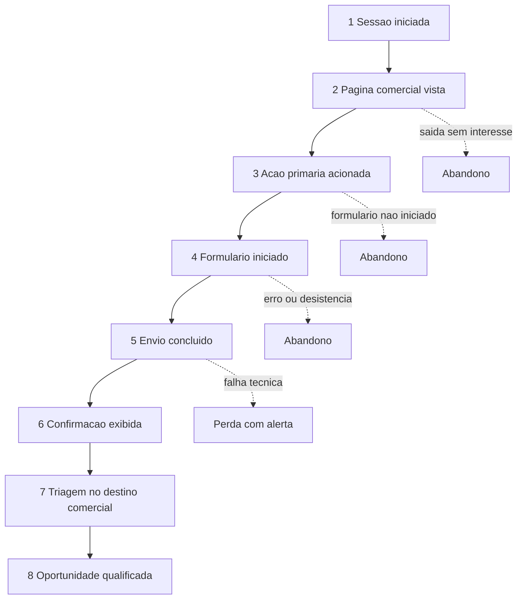

## 11. Conteúdo e identidade da marca

Esta seção define **como se escreve e como se apresenta** o site da ArtZan. Ela não substitui o esqueleto de mensagem de 5.3 — aquele diz *o que* dizer, e agora está alimentado pelas respostas de posicionamento (Q-018 a Q-022); esta diz *de que forma* qualquer texto e qualquer elemento visual são produzidos.

A seção mudou de natureza nesta revisão. Antes era só verbal, porque não havia marca. Hoje existe nome confirmado (ArtZan), domínio (`artzan.com.br`, sujeito a alteração), logotipo entregue (`Logo.png`) e tom de voz aprovado (Q-050). O sistema visual derivado do logotipo entra em 11.11 a 11.17: **identidade verbal e identidade visual são a mesma norma**, e separá-las em documentos distintos é o começo da divergência entre o que o site diz e o que o site parece.

**Premissa PR-040 (confirmada — Q-050, Q-051):** o site tem **uma única voz**, a da ArtZan. Nenhum software recebe personalidade, tom ou vocabulário próprios (2.2). A decisão por **nomes de produto independentes, sem família de marca** (Q-051), aumenta a importância dessa premissa: se o nome não carrega a marca, são o texto e o sistema visual que precisam carregá-la, em toda página.

**Premissa PR-061 (nova):** não existe manual de marca externo (Q-055) e não haverá agência — a identidade é produzida no próprio projeto, a partir do logotipo. **Este PRD é a referência normativa de marca**, verbal e visual; divergência entre o publicado e o que está aqui é erro de publicação (11.9), não questão de gosto.

### 11.1 Tom de voz

**Aprovado — Q-050.** Os seis atributos abaixo deixaram de ser proposta: o cliente os aprovou como estão. Passam a valer como norma verificável na revisão editorial (11.9) — texto que viole um deles não é discussão de estilo, é publicação bloqueada. O cliente também confirmou que **não há restrição de vocabulário setorial** (Q-059): nenhum termo regulado ou sigla obrigatória limita a redação, e a única restrição do site é o glossário de 11.8.

**Por que este tom.** Empresa **nova**, **sem histórico publicável**, **sem clientes ou cases** (PR-007), vendendo software para clubes, parques e pequenas e médias empresas (Q-009, Q-010), com decisão consultiva e atendimento humano ao final (PR-004). Três consequências calibram tudo: **toda afirmação será testada**, e a promessa desmentida contamina o que foi dito antes; **não há reserva de confiança para gastar**, de modo que cada superlativo não coberto vira dívida; e **a competência aparece no texto, não na declaração** — sem prova social, o único lugar onde a empresa demonstra entender o problema é a precisão com que o descreve. Daí o tom: **competente e verificável**. Seis atributos, cada um com o seu limite.

| # | Atributo | O que é | O que não é |
|---|---|---|---|
| 1 | **Claro** | Linguagem do cliente; uma ideia por frase; termo próprio explicado na primeira ocorrência | Didatismo condescendente, texto infantilizado, explicação do óbvio |
| 2 | **Específico** | Nomeia o que o software faz, para quem e com que resultado observável | Adjetivo no lugar do fato; "completo", "robusto", "inovador" sem o que os sustente |
| 3 | **Direto** | Frase curta, verbo concreto, sujeito explícito, ordem natural | Secura ou rispidez; frase telegráfica que economiza a informação necessária |
| 4 | **Confiante sem exagero** | Afirma o que a empresa faz e assume o que ainda não faz | Autoproclamação de liderança, pioneirismo ou superioridade não comprovada |
| 5 | **Profissional e próximo** | Trata o leitor por "você"; escreve como um profissional que vai atendê-lo | Gíria, emoji, exclamação, humor, intimidade forçada, "a gente" |
| 6 | **Consistente** | Mesmo termo para o mesmo conceito, sempre (11.8); mesma ordem de argumento entre páginas | Variação de vocabulário "para não repetir"; sinônimo criativo que cria dúvida |

**Exemplos por atributo.** Usam os produtos reais do portfólio (Q-004) para que a norma seja avaliada sobre o material que de fato existe. **Nenhum texto abaixo é conteúdo aprovado para publicação** — é ilustração do padrão, e os nomes ainda não confirmados (11.19) aparecem pela descrição funcional, conforme PR-063.

| # | Adequado | Inadequado | Por quê |
|---|---|---|---|
| 1 | `O software de alocação de quadras registra reservas, horários e responsáveis em um único lugar.` | `Uma poderosa ferramenta de gestão inteligente end-to-end para o seu espaço esportivo.` | O segundo não permite ao leitor saber o que o software faz |
| 2 | `Elimina o registro duplicado entre a planilha de reservas e o caderno da recepção.` | `Aumenta drasticamente a produtividade da sua equipe.` | "Drasticamente" é uma medida que a ArtZan não tem |
| 3 | `Você contrata o Sistema Lara isolado e acrescenta outro software quando precisar.` | `A contratação pode se dar de forma isolada ou, alternativamente, mediante composição posterior.` | Mesma informação, metade das palavras |
| 4 | `A ArtZan desenvolve softwares para a operação de clubes, parques e pequenas empresas. Comece por um e amplie conforme a necessidade.` | `A ArtZan é referência no mercado e líder em transformação digital.` | Empresa nova não é referência de nada; a frase se desmente sozinha |
| 5 | `Peça uma avaliação gratuita e use o Sistema Lara com os seus próprios dados.` | `Bora organizar sua empresa de uma vez? 🚀` | O comprador de software B2B lê como falta de seriedade |
| 6 | `O Sistema Lara é um software da ArtZan.` (sempre "software") | `O Sistema Lara é nossa plataforma, um módulo do nosso ecossistema, uma ferramenta...` | Quatro palavras para uma coisa só; o leitor passa a duvidar do que é |

**Sobre o "tom levemente neutro" (Q-009).** O cliente pediu que a comunicação não se fechasse nos três nichos citados. A tradução verbal: o **nível institucional** (P-01, P-02) fala de operação e de porte, não de esporte; o esporte aparece no **nível de produto**, onde é o assunto. A armadilha é confundir neutralidade com vagueza — trocar "clube" por "organizações de diversos segmentos" produz o texto genérico que o atributo 2 proíbe. Regra: **neutro na abrangência, específico na descrição** — diz-se para quem serve com exemplo concreto, nunca com categoria abstrata, e não se afirma exclusividade de nicho.

### 11.2 Princípios de redação

1. **Frase curta.** Alvo de até 20 palavras por frase; acima de 25, quebrar. Um parágrafo tem no máximo 4 linhas em tela pequena.
2. **Benefício antes de funcionalidade.** O leitor decide pelo resultado e confirma pelo recurso. A ordem "faz X, o que permite Y" vira "Y, porque faz X" sempre que a frase couber.
3. **Verbo concreto.** "Registra", "aprova", "concilia", "envia", "bloqueia". Proibidos como verbo principal: "otimizar", "potencializar", "alavancar", "revolucionar", "empoderar", "transformar" quando não houver objeto verificável.
4. **Proibição de jargão vazio.** Não se publica: "solução completa", "de ponta a ponta" sem dizer quais pontas, "inteligente", "disruptivo", "sinergia", "one-stop-shop", "tecnologia de última geração", "estado da arte".
5. **Proibição de superlativo não comprovável.** "Melhor", "líder", "maior", "mais rápido do mercado", "número 1", "pioneiro" só existem com fonte publicável ao lado. Sem fonte, o adjetivo é cortado — não é substituído por outro adjetivo.
6. **Número só quando real.** Percentual, quantidade de clientes, tempo de implantação, economia estimada e prazo só entram com origem verificável e responsável identificado. É proibido número "ilustrativo". Vale também para arredondamentos ("mais de 100 empresas") — o mesmo padrão de PR-007 e do princípio 2 de 2.8.
7. **Nada depende de conhecimento prévio da marca.** Nenhum texto começa assumindo que o leitor já sabe quem é ArtZan ou o que é [Produto A] (princípio 1 de 2.8; público PU-07).
8. **Uma promessa por bloco.** Se um parágrafo defende duas coisas, são dois parágrafos ou um deles é supérfluo.
9. **Voz ativa e segunda pessoa.** "Você acompanha", não "é possível acompanhar". Primeira pessoa do plural apenas no institucional (P-02).
10. **Sem comparação nominal com concorrentes.** Comparar com a situação atual do cliente (planilha, processo manual, retrabalho) é permitido; nomear concorrente, não.

### 11.3 Estrutura padrão de textos por tipo de bloco

Os limites abaixo são **decisões de projeto**, derivadas de duas restrições: (a) o layout mobile-first (PR-017) — o texto precisa caber sem truncar em grade de cards de altura uniforme, exigida por P-03; e (b) o comportamento de exibição em busca e em compartilhamento — buscadores truncam por largura em pixels, não por contagem de caracteres, de modo que o número em caracteres é uma **aproximação operacional segura**, não uma regra do buscador.

Três colunas de limite: **ideal** (alvo editorial), **máximo** (bloqueia publicação) e **mínimo** (impede página rasa, ver 12.7).

| Tipo de bloco | Onde aparece | Mín. | Ideal | Máx. | Justificativa |
|---|---|---|---|---|---|
| Título de página (H1) | Todas | 15 | 30–55 | 70 | Duas linhas em tela de 360 px; base do título de busca |
| Subtítulo de apoio | P-01, P-03, P-05, P-04, P-06 | 40 | 80–130 | 160 | Três linhas em tela pequena sem empurrar a ação primária para fora da primeira tela |
| Chamada de seção (H2) | Todas | 8 | 20–45 | 60 | Uma linha em tela pequena; serve à varredura (11.7) |
| Resumo de uma linha | Card de produto e solução | 45 | 60–90 | 110 | Duas linhas em card de grade uniforme (P-03); é a base da descrição de busca |
| Texto de card (institucional/parceiro) | P-01, P-07 | 40 | 70–120 | 150 | Três linhas sem quebrar a altura da grade |
| Descrição curta de produto | Card, listagem, compartilhamento | 90 | 110–150 | 160 | Reaproveitada como base da descrição de busca (12.2) |
| Descrição longa de produto | P-04, seção "descrição completa" | 500 | 900–1800 | 3000 | Piso combate conteúdo raso (12.7); teto evita página que ninguém termina |
| "Problema que resolve" | P-04 | 400 | 600–1200 | 2000 | É a seção que prova competência (11.1); abaixo do piso não descreve dor nenhuma |
| Título de funcionalidade | P-04 | 8 | 15–35 | 45 | Uma linha em coluna estreita |
| Descrição de funcionalidade | P-04 | 40 | 60–110 | 140 | Uma linha por item, conforme P-04 |
| Benefício | P-01, P-04, P-06 | 30 | 40–85 | 100 | Redigido como resultado, cabe em uma linha |
| Ganho da combinação | P-06 | 200 | 300–800 | 1200 | Campo obrigatório; abaixo do piso vira soma óbvia das partes |
| Rótulo de botão | Todas | 6 | 12–22 | 28 | 1 a 3 palavras; alvo de toque confortável sem quebra de linha (13.9) |
| Rótulo de campo | P-08, P-09 | 3 | 5–20 | 30 | Rótulo persistente acima do campo (13.6) |
| Texto de erro de campo | P-08, P-09 | 20 | 35–90 | 120 | Diz o que houve e como resolver (13.7) |
| Texto de erro global | P-08, P-09 | 40 | 80–150 | 200 | Inclui caminho alternativo |
| Texto de sucesso | P-16 | 40 | 70–160 | 220 | Confirma, informa prazo e oferece próximo passo |
| Estado vazio (título) | P-03, P-05, P-07, P-17 | 10 | 20–40 | 50 | — |
| Estado vazio (apoio) | idem | 30 | 60–120 | 160 | Explica e oferece saída, nunca só "nada encontrado" |
| Título de busca | Páginas indexáveis | 25 | 45–58 | 60 | Ver 12.2 |
| Descrição de busca | Páginas indexáveis | 90 | 120–155 | 158 | Ver 12.2 |
| Texto alternativo | Imagens informativas | 5 | 40–100 | 125 | Ver 13.4 |
| Rótulo de categoria | Cards e filtros | 3 | 8–20 | 24 | Cabe como etiqueta sem quebrar a grade |
| Item de lista | Todas | 15 | 30–90 | 110 | Uma linha em tela pequena (11.7) |

**Linhas sem objeto no lançamento.** Sem solução composta (Q-006), as linhas "Ganho da combinação" e as menções a P-05/P-06 permanecem válidas mas sem conteúdo a validar. Não são apagadas porque o limite editorial precisa estar decidido antes do primeiro texto: redescobri-lo quando a primeira solução for escrita é como se produz a divergência que 11.3 existe para evitar. Idem para P-10/P-11 (blog, Fase 2 — Q-027).

**Premissa PR-041:** os limites são validados no momento da edição: **aviso** ao ultrapassar o ideal e **bloqueio de publicação** ao ultrapassar o máximo ou ficar abaixo do mínimo. Sem validação na origem, os limites são recomendação e serão ignorados na décima publicação. Os requisitos das faixas RF-180..199 e RNF-070..079 implementam essa validação.

### 11.4 Padrão de nomenclatura de produtos

**Situação atual.** O portfólio de lançamento tem quatro softwares de prateleira e um serviço (Q-004). Um único nome está confirmado — **Sistema Lara**, para a gestão geral de empresa. Os outros três continuam sem nome aprovado; as propostas estão em 11.19 e dependem de Q-084. As regras abaixo deixam de ser hipotéticas: são o crivo pelo qual as propostas de 11.19 passaram e o crivo pelo qual passará o vigésimo produto.

**Premissa PR-042:** o portfólio crescerá continuamente; portanto o padrão de nomes é decidido uma vez, para a família inteira, e não caso a caso.

**Premissa PR-063 (nova):** nome de produto não aprovado **não é publicado**. Até Q-084, a identificação pública de cada software é a **descrição funcional** ("software de alocação de quadras"), e o nome proposto circula só em documento interno. Publicar nome provisório cria slug imutável (PR-014), termo de marca a defender (12.8) e expectativa de continuidade — três coisas que a troca do nome destrói de uma vez.

**Regras**

1. **Extensão.** Nome de produto com 1 ou 2 palavras, até 20 caracteres. O nome aparece em card de grade uniforme, breadcrumb, rótulo "Software", título de busca (que ainda leva o sufixo da marca) e assunto de formulário. Nome longo quebra os quatro.
2. **Pronunciabilidade.** Precisa ser dito ao telefone e escrito depois de ouvido, sem soletração. Vendas consultivas (PR-004) são conversas faladas.
3. **Digitabilidade.** Sem hífen interno, sem número, sem caractere acentuado, sem letra duplicada incomum, sem grafia "criativa" (troca de "s" por "z", vogal suprimida). O nome vira slug (6.5) e termo de busca; grafia ambígua divide o tráfego do próprio nome.
4. **Unicidade dentro do portfólio.** Dois produtos não podem ter nomes que se confundam na leitura rápida do catálogo — a jornada J-06 depende disso. Nomes que compartilham raiz só são aceitos se os produtos forem realmente da mesma família.
5. **Risco de colisão de marca.** Antes de adotar, verificar: registro de marca na classe correspondente, disponibilidade do termo como slug no domínio próprio, existência de software homônimo no mesmo mercado e sentido indesejado em inglês, já que a estrutura é preparada para tradução (Q-011). Nome não verificado não é publicado. **O registro de marca continua indefinido (Q-052): nenhum nome, inclusive Sistema Lara, pode ser tratado ou apresentado como marca registrada.**
6. **Relação com o nome da empresa — decidido (Q-051): padrão (a), nomes independentes.** Dos três padrões possíveis — (a) **nomes independentes** sob a assinatura "um software da ArtZan"; (b) **família com prefixo ou sufixo da marca** (`ArtZan [Termo]`); (c) **radical comum** entre produtos —, o cliente escolheu o (a): nomes sem parentesco entre si, ao menos no início. A consequência operacional é obrigatória e não opcional: como o nome do produto não carrega a marca, **a assinatura institucional precisa aparecer em toda página de produto** — no cabeçalho, no rodapé e na própria frase de identificação ("O Sistema Lara é um software da ArtZan"). Sem isso, o padrão (a) produz quatro produtos órfãos e nenhuma marca-guarda-chuva, que é exatamente o ativo que 2.2 pretende construir. É também o motivo de PR-040 valer com mais força aqui do que valeria sob o padrão (b).
7. **Sufixos e famílias.** Sufixos de versão, edição, porte ou plano ("Pro", "Plus", "Enterprise", "2.0") são **proibidos no MVP**. O modelo comercial agora existe — assinatura recorrente e projeto sob encomenda (Q-007) —, mas **não há preço publicado nem faixas de contratação definidas** (Q-008, PR-005): o sufixo prometeria uma diferenciação por nível que não existe e comprometeria o slug, que é imutável (PR-014). A proibição cai quando houver faixas reais, publicadas e distintas entre si — não antes.
8. **Descritivo x abstrato.** Nome descritivo é encontrável em busca e explica-se sozinho, mas envelhece quando o escopo do produto cresce e limita o registro de marca. Nome abstrato é registrável e duradouro, mas exige que o descritor funcional apareça sempre ao lado (12.2). A escolha é de negócio, não de site.
9. **O que evitar.** Sigla sem significado; termo genérico do mercado que não pode ser registrado nem disputado em busca; nome que descreva a tecnologia em vez do problema do cliente; referência interna do time; termo temporal ou de moda; nome que já é o rótulo fixo da interface ("Solução", "Software", "Plataforma").
10. **Registro.** Todo nome aprovado entra no glossário controlado (11.8) com grafia única — inclusive maiúsculas — e passa a ser a única forma escrita em todo o site. "Sistema Lara" já está registrado assim: as duas palavras, sempre juntas, sempre com as duas maiúsculas, nunca "Lara" isolado em texto publicado.

**Sistema Lara passa em todas as regras:** duas palavras dentro do limite; dito e escrito ao telefone sem soletração; sem hífen, número ou acento; foneticamente distante dos demais propostos; e abstrato quanto à função, o que satisfaz a regra 8 pelo lado do registro **ao custo de exigir o descritor funcional sempre ao lado** ("Sistema Lara — gestão de empresa"). O custo não é opcional: sem o descritor o nome não diz nada a quem chega pela busca com intenção transacional.

**Pergunta Q-051 — respondida.** Padrão (a), nomes independentes, sem família de marca no início. Ver regra 6.
**Pergunta Q-052 — permanece aberta.** O cliente respondeu "a definir" quanto ao registro de marca. Enquanto não houver decisão: nenhum nome é publicado com símbolo de marca registrada, nenhum texto afirma exclusividade sobre o nome, e a verificação formal de disponibilidade segue como pré-requisito de publicação de qualquer nome novo (Q-083).

### 11.5 Como apresentar a empresa sem tempo de mercado, cases ou equipe

O problema é concreto: as três provas usuais de um site B2B — tempo de mercado, clientes e tamanho — estão indisponíveis (PR-007). A tentação é preenchê-las com formulação vaga ("anos de experiência combinada", "atendemos empresas de diversos setores"). Isso é proibido: é a mesma classe de invenção que a regra 6 de 11.2 veda, e é detectável.

**A troca é explícita: substituir prova de tamanho por prova de método.** O que uma empresa nova pode demonstrar publicamente, sem mentir:

| Elemento de credibilidade | O que se publica | Por que funciona | Dependência |
|---|---|---|---|
| **Precisão na descrição do problema** | Seção "problema que resolve" de cada produto, escrita na linguagem do cliente | Quem descreve a dor com exatidão demonstra que já a viu; é a prova mais barata e a mais convincente | Q-004, Q-009 |
| **Clareza sobre o escopo** | O que o software faz e o que **não** faz; para quem é e para quem não é | Delimitar escopo é sinal de maturidade; promessa ilimitada é sinal contrário | Q-004 |
| **Identificação completa** | Razão social, CNPJ, endereço e canal de contato no rodapé de todas as páginas | Empresa que se identifica assume responsabilidade; a ausência é lida como risco | **Confirmado — Q-053.** Valores ainda não fornecidos: Q-086 |
| **Promessa verificável** | Período de avaliação gratuita em ambiente próprio, com prazo determinado (Q-022, Q-026) | É a prova mais forte disponível no lançamento: em vez de afirmar qualidade, oferece verificação direta. Substitui, na prática, o depoimento que não existe | Q-089 (duração e se ela é divulgada) |
| **Transparência do processo comercial** | O que acontece após o envio: responde **um dos dois sócios**, em **até 2 dias úteis**, por e-mail (Q-013, Q-064) | Reduz o risco percebido do primeiro contato, que é a barreira real de PU-01 | **Confirmado — Q-013** |
| **Páginas legais publicadas e datadas** | P-13 e P-14, com data de atualização visível | Custo baixo, sinal alto de operação real (OB-05) | **Confirmado — Q-028:** há setor jurídico responsável |
| **Explicação do modelo de negócio** | "Por que vários softwares menores" em P-02: **valores acessíveis** (Q-019) e softwares adaptados e versáteis (Q-018) | Transforma a pequenez em decisão deliberada, não em limitação | **Confirmado — Q-018, Q-019** |
| **Parceiros** | P-07, quando existirem e autorizados (PR-018) | Capacidade de entrega emprestada, declarada com honestidade (11.6) | Q-025: um parceiro em vista, **não confirmado**; Q-054 sem autorização |
| **Experiência da equipe** | Trajetória profissional dos dois sócios, quando houver autorização deles | Prova pessoal substitui prova institucional enquanto ela não existe | Sem resposta específica; depende de decisão dos sócios |
| **Consistência de apresentação** | Template idêntico, sem lacuna, sem "em breve" (princípio 2 de 2.8) | Um site sem falhas é, ele próprio, evidência de cuidado operacional | — |

**Prova social: confirmado que não há no lançamento (Q-021)**, com um cliente que **poderá ceder o uso da marca em breve**. Duas consequências: o bloco de credibilidade da inicial é **construído e mantido vazio**, oculto pela regra de estado vazio de PR-011 — construí-lo depois significa mexer no layout da página mais sensível no momento de maior pressa; e o primeiro logotipo entra pelas regras de 11.6 e PR-018, com autorização escrita e com o rótulo correto, porque quem cede a marca é **cliente**, não parceiro.

**O que continua proibido, agora por decisão e não por lacuna:** selo sem lastro, logo genérico, contador de clientes, depoimento fictício ou "ilustrativo", mapa de atuação sem operação, prêmio inexistente, imagem de banco que simule equipe ou escritório. Bloco de credibilidade sem conteúdo verificável é **omitido**, nunca preenchido.

**Como falar do tempo de mercado sem mentir e sem se diminuir.** Três formulações aceitáveis, em ordem de preferência: (1) não mencionar tempo de mercado e falar de método e escopo; (2) declarar o recorte temporal como escolha ("ArtZan nasceu para..."), sem transformar novidade em argumento de venda; (3) declarar explicitamente a fase, se houver decisão do cliente nesse sentido. É proibido ocultar a informação e simultaneamente sugerir o contrário — usar plural corporativo grandioso, citar "nossos escritórios", falar em "clientes" no plural genérico.

### 11.6 Como apresentar parceiros

Parceiro não é cliente e não é endosso. A linguagem precisa deixar isso legível sem esforço, porque a leitura por varredura (11.7) confunde as duas coisas por padrão: uma faixa de logos é interpretada como carteira de clientes salvo indicação em contrário.

1. **Rotulagem explícita e não editável.** Toda faixa e toda listagem de parceiro leva título que declara a natureza — "Empresas parceiras" — e nunca aparece sob título ambíguo ("Quem confia", "Trabalham com a gente", "Eles usam").
2. **Cada parceiro declara o tipo de parceria** (taxonomia de P-07) e a **natureza da relação** — campos obrigatórios do modelo (6.7). Logo sem essas duas informações não é publicado.
3. **Verbos permitidos:** "é parceiro de tecnologia", "realiza implantação", "comercializa", "encaminha oportunidades", "integra com". **Verbos proibidos:** "recomenda", "aprova", "certifica", "endossa", "confia", "escolheu" — todos afirmam algo sobre a opinião de um terceiro.
4. **Nenhuma frase pode sugerir relação comercial inexistente.** Citar tecnologia de terceiro que a empresa apenas utiliza não cria parceria; a menção, se necessária, aparece como informação técnica em "integrações" (P-04), fora da página de parceiros.
5. **Descrição redigida em conjunto.** **Q-054 — respondida: não existe autorização de uso de marca de nenhum parceiro.** PR-018 vale na forma mais estrita: sem autorização escrita, nada é publicado — nem logotipo, nem nome, nem descrição da relação. Com um parceiro em vista mas não confirmado (Q-025), o estado esperado de P-07 no lançamento é **página inteira ausente** (regra 7). A autorização, quando vier, precisa cobrir o logotipo **e** o texto que descreve a relação.
6. **Simetria.** Todos os parceiros recebem o mesmo espaço e o mesmo tratamento visual; destaque de um parceiro é uma afirmação comercial que exige acordo.
7. **Sem parceiro, sem bloco.** Estado vazio oculta página, item de menu e faixa da inicial (PR-011) — nunca substitui por logos genéricos.

### 11.7 Densidade de texto e hierarquia de leitura

**O risco.** Um site que precisa explicar um modelo pouco usual (softwares pequenos vendidos isolados ou combinados) tende a compensar com texto. Excesso de texto não aumenta a compreensão: reduz a leitura, empurra a ação primária para fora da tela e piora o desempenho (RNF-010..019).

**Regra de densidade por seção**

| Contexto | Teto de texto corrido | Regra adicional |
|---|---|---|
| Primeira tela de qualquer página | 1 título + 1 apoio + 1 ação | Nada mais compete com a ação primária (5.1) |
| Seção da página inicial | 90 palavras | Máximo 2 parágrafos; o resto é lista, card ou link |
| Seção de página de produto/solução | 180 palavras | Exceto "problema que resolve" e "descrição completa" |
| Parágrafo | 4 linhas em tela pequena (~320 caracteres) | Acima disso, quebrar |
| Lista | 3 a 7 itens | Menos de 3 é parágrafo; mais de 7 vira tabela ou seção |
| Item de lista | 1 linha (até 110 caracteres) | Item que precisa de duas linhas é subtítulo com apoio |

**Hierarquia de leitura em três níveis.** Toda página é escrita para ser compreendida em três profundidades, e as três precisam funcionar isoladamente:

- **Nível 1 — varredura (5 a 10 segundos):** só títulos, rótulos, nomes de produto e rótulos de botão. Teste: lendo apenas isso, o visitante sabe onde está, o que a empresa faz e qual é o próximo passo. Se não souber, o problema está nos títulos, não no corpo.
- **Nível 2 — leitura parcial (30 a 60 segundos):** títulos, subtítulos, primeira frase de cada parágrafo e listas. Regra decorrente: **a primeira frase de cada parágrafo carrega a informação principal**; ela nunca é preparatória ("Neste tópico vamos falar sobre...").
- **Nível 3 — leitura completa:** corpo integral, para o avaliador técnico (PU-06) e para quem compara dois produtos (J-06).

**Quando cortar.** Corta-se a frase que: (a) repete o que o título já disse; (b) não muda nenhuma decisão do leitor; (c) contém adjetivo sem fato que o sustente; (d) explica o óbvio do mercado do próprio leitor; (e) descreve o processo interno de ArtZan em vez do resultado para o cliente; (f) só existe para preencher um espaço de layout. **Teste final:** se a página cortada em 30% continua respondendo às perguntas do público-alvo (seção 4), o corte era necessário.

### 11.8 Consistência entre páginas: glossário de termos controlados

Um termo por conceito, sem sinônimos. A regra vale para textos publicados, rótulos de interface, mensagens de erro, assunto de formulário e nomes de evento de medição. **Premissa PR-058:** o glossário é normativo — divergência bloqueia a publicação na revisão editorial (11.9).

| Conceito | Termo único | Significado fixo | Sinônimos proibidos |
|---|---|---|---|
| Unidade vendável de software | **Software** (público) / **produto** (interno e modelo de conteúdo) | Um dos softwares do portfólio, vendido isolado ou combinado | sistema, ferramenta, app, aplicativo, plataforma, módulo, serviço, solução |
| Combinação de dois ou mais softwares | **Solução** | Entidade derivada que reúne 2+ softwares para uma necessidade ampla (PR-010). **Sem objeto no lançamento** (Q-006): o termo fica reservado e **não é usado em nenhum texto publicado** até a primeira solução existir — usá-lo antes descreveria algo que o visitante não encontra | pacote, combo, suíte, bundle, kit, plano, plataforma. E, no lançamento, o próprio termo "solução" em texto genérico ("nossa solução para...") |
| Parte interna de um software | **Funcionalidade** | O que o software faz | recurso, feature, função, módulo, ferramenta |
| Resultado para o cliente | **Benefício** | Efeito observável do uso, não o recurso que o produz | vantagem, diferencial, ganho (reservado a "ganho da combinação") |
| Agrupamento de softwares por tipo de problema | **Categoria** | Classificação N:N, sem pertencimento único (6.7) | segmento, linha, família, tipo, vertical |
| Peça de um sistema maior | *(termo banido)* | A ArtZan não vende módulos: cada software é delimitado e autônomo (2.3) | **"módulo" é proibido em todo o site** |
| Nível ou faixa de contratação | *(termo banido no MVP)* | O modelo comercial existe — assinatura recorrente e projeto sob encomenda (Q-007) —, mas **não há faixas nem preço publicado** (Q-008, PR-005): "plano" prometeria uma estrutura de níveis inexistente | **"plano", "pacote", "licença" só quando houver faixas reais e publicadas** |
| Forma de contratar | **Modelo de contratação** | Texto padrão único do catálogo (P-04, seção 8). Duas formas nomeadas: **assinatura** (recorrente) e **projeto sob encomenda** (Q-007), sem valor publicado | plano, pacote, oferta, condições, mensalidade, licença |
| Teste do software pelo próprio visitante | **Avaliação gratuita** | Ambiente próprio, por tempo determinado, liberado pela equipe após análise do pedido (Q-022, Q-026). É a promessa verificável do lançamento e a ação primária do site | demo, demonstração, trial, teste grátis, período de testes, tour, POC, piloto, degustação |
| Apresentação conduzida por pessoa | *(termo em reserva)* | **"Demonstração" deixou de ser o termo do MVP** (Q-026). Se um dia existir sessão conduzida por pessoa, ela volta com este nome — e nunca como sinônimo de avaliação gratuita | não usar "demonstração" para descrever a avaliação gratuita, em nenhuma superfície |
| Organização externa com relação declarada | **Parceiro** | P-07 e 11.6 | apoiador, patrocinador, aliado, colaborador, cliente |
| Organização que contrata | **Cliente** | Uso restrito: proibido no plural genérico enquanto não houver clientes (PR-007) | conta, parceiro |
| Pessoa que acessa o site | **Visitante** | Vocabulário interno; não aparece em texto publicado | usuário, lead, prospect |
| Solicitação enviada pelo formulário | **Solicitação de contato** (público) / **oportunidade** (interno) | Registro gerado por P-08 ou P-09 | lead (aceito só em documento interno), pedido, cadastro |
| Conexão existente entre um software da ArtZan e um sistema de terceiro | **Integração** | Ligação real e em funcionamento, publicada só quando existir de fato (P-04, seção 7). É **característica de um software**, nunca uma oferta | conector, plug-in, sincronização, interface, API (em texto publicado) |
| Serviço de construir essas conexões sob encomenda | **Desenvolvimento de integrações** | Serviço de engenharia, sem escopo fixo, apresentado à parte do catálogo (11.20). É **oferta comercial**, nunca característica de um software | "Integrações" isolado como nome da oferta; "integrador"; "serviço de integração"; e qualquer forma que omita a palavra "desenvolvimento" |
| A superfície interna de edição de conteúdo | **Painel de administração** | Área restrita aos dois sócios (P-19 a P-22, Q-033, Q-034), fora do site público, não indexável | CMS, admin, backoffice, gerenciador, dashboard, área logada |
| Textos editoriais | **Conteúdo** (público) / **item de conteúdo** (interno) | P-10 e P-11 | blog, post, notícia, matéria |
| A empresa | **ArtZan** | Nome por extenso na primeira ocorrência de cada página | a companhia, a organização, a gente, nós (fora de P-02), a startup, a casa |
| Conjunto do portfólio | **Ecossistema** | Uso exclusivo no nível 1 da mensagem (5.2); nunca em página de produto | universo, família, suíte, hub |
| Início do uso pelo cliente | **Implantação** | — | onboarding, ativação, setup |

**Pergunta Q-055 — respondida: não existe manual de marca nem vocabulário prévio.** O glossário acima não concorre com nada e não precisa ser reconciliado com material anterior: ele **é** o vocabulário oficial da ArtZan a partir da publicação deste PRD (PR-061). A consequência é maior do que parece — não há uma segunda fonte a consultar quando surgir dúvida de termo, e é por isso que a tabela precisa ser exaustiva e a coluna de sinônimos proibidos precisa ser lida como lista fechada de erros, não como sugestão.

#### O conflito do termo "integração" e como ele se resolve

Havia uma colisão real de vocabulário, criada pela própria resposta do cliente: "Integração" já era termo controlado com um sentido — **conexão entre um software da ArtZan e um sistema de terceiro** — e o portfólio passou a incluir uma oferta cujo nome natural é praticamente a mesma palavra: **desenvolvimento de integrações entre sistemas** (Q-004). Sem tratamento, a mesma palavra passaria a significar duas coisas de categorias diferentes — uma característica técnica de um produto e um serviço vendido —, e a confusão apareceria exatamente onde é mais cara: um visitante lendo a seção "Integrações" de uma página de produto pensaria estar diante de uma oferta de projeto; um visitante lendo a oferta de serviço pensaria que os softwares já vêm conectados aos sistemas dele.

**Decisão: dois termos distintos, separados pela palavra "desenvolvimento", que nunca aparece em um e nunca falta no outro.**

| Termo controlado | Categoria gramatical e conceitual | Definição sem ambiguidade | Onde aparece | Onde é proibido |
|---|---|---|---|---|
| **Integração** | Substantivo contável; **característica** de um software | Conexão existente e em funcionamento entre um software do catálogo da ArtZan e um sistema de terceiro, identificada pelo nome do sistema de terceiro | Seção "Integrações" de P-04, quando existirem (P-04, seção 7); FAQ; texto de produto | Como nome de oferta, de serviço, de card, de item de menu ou de ação. Nunca leva preço, nunca leva ação primária própria |
| **Desenvolvimento de integrações** | Locução nominal completa; **oferta de serviço** | Serviço de engenharia sob encomenda, sem escopo fixo, para construir conexões entre sistemas do cliente. Apresentado à parte do catálogo de software (11.20) | Bloco próprio no institucional (P-02), com ação de contato própria; FAQ; texto comercial | Dentro da seção "Integrações" de qualquer página de produto; em card do catálogo com rótulo "Software"; abreviado para "Integrações" |

**Premissa PR-064 (nova) — regra de desambiguação, verificável na revisão editorial (11.9):**

1. A palavra "integração" ou "integrações", **sozinha**, sempre significa o **primeiro** sentido: uma conexão que já existe. Essa é a acepção padrão do site, e é a que fica no glossário sem qualificador.
2. A oferta de serviço **sempre** carrega o substantivo "desenvolvimento". Na primeira ocorrência de cada página, por extenso: "desenvolvimento de integrações entre sistemas". Nas seguintes, "desenvolvimento de integrações". Nunca "integrações" isolado, nunca "serviço de integração", nunca uma sigla.
3. As duas acepções **nunca aparecem na mesma seção**. A oferta vive em bloco próprio no institucional; a característica vive na seção 7 do template de produto. A separação física é o que dispensa o leitor de desambiguar por conta própria — e o texto foi escrito para funcionar mesmo em leitura por varredura (11.7), onde ninguém lê o qualificador.
4. **A oferta não recebe nome próprio de marca.** A lista de 11.19 propõe um nome também para ela; a recomendação de 11.20 é não usá-lo. Um nome próprio criaria uma terceira forma de se referir à mesma coisa e reabriria a ambiguidade pelo outro lado — além de dar peso de marca a um serviço sob encomenda que não o sustenta.
5. **Um sistema de terceiro citado na seção "Integrações" não vira oferta.** Mencionar que um software se conecta a um sistema não afirma que a ArtZan desenvolve conexões para aquele sistema. A regra 4 de 11.6 já proíbe o inverso — criar parceria a partir de menção técnica — e vale aqui pela mesma razão.

Consequência de vocabulário: os quatro softwares **têm** integrações; a ArtZan **desenvolve** integrações. Verbo diferente, sujeito diferente, seção diferente.

### 11.9 Checklist de revisão editorial antes de publicar

**Premissa PR-043:** todo texto publicado passa por **um único revisor** designado, e a revisão é etapa obrigatória do fluxo de publicação (faixa RF-180..199), não uma boa intenção. Com equipe reduzida e não técnica (PR-009), revisão distribuída produz divergência já no terceiro produto.

- [ ] Todos os campos obrigatórios do tipo de entidade preenchidos (6.7); nenhuma seção improvisada para preencher espaço.
- [ ] Limites mínimos e máximos de 11.3 respeitados em todos os campos.
- [ ] Volume mínimo de conteúdo único atingido (12.7).
- [ ] Glossário de 11.8 respeitado; nenhum sinônimo proibido no texto.
- [ ] Nenhum superlativo, jargão vazio ou número sem fonte (11.2, regras 4 a 6).
- [ ] Nenhuma afirmação sobre clientes, tamanho, tempo de mercado ou prêmio (11.5).
- [ ] Texto compreensível para quem nunca ouviu falar de ArtZan; primeira ocorrência de termo próprio explicada.
- [ ] Nível 1 de leitura funciona: só os títulos já respondem "onde estou / o que é / qual o próximo passo".
- [ ] Nenhuma frase idêntica a outra página de produto, exceto os textos padrão declarados.
- [ ] Rótulo "Software" ou "Serviço" correto; o rótulo "Solução" não é usado enquanto não houver solução publicada (11.8).
- [ ] Regra de desambiguação de "integração" respeitada (PR-064): a oferta sempre com "desenvolvimento", e as duas acepções fora da mesma seção.
- [ ] Nome de produto: apenas nomes aprovados (PR-063). Os três a nomear aparecem pela descrição funcional até Q-084.
- [ ] Sistema visual respeitado: só tokens de 11.12, um raio por categoria, borda de 1 px, nenhuma sombra em elemento estático (11.15).
- [ ] Logotipo aplicado conforme 11.16: versão correta para o tema, área de proteção, tamanho mínimo, sem deformação.
- [ ] Nenhuma cor, tipografia ou componente exclusivo de um produto (11.17).
- [ ] Ação primária presente, única na seção e com rótulo do inventário de 14.1.
- [ ] Título e descrição de busca dentro dos limites e sem duplicidade com outra página (12.2).
- [ ] Texto alternativo presente e adequado ao tipo de imagem (13.4).
- [ ] Links internos com texto descritivo, sem "clique aqui" e sem âncora repetida apontando para destinos diferentes (12.9).
- [ ] Nenhum texto essencial dentro de imagem (13.11).
- [ ] Revisão ortográfica e gramatical em português do Brasil (PR-006).

### 11.10 Pendências de marca

**O que era lacuna deixou de ser.** Na versão anterior desta seção, oito itens de identidade estavam abertos e sete deles bloqueavam o cronograma. Hoje o quadro se inverteu: nome, domínio, logotipo, paleta, tipografia, posicionamento e tom de voz estão resolvidos, e as subseções 11.11 a 11.17 os transformam em norma aplicável. Registrar o que **saiu** da lista é tão importante quanto registrar o que ficou, porque as decisões de cronograma tomadas na seção 18 dependem de saber exatamente o que ainda trava.

**Resolvido — não retorna como pendência:**

| Item | Situação | Onde vive agora |
|---|---|---|
| **Nome da empresa** | **ArtZan** — confirmado (Q-001) | Todo o PRD; glossário 11.8 |
| **Domínio** | **artzan.com.br** — confirmado (Q-002), com nota de provisoriedade: sujeito a alteração | 6.4, 12.1, 12.5 |
| **Logotipo** | Entregue: `Logo.png`. Leitura, regras de uso e versões derivadas | 11.11, 11.16 |
| **Paleta de cores** | Extraída do logotipo por amostragem, com contraste verificado nos dois temas | 11.12, 11.13, 13.3 |
| **Tipografia** | Proposta fechada com duas famílias abertas e escala definida | 11.14 |
| **Posicionamento** | Diferencial, razão do portfólio, ganho e promessa verificável (Q-018 a Q-022) | 5.2, 5.3, 11.5 |
| **Tom de voz** | **Aprovado** (Q-050), sem restrição de vocabulário setorial (Q-059) | 11.1 |
| **Produção da identidade** | **Q-056 respondida:** produzida no próprio projeto, a partir do logotipo, sem agência e sem manual externo (Q-055) | PR-061 |

**O que continua pendente.** Três frentes, e só as duas primeiras travam publicação.

| Pendência | Situação | Impacto se não resolvida | Quando trava |
|---|---|---|---|
| **Aprovação dos nomes de produto** | Três dos quatro softwares sem nome aprovado. Propostas em 11.19, decisão em **Q-084** | Slug, título de busca, dados estruturados, assunto de formulário e o próprio card do catálogo dependem do nome. Enquanto não houver, publica-se pela descrição funcional (PR-063) — o que é aceitável, mas custa a distintividade de marca na busca (12.8) e obriga a redirecionamento permanente quando o nome entrar (12.1, regra 5) | **Antes da publicação de cada página de produto.** Adiar não impede o lançamento; impede que o endereço nasça definitivo |
| **Registro de marca** | **Q-052 continua "a definir".** Nenhum nome verificado quanto a registro, domínio ou uso por terceiros — inclusive Sistema Lara e o próprio nome ArtZan | Adotar um nome que colida com marca de terceiro custa muito mais depois da publicação: troca de nome, troca de slug, perda do histórico de indexação e retrabalho de todo material. É o risco de maior custo assimétrico desta seção | **Antes de aprovar qualquer nome em Q-084**, e antes de tratar qualquer nome como ativo defensável. A verificação em si é Q-083 |
| **Dados institucionais do rodapé** | **Q-053 decidiu publicar** razão social, CNPJ, endereço e canal de contato. **Os valores não foram fornecidos** — Q-086 | O rodapé e os dados estruturados de organização (12.4) são um dos poucos sinais de "esta empresa existe" disponíveis a uma marca desconhecida (11.5). Rodapé sem eles não impede o site de funcionar, mas descarta gratuitamente um sinal de credibilidade que já foi decidido publicar | **Antes da publicação.** Não trava desenho nem redação: trava o conteúdo de um bloco fixo |
| **Assinatura de marca (tagline)** | Não definida, e o cliente não a pediu | Aparece em rodapé, compartilhamento e título da inicial; sem ela usa-se a descrição funcional, que é aceitável | **Não trava.** Pode entrar depois, dentro dos limites de 11.3 |
| **Versões derivadas do logotipo** | Só existe a versão principal em imagem rasterizada. Faltam monograma isolado, reversa para tema escuro, monocromática e favicon (11.16) | Cabeçalho em tema escuro, ícone de aba e imagem de compartilhamento (12.6) ficam sem ativo definitivo | **Antes do desenho de interface e da publicação.** Depende de Q-077 e Q-078 |

**Pergunta Q-086 (nova):** quais são a razão social, o CNPJ e o endereço a publicar no rodapé e nos dados estruturados (12.4), e a partir de que data eles podem ser publicados? A empresa está em constituição; se o registro ainda não estiver concluído no lançamento, é preciso decidir explicitamente entre publicar o rodapé incompleto — com o canal de contato apenas — e adiar a publicação do bloco, porque publicar identificação fiscal errada é pior do que não publicá-la.

### 11.11 Leitura do logotipo

As subseções anteriores normatizam a palavra. Da 11.11 à 11.17 a mesma norma se estende ao que o visitante vê antes de ler — e o ponto de partida não é preferência estética, é o único ativo de marca entregue: o arquivo `Logo.png`, de 911 × 691 px. Tudo o que segue é **derivado** dele por observação direta, incluindo amostragem de cor em pontos específicos da imagem. Onde houve escolha, ela está declarada como tal.

**Monograma.** Duas formas angulares sobrepostas, construídas só com segmentos retos e vértices agudos — nenhuma curva em todo o traçado. A forma da esquerda, que sugere o "A", é preenchida num azul-marinho quase preto, sólido e único. A da direita, que sugere o "Z", é preenchida com um gradiente leve entre dois azuis, mais escuro numa ponta e mais claro e saturado na outra: é o único gradiente de toda a peça. As duas se encaixam por uma aresta diagonal compartilhada, formando um contorno único em vez de duas letras lado a lado — a ideia é **fusão, não justaposição**, que é também o que 2.2 pede da marca-guarda-chuva sobre produtos independentes.

**Wordmark.** "ARTZAN" em caixa alta, com espaçamento entre letras nitidamente mais largo que o de leitura corrida e desenho anguloso coerente com o monograma — o ápice do "A" repete o ângulo do pico. Todas as letras usam a mesma tinta escura, exceto o "Z", no tom azul chapado mais claro do gradiente: referência direta de volta ao monograma. O wordmark ocupa a mesma largura do monograma (medido: ambos ≈ 844 px) e sua caixa alta corresponde a cerca de 15% da altura total da peça — proporção que vira unidade de medida em 11.16.

**Fundo e ausência de efeito.** Fundo branco, sem moldura, sombra, contorno ou relevo. A peça já nasce **flat**. O "flat e clean" pedido pelo cliente não é direção nova a impor: é a descrição do logotipo que já existe, estendida ao resto do site.

**Quatro consequências atravessam as subseções seguintes.** Geometria sem curvas → cantos pequenos e discretos, nunca arredondamento pronunciado nem forma "pílula" (11.15). Tinta escura dominante, com o azul marcando um único elemento → o azul fica reservado ao que for acionável e nunca é fundo de seção (11.12). Gradiente único e contido → não se reproduz fora do arquivo do logotipo (11.15). Caixa alta com espaçamento largo, só no wordmark → mesmo tratamento em rótulo curto, e texto corrido nunca em caixa alta (11.14, 13.8).

### 11.12 Paleta

Valores obtidos por **amostragem de pixel** no arquivo, dentro dos preenchimentos sólidos e longe de bordas com serrilhado — não por estimativa visual: `#172738` no "A" e nas letras do wordmark exceto o "Z"; `#0E66B4` no "Z" do wordmark; `#0E4988` e `#106AB6` nos extremos escuro e claro do gradiente do monograma; `#FFFFFF` no fundo.

Desses cinco pontos monta-se o sistema funcional. Os tokens são nomeados **por função, não por cor** — "ação primária", não "azul" —, o que permite trocar um valor sem reescrever o site e torna o tema escuro uma troca de coluna em vez de uma redecoração.

| Token | Tema claro | Tema escuro | Origem |
|---|---|---|---|
| Superfície | `#FFFFFF` | `#0B121B` | Fundo do logotipo / neutro desenhado |
| Superfície elevada | `#F3F6FA` | `#131B26` | Neutro desenhado, leve inclinação para o matiz da tinta |
| Texto principal | `#172738` | `#EDF1F5` | Tinta do monograma / inverso desenhado |
| Texto secundário | `#5A6974` | `#A9B3C0` | Neutro desenhado na família de matiz da tinta |
| Borda | `#85919D` | `#78818A` | Neutro desenhado, calibrado para contraste de interface |
| Ação primária | `#0E66B4` | `#0E66B4` | Tom chapado da letra "Z" do wordmark |
| Ação primária em foco | `#0E4988` | `#106AB6` | Extremos do gradiente do monograma |
| Ação secundária | `#172738` | `#EDF1F5` | Reaproveita o texto principal do tema |
| Destaque | `#106AB6` | `#5AA9E6` | Extremo claro do gradiente / variação clareada |
| Sucesso | `#14783C` | `#3FCB6B` | Verde desenhado, fora do logotipo |
| Atenção | `#B24400` | `#F5B94D` | Laranja desenhado, fora do logotipo |
| Erro | `#B3261E` | `#FF7A70` | Vermelho desenhado, fora do logotipo |

**Premissa PR-062 (nova): o azul é exclusivo da ação primária.** A ação secundária usa a cor de texto principal do tema, em rótulo e contorno, nunca em preenchimento. A razão é a regra de 14.1 — no máximo uma ação primária por seção, e nunca duas de mesmo peso na mesma tela: se a secundária também fosse azul, duas ações disputariam o destaque e a hierarquia de conversão desapareceria por decisão de cor. Sucesso, atenção e erro são estados, não ações, e não competem. Confirmação pendente em Q-074.

**Contraste dos pares que o site usa de fato.** Fórmula de luminância relativa do WCAG 2.x; mínimo de 4,5:1 para texto normal e 3:1 para texto grande e elementos de interface. **Todos atendem nos dois temas.** É a base concreta de 13.3.

| Par (sobre a superfície do tema) | Claro | Escuro | Mínimo |
|---|---|---|---|
| Texto principal | 15,18:1 | 16,57:1 | 4,5:1 |
| Texto principal sobre superfície elevada | 14,00:1 | — | 4,5:1 |
| Texto secundário | 5,66:1 | 8,86:1 | 4,5:1 |
| Texto secundário sobre superfície elevada | 5,23:1 | — | 4,5:1 |
| Borda (contorno funcional de campo e botão) | 3,21:1 | 4,75:1 | 3:1 |
| Rótulo branco sobre ação primária | 5,87:1 | — | 4,5:1 |
| Rótulo branco sobre ação primária em foco | 9,02:1 | 5,59:1 | 4,5:1 |
| Ação primária (contraste não textual do botão) | — | 3,20:1 | 3:1 |
| Ação secundária | 15,18:1 | 16,57:1 | 4,5:1 |
| Destaque | 5,59:1 | 7,39:1 | 4,5:1 |
| Sucesso | 5,55:1 | 8,93:1 | 4,5:1 |
| Atenção | 5,65:1 | 10,68:1 | 4,5:1 |
| Erro | 6,54:1 | 7,41:1 | 4,5:1 |

**Três valores falharam na primeira montagem e foram corrigidos** — o registro explica por que a paleta não pode ser "ajustada para ficar mais bonita" sem refazer a conta. A borda do tema claro, num cinza comum de paletas "clean" (próximo de `#D7DCE2`), media 1,38:1 contra o branco, insuficiente para contorno funcional, e foi escurecida até `#85919D`. A borda do tema escuro tinha o problema oposto — um tom próximo da superfície elevada (`#2A3542`) media 1,51:1 — e foi clareada até `#78818A`. E os laranjas vivos típicos de aviso (faixa de `#F0A020`) medem entre 2:1 e 3:1 contra branco; a cor de atenção foi escurecida até `#B24400`, o tom mais vívido que ainda passa.

**O azul da marca como texto: tratado, não presumido.** O tom do wordmark passa como texto normal sobre branco com 5,87:1, mas a margem é estreita: azuis só um pouco mais claros e vívidos, do tipo comum em marcas de tecnologia (testados `#2E86D6` e `#3B82F6`), caem para 3,82:1 e 3,68:1 — abaixo do mínimo. **O azul aprovado é este valor exato, não "um azul parecido"**, e qualquer clareamento futuro por preferência estética exige nova verificação antes de entrar em texto, ícone ou rótulo de botão.

**Pergunta Q-073:** a paleta acima está aprovada como oficial? **Pergunta Q-074:** confirma-se PR-062, com o azul reservado à ação primária e a secundária no tom de texto principal?

### 11.13 Tema claro e escuro

O tema claro é o principal: o logotipo foi desenhado para fundo branco e toda a leitura de 11.11 depende desse contraste. O tema escuro é montado com a coluna correspondente de 11.12, já verificada. **Se os dois temas serão oferecidos, e por qual mecanismo, é decisão de implementação** — o que esta seção garante é que, se forem, nenhum par precisa ser reinventado nem reverificado.

**O logotipo no tema escuro não pode ser o mesmo arquivo.** A tinta quase preta (`#172738`) se aproxima demais da superfície escura (`#0B121B`): a peça perderia leitura por contraste insuficiente, não por decisão de estilo. É necessária uma **versão reversa**, em que a forma escura passa a usar o texto principal do tema escuro (`#EDF1F5`) e a forma azul mantém a identidade cromática, que já tem contraste comprovado contra fundo escuro. Essa versão não existe como arquivo: é pendência de 11.10, dependente de Q-077 e Q-078.

### 11.14 Tipografia

Duas famílias de **licença aberta** — o modelo é o SIL Open Font License: sem custo, sem fornecedor a contratar, sem dependência de terceiro que possa mudar de política. Nenhuma fonte proprietária ou paga.

**Títulos: família geométrica de traço anguloso**, referência Space Grotesk ou equivalente aberto de mesmo desenho. Os ápices angulares de "A" e "N" seguem a lógica do monograma, e números de largura uniforme ajudam onde o portfólio mostra número em tela — placar e scout —, já que número que muda de largura ao atualizar prejudica a leitura rápida de um placar. **Texto corrido: família humanista desenhada para tela**, referência Inter ou equivalente aberto. Título tolera traço com personalidade por aparecer em poucas palavras; texto corrido precisa ser lido rápido e sem fadiga em blocos de várias linhas (11.7), e famílias para tela diferenciam melhor caracteres parecidos ("I", "l", "1") e cobrem por completo a acentuação do português (PR-006).

| Nível | Tamanho | Peso | Uso |
|---|---|---|---|
| H1 | 32–40 px | 700 | Título de página |
| H2 | 24–28 px | 600 | Chamada de seção |
| H3 | 20 px | 600 | Título de funcionalidade, subtítulo de card |
| Corpo | 16 px | 400 | Todo texto corrido — piso, nunca menor |
| Apoio / legenda | 14 px | 400 | Rótulo de campo, legenda, texto de erro |
| Rótulo de botão | 14–16 px | 500 | Ação primária e secundária |

**Corpo mínimo de 16 px, sem exceção.** Abaixo disso o texto cansa em tela pequena (PR-017) e parte dos navegadores móveis reage ao foco de um campo menor com zoom automático indesejado — problema de uso que atinge exatamente o formulário que é a única conversão do site. **Espaçamento de letras** só em caixa alta e só em elemento curto — rótulo de navegação, etiqueta, botão —, ecoando o wordmark: +4% do tamanho da fonte. Títulos ficam em caixa normal e sem espaçamento adicional, porque caixa alta em frase inteira lê mais devagar na varredura de nível 1 (11.7) e é proibida em bloco de texto por 13.8.

**Pergunta Q-075:** a proposta acima pode ser adotada, ou já existe fonte em uso em outro material da empresa — cartão, apresentação, assinatura de e-mail — que deva prevalecer por consistência?

### 11.15 Princípios de aplicação flat e clean

"Flat e clean" é a direção declarada pelo cliente e a descrição da peça que ele entregou. Aqui deixa de ser adjetivo e vira regra verificável no checklist de 11.9.

**Proibido, sempre:** sombra difusa em elemento estático (card, cabeçalho, seção, imagem); qualquer efeito de profundidade — bisel, relevo, brilho, textura, contorno duplo; gradiente fora do arquivo do logotipo, em botão, fundo de seção, ícone ou faixa; mais de duas famílias tipográficas ou mais de três pesos na mesma tela; borda decorativa empilhada.

**Obrigatório, sempre:** preenchimento sólido, só com os tokens de 11.12; **um raio de canto por categoria** — 4 px em controle pequeno, 8 px em card, container e imagem, nenhum outro valor; **uma única espessura de borda, 1 px**, em todo contorno; respiro em escala de 8 px (8/16/24/32/48/64/96), com preenchimento interno mínimo de card de 24 px em tela grande e 16 px em tela pequena, e 64 px entre seções. O raio pequeno decorre da origem: o logotipo é anguloso (11.11), e arredondamento amplo contradiria a peça que dá origem ao sistema.

**Onde existe elevação.** Só em camada temporariamente sobreposta ao conteúdo — modal, menu suspenso, aviso temporário, texto de apoio sob o cursor —, com uma única sombra padrão, difusa e de baixo contraste. Card, cabeçalho, rodapé e seção nunca recebem sombra: separam-se do fundo pela borda de 1 px, porque estão no mesmo plano da página e não flutuando sobre ela.

**O gradiente não se espalha.** Ele vive só dentro do arquivo de imagem do logotipo — cabeçalho, rodapé, ícone maior, imagem de compartilhamento. Nenhuma outra superfície reproduz gradiente, nem com as mesmas cores; **inclusive os dois tons vindos das extremidades do próprio gradiente** (`#0E4988`, `#106AB6`) entram no sistema como cor sólida única, nunca em transição.

**Pergunta Q-076:** o raio de canto (4 px / 8 px) e a borda de 1 px podem ser adotados como padrão único, ou há preferência por um estilo ainda mais anguloso, com raio zero?

### 11.16 Uso do logotipo

**Área de proteção.** Mínimo, em todos os lados, igual à altura da caixa alta do wordmark medida no arquivo — cerca de 15% da altura da peça. Nenhum texto, borda, imagem ou outro logotipo entra nela; vale também para faixas de logotipo de parceiro (11.6, regra 6), onde a simetria de espaço é uma afirmação sobre a relação.

**Tamanho mínimo.** Peça completa: nunca abaixo de 120 px de largura em tela nem de 30 mm em impresso — abaixo disso os traços finos do wordmark perdem legibilidade. Em espaço menor, usa-se **só o monograma**, nunca o conjunto reduzido.

**Versões necessárias**, das quais só a primeira existe: (1) principal, cores completas, tema claro; (2) monograma isolado, para favicon, ícone e espaço quadrado pequeno; (3) reversa para tema escuro (11.13); (4) monocromática, para impressão em uma cor e fundo fotográfico não controlado.

**Favicon:** só o monograma. Em 16 e 32 px o gradiente não se sustenta — usa-se a versão monocromática ou de dois tons chapados; ícones maiores podem manter o gradiente. **Imagem padrão de compartilhamento:** proporção larga, alvo de 1200 × 630 px (12.6), logotipo em cores completas, centralizado, sobre a superfície do tema claro, respeitando a área de proteção, **nunca sobre fotografia**. É esta a imagem que satisfaz PR-055.

**Nunca fazer:** esticar, achatar ou girar; usar cor fora da paleta; recriar o gradiente com outras cores; adicionar sombra, contorno ou brilho; separar monograma de wordmark na versão principal; arredondar os vértices.

**Pergunta Q-077:** existe arquivo vetorial original, ou só o `Logo.png`? Sem vetor, toda versão derivada exige reconstrução do traçado, com risco de divergência geométrica. **Pergunta Q-078:** quem produz essas versões e em que prazo — trava cabeçalho, rodapé, favicon e imagem de compartilhamento (11.10). **Pergunta Q-079:** existe papelaria, apresentação ou assinatura de e-mail com identidade própria que deva seguir este sistema, ou o site é a primeira aplicação da marca?

### 11.17 Identidade de produto sem competir com a marca

O portfólio crescerá continuamente (PR-042, OB-07), e a regra abaixo existe para que o vigésimo produto não exija decisão de identidade nova. É a tradução visual de PR-040: se vozes diferentes por produto fragmentam a marca, identidades visuais diferentes fazem o mesmo dano pela imagem. Sob o padrão de nomes independentes de Q-051, essa regra passa a ser o principal mecanismo de coesão que resta.

Cada produto usa **o mesmo sistema** — mesma paleta, mesma tipografia, mesmos componentes — e se diferencia por três elementos e só por eles: **o nome**, com o tratamento tipográfico de qualquer H2/H3 (11.14), sem destaque gráfico próprio; **um ícone monocromático simples**, no mesmo traço e peso dos demais, na cor de texto principal ou de ação primária, nunca uma cor exclusiva por produto; e **a captura de tela real** (Q-005), único elemento que de fato varia, sempre dentro de moldura padrão idêntica — mesma proporção, mesma borda de 1 px, sem bisel nem sombra de dispositivo.

**Nunca:** logotipo próprio de produto, paleta exclusiva, família tipográfica diferente, componente que não exista em outro produto. A regra será testada primeiro no placar e no scout, produtos com apelo visual próprio, do tipo que gera pedido de "uma identidade mais esportiva": o lugar desse apelo é a **captura de tela** e o texto que descreve o problema, não a paleta nem a tipografia.

**Pergunta Q-080:** confirma-se que nenhum produto recebe paleta, tipografia ou logotipo próprios? **Pergunta Q-081:** quando a primeira captura existir, quem aprova o enquadramento — o revisor único de PR-043 ou um dos sócios em outra função? **Pergunta Q-082:** quem produz o conjunto de ícones por produto, e já existe conjunto interno reaproveitável?

### 11.18 Critérios aplicados às propostas de nome

Somam-se às dez regras de 11.4 e foram o crivo das doze opções de 11.19: curto; pronunciável em português sem soletração; sem ambiguidade de grafia; sem depender de trocadilho em inglês; sem termo genérico do setor, que não é registrável nem disputável em busca; sem colisão óbvia com marca conhecida que haja razão para suspeitar. O padrão é o (a) de 11.4, decidido em Q-051.

**Referência de estilo: Sistema Lara** — nome próprio, curto, humano e abstrato quanto à função. As doze opções seguem a mesma lógica **sem repetir som, raiz ou estrutura de "Lara" entre si**: a regra 4 de 11.4 é a que mais elimina candidatos, porque um catálogo lido por varredura (11.7) confunde nomes foneticamente vizinhos antes de qualquer outra coisa.

**Aviso válido para as doze opções:** nenhuma verificação de registro de marca, de disponibilidade de domínio ou slug, ou de uso por terceiros no mesmo mercado foi ou pôde ser feita neste documento. **Nenhum nome está disponível até prova em contrário**, e a coluna "Risco" registra suspeitas de senso comum, não resultado de busca formal.

**Pergunta Q-083:** quem faz a verificação formal de registro de marca, domínio e uso por terceiros para os nomes aprovados, e em que ponto do cronograma — antes de qualquer publicação, conforme a regra 5 de 11.4?

### 11.19 Nomes propostos por produto

**Um nome confirmado, três a aprovar.** A distinção não é formalidade: **Sistema Lara** foi decidido pelo cliente e é fato do PRD, usado em texto publicado, em slug e em dados estruturados. **Theo, Iago e Nina são propostas deste documento** — sem aprovação, sem verificação de registro, sem qualquer estatuto de decisão. Até Q-084, valem por PR-063: circulam em documento interno e não aparecem no site, onde a identificação é a descrição funcional. O quinto item **não recebe nome** (11.20, PR-064).

| Produto | Nome | Origem e por que combina | Risco identificado |
|---|---|---|---|
| Gestão geral de empresa | **Sistema Lara** — **confirmado** | Decidido pelo cliente; único publicável | Registro de marca não verificado (Q-052) |
| Alocação de quadras | **Theo** — proposta | Forma curta de Theodoro; curto, caloroso, distante em som de "Lara" | Muito popular hoje, pode datar; a grafia "Téo" pode dividir a busca |
| ↳ | Ivo | Tradicional em português, curto e direto ao telefone | Pode soar antiquado para parte do público |
| ↳ | Rian | Adaptação de "Ryan" à grafia portuguesa; soa ativo | Grafia concorre com "Ryan" (regra 3 de 11.4); comum internacionalmente |
| Scout esportivo | **Iago** — proposta | Forma portuguesa e galega de Tiago; sonoro e distinto dos demais | Associação com o vilão de "Otelo" e com personagem de animação; busca dividida com "Tiago" |
| ↳ | Rafa | Diminutivo de Rafael, muito reconhecível | Apelido comum, inclusive de atleta famoso; baixa distintividade para registro |
| ↳ | Vico | Diminutivo pouco comum de Vítor ou Ludovico; ritmo ativo | Pouco reconhecível como nome autônomo; pode exigir explicação de pronúncia |
| Placar esportivo | **Nina** — proposta | Curto, comum a várias línguas latinas; cadência distinta de "Lara" | Já usado como nome de assistente virtual por outra empresa de software |
| ↳ | Bia | Diminutivo de Beatriz, fácil e caloroso | Já em uso como assistente virtual por banco brasileiro; alta exposição por figuras públicas |
| ↳ | Mel | Uma sílaba, extremamente direto | É também palavra comum do português: ambiguidade de busca e de registro |

**Quinto item.** Se o cliente rejeitar a decisão de 11.20 e insistir em tratá-lo como produto de prateleira, as opções sóbrias e de raiz portuguesa que passam pelos critérios de 11.18 são **Renan** (recomendada), **Aldo** — que coincide com marca internacional de varejo conhecida — e **Ike**, de som anglófono e grafia ambígua para quem só a ouviu. As três têm distintividade baixa, o que reforça o argumento da descrição funcional.

**Nota de coerência sonora.** Lara, Theo, Iago e Nina não compartilham sílaba tônica, terminação nem número de sílabas — o que satisfaz a regra 4 de 11.4 e mantém o catálogo legível na varredura. É também o argumento contra substituir um deles por um nome escolhido isoladamente depois: o conjunto foi montado como conjunto.

**Pergunta Q-084:** dentre as opções acima, ou variações delas, quais o cliente aprova para seguir à verificação formal de Q-083? Sem resposta, os três produtos permanecem identificados pela descrição funcional (PR-063), com o custo de slug provisório registrado em 11.10.

### 11.20 O quinto item do portfólio: serviço, não produto de catálogo

Desenvolvimento de integrações entre sistemas não tem as características dos outros quatro itens: não tem escopo fixo, não comporta ambiente de avaliação por tempo determinado (Q-026) como um software pronto, e não produz captura de tela representativa única (Q-005) — cada projeto é diferente por definição. Encaixá-lo no template obrigatório de produto (P-04) forçaria seções vazias ou genéricas na própria página que deveria provar competência pela precisão (11.1), quebrando a consistência que é hoje o principal argumento de credibilidade da empresa (11.5). Um catálogo com quatro páginas completas e uma malformada é pior do que um catálogo com quatro.

**Decisão adotada no PRD: oferta de serviço apresentada à parte, fora do catálogo de software.** A inicial e o catálogo continuam alimentados só pelo catálogo de software, sem um quinto card no padrão de software — se um dia houver visibilidade equivalente, o card leva rótulo **"Serviço"**, nunca "Software" (11.8). A oferta vive em bloco curto e independente no institucional (P-02), com ação própria de contato, nunca a ação de avaliação gratuita, que pertence aos softwares prontos (14.1). A colisão de vocabulário está resolvida em 11.8 por PR-064, que é a razão de o serviço nunca ser chamado só de "integrações". E nome próprio é dispensável: serviço sob encomenda é referido pela descrição funcional, sem o peso de marca que um software vendido por assinatura precisa carregar.

**Pergunta Q-085:** confirma-se esta decisão, já adotada no restante do PRD, ou o cliente prefere tratar o desenvolvimento de integrações como quinto produto de prateleira, aceitando a inconsistência descrita acima? A pergunta permanece aberta porque a escolha é comercial, e a resposta muda catálogo, inicial e glossário ao mesmo tempo — convém decidi-la antes da redação das páginas de produto.

## 12. SEO e descoberta

A ArtZan não tem audiência, backlinks, histórico de domínio nem reconhecimento de marca. Duas consequências orientam toda esta seção: **(a)** o site não disputa termos genéricos de alta concorrência no primeiro ano, e planejar como se disputasse produz frustração e decisões erradas; **(b)** o que está sob controle da empresa — estrutura, unicidade de conteúdo, metadados, semântica e velocidade — é exatamente onde o esforço deve ir. Os requisitos das faixas RF-160..179 e RNF-030..039 implementam as políticas descritas aqui.

**O que mudou nesta revisão.** A versão anterior entregava apenas o **método** de levantamento de palavras-chave (12.8), porque não havia produto, público nem domínio definidos: qualquer termo escrito seria invenção. Agora há domínio (`artzan.com.br`), quatro softwares com função conhecida, um serviço, e um público declarado — clubes, parques e pequenas e médias empresas (Q-009, Q-010). O método permanece intacto e passa a ser **aplicado** em 12.10, que propõe os eixos temáticos e as intenções que decorrem desse portfólio. O limite continua rígido e vale a pena declarar antes: **nenhum volume de busca, dificuldade, posição ou estatística de mercado aparece neste documento.** Nada disso foi medido, nenhuma ferramenta foi consultada, e um número inventado aqui viraria meta falsa no painel de 15.7. O que 12.10 entrega são hipóteses estruturadas, prontas para validação — não um plano.

**Duas mudanças estruturais de escopo afetam o mapa de páginas indexáveis:**

1. **Não haverá solução composta no lançamento** (Q-006). P-05 e P-06 foram reclassificadas para Futuro; o namespace `/solucoes` existe no modelo mas não gera nenhuma página indexável. O efeito principal está em 12.9, cujo risco central perde objeto.
2. **Há um painel de administração** (Q-033, P-19 a P-22). **Premissa PR-066 (nova): nenhuma rota administrativa é indexável, rastreável ou listada em qualquer superfície pública.** O tratamento é mais estrito que o de `/obrigado` e `/busca`, e a razão não é de descoberta e sim de segurança: indexar uma tela de autenticação ou de edição de conteúdo publica a existência e o endereço de uma superfície de ataque. As regras concretas estão em 12.5.

### 12.1 Estrutura de URLs

O padrão canônico é o de 6.4 e não é alterado por esta seção. Reafirmação das regras, com o que elas implicam em manutenção:

1. **Minúsculas, hífen, sem acento, sem cedilha, sem caractere especial** (6.5). Variações de caixa são normalizadas por redirecionamento permanente, não servidas em paralelo.
2. **Sem parâmetro de consulta em URL indexável.** Filtro e ordenação de catálogo (6.6) não geram endereço próprio indexável; a página filtrada aponta para a listagem base (12.5). Parâmetro de campanha é aceito por ser inevitável, e não gera versão indexável (12.5).
3. **Sem identificador numérico, sem data, sem versão** — nem em produto, nem em solução, nem em conteúdo (6.4).
4. **A URL de produto nunca contém categoria; a de solução nunca contém produtos** (6.4). Um produto pertence a N categorias e participa de N soluções (PR-003); qualquer aninhamento tornaria a URL instável.
5. **Slug imutável após a publicação** (PR-014). Renomeação inevitável exige redirecionamento permanente do endereço antigo para o novo, e o endereço antigo **nunca** é reaproveitado para outro conteúdo.
6. **Despublicação não apaga endereço.** Produto retirado do portfólio redireciona permanentemente para o catálogo ou para o produto sucessor (6.9, regra 7), preservando o histórico de indexação — o ativo mais caro de reconstruir.
7. **Uma única forma canônica de host** (com ou sem `www`, sempre em conexão segura) e **uma única convenção de barra final**, ambas garantidas por redirecionamento permanente. Duas formas servidas em paralelo dividem sinais entre endereços idênticos.
8. **Cadeia de redirecionamento no máximo em um salto.** Redirecionamentos encadeados perdem sinal e tempo de carregamento; quando um endereço já redirecionado precisa mudar de novo, a origem é reapontada para o destino final.
9. **Rotas administrativas fora do namespace público e sem link de entrada** (PR-066). Não aparecem em menu, rodapé, mapa do site ou listagem gerada por registros; o endereço é comunicado aos dois sócios por canal direto.

**O domínio é real, e isso adianta três decisões que estavam paradas.** Com `artzan.com.br` definido: o host canônico único e a convenção de barra final podem ser fixados antes da primeira publicação, e não depois (regra 7 — corrigir isso depois custa uma rodada inteira de redirecionamentos); o e-mail institucional passa a ter domínio próprio, o que importa para a entregabilidade da confirmação automática de 14.3 e para a coerência do rodapé; e os endereços canônicos absolutos exigidos em 12.5 e 12.6 deixam de ser placeholder. Permanece a nota de provisoriedade: o cliente registrou que o domínio está **sujeito a alteração**. Enquanto essa possibilidade existir, vale a regra 5 na sua forma mais dura — troca de domínio depois da indexação é a operação mais cara desta seção, porque redireciona **todo** o site de uma vez e reinicia o histórico do endereço novo.

**Preparação para inglês na estrutura, sem ativar o idioma (Q-011).** O cliente pediu estrutura preparada para tradução básica ao inglês, e isso deixou de ser preparação genérica: é requisito. O que se decide agora, para não retrabalhar depois:

1. **Prefixo de idioma no caminho**, no padrão `/en/...` espelhando a árvore em português, que permanece na raiz sem prefixo. É o formato que não depende de subdomínio nem de domínio adicional — os dois custam registro, configuração e, no caso do subdomínio, reconstrução parcial de autoridade.
2. **Nenhuma rota em inglês é publicada, gerada ou listada no lançamento.** A preparação é de modelo de conteúdo (campos reservados, hoje vazios) e de convenção de endereço — não de conteúdo.
3. **Canonical de cada página aponta para si mesma, no seu próprio idioma.** Uma versão traduzida nunca aponta canônico para a versão portuguesa: são conteúdos distintos para públicos distintos, e canonicalizar entre idiomas apaga a versão traduzida do índice — o mesmo erro estrutural que a regra 4 de 12.5 proíbe entre produto e solução.
4. **A declaração de idioma alternativo entre versões só é publicada quando as duas versões existirem.** Declarar alternativa para página inexistente produz erro de rastreamento e nenhum benefício.
5. **O slug traduzido é um slug novo, não uma variação do português.** Vale a regra 5: publicado uma vez, imutável.

### 12.2 Títulos e descrições de busca

**Nenhuma palavra-chave é inventada aqui.** As fórmulas abaixo continuam sendo fórmulas: os termos que as preenchem saem do método de 12.8 e dos eixos de 12.10, depois da validação com ferramenta. O que mudou é que agora há **descritores funcionais reais** — "gestão de empresa", "alocação de quadras", "scout esportivo", "placar esportivo" — que não são palavras-chave e sim a descrição do que cada software faz, escrita pelo próprio cliente. Usá-los nas fórmulas não é inventar termo; é parar de usar placeholder onde existe fato.

**Regras gerais.** Um título por página, único em todo o site; alvo de 45 a 58 caracteres e teto de 60; sufixo fixo de marca `| ArtZan` em todas as páginas exceto a inicial, onde a marca vem primeiro; nunca empilhar termos separados por vírgula; nunca repetir o nome da marca duas vezes; a descrição de busca não é fator de posicionamento, é **texto de venda no resultado** e por isso termina com um convite à ação. Buscadores truncam por largura em pixels e podem reescrever ambos — os limites são operacionais, não garantias.

| Página | Fórmula do título | Fórmula da descrição de busca (120–155) |
|---|---|---|
| P-01 Inicial | `ArtZan — [o que faz] para [tipo de cliente]` | `ArtZan desenvolve [categoria de software] para [tipo de cliente] que enfrentam [dor do cliente]. Conheça os softwares e as soluções.` |
| P-02 Sobre | `Quem somos \| ArtZan` | `Como ArtZan desenvolve softwares para [dor do cliente] e por que o portfólio é composto por produtos independentes que se combinam.` |
| P-03 Catálogo | `Softwares \| ArtZan` | `Conheça os softwares de ArtZan: cada um resolve [escopo delimitado do problema] e pode ser contratado isolado ou combinado.` |
| P-04 Produto | `[Nome ou descrição funcional] — [descritor de 2 a 4 palavras] \| ArtZan` — ex.: `Sistema Lara — gestão de empresa \| ArtZan` | `[Produto] resolve [dor específica] para [papel ou área]. Veja funcionalidades, integrações e peça uma avaliação gratuita.` |
| P-05 Soluções | `Soluções \| ArtZan` | **Sem objeto no lançamento** (Q-006): página Futuro, não indexável enquanto não existir solução |
| P-06 Solução | `[Solução] — solução para [necessidade] \| ArtZan` | **Sem objeto no lançamento.** Fórmula preservada para quando a primeira solução existir |
| P-07 Parceiros | `Parceiros \| ArtZan` | `Empresas parceiras da ArtZan em tecnologia, implantação e distribuição, e o papel de cada uma no atendimento ao cliente.` |
| P-08 Contato | `Contato comercial \| ArtZan` | `Fale com a ArtZan sobre os softwares do catálogo ou sobre desenvolvimento de integrações. Resposta em até 2 dias úteis.` |
| P-09 Avaliação gratuita | `Solicitar avaliação gratuita \| ArtZan` | `Peça um ambiente de avaliação gratuita e teste o software da ArtZan com os seus próprios dados, por tempo determinado.` |
| P-11 Conteúdo | `[Título do artigo] \| ArtZan` | Resumo do artigo, com a dúvida que ele responde e o produto ou solução relacionado |
| P-12 FAQ | `Perguntas frequentes \| ArtZan` | `Respostas sobre contratação, implantação, integrações e tratamento de dados dos softwares de ArtZan.` |
| P-13/P-14 Legais | `[Nome do documento] \| ArtZan` | Descrição objetiva; sem apelo comercial |
| P-18 Categoria | `[Categoria] — softwares para [contexto] \| ArtZan` | `Softwares de ArtZan para [contexto da categoria]. Compare o escopo de cada um e veja quais se combinam.` |
| P-15/P-16/P-17 | Título descritivo; **páginas não indexáveis** (6.4) | Não se aplica |
| P-19 a P-22 Administração | Título interno, sem sufixo de marca; **não indexáveis, não rastreáveis** (PR-066) | Não se aplica: nenhuma descrição de busca é gerada |

**O quinto item não tem página nem título próprios.** O desenvolvimento de integrações vive em bloco do institucional (11.20), o que significa que a intenção de busca correspondente é atendida por P-02 e pela FAQ — e mal, porque P-02 já disputa a intenção institucional. É uma perda de descoberta assumida em troca de consistência de catálogo, e o gatilho para revê-la está em 12.10.

**O título de produto sob a decisão de nomes.** Enquanto Q-084 não for respondida, três dos quatro produtos entram na fórmula pela descrição funcional — `Alocação de quadras — reservas e horários | ArtZan`. Quando o nome for aprovado, o título passa a `Theo — alocação de quadras | ArtZan` e o endereço muda, com redirecionamento permanente (12.1, regra 5). A ordem importa: o **nome vem primeiro** e o descritor depois, porque é o nome que ocupa a posição de maior peso e é ele que se pretende ensinar ao mercado. Sistema Lara já entra assim desde o primeiro dia.

**Regras de geração e de exceção.** Título e descrição são **gerados automaticamente** a partir de nome e resumo (6.7) e podem ser sobrescritos por campo próprio; sobrescrever é a exceção, não a rotina. Se o nome do produto for longo, corta-se o descritor funcional, nunca a marca — exceto na inicial. Descrição vazia é preferível a descrição duplicada: o campo em branco deixa o buscador extrair do corpo; o campo duplicado entre páginas é sinal ativo de conteúdo repetido. Nenhuma página indexável pode compartilhar título com outra — verificação obrigatória na publicação.

### 12.3 Hierarquia de títulos por template

Regras válidas para todos: **exatamente um H1 por página**; nenhum nível pulado; título é estrutura, não estilo — texto grande que não é seção não vira título; o logotipo do cabeçalho não é H1; rodapé e navegação não usam H1 ou H2.

| Template | H1 | H2 | H3 |
|---|---|---|---|
| P-01 Inicial | Proposta de valor (o que a empresa faz), não o nome isolado da marca | Cada uma das 9 seções fixas | Nome de cada produto, solução ou benefício dentro do bloco |
| P-02 Sobre | Título da página institucional | Cada bloco de conteúdo | Subitens do bloco |
| P-03 Catálogo | `Softwares` (com o complemento do subtítulo à parte) | Nome da categoria quando o agrupamento estiver ativo (6.6); caso contrário, nome do produto | Nome do produto quando houver agrupamento |
| P-04 Produto | Nome do produto | Cada uma das 11 seções do template, na ordem fixa | Título de cada funcionalidade; nome de cada solução no bloco derivado |
| P-05 Soluções | `Soluções` | Nome de cada solução | Nomes dos produtos que a compõem |
| P-06 Solução | Nome da solução | Cada uma das 8 seções, na ordem fixa | Nome de cada produto que compõe; cada caso de uso |
| P-07 Parceiros | `Parceiros` | Tipo de parceria | Nome de cada parceiro |
| P-08 / P-09 | Ação da página ("Contato comercial", "Solicitar avaliação gratuita") | Agrupamentos do formulário, quando houver mais de um | Não usar |
| P-10 / P-11 | Título do índice / do artigo | Seções do artigo | Subseções |
| P-12 FAQ | `Perguntas frequentes` | Tema | Texto da pergunta |
| P-13 / P-14 | Nome do documento | Cláusula ou capítulo | Subitens |
| P-15 404 | Explicação objetiva | Não usar; os caminhos de retorno são lista de links | — |
| P-16 Obrigado | Confirmação do envio | Não usar | — |
| P-17 Busca | `Resultados para [termo]` | Tipo de entidade (Softwares, Soluções, Conteúdos) | Nome do item |
| P-18 Categoria | Nome da categoria | Blocos da descrição editorial; listagem | Nome do produto |

### 12.4 Dados estruturados

Objetivo: permitir que o buscador identifique **quem é a empresa** e **o que é cada página**, sem prometer exibição enriquecida.

**Premissa PR-056 (revisada e confirmada):** os dados estruturados declaram apenas o que é verificável e visível na própria página. Continua proibido declarar avaliação, nota, número de opiniões, preço ou disponibilidade — não existem (PR-005, PR-007, Q-008), e declará-los é falsear informação em campo de leitura automática. **A revisão é de escopo, não de princípio:** o conjunto do verificável **cresceu**. Passaram a existir logotipo real, domínio real, quatro softwares com função definida e a decisão de publicar razão social, CNPJ e endereço (Q-053). Cada um desses itens entra na declaração assim que tiver valor — e nenhum entra antes, o que mantém Q-086 como bloqueio dos campos de identificação fiscal.

| Tipo | Onde | Campos (descritos, sem sintaxe) | Por que existe |
|---|---|---|---|
| **Organization** | Uma vez por site, na inicial | Nome (**ArtZan**); razão social e identificação fiscal (Q-053, valores em Q-086); endereço do site (`artzan.com.br`); logotipo (`Logo.png` e derivados de 11.16); descrição curta; ponto de contato do tipo comercial com e-mail institucional e canal de WhatsApp (Q-012), idioma atendido e área atendida (Brasil, Q-011); endereço físico quando disponível | É o registro de identidade da empresa. Para marca nova e desconhecida, é o principal sinal de "esta entidade existe e é esta aqui" (OB-01, OB-05). É também o campo que mais ganhou com as respostas do cliente: saiu de quase vazio para quase completo |
| **WebSite** | Uma vez por site, na inicial | Nome do site; endereço; editor (vínculo com Organization); idioma | Associa o domínio à organização e evita que a marca seja lida como termo genérico |
| **SoftwareApplication** | Cada uma das quatro páginas de produto (P-04) | Nome — ou descrição funcional enquanto o nome não for aprovado (PR-063); descrição; endereço; imagem; categoria de aplicação; fornecedor (vínculo com Organization); requisitos e integrações quando existirem | Descreve o produto como software, não como página genérica. **Sem campo de oferta**, porque não há preço (Q-008, PR-005) — a ausência elimina a chance de exibição enriquecida, e isso é aceito: a finalidade é identificação da entidade, não estrela no resultado. **O serviço de desenvolvimento de integrações não recebe este tipo:** não é aplicação de software, e declará-lo como tal criaria a mesma entidade falsa que a linha abaixo evita |
| **BreadcrumbList** | P-04, P-11, P-18 (P-06 quando existir) | Sequência de níveis com nome e endereço, igual ao breadcrumb visível | Comunica a posição na hierarquia. A separação de namespaces que ele reforçava entre produto e solução (12.9) fica em espera junto com as soluções |
| **WebPage / ItemList** | P-06 Solução — **Futuro** | Página com nome, descrição e endereço; lista ordenada dos produtos que compõem | Não existe tipo nativo para "combinação de softwares". Representar a solução como página que **lista** produtos é a descrição honesta: a solução não é um software, é um conjunto (2.4). Sem objeto no lançamento (Q-006); a definição fica registrada para não ser reaberta depois |
| **FAQPage** | P-12, Fase 2 | Pares de pergunta e resposta, idênticos ao texto visível | Só com perguntas reais vindas do atendimento. A exibição enriquecida depende do buscador e pode ser restringida; o dado é publicado pela precisão semântica, não pela promessa de exibição |
| **Article** | P-11, Fase 2 | Título; resumo; data de publicação; data de atualização; autor; imagem; editor | Datas e autoria de conteúdo editorial |
| **ContactPage / AboutPage** | P-08, P-02 | Identificação do tipo de página, vinculada à Organization | Opcional, custo baixo, ajuda na desambiguação institucional |

**Regras transversais.** Todo dado estruturado espelha conteúdo **visível** na página; nenhum campo descreve o que o visitante não vê. Os dados são gerados a partir do modelo de conteúdo (6.7), nunca digitados por página — caso contrário divergem na primeira atualização. Páginas não indexáveis (`/obrigado`, `/busca`) e **todas as rotas administrativas** (PR-066) não recebem dados estruturados. Um erro em dado estruturado é falha de publicação, não ajuste posterior: a validação entra no checklist de 11.9.

**Sobre a avaliação gratuita: não se declara como oferta.** A promessa verificável do lançamento (Q-022) é comercialmente forte e a tentação de declará-la em campo de leitura automática é previsível. Não se faz, por duas razões independentes: declarar uma oferta sem preço em campo estruturado é declaração incompleta, do tipo que 12.4 proíbe desde a primeira versão; e a avaliação **não é acesso imediato** — depende de análise e liberação pela equipe em até 2 dias úteis (P-09). Um campo que sugira teste instantâneo descreveria um comportamento que o site não tem. A avaliação gratuita aparece como **texto visível** na página, onde o visitante lê a condição junto com a promessa.

### 12.5 Sitemap, robots e canonical

**Mapa do site (sitemap).**
1. Gerado automaticamente a partir dos registros publicados; nunca mantido à mão — lista manual é a primeira coisa a divergir quando o portfólio cresce (OB-07).
2. Contém **apenas** endereços canônicos, indexáveis, publicados e que respondem com sucesso. Ficam de fora: `/obrigado`, `/busca`, **todas as rotas administrativas (P-19 a P-22)**, rascunhos, endereços redirecionados, versões filtradas do catálogo, qualquer endereço com parâmetro e — no lançamento — `/solucoes` e tudo abaixo dele, que não existem (Q-006).
3. A data de última modificação reflete **alteração real de conteúdo**. Atualizá-la a cada publicação técnica do site destrói o valor do campo.
4. Regenerado automaticamente a cada publicação, despublicação ou alteração de slug.
5. Enquanto o volume for pequeno (PR-002), um único arquivo basta; a segmentação por tipo de entidade só é necessária ao se aproximar dos limites do protocolo (dezenas de milhares de endereços), o que não ocorrerá no horizonte deste PRD.
6. Endereço do mapa declarado no arquivo de diretrizes de rastreamento e informado às ferramentas de webmaster dos buscadores. **Q-057 — respondida: os dois sócios** administram o registro do site nas ferramentas de webmaster e recebem os avisos de erro de indexação. É a mesma dupla responsável por conteúdo, painel, triagem comercial e métricas (Q-058, Q-064, Q-069, Q-071) — concentração que resolve a pendência de responsável e cria outra, tratada em 15.2: não existe um segundo par de olhos, e o que ninguém olhar simplesmente não é olhado.

**Mapa de páginas indexáveis no lançamento.** Com quatro produtos, nenhuma solução, blog em Fase 2 e categorias condicionadas, o conjunto real é pequeno o suficiente para ser listado por extenso — e listá-lo tem valor prático: qualquer endereço fora desta lista aparecendo no índice é sinal de erro de configuração.

| Grupo | Endereços | Situação |
|---|---|---|
| Institucional | `/` e `/sobre` | Indexáveis. `/sobre` contém também o bloco do serviço de desenvolvimento de integrações (11.20) |
| Catálogo e produtos | `/produtos` e as quatro páginas de produto | Indexáveis. Slugs provisórios enquanto Q-084 não for respondida (12.1, regra 5) |
| Conversão | `/contato`, `/avaliacao-gratuita` | Indexáveis: são páginas de intenção transacional e destino legítimo de busca por marca |
| Legais e apoio | `/privacidade`, `/termos`, `/faq` | Indexáveis |
| Parceiros | `/parceiros` | **Ausente no lançamento** — sem parceiro autorizado (Q-025, Q-054, PR-011) |
| Soluções | `/solucoes` e abaixo | **Ausentes** — Futuro (Q-006) |
| Conteúdo | `/conteudo` e abaixo | **Ausentes** — Fase 2 (Q-027) |
| Categorias | `/produtos/categoria/...` | **Ausentes** — condicionadas ao gatilho de 6.6, que quatro produtos não atingem |
| Não indexáveis | `/obrigado`, `/busca` | Publicadas, marcadas como não indexáveis |
| Administração | P-19 a P-22 | **Não indexáveis, não rastreáveis, não divulgadas** (PR-066) |

Sete a nove endereços indexáveis no lançamento. É pouco, e é o número correto: cada um deles precisa passar nos pisos de 12.7, e é mais defensável ter nove páginas que os cumprem do que trinta que não.

**Diretrizes de rastreamento (robots).**
1. Rastreamento liberado para todo o conteúdo público; **nenhum bloqueio de folhas de estilo, scripts ou imagens** — bloqueá-los impede o buscador de avaliar a página como o visitante a vê.
2. `/busca` e qualquer caminho com parâmetro de busca interna são desautorizados ao rastreamento: geram infinitas combinações sem valor.
3. `/obrigado` **não** é bloqueado por essas diretrizes: é marcado como não indexável na própria página. Bloquear o rastreamento impediria o buscador de ler a marcação de não indexação — o efeito seria o contrário do pretendido.
4. Ambientes de homologação e pré-produção são bloqueados **e** protegidos por autenticação. Diretriz de rastreamento sozinha não impede indexação por links externos.
5. Nenhuma regra de bloqueio é usada como controle de segurança ou de privacidade: o arquivo é público e legível por qualquer pessoa.
6. **O painel de administração é o caso em que a regra 5 tem consequência prática.** Listar o caminho administrativo no arquivo de diretrizes o publicaria para qualquer pessoa que abrisse o arquivo — inclusive quem procura exatamente por isso. A proteção correta é em camadas, na ordem: autenticação obrigatória em toda rota (P-19), marcação de não indexação na própria resposta, ausência total de link de entrada a partir de qualquer página pública, e ausência do endereço em mapa do site e em dados estruturados. **Não se acrescenta o caminho ao arquivo de diretrizes.** O que impede a indexação é a marcação na resposta somada à ausência de link; o que impede o acesso é a autenticação — e só ela.
7. **O ambiente de avaliação gratuita segue a mesma lógica.** É acesso individual concedido a um visitante, não conteúdo público: autenticado, não indexável, sem link a partir do site e fora do mapa. A página `/avaliacao-gratuita` que **pede** o acesso é pública e indexável; o ambiente entregue depois não é.

**Endereço canônico.**
1. Toda página indexável declara o seu próprio endereço canônico, absoluto, com o host único definido em 12.1.
2. Listagens filtradas ou ordenadas apontam para a listagem base; páginas de resultado paginado apontam para si mesmas.
3. Parâmetros de campanha nunca criam versão canônica distinta.
4. **É proibido apontar canônico entre entidades diferentes** — de produto para solução, de solução para produto, ou entre dois produtos vizinhos. São conteúdos distintos com finalidades distintas; a canonicalização entre eles apagaria uma das páginas do índice. O tratamento correto da concorrência está em 12.9.
5. Página não indexável não declara canônico apontando para outra página indexável.
6. **Canônico é por idioma** (12.1): a futura versão em inglês aponta para si mesma, nunca para a página em português.
7. **Rota administrativa não declara canônico** e não participa de nenhuma relação canônica (PR-066).

### 12.6 Compartilhamento social (Open Graph e equivalentes)

| Campo | Origem | Regra |
|---|---|---|
| Título de compartilhamento | Título de busca da página, sem o sufixo de marca quando o nome do site já é enviado em campo próprio | Até 60 caracteres; ler bem isolado, fora de contexto |
| Descrição de compartilhamento | Descrição de busca da página | 100 a 150 caracteres; frase completa, nunca cortada |
| Endereço | Endereço canônico (12.5) | Sempre absoluto |
| Nome do site | `ArtZan` | Fixo em todas as páginas |
| Tipo de conteúdo | Site para páginas gerais; artigo para P-11 | — |
| Idioma | Português do Brasil (PR-006) | — |
| Imagem de compartilhamento | Ver tabela abaixo | Proporção aproximada de 1,91:1, dimensão alvo de 1200 × 630 pixels, peso abaixo de 300 KB; texto legível em miniatura ou nenhum texto |
| Texto alternativo da imagem | Campo de acessibilidade da imagem (13.4) | Obrigatório |
| Formato de cartão | Imagem grande | Aplicado a todos os templates, para consistência |

**Imagem por template e cascata de substituição.**

| Template | Imagem usada | Se não houver |
|---|---|---|
| P-01, P-02, P-08, P-09, P-13, P-14, P-15, P-16 | Imagem institucional padrão da marca | Não se aplica: a imagem padrão é obrigatória do lançamento |
| P-04 Produto | Imagem de destaque do produto (campo obrigatório, 6.7) | Não pode faltar; sem ela o produto não é publicável |
| P-06 Solução | Imagem de destaque da solução (campo obrigatório) | Não pode faltar |
| P-03, P-05, P-07 | Imagem institucional padrão | — |
| P-11 Conteúdo | Imagem de destaque do artigo (obrigatória) | — |
| P-18 Categoria | Imagem da categoria, se existir | Imagem institucional padrão |

**Premissa PR-055 (revisada — deixou de depender de decisão e passou a depender de produção):** existe **uma** imagem institucional padrão de compartilhamento, usada como substituto sempre que o campo específico estiver vazio. Nunca se compartilha sem imagem — o cartão sem imagem reduz a legibilidade do link e transmite descuido, o oposto do que a estratégia de credibilidade de 11.5 precisa. **A especificação dessa imagem deixou de ser lacuna:** está em 11.16 — logotipo em cores completas, centralizado, sobre a superfície do tema claro, respeitando a área de proteção, alvo de 1200 × 630 px, nunca sobre fotografia. O que ainda falta é o **arquivo**, e ele depende de Q-077 e Q-078. A premissa continua sendo item de bloqueio do lançamento, mas o bloqueio mudou de natureza: era "ninguém sabe o que essa imagem deve ser", agora é "alguém precisa produzi-la conforme 11.16".

**Compartilhamento das páginas de produto.** O campo obrigatório de imagem de destaque de cada produto será a captura de tela real (Q-005), ainda inexistente. Enquanto não existir, o produto **não é publicável** — regra já vigente na tabela acima e reforçada por 12.7. Não se recorre à imagem institucional padrão nesse caso: a cascata de substituição existe para páginas institucionais, não para transformar quatro páginas de produto em quatro cartões idênticos, que é a forma mais visível de anunciar que as páginas são intercambiáveis.

### 12.7 Indexação de páginas de produto e o risco de conteúdo raso

**O risco é estrutural, não hipotético — e o lançamento já o contém em miniatura.** O modelo de negócio é um portfólio de **softwares pequenos**, com escopos vizinhos, descritos por um **template idêntico** (PR-008) com seções curtas. Três forças empurram para páginas quase iguais: o template repete a mesma moldura; produtos vizinhos compartilham vocabulário; e o texto padrão de ausência de preço (P-04) é literalmente idêntico em todas. Quando o vigésimo produto for publicado, o site pode ter vinte páginas cujo conteúdo exclusivo é o nome e três frases. Buscadores tratam esse padrão como conteúdo de baixo valor, e o efeito não é local: páginas rasas em volume rebaixam a avaliação do site inteiro, incluindo as boas.

Com quatro produtos, o volume ainda não é o problema — mas a **vizinhança já é**. Scout para partidas esportivas e placar esportivo compartilham público, vocabulário e contexto de uso: mesmo clube, mesma quadra, muitas vezes a mesma pessoa operando os dois. Alocação de quadras compartilha o público sem compartilhar a função. Se as três páginas descreverem "o problema que resolve" em termos genéricos de "gestão esportiva", as três serão a mesma página com nomes diferentes, e a regra 4 abaixo dispara logo no lançamento. A defesa é a mesma que sustenta 11.5: descrever a dor com exatidão. Um scout registra o que aconteceu em campo para análise posterior; um placar exibe o estado atual de uma partida em andamento para quem está assistindo. São públicos, momentos e telas diferentes — e é isso que o texto precisa deixar evidente já na primeira frase de cada página.

**Volume mínimo de conteúdo único por página de produto.** **Premissa PR-057:** nenhum produto é publicado abaixo destes pisos:

| Requisito | Piso |
|---|---|
| Texto exclusivo da página (excluindo cabeçalho, rodapé, navegação, rótulos de interface e textos padrão) | 1.200 caracteres, aproximadamente 200 palavras |
| Seção "problema que resolve" | 400 caracteres |
| Seção "descrição completa" | 500 caracteres |
| Funcionalidades | 3 itens, cada um com título e descrição de ao menos 40 caracteres |
| Benefícios | 3 itens, cada um com ao menos 30 caracteres |
| Proporção de texto exclusivo | Ao menos 70% do texto da página não pode aparecer em nenhuma outra página do site |
| Imagem de destaque | Própria do produto; imagem genérica de banco não conta como conteúdo |

**Regras de não publicação.**
1. **Página vazia não é publicada.** Produto que não atinge os pisos permanece em rascunho. Não existe "publicar e completar depois" — reproduziria o princípio 2 de 2.8 ao contrário.
2. **Não existe página de produto anunciando produto inexistente.** Nada de "em breve" com endereço próprio (P-03 já o proíbe no card).
3. **Textos padrão são declarados.** Os trechos idênticos entre páginas — ausência de preço, aviso de privacidade, chamada final — são registrados como padrão e **descontados** do cálculo de texto exclusivo.
4. **Verificação de similaridade na publicação.** Duas páginas de produto com "problema que resolve" ou "para quem é" muito próximos disparam alerta editorial. Se dois produtos não conseguem descrever problemas distintos, ou os textos estão preguiçosos, ou os produtos não deveriam ser dois (o que é uma questão de portfólio, não de site).
5. **Mesma regra para soluções e categorias, quando existirem.** Solução sem "ganho da combinação" próprio é a soma das partes e não deveria existir (P-06); categoria sem descrição editorial não recebe URL própria (6.6, P-18). Nenhuma das duas tem objeto no lançamento.
6. **Despublicação preserva endereço** (12.1, regra 6).
7. **O bloco do serviço no institucional não é uma página de produto disfarçada.** Desenvolvimento de integrações não tem página própria (11.20) e, portanto, não é medido pelos pisos desta tabela. Se um dia ganhar página, ela passa a valer — e o serviço terá de descrever escopo e resultado com a mesma precisão exigida de um software, o que é justamente o que 11.20 aponta ser difícil.

### 12.8 Método para levantar palavras-chave

**O método permanece exatamente como estava; o que mudou é que agora ele pode ser executado.** Produtos, segmento e porte de cliente foram definidos (Q-004, Q-009, Q-010). As cinco etapas abaixo continuam sendo a norma; a aplicação delas ao portfólio real está em 12.10, e é uma **proposta de eixos**, não um plano de palavras-chave — a diferença está declarada lá.

**Etapa 1 — Extração a partir do que é real.** As fontes, em ordem de confiabilidade: (a) as palavras que o próprio cliente usa para descrever a dor, colhidas em conversas comerciais e em atendimento; (b) o vocabulário do setor do cliente, não o vocabulário técnico interno; (c) as funcionalidades e integrações reais de cada produto; (d) as perguntas que aparecem no atendimento — que também alimentam P-12. Fonte proibida: adivinhação do time de marketing sobre como o cliente falaria.

**Etapa 2 — Classificação por intenção.** Cada termo levantado é classificado em uma das três intenções, e a intenção determina a página de destino:

| Intenção | O que a pessoa quer | Página que atende | Formato do conteúdo |
|---|---|---|---|
| **Informacional** | Entender o problema, ainda não busca fornecedor | P-11 (Fase 2), P-12 | Explicação, sem apelo de venda na abertura; leva ao catálogo no final |
| **Comparativa** | Já sabe que existe software para isso e compara alternativas | P-18 Categoria, P-05/P-06 Soluções | Escopo, para quem é, o que faz e o que não faz |
| **Transacional** | Quer contratar, avaliar ou ver funcionando | P-04 Produto, P-09 Avaliação gratuita | Funcionalidades, integrações, ação primária visível |
| **De marca** | Busca ArtZan ou o nome de um produto | P-01, P-04 | Identificação inequívoca e dados estruturados (12.4) |

**Etapa 3 — Distribuição: um termo principal por página.** Cada página indexável declara, no modelo de conteúdo, **um** termo principal e no máximo dois secundários. Nenhum termo principal se repete entre páginas — a verificação de unicidade é feita na publicação e é a defesa concreta contra canibalização (12.9). Página sem termo principal declarado é publicável, mas não entra no acompanhamento de busca.

**Etapa 4 — Priorização realista para marca sem autoridade.** A ordem de investimento decorre da probabilidade de resultado no primeiro ano. As qualificações de concorrência abaixo são **estruturais** — decorrem do tipo de termo, não de medição de mercado, que não foi feita:

1. **Termos de marca** (nome da empresa e dos produtos). É obrigação: perder a própria marca na busca é o pior resultado possível e é o único termo que a empresa tem direito de disputar desde o dia um. Duas ressalvas concretas para a ArtZan: "Lara" e "Nina" são nomes próprios comuns, o que significa que **o termo de marca útil é o composto** — "Sistema Lara", "Sistema Lara ArtZan" —, e que a busca pelo primeiro nome isolado não pertence à empresa nem deve ser perseguida. E não se disputa termo de marca de nome não aprovado (PR-063): fazê-lo antes de Q-084 é construir autoridade para um endereço que vai mudar.
2. **Termos de cauda longa e específicos** — a combinação de problema, papel e contexto. Volume individual baixo, intenção alta, concorrência baixa. É onde uma marca nova compete de igual para igual, e conversa diretamente com PU-03.
3. **Termos de categoria e de solução** — a disputa média, que exige conteúdo próprio (P-18 com descrição editorial obrigatória) e tempo.
4. **Termos genéricos de cauda curta** — alto volume, dominados por concorrentes com anos de autoridade. **Não são alvo no primeiro ano.** Perseguí-los produz páginas otimizadas que não ranqueiam e consomem o orçamento editorial que renderia nos itens 1 e 2.

**Etapa 5 — Acompanhamento e revisão.** Revisão trimestral: quais termos trouxeram sessões, quais páginas o buscador escolheu exibir para cada termo (sinal de canibalização, 12.9), quais páginas têm exibição sem clique (título ou descrição fracos) e quais dúvidas novas do atendimento viraram termos.

**Q-058 — respondida: os dois sócios** conduzem a coleta inicial de termos, como fazem com SEO e ferramentas de webmaster (Q-057). A etapa 1 fica, portanto, sem a fonte (a) e (d) na sua forma mais rica — não há histórico de conversas comerciais nem fila de atendimento de onde extrair o vocabulário real do cliente, porque não há clientes (PR-007). A consequência prática é que **o levantamento inicial nasce mais pobre do que o método pressupõe**, e a etapa 5 deixa de ser rotina de refinamento para ser a etapa em que o levantamento de fato acontece: as primeiras mensagens recebidas no formulário (15.8, regra 8) são a primeira fonte real de vocabulário que o site terá.

**Q-059 — respondida: não há restrição de vocabulário setorial.** Nenhum termo regulado ou sigla obrigatória limita os textos. Registrado também em 11.1.

### 12.9 Canibalização: risco adiado, não resolvido

**Estado atual: sem objeto no lançamento.** Este era **o** risco de SEO específico deste site, decorrente de 2.4 — solução e produto falando do mesmo tema, para o mesmo público, com vocabulário parecido, no mesmo domínio. Sem solução composta (Q-006) e com P-05 e P-06 em Futuro, **não existem duas páginas para disputar termo nenhum**. O alerta deixa de valer como risco ativo e passa a valer como risco condicional.

**Gatilho de reativação — basta um dos três:** (1) **a primeira solução composta é publicada**, gatilho principal, a partir do qual todas as regras abaixo voltam a ser condição de publicação; (2) **a primeira página de categoria é publicada** (P-18, condicionada ao gatilho de 6.6), porque categoria disputa o termo genérico do tipo de software e entra na mesma vizinhança lexical dos produtos; (3) **o blog entra no ar** (P-10, P-11, Fase 2 — Q-027), já que artigo escrito para o mesmo termo de uma página de produto é a forma mais comum e mais fácil de cometer sem perceber.

**Premissa PR-065 (nova):** enquanto nenhum gatilho ocorrer, a verificação se limita à regra 1 abaixo — **um termo principal por página, sem repetição em todo o site** —, que continua obrigatória e é a única defesa que funciona antes do problema aparecer. As demais ficam registradas, sem custo de manutenção, e são reativadas em bloco.

**O risco que existe no lançamento é outro, e menor: produto contra produto vizinho.** Não é a canibalização clássica — dois produtos são entidades do mesmo tipo, com o mesmo template e a mesma intenção, e a separação entre eles é puramente lexical. Está tratado em 12.7 (scout e placar). A confusão entre os dois riscos leva à correção errada: entre produto e solução, o remédio é diferenciar **intenção**; entre dois produtos, é diferenciar **escopo**.

**Como o problema se manifestará quando existir.** O buscador escolhe por conta própria qual página exibir e alterna ao longo do tempo — a alternância é o sintoma diagnóstico; a escolha costuma ser a errada, exibindo a página de solução para uma busca transacional; os sinais se dividem entre dois endereços e nenhum acumula o suficiente; e o relatório engana, porque duas páginas medíocres somadas parecem crescimento.

**Regras de prevenção — a regra 1 vale desde o lançamento; as demais são reativadas pelo gatilho.** Implementadas pelas faixas RF-060..079, RF-080..099 e RF-160..179.

**1 —** Um termo principal por página, sem repetição no site (12.8, etapa 3); a verificação de unicidade bloqueia a publicação. **2 —** Intenções separadas por tipo de entidade: produto atende transacional e comparativa de escopo, solução atende comparativa ampla e informacional de processo. **3 —** Léxico distinto, já obrigatório em P-06: produto usa verbos de capacidade ("registra", "controla", "aprova"), solução usa verbos de cobertura ("cobre", "conecta", "integra") — é a separação lexical que impede a disputa pelo mesmo termo. **4 —** Solução nunca descreve funcionalidade, o que seria assumir a intenção transacional do produto. **5 —** Título diferenciado por fórmula fixa (12.2). **6 —** Disciplina de âncoras internas: link para produto usa o nome do produto, link para solução usa o nome da necessidade, nunca a mesma âncora para destinos diferentes. **7 —** Fluxo interno assimétrico: a solução aponta para os produtos com âncora nominal, distribuindo autoridade para as páginas transacionais. **8 —** Nenhum canônico entre produto e solução (12.5, regra 4). **9 —** Categoria é um terceiro competidor e precisa de recorte próprio; sem descrição editorial não é publicada (6.6). **10 —** Monitoramento por termo, não por página: a cada revisão trimestral, verificar qual endereço o buscador exibe para cada termo principal.

**Quando já ocorreu**, nesta ordem e nunca começando pela última: rediferenciar o conteúdo da página que perdeu o foco; reorganizar os links internos, concentrando as âncoras na página que deve vencer; rebaixar deliberadamente uma das páginas para aquele termo, mantendo-a viva para o seu próprio; e consolidar, só quando as duas realmente descrevem a mesma coisa, despublicando e redirecionando permanentemente (12.1, regra 6). **Nunca:** apontar canônico de uma para outra, bloquear a indexação de uma das duas, publicar as duas com o mesmo título variando uma palavra.

### 12.10 Eixos temáticos e intenções propostos para o portfólio real

**O que esta subseção é.** A aplicação do método de 12.8 ao portfólio confirmado em Q-004, para o público de Q-009 e Q-010: os eixos sobre os quais o levantamento vai correr, o mapeamento de cada um à página que o atende e o registro do que precisa ser verificado antes de qualquer decisão.

**O que ela não é, e a distinção é o mais importante aqui.** Não é um plano de palavras-chave. Nenhum volume de busca, grau de dificuldade, posição, sazonalidade ou estimativa de tráfego aparece — nada disso foi medido, nenhuma ferramenta foi consultada, e não há histórico do domínio, que é novo. Um número inventado aqui viraria referência e entraria no painel de 15.7 como meta. **PR-065 vale também aqui: eixo temático é hipótese, termo com volume é dado, e este documento só produz o primeiro.**

**Os seis eixos.** Cada eixo é uma família de assuntos, não um termo. Os "exemplos de formulação" são amostras de como a pessoa provavelmente fala do assunto, para orientar a ferramenta na validação; nenhum é adotado como termo principal antes disso.

| # | Eixo | Público mais provável | Exemplos de formulação a validar | Página que atende |
|---|---|---|---|---|
| 1 | **Gestão geral de empresa** (Sistema Lara) | Sócio-administrador de pequena e média empresa; administração de clube ou parque | Sistema de gestão para empresa pequena; controle de cadastro, contas e rotina administrativa; substituir planilha de controle | P-04 Sistema Lara |
| 2 | **Alocação e reserva de quadras** | Clube, parque, arena, academia; recepção e coordenação | Sistema de reserva de quadra; agenda de quadras; controle de horários e locação de espaço esportivo | P-04 alocação de quadras |
| 3 | **Scout de partidas esportivas** | Comissão técnica, coordenação esportiva, clube formador | Software de scout; registro de estatística de partida; análise de desempenho em jogo | P-04 scout |
| 4 | **Placar esportivo** | Clube, arena, ginásio, organização de torneio; operação de mesa | Placar eletrônico; sistema de marcação de partida; placar para transmissão ou telão | P-04 placar |
| 5 | **Marca** | Quem já ouviu falar: indicação, cartão, proposta comercial | ArtZan; Sistema Lara; ArtZan software | P-01, P-04 |
| 6 | **Desenvolvimento de integrações** | Empresa com dois sistemas que não conversam; avaliador técnico (PU-06) | Integração entre sistemas; conectar sistema a outro; desenvolvimento sob demanda | **Nenhuma página própria** — ver ressalva |

**Três eixos transversais** cruzam os quatro primeiros e são a matéria-prima da cauda longa da etapa 4. **Segmento** (clube, parque, arena, academia, condomínio com área esportiva, pequena e média empresa) é onde a intenção fica específica o suficiente para uma marca sem autoridade competir — "sistema de reserva de quadra **para clube**". **Papel** (sócio-administrador, gestor de operação, recepção, coordenação esportiva, avaliador técnico) determina o vocabulário e não o assunto: o mesmo software é "controle de horários" para a recepção e "ocupação da quadra" para a administração. **Situação atual** (planilha, caderno, agenda de papel, controle manual, sistemas que não conversam) é a formulação usada por quem ainda não sabe que existe software para aquilo, e alimenta a intenção informacional e, na Fase 2, o blog.

**Distribuição por intenção**, com o mapa de páginas real do lançamento:

| Intenção | Eixos que a produzem | Situação no lançamento |
|---|---|---|
| **De marca** | Eixo 5 | Atendida por P-01 e P-04. Único grupo com direito de disputa desde o dia um, com a ressalva de "Lara" e "Nina" isolados (12.8, etapa 4) |
| **Transacional** | Eixos 1 a 4 cruzados com segmento e papel | Atendida por P-04 e, no passo seguinte, `/avaliacao-gratuita`. É onde a promessa verificável (Q-022) tem mais efeito: quem busca com intenção transacional aceita testar antes de falar com alguém |
| **Comparativa** | Eixos 1 a 4 cruzados com segmento | Deveria ser P-18 Categoria, que **não existe no lançamento**. A página de produto assume parte da intenção — aceitável para quatro produtos, insustentável a partir do gatilho de categorias (6.6) |
| **Informacional** | Eixo transversal "situação atual" | Deveria ser o blog, que é **Fase 2**. **Não atendida.** A FAQ absorve o que puder, com perguntas reais do atendimento. É a lacuna consciente do lançamento e a razão de OB-08 ser objetivo de médio prazo |

**Ressalva do eixo 6.** O serviço tem intenção de busca própria e, pela decisão de 11.20, **não tem página onde aterrissar**. O bloco no institucional não compete por termo nenhum: P-02 já tem termo principal institucional, e dar-lhe um segundo violaria a etapa 3 de 12.8. É perda deliberada, com gatilho objetivo: **se o serviço passar a originar solicitações relevantes** (contexto de origem, 14.7), a decisão de não lhe dar página própria é reaberta, com página fora do template de produto e rótulo "Serviço".

**O que precisa ser validado com ferramenta antes de qualquer eixo virar plano**, nesta ordem: **(1) existe busca para o eixo?** — eixo sem procura mensurável não recebe página nem investimento de conteúdo, e é o teste que mais elimina hipóteses; **(2) qual formulação as pessoas usam?** — "reserva de quadra", "aluguel de quadra", "locação de espaço esportivo" e "agenda de quadras" descrevem a mesma coisa sem o mesmo comportamento, e a escolha determina o descritor funcional de 12.2; **(3) que concorrência cada formulação tem?**, o que separa a prioridade 2 (cauda longa disputável) da prioridade 4 (fora do alvo no primeiro ano); **(4) que intenção o buscador atribui hoje ao termo?**, verificável pelo tipo de página que ele já exibe — se exibe listagem de fornecedores, a intenção é comparativa e a página de produto não é o destino certo; **(5) há colisão com os nomes propostos?**, ligação direta com Q-083 e Q-084, porque nome que coincide com termo genérico de alto volume é impossível de disputar e deve ser descartado antes da aprovação.

**Pergunta Q-087 (nova):** quem executa essa validação, com que ferramenta e antes de qual marco do cronograma? Q-057 e Q-058 atribuem SEO aos dois sócios, mas validação com ferramenta é trabalho de escopo diferente — e sem ela os eixos acima permanecem hipótese, o que é aceitável para lançar e insuficiente para investir conteúdo.

## 13. Acessibilidade e usabilidade

### 13.1 Meta de conformidade

**Premissa PR-044 (confirmada como decisão técnica — Q-036, Q-060, Q-061):** o site é entregue em conformidade com as **WCAG 2.2, nível AA**, e a conformidade é **critério de aceite de publicação**, não melhoria posterior. Os requisitos da faixa RNF-020..029 formalizam a meta; esta seção descreve o que ela significa na prática.

**A meta permanece, e agora se sabe exatamente de onde ela vem.** O cliente respondeu que **não há exigência contratual, setorial ou de licitação acima do padrão (Q-060), não haverá laudo formal e não haverá auditoria externa nem teste com pessoas com deficiência antes do lançamento (Q-061, Q-036)**. Isso poderia ser lido como autorização para baixar a meta. Não é, e a distinção precisa ficar registrada: **a meta AA passa a ser decisão técnica do projeto, não obrigação legal.** As três razões que a sustentavam continuam de pé — (a) o público inclui avaliadores técnicos e compradores corporativos (PU-01, PU-06) que podem ter requisito interno de acessibilidade, e um site inacessível é objeção antes da primeira conversa; (b) a maior parte dos critérios AA é decisão de projeto de custo quase zero na origem e cara depois, porque exige refazer paleta, layout e componentes; (c) acessibilidade e descoberta (seção 12) compartilham a mesma base — hierarquia semântica, texto real em vez de imagem, rótulo descritivo e ordem lógica servem às duas. Nenhuma delas dependia de obrigação legal.

**A consequência real da dispensa de auditoria é sobre a verificação, não sobre a meta.** Sem laudo e sem auditoria externa, **o checklist de 13.12 deixa de ser um complemento e passa a ser a única garantia de que a meta foi cumprida** — não há segunda opinião, não há relatório de terceiro, não há teste com usuários reais. Duas decorrências: a lista manual não pode ser tratada como opcional em nenhuma publicação, e nenhuma comunicação do site pode afirmar conformidade como se ela tivesse sido atestada externamente. **Não se publica selo, declaração de conformidade nem página de acessibilidade que afirme certificação.** Uma declaração honesta do que se fez — a meta adotada e a forma de verificação — é publicável; uma que sugira atestado não é, e cairia na mesma regra de PR-007 que proíbe prova sem lastro (11.5).

**O que a meta implica na prática, em uma frase por área:** o site é inteiramente operável por teclado; todo texto tem contraste suficiente; toda imagem informativa tem texto alternativo; a estrutura de títulos e regiões é semântica e não decorativa; os formulários têm rótulo persistente, erro descrito em texto e foco gerenciado; o conteúdo se reorganiza sem rolagem horizontal em telas estreitas e em zoom elevado; e nenhuma animação é imposta a quem pediu menos movimento.

**Critérios adicionados na versão 2.2 que afetam diretamente este site:** foco não obscurecido por elementos fixos (cabeçalho aderente e barra de aviso são os suspeitos usuais); tamanho mínimo de alvo; ausência de movimento de arrastar como única forma de operar um controle; e ausência de reentrada de dados já informados no mesmo processo — relevante no fluxo de formulário de 14.3. **O critério de autenticação acessível passou a se aplicar**, ao contrário do que a versão anterior registrava: o site público continua anônimo (PR-001), mas o painel de administração tem autenticação (P-19) e entra no escopo por 13.13.

**Âmbito de suporte — mais estreito do que esta seção assumia (Q-037).** O cliente decidiu suportar **apenas dispositivos e versões recentes**, aceitando perder parte do público, com a exigência de garantir mobile e desktop. Duas consequências para esta seção, e é importante não confundi-las:

- **O que muda:** as regras abaixo não precisam prever alternativas para navegadores antigos. Indicador de foco, refluxo em telas estreitas, respeito à preferência de movimento reduzido, campos que identificam a própria finalidade e regiões semânticas podem ser especificados na sua forma moderna, sem caminho de contorno. Isso simplifica a implementação e **reduz** o custo da meta AA.
- **O que não muda:** tecnologia assistiva não é navegador. Leitor de tela, ampliador, navegação só por teclado e ajuste de espaçamento do sistema são usados por pessoas que não escolhem a versão do que usam, e frequentemente em combinações mais antigas do que a média. **Restringir versões de navegador não autoriza restringir suporte a tecnologia assistiva**, e o checklist manual de 13.12 continua sendo executado por inteiro. Confundir as duas coisas é o modo mais provável de a decisão de Q-037 virar uma regressão de acessibilidade.
- **Verificação obrigatória em duas larguras**, uma pequena e uma grande, porque a garantia de mobile e desktop é explícita (Q-037) e é onde o refluxo de 13.8 falha primeiro.

**Pergunta Q-088 (nova):** que dispositivos e versões, exatamente, compõem "recentes"? Sem uma definição escrita, "recente" é interpretado de forma diferente a cada publicação, e o critério de aceite de 13.12 deixa de ser verificável — vira opinião de quem estiver testando naquele dia.

### 13.2 Navegação por teclado, foco e ordem

1. **Tudo que é operável por mouse é operável por teclado**, sem exceção: menu, submenu, abertura do menu em tela pequena, campos, filtros, galeria de telas, componentes que expandem e fecham.
2. **Sem armadilha de foco.** É sempre possível entrar e sair de qualquer componente pelo teclado. Componentes que sobrepõem o conteúdo devem devolver o foco ao elemento que os abriu ao serem fechados, e fechar por tecla de escape.
3. **Ordem de foco igual à ordem de leitura.** A sequência acompanha a ordem visual e lógica da página; nenhuma reordenação visual pode inverter a sequência de tabulação. Em telas pequenas, a ordem empilhada é a mesma ordem definida no rodapé (P-01) e nas seções do template (P-04, P-06).
4. **Link de salto (skip link)** como primeiro elemento focável de toda página, levando ao conteúdo principal. Ele é invisível até receber foco e, ao recebê-lo, torna-se plenamente visível — nunca fica oculto de forma permanente nem é removido do fluxo. Com um cabeçalho e um menu presentes em todas as páginas, sem ele o visitante de teclado atravessa a navegação inteira em cada página.
5. **Foco sempre visível**, com indicador próprio do site e não apenas o padrão do navegador: contorno de espessura mínima de 2 pixels, com contraste mínimo de 3:1 contra o fundo adjacente, envolvendo o elemento e sem ser cortado por recorte de contêiner.
6. **Foco nunca obscurecido.** Se houver cabeçalho fixo, barra de consentimento ou aviso persistente, o elemento focado não pode ficar por baixo deles — o deslocamento de rolagem compensa a altura do elemento fixo.
7. **Nenhuma funcionalidade depende de arrastar.** Galeria, carrossel de imagens do produto ou qualquer controle deslizante têm alternativa por clique ou tecla.
8. **Estado de foco distinto do estado de passagem do ponteiro.** Foco e passagem do mouse não podem ser o mesmo tratamento visual, ou o visitante de teclado perde a referência.

### 13.3 Contraste

**A paleta existe, e isso muda a natureza desta subseção.** Na versão anterior ela só podia enunciar mínimos genéricos, porque não havia cor definida — e registrava a paleta como bloqueio de cronograma justamente por isso. Hoje a paleta está definida e **verificada par a par em 11.12**, nos dois temas. Os mínimos abaixo continuam valendo como norma; o que muda é que a verificação deixa de ser exercício aberto e passa a ser conferência de valores conhecidos.

**Os pares do site já foram verificados e atendem.** A tabela de 11.12 é a fonte, e não se duplica aqui para não divergir na primeira alteração. Os resultados que importam a esta seção: texto principal, texto secundário, ação secundária e todas as cores de estado (sucesso, atenção, erro) superam 4,5:1 nos dois temas; o rótulo branco sobre a ação primária atinge 5,87:1 no tema claro e o botão atinge 3,20:1 de contraste não textual no tema escuro; e a borda funcional — a que desenha campo de formulário e contorno de botão — atinge 3,21:1 no tema claro e 4,75:1 no escuro, acima do mínimo de 3:1. **Nenhum par do sistema fica abaixo do exigido.**

**Onde a verificação ainda precisa ser feita, porque 11.12 não cobre:**

| Situação | Mínimo | Por que não está resolvida em 11.12 |
|---|---|---|
| Indicador de foco contra o fundo adjacente | **3:1** | Depende da cor escolhida para o indicador e do fundo sobre o qual ele aparece — inclusive sobre a ação primária azul, o pior caso do sistema |
| Texto sobre captura de tela ou imagem de produto | **4,5:1**, garantido por camada sólida ou semitransparente | A imagem muda a cada produto (Q-005); nunca se confia na área "escura" da foto |
| Texto sobre o gradiente do logotipo | **4,5:1** | Só ocorre na imagem de compartilhamento (11.16); nenhuma outra superfície tem gradiente (11.15) |
| Texto grande, a partir de 24 px ou 18,66 px em negrito | **3:1** | Já atendido com folga por todos os tokens de texto, mas o mínimo fica registrado |
| Estado desabilitado | Sem mínimo obrigatório | Ainda assim deve ser legível, e nunca é o único indicador de estado |

**Regra do azul, herdada de 11.12 e com efeito direto aqui.** O azul de ação primária (`#0E66B4`) passa como texto normal sobre branco por margem estreita: azuis apenas um pouco mais claros reprovam. **Qualquer alteração da paleta por preferência estética obriga a refazer a tabela de 11.12 antes da implementação**, e é isso que o bloqueio de cronograma protegia. O bloqueio não desapareceu — mudou de "definir a paleta" para "não mexer na paleta sem reverificar".

**Regras adicionais, inalteradas.** A cor nunca é o único meio de transmitir informação: erro, sucesso, obrigatoriedade, item selecionado e estado ativo de filtro precisam de texto, ícone ou forma além da cor (13.6). Link dentro de bloco de texto corrido é distinguível sem depender exclusivamente de cor — sublinhado, ou 3:1 em relação ao texto ao redor **somado** a um indicador visual na passagem e no foco. **PR-062 ajuda aqui:** como o azul é exclusivo da ação primária, um link em texto corrido não pode ser identificado só por ser azul, e o sublinhado deixa de ser opcional.

### 13.4 Textos alternativos

Regra por tipo de imagem, aplicável a todos os campos de imagem do modelo de conteúdo (6.7):

| Tipo de imagem | Regra do texto alternativo | Exemplo de forma (placeholder) |
|---|---|---|
| **Logotipo de parceiro** | Nome da organização, sem a palavra "logo" e sem descrever o desenho | `[Parceiro X]` |
| **Logotipo de ArtZan no cabeçalho** | Nome da empresa; quando o logotipo é link para a inicial, o texto descreve o **destino** | `ArtZan — página inicial` |
| **Captura de tela de produto** | O que a tela mostra em termos de função, não de elementos visuais; nunca "captura de tela do sistema" | `Tela de [Produto A] com a lista de [objeto do produto] agrupada por responsável` |
| **Imagem de destaque de produto ou solução** | Descrição funcional curta; se for puramente ilustrativa e não acrescentar informação, é decorativa | Depende do material (Q-005) |
| **Ícone decorativo** | Alternativo **vazio**, para que a tecnologia assistiva o ignore; nunca repetir o rótulo que está ao lado | — |
| **Ícone que é o único conteúdo de um botão** | Descreve a **ação**, não o desenho | `Abrir menu` |
| **Imagem de demonstração ou diagrama** | Alternativo curto identificando o assunto **mais** a informação equivalente disponível como texto na própria página | Diagrama nunca carrega informação exclusiva (13.11) |
| **Imagem que é link** | Descreve o destino, não a imagem | `Ver [Produto A]` |
| **Imagem de compartilhamento** | Texto alternativo obrigatório no campo próprio (12.6) | — |
| **Gráfico ou imagem com dado** | Proibido: dado vive em texto ou tabela (11.2, regra 6; 13.11) | — |

**Regras gerais.** Limite de 125 caracteres (11.3): texto alternativo longo é lido de uma vez, sem pausa, e deixa de ser compreensível. Não começar com "imagem de" ou "foto de" — a tecnologia assistiva já anuncia o tipo. Não repetir a legenda visível nem o título imediatamente adjacente: o leitor de tela ouviria a mesma frase duas vezes. Imagem informativa sem texto alternativo **bloqueia a publicação**; alternativo vazio é uma escolha declarada, não uma omissão.

### 13.5 Hierarquia semântica e regiões de página

1. **Regiões declaradas em toda página:** cabeçalho, navegação principal, conteúdo principal, complementos (quando houver) e rodapé. Elas permitem que o leitor de tela salte diretamente para o conteúdo — a mesma função do link de salto, por outro caminho.
2. **Um único conteúdo principal por página**, contendo tudo que é específico daquela página e nada do que se repete entre páginas.
3. **Regiões repetidas recebem rótulo próprio quando houver mais de uma do mesmo tipo** — por exemplo, a navegação principal e a navegação do rodapé.
4. **Hierarquia de títulos conforme 12.3**, sem pular níveis. Aqui a regra tem duas justificativas convergentes: descoberta (12.3) e navegação por títulos, que é a forma mais usada de percorrer uma página com leitor de tela.
5. **Listas são listas; tabelas são tabelas.** Funcionalidades, benefícios, produtos de uma solução e itens de rodapé são listas de verdade, com contagem anunciada. Tabela só para dado tabular, com cabeçalho de coluna declarado.
6. **Breadcrumb é uma região de navegação identificada**, com o item atual marcado como atual (P-04, P-06, P-18).
7. **O idioma da página é declarado** (PR-006), e qualquer trecho em outro idioma declara o seu próprio — relevante quando houver nome de produto ou termo técnico estrangeiro.
8. **Ordem do conteúdo no código igual à ordem lógica**, para que a leitura linear faça sentido independentemente do arranjo visual.

### 13.6 Formulários acessíveis

Aplica-se a P-08 e P-09 e a qualquer campo do site.

1. **Rótulo persistente e visível acima do campo.** Rótulo dentro do campo (que desaparece ao digitar) é proibido: some justamente quando o visitante precisa conferir o que preencheu, prejudica revisão, autocompletar e memória de trabalho.
2. **Rótulo programaticamente associado ao campo**, de modo que clicar no rótulo mova o foco para o campo e o leitor de tela o anuncie.
3. **Instruções antes do campo, nunca depois.** Formato esperado, obrigatoriedade e restrições aparecem antes de o visitante começar a digitar. Instrução colocada abaixo do campo é lida tarde demais por quem usa leitor de tela.
4. **Obrigatoriedade indicada em texto e programaticamente**, não apenas por asterisco colorido. O critério de 14.2 é manter poucos campos obrigatórios, o que também simplifica isto.
5. **Erros identificados em texto**, junto ao campo, descrevendo o que houve e como resolver (13.7). Cor e ícone são reforço, nunca o único sinal.
6. **Resumo de erros no topo do formulário** quando houver mais de um, com links que levam a cada campo com problema.
7. **Foco movido para o primeiro campo com erro** após uma tentativa de envio inválida, e o erro anunciado por tecnologia assistiva.
8. **Mensagem de sucesso anunciada por leitor de tela** — em região de anúncio dinâmico, se a confirmação ocorrer sem troca de página, ou pelo próprio título da página de confirmação (P-16), que passa a ser o primeiro conteúdo lido.
9. **Nada é reexigido.** Dados já informados no mesmo processo — inclusive o produto de interesse pré-preenchido pela origem (14.7) — não são pedidos de novo, e o preenchimento sobrevive a qualquer erro (14.4).
10. **Campos identificam a sua finalidade** para permitir preenchimento automático de nome, e-mail, organização e telefone: reduz esforço motor e cognitivo e aumenta a taxa de conclusão.
11. **Agrupamentos têm legenda.** Um conjunto de opções (assunto, disponibilidade) é anunciado com o seu título comum.
12. **Nenhuma mudança de contexto automática.** Selecionar uma opção não envia o formulário, não navega e não reorganiza a página sem aviso.
13. **Sem limite de tempo** para preencher. Se houver expiração técnica de sessão do formulário, ela precisa ser longa, avisada e recuperável sem perda de dados.
14. **Envio por um único controle explícito**, com rótulo que descreve o resultado ("Enviar solicitação"), estado de processamento anunciado e proteção contra envio duplicado.

### 13.7 Princípios de redação das mensagens de erro

1. **Diga o que houve, no campo onde houve.** "E-mail inválido" flutuando no topo não localiza nada.
2. **Diga como resolver.** Toda mensagem termina com a ação corretiva, ou o formato esperado.
3. **Nunca culpe o visitante.** Sem "você errou", "você esqueceu", "inválido" isolado. O tom segue 11.1: direto, sem rispidez.
4. **Sem jargão técnico e sem código de erro** como texto principal. Um identificador de ocorrência pode aparecer discretamente, para suporte.
5. **Uma mensagem por problema**, no mesmo lugar, sempre com a mesma redação — a consistência de 11.8 vale para as mensagens.
6. **Erro de sistema assume a responsabilidade** e oferece caminho alternativo (14.4).
7. **Preservar o que foi digitado é parte da mensagem.** Dizer "seus dados continuam preenchidos" reduz o abandono no momento exato em que ele acontece.

### 13.8 Legibilidade

| Parâmetro | Regra | Justificativa |
|---|---|---|
| Corpo de texto | Mínimo **16 px** (ou equivalente relativo); nunca abaixo de 14 px em qualquer texto secundário | Abaixo disso a leitura prolongada em tela pequena (PR-017) exige zoom |
| Altura de linha do corpo | Mínimo **1,5** | Também é o valor que o critério de espaçamento de texto exige suportar sem perda de conteúdo |
| Espaço entre parágrafos | Ao menos **2×** o tamanho da fonte | — |
| Largura da linha | **60 a 75 caracteres** no máximo em telas largas | Linha longa faz o olho perder o retorno; a coluna de texto não ocupa a largura inteira da tela |
| Alinhamento | **Sempre à esquerda**, texto não justificado | Justificação cria rios de espaço branco irregulares, que prejudicam a leitura, especialmente na dislexia |
| Hifenização forçada | Proibida em texto corrido | — |
| Zoom e redimensionamento | O conteúdo permanece utilizável com o texto ampliado em 200% e a página reflui sem rolagem horizontal em largura equivalente a 320 px | Critérios de redimensionamento e refluxo |
| Espaçamento ajustável | O layout suporta ajuste externo de altura de linha, espaço entre parágrafos, letras e palavras sem perda de conteúdo ou função | Critério de espaçamento de texto |
| Maiúsculas | Proibidas em blocos de texto; permitidas apenas em rótulos curtos | Texto todo em maiúsculas elimina a silhueta da palavra e reduz a velocidade de leitura |
| Contraste | Conforme 13.3 | — |

### 13.9 Alvo de toque e espaçamento

- **Mínimo normativo:** 24 × 24 pixels para qualquer alvo, com espaçamento suficiente para que alvos vizinhos não se sobreponham.
- **Padrão adotado pelo projeto:** **44 × 44 pixels** para todo elemento acionável — botões, itens de menu, links do rodapé, controles de galeria, campos e itens de filtro. O mínimo normativo evita reprovação; 44 px evita erro de toque, que é o que realmente custa conversão em tela pequena (PR-017).
- **Espaçamento mínimo de 8 pixels** entre alvos adjacentes.
- **A área acionável pode ser maior que o desenho visível** — um ícone de 24 px pode ter área de toque de 44 px.
- **O card inteiro do catálogo é acionável** (P-03), o que já satisfaz o alvo com folga; nenhum link menor pode ficar aninhado dentro dele.
- **Links em texto corrido**, exceção justificada, mantêm altura de linha de 1,5 para não se colarem entre si.

### 13.10 Movimento e animação

1. **Preferência de movimento reduzido é respeitada.** Quando o sistema do visitante declara essa preferência, transições de deslocamento, paralaxe, animação de entrada por rolagem e movimento automático são desligados ou substituídos por transição simples de opacidade.
2. **Nada se move sozinho por mais de 5 segundos** sem controle de pausa. A página inicial não tem carrossel de mensagem (P-01), o que elimina a fonte mais comum do problema.
3. **Sem piscar.** Nenhum elemento pisca mais de três vezes por segundo.
4. **Movimento nunca carrega informação.** Se algo só é compreendido por meio da animação, a informação também existe como texto ou estado estático.
5. **Animação não atrasa a leitura.** Conteúdo que só aparece após animação de rolagem precisa estar presente e legível mesmo se a animação não executar — o que também protege a indexação (seção 12).
6. **Sem rolagem sequestrada** e sem sobreposição que interrompa a leitura por tempo. O aviso de privacidade, quando existir, não pode cobrir o conteúdo principal nem o foco (13.2, regra 6).

### 13.11 Conteúdo essencial em imagem

**Premissa PR-045: é proibido publicar texto essencial dentro de imagem.** Vale para proposta de valor, benefício, funcionalidade, tabela comparativa, preço, dado, diagrama explicativo e chamada para ação. Exceção única: logotipo.

Cinco razões, e nenhuma é opcional: o texto em imagem não é lido por tecnologia assistiva além do que couber no alternativo de 125 caracteres; não é redimensionado nem reflui no zoom (13.8); não é indexado (seção 12); não pode ser selecionado, copiado ou traduzido; e não pode ser corrigido sem refazer o ativo — o que, num catálogo que cresce (OB-07), significa refazer N imagens a cada mudança de texto padrão.

**Casos limítrofes.** Captura de tela de produto é permitida como **ilustração**, nunca como fonte da informação: tudo que a captura mostra e que importa para a decisão também está escrito na página. Diagrama de arquitetura ou de fluxo segue a mesma regra, com equivalente textual próximo. Imagem de compartilhamento (12.6) pode conter texto curto por ser um cartão isolado, mas o mesmo texto existe no título e na descrição da página.

### 13.12 Checklist de verificação antes de publicar

Separado pelo critério prático: o que uma verificação automática detecta e o que exige uma pessoa. **A lista automatizável não substitui a manual** — a maior parte das falhas relevantes (texto alternativo errado, ordem de foco ilógica, mensagem de erro inútil) passa por qualquer verificação automática.

**Automatizável — bloqueia a publicação**

- [ ] Imagem informativa sem texto alternativo, ou com alternativo idêntico ao nome do arquivo.
- [ ] Campo de formulário sem rótulo associado.
- [ ] Contraste de texto e de componente abaixo dos mínimos de 13.3 na paleta definida.
- [ ] Mais de um H1, nível de título pulado ou título vazio.
- [ ] Idioma da página não declarado.
- [ ] Botão ou link sem nome acessível (inclui botão só com ícone).
- [ ] Link com o mesmo texto apontando para destinos diferentes na mesma página (também é regra de 12.9).
- [ ] Regiões de página ausentes ou duplicadas sem rótulo.
- [ ] Ausência de link de salto.
- [ ] Rolagem horizontal em largura equivalente a 320 px, ou perda de conteúdo em zoom de 200%.
- [ ] Texto abaixo do tamanho mínimo ou altura de linha abaixo de 1,5.
- [ ] Alvo acionável abaixo do mínimo.

**Manual — exige teste por pessoa**

- [ ] Percorrer a página inteira **somente com teclado**, do início ao envio do formulário: ordem lógica, foco sempre visível, nada inalcançável, nada preso, nada escondido sob o cabeçalho fixo.
- [ ] Ler a página inteira **com leitor de tela**: os títulos contam a estrutura, os alternativos fazem sentido, os rótulos de botão dizem o que acontece, o breadcrumb é compreensível.
- [ ] Verificar se **cada texto alternativo descreve a função** e não o desenho (13.4).
- [ ] Enviar o formulário **com erros propositais**: mensagem correta, foco no primeiro erro, erro anunciado, dados preservados, resumo no topo funcional.
- [ ] Enviar o formulário **com sucesso**: confirmação anunciada, prazo informado, próximo passo disponível.
- [ ] Ativar a **preferência de movimento reduzido** e confirmar que nada se move.
- [ ] Ler a página **sem cor** (em escala de cinza): erro, sucesso, obrigatoriedade, filtro ativo e link ainda são identificáveis.
- [ ] Ampliar o **texto em 200%** e conferir que nada se sobrepõe e nada é cortado.
- [ ] Confirmar que **nenhuma informação essencial está dentro de imagem** (13.11).
- [ ] Confirmar que a página faz sentido para quem chega sem contexto de marca (PU-07), lendo apenas o nível 1 de leitura (11.7).
- [ ] Repetir a verificação em **duas larguras**, uma pequena e uma grande, conforme o âmbito de suporte de Q-037 (13.1).

**Q-061 — respondida: não haverá auditoria externa nem teste com pessoas com deficiência antes do lançamento.** A lista manual acima é, portanto, a única verificação que existirá. Duas consequências operacionais: ela é **executada por pessoa, a cada publicação de página nova**, e não pode ser dispensada por pressa de cronograma; e quem a executa é um dos dois sócios (Q-034, Q-069), o que significa que a mesma pessoa que escreveu o conteúdo o verifica — situação reconhecidamente ruim, mitigável apenas pela disciplina de seguir a lista item a item em vez de conferir de memória. **Registrar isso como risco assumido é mais honesto do que registrar a lista como se ela fosse auditoria.**

### 13.13 Acessibilidade do painel de administração

O painel (P-19 a P-22) é a superfície que **mais** será usada em regime diário — os dois sócios publicam produto, atualizam página institucional e corrigem texto por ali —, e é a que costuma ser dispensada de exigência de acessibilidade sob o argumento de que "é interno". O argumento não se sustenta em dois pontos: a equipe é fixa e pequena, o que significa que qualquer necessidade de acessibilidade de qualquer um dos dois é permanente e não contornável por rodízio; e uma ferramenta de uso diário mal construída produz erro de publicação, que sai no site público.

**Premissa PR-067 (nova):** o painel de administração cumpre a mesma meta AA das páginas públicas. As exceções admitidas são de **escopo**, não de nível: não há requisito de descoberta, compartilhamento social nem indexação (PR-066), e não há público externo a considerar.

**O que se aplica sem alteração:** operação completa por teclado e ausência de armadilha de foco (13.2); indicador de foco visível e não obscurecido, o que importa mais aqui do que no site público, porque um painel tem muito mais elementos focáveis por tela; contraste conforme 13.3, com os mesmos tokens de 11.12 — **o painel não recebe paleta própria** (11.17 vale também para superfície interna); rótulo persistente e visível em todo campo, com erro em texto e foco movido para o primeiro erro (13.6); regiões e hierarquia de títulos semânticas (13.5); e alvo de toque de 44 px, porque o painel será usado também em tela pequena.

**O que é específico do painel e não tem equivalente no site público:**

1. **A tela de autenticação entra no escopo** (13.1): rótulos persistentes, erro descrito em texto sem revelar qual campo falhou, e nenhum passo que exija reconhecimento visual ou memorização — o critério de autenticação acessível existe exatamente para isso.
2. **Sessão que expira precisa avisar antes e não pode destruir trabalho.** Um formulário de edição longo perdido por expiração silenciosa é falha de acessibilidade cognitiva além de ser falha de produto. Vale a regra 13 de 13.6: sem limite de tempo para preencher, e recuperação sem perda de dados.
3. **Mensagem de bloqueio de publicação diz o que falta e onde.** O painel bloqueia publicação sem campo obrigatório e sem imagem (P-21). Essa mensagem segue integralmente 13.7: diz o que houve, onde, e como resolver — "faltam a imagem de destaque e o campo 'problema que resolve'", nunca "publicação inválida".
4. **Listagens são tabelas ou listas de verdade** (13.5, regra 5), com cabeçalho de coluna declarado. Uma listagem de conteúdo montada como grade visual sem semântica é ilegível por leitor de tela — e é o padrão mais comum de painel administrativo.
5. **Estado de rascunho e publicado nunca é indicado só por cor** (13.3). É a informação mais consultada do painel e a que mais tenta virar um ponto colorido.
6. **A verificação segue a mesma lista de 13.12**, com uma exclusão declarada: os itens de descoberta e compartilhamento não se aplicam. Nada mais é dispensado.

## 14. Conversão e contato comercial

O site tem **uma conversão principal** no MVP e ela mudou de natureza nesta revisão. Antes era "solicitação de contato comercial", com a demonstração conduzida por pessoa como variante de maior intenção. Agora a ação de maior intenção é o **pedido de avaliação gratuita** — um ambiente próprio para teste por tempo determinado (Q-022, Q-026) —, e o contato comercial passa a ser a alternativa de menor compromisso. A inversão importa: a promessa verificável do lançamento é o teste, não a conversa, e é ela que o site precisa colocar em primeiro plano.

Somam-se dois canais diretos que antes eram hipótese: **WhatsApp e e-mail** (Q-012), tratados em 14.10. Os requisitos das faixas RF-120..139 e RF-200..219 implementam o que segue.

### 14.1 Inventário de chamadas para ação

**Três níveis, com definição funcional e não estética:**

| Nível | Definição | Onde pode aparecer | Peso visual |
|---|---|---|---|
| **Primária** | Leva a um formulário: avaliação gratuita (P-09) ou contato (P-08) | No máximo **uma por seção**; ao menos uma na primeira tela de toda página comercial | Botão de maior destaque, na cor de ação primária (PR-062) |
| **Secundária** | Aprofunda a navegação no portfólio: catálogo, produto, solução, categoria | Livre, desde que não compita em peso com a primária | Botão discreto ou link com destaque |
| **Terciária** | Baixo compromisso e utilidade: institucional, conteúdo, FAQ, legais, link externo de parceiro | Rodapé, fim de seção, dentro de texto | Link |

**Regras invioláveis.** (1) **No máximo uma ação primária por seção**, e nunca duas de mesmo peso visual na mesma tela (P-01, 5.1). (2) **Nenhuma página é beco sem saída** (princípio 6 de 2.8): toda página termina com pelo menos uma ação. (3) **Rótulo começa com verbo no infinitivo** e descreve o resultado; proibidos "Clique aqui", "Saiba mais" isolado, "Enviar" sozinho, "Vamos lá". (4) **O mesmo rótulo sempre para a mesma ação** em todo o site (11.8). (5) Um rótulo nunca aponta para destinos diferentes em páginas diferentes.

**Inventário por página**

| Página | Ação primária | Ação secundária | Ação terciária |
|---|---|---|---|
| **P-01 Inicial** | `Solicitar avaliação gratuita` — na primeira tela e na chamada final | `Ver softwares`; `Ver detalhes` (por card de produto) | `Falar com a equipe`; `Sobre a ArtZan`; rodapé completo |
| **P-02 Sobre** | `Falar com a equipe` — ao final | `Ver softwares` | Canais diretos (14.10) |
| **P-02, bloco do serviço** | `Falar sobre seu projeto` — ação própria do desenvolvimento de integrações (11.20) | — | — |
| **P-03 Catálogo** | `Solicitar avaliação gratuita` — ao final da listagem | `Ver detalhes` (cada card, com o nome ou a descrição funcional do produto associado para tecnologia assistiva) | `Falar com a equipe` |
| **P-04 Produto** | `Solicitar avaliação gratuita` — na primeira tela e na chamada final do template | `Falar com a equipe` (alternativa de menor compromisso, peso menor); `Ver softwares` | Breadcrumb; `Sobre a ArtZan`; canais diretos |
| **P-05 / P-06 Soluções** | — | — | — (páginas ausentes no lançamento, Q-006) |
| **P-07 Parceiros** | `Falar com a equipe` — no bloco "seja um parceiro" | `Ver softwares` | Link externo do parceiro (nova aba, sem transferir autoridade) — página ausente no lançamento (Q-025) |
| **P-08 Contato** | `Enviar solicitação` (envio do formulário) | — (nada compete com o envio) | Canais diretos (14.10); `Política de privacidade` |
| **P-09 Avaliação gratuita** | `Enviar solicitação` | — | Canais diretos; `Política de privacidade` |
| **P-10 / P-11 Conteúdo** | `Solicitar avaliação gratuita` — ao final do artigo | `Ver detalhes` do produto relacionado | `Ver todos os conteúdos` |
| **P-12 FAQ** | `Falar com a equipe` — ao final | `Ver softwares` | Links para produtos citados |
| **P-13 / P-14 Legais** | — (sem ação comercial) | — | Rodapé |
| **P-15 404** | — | `Ver softwares`; `Ir para a página inicial` | `Falar com a equipe` |
| **P-16 Obrigado** | — (a conversão já ocorreu) | `Ver softwares`; `Ver detalhes` do produto de origem | `Ver conteúdos` |
| **P-17 Busca** | — | Resultados; `Ver softwares` no estado sem resultados | `Falar com a equipe` no estado sem resultados |
| **P-18 Categoria** | `Solicitar avaliação gratuita` — ao final | `Ver detalhes` (cada produto) | `Ver todos os softwares` |
| **Rodapé (todas)** | — | `Ver softwares` | Institucional, FAQ, legais, **WhatsApp e e-mail** (14.10) |
| **P-19 a P-22 Administração** | — | — | — (superfície interna; nenhuma ação comercial) |

**Duas ações primárias diferentes, e a regra que decide qual usar.** A avaliação gratuita é a ação primária de toda página que fala de um software específico ou do catálogo: quem já está diante do produto tem o que testar. `Falar com a equipe` é a ação primária das páginas que **não** têm um produto no contexto — institucional, FAQ, recuperação — porque pedir avaliação sem saber de qual software é a contradição que P-09 proíbe. Nas páginas de produto as duas convivem, com pesos distintos: a avaliação em botão de ação primária, o contato como alternativa de menor compromisso e menor peso. Nunca as duas com o mesmo destaque na mesma seção — é literalmente a regra 1 abaixo, e é também a razão de PR-062 reservar o azul a uma única ação.

**O rótulo mudou e o antigo não volta.** `Solicitar demonstração` sai do inventário: descreve uma apresentação conduzida por pessoa, que não é o que o site oferece (Q-026, 11.8). O rótulo único é `Solicitar avaliação gratuita`, e as regras 4 e 5 abaixo o tornam obrigatório em todas as superfícies — inclusive no assunto do formulário, na confirmação e no nome do evento de medição (14.8).

Em P-15 e P-17 a ação primária é deliberadamente ausente: são páginas de recuperação, e o objetivo é devolver o visitante ao conteúdo, não empurrá-lo para um formulário que ele não pediu.

### 14.2 O que o visitante pode enviar

**Princípio.** Cada campo é uma decisão que o visitante precisa tomar, e cada decisão é uma oportunidade de desistir. Um campo só existe se **muda o que o time comercial faz ao receber a solicitação**. Campo que apenas alimenta relatório é fricção paga com conversão perdida. Como a venda é concluída por pessoa (PR-004), a qualificação profunda acontece na conversa — o formulário só precisa permitir **priorizar e preparar** o primeiro contato.

**Formulário de contato (P-08)**

| Campo | Obrigatório | Por que existe / custo de fricção |
|---|---|---|
| Nome | Sim | Necessário para responder e para o tratamento na resposta. Fricção mínima, valor alto |
| E-mail | Sim | É o canal de resposta. Sem ele nada funciona. Fricção mínima |
| Empresa | Sim | Separa oportunidade B2B de curiosidade e permite pesquisa prévia antes do retorno — é o campo que mais muda a preparação do atendimento. Fricção baixa, valor alto |
| Assunto | Sim, com opções | Roteia a solicitação (comercial, parceria, suporte, outro) e atende PU-05 sem trilha própria (4.1). Fricção quase nula: é escolha, não digitação |
| Produto ou solução de interesse | Sim, **pré-preenchido pela origem** (14.7) | Muda a qualificação e alimenta a métrica de produto com mais interesse (15.2). Fricção zero quando vem de P-04 ou P-06; quando vem de página institucional, oferece a opção "ainda não sei" |
| Mensagem | Sim | É onde o visitante descreve a própria dor — o dado mais valioso da solicitação e o que mais encurta o ciclo. Fricção real, e assumida |
| Telefone | **Não** | Útil para retorno rápido, mas obrigá-lo expõe o visitante a uma ligação não solicitada, o que reduz envios. Opcional, com a explicação de que só será usado se ele preferir esse canal |
| Cargo ou área | **Não** | Ajuda a qualificar, mas o mesmo dado aparece na conversa. Não justifica ser obrigatório |
| Aceite de comunicações futuras | **Não**, desmarcado | **Confirmado — Q-066:** haverá aceite separado. Especificação completa abaixo |

**Formulário de avaliação gratuita (P-09).** É **variante** do formulário de contato, não estrutura independente: mesmos campos base, com três diferenças. O campo de produto é **obrigatório e sem a opção "ainda não sei"** — pedir avaliação de nada é contradição. Acrescenta-se **contexto atual** como campo opcional livre — como o processo é feito hoje —, que é o que permite provisionar um ambiente com sentido para o cenário do visitante. **Sai o campo de disponibilidade preferida** que a versão anterior previa: ele existia para marcar horário de uma demonstração conduzida, e não há horário a marcar num ambiente de teste liberado após análise (Q-026).

**Q-062 — respondida: não.** O time comercial não precisa de dado de qualificação antes do primeiro contato. **PR-046 confirmada:** o formulário permanece curto, e a qualificação profunda acontece na conversa. A troca descrita abaixo — menos campos, mais triagem manual — é, portanto, uma decisão do cliente e não uma proposta deste documento.

**Aceite de comunicações futuras: como se separa, exatamente (Q-066).** A separação não é gráfica, é lógica, e precisa resistir a três testes: o visitante consegue enviar sem aceitar; o texto de um não descreve o outro; e a recusa não muda nada no que ele pediu.

| Elemento | Regra |
|---|---|
| **Base do envio** | A solicitação é respondida **independentemente do aceite**. Responder a um pedido não é comunicação de marketing e não depende de consentimento adicional |
| **Estado inicial** | **Desmarcado**, sempre. Caixa pré-marcada não é consentimento; é um item que o visitante precisa descobrir para desfazer |
| **Posição** | Depois dos campos e **depois** do aviso de tratamento de dados, imediatamente antes do botão de envio — nunca dentro do mesmo bloco de texto do aviso |
| **Texto proposto** | `Quero receber e-mails da ArtZan sobre novidades e novos softwares. Você pode cancelar a qualquer momento.` |
| **O que o texto não pode fazer** | Não pode condicionar ("aceite para receber sua avaliação"), não pode agrupar duas permissões numa caixa só, e não pode usar negativa dupla ("não desejo deixar de receber") |
| **Efeito da recusa** | Nenhum sobre o envio, o prazo, o conteúdo da resposta ou a liberação do ambiente de avaliação. Está escrito na própria página, não só na política |
| **Registro** | Guarda-se a escolha, a data e a versão do texto exibido — sem isso não há como demonstrar o consentimento depois. Registro interno, nunca enviado à medição (15.9) |
| **Revogação** | Link de cancelamento em toda mensagem enviada com base nesse aceite, e no canal de direitos do titular indicado em P-13 |

**Premissa PR-069 (nova):** o aceite de comunicações futuras é opcional, desmarcado, separado do consentimento de tratamento dos dados da solicitação, e sua recusa nunca altera o atendimento. **Pergunta Q-089 (nova):** o texto acima precisa de validação do setor jurídico (Q-028) antes da publicação — quem valida e em que prazo, considerando que ele aparece em duas páginas de MVP não negociável?

**Premissa PR-046:** o formulário é curto por decisão; a qualificação profunda ocorre no atendimento humano. **Premissa PR-047:** não há envio de arquivo anexo no MVP — o anexo agrega superfície de risco e custo de tratamento sem demanda demonstrada.

**O que se ganha e o que se perde com um formulário curto.** Ganha-se taxa de conclusão, especialmente em tela pequena (PR-017), onde cada campo adicional é uma rolagem a mais e uma abertura de teclado a mais; ganha-se acessibilidade, porque menos campos significam menos rótulos, menos erros e menos gestão de foco (13.6); e ganha-se velocidade de resposta, porque o time lê menos para decidir o que fazer. Perde-se qualificação automática: chegarão solicitações de porte, orçamento ou aderência incompatíveis, e alguém precisará triá-las manualmente. **A troca é deliberada e favorável enquanto o volume for baixo:** com poucas solicitações por mês, o custo de triar uma solicitação ruim é minutos; o custo de perder uma boa por excesso de campos é uma oportunidade inteira. Quando o volume crescer a ponto de a triagem consumir tempo relevante, acrescentam-se campos de qualificação — e a decisão será baseada em dados reais, não em suposição. **A avaliação gratuita acrescenta um custo novo a essa conta:** cada pedido aceito consome provisionamento de ambiente, não só minutos de leitura. Se a proporção de pedidos sem aderência crescer, o primeiro ajuste não é acrescentar campo ao formulário — é **explicar melhor na própria página para quem o software serve**, o que é matéria de 11.5 e custa menos conversão.

### 14.3 Fluxo de contato ponta a ponta

1. **Entrada com contexto.** O visitante aciona uma ação primária em P-04, P-06 ou em qualquer página. O produto ou solução de origem é registrado e pré-preenchido (14.7). O contexto aparece de forma visível para o visitante — ele precisa ver que está falando sobre `[Produto A]` e poder mudar.
2. **Preenchimento.** Rótulos persistentes, instruções antes dos campos, campos identificados para preenchimento automático (13.6). Nada de validação agressiva enquanto se digita: a validação de formato ocorre ao sair do campo; a de obrigatoriedade, no envio.
3. **Validação.** Erros mostrados junto aos campos, com resumo no topo se houver mais de um, foco no primeiro erro e anúncio por tecnologia assistiva (13.6).
4. **Envio.** Controle único, estado de processamento anunciado, bloqueio de duplo envio. Camadas de proteção contra spam operam sem interação do visitante (14.6).
5. **Confirmação na tela.** Redirecionamento para P-16 (`/obrigado`, não indexável), que confirma o recebimento, informa **o prazo de resposta**, indica **por qual canal** a resposta virá e oferece ao menos um próximo passo relacionado à origem. Página própria em vez de mensagem embutida por três motivos: é anunciada com clareza por leitor de tela, sobrevive à atualização da página e permite medir a conversão sem ambiguidade (15.4).
6. **Confirmação por e-mail ao visitante.** Mensagem curta e automática: o que foi recebido, sobre o que é, o prazo e como responder. Não é opcional — é a única evidência que o visitante guarda de que o envio funcionou, e reduz reenvios. Contém o resumo do que ele escreveu.
7. **Destino interno.** A solicitação chega à caixa de e-mail comercial (14.5) com todos os campos, o contexto de origem e o horário. **Premissa PR-048 (corrigida — Q-013):** o prazo de resposta comunicado ao visitante é de **até 2 dias úteis**, e quem responde é **um dos dois sócios** (Q-064). A versão anterior assumia um dia útil, número provisório que a resposta do cliente contradisse. A correção é para pior do ponto de vista da promessa e para melhor do ponto de vista do cumprimento — e é essa a ordem certa: um prazo folgado e cumprido vale mais que um prazo curto e quebrado, porque o dano de OB-05 vem do descumprimento, não da duração. O prazo aparece com a mesma redação em todos os lugares: página de formulário, confirmação em tela (P-16), e-mail automático e resposta padrão. **Um número diferente em qualquer uma dessas superfícies é falha de publicação** (11.8).
7a. **Pedido de avaliação gratuita: dois prazos, e só um é prometido.** O prazo de **até 2 dias úteis** é o da **resposta ao pedido**, não o da liberação do ambiente e muito menos a duração da avaliação. A página e a confirmação dizem isso explicitamente: a equipe analisa o pedido e retorna com as instruções de acesso, e a avaliação não é instantânea. Prometer acesso imediato é o erro mais provável desta página, porque é o que o visitante espera de "avaliação gratuita" em outros sites. **Pergunta Q-090 (nova):** qual é a duração do período de avaliação e ela é divulgada no site? Publicá-la torna a promessa mais concreta; omiti-la preserva flexibilidade caso a caso — mas a decisão precisa ser tomada, porque a página não pode ficar ambígua sobre quanto tempo o visitante terá.
8. **Registro e rastreabilidade.** Toda solicitação recebe identificador próprio e fica registrada de forma independente do canal de entrega (14.5).
9. **Falha em qualquer etapa.** Nada do que o visitante digitou é perdido; a mensagem explica e oferece caminho alternativo (14.4); e a falha gera **alerta interno**, porque uma falha silenciosa de envio é indistinguível de "ninguém entrou em contato" — o pior modo de falha possível deste site.

### 14.4 Mensagens de sucesso e de erro

Textos propostos, com placeholders onde envolvem dado do negócio. **Premissa: o visitante nunca perde o que digitou.** Em nenhuma condição de erro o formulário é limpo, recarregado sem estado ou reiniciado.

**Sucesso**

| Situação | Texto proposto |
|---|---|
| Contato enviado (P-16) | `Recebemos sua mensagem. Um de nós responde em até 2 dias úteis por e-mail. Enviamos uma confirmação para o endereço informado.` |
| Avaliação gratuita enviada (P-16) | `Recebemos seu pedido de avaliação do [Produto]. Analisamos o pedido e enviamos as instruções de acesso em até 2 dias úteis. O ambiente não é liberado automaticamente.` |
| Contato de parceria enviado | `Recebemos seu interesse em parceria. Respondemos em até 2 dias úteis com os próximos passos.` |
| Aceite de comunicações marcado | Acrescentar à confirmação: `Você também aceitou receber nossos e-mails. Pode cancelar quando quiser.` |

**Erros de validação**

| Situação | Texto proposto |
|---|---|
| Campo obrigatório vazio (nome) | `Informe seu nome para que possamos responder.` |
| Campo obrigatório vazio (e-mail) | `Informe um e-mail para receber a resposta.` |
| Formato de e-mail inválido | `Verifique o e-mail: o formato esperado é nome@dominio.com.` |
| Empresa vazia | `Informe o nome da empresa. Isso nos ajuda a preparar o contato.` |
| Mensagem vazia | `Escreva em poucas linhas o que você precisa resolver.` |
| Mensagem curta demais | `Conte um pouco mais: quanto mais claro o cenário, mais objetiva é a resposta.` |
| Assunto não selecionado | `Selecione um assunto para direcionarmos sua mensagem.` |
| Produto de interesse não selecionado (P-09) | `Escolha o software que você quer avaliar.` |
| Vários erros | `Faltam [N] informações para enviar. Os campos com problema estão indicados abaixo.` |

**Erros de envio**

| Situação | Texto proposto | Comportamento |
|---|---|---|
| Falha de rede | `Não foi possível enviar agora: a conexão falhou. Seus dados continuam preenchidos. Tente novamente em alguns instantes, ou fale com a gente pelo WhatsApp ou por e-mail.` | Botão volta ao estado ativo; nada é limpo |
| Falha do servidor | `Tivemos um problema ao registrar sua solicitação. Nada do que você escreveu foi perdido. Tente enviar novamente, ou fale com a gente pelo WhatsApp ou por e-mail.` | Gera alerta interno (14.3, item 9) |
| Tempo de resposta esgotado | `O envio demorou mais do que o esperado e não foi concluído. Seus dados continuam preenchidos. Tente novamente, ou fale com a gente pelo WhatsApp ou por e-mail.` | Nunca dizer "enviado" sem confirmação |
| Envio duplicado detectado | `Sua solicitação já foi enviada. Se precisar acrescentar alguma informação, responda ao e-mail de confirmação.` | Não cria segundo registro |
| Bloqueio por proteção contra spam | Mesma mensagem de falha do servidor, sem acusação | Nunca informar que foi classificado como spam; registra ocorrência internamente para revisão (14.6) |

Nenhuma mensagem menciona código de erro, nome de sistema ou detalhe de infraestrutura (13.7, regra 4). **Toda mensagem de erro de envio oferece os dois canais diretos como alternativa** (14.10): é o momento em que a alternativa vale mais, porque o visitante já decidiu falar com a empresa e está sendo impedido por um problema que não é dele.

### 14.5 Destino das solicitações

**Decidido — Q-014: caixa de e-mail, sem ferramenta de gestão comercial no início. PR-021 confirmada.** A escolha estrutural que a versão anterior deixava aberta foi feita pelo cliente, e vale registrar o que ela custa, para que ninguém se surpreenda depois. A caixa de e-mail é simples, imediata, sem contrato nem integração, e todos veem tudo — adequada ao volume baixo previsto (PR-002) e a um time de duas pessoas. Em troca, **não há estado**: não se sabe quem está atendendo nem se algo já foi respondido; o histórico se dispersa em respostas individuais; e medir tempo de resposta e taxa de qualificação vira trabalho manual. Isso tem efeito direto na seção 15: três das métricas de negócio de 15.2 dependem de dado que a caixa de e-mail não produz sozinha, e por isso são declaradas como apuração manual, não automática.

**Gatilho objetivo para reabrir a decisão:** quando houver mais de uma pessoa atendendo, ou quando a apuração manual do tempo de resposta e da qualificação passar a consumir tempo relevante todo mês. Antes disso, ferramenta de relacionamento é custo, configuração e disciplina de preenchimento sem contrapartida — e ferramenta abandonada é pior que nenhuma.

**Requisitos que valem de qualquer forma — não negociáveis:**

1. **Rastreabilidade completa.** Toda solicitação tem identificador próprio, horário, todos os campos e o contexto de origem (14.7), consultável depois.
2. **Registro independente do canal de entrega.** A solicitação é persistida em um registro do próprio site **antes** de ser encaminhada. Se a entrega falhar, o dado existe. Depender exclusivamente do encaminhamento é aceitar perder oportunidades silenciosamente.
3. **Alerta em caso de falha de envio ou de encaminhamento**, para um destino monitorado, com o identificador da solicitação.
4. **Confirmação de entrega verificável**: é preciso saber que a solicitação chegou, e não apenas que foi enviada.
5. **Sem dado pessoal em ferramenta de medição** (15.9). A analítica registra que houve uma conversão e sua origem, nunca quem converteu.
6. **Retenção e finalidade declaradas** em P-13, coerentes com o que o site realmente faz.

**Q-063 — respondida em parte: haverá e-mail institucional no domínio próprio, ainda não criado.** É pré-requisito de publicação, não item de melhoria: sem ele, a confirmação automática de 14.3 sai de um endereço que não corresponde ao site, o que prejudica entregabilidade e credibilidade ao mesmo tempo, e o rodapé (Q-053) não tem canal a publicar. **Q-064 — respondida: um dos dois sócios** faz a triagem. Como são apenas dois e não há hierarquia (Q-034), permanece sem resposta o procedimento de ausência: com uma única caixa e duas pessoas, férias ou indisponibilidade simultânea significam solicitações paradas dentro do prazo prometido de 2 dias úteis. **Não é pergunta nova, é risco operacional a registrar:** a mitigação mínima é que os dois tenham acesso à caixa desde o primeiro dia e que o alerta de falha de envio (item 3 acima) chegue aos dois, não a um.

### 14.6 Proteção contra spam

Camadas em ordem crescente de custo de usabilidade. **Adotam-se as camadas 1 a 6. A camada 7 não é adotada agora, mas deixa de ser tratada como último recurso: passa a ser um ponto de extensão previsto** (Q-030, PR-050 corrigida).

| # | Camada | Custo para o visitante | Observação |
|---|---|---|---|
| 1 | **Campo isca invisível** | Zero | Campo oculto que humanos não preenchem. Precisa ser ocultado de forma que tecnologia assistiva também o ignore e o preenchimento automático não o alcance — caso contrário, bloqueia justamente quem usa leitor de tela |
| 2 | **Tempo mínimo de preenchimento** | Zero | Envio em menos de poucos segundos é automatizado. O limite é baixo para não punir quem usa preenchimento automático |
| 3 | **Token de origem do formulário** | Zero | Vinculado à sessão, de uso único e validade limitada; impede envio direto ao destino sem passar pela página. A expiração precisa ser longa e recuperável sem perda de dados (13.6, regra 13) |
| 4 | **Limitação de taxa por origem** | Zero em uso normal | Poucos envios por janela de tempo. Risco real de falso positivo em rede corporativa compartilhada — por isso a mensagem de bloqueio nunca acusa e sempre oferece canal alternativo (14.4) |
| 5 | **Validação de formato e de existência do domínio de e-mail** | Baixo | Verifica sintaxe e se o domínio pode receber mensagens. **Proibido bloquear provedores gratuitos:** empresas pequenas — parte relevante do público — os usam legitimamente. Domínio descartável pode ser recusado com mensagem clara |
| 6 | **Triagem no destino** | Zero | Filtro e revisão humana no destino (14.5). Com volume baixo, resolve o resíduo |
| 7 | **Desafio interativo (CAPTCHA)** | **Alto** | **Não ativo no lançamento, previsto como extensão**, ver abaixo |

**Por que o desafio interativo fica por último — e por que "por último" não é "nunca".** Ele é o único item da lista cujo custo recai sobre o **visitante legítimo**, e recai desproporcionalmente sobre quem já tem mais dificuldade: exige acuidade visual ou auditiva, coordenação motora e carga cognitiva adicional; alternativas de áudio e outras vias historicamente funcionam mal com tecnologia assistiva; e ele adiciona um recurso de terceiro à página, com implicações de desempenho (faixa RNF-010..019) e de privacidade (15.9). Este site tem **uma única conversão**: qualquer atrito no último passo do único caminho de receita é caro. Somando: o desafio protege um formulário que recebe poucos envios por mês, ao custo de reduzir os envios legítimos e criar barreira de acessibilidade contra a meta de 13.1.

**Premissa PR-050 (corrigida — Q-030):** não haverá desafio interativo no lançamento, **e a arquitetura do formulário prevê explicitamente o ponto onde ele será acoplado depois.** A correção é pequena no texto e grande na prática: a versão anterior tratava o captcha como exclusão simples, o que autorizaria construir o envio sem lugar previsto para ele — e acrescentá-lo depois significaria mexer na validação, na gestão de foco (13.6) e na mensagem de bloqueio (14.4) de uma só vez, no momento em que o site estiver sob ataque de spam, que é o pior momento possível para refatorar o único caminho de conversão.

**O que "ponto de extensão previsto" exige, sem escolher fornecedor nem formato:** a etapa de verificação antes do envio é um passo **isolado** do fluxo, capaz de reprovar o envio sem que o restante da validação precise mudar; a mensagem de bloqueio já existe e já é neutra (14.4), de modo que a camada nova não introduz texto novo; a página já reserva o lugar do controle no fluxo de foco, para que a inclusão não reordene a tabulação; e o desempenho de um recurso de terceiro (faixa RNF-010..019) e o seu efeito de privacidade (15.9) são avaliados **antes** da adoção, não depois. **Este documento não escolhe o mecanismo** — desafio visual, verificação sem interação ou outro — porque a escolha depende do tipo de abuso que aparecer.

**Gatilho objetivo de ativação:** se, com as camadas 1 a 6 ativas, o volume de envios indesejados passar a exigir triagem humana relevante — mais envios inválidos do que válidos por duas semanas consecutivas —, reforçam-se primeiro as camadas 2 a 5 e só então se ativa a camada 7, preferindo o formato que não exige interação do visitante na maior parte dos casos. **Com um dos dois sócios triando manualmente (Q-064), o limiar de "triagem relevante" é baixo:** duas pessoas acumulando outras funções sentem o custo do spam antes do que um time dedicado sentiria.

### 14.7 Contexto de origem da solicitação

Toda solicitação registra **de onde partiu**. Não é um detalhe de implementação: é o que transforma um formulário genérico em informação comercial, e é o insumo da métrica "produtos que mais geram interesse" (15.2) e do objetivo OB-09.

**Premissa PR-049:** nenhuma solicitação é registrada sem contexto de origem; quando a origem for institucional, o contexto é registrado como tal, e não fica vazio.

| Dado registrado | Origem | Para que serve |
|---|---|---|
| Página de origem (endereço canônico) | Página onde a ação foi acionada | Identifica o caminho real de conversão (15.5) |
| Tipo de entidade (produto, solução, categoria, institucional, conteúdo, parceiro) | Template da página | Permite comparar a conversão de produto contra a de solução (OB-09) |
| Identificador do produto ou solução | Registro vinculado | Alimenta a métrica de interesse por produto e a qualificação da conversa |
| Ação que originou o envio (primária, secundária, rodapé, bloco final) | Componente acionado | Mostra qual chamada funciona e onde |
| Formulário utilizado (contato ou demonstração) | Página de destino | Separa intenções de níveis diferentes (15.5) |
| Canal de chegada ao site | Parâmetros de campanha ou origem de referência, sem identificação pessoal | Liga o esforço de divulgação ao resultado (15.2) |
| Categoria de dispositivo | Contexto técnico | Valida as decisões mobile-first (PR-017) |
| Data e hora | Sistema | Base do tempo de resposta (15.2) |

**Regras.** O contexto é registrado automaticamente, sem esforço do visitante, e o campo de interesse aparece **pré-preenchido e editável** (P-08). O visitante vê e pode alterar o contexto — nada é coletado de forma oculta que ele não possa verificar na tela. O contexto acompanha a solicitação até o destino interno (14.5) e é enviado também na notificação, para que quem atende saiba do que se trata antes de abrir o registro. Nenhum dado pessoal adicional é inferido ou anexado.

### 14.8 Eventos de conversão a medir

Convenção de nomes, fixa e obrigatória: **letras minúsculas, sem acento, palavras separadas por sublinhado, em português, no formato objeto_ação, no passado.** Nome de evento nunca muda depois de publicado — renomear quebra a série histórica, que é o único ativo que a medição acumula. Nenhum evento carrega dado pessoal (15.9).

| Nome do evento | Quando dispara | Classificação |
|---|---|---|
| `contato_iniciado` | Primeira interação com qualquer campo do formulário de P-08 | Micro-conversão |
| `contato_enviado` | Confirmação de recebimento da solicitação de contato | **Conversão** |
| `contato_falhou` | Erro de rede, de servidor ou tempo esgotado no envio de P-08 | Diagnóstico |
| `avaliacao_iniciada` | Primeira interação com qualquer campo do formulário de P-09 | Micro-conversão |
| `avaliacao_enviada` | Confirmação de recebimento do pedido de avaliação gratuita | **Conversão principal** |
| `avaliacao_falhou` | Erro no envio de P-09 | Diagnóstico |
| `parceria_enviada` | Envio concluído com assunto de parceria selecionado | **Conversão** (secundária, OB-06) |
| `cta_primaria_clicada` | Acionamento de qualquer ação primária (14.1) | Micro-conversão |
| `cta_secundaria_clicada` | Acionamento de ação secundária | Micro-conversão |
| `whatsapp_acionado` | Acionamento do canal de WhatsApp publicado (Q-012) | **Conversão de canal direto**, com a ressalva de 14.10 |
| `email_direto_acionado` | Acionamento do e-mail institucional publicado | **Conversão de canal direto** |
| `comunicacoes_aceitas` | Envio concluído com o aceite de comunicações marcado (Q-066) | Diagnóstico. **Sem qualquer dado da pessoa** (15.9): registra-se que houve aceite, nunca quem aceitou |
| `formulario_com_erro` | Tentativa de envio bloqueada por validação | Diagnóstico |

**Os nomes mudaram antes de existirem, e é a única janela em que isso é possível.** `demonstracao_iniciada`, `demonstracao_enviada` e `demonstracao_falhou` saem do inventário e são substituídos pela família `avaliacao_*`. A regra de imutabilidade de nome vale a partir da **publicação**: nenhum destes eventos foi publicado ainda, então a renomeação não quebra série histórica nenhuma. Depois do lançamento, a mesma mudança seria proibida — e é exatamente por isso que ela é feita agora, junto com a mudança de conceito que a motivou (Q-026). Manter `demonstracao_enviada` para medir pedido de avaliação criaria a pior espécie de dívida de medição: um nome que descreve outra coisa, lido por quem não estava presente na decisão.

**`canal_direto_acionado` foi dividido em dois.** O evento único da versão anterior não distinguia WhatsApp de e-mail, e os dois têm comportamentos muito diferentes depois do clique (14.10). Como a distinção muda decisão — qual canal manter, onde publicá-lo, o que esperar de rastreabilidade —, ela justifica dois eventos em vez de um, pela regra de admissão de 15.1.

Eventos de comportamento que não são conversão estão na tabela completa de 15.4.

### 14.9 O que não faremos no MVP e por quê

**Premissa PR-059 (corrigida — Q-033):** o MVP **do site público** não terá chat ao vivo, agendamento automático, autoatendimento de proposta nem cadastro de visitante — todos confirmados fora pelo cliente. **A correção é o que saiu da lista: haverá painel de administração** (P-19 a P-22). A versão anterior tratava a administração de conteúdo como decisão em aberto e a mantinha implicitamente ao lado dessas exclusões; ela deixou de ser hipótese e passou a ser software a construir, com autenticação, sessão e permissão próprias.

**A distinção que a correção obriga a fazer.** "Sem cadastro e sem área logada" continua verdadeiro para o **visitante**: o site público é anônimo (PR-001), ninguém se cadastra, ninguém tem conta. E é falso para a **operação**: os dois sócios autenticam-se para publicar. As duas afirmações convivem porque descrevem superfícies diferentes, e a tabela abaixo passa a dizer isso explicitamente na linha correspondente — deixá-la como estava faria o PRD negar, numa seção, o que outra seção especifica. Nenhuma das exclusões é permanente; cada uma tem gatilho objetivo de reavaliação, na mesma lógica de 6.6 — nenhum recurso entra por ser comum em outros sites (princípio 13 de 2.8).

| Recurso | Por que fica fora | O que o substitui no MVP | Gatilho de reavaliação |
|---|---|---|---|
| **Chat ao vivo** | Confirmado fora. Chat exige presença humana em horário declarado; com dois sócios acumulando funções (PR-009, Q-034) e venda consultiva (PR-004), a resposta provável é "ninguém disponível" — pior do que não oferecer o canal, porque a expectativa foi criada e frustrada no momento de maior interesse. Acrescenta ainda recurso de terceiro na página, com custo de desempenho e de privacidade | Formulário curto com prazo explícito (14.3) e **WhatsApp** (14.10), que cobre boa parte da expectativa de conversa imediata sem exigir presença contínua | Pessoa dedicada ao atendimento em horário fixo e volume que justifique |
| **Agendamento automático** | Confirmado fora. E agora **perdeu o objeto**: com o formato definido como ambiente de teste (Q-026), não há horário a marcar. Uma agenda com poucos horários visíveis também sinalizaria escassez de forma involuntária | Nada: o pedido de avaliação não envolve marcação de horário | Retorno de um formato conduzido por pessoa, que hoje não existe |
| **Autoatendimento de proposta** | Confirmado fora. O modelo comercial existe (assinatura e projeto sob encomenda, Q-007), mas **o preço depende do projeto e não é publicado** (Q-008): um simulador precisaria inventar números, violando a regra 6 de 11.2 | Texto padrão único sobre modelo de contratação (P-04) e contato comercial | Preço definido e escopo padronizável por produto |
| **Cadastro e área logada do visitante** | Sem clientes no lançamento (PR-007) não há usuários; o site público é anônimo (PR-001). Autenticação de visitante traria requisitos de segurança, recuperação de acesso e suporte desproporcionais ao valor entregue | Todo o conteúdo público é acessível sem barreira | Existência de base de clientes com necessidade declarada de área própria |
| **Painel de administração** | **Não é mais exclusão — entrou no escopo (Q-033).** Fica registrado aqui para desfazer a leitura anterior: administração de conteúdo não é "área logada de cliente" e nunca esteve na mesma categoria | Nada o substitui: é construído (P-19 a P-22), operado pelos dois sócios, sem hierarquia de aprovação (Q-034) | — |
| **Ambiente de avaliação gratuita** | **Também não é exclusão.** É a promessa comercial do lançamento (Q-022) e a ação primária do site. O que fica de fora é o **provisionamento automático**: o pedido é analisado por uma pessoa e o acesso é liberado em até 2 dias úteis (14.3) | Pedido por formulário, com liberação manual | Volume de pedidos em que a liberação manual se torne o gargalo |
| **Área de materiais com formulário obrigatório** | Trocar conteúdo por dado cadastral gera volume de contatos de baixa intenção e polui a única métrica de conversão do site | Conteúdo aberto (P-10, P-11, Fase 2) | Volume de tráfego que justifique segmentar intenção |

### 14.10 Canais diretos: WhatsApp e e-mail

O cliente confirmou **WhatsApp e e-mail além do formulário** (Q-012). Não são detalhe de rodapé: mudam o inventário de ações, a medição e a promessa de prazo, e por isso ganham subseção própria.

**Por que valem a pena.** Parte relevante do público — clubes, parques e empresas pequenas (Q-009, Q-010) — resolve assunto comercial por WhatsApp como padrão, e para essas pessoas um formulário é a via mais lenta e mais formal. Oferecer o canal que o visitante já usa remove atrito real. **E o WhatsApp cobre, sem custo de presença contínua, boa parte do que um chat ao vivo cobriria** (14.9): a mensagem fica registrada e é respondida quando alguém puder, sem a promessa implícita de resposta imediata que um chat na página cria.

**Onde cada canal aparece, e onde não aparece:**

| Superfície | WhatsApp | E-mail | Regra |
|---|---|---|---|
| Rodapé (todas as páginas) | Sim | Sim | Ambos sempre visíveis, junto da identificação da empresa (Q-053) |
| P-08 Contato | Sim, abaixo do formulário | Sim | Nunca acima nem ao lado do formulário: não competem com a ação primária |
| P-09 Avaliação gratuita | **Não em destaque** | Sim, discreto | O pedido de avaliação precisa dos campos estruturados para provisionar o ambiente; um pedido por WhatsApp chega sem contexto de origem e sem aceite registrado (14.7, Q-066) |
| P-04 Produto | Não | Não | A ação da página é a avaliação gratuita. Canal direto aqui divide a atenção da única conversão que a página existe para produzir |
| P-01, P-02, P-12 FAQ | Terciário, em texto | Terciário | Nível terciário do inventário de 14.1 |
| Mensagem de erro de envio (14.4) | Sim | Sim | É onde a alternativa mais vale: o visitante quis falar e foi impedido por falha técnica |
| P-15 404, P-16 Obrigado | Não | Não | Não são momentos de contato |

**Regras de publicação.** O número e o endereço são os mesmos em todas as superfícies e entram no glossário como valor único (11.8) — dois números diferentes em duas páginas destroem a confiança mais rápido do que a ausência de um deles. O horário de atendimento é declarado junto do WhatsApp; sem essa declaração, o canal promete imediatismo que dois sócios não sustentam. **O prazo de até 2 dias úteis vale para os três canais**, sem exceção: prometer resposta mais rápida no WhatsApp cria um segundo prazo que ninguém controla.

**O que se perde em rastreabilidade quando o visitante sai pelo WhatsApp — e é bastante.** O site consegue registrar **o clique** (`whatsapp_acionado`, 14.8) e nada além disso. A partir daí:

1. **Não se sabe se a conversa aconteceu.** O clique pode não virar mensagem, e o abandono entre um e outro é invisível — o mesmo problema que a etapa 4 do funil (15.5) existe para separar, aqui sem solução.
2. **Não há contexto de origem** (14.7). A solicitação por WhatsApp chega sem página de origem, sem tipo de entidade, sem produto de interesse e sem canal de chegada. **PR-049 fica sem efeito nesse caminho**, e a métrica "produtos que mais geram interesse" (15.2) enxerga apenas quem passou pelo formulário.
3. **Não há registro próprio do site** (14.5, requisito 2): a solicitação existe só no aplicativo de mensagens, fora de qualquer registro que o site controle.
4. **Não há aceite de comunicações registrado** (Q-066): quem chega por WhatsApp não passou pela caixa de aceite, e tratá-lo como se tivesse aceitado seria falsear consentimento.
5. **Não há confirmação automática nem identificador de solicitação**, portanto não há como medir tempo até o primeiro retorno pelo caminho automático.

**Premissa PR-068 (nova):** os canais diretos são **complementares e nunca substituem o formulário** nas páginas em que a conversão depende de contexto estruturado — P-04 e P-09. O que se perde em rastreabilidade é aceito conscientemente em troca de atrito menor onde o atrito é maior, e **é compensado por uma prática manual, não por tecnologia**: quem atender pelo WhatsApp registra, na própria caixa de e-mail comercial, o produto de interesse e a origem informada pela pessoa. Sem essa disciplina, o crescimento do canal direto aparece nos relatórios como **queda** de conversão do site — a interpretação errada mais provável de toda a seção 15, e a razão de 15.2 passar a ler as duas contagens juntas.

**Pergunta Q-091 (nova):** qual número de WhatsApp e qual endereço de e-mail serão publicados, e com que horário de atendimento declarado? Depende do e-mail institucional ainda não criado (Q-063) e de uma decisão sobre usar número pessoal de um dos sócios ou linha própria — a primeira opção é gratuita e imediata, e amarra um canal comercial a um telefone particular.

## 15. Métricas e analytics

### 15.1 Dois conjuntos que não se misturam

**Métricas de negócio** medem **resultado**: o que aconteceu de valor para a empresa. Respondem "o site está gerando oportunidades?" e são as únicas que justificam o investimento. **Métricas de uso** medem **comportamento**: o que as pessoas fazem no site. Respondem "por que o resultado é este?" e servem para diagnosticar, nunca para declarar sucesso.

A separação importa porque a confusão entre as duas é o erro mais comum e o mais caro: um site com tráfego crescente e nenhuma solicitação parece saudável em qualquer relatório de uso e é um fracasso de negócio. O inverso também vale: poucas visitas com alta conversão é um problema de divulgação, não de site — e a decisão correspondente é completamente diferente.

**Regra de admissão: métrica que não muda decisão não entra.** Toda métrica desta seção declara explicitamente qual decisão ela altera. Métrica sem decisão associada é ruído: ocupa espaço no painel, consome tempo de leitura e cria a ilusão de acompanhamento.

**Premissa PR-054:** o site mede **até o envio da solicitação**. As etapas posteriores — triagem, qualificação, proposta, fechamento — pertencem ao destino comercial (14.5) e só entram nas métricas de negócio se esse destino as registrar. Enquanto não houver esse registro, a métrica é declarada como indisponível, e não estimada.

### 15.2 Métricas de negócio

**Q-069 — respondida: os dois sócios** acompanham o painel e as métricas. A coluna "Quem acompanha" desaparece das tabelas de 15.2 e 15.3 porque não distingue nada: não há responsável comercial, de conteúdo e técnico como papéis separados — são as mesmas duas pessoas em todas as linhas, e manter três rótulos diferentes sugeriria uma divisão de trabalho que não existe.

**A concentração é um risco a registrar, não um detalhe de atribuição.** Os dois sócios respondem por conteúdo, painel de administração, triagem comercial, SEO, ferramentas de webmaster e métricas (Q-034, Q-057, Q-058, Q-064, Q-069, Q-071). Três consequências diretas para esta seção: **(a)** o painel de 15.7 precisa ser legível em minutos, porque quem o lê tem outras seis funções — a regra dos dez segundos por bloco deixa de ser elegância e vira condição de uso; **(b)** métrica que exige apuração manual (todas as que dependem da caixa de e-mail, 14.5) será a primeira a ser abandonada, e por isso cada uma declara explicitamente abaixo que é manual; **(c)** não há segundo par de olhos — o que ninguém olhar simplesmente não é olhado, e é por isso que o único alerta ativo do painel (bloco 5 de 15.7) precisa chegar por notificação aos dois, não esperar alguém abrir um relatório.

**Q-017 — permanece "a definir"** quanto a quais indicadores o cliente quer acompanhar e com que periodicidade. As cadências propostas abaixo continuam sendo proposta deste documento, não decisão do cliente.

| Métrica | Definição | Como é calculada | Fonte | Cadência | Que decisão muda |
|---|---|---|---|---|---|
| **Oportunidades geradas** | Pedidos de avaliação gratuita e solicitações de contato recebidos e válidos no período | `avaliacao_enviada` + `contato_enviado` + `whatsapp_acionado` + `email_direto_acionado`, descontados os envios de teste e os inválidos na triagem. **Lida sempre em duas contagens separadas — formulário e canal direto** —, porque a segunda não tem contexto de origem (14.10) e migração entre elas parece queda quando somada | Registro de solicitações (14.5) | Semanal | É a métrica de existência do site. Se for zero por período prolongado com tráfego, o problema está no caminho de conversão, não na divulgação |
| **Oportunidades qualificadas** | Subconjunto que os sócios consideram aderente após a triagem | Marcação manual na triagem, dividida pelo total. **Apuração manual:** a caixa de e-mail não produz esse dado sozinha (14.5) | Triagem (14.5) | Mensal | Se a taxa for baixa, o problema é de **público**: ou o conteúdo atrai o perfil errado, ou a página não diz com clareza para quem o software serve (11.5). Q-062 fechou a porta do campo extra |
| **Taxa de qualificação** | Oportunidades qualificadas ÷ oportunidades geradas | Percentual. Apuração manual | Triagem | Mensal | Decide o que ajustar na mensagem das páginas — o caminho do campo extra está fechado por Q-062 |
| **Produtos que mais geram interesse** | Distribuição das solicitações pelo produto de origem (14.7) | Contagem por identificador de entidade. **Só enxerga o que veio por formulário** (14.10) | Contexto de origem | Mensal | Decide **onde investir conteúdo** e, no limite, informa a estratégia de portfólio: com quatro produtos, um que nunca aparece ou não interessa ou não está sendo encontrado — e a diferença entre as duas causas se lê comparando com as visualizações |
| **Participação das soluções na origem** | Percentual das solicitações originadas em P-05/P-06 contra P-04 | — | — | — | **Sem objeto no lançamento** (Q-006): não há solução, logo não há origem a medir. **Gatilho:** volta a valer no dia em que a primeira solução for publicada, junto com 12.9. Até lá, OB-09 é medido pela métrica abaixo |
| **Interesse no serviço de integrações** | Solicitações cujo assunto é desenvolvimento de integrações (11.20) | Contagem por assunto do formulário | Registro de solicitações | Mensal | É o gatilho de 12.10: se o serviço originar solicitações relevantes sem ter página própria, a decisão de não lhe dar página é reaberta |
| **Custo por oportunidade** | Investimento do período ÷ oportunidades geradas | Só calculável com investimento declarado | Registro financeiro + solicitações | Mensal | **Indisponível no lançamento — Q-067 respondida: não haverá mídia paga.** Sem investimento não há custo a dividir, e a métrica não é estimada nem substituída por proxy. Volta a existir se houver campanha paga depois |
| **Tempo até o primeiro retorno** | Intervalo entre o envio e a primeira resposta ao visitante | Média e pior caso. **Apuração manual**, comparando horário de recebimento e de resposta na caixa (14.5) | Caixa de e-mail | Semanal | Valida ou desmente os **2 dias úteis** prometidos (PR-048 corrigida). Prometer e não cumprir é dano direto a OB-05, e com dois sócios acumulando funções é a métrica com maior chance de deteriorar sem ninguém perceber |
| **Solicitações por canal de chegada** | Distribuição por origem de tráfego, sem identificação pessoal | Contagem por canal | Contexto de origem (14.7) | Mensal | Decide onde repetir esforço de divulgação. **Sem mídia paga (Q-067), o conjunto se resume a busca, acesso direto e indicação** — o que torna a leitura mais simples e mais pobre |
| **Interesse de parceria** | Solicitações com assunto de parceria | Contagem de `parceria_enviada` | Registro de solicitações | Trimestral | Mede OB-06 e informa se P-07 justifica investimento adicional |

### 15.3 Métricas de uso

| Métrica | Definição | Como é calculada | Fonte | Cadência | Que decisão muda |
|---|---|---|---|---|---|
| **Visitantes e sessões** | Volume de acesso no período | Contagem de sessões e de visitantes distintos | Medição do site | Semanal | Contextualiza todas as taxas (15.8). Isoladamente não decide nada |
| **Sessões que alcançam uma página comercial** | Percentual de sessões que veem ao menos um produto | Sessões com `produto_visualizado` ÷ sessões | Medição do site | Semanal | Mede OB-02. Se for baixo, o problema está na inicial e na navegação, não no produto |
| **Páginas por sessão** | Profundidade média de navegação | Páginas ÷ sessões | Medição do site | Mensal | Sinaliza se a navegação cruzada (6.8) funciona. Interpretar com cuidado: valor alto também pode significar que a pessoa não encontra o que procura |
| **Profundidade de rolagem** | Percentual de sessões que atinge 75% da altura da página | Evento de rolagem por página | Medição do site | Mensal | Diz se o conteúdo abaixo da dobra é lido. Se a chamada final nunca é vista, ela precisa subir |
| **Taxa de início de formulário** | Sessões em página de formulário que interagem com algum campo | `contato_iniciado` e `avaliacao_iniciada` ÷ visualizações de P-08 e P-09, lidas separadamente | Medição do site | Semanal | Separa dois problemas distintos: chegar ao formulário e começar a preencher |
| **Taxa de conclusão de formulário** | Envios concluídos ÷ formulários iniciados | Percentual | Medição do site | Semanal | Se estiver baixa, o problema está nos campos (14.2), nos erros (14.4) ou no desempenho |
| **Taxa de erro de validação** | Tentativas bloqueadas por validação ÷ tentativas de envio | `formulario_com_erro` ÷ tentativas | Medição do site | Semanal | Identifica o campo que trava as pessoas. Um campo concentrando erros é um campo mal redigido, não um visitante desatento |
| **Taxa de falha de envio** | Falhas técnicas ÷ tentativas de envio | `contato_falhou` + `avaliacao_falhou` ÷ tentativas | Medição do site | **Diária, com alerta ativo** | Falha de envio é perda direta de receita. Qualquer valor acima de zero exige investigação (14.3, item 9). **É o único indicador que não espera alguém abrir o painel** — ver PR-070 |
| **Caminho até a conversão** | Sequência de páginas que precede o envio | Análise de percurso | Medição do site | Mensal | Mostra qual conteúdo participa da decisão e merece investimento |
| **Entradas orgânicas por página** | Sessões que começam em uma página vinda de busca | Contagem por página de entrada | Medição do site e ferramentas de webmaster | Mensal | Mede OB-08 e alimenta a revisão de termos (12.8, etapa 5) |
| **Alternância de página por termo** | Qual endereço o buscador exibe para cada termo principal | Comparação entre revisões | Ferramentas de webmaster | Trimestral | Diagnóstico de canibalização. **Sem objeto enquanto não houver solução, categoria ou blog** (12.9): com quatro páginas de produto de escopos distintos, a alternância indicaria antes um problema de diferenciação de escopo (12.7) |
| **Desempenho técnico** | Carregamento, resposta à interação e estabilidade visual | Conforme os limites da faixa RNF-010..019 | Medição de campo e de laboratório | Mensal e a cada publicação | Desempenho ruim reduz conversão e descoberta ao mesmo tempo. **Sem monitoramento externo contratado (Q-039), a verificação é feita na publicação e na leitura mensal** — não há vigilância contínua entre uma e outra |
| **Erros 404** | Acessos a endereços inexistentes | Contagem por endereço de origem | Registro do servidor | Mensal | Identifica link quebrado e redirecionamento faltante (12.1, regra 5) |

### 15.4 Eventos a instrumentar

Convenção de nomes conforme 14.8. **Nenhuma propriedade contém dado pessoal** (15.9): nem nome, nem e-mail, nem conteúdo digitado, nem identificador que permita reconhecer a pessoa.

| Evento | Gatilho | Propriedades | Página | Métrica que alimenta |
|---|---|---|---|---|
| `pagina_vista` | Carregamento de qualquer página | tipo de página, identificador da entidade, categoria, canal de chegada, categoria de dispositivo | Todas | Visitantes, sessões, entradas orgânicas |
| `produto_visualizado` | Carregamento de P-04 | identificador do produto, categorias, origem interna | P-04 | Sessões que alcançam página comercial; interesse por produto |
| `solucao_visualizada` | Carregamento de P-06 | identificador da solução, quantidade de produtos que a compõem | P-06 | **Sem objeto no lançamento** (Q-006); definido para não ser reaberto |
| `catalogo_visualizado` | Carregamento de P-03 | quantidade de produtos exibidos, filtro ativo | P-03 | Navegação até o produto |
| `catalogo_filtrado` | Aplicação de filtro ou ordenação | categorias selecionadas, quantidade de resultados | P-03 | **Sem objeto no lançamento:** quatro produtos ficam abaixo de todos os gatilhos de 6.6, e o catálogo não tem filtro nem busca. Volta com o gatilho |
| `busca_realizada` | Envio de busca interna (quando ativa) | termo buscado, quantidade de resultados | P-17 | Lacunas de conteúdo; termos que as pessoas usam (12.8) |
| `produto_a_partir_de_solucao` / `solucao_a_partir_de_produto` | Navegação cruzada entre produto e solução | entidade de origem e de destino | P-04, P-06 | **Sem objeto no lançamento** (Q-006). Definidos agora porque nome de evento é imutável depois de publicado |
| `cta_primaria_clicada` | Acionamento de ação primária | rótulo do botão, posição na página, tipo de entidade de origem | Todas as comerciais | Intenção; qual chamada funciona |
| `cta_secundaria_clicada` | Acionamento de ação secundária | rótulo, posição | Todas | Navegação de aprofundamento |
| `rolagem_75` | 75% da altura da página alcançados | tipo de página | Todas | Profundidade de rolagem |
| `contato_iniciado` | Primeira interação com campo de P-08 | tipo de entidade de origem, identificador da entidade | P-08 | Taxa de início de formulário |
| `avaliacao_iniciada` | Primeira interação com campo de P-09 | identificador do produto | P-09 | Taxa de início |
| `formulario_com_erro` | Tentativa de envio bloqueada por validação | nome do campo com erro, quantidade de erros, formulário | P-08, P-09 | Taxa de erro de validação |
| `contato_enviado` | Confirmação de recebimento em P-08 | tipo e identificador da entidade de origem, assunto, formulário, canal de chegada | P-16 | **Oportunidades geradas** |
| `avaliacao_enviada` | Confirmação de recebimento em P-09 | identificador do produto, aceite de comunicações (sim ou não, sem qualquer dado da pessoa) | P-16 | **Oportunidades geradas — conversão principal** |
| `parceria_enviada` | Envio concluído com assunto de parceria | tipo de parceria de interesse | P-16 | OB-06 |
| `contato_falhou` / `avaliacao_falhou` | Erro de rede, servidor ou tempo esgotado | tipo de falha, formulário | P-08, P-09 | **Taxa de falha de envio (com alerta)** |
| `whatsapp_acionado` | Acionamento do canal de WhatsApp | página de origem, tipo de entidade | Rodapé, P-08, erro de envio | Conversões fora do formulário. **Só o clique é observável** (14.10) |
| `email_direto_acionado` | Acionamento do e-mail institucional publicado | página de origem | Rodapé, P-08, P-09 | Conversões fora do formulário |
| `parceiro_link_externo` | Clique em link externo de parceiro | identificador do parceiro | P-07 | Uso da página de parceiros (OB-06) |
| `erro_404` | Carregamento de P-15 | endereço solicitado, origem | P-15 | Erros 404 |

**Regras de instrumentação.** Um evento por acontecimento — nunca dois nomes para o mesmo fato. Propriedades usam **identificadores de registro**, não textos livres, para não quebrarem quando o nome de um produto for ajustado. Nome de evento e de propriedade são imutáveis após a publicação. Todo evento novo passa pela mesma pergunta de admissão: qual decisão ele muda?

### 15.5 Funil do site até o contato

| # | Etapa | Como é medida | Taxa derivada | O que o valor baixo indica |
|---|---|---|---|---|
| 1 | Sessão iniciada | `pagina_vista` (primeira da sessão) | — | Problema de divulgação, não de site |
| 2 | Página comercial vista | `produto_visualizado` | Etapa 2 ÷ 1 — **alcance comercial** | A inicial e a navegação não conduzem ao portfólio (OB-02) |
| 3 | Ação primária acionada | `cta_primaria_clicada` | Etapa 3 ÷ 2 — **intenção** | A página não convence, ou a chamada está mal posicionada, ou o preço ausente barra a decisão (Q-008). **A avaliação gratuita existe justamente para atenuar esta etapa:** testar custa menos ao visitante do que perguntar preço |
| 4 | Formulário iniciado | `contato_iniciado` ou `avaliacao_iniciada` | Etapa 4 ÷ 3 — **engajamento** | O formulário assusta à primeira vista: tamanho, campos obrigatórios, ausência de contexto |
| 5 | Envio concluído | `contato_enviado` ou `avaliacao_enviada` | Etapa 5 ÷ 4 — **conclusão** | Campos, erros de validação ou falhas técnicas (15.3) |
| 6 | Confirmação exibida | Visualização de P-16 | Deve ser igual à etapa 5 | Divergência entre 5 e 6 indica falha de medição ou de redirecionamento |
| — | **Conversão total do site** | Etapa 5 ÷ etapa 1 | — | Indicador único de OB-03; ler apenas com volume suficiente (15.8) |
| 7 | Solicitação triada | Destino comercial (14.5) | — | Fora do site (PR-054) |
| 8 | Oportunidade qualificada | Destino comercial | Etapa 8 ÷ 5 — **qualificação** | Público errado ou expectativa mal calibrada nas páginas |

O ponto 4 do funil só existe porque o abandono entre "clicou na ação" e "começou a preencher" e o abandono entre "começou" e "enviou" têm causas e correções completamente diferentes. Sem essa separação, uma queda de conversão não indica onde agir.

### 15.6 Métricas por objetivo

| Objetivo | Métrica principal | Métricas de apoio |
|---|---|---|
| **OB-01** Apresentar a empresa | Visitantes e sessões; visualizações de P-02 | Profundidade de rolagem em P-01 e P-02; entradas por termo de marca |
| **OB-02** Divulgar o portfólio | Sessões que alcançam uma página comercial | Visualizações por produto; caminho catálogo → produto; `catalogo_filtrado` |
| **OB-03** Gerar oportunidades | **Oportunidades geradas** | Conversão total do site; conversão por página de origem |
| **OB-04** Facilitar o contato | Taxa de conclusão de formulário | Taxa de início; taxa de erro de validação; `whatsapp_acionado` e `email_direto_acionado`; tempo até o primeiro retorno |
| **OB-05** Fortalecer marca e confiabilidade | Visitantes recorrentes | Sessões de duração muito curta em página de entrada; visualizações de páginas legais; entradas por termo de marca |
| **OB-06** Apresentar parcerias | Solicitações com assunto de parceria | Visualizações de P-07; `parceiro_link_externo`; solicitações originadas em P-07 |
| **OB-07** Expandir sem retrabalho | Esforço para publicar um produto novo (medido em horas e em etapas, fora da analítica) | Número de alterações estruturais por lançamento; publicações bloqueadas por campo obrigatório ausente |
| **OB-08** Sustentar descoberta orgânica | Entradas orgânicas por página | Páginas indexadas; exibições e cliques por termo; alternância de página por termo (12.9) |
| **OB-09** Posicionar a venda combinada | **Sem métrica no lançamento** (Q-006) | Enquanto não houver solução, OB-09 é uma promessa de ecossistema, não um catálogo: mede-se indiretamente pelo percentual de sessões que veem **mais de um** produto e por solicitações que citam mais de um software na mensagem — apuração manual, na leitura das mensagens (15.8, regra 8). **Gatilho:** a métrica própria volta com a primeira solução publicada |

OB-07 é o único objetivo cuja métrica **não** vem da analítica: ele é medido no processo editorial. Registrá-lo assim mesmo evita que ele seja esquecido por não ter número automático — e ele é o objetivo que sustenta toda a arquitetura da seção 6.

### 15.7 Painel mínimo de lançamento

Uma tela, seis blocos. Cada bloco responde a **uma** pergunta em uma olhada; o que não responder a uma pergunta desta lista não entra no painel. **Quem lê são os dois sócios (Q-069)**, que acumulam outras seis funções — a economia de atenção não é preferência de projeto, é a condição para que o painel seja aberto alguma vez.

| Bloco | Pergunta que responde | Conteúdo |
|---|---|---|
| 1. Oportunidades | Quantas chegaram no período e de onde? | Contagem do período, comparação com o período anterior, divisão entre **pedido de avaliação, contato e canal direto**, e as cinco origens mais frequentes |
| 2. Interesse por produto | Sobre o que as pessoas querem falar? | Ranking dos quatro produtos por solicitação recebida e por visualização, lado a lado — a diferença entre os dois rankings é o achado mais útil do painel: muita visita e pouca solicitação é problema de página; pouca visita e muita solicitação é problema de descoberta |
| 3. Audiência | Quantas pessoas chegaram e por qual caminho? | Sessões, visitantes, canais de chegada, cinco páginas de entrada mais frequentes |
| 4. Funil | Onde as pessoas param? | Etapas 1 a 5 de 15.5, em números absolutos **e** percentuais |
| 5. Saúde técnica | Algo está quebrado? | Falhas de envio, erros de validação por campo, 404 mais frequentes, indicadores de desempenho (faixa RNF-010..019). Único bloco com alerta ativo (PR-070) |
| 6. Descoberta | Estamos sendo encontrados? | Páginas indexadas — sete a nove no lançamento (12.5) —, entradas orgânicas, exibições e cliques por termo principal, e situação dos eixos de 12.10 ainda não validados |

**Regras do painel.** Números absolutos sempre visíveis ao lado de qualquer percentual (15.8). **Comparação apenas com o período anterior — Q-068 confirmou que não há meta numérica para o primeiro trimestre**, e o painel não exibe barra de progresso, semáforo nem qualquer elemento que sugira uma meta inventada. Nenhum bloco exige interpretação de mais de dez segundos. O bloco 5 é o único com alerta ativo.

**Ferramenta única de medição, sem escolha de fornecedor.** A decisão de concentrar a medição em uma única ferramenta permanece — duas ferramentas produzem dois números diferentes para o mesmo fato, e a discussão sobre qual está certo consome mais tempo do que a decisão que os números deveriam apoiar. **Este documento não escolhe qual**, e a escolha precisa respeitar 15.9: sem dado pessoal em evento, sem rastreamento entre sites, e capaz de operar em modo reduzido enquanto não houver manifestação do visitante.

**Premissa PR-070 (nova) — o alerta sem monitoramento externo.** O cliente dispensou monitoração externa (Q-039), e esta seção contava com ela em dois pontos: a leitura diária da taxa de falha de envio e a vigilância contínua de desempenho e disponibilidade. A tensão se resolve assim, sem contratar nada: **o alerta de falha de envio continua obrigatório e é gerado pelo próprio site** — quando o registro da solicitação ou o encaminhamento falha (14.3, item 9; 14.5, requisito 3), o sistema notifica **os dois sócios**, com o identificador da solicitação. É alerta de aplicação, não sonda externa. **O que se perde, e fica declarado:** se o site inteiro estiver fora do ar, não há quem avise — um alerta gerado pelo próprio site não dispara quando o site não responde. A lacuna é consequência aceita de Q-039, e a mitigação disponível é barata e manual: os dois sócios abrem o site como parte da rotina, e o bloco 5 do painel é o primeiro a ser lido, não o último.

### 15.8 Como ler os primeiros meses sem tirar conclusão errada

**O problema é matemático, não de interpretação.** Com pouco tráfego, uma taxa de conversão é uma estimativa com margem de erro grande — e a margem é frequentemente maior do que a diferença que se pretende observar.

Duas contas ilustram a ordem de grandeza, usando o intervalo de confiança de 95% para uma proporção:

- **200 sessões e 4 envios** (2,0%): o intervalo vai de aproximadamente **0,8% a 5,0%**. A conversão real pode ser seis vezes maior ou duas vezes menor do que a observada. Nenhuma decisão pode se apoiar nisso.
- **1.000 sessões e 30 envios** (3,0%): o intervalo vai de aproximadamente **2,1% a 4,3%**. Ainda é largo, mas já permite dizer que a conversão não é 1% nem 8%.

São propriedades da amostra, não estatísticas de mercado: valem para qualquer site com esses volumes.

**Regras operacionais para os primeiros meses**

1. **Piso de leitura de taxa:** nenhuma taxa é interpretada com menos de **30 eventos no numerador** e **1.000 sessões no denominador** no período. Abaixo disso, o painel exibe o número absoluto e omite o percentual.
2. **Contagens absolutas em primeiro lugar.** "Recebemos 6 solicitações este mês, 4 sobre `[Produto A]`" é informação acionável. "A conversão caiu 30%" com base em duas solicitações a menos não é.
3. **Janelas móveis.** Ler acumulado de 28 dias em vez de semanas isoladas; a variação semanal com volume baixo é quase toda ruído.
4. **Sem comparação entre versões no primeiro ano.** Testes comparativos exigem volume que este site não terá (PR-002 e ausência de audiência); comparações feitas com pouco volume produzem "vencedores" aleatórios que induzem a mudanças erradas e permanentes.
5. **Sem reação a um único ponto fora da curva.** Uma semana ruim não gera mudança; três leituras consecutivas na mesma direção, sim.
6. **Exceção: erro é lido no primeiro caso.** Falha de envio, 404 relevante ou campo que trava as pessoas não têm piso estatístico — uma única ocorrência já é acionável, porque não é uma estimativa, é um defeito.
7. **Os três primeiros meses são calibração. Premissa PR-053 (confirmada — Q-068):** o cliente não fixou meta numérica para o primeiro trimestre. Os três primeiros meses estabelecem a linha de base; nenhuma meta é fixada antes disso, e nenhum julgamento sobre o desempenho do site é emitido nesse período além da verificação de que tudo funciona (bloco 5 do painel). **Premissa PR-071 (nova):** enquanto não houver meta acordada, toda leitura é comparativa com o período anterior e descritiva — o painel relata o que aconteceu, nunca avalia contra um número que ninguém definiu.
8. **Leitura qualitativa vale mais no início.** Com seis solicitações no mês, **ler as seis mensagens** ensina mais sobre a adequação do conteúdo do que qualquer taxa. O texto que o visitante escreve é a fonte mais rica que o site tem no lançamento — e alimenta diretamente P-12 e o método de 12.8.

**Q-067 e Q-068 — respondidas, e as duas respostas agravam o mesmo problema.** Não haverá mídia paga no lançamento, embora ela seja possível depois, e não há meta numérica para o primeiro trimestre. Somadas, elas transformam o alerta desta subseção de recomendação prudente em **condição de leitura obrigatória**, por três razões encadeadas:

1. **Sem mídia paga, o volume inicial será o menor possível.** Um site novo, em domínio novo, sem audiência, sem backlinks e sem reconhecimento de marca (seção 12) recebe, no começo, quase só acesso direto e indicação. As contas acima — 200 sessões, 1.000 sessões — não são pessimismo: são a ordem de grandeza realista de um lançamento sem divulgação paga. **Com esse volume, praticamente nenhuma taxa desta seção é interpretável no primeiro trimestre**, e o piso da regra 1 abaixo será atingido tarde, se for atingido.
2. **Sem meta, não há com o que comparar** — e é exatamente por isso que a tentação de inventar uma comparação aumenta. O erro previsível é adotar uma referência de mercado ouvida em algum lugar ("conversão normal de site B2B") como se fosse meta. **É proibido:** nenhum benchmark externo entra neste PRD nem no painel, porque não há fonte publicável para ele e porque a comparação com sites de outra audiência e outro histórico não diz nada sobre este.
3. **A conclusão errada mais provável é "o site não funciona".** Poucas solicitações no primeiro trimestre é o resultado esperado de um site sem divulgação, não evidência de falha do site. A distinção tem consequência prática: se o problema for de divulgação, mexer nas páginas não resolve — e três meses de reescrita de texto terão sido gastos contra a causa errada. O diagnóstico correto é o do início de 15.1: tráfego baixo com conversão razoável é problema de divulgação; tráfego razoável com conversão nula é problema de site.

**Consequência operacional:** nos primeiros três meses, o único bloco do painel que exige ação é o 5 (saúde técnica), e a fonte de aprendizado mais rica é a leitura das mensagens recebidas, não as taxas. Se e quando houver mídia paga, o custo por oportunidade (15.2) volta a ser calculável e o funil ganha volume para ser lido — mas a decisão de investir é do cliente e não é assumida aqui.

### 15.9 Consentimento e privacidade na medição

**Premissa PR-051:** nenhuma métrica deste PRD depende de coletar dado pessoal além do necessário. A medição registra **comportamento agregado e contexto de origem**, nunca identidade.

1. **Nenhum dado pessoal em evento.** Nome, e-mail, telefone, empresa e conteúdo digitado **nunca** são enviados como propriedade de evento (15.4). O que se mede é que houve uma conversão e de onde ela partiu, não quem a fez.
2. **Nenhum campo de formulário é enviado à medição** — inclusive o texto da mensagem, que é o dado mais sensível do site.
3. **Sem rastreamento entre sites e sem perfil publicitário no MVP.** Não há publicidade nem remarketing; portanto não há justificativa para identificadores dessa natureza.
4. **Consentimento para o que não é essencial.** **Premissa PR-052:** medição que exija armazenamento no navegador além do estritamente necessário ao funcionamento só ocorre após manifestação do visitante. Enquanto não houver manifestação, a medição opera em modo reduzido ou não opera — nunca em modo completo "até o visitante recusar".
5. **O aviso de consentimento não pode prejudicar a acessibilidade** nem obscurecer o foco (13.2, regra 6), e recusar precisa ser tão fácil quanto aceitar, com a mesma quantidade de cliques.
6. **Coerência com a política de privacidade.** Tudo que é medido está descrito em P-13, em linguagem compreensível, com finalidade e prazo de retenção. É proibido medir o que a política não declara.
7. **Endereço de rede e demais dados técnicos** usados nas camadas antifraude (14.6) têm finalidade e prazo próprios, curtos, e não alimentam a analítica.
8. **Minimização também no destino comercial.** O que chega ao destino (14.5) é o necessário para responder; nada é coletado "para o caso de servir depois".
9. **Direitos do titular** exercíveis pelo canal indicado em P-13, com procedimento definido para exclusão de uma solicitação.

**Transferência internacional de dados — Q-040: provavelmente sim.** O cliente informou que os dados provavelmente serão tratados fora do Brasil. Isso não altera nenhuma regra desta subseção, mas altera o que P-13 precisa dizer: o aviso de privacidade declara a transferência internacional **como cenário possível**, em linguagem compreensível, junto da finalidade. Vale também para a ferramenta de medição — se ela processar dados fora do país, isso é parte do que a política declara, e a regra 6 acima já proíbe medir o que a política não declara.

**Q-065 — permanece aberta.** Base legal e prazo de retenção continuam "a definir", a serem seguidos conforme a LGPD e validados pelo setor jurídico (Q-028, PR-019). Enquanto não houver definição, nada é publicado em P-13 sobre retenção — omitir é melhor que publicar prazo que não se cumpre. **Q-043 também segue aberta:** canal e prazo para exercício de direitos do titular, dependência direta do item 9 acima.

**Q-066 — respondida: haverá aceite explícito e separado.** O texto proposto e as regras de separação estão em 14.2, e a validação jurídica desse texto é Q-089.

**Q-069 — respondida: os dois sócios** têm acesso ao painel e agem quando um indicador se deteriora. O risco que a pergunta antecipava — painel sem responsável, que ninguém lê — não desapareceu; mudou de forma. Agora há responsável nomeado, mas é o mesmo par que responde por conteúdo, administração, triagem, SEO e infraestrutura. **A mitigação não é organizacional, é de projeto:** painel curto (15.7), um único alerta ativo que chega por notificação (PR-070) e nenhuma métrica que exija apuração manual semanal. Tudo o que depender de disciplina recorrente de duas pessoas sobrecarregadas será abandonado, e é melhor projetar contando com isso.

---

