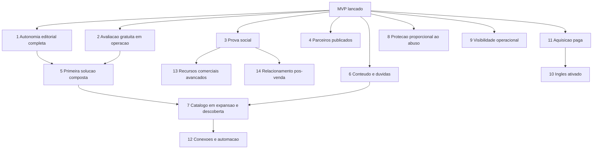

## 16. Escopo do MVP

> As 69 perguntas pendentes foram respondidas em 2026-09-07 (`PERGUNTAS-PENDENTES.md`). O escopo abaixo já as incorpora e **mudou nos dois sentidos**: cresceu com o painel de administração, a avaliação gratuita, a preparação para inglês, quatro páginas de produto com imagens inexistentes e a identidade visual a derivar do logotipo; encolheu com a saída das páginas de solução e com a confirmação de que quatro softwares ficam abaixo de todos os gatilhos de filtro, busca, ordenação e paginação. O conflito entre esse escopo e a data declarada está em **16.9**, não escondido aqui.

**Definição de sucesso do MVP.** O MVP está pronto quando **três condições** valem ao mesmo tempo:

1. **Conversão pública.** Um visitante que nunca ouviu falar da ArtZan entende, sozinho, o que a empresa faz, identifica qual software trata do problema dele e envia uma solicitação — de contato (P-08) ou de **ambiente de avaliação gratuita** (P-09) — que chega confirmada e rastreável a um dos dois sócios, com prazo de até 2 dias úteis informado na confirmação.
2. **Autonomia editorial.** Os dois sócios cadastram, editam, publicam e despublicam um produto pelo **painel de administração** (P-19 a P-22), sem intervenção do desenvolvimento e sem alterar código.
3. **Nada se perde em silêncio.** Falha de envio dispara alerta interno e preserva os dados digitados (RNF-092).

As três são obrigatórias. Só a primeira é artesanal disfarçado de produto; só a segunda é ferramenta interna sem público; falhar na terceira é perder exatamente o que o projeto existe para capturar.

### 16.1 O que entra no MVP

**Por página.** Prioridade já fixada nas seções 1-8; aqui, o que mudou com as respostas.

| Página | Justificativa e mudança |
|---|---|
| P-01 Inicial | Única página que expõe o portfólio inteiro. Bloco de soluções omitido (Q-006); faixa de parceiros condicional |
| P-02 Sobre | Responde "quem é essa empresa" sem prova social. Passa a apresentar também o serviço de integrações (11.20, D-13) |
| P-03 Catálogo | Principal ponto de decisão. Grade simples com 4 softwares, sem filtro, busca, ordenação ou paginação |
| P-04 Produto | Maior valor comercial; hospeda o template obrigatório. **Bloqueada até existir print real por produto** (Q-005) |
| P-07 Parceiros | Condicionada a parceiro confirmado e autorizado; cenário provável é ausência (Q-025, Q-054, RF-105) |
| P-08 Contato | Ganha **WhatsApp e e-mail institucional** com o mesmo destaque do formulário (RF-220) e **aceite separado** de comunicações futuras (RF-221) |
| P-09 Avaliação gratuita | Deixa de ser "demonstração": vira **solicitação de ambiente de avaliação**, em `/avaliacao-gratuita`; o site registra o pedido e não provisiona nada (RF-222) |
| P-13 Privacidade | Não negociável. Passa a declarar transferência internacional como cenário possível (Q-040) |
| P-14 Termos | Complementa P-13; validação pelo setor jurídico confirmada (Q-028) |
| P-15 404 | Protege tráfego orgânico. Sem mudança |
| P-16 Confirmação | Fecha o fluxo; prazo comunicado passa a **2 dias úteis** (Q-013) |
| **P-19 a P-22 Administração** | **Novas** (Q-033): autenticação, painel inicial, gestão de catálogo e gestão institucional/legal — superfície interna, não indexada, para os dois sócios |

**Por capacidade transversal** — o MVP não é a soma das telas; é isso somado ao mecanismo que faz o portfólio crescer sem reabrir projeto:

| Capacidade | Por que está no MVP |
|---|---|
| Template obrigatório por produto (PR-008, RF-060..063) | Qualidade igual do 1º ao 20º produto |
| Modelo de conteúdo com entidades e relações (6.7) | Condição estrutural de OB-07; reverter exige migração |
| Relação produto↔solução N:N (PR-003) | **Permanece mesmo sem solução publicada**: é a razão de ser da arquitetura |
| Categorias e gatilhos modelados e desligados (PR-013, 6.6) | Ativar filtro ou busca vira configuração, não projeto |
| **Painel de administração (RF-180..193)** | Q-033 converteu capacidade abstrata em software: autenticação, sessão, auditoria e bloqueio de publicação incompleta |
| Publicação sem desenvolvimento (RF-185, RF-186) | Núcleo de OB-07, verificável pelo painel (CA-31) |
| Piso de conteúdo único por produto (PR-057) | Defesa contra conteúdo raso desde o primeiro produto |
| **Preparação estrutural para inglês (RNF-083)** | Campos e endereço reservam o idioma; retrofitar depois é o retrabalho mais caro |
| **WhatsApp e e-mail como canais (RF-220)** | A conversão deixa de depender de um caminho só |
| **Aceite separado de comunicações futuras (RF-221)** | Consentimento e permissão de marketing não podem se confundir |
| **Fronteira do pedido de avaliação (RF-222)** | O site registra e alerta; provisionamento acontece fora dele |
| SEO no modelo (RF-160..172) | Título, URL e dados estruturados nascem com o registro |
| Mobile-first e acessibilidade AA | Critério de aceite por template, sem obrigação legal (Q-036) |
| **Identidade derivada do logotipo (11.11–11.17)** | Sem agência nem manual externo: paleta, tipografia e versões do logotipo são entregáveis do projeto |
| Eventos, funil e alerta de falha (RF-200..206, RNF-092) | A linha de base começa no lançamento e não se recupera depois |
| Antispam silencioso com **extensão para captcha** (PR-050) | Ativar depois precisa ser configuração, não reconstrução |
| Voz única e glossário normativo (PR-040, PR-058) | Consistência em escala, sem depender do redator |

**Volume do MVP:** **118 requisitos funcionais, 106 deles MVP**, e **86 não funcionais**. Administração cresceu de 8 para 14 requisitos; formulários ganharam 2; produto ganhou 1; segurança ganhou 4. Nenhum foi renumerado.

### 16.2 O que fica para a Fase 2

Com **4 softwares publicáveis** (5 contando o serviço, que nem entra no catálogo), o portfólio fica **abaixo de todos os gatilhos numéricos** de 6.6, mantidos como estão (Q-023). Não é adiamento por prazo: é aritmética do portfólio real. **Nada além da grade simples é construído no lançamento.**

| Item | Gatilho de ativação |
|---|---|
| Agrupamento por categoria (RF-043) | 7 produtos publicados |
| Filtro por categoria (RF-044) | 10 produtos, ou 4 categorias com 2+ produtos |
| Ordenação (RF-045) | 12 produtos |
| Paginação (RF-047) | 24 produtos |
| Estado sem resultados (RF-050) | Junto do filtro ou busca que o ativar |
| Filtro de soluções por produto (RF-089) | 7 soluções — hoje, zero |
| Categoria com página própria (P-18) | Filtro ativo **e** descrição editorial escrita |
| Blog (P-10, P-11) | Responsável e cadência definidos; Q-027 confirmou que não é pré-requisito |
| FAQ e dados estruturados (P-12) | Volume real de dúvidas do atendimento |
| Produtos relacionados (RF-067) | Catálogo com produtos vizinhos o bastante |
| Pré-visualização antes de publicar (RF-184) | Ritmo que torne arriscado revisar em produção |
| Relatório por entidade (RF-205) | Volume acima do piso estatístico (15.8) |
| **Ativação do captcha (PR-050 corrigida)** | Mais envios inválidos que válidos por duas semanas; a extensão já nasce no MVP |

### 16.3 O que fica para o Futuro

| Item | Por quê | Gatilho |
|---|---|---|
| **Índice de soluções (P-05) e página de solução (P-06)** | **Reclassificadas de MVP para Futuro** (Q-006): sem solução composta, construir a página é construir um vazio; o menu fica oculto | Primeira solução com 2+ produtos e ganho escrito (RF-084) |
| **Jornada J-03** | Fica sem objeto no lançamento; permanece como roteiro de referência | Mesmo gatilho de P-05 e P-06 |
| Busca no site (P-17) | Com 4 produtos não é usada e sugere catálogo maior que o real | 15 produtos ou 20 conteúdos |
| Comparador de produtos (J-06) | Template consistente já resolve a dúvida com poucos produtos | Produtos de escopo vizinho gerando dúvida frequente |
| **Publicação efetiva em inglês** | A estrutura entra no MVP; conteúdo, seletor e indexação por idioma não | Mercado fora do Brasil exigindo inglês (Q-011) |
| **Monitoramento externo** | Q-039: cliente decidiu que não é necessário; fica como risco residual (RNF-091), não pendência técnica | Primeira indisponibilidade percebida por reclamação |

### 16.4 O que explicitamente não faz parte do projeto

| Excluído | Justificativa |
|---|---|
| Área logada **de cliente** | Sem clientes, sem usuário para autenticar (PR-001, PR-007). **Não confundir com o painel** (P-19 a P-22): superfície interna dos dois sócios, não indexada — PR-059 deixou de excluí-la |
| Gestão de leads no painel | Q-014: leads seguem na caixa de e-mail; trazer o funil dobraria superfície de ataque e esforço |
| Gestão de usuários no painel | Dois acessos provisionados diretamente (Q-034); sem convite, hierarquia ou aprovação |
| **Provisionamento automático do ambiente de avaliação** | RF-222: o site registra e alerta; criar acesso e liberar credenciais é operação humana |
| E-commerce | Assinatura e projeto sob encomenda, sem preço publicado (Q-007, Q-008) |
| Autoatendimento de proposta/calculadora | Preço depende do projeto; número ilustrativo violaria 11.2 |
| Aplicação (executar produto) | Acoplaria o site ao ciclo de vida de cada produto |
| Portal de cliente | Sem cliente e sem suporte modelado — mesmo erro da área logada |
| Chat ao vivo | Dois sócios acumulando funções tornariam "ninguém disponível" a resposta provável |
| Agendamento automático | Q-026 eliminou a apresentação por pessoa; não há agenda a marcar |
| Procedimento publicado de resposta a incidente | Q-044: não incluir por enquanto — decisão registrada, não omissão |
| Teste de intrusão antes do lançamento | Q-047: posteriormente. O painel eleva o risco (R-16) e a decisão deve ser revisitada |

### 16.5 Funcionalidades que podem ser adiadas sem perda comercial

**Critério para adiar sob pressão de prazo:** só se, ao mesmo tempo, (a) a ausência não impede nenhuma jornada central de terminar; (b) não é requisito jurídico, de acessibilidade ou de segurança; (c) adicionar depois não exige retrabalho estrutural; (d) há substituto que preserve "nenhuma lacuna visível" — nunca um "em breve".

| Adiável | Substituto imediato |
|---|---|
| Fluxo dedicado "seja um parceiro" (RF-107) | Assunto "sou parceiro" no formulário de contato |
| Histórico público de versões legais | Q-032: histórico só interno; data de atualização visível |
| Mecanismo formal de reuso de blocos (RF-146) | Duplicação simples com revisão reforçada |
| Painel de medição curado (15.7) no dia 1 | Dados brutos lidos pelos sócios; instrumentação e alerta não são adiáveis |
| Profundidade da seção de integrações | Já é condicional — omitida quando não há integração (Q-070) |
| **P-20 (painel inicial)** | Acesso direto às listagens; perde-se a visão de "o que falta publicar", não a capacidade de publicar |
| **P-22 (gestão institucional)** | Textos publicados na entrega; atualizar exige desenvolvedor até a etapa seguinte — só aceitável com o texto jurídico já final |

**Nunca cortar:** P-13 e P-14 publicadas, datadas e validadas; alerta de falha (RNF-092); validação de obrigatórios com imagem real (RF-185, PR-057); acessibilidade AA; autenticação e proteção das rotas administrativas (RNF-047 a RNF-049, RNF-110); aceite separado (RF-221); qualquer item de 16.4.

### 16.6 Conteúdo mínimo para lançar

**É o item mais concreto do escopo e o principal caminho crítico — não o desenvolvimento.** As respostas confirmaram o portfólio e confirmaram também que boa parte do material a exibir **ainda não existe como arquivo**. A coluna final distingue **bloqueia o lançamento** (sem isso não se publica nada) de **bloqueia a página** (aquela página não sobe; o resto sobe sem lacuna visível).

| Item | Mínimo exigido | Situação e efeito |
|---|---|---|
| Nome e domínio | ArtZan; `artzan.com.br`, sujeito a alteração | **Resolvido** (Q-001, Q-002) |
| **Quatro produtos escritos** | Campos de 6.7 e piso de PR-057: texto único, 3 funcionalidades, 3 benefícios, problema que resolve, para quem é | Textos a redigir; três nomes não aprovados (Q-084). **Bloqueia o lançamento** — card sem destino é pior que catálogo pequeno |
| **Prints de tela** | Uma imagem real por produto publicado, na moldura padrão de 11.17 | **Não existem** (Q-005, sem responsável nem data). **Bloqueia a página**, e o painel impede publicar sem imagem; com zero prints, trava o lançamento inteiro |
| Textos institucionais (P-02) | Promessa, o que faz, como trabalha, serviço de integrações — sem afirmação não verificável | A redigir, com base confirmada (Q-018 a Q-020). **Bloqueia o lançamento** |
| **Textos legais (P-13, P-14)** | Validados pelo setor jurídico, datados, com transferência internacional declarada | Não entregues; base legal e retenção a definir (Q-065). **Bloqueia o lançamento**, não negociável |
| **Dados de rodapé** | Razão social, CNPJ, endereço e canal (Q-053) | Valores não fornecidos. **Bloqueia o lançamento** — sem eles o site não identifica quem responde por ele |
| **E-mail institucional no domínio** | Caixa operante para receber leads e remeter confirmações | **Não criada** (Q-031, Q-063). **Bloqueia o lançamento** — o formulário aponta para lugar nenhum |
| **Ambiente de avaliação gratuita** | Existir, com duração definida e alguém que libere em até 2 dias úteis | **Não confirmado.** Pré-requisito **de negócio**, não de site: P-09 subiria tecnicamente sem ele, e esse é o perigo (R-19). Sem ambiente, P-09 sai do lançamento |
| Identidade visual aplicada | Paleta e tipografia aplicadas, contraste verificado (CA-45) | Sistema proposto, **aprovação pendente** (Q-073 a Q-076). **Bloqueia o lançamento** |
| **Versões derivadas do logotipo** | Monograma isolado, reversa, monocromática e favicon (11.16) | **Não existem**; pode não haver vetor (Q-077, Q-078). **Bloqueia o lançamento** |
| Imagem padrão de compartilhamento | Uma imagem próxima de 1200×630, logotipo sobre superfície clara | A produzir junto das versões derivadas. **Bloqueia o lançamento** (12.6) |
| Autorização de marca do parceiro | Registrada (PR-018), **se** houver parceiro | Inexistente (Q-054). **Bloqueia a página** P-07, que já é condicional |
| Revisão editorial e de acessibilidade | Checklists de 11.9 e 13.12 aprovados pelos sócios | Processo definido, execução pendente. **Bloqueia o lançamento** |

**Sem rodeio:** dos doze itens, **cinco não existem hoje em nenhuma forma** — prints, e-mail institucional, textos legais entregues, versões derivadas do logotipo e ambiente de avaliação. Nenhum é produzido por desenvolvimento. Enquanto faltarem, **nenhuma velocidade de construção antecipa o lançamento**: a data discutida em 16.9 é definida pelo conteúdo, não pelo código.

### 16.7 Decisões antes de começar o desenvolvimento

As respostas de 2026-09-07 **resolveram a maior parte da lista original**; o estado item a item está em 18.4.

**Já resolvidas:** D-01 (ArtZan, logotipo existente, identidade derivada no projeto), D-02 (painel), D-03 (caixa de e-mail dos sócios, 2 dias úteis), D-04 (preço sob consulta), D-06 (português com estrutura para inglês), D-07 (sem captcha agora, com ponto de extensão), D-09 (os dois sócios revisam e triam).

**Ainda abertas, em ordem de urgência:**

1. **D-11 — Cortar escopo ou mover a data.** Define o que sequer começa a ser construído (16.9).
2. **D-12 — Aprovação dos nomes de produto.** Bloqueia texto, endereço e slug, imutável depois de publicado (PR-014).
3. **D-14 — Aprovação do sistema visual** e produção das versões derivadas do logotipo. Bloqueia cabeçalho, rodapé, favicon e compartilhamento.
4. **D-17 — Ambiente de avaliação:** quem provisiona, por quanto tempo. Define se P-09 entra ou sai.
5. **D-15 — Hospedagem e monitoramento de erro.** Bloqueia homologação, endereços e envio de e-mail.
6. **D-16 — Base legal, retenção e direitos do titular**, com o setor jurídico. Bloqueia P-13.
7. **D-05 — Parceiro no lançamento.** Cenário provável é ausência.
8. **D-08 — Ferramenta de medição.** A linha de base começa no lançamento e não se recupera depois.
9. **D-13 — Serviço de integrações** à parte ou como card do catálogo (Q-085).

### 16.8 Estimativa de esforço relativo

Sem prazo em dias ou semanas: **este documento não converte esforço em calendário**, e nada aqui é promessa de entrega. A tabela compara blocos entre si; a variação mostra o efeito das respostas de 2026-09-07.

| Bloco | Esforço | Var. | O que domina o custo |
|---|---|---|---|
| **Painel de administração (RF-180..193, P-19 a P-22, RNF-047..049)** | **Grande** | **▲ maior adição** | Autenticação, sessão, recuperação de acesso, auditoria, validação de publicação e proteção de rotas. "Simples" descreve a interface, não o custo |
| Template de produto + modelo de conteúdo (RF-060..070, RF-181..187) | Grande | = | Mecanismo do qual a estratégia depende; vínculos N:N permanecem mesmo sem solução publicada |
| Formulários, roteamento, e-mail, WhatsApp (RF-120..132, RF-220..222) | Grande | ▲ leve | Tratamento de falha, alerta e rastreabilidade; soma aceite separado, WhatsApp e a fronteira do pedido de avaliação |
| Navegação, cabeçalho, rodapé, catálogo (RF-001..011, RF-040..050) | Médio | ▼ | Catálogo vira grade simples; filtro, busca e paginação ficam desligados |
| **Identidade visual aplicada (11.11..11.17)** | Médio | ▲ novo | Tokens, escala tipográfica, componentes, versões do logotipo e contraste par a par |
| SEO e **reserva estrutural de idioma** (RF-160..172, RNF-083) | Médio, no início | ▲ leve | Parte do desenho de cada template; a reserva é barata agora e cara depois |
| Template de solução (RF-080..089) | Pequeno | ▼▼ | **Páginas saem do MVP**; permanecem só o modelo e o vínculo |
| Institucional, legais, 404 | Pequeno | = | Depende dos textos existirem (16.6), não da construção |
| Parceiros (RF-100..107) | Quase zero sem parceiro | ▼ | Interface só se houver o que mostrar |
| Analytics, funil, alerta (RF-200..206, RNF-092) | Pequeno a médio | = | O esforço está em garantir o alerta **sem** monitoramento externo |
| Acessibilidade e responsividade | Sobretaxa em todos os blocos | = | Cada template soma AA e mobile-first — inclusive o painel |

**O que domina o calendário não é técnico.** Primeiro, a existência do conteúdo de 16.6 — cinco itens não existem. Segundo, o painel, bloco comparável ao próprio site público, que entrou depois do prazo declarado. Terceiro, D-11: enquanto não for decidida, qualquer construção pode estar sendo feita para um escopo que será cortado.

### 16.9 Recorte de lançamento sob o prazo declarado

**O dado, sem interpretação:** a data alvo é **setembro de 2026** (Q-029) e hoje é **07 de setembro de 2026** — o prazo é o mês corrente. No mesmo conjunto de respostas, o escopo aumentou: painel de administração, avaliação gratuita, preparação para inglês, quatro páginas de produto com prints inexistentes e identidade visual a derivar do logotipo.

Este documento **não afirma que esse escopo cabe nesse prazo** e não estima em dias o que caberia — não há base, e um número inventado seria pior que nenhum. O que cabe fazer com honestidade é separar o inegociável do cortável e mostrar o preço de cada caminho. A escolha é do cliente, registrada como **D-11**.

**Piso inegociável — abaixo disto não é lançamento, é publicação de rascunho:** inicial, institucional e catálogo sem lacuna visível e sem "em breve"; **ao menos um** produto completo, com print real, dentro do piso de conteúdo único; contato funcionando ponta a ponta (formulário, WhatsApp, e-mail, confirmação com prazo e alerta de falha testado); privacidade e termos publicados, datados e validados juridicamente, com aceite separado de comunicações futuras; 404, identidade aplicada com contraste verificado, acessibilidade AA e responsividade; e dados de rodapé completos.

**Três caminhos, comparados:**

| | **A — Data mantida, escopo cortado** | **B — Data movida, escopo completo** | **C — Duas etapas** |
|---|---|---|---|
| **Entra na data** | Piso inegociável + produtos com print pronto + preparação para inglês | Nada; a data se desloca até 16.1 estar pronto | O mesmo da A, publicado como lançamento real |
| **Sai ou espera** | Painel; P-09; P-07; produtos sem print | Nada sai | Painel e P-09 vão para a etapa 2, com data acordada no mesmo ato |
| **Publicação do conteúdo** | Técnica, pelo desenvolvimento, na entrega | Pelo painel, como especificado | Técnica na etapa 1; painel assume na etapa 2 |
| **O que se perde** | Autonomia editorial (condição 2) e a promessa verificável (Q-022): site dependente de desenvolvedor e sem o argumento de conversão mais forte | O marco comercial da data; se houver compromisso externo, o custo é de negócio | Nada em definitivo, mas semanas operando sem autonomia editorial e sem avaliação gratuita |
| **Risco principal** | "Provisório" virar permanente: painel sem data vira painel cancelado | A data escorregar de novo, já que o caminho crítico é o conteúdo de 16.6 | Etapa 2 sem data no mesmo ato degenera em Alternativa A |
| **Contraindicação** | Se a avaliação gratuita for a espinha do discurso comercial | Se a data tiver compromisso externo real (Q-089) | Se não houver disposição de assinar a data da etapa 2 junto |
| **Efeito em PR-060** | Mantida | Mantida | **Superada** — deixa de ser evento único |

**Recomendação do PRD: Alternativa C**, com duas condições. Primeira, a data da etapa 2 é acordada por escrito junto com a etapa 1, e o painel entra nela como primeiro item — não como intenção. Segunda, enquanto o painel não existir, nenhuma publicação é feita fora do modelo de dados de 6.7: publicar "na mão" cria exatamente o retrabalho que o painel existe para evitar. Se alguma das duas condições não for aceita, a Alternativa B é preferível à A — mover a data custa menos que lançar um site que a própria empresa não consegue manter.

**Três cortes que não devem ser feitos, nem na Alternativa A:** a preparação estrutural para inglês (barata agora, retrabalho depois); a validação de publicação com imagem obrigatória, cuja remoção equivale a autorizar catálogo com espaço vazio; e o alerta de falha de envio, que é a diferença entre perder uma oportunidade e nem saber que ela existiu.

**Sobre P-09, o que o cliente precisa ver.** A avaliação gratuita é o item de maior valor comercial das respostas: é a única promessa verificável que a empresa tem (Q-022), sem nenhuma prova social (Q-021). Cortá-la custa mais, comercialmente, do que cortar o painel. Mas publicá-la **sem** ambiente pronto é pior que cortá-la — o site receberia pedidos que ninguém atende em 2 dias úteis. A ordem correta é: primeiro existir o ambiente, depois publicar a página.

## 17. Roadmap de evolução

Nada aqui é requisito do MVP nem deve ser antecipado para 16.1. A ordem mudou com as respostas de 2026-09-07: as ondas agora têm pré-condição conhecida e, em dois casos, recebem **item que saiu do MVP**. Cada onda mantém pré-condição de negócio (o que precisa ser verdade para começar) e indicador de necessidade (o que se observa para saber que chegou a hora). Nenhuma tem data.

| Onda | Itens | Pré-condição de negócio | Indicador de necessidade |
|---|---|---|---|
| **1. Autonomia editorial completa** *(só se D-11 escolher A ou C)* | Painel de administração completo (P-19 a P-22) | Etapa 1 publicada e data da etapa 2 acordada por escrito | Toda alteração de conteúdo passando por desenvolvedor |
| **2. Avaliação gratuita em operação** *(só se P-09 sair do lançamento)* | P-09 publicada, com liberação humana operante | Ambiente de teste existente, com duração e responsável (D-17) | Contatos pedindo para testar antes de conversar |
| **3. Prova social** | Logo do primeiro cliente, depois case e depoimento | Um cliente poderá ceder a logo (Q-021), sob autorização formal (PR-018) | Primeira autorização assinada; primeiras vendas |
| **4. Parceiros publicados** | Página, faixa da inicial e item de menu | Parceiro confirmado (Q-025) **e** autorização de marca (Q-054) — hoje nenhum dos dois | Parceria formalizada |
| **5. Primeira solução composta** | **P-05 e P-06, que saíram do MVP** (Q-006); vínculos já existem no modelo | Duas ofertas que combinem de fato, com ganho escrito (RF-084) | Cliente comprando dois produtos e pedindo que conversem |
| **6. Conteúdo e dúvidas** | Blog (P-10, P-11); FAQ (P-12) | Responsável e cadência definidos (Q-027) | Dúvidas repetidas no atendimento; orgânico estagnado |
| **7. Catálogo em expansão e descoberta** | Categoria, filtro, ordenação, paginação (6.6); busca (P-17); comparador (J-06) | Portfólio ultrapassando os gatilhos, mantidos como estão (Q-023) | Catálogo chegando a 7, 10, 12, 15 produtos |
| **8. Proteção proporcional ao abuso** | Ativação do captcha no **ponto de extensão já previsto** | Nenhuma: a extensão é construída no MVP, só a ativação espera | Mais envios inválidos que válidos por duas semanas |
| **9. Visibilidade operacional** | Monitoramento de erro (Q-041); verificação externa, se revista (Q-039); teste de intrusão (Q-047) | Reconhecer que uma queda pode passar despercebida | Indisponibilidade descoberta por reclamação de visitante |
| **10. Inglês ativado** | Tradução dos campos reservados, seletor, endereços por idioma | **Estrutura preparada desde o MVP** (Q-011): é ativação, não reconstrução | Tráfego ou contato relevante em inglês |
| **11. Aquisição paga** | Páginas de destino, parâmetros de campanha, medição por origem | **Possível, não planejada** (Q-067) | Volume acima do que o orgânico entrega |
| **12. Conexões e automação** | Gestão de relacionamento; automação; conteúdo sobre integração com sistemas de terceiros (Q-070) | Volume que torne a caixa de e-mail um gargalo (PR-021) | Tempo até o primeiro retorno piorando |
| **13. Recursos comerciais avançados** | Preço público ou faixado; calculadora | Preço fechado o bastante para publicar (hoje: sob consulta) | Contatos pedindo preço antes de qualquer conversa |
| **14. Relacionamento pós-venda** | Área de clientes; portal de suporte | Base de clientes com necessidade declarada — reverte PR-001 e PR-007 | Volume de suporte que justifique canal dedicado |

Ondas 1 e 2 só existem se D-11 tirar painel e avaliação gratuita da data de lançamento — são dívida do recorte, não evolução. As ondas 3, 4, 6, 8, 9 e 11 podem começar de forma independente. As demais dependem de uma anterior ter avançado de fato, não de alguém decidir que chegou a hora.

## 18. Riscos, premissas e pendências

### 18.1 Riscos

> ### 🔴 R-15 — Severidade máxima: o prazo declarado é o mês corrente e o escopo cresceu
>
> **O fato.** Data alvo: **setembro de 2026** (Q-029). Hoje: **07 de setembro de 2026**. No mesmo conjunto de respostas, o escopo aumentou em cinco frentes: painel de administração, avaliação gratuita, preparação para inglês, quatro páginas de produto com prints **inexistentes** e identidade visual a derivar do logotipo.
>
> **Por que é máximo.** Não é risco de execução, que se mitiga trabalhando melhor: é contradição declarada entre duas respostas do próprio cliente. E o caminho crítico não é o desenvolvimento — cinco itens de 16.6 não existem, e nenhum é produzido por quem constrói o site.
>
> **Sinais de alerta.** Construção iniciada sem D-11 decidida; semana encerrada sem prints, e-mail institucional e textos legais; plano que só fecha se tudo chegar no mesmo dia; conversa que trate o painel como "um CRUD simples".
>
> **Consequência se ignorado.** Uma de três, todas ruins: publicar um site com lacuna visível; publicar P-09 sem ambiente, quebrando a única promessa verificável na primeira semana; ou não publicar nada e deixar a data passar sem decisão — a pior, porque gasta o prazo **e** a confiança sem produzir escolha.
>
> **Mitigação.** Não há mitigação técnica. As saídas estão em **16.9**; a escolha é do cliente, em **D-11**, com prazo **imediato**.

**Reavaliação de R-01 a R-14.** Coluna **Variação** contra a v1.0: ✔ superado, ▼ caiu, = igual, ▲ subiu.

| ID | Risco | Prob. | Impacto | Var. | Sinal de alerta | Mitigação |
|---|---|---|---|---|---|---|
| R-01 | Identidade indefinida no início do design | Muito baixa | Alto | **✔** | Aprovação de paleta parada (Q-073 a Q-076) | Logotipo existe; paleta e tipografia derivadas dele: resta aprovar, não criar |
| R-02 | Portfólio não definido a tempo | Muito baixa | Alto | **✔** | — | Q-004: falta nome (D-12), não existência |
| R-03 | Conteúdo depende do cliente e atrasa | **Alta** | Alto | **▲** | Semana sem print, texto legal ou rodapé | Inventário com nível de bloqueio (16.6); recorte de 16.9 |
| R-04 | Ausência de prova social reduz conversão | Alta (fato) | Médio | = | Conversão baixa sem outra causa | Avaliação gratuita como promessa verificável (Q-022) |
| R-05 | Canibalização produto × solução na busca | Nula hoje | Médio | **▼** | Volta com a primeira solução publicada | Sem página de solução não há disputa; 12.9 segue escrita |
| R-06 | Catálogo cresce e perde curadoria | Baixa, crescente | Médio | ▼ | Ultrapassar gatilhos sem ativação | Quatro produtos ficam muito abaixo; categorias modeladas |
| R-07 | Formulário falha em silêncio | Baixa | **Alto** | = | Divergência entre envio e confirmação | Registro independente e alerta obrigatório (RNF-092) |
| R-08 | Expectativa de tráfego orgânico rápido | Alta | Médio | = | Cobrança antes da calibração | Linha de base de três meses; Q-068 sem meta |
| R-09 | Decisão de forma de publicação atrasa | **Nula** | Alto | **✔** | — | Q-033 resolveu D-02; o risco virou construir (R-17) |
| R-10 | Escopo cresce durante a execução | **Alta — já ocorreu** | Médio-alto | **▲** | Pedido novo sem revisar D-11 | Critério de 16.5; toda adição exige reabrir 16.9 |
| R-11 | Parceiro e autorização não resolvidos | **Alta** | Baixo-médio | **▲** | Congelamento sem confirmação | P-07 condicional; RF-105 trata o vazio |
| R-12 | Destino dos leads indefinido na execução | Baixa na decisão, **alta na execução** | Alto | ▼ / ▲ | Lançamento sem a caixa criada | Q-013 e Q-064 resolvidas; a caixa segue inexistente (R-22) |
| R-13 | Preço e modelo comercial indefinidos | **Baixa** | Médio | **▼** | Texto de preço divergente entre produtos | Q-007 e Q-008 resolvidas; texto único (RF-065) |
| R-14 | Revisor sobrecarregado | Baixa, cresce | Médio | = | Atraso entre pronto e publicado | Sem hierarquia (Q-034); checklists objetivos |

**Riscos novos, a partir de R-15.**

| ID | Risco | Prob. | Impacto | Sinal de alerta | Mitigação |
|---|---|---|---|---|---|
| **R-15** | **Prazo declarado incompatível com o escopo ampliado** | **Alta** | **Máximo** | Ver quadro acima | 16.9 e D-11, com prazo imediato |
| **R-16** | Painel como **superfície de ataque** em site antes só de leitura | Média | **Alto** | Rota acessível sem sessão; tentativa repetida sem bloqueio; login indexado | RNF-047 a RNF-049 e RNF-110; corte mínimo (16.4); Q-047 deve ser reaberta |
| **R-17** | Painel como **esforço** subestimado por ser "simples" | **Alta** | Alto | Estimativa que ignore recuperação de acesso, auditoria e validação | Dimensionamento de 16.8; corte mínimo e Alternativa C |
| **R-18** | **Sem monitoramento externo**, queda pode não gerar alerta | Média | Médio-alto | Indisponibilidade descoberta por reclamação | Q-039 é decisão do cliente; RNF-091 registra o risco residual; RNF-092 cobre falha de formulário, não o site fora do ar |
| **R-19** | **Avaliação gratuita: o site promete, outra equipe cumpre** | **Alta com D-17 aberta** | **Alto** | P-09 pronta sem ambiente definido; primeiro pedido sem resposta | RF-222 fixa a fronteira; 16.9 recomenda não publicar antes do ambiente existir |
| **R-20** | **Logo de parceiro publicada sem autorização** | Média | Alto se ocorrer | Pedido para "adiantar" a logo antes da assinatura | PR-018 inegociável (RF-103); CA-13 audita antes do lançamento |
| **R-21** | **Prints não ficam prontos** e travam a publicação | **Alta** | **Alto** | Produto sem imagem na semana do congelamento | Bloqueio proposital (RF-185, CA-37); 16.9 permite lançar só com os completos |
| **R-22** | **E-mail institucional inexistente**: leads sem destino | **Alta** | **Alto** | CA-15 impossível de executar | Bloqueio em 16.6; criação é responsabilidade dos sócios (Q-071) |
| **R-23** | **Nome publicado antes da verificação de marca** | Média | Médio-alto | Aprovação (Q-084) sem verificação (Q-083) | Nenhum nome tratado como registrado; slug imutável (PR-014); D-12 exige verificação antes |

### 18.2 Premissas consolidadas

Todas as premissas do documento. **Impacto** = efeito no PRD se a premissa for falsa. A coluna **Situação** foi acrescentada após as respostas de 2026-09-07: **Confirmada** (a resposta sustenta a premissa como escrita), **Corrigida** (o enunciado original não vale mais; a correção está ao lado), **Aberta** (segue como suposição, sem confirmação) e **Superada** (o objeto deixou de existir no escopo). Nenhuma foi renumerada ou removida.

| ID | Enunciado | Origem | Impacto se falsa | Situação |
|---|---|---|---|---|
| PR-001 | Site totalmente público e anônimo no MVP, sem área logada | Seções 1–8 | Alto | **Confirmada** — o painel é superfície interna, não área de cliente |
| PR-002 | Portfólio de lançamento pequeno, entre 2 e 5 produtos | Seções 1–8 | Médio | **Confirmada** (Q-004: quatro softwares) |
| PR-003 | Relação produto↔solução é muitos-para-muitos nos dois sentidos | Seções 1–8 | Alto | **Confirmada** — mantida mesmo sem solução publicada |
| PR-004 | Venda concluída por atendimento humano; o site qualifica e encaminha | Seções 1–8 | Alto | **Confirmada** (Q-007, Q-013) |
| PR-005 | Preço não é publicado no MVP | Seções 1–8 | Médio | **Confirmada** (Q-008) |
| PR-006 | Site publicado em um único idioma, português do Brasil | Seções 1–8 | Alto | **Confirmada**, com estrutura reservada para inglês (Q-011) |
| PR-007 | Sem clientes, cases, depoimentos ou logos no lançamento | Seções 1–8 | Médio | **Confirmada** (Q-021), com logo possível em seguida |
| PR-008 | Todo produto publicado usa o mesmo template obrigatório | Seções 1–8 | Alto | **Confirmada** — reforça manter o serviço fora do template (11.20) |
| PR-009 | Conteúdo mantido por equipe reduzida e não técnica | Seções 1–8 | Alto | **Confirmada** (Q-034) — justificativa direta do painel |
| PR-010 | Solução composta exige no mínimo dois produtos | Seções 1–8 | Médio | **Confirmada**, sem efeito prático: nenhuma solução existe |
| PR-011 | A lista de parceiros pode estar vazia no lançamento | Seções 1–8 | Baixo | **Confirmada** — cenário provável (Q-025) |
| PR-012 | Formulário é o canal principal de contato | Seções 1–8 | Médio | **Confirmada** como canal instrumentado; WhatsApp e e-mail entram no mesmo destaque (Q-012) |
| PR-013 | Categorias existem no modelo desde o início, mesmo sem exibição | Seções 1–8 | Médio | **Confirmada** (Q-023) |
| PR-014 | Slug imutável após publicação; renomeação exige redirecionamento | Seções 1–8 | Médio | **Confirmada** — crítica por causa dos nomes pendentes (R-23) |
| PR-015 | Blog e conteúdo editorial não são pré-requisito de lançamento | Seções 1–8 | Baixo | **Confirmada** (Q-027) |
| PR-016 | Demonstração conduzida por pessoa, sem acesso imediato ao software | Seções 1–8 | Médio | **Corrigida** (Q-026): é ambiente próprio de teste por tempo determinado, liberado por um dos sócios |
| PR-017 | Parte relevante do tráfego será móvel | Seções 1–8 | Alto | **Confirmada por decisão** (Q-037), sem dado de audiência |
| PR-018 | Marca de terceiro só com autorização formal registrada | Seções 1–8 | Alto | **Confirmada** (Q-054: não existe autorização) |
| PR-019 | Textos legais fornecidos e validados pelo cliente | Seções 1–8 | Alto | **Confirmada** (Q-028: setor jurídico) |
| PR-020 | Contato e demonstração são os únicos formulários no lançamento | Seções 9–10 | Médio | **Confirmada** — WhatsApp e e-mail são canais, não formulários |
| PR-021 | Destino é caixa de mensagens compartilhada, sem CRM | Seções 9–10 | Médio | **Confirmada** (Q-014) |
| PR-022 | E-mail de confirmação é transacional, não é marketing | Seções 9–10 | Médio | **Confirmada** — reforçada pelo aceite separado (Q-066) |
| PR-023 | Até três pessoas com acesso de publicação no lançamento | Seções 9–10 | Baixo | **Corrigida** (Q-034): exatamente dois sócios, conta individual, sem hierarquia |
| PR-024 | Uma única ferramenta de medição, escolhida fora deste PRD | Seções 9–10 | Médio | **Aberta** — ferramenta não escolhida (D-08, Q-041) |
| PR-025 | Orçamento de performance calibrado para conexão móvel média | Seções 9–10 | Médio | **Confirmada** — sem restrição de orçamento (Q-035) |
| PR-026 | Sem exigência contratual adicional de acessibilidade além de AA | Seções 9–10 | Baixo-médio | **Confirmada** (Q-036, Q-060, Q-061) |
| PR-027 | Correção de vulnerabilidades e dependências é rotina operacional contínua da mesma equipe de publicação | Seções 9–10 | Médio | **Confirmada** (Q-071), agravada pelo painel (R-16) |
| PR-028 | Critério de navegadores suportados usa referência genérica de mercado até haver dado real de audiência | Seções 9–10 | Baixo | **Corrigida** (Q-037): decisão declarada — só versões recentes, garantindo mobile e desktop |
| PR-029 | Meta de disponibilidade assumida em 99,5% mensal, compatível com hospedagem convencional sem redundância dedicada | Seções 9–10 | Alto | **Confirmada** (Q-038) |
| PR-030 | Cópia de segurança do conteúdo assume retenção mínima de 30 dias | Seções 9–10 | Baixo | **Aberta** — depende da hospedagem (Q-046) |
| PR-031 | Até confirmação dos fornecedores contratados, assume-se possível processamento de dado fora do Brasil | Seções 9–10 | Médio | **Corrigida** (Q-040): é **provável**, e o aviso declara desde a publicação |
| PR-032 | Monitoramento de erro e de desempenho real é categoria operacional distinta da ferramenta única de PR-024 | Seções 9–10 | Médio | **Aberta** (Q-041) |
| PR-033 | Ambiente de homologação é réplica reduzida da produção, no mesmo orçamento de hospedagem de PR-025 | Seções 9–10 | Médio | **Aberta** (Q-046) — é onde CA-24 e CA-31 se executam |
| PR-034 | Qualquer publicador autorizado pode publicar em qualquer horário útil, sem plantão dedicado no MVP | Seções 9–10 | Médio | **Confirmada** (Q-045) |
| PR-035 | Alvo de 60 minutos para publicar um produto novo cobre campos e vínculos, exclui texto e imagem | Seções 9–10 | Alto | **Confirmada** — agora verificável no painel (CA-31) |
| PR-040 | Uma única voz, a de ArtZan; nenhum produto tem tom próprio | Seções 11–15 | Médio | **Confirmada** (Q-050, Q-059) |
| PR-041 | Limites de caracteres validados na edição | Seções 11–15 | Baixo | **Confirmada** — executada no painel (RF-185) |
| PR-042 | Nomes de produto ainda não existem; padrão único para a família | Seções 11–15 | Alto | **Corrigida** (Q-004, Q-051): Sistema Lara já existe e o padrão é de nomes independentes, sem família de marca |
| PR-043 | Todo texto passa por um único revisor designado | Seções 11–15 | Médio | **Corrigida** (Q-034): não há revisor distinto do publicador; os dois sócios revisam e publicam |
| PR-044 | WCAG 2.2 nível AA como critério de aceite | Seções 11–15 | Alto | **Confirmada por decisão técnica**, sem obrigação legal (Q-036) |
| PR-045 | Nenhum texto essencial dentro de imagem, exceto o logotipo | Seções 11–15 | Médio | **Confirmada** — vale para os prints de tela (Q-005) |
| PR-046 | Formulário curto por decisão; qualificação no atendimento humano | Seções 11–15 | Médio | **Confirmada** (Q-062) |
| PR-047 | Sem envio de anexo nos formulários do MVP | Seções 11–15 | Baixo | **Confirmada** |
| PR-048 | Prazo de resposta de um dia útil, provisório até Q-013 | Seções 11–15 | Alto | **Corrigida** (Q-013): **até 2 dias úteis**, por um dos sócios; deixa de ser provisório |
| PR-049 | Nenhuma solicitação sem contexto de origem | Seções 11–15 | Médio | **Confirmada** — vale também para o pedido de avaliação (RF-222) |
| PR-050 | Sem desafio interativo no MVP; camadas 1-6 de 14.6 | Seções 11–15 | Baixo-médio | **Corrigida** (Q-030): exige **ponto de extensão** para captcha desde o desenho |
| PR-051 | Nenhuma métrica com dado pessoal além do necessário | Seções 11–15 | Alto | **Confirmada** |
| PR-052 | Medição não essencial só após manifestação do visitante | Seções 11–15 | Alto | **Confirmada** — reforçada por Q-065 |
| PR-053 | Três primeiros meses são linha de base; sem meta antes disso | Seções 11–15 | Médio | **Confirmada** (Q-068) |
| PR-054 | O site mede até o envio; o resto depende do destino comercial | Seções 11–15 | Médio | **Confirmada** — reforçada por RF-222 |
| PR-055 | Existe uma imagem institucional padrão de compartilhamento | Seções 11–15 | Médio | **Aberta** — não existe como arquivo (Q-078) |
| PR-056 | Dados estruturados só declaram o verificável | Seções 11–15 | Alto | **Confirmada** — nenhum nome é declarável como marca registrada (Q-052) |
| PR-057 | Nenhum produto publicado abaixo do piso de conteúdo único | Seções 11–15 | Alto | **Confirmada** — aplicada pelo painel |
| PR-058 | Glossário normativo bloqueia publicação divergente | Seções 11–15 | Médio | **Confirmada**, com colisão a resolver: "integração" tem duas acepções (11.20) |
| PR-059 | Sem chat, agendamento automático, proposta automática e cadastro no MVP | Seções 11–15 | Alto | **Corrigida** (Q-033): o cadastro excluído é o **de visitante**; deixou de excluir o painel de administração |
| PR-060 | Lançamento do MVP como evento único: 16.1 publica em bloco, sem fases parciais internas | Seções 16–21 | Médio | **Aberta** — depende de D-11; a Alternativa C a **supera** |
| **PR-061** | O ambiente de avaliação gratuita é criado, liberado e encerrado **fora do site**, sem integração automática | Seções 16–21 | Alto | **Confirmada** quanto ao site (RF-222); **Aberta** quanto a quem o opera (D-17) |
| **PR-062** | O painel administra só conteúdo do catálogo e institucional: não gerencia leads nem usuários | Seções 16–21 | Médio | **Confirmada** (Q-014, Q-034) — corte mínimo viável de 16.8 |
| **PR-063** | Os prints de tela serão produzidos pelo cliente antes do congelamento de conteúdo | Seções 16–21 | **Alto** | **Aberta** — sem responsável nem data (Q-086, R-21) |
| **PR-064** | A identidade visual é derivada do logotipo existente, no próprio projeto, sem agência nem manual externo | Seções 16–21 | Médio | **Confirmada** (Q-003, Q-055, Q-056) |
| **PR-065** | Nenhum nome de produto está verificado quanto a marca, domínio ou uso por terceiros | Seções 16–21 | Alto | **Aberta** (Q-052, Q-083, Q-084) |

### 18.3 Informações faltantes

A lista da v1.0 dizia que "quase tudo" faltava. Isso deixou de ser verdade: o que falta agora é **pouco, específico e quase todo de produção — não de decisão**.

**Marca.** Definidos nome, domínio, logotipo, paleta, tipografia e estilo. Faltam as **versões derivadas do logotipo** e a imagem de compartilhamento, com a dúvida sobre existir arquivo vetorial (Q-077, Q-078), e a **aprovação formal** do sistema proposto (Q-073 a Q-076).

**Produto.** Existem quatro softwares e um serviço. Faltam **três nomes comerciais** (Q-084), a **verificação de marca e domínio** dos que forem aprovados (Q-083, Q-052) e os **prints de tela**, que bloqueiam a publicação de cada produto (Q-086).

**Comercial.** Definidos segmento, porte, modelo, diferencial e promessa verificável. Faltam **volume atendível** (Q-015), **ciclo de venda e ticket** (Q-016) e **quais indicadores acompanhar, por quem** (Q-017). Nenhum bloqueia o lançamento; os três bloqueiam saber se o site funcionou.

**Operacional.** Resolvidos destino, triagem e prazo. Faltam a **caixa de e-mail institucional** (Q-031, Q-063), a **hospedagem** (Q-046), a **ferramenta de medição** e o monitoramento de erro (D-08, Q-041), e quem opera o **ambiente de avaliação**, com que duração (Q-087).

**Jurídico.** Há setor jurídico e a lista do rodapé está definida. Faltam **base legal e retenção** (Q-065), **canal de direitos do titular** (Q-043), os **valores reais** de razão social, CNPJ e endereço, e a **autorização de marca** do parceiro (Q-054).

**Prazo.** Falta a decisão mais importante: **D-11**.

### 18.4 Decisões necessárias

**Estado de D-01 a D-10 após as respostas.** Item resolvido é marcado como resolvido, nunca apagado, para que ninguém o reabra por esquecimento.

| ID | Decisão | Situação | Resolvida por / o que falta |
|---|---|---|---|
| D-01 | Nome e identidade visual | **Resolvida** | Q-001 (ArtZan), Q-002 (`artzan.com.br`), Q-003 (logotipo existente), Q-056 (identidade produzida no projeto). Resíduo em D-14 |
| D-02 | Forma de publicação de conteúdo | **Resolvida** | Q-033: haverá painel simples de administração; RF-180..193 viraram construção |
| D-03 | Destino dos leads | **Resolvida** | Q-013 e Q-014: caixa institucional, sem CRM, resposta em até 2 dias úteis. Resíduo: a caixa não existe (R-22) |
| D-04 | Preço público, faixado ou sob consulta | **Resolvida** | Q-007 e Q-008: assinatura e projeto sob encomenda, preço não publicado |
| D-05 | Parceiros no lançamento | **Aberta** | Q-025 e Q-054: parceiro não confirmado, sem autorização. Cenário provável: lançar sem parceiro |
| D-06 | Idioma único ou múltiplo | **Resolvida** | Q-011: português no lançamento, estrutura reservada para inglês |
| D-07 | Desafio interativo antispam | **Resolvida** | Q-030: sem desafio agora, com ponto de extensão obrigatório |
| D-08 | Ferramenta de medição | **Aberta** | Q-069 definiu quem acompanha; a ferramenta e Q-041 seguem sem decisão |
| D-09 | Responsável editorial e de triagem | **Resolvida** | Q-034 e Q-064: os dois sócios, sem hierarquia |
| D-10 | Prazo alvo e orçamento | **Resolvida quanto ao dado** | Q-029 (setembro de 2026) e Q-035 (sem restrição). A consequência virou **D-11** |

**Decisões novas, a partir de D-11.**

| ID | Decisão | Opções | Quem decide | Prazo | Consequência de adiar |
|---|---|---|---|---|---|
| **D-11** | **Cortar escopo ou mover a data** | (a) data mantida, escopo cortado; (b) data movida, escopo completo; (c) duas etapas — **recomendada** (16.9) | **Cliente / sócios** | **Imediato, antes de qualquer construção** | A decisão é tomada por omissão: a data chega, nada está pronto, e perde-se o prazo **e** a escolha do que entregar nele |
| **D-12** | Aprovação dos nomes de produto e momento da verificação de marca | (a) aprovar as propostas; (b) variações; (c) outros nomes | Cliente, com verificação por quem for designado (Q-083) | Antes de redigir as páginas de produto | Texto e slug ficam congelados; slug é imutável após publicação (PR-014) |
| **D-13** | Modelagem do serviço de integrações | (a) oferta à parte — **recomendada** (11.20); (b) quinto card do catálogo | Cliente | Antes de fechar inicial e catálogo | Página de produto malformada na superfície que deveria provar precisão |
| **D-14** | Aprovação do sistema visual e produção das versões derivadas do logotipo | (a) aprovar como proposto; (b) ajustar antes de aplicar | Cliente + quem produzir as versões (Q-078) | Antes de fechar cabeçalho, rodapé e favicon | Nenhuma tela final fecha; o lançamento trava por arquivo, não por código |
| **D-15** | Hospedagem e monitoramento de erro | Critério técnico, sem fornecedor indicado aqui | Sócios + desenvolvimento | Antes de publicar em endereço definitivo | Sem homologação não se executa CA-24 nem CA-31; falhas de aplicação ficam invisíveis |
| **D-16** | Base legal, retenção e canal de direitos do titular | Definição jurídica conforme a LGPD (Q-065, Q-043) | Setor jurídico do cliente | Antes de publicar P-13 | P-13 não publica; sem P-13 não há formulário |
| **D-17** | Ambiente de avaliação: quem provisiona, duração, capacidade | (a) pronto antes do lançamento, P-09 entra; (b) depois, P-09 sai | Cliente / equipe de produto | Antes de publicar P-09 | O site promete o que ninguém entrega (R-19) |

### 18.5 Dependências

| Dependência | Origem | Bloqueia enquanto pendente | Situação |
|---|---|---|---|
| **Decisão D-11 (prazo × escopo)** | Cliente | Praticamente tudo: define o que se constrói e em que ordem | **Pendente, urgência máxima** |
| **Prints de tela** | Cliente / Produto | Publicação de cada P-04 e do catálogo | Sem data (Q-005, Q-086) |
| **E-mail institucional** | Sócios | Recebimento de leads, remetente das confirmações, CA-15 | Não criado (Q-031, Q-063) |
| **Textos legais validados** | Setor jurídico | P-13, P-14 e, por serem inegociáveis, o lançamento | Não entregues (Q-028) |
| **Dados de rodapé** | Cliente | Rodapé de todas as páginas | Valores não fornecidos (Q-053) |
| **Versões derivadas do logotipo** | Produção da identidade | Cabeçalho, rodapé, favicon, compartilhamento, tema escuro | Não existem (Q-077, Q-078) |
| **Nomes aprovados e verificados** | Cliente | Redação das páginas de produto, endereços e slugs | Um confirmado, três propostos (Q-084) |
| **Ambiente de avaliação** | Cliente / Produto | Publicação responsável de P-09 | Não confirmado (D-17) |
| **Hospedagem e homologação** | Sócios / dev. | Endereços definitivos, e-mail, CA-24 e CA-31 | A definir (Q-046) |
| **Ferramenta de medição** | Sócios / dev. | Instrumentação e início da linha de base | A definir (D-08) |
| **Autorização de marca do parceiro** | Cliente / parceiro | P-07 e a faixa de logos | Inexistente (Q-054) |

### 18.6 Impactos possíveis no escopo

Cenários reescritos com o que se sabe hoje: dois saíram por terem deixado de ser possíveis, dois entraram por terem se tornado prováveis.

**Sem parceiro — cenário provável, não hipótese.** P-07 não é publicada; menu, faixa da inicial e qualquer referência ficam ocultos, sem substituto genérico (RF-105). Perde-se um elemento de credibilidade com que já não se contava. Se o parceiro confirmar depois, publicar é operação de conteúdo pelo painel.

**Prints não ficam prontos — bloqueio real.** O painel impede publicar produto sem imagem, e isso é proposital. Com nenhum print não há catálogo nem lançamento; com alguns, publicam-se só os produtos completos e o catálogo nasce menor que o portfólio — honesto e reversível, ao contrário de um card levando a página vazia. A escolha entre esperar todos e publicar os prontos é do cliente, junto de D-11.

**Ambiente de avaliação não pronto.** P-09 sai, e a chamada final do template de produto aponta para o contato (P-08), sem nenhuma menção a avaliação gratuita em lugar algum — meia promessa é pior que nenhuma. Quando o ambiente existir, P-09 é a onda 2.

**Painel não cabe no prazo.** Corte mínimo: mantêm-se P-19 e P-21, que já entregam a condição 2 da definição de sucesso; adiam-se P-20 e P-22. Se nem isso couber, o conteúdo é publicado tecnicamente na entrega e o painel vira a onda 1, com data por escrito — sob pena de a dependência de desenvolvedor virar permanente.

**Um ou dois produtos completos.** O catálogo opera no estado "poucos produtos", que já é o normal com quatro; nenhum gatilho muda. A promessa de ecossistema, sem página de solução, passa a depender do institucional e da proposta de valor.

**Nome muda depois de publicado.** O slug antigo redireciona (PR-014, RF-171) e o histórico é preservado, mas o custo é de reconhecimento: material já distribuído aponta para um nome que mudou. Por isso D-12 vem antes da redação.

**Preço passa a ser publicado.** O texto padrão (RF-065) dá lugar a um campo validado na publicação. Impacto de conteúdo, não estrutural, se a decisão vier antes da redação.

**Inglês exigido antes do previsto.** Deixou de ser o maior retrabalho da lista: a estrutura já reserva campos e o ponto do endereço (RNF-083). O custo remanescente é de conteúdo e operação, não de arquitetura.

## 19. Critérios gerais de aceite

Cada critério é verificável por observação ou medição; a coluna final diz como. **CA-01 a CA-35 foram revisados** contra o escopo real; **CA-36 a CA-48 são novos** e cobrem o que as respostas de 2026-09-07 acrescentaram — painel de administração, avaliação gratuita, WhatsApp, identidade visual aplicada e preparação para inglês. Nenhum identificador foi renumerado. Critérios cujo objeto não existe no lançamento (soluções) permanecem escritos e são verificados **no modelo de dados, em homologação**, não na página pública.

### 19.1 Navegação

| ID | Critério | Verificação |
|---|---|---|
| CA-01 | Os itens do menu não mudam ao publicar produto, categoria, solução ou parceiro; destino sem conteúdo — soluções e parceiros no lançamento — fica **oculto**, nunca leva a página vazia | Publicar um de cada tipo e conferir o menu; confirmar que "Soluções" e "Parceiros" não aparecem |
| CA-02 | Nenhuma página publicada é beco sem saída | Amostrar um exemplar de cada template; checar ação de saída |
| CA-03 | Breadcrumb reflete a hierarquia em produto, solução e categoria | Comparar com o mapa do site (6.3) |

### 19.2 Conteúdo

| ID | Critério | Verificação |
|---|---|---|
| CA-04 | Nenhum texto tem superlativo, jargão vazio, número sem fonte ou afirmação não verificável (11.2, 11.5) | Checklist de 11.9 aplicado por um dos sócios antes de publicar (PR-043 corrigida: não há revisor separado do publicador) |
| CA-05 | Glossário controlado (11.8) usado de forma consistente entre páginas, inclusive nas duas acepções de "integração" — recurso de produto e serviço sob encomenda | Busca pelos sinônimos proibidos antes de publicar; conferir que cada ocorrência de "integração" tem contexto que a distingue |

### 19.3 Produtos

| ID | Critério | Verificação |
|---|---|---|
| CA-06 | Página de produto segue a ordem fixa do template; obrigatórias preenchidas, ausentes omitidas | Comparar com 6.7 e RF-060..063 |
| CA-07 | Nenhum produto abaixo do piso de conteúdo único (PR-057) | Contar caracteres e % de texto exclusivo antes de publicar |
| CA-08 | Bloco de soluções do produto reflete os vínculos, ou **some por completo** quando não houver — que é o estado de todos os produtos no lançamento | Publicar produto sem vínculo e confirmar ausência do bloco, sem texto substituto; criar vínculo em teste e conferir atualização sem edição manual |
| CA-09 | Nenhuma página de produto exibe preço; texto padrão idêntico em todas, coerente com assinatura recorrente **e** projeto sob encomenda | Comparar o texto entre produtos publicados |

### 19.4 Soluções

*Sem solução composta no lançamento (Q-006): P-05 e P-06 são Futuro. Os três critérios permanecem e são verificados no modelo, em homologação, para garantir que a arquitetura N:N continua íntegra.*

| ID | Critério | Verificação |
|---|---|---|
| CA-10 | Solução tem 2+ produtos e "ganho da combinação" preenchido, distinto da soma das partes | Em homologação, tentar publicar solução com 1 produto e confirmar bloqueio (RF-185) |
| CA-11 | Rótulo, breadcrumb, URL e léxico distinguem solução de produto | Inspeção cruzada de amostra em homologação (12.9); no site público, confirmar que nenhuma referência a solução aparece enquanto não houver nenhuma |
| CA-12 | Alterar a composição atualiza a página sem reescrita manual | Alterar vínculo em teste e conferir atualização |

### 19.5 Parceiros

| ID | Critério | Verificação |
|---|---|---|
| CA-13 | Nenhum parceiro exibido sem autorização formal registrada (PR-018) | Auditar registro de autorização antes do lançamento; hoje não existe nenhuma |
| CA-14 | Com zero parceiros — **o estado esperado no lançamento** — página, item de menu e faixa da inicial ficam ocultos, sem substituto genérico e sem "em breve" | Testar o estado vazio como caso principal, não como exceção |

### 19.6 Formulários e conversão

| ID | Critério | Verificação |
|---|---|---|
| CA-15 | **Entrega confirmada:** solicitação enviada chega à caixa institucional com identificador rastreável, independente do canal e do tipo de formulário — contato ou avaliação gratuita | Enviar solicitação de teste ponta a ponta, dos dois formulários; conferir mesmo identificador no destino. **Exige a caixa institucional criada** (R-22) |
| CA-16 | **Alerta de falha:** falha simulada de entrega dispara alerta interno sem perda dos dados digitados, sem depender de monitoramento externo | Simular indisponibilidade do canal em teste; conferir alerta e dados preservados; confirmar que o alerta funciona com zero serviços externos contratados (RNF-091, RNF-092) |
| CA-17 | Envio bem-sucedido redireciona à confirmação com **prazo de até 2 dias úteis**, próximo passo e página não indexável | Completar envio; inspecionar o prazo exibido, a página e a marcação de indexação |
| CA-18 | Contexto de origem registrado automaticamente e visível antes do envio | Originar envio de uma página de produto; conferir campo pré-preenchido |
| CA-19 | Nenhuma ação primária compete em peso com outra na mesma tela | Inspeção visual de cada template comercial |

### 19.7 Responsividade e acessibilidade

| ID | Critério | Verificação |
|---|---|---|
| CA-20 | Sem rolagem horizontal em 320px; alvos acionáveis no tamanho mínimo | Teste no viewport mínimo suportado |
| CA-21 | Toda página cumpre WCAG 2.2 nível AA, por template | Checklist automatizável + manual de 13.12 |
| CA-22 | Erro de formulário anunciado por leitor de tela junto ao campo, sem depender só de cor | Teste manual de 13.12 |
| CA-23 | Toda imagem informativa tem texto alternativo descritivo; decorativas marcadas | Bloqueio automático no carregamento sem alternativo (RF-187) |

### 19.8 Performance

| ID | Critério | Verificação |
|---|---|---|
| CA-24 | Página nova ou alterada verificada contra o orçamento de performance antes de publicar | Medição em homologação antes de cada publicação |
| CA-25 | Nenhuma imagem excede o peso máximo; variações responsivas automáticas | Inspeção de peso após carregamento de mídia nova |

### 19.9 SEO

| ID | Critério | Verificação |
|---|---|---|
| CA-26 | Nenhuma página compartilha título, URL canônica ou H1 duplicado com outra | Verificação de unicidade e de estrutura na publicação |
| CA-27 | Mapa do site regenerado a cada publicação/despublicação, só com endereços canônicos | Publicar/despublicar entidade de teste; conferir mapa |

### 19.10 Segurança e privacidade

| ID | Critério | Verificação |
|---|---|---|
| CA-28 | Nenhum dado pessoal enviado como propriedade de evento | Inspecionar eventos disparados num envio de teste |
| CA-29 | Medição não essencial só após manifestação; recusa tão simples quanto aceite | Testar aceite e recusa do aviso de consentimento |
| CA-30 | Privacidade acessível do rodapé e de todo formulário, com data visível | Navegar a partir de cada formulário e do rodapé |

### 19.11 Manutenibilidade e escalabilidade

| ID | Critério | Verificação |
|---|---|---|
| CA-31 | **Teste de escalabilidade, agora executado pelo painel:** um dos sócios, sem apoio do desenvolvimento, publica um produto novo do zero — e, em homologação, uma solução que o inclua — sem alterar código nem tocar em outra página, dentro do tempo-alvo de RNF-070..075 (PR-035) | Executar em homologação, cronometrado, **operado por um sócio e não por quem construiu o site**. Se o painel ficar fora do lançamento (16.9), o critério fica **explicitamente não cumprido** e vira dívida da etapa seguinte — nunca aprovado por equivalência |
| CA-32 | Remover vínculo produto-solução atualiza as duas páginas na mesma operação | Remover vínculo em teste; comparar antes/depois |
| CA-33 | Despublicar retira a entidade de listagens/blocos e ativa redirecionamento na mesma operação, sem apagar o registro | Despublicar entidade de teste pelo painel; conferir catálogo, endereço antigo e permanência do registro |

### 19.12 Qualidade geral

| ID | Critério | Verificação |
|---|---|---|
| CA-34 | Nenhuma página tem lacuna visível, imagem ausente ou seção "em breve" | Revisão visual de todas as páginas antes do lançamento |
| CA-35 | Todo requisito MVP tem verificação cumprida; nenhum item adiado sem decisão formal registrada — inclusive os itens cortados por D-11 | Conferir 16.1 contra o estado real do site antes de publicar, e conferir cada corte contra a alternativa escolhida em 16.9 |

### 19.13 Painel de administração (novo)

| ID | Critério | Verificação |
|---|---|---|
| CA-36 | Nenhuma tela administrativa é acessível sem sessão válida; as rotas não são indexáveis e nenhum link público leva a elas | Abrir cada tela sem autenticação; inspecionar indexação; varrer o site em busca de links para o painel |
| CA-37 | O painel **bloqueia a publicação** sem os campos obrigatórios de 6.7, inclusive imagem real, nomeando o campo pendente | Tentar publicar sem imagem e sem cada obrigatório; conferir bloqueio e mensagem |
| CA-38 | Despublicar preserva o registro e ativa o redirecionamento na mesma operação; a auditoria mostra quem alterou, quando e o quê | Despublicar entidade de teste; conferir registro, redirecionamento e entrada de auditoria |
| CA-39 | Falha de salvamento ou expiração de sessão não descarta o texto digitado nem publica por engano | Simular instabilidade e expiração durante a edição |
| CA-40 | Cada sócio entra com conta individual; sem conta compartilhada, autocadastro ou convite | Conferir as contas; tentar autocadastro e confirmar que não há caminho |

### 19.14 Avaliação gratuita e canais diretos (novo)

| ID | Critério | Verificação |
|---|---|---|
| CA-41 | A página deixa claro que o ambiente é **temporário e liberado por uma pessoa** em até 2 dias úteis, sem prometer acesso imediato | Ler a página e a confirmação procurando qualquer promessa de acesso instantâneo |
| CA-42 | O pedido chega ao destino com o produto identificado e o mesmo rastreio dos demais leads; o site não provisiona nada | Enviar pedido de teste a partir de uma página de produto |
| CA-43 | WhatsApp e e-mail aparecem com o mesmo destaque do formulário em P-08 e funcionam em tela pequena | Abrir P-08 no viewport mínimo; acionar cada canal e confirmar o destino |
| CA-44 | O aceite de comunicações futuras é separado, **nunca pré-marcado**, e registrado à parte do consentimento da solicitação | Enviar um formulário com e outro sem o aceite; conferir os registros distintos |

### 19.15 Identidade visual aplicada (novo)

| ID | Critério | Verificação |
|---|---|---|
| CA-45 | Toda tela usa só os tokens definidos a partir do logotipo, e **cada par texto/fundo atinge o mínimo de contraste** (4,5:1 normal, 3:1 texto grande e interface) | Medir cada par usado, nos dois temas; nenhum entra em produção sem medição registrada |
| CA-46 | Nenhum gradiente fora do logotipo; um raio por categoria; uma espessura de borda; no máximo duas famílias; corpo nunca abaixo de 16 px | Inspeção por template contra 11.14 e 11.15 |
| CA-47 | O logotipo é legível em cada contexto — principal, monograma no favicon e **reversa em tema escuro** —, com área de proteção e sem distorção | Conferir cabeçalho, rodapé, favicon, compartilhamento e tema escuro |

### 19.16 Preparação para inglês (novo)

| ID | Critério | Verificação |
|---|---|---|
| CA-48 | Cada entidade tem os campos em inglês reservados e vazios, e o padrão de endereço reserva o ponto do idioma — **sem nada em inglês publicado ou indexado** | Inspecionar o modelo e o padrão de endereço; confirmar que nenhuma rota em inglês está acessível |

### 19.17 Definição de pronto para o lançamento

**Se D-11 escolher um recorte, cada item cortado vira dívida explícita, com destino acordado — nunca some daqui.**

**Conteúdo e negócio:** inventário de 16.6 completo para tudo o que será publicado, com os cinco itens inexistentes resolvidos ou formalmente cortados; nenhum produto sem print real (CA-34, CA-37); textos legais validados, datados e publicados; dados de rodapé publicados; nenhum parceiro sem autorização registrada (CA-13).

**Operação:** caixa de e-mail institucional criada e operante; CA-15 validado ponta a ponta nos dois formulários; CA-16 testado sem depender de monitoramento externo; triagem e prazo de 2 dias úteis assumidos pelos sócios; ambiente de avaliação existente **ou** P-09 formalmente fora do lançamento (D-17).

**Produto e técnica:** CA-31 executado por um sócio pelo painel — ou registrado como dívida, se o painel foi cortado; CA-36 a CA-40 aprovados, se o painel entrar; CA-45 a CA-47 aprovados; nenhuma página violando 11.9 ou 13.12; orçamento de performance verificado por template; reserva de idioma verificada (CA-48).

**Decisão:** **D-11 decidida e registrada**, com a alternativa escolhida e a lista de cortes assinada; D-12, D-14, D-16 e D-17 resolvidas para tudo o que for publicado; toda decisão adiada com destino no roadmap da seção 17.

## 20. Perguntas em aberto

> **As 69 perguntas originais do PRD foram respondidas em 2026-09-07.** O formulário respondido está em `PERGUNTAS-PENDENTES.md`, que é a fonte de verdade das respostas — em caso de divergência com qualquer texto deste PRD, vale o formulário. Esta seção deixou de listar todas as perguntas e passa a listar **apenas o que continua em aberto**, mantendo os identificadores originais. Uma pergunta respondida com "a definir" **continua aberta**: a resposta registrou a ausência de decisão, não criou um fato.

**As sete mais críticas, hoje** — são poucas, e essa é a boa notícia da rodada: **Q-088** (prazo × escopo) · **Q-089** (compromisso externo na data) · **Q-086** (prints) · **Q-031/Q-063** (e-mail institucional) · **Q-065** (base legal e retenção) · **Q-087** (ambiente de avaliação) · **Q-078** (versões do logotipo). Nenhuma é técnica, nenhuma depende do desenvolvimento, e todas travam o lançamento se ficarem sem resposta.

### 20.1 Bloco A — Bloqueiam o lançamento

Sem resposta, alguma parte do site não pode ser publicada, ou seria publicada prometendo o que não se cumpre.

| ID | Pergunta | O que trava |
|---|---|---|
| **Q-088** *(nova)* | O cliente mantém setembro de 2026 com o recorte da Alternativa A, move a data (B) ou lança em duas etapas (C, recomendada)? | D-11 e, com ela, o que sequer começa a ser construído |
| **Q-089** *(nova)* | Existe compromisso externo — evento, campanha, contrato — que torne setembro de 2026 uma data rígida, ou é meta interna? | O critério para decidir Q-088; sem isso a escolha é feita no escuro |
| **Q-086** *(nova)* | Quem produz os prints de tela, até quando, e quem aprova o enquadramento? | Cada página de produto e, com zero prints, o catálogo inteiro |
| **Q-087** *(nova)* | Quem provisiona o ambiente de avaliação, com que duração e capacidade, e quem garante a liberação em até 2 dias úteis? | P-09 e a única promessa comercial verificável do site |
| **Q-031 / Q-063** | Quando a caixa institucional no domínio será criada e qual endereço remete as confirmações? | Recebimento de leads, remetente das confirmações e o teste CA-15 |
| **Q-065** *(e Q-042)* | Qual a base legal e o prazo de retenção dos dados de formulário? | P-13 e, com ela, todo o site comercial |
| **Q-043** | Qual o canal e o prazo de resposta a direitos do titular? | Conteúdo obrigatório de P-13 |
| **Q-046** | Qual o provedor de hospedagem? | Homologação, endereços definitivos, e-mail, CA-24 e CA-31 |
| **Q-077** | Existe arquivo vetorial do logotipo, ou apenas o `Logo.png`? | Sem vetor, cada versão derivada exige reconstrução do traçado |
| **Q-078** | Quem produz as versões derivadas do logotipo, e em que prazo? | Cabeçalho, rodapé, favicon, compartilhamento e tema escuro |
| **Q-073** | A paleta extraída do logotipo está aprovada como oficial? | Aplicação da identidade em todas as telas e o critério CA-45 |
| **Q-084** | Quais nomes de produto o cliente aprova? | Redação das páginas, endereços e slugs, imutáveis após publicar |
| **Q-090** *(nova)* | Qual o número de WhatsApp institucional e em que horário há resposta humana nele? | O canal direto de P-08: publicar número sem ninguém do outro lado é pior que não publicar |

### 20.2 Bloco B — Afetam conteúdo, marca e operação, sem bloquear a publicação

Sem resposta, o site é publicado, mas alguma decisão fica pendurada ou algum conteúdo nasce provisório.

| ID | Pergunta | Efeito de continuar sem resposta |
|---|---|---|
| **Q-025** | O parceiro em vista se confirma antes do lançamento? | P-07 permanece oculta; a onda 4 não começa |
| **Q-054** | Qual a abrangência da autorização de marca do parceiro? | Mesmo confirmado, não pode ser publicado (PR-018) |
| **Q-052** | Haverá registro de marca para os nomes de produto? | Risco de trocar nome depois de publicado (R-23) |
| **Q-083** | Quem faz a verificação formal de marca e domínio, e quando? | Q-084 aprovaria nomes que ninguém verificou |
| **Q-074** | Confirma-se reservar o azul só à ação primária? | Regra de destaque de ação em todos os templates |
| **Q-075** | A dupla tipográfica proposta pode ser adotada? | Consistência entre o site e material comercial existente |
| **Q-076** | Raio de canto e espessura de borda propostos, ou raio zero? | Aparência de todos os componentes |
| **Q-079** | Há papelaria ou apresentação que deva seguir este sistema? | Marca coerente fora do site |
| **Q-080** | Confirma-se que nenhum produto tem identidade própria? | Fragmentação visual a partir do segundo produto |
| **Q-081** | Quem aprova o enquadramento das capturas de tela? | Uniformidade da moldura padrão (11.17) |
| **Q-082** | Quem produz os ícones por produto? | Card do catálogo e cabeçalho da página de produto |
| **Q-085** | O serviço de integrações vai à parte ou vira card do catálogo? | Estrutura da inicial, do catálogo e do glossário (D-13) |
| **Q-041** | Monitoramento de erro é exceção à ferramenta única? | Falhas de aplicação sem destino definido (R-18) |
| **Q-017** | Quais indicadores acompanhar, com que periodicidade e por quem? | Publica-se sem saber o que contaria como sucesso |

### 20.3 Bloco C — Podem esperar

Afetam Fase 2, o roadmap ou decisões deliberadamente adiadas. Ficam registradas para não se perderem.

| ID | Pergunta | Quando volta à mesa |
|---|---|---|
| **Q-015** | Volume de oportunidades atendível por mês? | Com fluxo real de contatos; hoje o limite é dois sócios respondendo em 2 dias úteis |
| **Q-016** | Ciclo de venda e ticket esperado? | Após as primeiras vendas; condiciona a leitura das métricas e a onda 13 |
| **Q-067** | Haverá mídia paga? | "Não de início, mas possível" — volta na onda 11 |
| **Q-068** | Meta numérica do primeiro trimestre? | Após os três meses de linha de base (PR-053) |
| **Q-027** | Responsável e cadência do blog? | "Não é pré-requisito" — volta na onda 6; sem resposta, o blog não é publicado |
| **Q-044** | Procedimento de resposta a incidente? | "Não incluir por enquanto". **Deveria ser reaberta por causa do painel** (R-16) |
| **Q-047** | Teste de intrusão? | "Posteriormente". Mesma ressalva de Q-044 |

**Respondidas de forma conclusiva, portanto fora desta lista:** Q-001 a Q-014, Q-018 a Q-024, Q-026, Q-028 a Q-030, Q-032 a Q-040, Q-045, Q-050, Q-051, Q-053, Q-055 a Q-062, Q-064, Q-066, Q-069 a Q-072. Q-048 e Q-049 nunca existiram no PRD; Q-042 é remissão a Q-065. Onde a resposta gerou uma decisão nova, ela está em 18.4, não aqui.

## 21. Síntese final e próximos passos

*Esta seção é escrita para ser lida sozinha, por quem não leu o resto do documento.*

**A empresa.** A **ArtZan** é uma empresa de software em constituição. Vende **quatro softwares** — gestão geral de empresa (Sistema Lara, único nome confirmado), alocação de quadras, scout para partidas esportivas e placar esportivo — e, à parte deles, um **serviço de desenvolvimento de integrações entre sistemas**, que não é produto de prateleira e por isso não entra no catálogo de software. O público é formado por **clubes, parques e pequenas e médias empresas**, no Brasil, com tom que prioriza esses nichos sem se fechar neles. O modelo comercial é **assinatura recorrente e projeto sob encomenda**; o preço depende do projeto e **não é publicado**. A empresa não tem clientes citáveis, cases, depoimentos ou logos: a credibilidade no lançamento vem da precisão do que está escrito e de uma promessa verificável — o **período de avaliação gratuita**, um ambiente próprio de teste por tempo determinado.

**O site.** É o canal que explica, sem reunião comercial prévia, o que a empresa faz e o que cada software resolve. Núcleo: inicial, institucional, catálogo dos quatro softwares e página individual de produto. Conversão: contato — com formulário, **WhatsApp e e-mail institucional no mesmo nível de destaque** — e **solicitação de ambiente de avaliação gratuita**, que o site registra e uma pessoa libera em até 2 dias úteis. Operação e confiança: privacidade, termos, 404 e confirmação de envio. Parceiros permanece condicionada: há um parceiro em vista, não confirmado e sem autorização de marca, e sem isso a página não é publicada. **Não há solução composta no lançamento**: o índice e a página de solução saíram do MVP e viraram item de roadmap, embora o modelo de dados que as sustenta permaneça. Blog, FAQ, busca, filtros e paginação ficam para depois — com quatro produtos, o catálogo fica abaixo de todos os gatilhos que justificariam qualquer um deles.

**Além do site público, um painel.** Os dois sócios cadastram, editam, publicam e despublicam conteúdo por um **painel de administração** próprio, não indexado e sem link público, que bloqueia a publicação de produto sem imagem real e registra quem alterou o quê. É a diferença entre um site que a empresa mantém sozinha e um que depende de desenvolvedor para cada correção — e é também a maior adição de esforço do projeto, porque é software com autenticação, sessão e superfície de ataque próprias.

**O que sustenta tudo isso.** Um template obrigatório garante que o quarto e o vigésimo produto tenham a mesma qualidade. Um modelo de conteúdo baseado em entidades e vínculos permite publicar sem reescrever páginas. Formulários curtos, com origem registrada, entregam cada solicitação com rastreabilidade e **alerta obrigatório em caso de falha** — perder uma oportunidade em silêncio é o pior defeito possível deste site. Identidade visual derivada do próprio logotipo, acessibilidade AA, desempenho móvel, SEO e a estrutura já reservada para uma futura versão em inglês nascem dentro de cada template. Em números: **118 requisitos funcionais, 106 deles no MVP, e 86 não funcionais.**

**O problema mais importante deste documento.** A data alvo declarada é **setembro de 2026** e hoje é **07 de setembro de 2026** — o prazo é o mês corrente. No mesmo conjunto de respostas em que essa data foi confirmada, o escopo **aumentou**: painel de administração, avaliação gratuita, preparação para inglês, quatro páginas de produto e a aplicação da identidade visual. Pior: o caminho crítico não é o desenvolvimento. Cinco insumos que bloqueiam o lançamento **não existem hoje em nenhuma forma** — os prints de tela dos produtos, a caixa de e-mail institucional no domínio, os textos legais validados, as versões derivadas do logotipo e o próprio ambiente de avaliação. Nenhum deles é produzido por quem constrói o site.

Este PRD não finge que esse escopo cabe nesse prazo e não estima em dias o que caberia. Ele faz o que é possível fazer com honestidade: define o **piso inegociável** abaixo do qual publicar não é lançar, e compara três caminhos — manter a data cortando escopo, mover a data mantendo o escopo, ou lançar em duas etapas com a data da segunda acordada por escrito no mesmo ato. A recomendação é a terceira. A escolha é do cliente.

**Próximos passos, em ordem:**

1. **Cliente — decidir o prazo (D-11, perguntas Q-088 e Q-089).** Nada mais começa com segurança antes disso. Adiar essa decisão é decidi-la por omissão: a data chega, nada está pronto, e perde-se o prazo **e** a chance de escolher o que entregar nele.
2. **Cliente — destravar os cinco insumos inexistentes:** prints de tela com responsável e data, caixa de e-mail institucional criada, textos legais com o setor jurídico, versões derivadas do logotipo e definição de quem opera o ambiente de avaliação.
3. **Cliente — aprovar nomes e sistema visual** (Q-084, Q-073 a Q-078), lembrando que endereço publicado não muda sem custo e que nenhum nome está verificado quanto a registro de marca.
4. **Desenvolvimento — construir na ordem que a decisão de prazo definir**, começando pelo modelo de conteúdo e pelo template de produto, e sem abrir mão da reserva estrutural de idioma, da validação de publicação e do alerta de falha.
5. **Conteúdo — redigir os quatro produtos e o institucional** dentro do piso de conteúdo único, aplicando o glossário desde a primeira frase.
6. **Cliente e desenvolvimento — cumprir a definição de pronto de 19.17** antes de publicar, incluindo o teste em que um dos sócios publica um produto sozinho, pelo painel.
7. **Todos — tratar os três primeiros meses como calibração:** ler contagens absolutas, não taxas, e avançar no roadmap apenas quando a pré-condição de cada onda se cumprir de fato.
